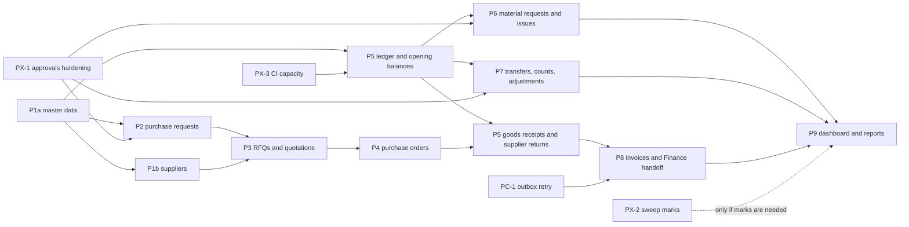

# Administrative Affairs (الشئون الإدارية) — Warehouses & Procurement — Part 4 of 4

**Status:** DRAFT v0.1 (2026-11-17) — part of the design whose status, executive summary and contents are in [administration-module-design.md](administration-module-design.md). Section numbers run across the four files; decisions are `OD-xx` in [§16](administration-module-decisions-and-phases.md#16-open-business-decisions).

> Part 1: [administration-module-design.md](administration-module-design.md) (§0–§3) · Part 2: [administration-module-design-flows.md](administration-module-design-flows.md) (§4–§7) · Part 3: [administration-module-design-integration.md](administration-module-design-integration.md) (§8–§14) · Part 4: [administration-module-decisions-and-phases.md](administration-module-decisions-and-phases.md) (§15–§22)

---

## 15. Dependencies, migration and data

What the module takes from the platform as it is (§15.1), what it asks the platform to change (§15.2), what happens to
data (§15.3), what other modules feel (§15.4) and which decisions and prerequisites gate which phase (§15.5). Risks are
in §17; the decisions themselves in §16, the single source for them.

### 15.1 Platform services used as they are

| Capability | Where it lives | Used for | From |
|---|---|---|---|
| Manifest, boot, seed | `apps/api/src/platform/kernel/module-registry.ts:43-78`, `bootstrap.ts:35-148` | one manifest grown phase by phase. The seed runs on every boot of the api, the worker and each CLI that boots the platform: all of them except `db:sync-indexes` and `report:org-duplication`, which deliberately do not (`apps/api/src/sync-indexes.cli.ts:10-13`; `apps/api/src/org-duplication-report.cli.ts:16`) | P1 |
| Transactions | `platform/kernel/unit-of-work.ts:5-17` | a document and its number commit together: the counter row is ensured outside the transaction with a `$max` floor and moved by `$inc` inside it (the Fleet/ATM idiom; in P1 only if OD-05 picks generated codes, recommended default: A, generated item and supplier codes; otherwise from P2). From P5 the movements and their guarded `$inc` on balance rows join the same transaction; the balance rows themselves are ensured, with zero quantities, outside it (`ensureStockRows`) and never upserted inside it (§2.4.4) | P1 |
| Keys, pages, scopes | `packages/contracts/src/permissions/def.ts:100-143`; `platform/rbac/rbac.middleware.ts`; `shared/types/index.ts` (`scopeSelector`, `keyReachesBranch`, `keyCoversUnit`, `currentBranchId`); `shared/base/base.repository.ts`, `org-scope-match.ts` | `administration<Entity>` keys, each declared with its operation; the 18 page ids of §6.3, each arriving with its first key; declared scope fields; fail-closed branch records | P1 |
| Organization | `platform/organization/index.ts` (unit repositories, `costCenterRepository` :62, `effectiveManagerId`) | warehouse branch, requester placement; cost-centre names only under OD-41 B or C (recommended default: A, none) | P1 |
| Employees | `platform/directory/index.ts` (`searchDirectoryEmployees`, `getDirectoryEmployees`, `getSelfDirectoryEmployee`) | module-gated people search in `people/` (IT `/it/people` precedent); in P1 only if OD-10 keeps a keeper on warehouses (recommended default: A, it does) | P1 |
| Approvals | `platform/approvals/index.ts`; web `platform/approvals/ApprovalChainPanel.tsx` | request types registered at module load; the host stores its trail (`approvalSteps: ApprovalEntry[]`, leave's `DecidedEntry` plus the rung's label and the decider's name) and the other approval host fields of §2.1 | P2 |
| Audit | `platform/audit/index.ts`, `shared/utils/diff.ts` | after commit, one row per document act, plus one row on any other document whose lifecycle status the act changes (a GRN that closes its PO); verbs per §10.2, never `accept`/`reject` (ATM's labels) or `deliver`/`checkOut`; the approval-decision verb is OD-82 | P1 |
| Realtime | `platform/realtime/realtime-publisher.ts:40-74`, `realtime-registry.ts`; web `platform/realtime/invalidation-registry.ts` | one topic per audited entity type (the skeleton's list, by phase in §18.2). Every audited act on a branch-scoped entity, whatever its verb, also sends an `update` signal carrying `branchId`, because `record()` passes none (`platform/audit/audit.service.ts:181-185`); transfers signal both branches; every posting also signals the signal-only topic `administration.stock` (gated by `administrationStock.view`) once per touched branch | P1 |
| Events, outbox | `platform/kernel/event-bus.ts:61-97`, `outbox.model.ts` | catalogued events; a fact Finance must not lose is emitted with `{ reliable: true, session }` inside the transaction and nudged with `nudgeOutboxRelay()` after commit (`platform/users/user.service.ts:182-186`; §8.5) | P2 |
| Notifications | `platform/notifications/index.ts` | templates ensured in `administration.seed.ts`; `notify()` after commit; recipients and categories per OD-61 | P2 |
| Scheduler | manifest `scheduledTasks` (`platform/scheduler/scheduler.service.ts:15-30`) | `administration.*` reminders and sweeps (OD-61); cron runs in UTC while business days are Cairo dates (RK-13) | P2+ |
| Settings | `platform/settings/settings.registry.ts:7-23`; `settings.service.ts:180-200` | the paper signatories, one organization-scope string per paper role (§11.6.5), then the procurement-policy settings (value bands, tolerances: OD-18, OD-32), declared at module import, organization scope only. The settings service authorizes every write by the platform key `setting.edit` and its scope, so declaring a setting does not let a module key govern it. `/procurement-policy` therefore checks `administrationProcurementPolicy.manage` at organization scope, then makes its one write with `setting.edit` added at organization scope: a module copy of ATM's `assertAtmSettingsManager` and `asSettingsEditor` (`apps/api/src/modules/atm/shared/settings-authority.ts:12-32`). The reverse path stays open: any `setting.edit` holder at organization scope can change these settings through the generic settings `PATCH` without the module key (RK-32; a sub-question of OD-18) | P3, or P2 if OD-59 prints PRs (§11.6.5); the policy P4 (P3 if OD-23 = A) |
| Files | `platform/files` (`fileCategoryService.ensure`, `file-authorizers.ts:32-56`) | the eight `administration-*` categories of §11.2, each ensured with its first endpoint, and §11.4's link fields (`signedCopy`, `attachments[]`, …). Supplier papers come first if OD-11 files them (recommended default: A, it does), then request attachments (P2) and quotations (P3) | P1b (else P2) |
| Papers, exports | web `shared/lib/print-window.ts`, `shared/lib/xlsx-writer.ts`; api `shared/utils/stream-rows.ts`, `draining-writer.ts` | papers through one door (§11.6). The first paper is P2's purchase-request copy if OD-59 has PRs printed, otherwise P3's RFQ paper; `.print` keys exist only on the PO, the GRN and the stock issue. No exports in Phase 1 (OD-60's Phase 1 sub-question, recommended default: (i), none; (ii) is a client Excel of master data on the owner's request). Server CSV under `<resource>.export` only where OD-60 picks server exports (recommended default: A; the first is P3's quotation comparison); client Excel under `.view` from P2's PR register | P2 or P3 |
| Money | `packages/contracts/src/modules/hr-payroll-money.ts`; web `shared/ui/MoneyInput.tsx` | prices and values as minor units | P3 |
| Sealed secrets | `platform/secrets` + ADR-034 | only if OD-11 stores bank data (recommended default: A, no bank data) | — |

**Rollout** is OD-80 (recommended default: A, no gate; a pilot by role assignment). Its inputs: a page ships with its
navigation row and keys ("only SHIPPED pages appear in navigation", `apps/api/src/seed-navigation.ts:889-892`), and the
boot sync gives super-admin every new key but platform-admin only the platform's own
(`apps/api/src/platform/rbac/rbac.service.ts:599-605`). A phase is therefore visible to super-admin holders the day it
deploys, and to other roles once their keys are granted, by hand or through OD-78's seeded bundles (recommended default:
A, managed roles). An environment gate or a feature flag (OD-80 B, C) would be new ground: the flag catalog is empty
(`packages/contracts/src/flags/index.ts:19-23`).

### 15.2 Platform changes the module needs or recommends

#### 15.2.1 Approval-engine hardening: platform slice PX-1 (OD-20), before P2

The engine's authority model fits procurement, but five defects in `apps/api/src/platform/approvals/` matter far more
for money than for leave. Platform slice PX-1 fixes them, and R8 and R9 of the second table, with an amending ADR (§20,
"Money approvals on the platform engine"), under OD-20 (recommended default: A, the slice before P2). Under OD-20 B the
module stopgaps below ship in P2 instead (§18.1 A4); under C the owner accepts R1–R5 in writing. §6.4 item 4 writes the
decide-route checks out in full.

| Defect | Evidence | Effect on a PR or PO | Proposed platform fix | Module stopgap if the fix is late |
|---|---|---|---|---|
| **R1** chain not pinned | `chainFor` re-resolves on every call, and entries are keyed by `stepIndex` only (`platform/approvals/approval.service.ts:73-98`; `approval-trail.ts:26-36`). `setWorkflow` edits a place's chain **in place**: `updateById` on the existing `_id`, so only the row's `__v` and `updatedAt` move (`approval.service.ts:273-297`; `shared/base/base.repository.ts:574-592`) | an edited chain maps recorded decisions onto other rungs, or drops a rung the document still needed; a deleted or deactivated chain reads "approved" while the document stays `pendingApproval` | pin the chain's shape per request at submission (workflow id + ordered steps; staffing stays live); edits apply to new submissions — the pinning ADR-011 promised | at submission, store `approvalWorkflowId` **and** the chain's shape in `approvalChainShape: string[]`, approval host field #7 (§2.1): the ordered `permissionKey@level` of each rung, as `chainFor` returns them (`approval.service.ts:92-97`). A decision is refused with `ADMINISTRATION_APPROVAL_CHAIN_CHANGED` when either the id or the shape differs from the live chain (new ground); the way out is a cancel and a new submission, or, under OD-72 B, a return by a holder on the new chain, which keeps the number (§5.2). The id alone catches only a deleted, deactivated or newly more specific chain, never an edit |
| **R2** unstaffed chain: approved by the engine, stuck under the leave host | the engine reads a chain whose every rung is unstaffed as approved: `liveStep` finds nothing and `statusOf` answers `approved` ("approved by default … the caller's policy", `approval-chain.ts:74-92`; `approval-trail.ts:59-65`). Leave writes `pendingApproval` whenever `steps.length > 0` and never asks `statusFor` (`leave-request.service.ts:294-300`), so `decide` refuses (`approvals.alreadyDecided`, `approval.service.ts:164-165`) and `currentApprovers` is empty (`:226-233`) | a host that took its status from `statusFor` or `trailFor` would silently approve the PO: a second auto-approval path beside "no chain ⇒ approved". A host that stamps `pendingApproval`, as leave does, waits forever | the engine reports "no staffed rung" as its own answer, at submission and at every decision, never as "approved"; a stuck-request report | refuse submission without an active chain or a staffed rung (OD-19, recommended default: A); never take a status from `statusFor` alone (§5.2); after each decision, re-check the new live rung's eligible approvers and flag a document left without one for OD-61's stuck-approval notice and sweep (§6.4 item 5; §5.2) |
| **R3** expired grants decide | `ownStepsOf` reads `findActiveForUser`, unfiltered by `validFrom`/`validTo` (`approver-lookup.ts:107`; `platform/rbac/rbac.repository.ts:171-176`); staffing uses the filtered `findActiveForRoles` (`:245-259`) | an acting approver keeps approving after the window closes, on any rung his expired grant reached | apply the validity window inside `ownStepsOf`; keep `findActiveForUser` unfiltered, SA-4 relies on it (`rbac.service.ts:1230-1237`) | §6.4 item 4's exact-level check: the decide route requires an active grant at exactly the picked rung's level over the Unit, read from `ctx`, which holds active grants only (`rbac.service.ts:123-127`): `ctx.userId` among `currentApprovers` on the live rung; on a higher rung, `scopeOf`, `reachOfKey`, `keyReachesBranch` or `keyCoversUnit` by its level; a key held at two scopes is refused, fail-closed. An active grant of the key at another level (a permanent branch grant, say) proves nothing while the expired one still puts the actor on a higher rung |
| **R4** override is scope-blind | `actor.permissions['approval.override'] !== undefined` accepts any scope, even `own` (`approval.service.ts:179`) | an override holder in one branch decides another branch's PO | require organization scope or the override's reach over the request's unit | an off-chain decision needs `approval.override`'s own reach over the live rung, by the rung's level: organization scope, `keyCoversDepartmentEverywhere`, `keyReachesBranch` or `keyCoversUnit` (§6.4 item 4). Whether override decides these approvals at all is OD-69's override sub-question (recommended default: (i), within its own reach, recorded as `overriddenWith` and bound by §6.6) |
| **R5** audit before commit, naming no document | `decide` records `platform/approval` `${requestType}:${stepIndex}` itself (`approval.service.ts:202-221`); the row carries the HTTP request id (`platform/audit/audit.service.ts:167`) but no document id | a refused host write leaves a row for a decision that never happened, linked to no document | `decide` returns the audit facts; the host records them after commit, with its document id (opt-in per host, so leave keeps its behaviour, §20) | the module's own after-commit audit on its document is the trail of record (D-12); pre-checks before `decide` keep orphan engine rows rare (§5.2) |

The rest of discovery's defect list is routed:

| Defect | Evidence | Where it goes | Module check meanwhile |
|---|---|---|---|
| **R6** the requester is a rung's only holder | staffing does not exclude him (`approver-lookup.ts:23-75`); the host forbids him, so the rung blocks | OD-19 (recommended default: A, such a rung counts as unstaffed) and §6.6 | §6.4 item 5: eligible approvers exclude the requester and, under OD-21 A or B (recommended: B), the creator and the submitter |
| **R7** one person decides consecutive rungs | `decisionFor` lets the holder of two rungs take each in turn (`approval-chain.ts:154-164`) | OD-21 (recommended default: B, with §6.6's pairs) | the §6.6 pair the owner adopts |
| **R8** accounts that are not `active` count as approvers | `approversFor` reads no account status (`approver-lookup.ts:23-75`), so a rung staffed only by a suspended account passes the staffing test, then waits: an R2 variant, not a separation-of-duties rule | PX-1: count only `active` accounts | §6.4 item 5: only `active` accounts count as eligible on the live rung |
| **R9** a chain may name any registered key | `setWorkflow` checks that a key is registered, not that it is among the type's `permissionKeys`, which feed only the configuration screen (`approval.service.ts:253-271`; `request-type.registry.ts:9-12`); a chain save carries no client version | PX-1: enforce the type's `permissionKeys`, and a client version on saves | §6.4 item 1: submission refuses a chain that names another key (`ADMINISTRATION_APPROVAL_CHAIN_MISSING`) |
| **R12** no tests | `approval.service.ts` and `approver-lookup.ts` have no specs, and no integration suite writes a chain | PX-1 brings unit and integration coverage (§18.3) | — |

PX-1 covers R1–R5 plus R8 (inactive approvers) and R9 (a chain may name any registered key; no client version), so
its exit criteria in §18.3 hold one test per defect for all seven, and its ADR's scope in §20 names all seven (OD-20).
The no-chain default "approved" (`approval.service.ts:99-112`) is OD-19. R10 (no "waiting for me" list) is a
screen concern (§13); R11, engine refusals as untranslated keys, joins RK-23.

#### 15.2.2 Other platform changes

| # | Change | Where | Kind | Needed by | Why |
|---|---|---|---|---|---|
| PC-1 | Mark an outbox delivery handled only after its handler succeeds, and set the `failed` status the model declares but nothing sets | `platform/kernel/event-bus.ts:100-109, 115-137`; `outbox.model.ts:14, 27` | recommended | the first reliable event with a cross-module consumer: P8's Finance handoff under the recommended defaults; P5 if OD-02 C or OD-65 B gives IT a consumer of `administration.goodsReceipt.posted` | the dedup row is written before the handler, so a handler that throws is skipped on every retry; `relayOutbox` marks a row `dispatched` once it is enqueued, before any handler runs |
| PC-2 | An employee's cost centre on a date, through the directory | `platform/directory/index.ts` + `modules/hr/directory-seams.ts` | only if OD-41 C | P6 | `DirectoryEmployee` has no cost centre (`apps/api/src/platform/directory/index.ts:16`) |
| PC-3 | Supplier lookup seam for IT and Fleet | new platform seam in the directory pattern (`apps/api/src/platform/directory/index.ts:147-460`) | only under OD-01 B, or C's second stage | when IT and Fleet switch to the registry; under C it may come before any merge (§15.3.5 a) | IT and Fleet may not import Administration |
| PC-4 (= PX-2) | Extract the sweep-mark idiom into a platform helper; `administration_sweep_marks` uses it | platform, from `it/shared/sweep-mark.model.ts` and `fleet/sweeps/sweep-mark.model.ts` | conditional: only if an announcement needs marks | the first such announcement (§18.1 A10; likely P9's digests or the integrity announcement, OD-61) | ADR-025 (`:47-50`) forbids a third copy; a fact stamped on its document, or a notification idempotency key, needs no mark |
| PC-5 | Send `X-Active-Branch` on binary downloads, and parse the JSON error envelope of a refused one | `apps/web/src/shared/lib/api-client.ts:490-514` | recommended | the first server export: P3's quotation comparison under OD-60 A | `fetchBlob` omits the header ADR-028 expects on every request (§11.7) |
| PC-6 | Align the web's friendly error keys with emitted codes | `apps/web/src/shared/lib/errors.ts:8-218` | recommended | any time | `BUSINESS_RULE`/`CONFLICT` never match `BUSINESS_RULE_VIOLATION`/`DUPLICATE` (`packages/contracts/src/errors/index.ts:47-49`) |
| PC-7 | Requester liveness: on `notification:new`, derive the topic from the notification's `entityRef` and invalidate it; a generic platform-web rule, with an administration-only allow-list as the fallback (§9.5) | web realtime client | ADR only if made a platform convention (§20) | P2 | own scope joins no room (`platform/realtime/realtime-rooms.ts:29-35`) |
| PC-8 | A notification category | `packages/contracts/src/platform/notifications.ts:8-19` + labels | only under OD-61 B (an `administration` category); `approval`, `workflow` and the unused `finance` already exist | P2 | closed enum |
| PC-9 (= PX-3) | Split the CI job or raise its ceiling again (30 → 45 minutes already, 2026-11) | `.github/workflows/ci.yml:16` (a CODEOWNERS path) | under OD-81 (recommended default: A, split in PX-3) | before P5 | RK-01 |
| PC-10 | None left: `EGYCASH_LOGO` already moved, to contracts, with gold re-exporting it (§11.6.3) | `packages/contracts/src/assets/egycash-logo.ts:7`, exported as `@ecms/contracts/egycash-logo` (`packages/contracts/package.json:14-16`); `apps/web/src/modules/gold/lib/egycash-logo.ts:1-5` (six web importers across four modules) | done upstream | — | the module imports the subpath, as HR's server letterhead does (`apps/api/src/modules/hr/contracts/contracts/letterhead.ts:4`) |
| PC-11 | Move the export walk and buttons and the company report form to `apps/web/src/shared/`, behind re-exports (§11.7) | `apps/web/src/modules/fleet/lib/whole-catalog.ts`, `fleet/lib/fleet-sheet.ts`, `fleet/lib/fleet-report-print.ts`, `it/components/RegisterExportButtons.tsx` | recommended; the fallback is importing them from Fleet and IT, as ATM does | the first client export: P2's PR register, or P1 if the owner asks for one (OD-60 (ii)) | the module would be their next cross-module importer |

Cost-centre names (OD-41 B or C; recommended default: A, none) need **no** platform change: `costCenterRepository` is
exported (`platform/organization/index.ts:69`) and `people/` serves options under a module key. No
`/platform/cost-centers/options` exists (`cost-center.routes.ts:26-58`; a web call to one fails
`platform-routes-exist.spec.ts`). B or C reverses the recorded D-CC-3 («employees only»), whose guard checks five named
files (`cost-center-guards.spec.ts:76-88`) and would not fail, so its wording is amended in the same PR. Serving the
names under a module key also widens who reads the company's cost-centre list, today only holders of `costCenter.view`
(`cost-center.routes.ts:26-38`); who may read them belongs to OD-41 (recommended default, under B or C: codes and names
only, to holders of the MR create key). Options in `people/` page through `BaseRepository.list`'s silent
cap of 100 rows (`shared/base/base.repository.ts:363`; `MAX_PAGE_SIZE`, `packages/contracts/src/common/index.ts:139`) the
way `platform/organization/shared/all-options.ts` (`collectOptions`) does — a module copy, since the organization barrel
does not export it — or use server search.

The module's `shared/cairo-day.ts` re-exports the shared Cairo calendar in `@ecms/contracts`
(`packages/contracts/src/common/cairo-date.ts`, since 2026-11-02), as HR's `business-date.ts` now does, instead of copying
IT's day window and HR's calendar-date and year helpers, an idiom IT, ATM (`atm/shared/cairo-time.ts`) and Fleet
(`fleet/fleet-cairo-day.ts`) still copy.

#### 15.2.3 Central files every phase registers in

None changes behaviour; each is a census. Miss one and a spec fails, or CI silently passes. §18.4 restates the same
files as per-PR coupling rules.

| File | Change | When | If missed |
|---|---|---|---|
| `apps/api/src/modules/index.ts` | import + `moduleManifests` entry | P1 | nothing mounts; registry specs cannot see the keys |
| `scripts/check-page-registry.mjs:65` | add `'administration'` to `MODULES`. The script reads source, and only `<id>.module.ts` (`:21-63`): pages in the parsed shape (`export const administrationPages: PageDef[] = [`, with literal module and page ids), and `declarePermissions(...)` calls by bracket matching, so every call sits in `administration.module.ts` (calls in other files are invisible to it) and no permission name contains a parenthesis, which breaks its count (copy ATM's guard, `atm.module.spec.ts:170-174`). `page-registry.spec.ts:16` (hr, fleet, it only) is optional; a module-local manifest spec (`atm.module.spec.ts`) is preferred | P1 | the CI step does not see the module. Boot still validates the assembled registry and throws (`platform/kernel/bootstrap.ts:94-100`; `rbac.service.ts:648-654`), and 112 of the 118 integration files boot every manifest, so a broken registry still fails CI, through the suites rather than this script |
| `apps/api/src/seed-navigation.ts` (+ `seed-application-sections.ts`) | a category whose English name is not `'Administration'` (`seed-navigation.ts:1291`), placed after ATM: both OD-62 (recommended default: A, "Administrative Affairs" / «الشئون الإدارية», after ATM). Categories match on `name.en` (`:1403-1405`), so the English name is permanent once seeded (RK-16) | P1 | rows merge into System Administration |
| `seed-navigation.spec.ts:80`; `tests/integration/auth-seed-login.spec.ts:36, :141-150, :289-296, :314` | 139 + n rows; the category order; the per-category breakdown; 8 → 9 groups | each phase adding rows | pinned counts |
| `apps/web/src/platform/navigation/app-icon.tsx:44-104`; `shared/ui/icons.tsx` | the new glyphs and keys `box` (the category) and `warehouse` in P1a.W, later `cart` (§13.1, §13.3); none exists today. The glyphs are a design choice, not OD-62's, which covers the names and labels and when nav sections arrive (skeleton Addenda 5) | P1 | an unknown row icon falls back silently (`:98-101`); a module tile's is pinned by `apps/web/src/platform/navigation/module-icons.spec.ts:44-81`, which fails |
| `platform/realtime/realtime-registry.ts`; web `platform/realtime/invalidation-registry.ts` | one topic per audited entity type, with its view key, plus the signal-only `administration.stock` (`administrationStock.view`); on the web, each mapped to its key prefixes. The spec finds entities only as literal `{ moduleId, entityType }` pairs, so each `<entity>-audit.ts` writes its pair as a literal, as IT's `signalConsumable` does (`modules/it/consumables/consumable-history.ts:100-107`). A shared helper that takes the entity type as a variable (`posting-lifecycle.ts`, say) is a dynamic site: pinned by value in `DYNAMIC_ENTITY_KEYS` and counted in `EXPECTED_DYNAMIC_SITES`, 16 today and 10 at `b03522f` (`realtime-registry.spec.ts:18-65`) | every phase | `realtime-registry.spec.ts:100-129`; `realtime.spec.ts:166-215` |
| `packages/contracts/src/platform/audit.ts` + `systemAdmin.users.audit.<verb>` (en, ar) | none in P1: master data uses `create`, `update`, `activate` and `deactivate`, which exist (`audit.ts:111-112`); the last two are not broadcast (`packages/contracts/src/platform/realtime.ts:19-31`), so (de)activation also sends an explicit `update` signal. Later only verbs §10.2 justifies (`submit`, `approve`, `post`, `adjust` and `count` do not exist today). `accept`/`reject` (ATM's «قبول/رفض رسالة صيانة», `audit.ts:164-165`), `deliver` and `checkOut` are never reused (§10.3). The approval-decision verb is OD-82 (recommended default: A, a new `approvalDecision`), shipped a release ahead of its first writer or with api and worker deployed together (RK-29) | P2 (OD-82), then per phase | `system-admin-i18n.spec.ts:113-127`, `audit-screens.spec.tsx:361-368` |
| `packages/contracts/src/errors/index.ts` | module-prefixed codes (precedents `OPERATIONS_CUSTODY_NOT_HELD` `:207`, `ATM_PLAN_LINE_STATE` `:432`), each shipped with the first transition that raises it and its web i18n mapping (`lib/administration-errors.ts`, the ATM `settlement-view.ts` precedent): the skeleton's eight (`ADMINISTRATION_INVALID_TRANSITION`, `…_TRANSITION_BLOCKED`, `…_REASON_REQUIRED`; the approval codes `…_APPROVAL_CHAIN_MISSING`, `…_APPROVAL_CHAIN_CHANGED`, `…_APPROVAL_NOT_PENDING`, `…_APPROVAL_NOT_YOUR_STEP` and `…_SEPARATION_OF_DUTIES` from P2) and §2.4.4's stock codes from P5 (`…_INSUFFICIENT_STOCK`, `…_OPENING_BALANCE_NOT_FIRST`, `…_ITEM_INACTIVE`, `…_WAREHOUSE_INACTIVE`, `…_STOCK_ROW_NOT_READY`; `…_STOCK_FROZEN` with counts, P7) | P1, then with each transition | Arabic users read English refusals (RK-23) |
| `packages/contracts/src/events/catalog.ts`; `catalog.spec.ts:181-195`; `platform/kernel/event-publishers.spec.ts` | event source, `EVENT_MODULE_NAMES.administration`, lexicon words; constants in the "invents nothing" hand list (`catalog.spec.ts:181-195`); every emitted name catalogued (`event-publishers.spec.ts:165-170`) and a reliable event's payload keys within its catalogue fields, `EVENT_MULTI_PUBLISHER` being the hand-written exception list (`:198-216`) | first emitting phase (P2) | compile error; spec |
| `apps/api/src/workforce-reset/targets.ts:133`; `targets.spec.ts:50-52`; `tests/integration/workforce-reset.spec.ts:223-243, :361` | classify each collection holding an employee path (§15.3.3) | P1a if warehouses keep a keeper (OD-10), then the phase adding each path | the unit spec fails CI on an unclassified path; the reset refuses to start; the exact `keep` list and its count fail |
| `apps/web/src/platform/localization/i18n.ts` | `systemAdmin.roles.module.administration` (en, ar) | P1 | the role matrix shows the raw key |
| `apps/web/src/shared/lib/remembered-filters-coverage.spec.ts` | classify every `*Page.tsx`, Phase 1's `ItemDetailPage` and `SupplierDetailPage` included | each page | partition spec (`:487-491`) |
| `apps/web/src/shared/lib/print-window.spec.ts:138-155` | each paper composer | the first paper (P2 if OD-59 has PRs printed, else P3) | one-door list; a convention: only the global no-script rule bites (`:128-136`) |
| `apps/api/src/shared/utils/stream-rows.spec.ts:103-107` | each server export | the first server export (OD-60) | a convention, as for papers |
| `packages/contracts/src/platform/notification-target.ts:36-42` | `ENTITY_ROUTES` per entity type with a detail route; a notification about a quotation or a line carries its parent's `entityRef` (§8.6) | P2 | links open the inbox instead |
| `settings-inventory.spec.ts:89-100` (58), `SettingsPage.spec.tsx:270-275` (67), `settings-catalog.ts` `SETTING_DEPARTMENTS`, `SETTING_SECTIONS` and `PLACEMENTS` (`apps/web/src/modules/system-admin/settings/lib/settings-catalog.ts:12-32, 43-110`) | module settings; the screen groups keys by department and section, and a key whose first segment names no department it knows is filed under "Other" (`:98-110`) | the first signatory paper (P3; P2 if OD-59 prints PRs, §11.6.5), and again with the policy settings (P4, or P3 if OD-23 = A) | counts; rows filed under "Other" |
| `apps/web/src/platform/app/App.tsx` | lazy `/administration/*` mounted above the `/*` catch-all | P1 | routes swallowed by the catch-all |
| `apps/api/src/sync-indexes.models.ts:10-13`; `server.ts`, `worker.ts`; `tsup.config.ts` entries and `package.json` scripts; `operator-cli-safety.spec.ts` (`BOOTING_CLIS`, `:16-22`), `operator-cli-build.spec.ts`, `runtime-import-safety.spec.ts` | only for go-live steps and operator CLIs. `BOOTING_CLIS` is a hand list whose completeness test only checks that its five entries are wired to npm scripts (`operator-cli-safety.spec.ts:39-47`): four platform-booting CLIs are already missing from it, and `migrate:org-catalog` is guarded but unlisted. A new CLI is added by hand, as a PR-checklist item (or the list is derived from `*.cli.ts`, a small platform change) | P1 if OD-68 loads master data from files; P5 if OD-63 picks a deploy-time file; any migration CLI | `sync-indexes.models.spec.ts:60-73`; nothing fails if a CLI is left off the lists |
| `apps/api/src/org-catalog-migration/references.spec.ts:188-200` | see §15.3.4 | P5 (`inspection.members`, OD-35), P7 (`team`, OD-50) | the exact `documentArray` list |

`gen-permission-matrix --check` reads platform keys only; module keys need no regeneration.

### 15.3 Migration and data considerations

#### 15.3.1 Phase 1 changes no existing data

Phase 1 creates only new collections and their indexes: `administration_` + `counters` (if OD-05 picks generated
codes), `catalog_items`, `item_categories`, `items`, `warehouses`, `suppliers`, and `go_live_runs` only if OD-68 loads
master data from files. It writes no row of another module, rewrites nothing and deletes nothing: `it_vendors`, Fleet's
workshop rows and IT's stores stay untouched (OD-01 and OD-02 at their recommended defaults, C and A). Boot writes are
class 1 (§15.3.7): the module seed's create-if-missing rows (counter documents with a `$max` floor, outside any
transaction, the Fleet/ATM idiom; later, file categories and templates), beside the platform's own additive sync —
permission-registry upserts and the super-admin key set (`platform/rbac/rbac.service.ts:569-605`), navigation rows and
sections (`apps/api/src/server.ts:57-61`). Two boot writes are not create-if-missing: the permission sync deletes keys no
longer declared (`rbac.service.ts:591`; RK-30), and under OD-78 A the module's managed role bundles are re-asserted on
every boot, so a key an administrator added to one by hand is removed (`rbac.service.ts:1625-1656`). Master data enters
through the screens, or through an OD-68 load (§15.3.5 d). **Phase 1 needs no data migration.**

#### 15.3.2 The module builds its own indexes

`autoIndex` is off in production (`apps/api/src/infrastructure/database/mongo.ts:143`). Since 2026-10-18 the deploy's
pre-step, `db:sync-indexes` (`railway.json`, `deploy.preDeployCommand`), loads every model, the module's included through
`import './modules'` (`apps/api/src/sync-indexes.models.ts:10-11`), and builds what is missing — but only once an operator
sets `INDEX_SYNC_MODE=apply`: it defaults to `report` and builds nothing (`infrastructure/config/env.ts:204`;
`docs/09-guides/railway-deployment.md:164-167`). Whether production has been switched is for Ops to confirm; platform code of 2026-11-04 says it has not ("the pre-deploy index sync (sync-indexes.cli.ts) runs in REPORT mode there", `apps/api/src/platform/audit/audit-indexes.ts:4-9`) and builds the audit log's two new indexes at boot for that reason. Therefore
(D-16):

- `administration-indexes.ts` lists the module's models and, as the **first** step of `administration.seed.ts`, calls the
  shared `syncDeclaredIndexes('apply', administrationModels)` (`apps/api/src/shared/base/index-sync.ts:338-341`). That
  helper generalises Fleet's builder (`:12-17`): definitions read from the schemas (`shared/base/index-plan.ts`), one
  index at a time, duplicates reported and never resolved, nothing dropped, and a failure on one index recorded while the
  sync moves on. The module copies no builder: ATM's copy (`atm-indexes.ts:1-3`) has drifted already, its forwarded
  options lacking `expireAfterSeconds` (`atm-indexes.ts:147` against `index-plan.ts:10-16`), and Fleet's logs the
  duplicated key values (`modules/fleet/fleet-indexes.ts:120-140, 185-186`). Calling the shared sync from a module seed
  is new ground (only `sync-indexes.cli.ts` imports it today); modules may import `shared/` (`eslint.config.js:73`). The
  deploy step in apply mode then repeats the work harmlessly.
- **First** is a design choice with a reason, not a copied order: a counter's `$max`-floor upsert and the first
  transaction need their unique indexes and collections to exist. Fleet builds last among its migrations, before only
  its memo counter (`fleet.seed.ts:150-155`; `fleet.migration.ts:426-443`); ATM grants super-admin first
  (`atm.seed.ts:32-42`).
- A collection written inside a transaction is made ready first with `collectionReady(Model)`
  (`it/mobile-lines/ensure-collection.ts:1-30`).
- A duplicate that blocks a unique index is reported by collection, index, counts and document ids, never by value (the
  shared sync's rule, `index-sync.ts:32-35`), and boot never fails over it (Fleet `migrateFixedCrewIndex`).
- Unique options are settled before the first build, because Mongoose never rewrites an existing index
  (`hr/recruitment/job-offers/code-index-migration.ts:1-12`): never-reused system numbers unique and **not** partial; a
  number given when a document leaves draft (OD-58) partial on `{ number: { $type: 'string' } }`, or the second draft
  fails on `null`; a typed master code partial on `{ isDeleted: false }`.
- A module spec (`administration-indexes.spec.ts`, §19) checks that `administrationModels` equals the collections the
  module's `*.model.ts` files declare; that every declared option reaches `createIndex` is already checked
  platform-wide (`sync-indexes.models.spec.ts:76-90`). An after-boot check would prove nothing: tests run with
  `autoIndex` on (`mongo.ts:143`).

#### 15.3.3 Workforce-reset classification (OD-64)

`reset:workforce` walks every schema for a path matching `/employeeid/i` (`apps/api/src/workforce-reset/targets.ts:23`)
and refuses to start while one is unclassified (`:133`); the unit spec fails CI on such a path first
(`targets.spec.ts:50-52`). The file's rubric: a record in its own right that happens to name an employee is `keep`, and
`keep` writes nothing, not even to clear the reference (`targets.ts:30-38`). OD-64's recommended default is A, `keep`
for all seven collections below (§2.1). Names omit the `administration_` prefix; the paths are §2's.

| Collection (phase) | Employee path | Recommended (OD-64 A) | Why |
|---|---|---|---|
| `warehouses` (P1a) | `responsibleEmployeeId` (OD-10) | keep | a warehouse is a record in its own right and outlives its keeper (`targets.ts:30-38`). After a reset the keeper id resolves to nobody; the screen flags it until a keeper is named again (OD-64, recommended default: keeper (i); §2.1) |
| `purchase_requests` (P2), `material_requests` (P6) | `requester.employeeId` | keep | a need and a spending decision that POs and issues refer to |
| `goods_receipts` (P5) | `inspection.members.employeeId`, only under OD-35 | keep | a financial record (the gold receipts precedent) |
| `stock_issues` (P6) | `recipient.employeeId` | keep | movements name the issue in `source.docId`; IT keeps its ledger for that reason (`targets.ts:226-233`). Purging, IT's memo choice (`:183-188`), would orphan ledger sources and add a delete path for posted documents (§15.3.6), so OD-64 B is not the recommendation |
| `stock_returns` (P6) | `returnedBy.employeeId` | keep | as for issues |
| `stock_counts` (P7) | `team.employeeId` (OD-50) | keep | a record about stock |

Every other collection holds no employee path: `items`, `item_categories`, `catalog_items`, `suppliers`, `counters`,
`rfqs`, `quotations`, `purchase_orders`, `opening_balances`, `supplier_returns`, `stock_movements` and
`stock_balances` (`byUserId` is a user id), `stock_transfers` (the carrier is text, OD-46), `stock_count_lines` and
`stock_adjustments` (user ids only), `supplier_invoices`, `finance_handoffs`, `sweep_marks` and `go_live_runs`. Each
`keep` extends the exact untouched list (`tests/integration/workforce-reset.spec.ts:223-243`; `toHaveLength(12)` at
`:361`) in the same PR.

HR's permanent delete («مسح نهائي», `DELETE /hr/employees/:id/purge` under `employee.purge`, 2026-11) reads the same
classification: it deletes the `purge` rows and, on `keep` rows, rewrites copies of the person's name to «موظف محذوف»
(`apps/api/src/modules/hr/employee-management/employees/employee-purge.ts:1-31`). Every path ending in `name` on a `keep`
collection must be classified in `employee-name-copies.ts`, or its spec fails CI (`:235-275`; spec `:30-33`, which also
pins the whole scrub list); a `scrub` inside a subdocument or array is refused (`:250-261`). Here that means the nested
`PersonSnap.employeeName`, `ApprovalEntry.deciderName`, signatory and party names on the `keep` documents above, added to
that HR file in the phase that adds each (OD-64's names sub-question).

#### 15.3.4 Department references must survive an org-catalog merge

`migrate:org-catalog --merge` repoints only paths whose last segment is exactly `departmentId` (an ObjectId, at any
depth) or ends in `DepartmentIds` (`apps/api/src/org-catalog-migration/references.ts:51-54`). `Schema.Types.Mixed` is
invisible to its schema walk: it reads and refuses only two named carriers, `hr_announcements` and
`hr_notification_rules` (`:10-16, 178-201`), so an org id inside `Mixed` anywhere else silently keeps pointing at a
retired department (RK-31). So every department reference is named `departmentId` (the branch copy, ADR-031) — never
`requestingDepartmentId`, `toDepartmentId` or `departmentIds` — and no org id goes into `Mixed` (§2.1, §7.7). Scalar
sub-document paths such as `recipient.departmentId` are swept like any other. A `departmentId` inside an **array** of
sub-documents becomes a new `documentArray` path and changes the exact list `references.spec.ts:188-200` pins (four
today): `goods_receipts.inspection.members.departmentId` (P5, under OD-35) and `stock_counts.team.departmentId` (P7,
OD-50), both from `PersonSnap.departmentId` (§2.1), and PR lines per department if OD-25 ever allows them. The
alternative, a `PersonSnap` held in an array without `departmentId`, is §2's choice to make.

#### 15.3.5 Future migrations and loads — each one separately approved

Migrations follow ADR-031's discipline (`docs/03-decisions/ADR-031-org-units-defined-once-declared-per-branch.md:62-73`;
`apps/api/src/migrate-org-catalog.cli.ts:1-30`): an operator-run CLI; a **dry run by default** printing the whole plan;
`--write` applies exactly that plan; rows merge only where a human names them (`--merge LOSER=WINNER`); refusal rather
than half-application; **never at boot** (class 3, §15.3.7). The CLI calls `assertLoginProvisioningDisabled()` before
`bootPlatform` and is added by hand to the operator-CLI lists (§15.2.3), where nothing fails if it is forgotten.
Go-live loads (c, d) are class 2, not migrations. A boot-time repair is class 1 only if it keeps Fleet's rules: nothing
deleted, nothing invented, re-running changes nothing (`modules/fleet/fleet.migration.ts:1-12`).

**a. Supplier registry merge (OD-01 B, or the second stage of C).** IT's design records the debt as "merge rows into a
platform registry, re-point `workshopId`/`vendorId`, alias module endpoints through a deprecation window"
(`docs/12-planning/it-module-design.md:1171`, §16 P4: "the only one needing a data migration", two to three slices).
This design departs from it in two flagged places: the target follows OD-01 (B: a platform registry; C's second stage:
`administration_suppliers` behind the PC-3 seam), and a distinct row keeps its ObjectId instead of being re-pointed (the
skeleton's rule that any merge preserves ObjectIds; OD-01's recommendation). It is two operations:

- **Move, with no rewrite.** A row with no duplicate keeps its `_id`, so `it_assets.purchase.vendorId`,
  `it_assets.warranty.vendorId`, `it_licenses.purchase.vendorId`, `it_maintenance_orders.vendorId` and
  `fleet_maintenance_visits.workshopId` (required; about 1,800 legacy visits, `fleet/go-live/maintenance.ts:1`) resolve
  unchanged. Audit rows and event payloads naming old ids are never edited.
- **Merge, with re-pointing.** Near-duplicates collapse only by `--merge LOSER=WINNER`, as ADR-031's catalog merge does.
  The loser's id is retired, so every IT and Fleet row naming it is re-pointed by the operator CLI itself, the way
  `migrate:org-catalog` re-points every module's departments, and the loser stays soft-deleted as a tombstone that names
  its winner, so audit rows and payloads that keep the old id still resolve (the tombstone's field is named when that
  merge is designed).
- Shapes differ: IT has a string `name`, contacts and `ux_name` (`it/vendors/vendor.model.ts:37, :51-54`); workshops have
  `{ar,en}` names, no contacts and `ux_kind_name_ar` (`fleet/catalogs/catalog-item.model.ts:63-66`).
- A fourth list arrived in 2026-11: Fleet's vehicle supply contracts name their supplier as free text, with no id, and
  list the distinct names (`apps/api/src/modules/fleet/vehicle-contracts/vehicle-contract.model.ts:65, 118`;
  `vehicle-contract.repository.ts:173-176`). It cannot move by id: joining it takes a human-named name → supplier map in
  the operator CLI and a Fleet slice that stores the id instead. Whether it joins is OD-01's.
- One writer per collection: IT and Fleet switch validators and pickers to the seam (PC-3) in their own slices, with a
  deprecation window for `/it/vendors`; no module writes another's collections, and only the operator CLI re-points,
  under §15.3.7. The source rows are retired only after IT and Fleet have switched to the seam (§20).
- Whether insurers, fuel-card companies and the traffic authority join is part of OD-01 (recommended default: (i), they
  stay where Fleet keeps them).

**b. IT stores into Warehouses — only if OD-02 B.** It needs a design revision and an ADR first. ADR-024 already names
the boundary for spare parts: receipts become Procurement's output, "the movement shape does not change, only who writes
it", and on-hand may become Warehouses' number while IT keeps its ledger
(`docs/03-decisions/ADR-024-minimal-spare-parts-ledger.md:40-52`). Consumables (FR-20) are a separate ledger with no such
clause (`it/consumables/consumable.model.ts:1-12`). A move must carry: per-branch `CON-` rows
(`it/consumables/consumable.model.ts:4-9`) becoming one item master through a human-named merge; «بدل تالف» moving
three counters in one row, so `scrappedQty` ≠ Σ scrap rows (`consumable-stock.ts:45-62`); memo lines'
`consumableId`/`movementId` still resolving; since 2026-11 also each transfer pair's `transferId`, `counterpartBranchId`
and `counterpartConsumableId`, and the same-name `CON-` rows a transfer creates in the receiving store
(`apps/api/src/modules/it/consumables/consumable-movement.model.ts:39-48`; `apps/api/src/modules/it/consumables/consumable-transfer.service.ts:161-196`); a warehouse for spare parts; the FR-5 asset-delete guard
(`it/assets/asset.service.ts:370-372`) and the `it.sparePart.belowMin` trigger intact. The recommended OD-02 (A now; C
when Procurement buys for IT, OD-65) needs no migration: under C a GRN reaches IT as a reliable event (§15.4).

**c. Opening balances at go-live (OD-63).** A load through the ledger, not a migration (class 2, §15.3.7). Recommended
default (OD-63 A): the in-app `OpeningBalance` document (`OB-`, movement kind `openingBalance`), one per warehouse,
posted by a second person (§4.3.1; a §6.6 candidate pair), its movements carrying `unitCostMinor` and `currency`
(OD-37, recommended default: A, quantities with the cost captured on receipts and openings). OD-63 B adds a deploy-time go-live file in the IT shape
(`it/go-live/consumables-opening.ts`: versioned run key `:77-78`, rows validated with the screens' own schemas, refusal
when a warehouse is missing, the run row in `administration_go_live_runs` written last, audit after commit; wiring in
§15.2.3). As in IT, the file loads in one transaction: each warehouse's opening is its own document, within the line cap §2.1 sets for an opening balance, and the documents, their movements and counters and the run row commit together, so a refused file loads nothing (§4.3.1 (a), §15.3.7). Balances are never written directly:
Fleet's fuel-card import set `balance` with no movement (`fleet/go-live/fuel-cards-import.ts:161-178`). An opening is
the first movement of its (warehouse, item) row (`lastMovementAt: null`, §2.4.4; §4.3.1), and a posted OB cancels only
as a draft (§5.7), so a wrong opening is corrected by a stock adjustment: §18.1 A11 recommends shipping adjustments in
P5; if they stay in P7, the owner accepts the P5–P6 gap in writing.

**d. Legacy master data (OD-68).** If lists exist (recommended default: A, the owner sends files and a one-time
versioned load follows, with `go_live_runs` in P1), the precedents are the screens, a reviewed go-live file (class 2),
an operator CLI in the workforce-import shape, or an in-app preview/apply import in the ATM register shape (file
SHA-256, per-row outcome, unique import-row index; OD-68 C, a run collection the skeleton lacks, §4.3.1). Recommended: supplier
contacts' phones, e-mails and tax numbers never go into a committed file, because git history keeps it forever, although
Fleet's and IT's earlier go-live files do commit people's data (`apps/api/assets/fleet-go-live/`, `drivers.json`;
`apps/api/assets/it-go-live/mobile-lines-2026-10.json`). IT's newest one keeps people out by design: "NOBODY IS IN THE
FILE" (`apps/api/src/modules/it/go-live/branch-custody-import.ts:22-23`; `apps/api/assets/it-go-live/branch-custody-2026-11.json`). How those fields arrive is then part of OD-68:
typed in-app after the load, or read at run time from a file the operator supplies and never commits.

#### 15.3.6 Retention

What exists: the audit trail is never purged (`platform/audit/audit.retention.ts:1-3`); activity logs are purged after
`audit.retention.activityDays` (at least 365, default 730, `platform/audit/audit.settings.ts:9-16`); outbox rows are
never deleted and `processed_events` expire after 30 days (`platform/kernel/outbox.model.ts:44`); file categories carry
a `retentionDays` that no job reads (`platform/files/file-category.model.ts:22`). This design adds no delete path for
movements or documents (D-2): nothing is deleted over HTTP, and a draft ends as `cancelled` (§2.1). How long documents
and attachments (quotations, invoices, signed copies) must be kept is a legal and Finance policy: **OD-77** (recommended
default: A, keep everything, `retentionDays: null`; then B once Finance names the periods). If procurement papers and
store papers get different periods, `administration-signed-papers` splits before its first store paper (P5), and
preferably before P3 (§11.2).

#### 15.3.7 Three kinds of data write, and who approves each

| Kind | What | When it runs | Approved by | Rules |
|---|---|---|---|---|
| 1. Boot-safe | index builds (§15.3.2); create-if-missing seeds (counters with a `$max` floor, file categories, templates); the platform's own syncs; under OD-78 A, managed roles; repairs that only add | every boot (§15.1) | the PR's review | Fleet's three rules: nothing deleted, nothing invented, re-running changes nothing (`modules/fleet/fleet.migration.ts:1-12`); duplicate-key tolerant, because seeds run concurrently (RK-28) |
| 2. Go-live loads | OD-63 B's counted opening file; OD-68's master-data load when it comes as a file | once per versioned run key, started by the deploy (IT's precedent: `server.ts:142` and `worker.ts:110` start `startItConsumablesOpeningGoLive`) | the owner, on the file itself, reviewed with him in its PR ("reviewed with the owner", `it/go-live/consumables-opening.ts:4`) | rows validated with the screens' schemas; refusal rather than a partial load; the run row written last; audit after commit. Recommended (new ground): the first deploy only reports what it would load, behind an environment switch, as `INDEX_SYNC_MODE` does for indexes (`infrastructure/config/env.ts:204`), standing in for class 3's dry run |
| 3. Migrations and merges | the supplier merge (§15.3.5 a), IT stores (b), any backfill or destructive operation | operator CLI only; never at boot, never as a side effect of a feature slice (D-17) | the owner, on the production dry run's output | ADR-031's discipline (§15.3.5) |

No class-3 operation runs against production without the owner's explicit approval of its dry-run output (D-17). The
dry run can only run on the deployed image (`migrate-org-catalog.cli.ts:9-15`), after the PR that ships the CLI has
merged, so the approval is dated and quoted in the decision table (§16.1's answer format) with the output attached,
before `--write`, and the PR links to it. Recommended operator practice: a database snapshot immediately before
`--write`.

### 15.4 Other modules affected

| Module | What changes | Trigger | Done by |
|---|---|---|---|
| IT | Nothing in P1–P4 (OD-02, recommended default: A now). ADR-024's boundary is the precedent for OD-02 C: a received purchase order writes the receipt movement, whose shape does not change, and on-hand may become Warehouses' number while IT keeps its ledger (`docs/03-decisions/ADR-024-minimal-spare-parts-ledger.md:40-52`); the clause covers spare parts only, not consumables (FR-20). Under OD-02 C or OD-65 B a GRN reaches IT through the reliable `administration.goodsReceipt.posted` event (§8.2), which IT turns into its own receipt movement or asset; PC-1 lands first. IT movements carry internal references (consumables `memoId`, `assetId`; spare parts `orderId`) but no external GRN or PO source (`it/consumables/consumable-movement.model.ts:30-37`, `it/spare-parts/movement.model.ts:9-16`), and IT's receive services rely on route guards, so IT adds both. Vendor validators (`asset.service.ts:115-133`, `license.service.ts:100-104`, `maintenance/order.service.ts:92-103`) switch only with the §15.3.5 a merge. Whether a received device becomes an IT asset is OD-65 (recommended default: A in P5, IT registers devices by hand; B, the event, as a later IT slice). | OD-01, OD-02, OD-65 | IT slices |
| Fleet | Workshop references re-point only with the merge (`fleet/maintenance/maintenance.service.ts:137, 270, 430`, `fleet/maintenance/maintenance.repository.ts:509-532`, go-live imports, `FleetMaintenancePayloadV1.workshopId`). The custody fund, and the parts it buys outside any stock record, stay as they are until OD-66 (recommended default: A for v1, B, planned buys through PR and PO, as the target; never a second petty-cash system). | OD-01, OD-66 | Fleet slices |
| HR | No HR code in P1 (directory reads only). P6, under OD-44 (recommended default: A, cancel the leaver's drafts and flag holdings only if OD-15 = B; per act (i)): an `hr.employee.exited` subscription that only flags, the IT precedent (`it/it.module.ts:577-603`). The event is in-process and emitted before the employee is saved, carrying `effectiveDate` (`hr/employee-management/employee-actions/employee-action.service.ts:771-780`), so a draft cancellation runs from a daily sweep that reads the directory (status `exited`, effective date on or before the Cairo date), never from the event (RK-05). The cost-centre seam (PC-2) if OD-41 C; self-service keys if OD-16 or OD-38 chooses ESS (recommended defaults: A, department focal points, no ESS), in an HR slice that keeps the four ESS declarations in agreement (`modules/hr/ess-grants.spec.ts`). HR notification rules see every catalogued `administration.*` event automatically. | OD-16, OD-38, OD-41, OD-44 | HR + platform |
| Gold, Fleet, IT (web) | Shared web pieces move to `apps/web/src/shared/` in their own PRs, outside the module, before their first use (§18.1): PC-10 is done (`EGYCASH_LOGO` lives in `@ecms/contracts/egycash-logo` since 2026-11-10, §11.6.3); PC-11, the export walk and buttons and the company report form (`fleet-report-print.ts`, `fleet-sheet.ts`, `whole-catalog.ts`, `RegisterExportButtons.tsx`), of which the module is the next consumer, before the first client export (§11.7). The `xlsx-writer.ts` and `paper-fonts.ts` moves are the precedent. | the first paper (P2 or P3); the first client export (P2, or P1 on request) | web refactor PRs |
| Operations, ATM, Automation | None. The Finance seam is not a module-local port in the shape of `operations/treasury-boundary.ts`, whose weaknesses §12.5 lists, but a platform seam, `apps/api/src/platform/finance-handoff/` (directory-seam pattern, conformance spec), built with its first consumer (OD-55, P8). ATM seal stock waits for ATM's S-8 (c) (OD-03). Catalogued events become automation triggers once `AUTOMATION_ENABLED` is on. | — | — |

### 15.5 Decisions per phase

§16 is the single source for which decision gates which phase. This section copies §16.2 and §16.3's table word for
word, and adds only what §16 does not carry: the platform slices and cross-cutting prerequisites each phase waits for
(§18.1). Where a copy differs, §16 wins.

**Phase 1 (a copy of §16.2).**

§0's start gate means this table: Phase 1 code starts once the owner has answered each decision below or adopted its
default. Two more decisions gate the start without shaping code. OD-81 fixes how the slices are cut, before P1a.1
(§19.1). OD-03 names the item families entered on staging, which the owner's acceptance needs (§19.10), not the code.
Exports are none in Phase 1 unless the owner asks (skeleton Addenda 3; OD-60).

| OD | Decision | Recommended default | Phase 1 code it shapes | Slice |
|---|---|---|---|---|
| OD-01 | supplier registry | C: module-owned; a platform seam later | `administration_suppliers` | P1b |
| OD-04 | who maintains master data | A: central, organization scope | write authority (`assertAdministrationOrgAuthority`) | P1a, P1b |
| OD-05 | master-data codes, barcodes | A: generated `ITM-`/`SUP-`, typed short codes elsewhere; one item per barcode | counters, allocators, indexes | P1a, P1b |
| OD-06 | category depth | A: two levels; new items name the subcategory | categories, item rules | P1a |
| OD-07 | units | A: one base unit per item | unit list, items | P1a |
| OD-08 | decimal quantities | A: integers | quantity types | P1a |
| OD-09 | stock levels | C, starting with A: on the item, compared per warehouse | item schema (the comparison runs from P5) | P1a |
| OD-10 | warehouses | A: several per branch; keeper accountable; department reference-only | warehouse schema (who may post: P5) | P1a |
| OD-11 | supplier fields | A: no bank data; papers filed; a repeated tax number warns | supplier schema, papers | P1b |
| OD-12 | supplier status | A: `active`/`inactive` | supplier lifecycle | P1b |
| OD-62 | names and menu | A: «الشئون الإدارية» / Administrative Affairs | navigation seed, pins | P1a |
| OD-64 | workforce reset | A: `keep`; a keeper who no longer resolves is flagged | reset classification (a CI gate, §2.1) | P1a |
| OD-67 | vocabulary | B: the owner's words | labels | P1a, P1b |
| OD-68 | legacy sources | A: port the owner's files | field set, data load | P1a, P1b |
| OD-76 | file formats, if OD-11 keeps supplier papers | A, formats (i): PDF and images | the supplier-papers category | P1b |
| OD-77 | retention, likewise | A: keep everything (`retentionDays: null`) | the same category | P1b |
| OD-78 | role bundles | A: seed managed roles | module seed | P1a, P1b |
| OD-80 | rollout | A: no gate | manifest registration | P1a |
| OD-83 | page frame, shared pieces | B: board frame on registers; module copies | the P1a.W and P1b.W pages | P1a |

A file category's rules are fixed when `ensure()` first creates it, so a later answer to OD-76 or OD-77 reaches the
supplier-papers category only through an operator `PATCH` (§11.1).

**Later phases (a copy of §16.3).**

| Phase | Answer first | Also applied |
|---|---|---|
| PX-1 approvals hardening (before P2) | OD-19, OD-20 | — |
| P2 purchase requests | OD-14, OD-16, OD-17, OD-21, OD-26, OD-28, OD-57, OD-58, OD-60, OD-61, OD-69, OD-71, OD-72, OD-82 | OD-19, OD-20 (P2 ships OD-20 B's stopgaps if PX-1 is deferred) |
| P3 RFQs and quotations | OD-22, OD-23, OD-24, OD-25, OD-29, OD-30, OD-31, OD-59, OD-73 | OD-18's thresholds if OD-23 = A; OD-60 (the first server export); OD-76, OD-77 (the quotation and signed-paper categories) |
| P4 purchase orders | OD-18, OD-27, OD-56, OD-66 | OD-23 (per-band minimum), OD-26 (PO revisions), OD-29 and OD-30 (document discount, rounding), OD-31, OD-59 (the PO paper), OD-60 |
| PX-3 CI capacity (before P5) | — | OD-81 (its CI part) |
| P5 receiving and ledger | OD-02, OD-32, OD-33, OD-34, OD-35, OD-36, OD-37, OD-53, OD-63, OD-65, OD-70, OD-74, OD-79, OD-84 | OD-09 (the comparison basis), OD-10 (who may post), OD-52 if §18.1 A11 brings adjustments into P5, OD-60 |
| P6 requests and issues | OD-15, OD-38, OD-39, OD-40, OD-41, OD-42, OD-43, OD-44, OD-75 | OD-28 (MR cancellation) |
| P7 transfers, counts, adjustments | OD-45, OD-46, OD-47, OD-48, OD-49, OD-50, OD-51, OD-52 | — |
| P8 invoices and Finance | OD-13, OD-54, OD-55 | OD-60 |
| P9 dashboard and reports | — | OD-13 (supplier KPIs), OD-61 (digests; PX-2 if marks are needed), OD-79 |

**What else each phase waits for** — not decisions, but slices and prerequisites outside the module (§18.1):

| Before | Platform slice or prerequisite |
|---|---|
| any PR after 2026-11-26, P1 included | the zod waiver renewed under review, or the zod 4 migration landed (RK-09) |
| P1a, P1b | none; PC-11 only if the owner asks for a Phase 1 client export (OD-60 (ii)) |
| P2 | PX-1 (OD-20 A; under B, §15.2.1's stopgaps ship in P2); PC-7; the `ApprovalChainPanel` fixes (its labels and raw rung keys; §13.4 item 6 adds the chain screen's labels); under OD-82 A, the new verb a release ahead of its writer (RK-29); PC-8 under OD-61 B; PC-11 before the PR register's client export; an HR ESS slice under OD-16 B |
| P3 | PC-5 under OD-60 A; PX-2 only if an announcement here needs marks |
| P4 | PX-1, or its stopgaps |
| P5 | PX-3 (PC-9, OD-81); PC-5 if a server export ships here first; PX-1 if §18.1 A11 brings adjustments here; PC-1 if OD-02 C or OD-65 B gives IT a consumer here |
| P6 | PX-1 if the warehouse half comes before P2; PC-2 under OD-41 C; an HR ESS slice under OD-38 B |
| P7 | PX-1 if the warehouse half comes before P2 |
| P8 | PC-1, or the owner accepts that consumers read `finance_handoffs` instead of trusting the event (RK-05) |
| P9 | PX-2 (PC-4) if digests or the integrity announcement need marks (§18.1 A10) |

---

---

## 16. Open business decisions

This register holds every business decision the design waits on, merged from the open-decisions draft, discovery
reports 01–16, the skeleton's addenda and the questions the other sections raised while they were drafted. **A
recommended default is a proposal, not a rule**: nothing here is settled until the owner answers.

### 16.1 How to read the register

- **Phase** (in each heading): the earliest phase whose code needs the answer, or the owner's adoption of the default.
  The phases are §18's: P1a (master data) and P1b (suppliers) make Phase 1; PX-1 (approvals hardening, before P2), PX-2
  (sweep marks, conditional) and PX-3 (CI capacity, before P5) are platform slices; then P2…P9. A heading also names a
  later phase that applies part of the answer.
- **Impact**: what an option changes (data model, keys, lifecycle edges, skeleton deviations, risk) and its effort: S
  inside the phase, M an extra slice, L a platform change or data migration.
- **Ids**: OD-01…OD-64 keep the draft's numbers; OD-65…OD-84 are new, OD-66 and OD-67 as §0 uses them. An entry may hold
  sub-questions that sections raised, each with its own options and recommended default. Every business question in
  discovery reports 01–16 maps to an entry or to §16.4.
- **Answers**: by id («موافق على OD-05 كما هو», or another option), dated and quoted in the decision table; an answer
  that names no sub-question adopts the entry's recommended defaults for all of them. A changed binding name is a new
  revision (§22).

OD-65…OD-84 were added during drafting, and each absorbs the questions the sections raised.

### 16.2 Blocks P1

§0's start gate means this table: Phase 1 code starts once the owner has answered each decision below or adopted its
default. Two more decisions gate the start without shaping code. OD-81 fixes how the slices are cut, before P1a.1
(§19.1). OD-03 names the item families entered on staging, which the owner's acceptance needs (§19.10), not the code.
Exports are none in Phase 1 unless the owner asks (skeleton Addenda 3; OD-60).

| OD | Decision | Recommended default | Phase 1 code it shapes | Slice |
|---|---|---|---|---|
| OD-01 | supplier registry | C: module-owned; a platform seam later | `administration_suppliers` | P1b |
| OD-04 | who maintains master data | A: central, organization scope | write authority (`assertAdministrationOrgAuthority`) | P1a, P1b |
| OD-05 | master-data codes, barcodes | A: generated `ITM-`/`SUP-`, typed short codes elsewhere; one item per barcode | counters, allocators, indexes | P1a, P1b |
| OD-06 | category depth | A: two levels; new items name the subcategory | categories, item rules | P1a |
| OD-07 | units | A: one base unit per item | unit list, items | P1a |
| OD-08 | decimal quantities | A: integers | quantity types | P1a |
| OD-09 | stock levels | C, starting with A: on the item, compared per warehouse | item schema (the comparison runs from P5) | P1a |
| OD-10 | warehouses | A: several per branch; keeper accountable; department reference-only | warehouse schema (who may post: P5) | P1a |
| OD-11 | supplier fields | A: no bank data; papers filed; a repeated tax number warns | supplier schema, papers | P1b |
| OD-12 | supplier status | A: `active`/`inactive` | supplier lifecycle | P1b |
| OD-62 | names and menu | A: «الشئون الإدارية» / Administrative Affairs | navigation seed, pins | P1a |
| OD-64 | workforce reset | A: `keep`; a keeper who no longer resolves is flagged | reset classification (a CI gate, §2.1) | P1a |
| OD-67 | vocabulary | B: the owner's words | labels | P1a, P1b |
| OD-68 | legacy sources | A: port the owner's files | field set, data load | P1a, P1b |
| OD-76 | file formats, if OD-11 keeps supplier papers | A, formats (i): PDF and images | the supplier-papers category | P1b |
| OD-77 | retention, likewise | A: keep everything (`retentionDays: null`) | the same category | P1b |
| OD-78 | role bundles | A: seed managed roles | module seed | P1a, P1b |
| OD-80 | rollout | A: no gate | manifest registration | P1a |
| OD-83 | page frame, shared pieces | B: board frame on registers; module copies | the P1a.W and P1b.W pages | P1a |

A file category's rules are fixed when `ensure()` first creates it, so a later answer to OD-76 or OD-77 reaches the
supplier-papers category only through an operator `PATCH` (§11.1).

### 16.3 Blocking later phases

This is the gate list from PX-1 onward. §15.5 and §18.3 copy it; where a copy differs, this table wins. "Answer first"
holds each entry once, at its heading's phase. "Also applied" names entries answered earlier, or needed here only under
one option, that the phase applies in a new place. The §6.6 pairs OD-21 adopts are enforced phase by phase (§18.3).

| Phase | Answer first | Also applied |
|---|---|---|
| PX-1 approvals hardening (before P2) | OD-19, OD-20 | — |
| P2 purchase requests | OD-14, OD-16, OD-17, OD-21, OD-26, OD-28, OD-57, OD-58, OD-60, OD-61, OD-69, OD-71, OD-72, OD-82 | OD-19, OD-20 (P2 ships OD-20 B's stopgaps if PX-1 is deferred) |
| P3 RFQs and quotations | OD-22, OD-23, OD-24, OD-25, OD-29, OD-30, OD-31, OD-59, OD-73 | OD-18's thresholds if OD-23 = A; OD-60 (the first server export); OD-76, OD-77 (the quotation and signed-paper categories) |
| P4 purchase orders | OD-18, OD-27, OD-56, OD-66 | OD-23 (per-band minimum), OD-26 (PO revisions), OD-29 and OD-30 (document discount, rounding), OD-31, OD-59 (the PO paper), OD-60 |
| PX-3 CI capacity (before P5) | — | OD-81 (its CI part) |
| P5 receiving and ledger | OD-02, OD-32, OD-33, OD-34, OD-35, OD-36, OD-37, OD-53, OD-63, OD-65, OD-70, OD-74, OD-79, OD-84 | OD-09 (the comparison basis), OD-10 (who may post), OD-52 if §18.1 A11 brings adjustments into P5, OD-60 |
| P6 requests and issues | OD-15, OD-38, OD-39, OD-40, OD-41, OD-42, OD-43, OD-44, OD-75 | OD-28 (MR cancellation) |
| P7 transfers, counts, adjustments | OD-45, OD-46, OD-47, OD-48, OD-49, OD-50, OD-51, OD-52 | — |
| P8 invoices and Finance | OD-13, OD-54, OD-55 | OD-60 |
| P9 dashboard and reports | — | OD-13 (supplier KPIs), OD-61 (digests; PX-2 if marks are needed), OD-79 |

### 16.4 Raised by discovery, settled by design or outside this module

D-1…D-17 (§0.3), §13.6 (digits), §14.1 (out-of-reach branches) and §14.8 (Cairo calendar) settle discovery's
technical questions. The two below also follow a precedent; the owner may overturn either:

| Question | Settled as | Precedent |
|---|---|---|
| What `own` means on requests | the requester sees his own PRs and MRs (§7.3) | IT tickets: "a requester always sees their own tickets" (`apps/api/src/modules/it/tickets/ticket.repository.ts:12-14`) |
| Filing a stock document with «الشركة كلها» selected | the user picks the warehouse; the warehouse's branch files the document (§7.5) | Gold: "The key follows the DRAWER's branch, not the operator's" (`apps/api/src/modules/gold/keys/key-handover.service.ts:94-95`). IT: a movement copies its item's store branch (`apps/api/src/modules/it/consumables/consumable-history.ts:197-209`), and a memo is filed in its items' store, with items from two stores refused (`apps/api/src/modules/it/consumables/consumable-issue.service.ts:105-111, 201`). Gold's switcher-based `resolveCreateBranchId` (`apps/api/src/modules/gold/shared/ecms-refs.ts:82-95`) is not used |

Fleet's discovery (report 10) also asked about Fleet's own cash fund. This design keeps that fund unchanged until OD-66
(§0.2), so these questions belong to their owners and are recorded here so that none is lost. Two others map to entries:
whether insurers, fuel companies and the traffic authority are suppliers is OD-01, and whether licensing fees move to
Administrative Affairs is OD-66.

| Question | Owner | Where it touches this design |
|---|---|---|
| Are dealership invoices supplier invoices to be handed to Finance? | Fleet, with Finance | OD-54, only if OD-66 B routes dealership buys through POs |
| Is a fuel-card top-up a payment to the fuel company or an internal allocation, and must its requester differ from its approver? | Fleet, with Finance | — |
| Which cost centre does a vehicle's spend belong to? | Fleet, with Finance | D-CC-3 lets only employees carry a centre (OD-41) |
| Does Finance approve the fund's replenishment and settlement, and is «تسوية» a write-off? | Finance | — |
| Who may correct a fund operation, and by what reversal? | Fleet, answered in 2026-11: no reversal entry; «حذف العملية» soft-deletes the operation with a reason under `fleetReceipt.delete`, frees what it claimed, logs the fund before and after and has no restore; a held replenishment is confirmed or cancelled instead (`apps/api/src/modules/fleet/custody/custody-fund-delete.ts:1-29`; `custody-fund-hold.ts:1-9`; `custody-fund.routes.ts:132-138`) | — |

### 16.5 A — Ownership and boundaries

#### OD-01: Supplier registry ownership (P1b)
- **Q** Who owns the supplier list, do IT vendors and Fleet workshops move into it now, and do other external parties
  belong in it? «من يملك سجل الموردين؟ وهل يُضم إليه موردو التقنية وورش الحركة الآن؟ وهل تدخل فيه شركات التأمين وشركات
  الوقود؟»
- **Evidence** IT's plan: "Procurement owns the concept; extracting earlier buys nothing"
  (`docs/12-planning/it-module-design.md:1171`). Fleet workshops are name-only catalog rows
  (`apps/api/src/modules/fleet/catalogs/catalog-item.model.ts:1-3, 18-39`; `packages/contracts/src/modules/fleet.ts:54-55`),
  which maintenance visits cite by `workshopId` (`apps/api/src/modules/fleet/maintenance/maintenance.model.ts:15, 50`).
  Fleet also keeps insurers as a catalog kind (`fleet.ts:67`) and its two fuel companies as a code constant
  (`fleet.ts:3601`); Fleet's discovery asked whether they, and the traffic authority, are suppliers. Since 2026-11 Fleet's
  vehicle supply contracts «عقود توريد السيارات» name their car suppliers as free text, filtered by distinct name
  (`apps/api/src/modules/fleet/vehicle-contracts/vehicle-contract.model.ts:65, 118`; `vehicle-contract.routes.ts:51-52`).
- **Options** **A** module-owned; IT and Fleet untouched (S; a third copy persists). **B** a platform registry now, with a
  staged migration (L; ADR; delays P1b). **C** module-owned now, a platform lookup seam later, migration only on an
  owner GO (S, then M; §15.3.5).
  - *Other external parties:* **(i)** insurers, fuel companies and the traffic authority stay where Fleet keeps them; a
    later merge stage may bring them in (S). **(ii)** they join the supplier list now (M; they supply no goods to the
    stores, and Fleet's references would re-point, an operator migration under D-17).
  - *Fleet's vehicle suppliers* (free text, since 2026-11): **(i)** they stay text in Fleet until a merge stage (S; a
    fourth list, RK-18). **(ii)** the merge maps each distinct name to a registered supplier through a human-named list,
    and Fleet stores the id (M; a Fleet slice and an operator step, §15.3.5 a).
- **Recommendation** C, on the directory-seam pattern (`apps/api/src/platform/directory/index.ts:1-11`); a merge keeps
  ObjectIds (§2.3.6). Other parties: (i). Fleet's vehicle suppliers: (i).

#### OD-02: IT stores and Warehouses (P5)
- **Q** Do IT's two registers stay with IT, merge into Warehouses, or receive Procurement's GRNs? «هل يبقى مخزنا التقنية
  لديها أم ينتقلان إلى المخازن؟»
- **Evidence** IT keeps two registers: spare parts, one company-wide store with no branch field
  (`apps/api/src/modules/it/spare-parts/part.model.ts:9-16`; `part.repository.ts:9`), and consumables, one store per
  branch: "The branch IS the store" (`apps/api/src/modules/it/consumables/consumable.model.ts:4-9`). ADR-024 hands the
  spare-parts ledger's receipts, and perhaps its on-hand, to Procurement and Warehouses
  (`docs/03-decisions/ADR-024-minimal-spare-parts-ledger.md:15-19, 40-52`); consumables borrowed only its counter rule
  (`consumable.model.ts:14-17`).
- **Options** **A** coexist, each item in one ledger (S). **B** merge; IT reads on-hand through a port (L; a migration
  that keeps «بدل تالف», `apps/api/src/modules/it/consumables/consumable-stock.ts:33-62`). **C** a GRN writes IT's
  `received` movement by reliable event (M; IT-side change).
- **Recommendation** A now, C when Procurement buys for IT (OD-65). By analogy with BD-005's "shared pattern, separate
  entities" (`docs/01-domain/business-decisions.md:100-107`), which was written for cash and gold custody.

#### OD-03: Item families in scope (P1a data entry; no code)
- **Q** Which kinds of goods will the warehouses hold? «ما أنواع الأصناف التي تديرها المخازن (مكتبية، نظافة، ضيافة،
  أثاث، زي، مطبوعات)؟»
- **Evidence** No non-IT stock exists. Fleet keeps a name-only spare-parts catalog (`sparePart`,
  `packages/contracts/src/modules/fleet.ts:57`), recorded on maintenance visits (`sparePartIds`,
  `apps/api/src/modules/fleet/maintenance/maintenance.model.ts:27, 53`), outside any stock. ATM: "Seal stock (c) is not
  requested" (`docs/12-planning/atm-settlements-phase1.md:146`).
- **Options** **A** the owner lists families; categories follow (no code). **B** an open list (S; sprawl). **C** office
  and cleaning only (S; later families need categories).
- **Recommendation** A. ATM seals and vehicle parts wait for ATM's S-8 (c) and OD-66; IT's families stay in IT's ledgers
  (OD-02 A).

#### OD-04: Who maintains master data (P1a, P1b)
- **Q** Who maintains items, categories, units and suppliers: a central team or each branch's keeper? «من يعرّف
  الأصناف والموردين: جهة مركزية أم أمين مخزن كل فرع؟»
- **Evidence** No delegate passes an organization-scope check such as `assertAtmSettingsManager`
  (`apps/api/src/modules/atm/shared/settings-authority.ts:12-20`), because a delegated grant is department or branch
  scope, never organization (`apps/api/src/platform/rbac/rbac.service.ts:304-313`). Per-branch master rows are the
  ADR-031 lesson (RK-12).
- **Options** **A** central: item, catalog and supplier write keys at organization scope, checked by
  `assertAdministrationOrgAuthority` (S; one taxonomy). **B** branch keepers (S–M; duplicates; each master row needs an
  owning-branch field, a skeleton change, checked with `keyReachesBranch`; a merge tool later). **C** central, branches
  request new items (M; a request queue). Under every option, `own`, `section` and `department` grants never write
  master data (§6.7).
- **Recommendation** A (§6.7), the ATM settings-authority precedent.

#### OD-65: IT goods bought through Procurement (P5)
- **Q** Which IT purchases become stock, and does a received device become an IT asset? «ما الذي يدخل المخازن من
  مشتريات التقنية؟ وهل يُسجَّل الجهاز أصلًا عند استلامه؟»
- **Evidence** RAM and disks are IT consumable types (`apps/api/src/modules/it/go-live/consumable-type-defaults.ts:27-39`);
  a device is one `it_assets` row with custody intervals (`apps/api/src/modules/it/assets/assignment.model.ts:52-60`).
- **Options** **A** IT's GRN lines post no stock; IT registers devices by hand (S; double entry). **B** a reliable GRN
  event IT turns into assets or receipts (M; IT-side, idempotent by GRN line). **C** devices stocked until issued
  (rejected: a second count of registered devices).
- **Recommendation** A in P5, B as a later IT slice: IT owns devices and their custody (ADR-021), so no second custody
  chain exists (§4.4).

#### OD-66: Fleet spend and Procurement (P4)
- **Q** Which Fleet purchases go through Procurement, are vehicle parts stock, who owns Fleet's cash fund, and do
  licensing fees move to Administrative Affairs? «ما مشتريات الحركة التي تمر بالمشتريات؟ وهل قطع الغيار أصناف مخزنية؟
  ومن يملك عهدتها النقدية؟ وهل تنتقل رسوم الترخيص إلى الشئون الإدارية؟»
- **Evidence** Fleet runs one imprest fund (`apps/api/src/modules/fleet/custody/custody-fund.service.ts:88`); tyres and
  «صيانة» are receipts from it (`apps/api/src/modules/fleet/custody/custody-dashboard.spec.ts:3-5`), outside any stock or
  purchase record. Fleet's parts are a name-only catalog (`packages/contracts/src/modules/fleet.ts:57`) recorded on visits
  (`apps/api/src/modules/fleet/maintenance/maintenance.model.ts:27`). Since 2026-11 Fleet also records the cars it buys
  as vehicle supply contracts «عقود توريد السيارات», outside any request, approval or PO: a free-text supplier, makes and
  counts with unit prices, a deadline and deliveries (`apps/api/src/modules/fleet/vehicle-contracts/vehicle-contract.model.ts:1-11`).
- **Options** **A** Fleet unchanged; parts not stock (S; consumption invisible). **B** planned buys above an owner
  threshold go PR → PO; emergencies stay on the fund (S; policy). **C** parts become stock issued to vehicles (L; a new
  issue target, and Fleet's parts catalog reconciled into items with its ObjectIds kept).
  - *Licensing fees:* **(i)** they stay with Fleet (S; fees paid to an authority are not purchases). **(ii)** they move
    to Administrative Affairs (M; outside this design's scope, §0.1).
  - *Vehicle supply contracts:* **(i)** they stay Fleet's register (S; cars never enter stock, and the supplier stays
    free text, RK-18). **(ii)** vehicle purchases go PR → PO, as non-stock lines (OD-14), to a registered supplier (L;
    Fleet's contracts and deliveries re-pointed by an operator migration under D-17).
- **Recommendation** A for v1, B as the target; never a second petty-cash system. Licensing fees: (i). Vehicle supply
  contracts: (i).

#### OD-69: Company-wide acts, delegation and override (P2)
- **Q** Which acts are held only company-wide, may any approve key never be delegated, and may `approval.override`
  decide administration approvals, and on which bands? «ما الصلاحيات المقصورة على مستوى الشركة؟ وهل من اعتماد لا يجوز
  تفويضه؟ وهل يجوز الاعتماد بصلاحية التجاوز، وفي أي الشرائح؟»
- **Evidence** Every key held at department scope or wider is delegable within its reach, and no key, break-glass
  included, is marked non-delegable (`apps/api/src/platform/rbac/delegation.service.ts:71-72, 219-240`); keys held at
  `own` or `section` scope cover no unit (`apps/api/src/shared/types/index.ts:163-164`). An `organization` rung is never
  a delegate's (`apps/api/src/platform/approvals/approver-level.ts:104-105`). This entry answers RK-26.
- **Options** **A** §6.7's organization-scope list; top PO bands and write-offs on `organization` rungs (S). **B** also
  refuse delegates on named approve keys (M; a check per key). **C** split keys (M; the key list changes; since 2026-11-17 `rbacService.grantAlongside` can give the old key's holders
  the new keys once, roles and delegated grants alike, in a run-keyed go-live step, IT's precedent
  `apps/api/src/modules/it/go-live/screen-grants.ts:1-40`; a key split off to keep it from delegates is left out of that copy).
  - *Override* (may `approval.override` decide administration approvals, and on which bands?): **(i)** yes, on any band
    within its own reach, recorded as `overriddenWith` and bound by §6.6 (S; §6.4). **(ii)** override never decides an
    administration type (S). **(iii)** override only below a named band (M; a check per band).
- **Recommendation** A; override (i): yes, within its own reach, recorded as `overriddenWith`, bound by §6.6.

### 16.6 B — Master data

#### OD-05: Master-data codes and barcodes (P1a, P1b)
- **Q** Are codes for items, suppliers, warehouses, categories and units generated or typed, and may two items share a
  barcode? «هل يولّد النظام الأكواد أم يكتبها المستخدم؟ وهل يجوز أن يشترك صنفان في باركود واحد؟»
- **Evidence** IT's `CON-{seq:5}` codes are global, permanent and never reused
  (`apps/api/src/modules/it/consumables/consumable-number.ts:1-19`); org units take typed codes
  (`packages/contracts/src/platform/organization.ts:52-55`).
- **Options** **A** generated `ITM-{seq:5}` and `SUP-{seq:5}`; typed short codes for the rest; an optional barcode (S).
  **B** all generated (S; a counter per kind). **C** all typed (S; only with OD-68's coded lists; no counter until P2).
  - *Barcodes:* **(i)** unique among live items, so a scan resolves to one row (S; `ux_barcode`, §2.3.4). **(ii)** two
    items may share one (S; a scan offers a choice).
- **Recommendation** A; legacy codes kept beside; barcodes by keyboard wedge
  (`apps/web/src/modules/it/pages/AssetScanPage.tsx:1-10`). Barcodes: (i).

#### OD-06: Category depth (P1a)
- **Q** Two classification levels or an open tree, and which level does an item name? «هل التصنيف مستويان (رئيسي
  وفرعي) أم شجرة مفتوحة؟ وبأي مستوى يرتبط الصنف؟»
- **Evidence** The request names two levels. No open tree exists in ECMS: org units are a fixed three-level hierarchy
  (`apps/api/src/platform/organization/shared/org-unit.ts:1-3`); IT asset categories are flat by owner decision
  (`docs/12-planning/it-module-design.md:1099`); cost centres forbid a parent (D-CC-4,
  `apps/api/src/platform/organization/cost-centers/cost-center-guards.spec.ts:69-74`); Fleet catalogs are flat kind and
  name rows (`apps/api/src/modules/fleet/catalogs/catalog-item.model.ts:18-39`).
- **Options** **A** two levels (S). **B** n levels with a path (M; subtree filters; the org-unit `path` shape,
  `org-unit.ts:29-36`). **C** flat (S; no grouping).
  - *The item's level:* **(i)** the subcategory whenever its category has one, for new items and edits; an item whose
    category later gains its first subcategory keeps its category until it is next edited, so adding a level
    invalidates no item (S; §2.3.3). **(ii)** any level (S; reports group unevenly).
- **Recommendation** A; the item's level (i).

#### OD-07: Units of measure (P1a)
- **Q** One unit per item, or purchase and issue units with a factor (a box of 12)? «هل للصنف وحدة واحدة، أم وحدة شراء
  ووحدة صرف بمعامل تحويل؟»
- **Evidence** IT units are free text (`apps/api/src/modules/it/consumables/consumable.model.ts:28-29`); no conversion
  exists anywhere.
- **Options** **A** one base unit from a managed list (S). **B** A plus a purchase unit and factor on PO and GRN lines (M,
  additive). **C** a conversion table (L).
- **Recommendation** A; B can follow without migration.

#### OD-08: Decimal quantities (P1a)
- **Q** Whole numbers of the base unit, or fractions for kg, m and L? «هل الكميات أعداد صحيحة فقط، أم يُسمح بالكسور
  للكيلو والمتر واللتر؟»
- **Evidence** Every counted stock quantity in ECMS is an integer (`packages/contracts/src/modules/it.ts:1781, 1860, 2601`). The one decimal measure, Gold's gram weights, is an unconstrained float
  (`apps/api/src/modules/gold/bars/bar.model.ts:74`; `packages/contracts/src/modules/gold.ts:409`), printed to two
  decimals (`apps/web/src/modules/gold/lib/gold-print.ts:253-254`). Mongo `$round` rounds half to even
  (`apps/api/src/modules/fleet/custody/custody-memo-totals.ts:19-26`).
- **Options** **A** integers; small base units where needed (S). **B** decimals per unit as scaled integers (M; every
  rule and report scales). **C** floats (rejected: drift, as Gold's weights show).
- **Recommendation** A.

#### OD-09: Minimum, reorder and maximum levels (P1a; the comparison basis at P5)
- **Q** Are stock levels set per item, or per item in each warehouse, and which quantity is an item-level threshold
  compared with? «هل تُحدَّد حدود الطلب على الصنف عمومًا أم لكل مخزن؟ وبأي رصيد تُقارَن: رصيد كل مخزن أم رصيد الشركة كلها؟»
- **Evidence** IT's `minQty` is "a reorder hint, never a block"
  (`apps/api/src/modules/it/consumables/consumable-stock.ts:94-99`), and it sits on a per-branch row, so IT compares it
  per store (`apps/api/src/modules/it/consumables/consumable.model.ts:4-9`). Settings hold no per-item values
  (Addenda 2).
- **Options** **A** on the item, min ≤ reorder ≤ max (S). **B** per item × warehouse (M; a threshold record from P5, a
  collection the skeleton does not list; never the balance projection). **C** A now, a per-warehouse override later (S,
  additive).
  - *Comparison basis* (under A or C's item-level values): **1** each warehouse's on hand (S; one level suits stores of
    one size, so a minimum of 100 flags every small store until C's override exists). **2** the company total (S; hides
    a stock-out in one store). **3** the per-warehouse value, by construction, under B or C's override (M). How often an
    alert repeats and who receives it are OD-61.
- **Recommendation** C, starting with A; basis 1, IT's per-store reading (§2.3.4).

#### OD-10: Warehouses (P1a; who may post at P5)
- **Q** How many warehouses per branch, of which types, under which department, may only the named keeper post, and is
  the department a write axis? «كم مخزنًا في الفرع وما أنواعها وتبعيتها؟ وهل يقتصر التسجيل على أمين المخزن؟»
- **Evidence** No warehouse scope exists (`packages/contracts/src/common/index.ts:105-125`). A department delegate whose
  grant reaches several units reads a whole branch of a branch-only collection
  (`apps/api/src/shared/base/org-scope-match.ts:93-97`). A home department or section grant reads company-wide on a
  branch-only collection unless the repository fails closed (`apps/api/src/shared/base/base.repository.ts:248-252`;
  `org-scope-match.ts:79-86, 107-111`): §7.2, D-10.
- **Options** **A** several per branch, typed `main`, `branch`, `sub` (+ `quarantine` if OD-34 = B); an optional
  department, reference-only (§7.2); the keeper for accountability; any key holder in reach posts; a moved store is a new
  warehouse, because the ledger never re-files rows (§2.4.1) (S). **B** keeper-only posting (M; new ground; leave cover).
  **C** one per branch (S; no sub-stores).
  - *The department as a write axis:* **(i)** reference-only; writes check `keyReachesBranch` (S). **(ii)** a write
    axis: writes use `keyCoversUnit`, so a home-only department holder writes his own department's warehouses (S–M;
    §19.2).
- **Recommendation** A; department (i).

#### OD-11: Supplier fields (P1b)
- **Q** What does a supplier record hold, are its papers filed, is bank data stored, and is a repeated tax registration
  number refused? «ما بيانات المورد المطلوبة؟ وهل نحفظ صور مستنداته وحسابه البنكي؟ وهل يُرفض تكرار رقم التسجيل الضريبي؟»
- **Evidence** No counterparty model holds tax or bank data: an IT vendor keeps name, code, phone, email, address,
  services and contacts (`apps/api/src/modules/it/vendors/vendor.model.ts:15-22`), and a Fleet workshop a name
  (`apps/api/src/modules/fleet/catalogs/catalog-item.model.ts:18-39`). Only the Organization singleton stores the
  company's own `taxNumber` and `commercialRegistry` (`apps/api/src/platform/organization/organization.model.ts:11-12`);
  §2.3.6 gives the supplier the same names, `taxNumber` and `commercialRegistry` (skeleton Addenda 5). Payroll contracts reject `iban`
  (`packages/contracts/src/modules/hr-payroll.spec.ts:440-445`); a revealed secret follows ADR-034.
- **Options** **A** identity, contacts, `taxNumber`, `commercialRegistry`, `vatStatus` (its values arrive
  with OD-29), `paymentTerms` (free text until OD-29); papers in `administration-supplier-documents`; no bank data (S).
  **B** A plus a sealed account, an audited reveal and its key (M; ADR-034; the reveal key is a skeleton addition).
  **C** plain bank data (rejected).
  - *A repeated tax registration number:* **(i)** a warning, never a block (S; a supplier's branches can be separate
    records). **(ii)** refused by a unique index (S; one record per legal entity).
- **Recommendation** A; B only if OD-54 needs payee data. Repeats: (i), as OD-58 treats a repeated delivery-note number.

#### OD-12: Supplier status (P1b)
- **Q** Is a supplier usable once recorded or after approval, and is there a blocked list? «هل يُستخدم المورد فور
  تسجيله أم بعد اعتماده؟ وهل توجد قائمة محظورين؟»
- **Evidence** IT vendors are active or inactive, never deleted (`apps/api/src/modules/it/vendors/vendor.routes.ts:23-58`).
- **Options** **A** `active`/`inactive` (S). **B** approval before first use (M; a request type and key). **C** A plus
  `blocked` with a reason, which RFQs and POs refuse (S; a status whose absence reads as active, §2.3.6).
- **Recommendation** A, the IT vendor precedent; C if a blacklist exists.

#### OD-13: Supplier evaluation (P8)
- **Q** How are suppliers rated? «كيف يُقيَّم أداء المورد؟»
- **Evidence** No rating exists. Reports derive and store nothing: "Nothing here is stored"
  (`apps/api/src/modules/fleet/custody/custody-ledger.ts:3`); history reads through `ix_supplier_received`
  (§2.5).
- **Options** **A** derived on-time and rejection shares (S). **B** manual ratings (M; a form and a collection). **C**
  both (M).
- **Recommendation** A, the derived-report precedent.

#### OD-14: Non-stock lines on purchase requests (P2)
- **Q** May a PR ask for services or uncatalogued items? «هل يجوز طلب خدمة أو صنف غير مُعرَّف في دليل الأصناف؟»
- **Evidence** Every movement names an `itemId` (§2.4.1). A non-stock flag is absence-safe (§2.3.4), as Fleet's optional
  `licenseExpenseKind` reads an absent value as "both"
  (`apps/api/src/modules/fleet/catalogs/catalog-item.model.ts:25-29`).
- **Options** **A** catalogued items only (S; new items wait). **B** free-text lines (S; spend per item lost). **C** a
  non-stock kind on items (S, additive).
- **Recommendation** C.

#### OD-15: Durable items issued to a person (P6)
- **Q** Must an employee return a durable item (furniture, a tool, a uniform) issued to him? «هل يلتزم الموظف بردّ
  الأصناف المعمّرة المصروفة له (أثاث، عُدد، زي)؟»
- **Evidence** IT keeps durables as custody (ADR-021); consumables are "used up, not handed back"
  (`apps/api/src/modules/it/consumables/consumable-memo.model.ts:4-8`); «عهدة» already has three meanings (§0.4).
- **Options** **A** every issue is consumption (S). **B** a returnable flag; holdings flagged on exit (M–L; a holdings
  ledger). **C** registered assets, a later module (L).
- **Recommendation** A, IT's consumables rule; under B the term comes from OD-67.

#### OD-67: Business vocabulary (P1a, P1b)
- **Q** Which words does the company use for the supplier, the papers and the roles? «ما المسميات المعتمدة: المورد،
  إذن الاستلام أو الإضافة، إذن الصرف، محضر الجرد، أمين المخزن؟»
- **Evidence** IT's consumables words exist (`apps/web/src/platform/localization/i18n.ts:24889-24977`), and so does
  «جرد»: Gold's «جرد الدرج» and «محضر جرد درج» (`i18n.ts:27455`; `apps/web/src/modules/gold/lib/gold-print.ts:236, 306`)
  and ATM's «محضر جرد ماكينة الصراف الآلى» (`apps/web/src/modules/atm/lib/papers/settlement-paper-wording.ts:11, 47`).
  «جرد» is reused (skeleton Addenda 3); only the count document's name is open. "Vendor" is the word of IT's code and
  English UI ("IT Vendors", `apps/api/src/seed-navigation.ts:997`; "Add vendor", `i18n.ts:9150`); "supplier" appears
  in Fleet's fuel label (`i18n.ts:5438`) and an IT page subtitle (`:9148`); Arabic uses «مورد» for both
  (`i18n.ts:20354, 23733`). The business validates terms (`docs/01-domain/ubiquitous-language.md:11-22`).
- **Options** **A** §0.4's candidates (S). **B** the company's words, from its forms (S; OD-68). **C** IT's words where
  they overlap (S; «توريد» for a receipt).
- **Recommendation** B, A as fallback; identifiers unchanged.

#### OD-68: Legacy sources (P1a, P1b: field set and data load)
- **Q** Is there a legacy system, Excel item or supplier lists, or paper forms to follow? «هل توجد نظم أو قوائم Excel
  أو نماذج ورقية قديمة نلتزم بها؟»
- **Evidence** IT's opening stock came from the owner's count by a versioned go-live step
  (`apps/api/src/modules/it/go-live/consumables-opening.ts:1-2, 77-78`); Fleet came from a legacy repository
  (`docs/12-planning/fleet-module-design.md:3-11`).
- **Options** **A** the owner sends files; fields follow; a one-time versioned load (S–M; `go_live_runs` in P1). **B**
  typed by hand (S; slow go-live). **C** an in-app import with preview (M; ATM's register import keeps a run collection the skeleton
  lacks; IT's asset upload and ATM's machine sync, both 2026-11, keep none: a hash-checked apply of the previewed file,
  §4.3.1).
- **Recommendation** A.

#### OD-70: Retiring an item or warehouse that holds stock (P5)
- **Q** What does retiring an item or warehouse mean while stock remains, and which acts does a retired row refuse?
  «ماذا يعني إيقاف صنف أو مخزن ما زال به رصيد؟»
- **Evidence** IT's retired item refuses receipts and issues (`REFUSED_WHEN_INACTIVE`,
  `apps/api/src/modules/it/consumables/consumable.repository.ts:21-25`) but may still be scrapped, and returns are taken
  back into it (`apps/api/src/modules/it/consumables/consumable.service.ts:331-355`).
- **Options** **A** a per-kind refusal map (`REFUSED_WHEN_INACTIVE`, §2.4.4): a retired item takes no new purchase or
  receipt lines and refuses only `goodsReceipt` and `openingBalance` legs; outflows, returns, write-offs, count postings
  and the legs of a transfer already dispatched pass, so its stock leaves until zero (S). **B** retirement refused while
  stock, transit or an open document remains (S; the checkers of §3.6). **C** write the rest off (rejected).
- **Recommendation** A for items, after IT's map but wider, so no document is stranded; B for warehouses (§2.3.5).

### 16.7 C — Procurement policy

#### OD-16: Who raises a purchase request (P2)
- **Q** Who may raise a PR (any employee, department focal points, or procurement), and for another department? «من يحق
  له إنشاء طلب شراء؟ وهل يجوز الطلب نيابة عن إدارة أخرى؟»
- **Evidence** ESS keys are "Asking, never deciding" (`apps/api/src/modules/hr/employee-loans/ess-grants.ts:19-35`); the
  ESS set is pinned (`apps/api/src/modules/hr/ess-grants.spec.ts:42-48`). Leave refuses an account with no employee
  record (`apps/api/src/modules/hr/leave-management/leave-requests/leave-request.service.ts:85-90`).
- **Options** **A** focal points with department-scope `administrationPurchaseRequest.create` (S; section focal points
  add `sectionId`, a skeleton change, §7.3). **B** every employee via ESS (S; the pinned set and volume grow; an HR
  slice). **C** procurement only (S; needs arrive outside ECMS).
- **Recommendation** A; requesters are placed employees; no filing for another department.

#### OD-17: Purchase-request approval (P2)
- **Q** Who approves a PR, whose unit picks the chain, and may an approver lower a quantity? «من يعتمد طلب الشراء: مدير
  الإدارة الطالبة أم سلسلة الاعتمادات؟ وهل يجوز للمعتمِد تخفيض الكمية؟»
- **Evidence** Chains are picked by type × (department catalog, branch)
  (`apps/api/src/platform/approvals/approval-chain.ts:41-56`); requisitions decide by relationship
  (`apps/api/src/modules/hr/recruitment/job-requisitions/job-requisition.service.ts:236-262`). For an edit, a requisition
  goes back for approval when the quantity rises, never when it falls
  (`apps/api/src/modules/hr/recruitment/job-requisitions/job-requisition-rules.ts:95-107`).
- **Options** **A** `administration.purchaseRequest` at the requester's unit; admins set rungs (S). **B** the manager by
  relationship, then procurement (M; custom steps). **C** by value (M; needs prices and OD-18).
  - *Lowering a quantity:* **(i)** no; the approver rejects or returns the PR (S). **(ii)** lower, never raise, the cut
    recorded as the line's `cancelledQty`, no new field (S; the MR rule, §5.8, §2.5).
- **Recommendation** A, as leave does: the PR approves the need, the PO the spend. Lowering: (ii), as OD-39 A for MRs.

#### OD-18: Purchase-order value bands (P4; P3 if OD-23 = A)
- **Q** Does PO approval depend on value, with which thresholds and approvers, keyed on what, company-wide or per
  branch, edited by whom, and how does an over-receipt tolerance meet the band? «هل يختلف اعتماد أمر الشراء حسب قيمته؟
  وما الحدود ومن يعتمد كل شريحة؟ وعلى أي قيمة تُحسب الشريحة؟»
- **Evidence** The engine has no amount field (`apps/api/src/platform/approvals/workflow.model.ts:12-29`); automation
  may never own entity state (`docs/03-decisions/ADR-018-automation-engine.md:38`). A chain row is scoped by branch and
  department catalog (`apps/api/src/platform/approvals/workflow.model.ts:21-26`), while module settings are organization
  scope only (Addenda 2).
- **Options** **A** `administration.purchaseOrder.band<N>`, thresholds in a setting under
  `administrationProcurementPolicy.manage` (S). Any organization-scope `setting.edit` holder can also rewrite the
  thresholds through `PATCH /api/v1/platform/settings/values`, with only a `platform/setting` audit row
  (`apps/api/src/platform/settings/settings.routes.ts:19-25`; §6.7); whether to close that bypass is a sub-question
  below. **B** an amount condition in the engine (L; ADR). **C** one chain for all POs (S).
  - *Basis:* **1** the PO total at submission, plus a derived split-purchase report: POs to one supplier in a period,
    or from one PR, whose sum crosses a higher band (S). **2** the total of the PR lines the PO claims (M; PRs would
    carry price estimates). **3** a cumulative total per supplier and period (M; a per-supplier-period counter written
    in the same transaction, or two POs submitted at once both stay under the band: write skew).
  - *Tolerance* (only if OD-32 allows one): **(i)** capped so the received value stays inside the PO's approved band
    (S; it bounds the GRN claim, §4.3.2). **(ii)** receipts beyond the band need the next band's approval (M; an
    override act and a key the skeleton lacks).
  - *Scope of the thresholds:* **(i)** company-wide (S; organization-scope settings, so
    `administrationProcurementPolicy.manage` is checked at organization scope, §6.7; the chains behind each band can
    still differ per branch). **(ii)** per branch (M; a module-owned record, a skeleton deviation).
  - *The settings bypass* (holders of the platform `setting.edit` key rewriting the thresholds through the generic
    settings `PATCH`): **(i)** closed: the thresholds live in a module-owned policy record, or the platform's setting
    declarations gain an owning key that the generic `PATCH` also requires (M for the record, L for the owning key, a
    platform change; a skeleton deviation either way, §6.7).
    **(ii)** accepted: the declaration's Zod schema carries every domain check, the generic settings screen shows the keys
    with no field and a link to the policy page (`MANAGED_ELSEWHERE`, a System Administration web list,
    `apps/web/src/modules/system-admin/settings/lib/settings-catalog.ts:131-153`), and the audit shows only
    `platform/setting` (S; §6.7's mitigations; the `PATCH` stays open). The risk is RK-32 (§17).
- **Recommendation** A; basis 1 (Addenda 4); tolerance (i); thresholds company-wide; the bypass (i), a module-owned
  policy record or an owning key. The band is stamped at submission, so a threshold edit never re-routes an in-flight
  PO (§6.4).

#### OD-19: No chain configured (PX-1, before P2)
- **Q** With no chain, or no staffed rung, may a document still pass? «إذا لم تُضبط سلسلة اعتماد، هل يُعتمد المستند
  تلقائيًا أم يُمنع إرساله؟»
- **Evidence** No chain → approved: "A chain with NO steps … leaves the request approved. That is a policy"
  (`apps/api/src/platform/approvals/approval.service.ts:100-108`). A chain whose rungs are all unstaffed also reads
  approved in the engine, which steps over unstaffed rungs (`apps/api/src/platform/approvals/approval-chain.ts:74-81`;
  `apps/api/src/platform/approvals/approval-trail.ts:59-65`). A host that enters the engine on `steps.length > 0`, as
  leave does (`apps/api/src/modules/hr/leave-management/leave-requests/leave-request.service.ts:293-300`), is then left
  in `pendingApproval` where nobody can decide (`approval.service.ts:164-165`; §15.2.1 R2).
- **Options** **A** refuse submission when no active chain applies or no rung is staffed; a rung held only by the
  requester is unstaffed (S; a host check on `chain.steps.some((s) => s.staffed)` at submission, §4.1, §6.4). **B**
  auto-approve (S; spend risk; already the engine's reading of both cases, but it needs edges §5 does not draw:
  `draft → approved` with the claims taken at submission, and a submission that posts for counts and adjustments). **C**
  a fixed fallback rule (S).
- **Recommendation** A.

#### OD-20: Approval-engine hardening (PX-1, before P2)
- **Q** Is the engine fixed before money approvals rely on it, and are temporary deputies needed? «هل نُصلح محرك
  الاعتماد قبل اعتماد المال؟ وهل نحتاج معتمِدًا بديلًا؟»
- **Evidence** §15.2.1: chains are not pinned (R1); a chain with no staffed rung reads approved (R2, OD-19); expired
  assignments decide (`apps/api/src/platform/approvals/approver-lookup.ts:107`, R3); override ignores scope
  (`apps/api/src/platform/approvals/approval.service.ts:179`, R4); the engine audits before the host commits
  (`apps/api/src/platform/approvals/approval.service.ts:202-221`, R5); accounts that are not `active` count as
  approvers (`apps/api/src/platform/approvals/approver-lookup.ts:23-75`, R8); a chain may name any registered key, and
  a chain save carries no client version (`apps/api/src/platform/approvals/approval.service.ts:253-271`, R9).
- **Options** **A** a platform slice first: PX-1 covers R1–R5 plus R8 (inactive approvers) and R9 (any registered key;
  no client version) (L; ADR amendment; R8 and R9 widen §18.3's exit criteria, one test per defect). **B** module
  workarounds (M; duplicated logic; §18.1 A4 lists the stopgaps). **C** as is (S; risk on money, accepted in writing).
- **Recommendation** A; deputies as time-bound assignments after the R3 fix; chain edits never move in-flight
  documents.

#### OD-21: Separation of duties (P2)
- **Q** Which acts must different people do? «ما المهام التي يجب أن يقوم بها أشخاص مختلفون؟»
- **Evidence** "One key held by one person is not a two-person rule" (`apps/api/src/modules/hr/hr.module.ts:917-918`);
  the engine has no requester or two-rung rule (`apps/api/src/platform/approvals/approval.service.ts:150-224`). A run's
  freezer may not approve it (`apps/api/src/modules/hr/payroll/runs/payroll-run.service.ts:207-209`).
- **Options** **A** §6.6's A pairs: A1, the requester, creator and submitter never decide any rung of any
  administration type (the widening of the requester rule to creators and submitters follows the loans precedent); A2,
  a PO's approver never posts its GRN; A3, a counter never approves the variance (S). **B** A plus §6.6's B pairs: B1,
  one decider per round; B2, dispatcher ≠ receiver; B3, awarder ≠ PO approver; B4, GRN poster ≠ invoice hand-over (S
  each; a small branch may need a higher rung or an override for B1). **C** requester ≠ approver only (S; the floor
  §5.2 keeps under every option).
  - *Further pairs, each decided alone:* receiver ≠ resolver of a transfer shortage (recommended: enforce, OD-47);
    opening-balance drafter ≠ poster (recommended: enforce, OD-63 A); invoice recorder ≠ hand-over actor (candidate;
    recommended: enforce, or one person types and releases the payable, OD-54, §12.4); buyer (the PO's creator or
    issuer) ≠ GRN poster (candidate; recommended: not enforced, since A2 already keeps the PO's approvers off the
    GRN); quotation recorder ≠ awarder (candidate; recommended: not enforced, since B3 keeps the awarder off the PO);
    supplier maintainer or policy setter ≠ awarder or PO approver (recommended: separate bundles only, §6.5); PR
    requester ≠ the PO's approver (recommended: not enforced, because the PR chain already separated the need from its
    requester).
- **Recommendation** B, with the further pairs as listed (§6.6).

#### OD-22: Central or branch buying (P3)
- **Q** Does one central unit buy for every branch, or each branch for itself; whose chain approves the spend; and may
  goods be received into a store other than the one the PO line names? «هل الشراء مركزي لكل الفروع أم يشتري كل فرع
  لنفسه؟ وهل يجوز الاستلام في مخزن غير المحدد في أمر الشراء؟»
- **Evidence** No ECMS module runs a purchase cycle (request, quotation, approval, order): new ground. Since 2026-11 Fleet
  records the cars it buys as vehicle supply contracts, company-wide (no branch on the contract): a free-text supplier,
  lines of make × count × unit price, a deadline and deliveries per line, entered after the fact with no request or
  approval (`apps/api/src/modules/fleet/vehicle-contracts/vehicle-contract.model.ts:1-11, 57-69`). Fleet's one fund, which pays for every vehicle
  (`apps/api/src/modules/fleet/custody/custody-fund.service.ts:88`), is the nearest analogy for central buying. §7.1
  assumes RFQs and POs are scoped by the purchasing branch.
- **Options** **A** central, organization-scope buyers; PO lines name delivery warehouses (S). **B** per branch (S; no
  consolidation). **C** central plus local buying under a threshold (M; two paths).
  - *Whose chain approves the spend:* **(i)** the purchasing unit's, because one PO may consolidate several
    departments' lines (S; §7.5, OD-25). **(ii)** the requesting department's (S; one department per PO).
  - *Delivery redirection:* **(i)** refused: goods are received where ordered, then transferred (S; the claim checks
    the line's `deliveryWarehouseId`, §2.6). **(ii)** allowed with a reason (M; the claim filter and the keeper's queue
    change).
- **Recommendation** A, unless branches buy locally today; spend chain (i); redirection (i).

#### OD-23: Quotation rules (P3)
- **Q** How many quotations, when is one source acceptable, how long is a quotation valid, and may a supplier withdraw
  and quote again? «كم عرض سعر مطلوب، ومتى يُقبل مورد وحيد، وما مدة صلاحية العرض؟ وهل يجوز للمورد سحب عرضه وتقديم غيره؟»
- **Evidence** No ECMS rule counts quotations: new ground. `expired` derives from `validUntil` (§5.5). PR and RFQ lines
  carry no price (§2.5), so a value exists only once quotations are in. `ux_rfq_supplier` keeps one live quotation per
  supplier per RFQ, and a withdrawn one frees its slot (§2.5).
- **Options** **A** a minimum per value band, judged at award on the awarded total, and a written reason when fewer
  valid quotations came back (M; a skeleton deviation: `administrationProcurementPolicy.manage`, its page and OD-18's
  thresholds move to P3, so OD-18's thresholds are answered before P3, §18.2). **B** always three (S; slows small buys).
  **C** no rule (S; audit risk). **D** a flat minimum at issue until P4's bands exist, then per band at award (S; no
  deviation).
  - *One live offer per supplier:* **(i)** revised by editing while `received` and the RFQ is `issued`; a withdrawn
    quotation frees its slot, so a supplier may withdraw and quote again before bidding closes (S; `ux_rfq_supplier`
    is partial on the live statuses, §2.5). **(ii)** a withdrawal ends the supplier's part in that RFQ (S; the index
    also counts withdrawn rows).
  - *Late and expired quotations:* **(i)** a quotation is recorded only while bidding is open (`issued`), from an
    invited supplier; the officer closes bidding at or after `responseDueAt`; an expired quotation is never awarded
    (S; §5.5). **(ii)** also refuse one received after `responseDueAt` while bidding is still open (S). Validity
    reminders ride a notification idempotency key, or PX-2's marks (§18.1 A10).
- **Recommendation** A, numbers from the owner; D if the policy key must wait for P4. One live offer (i) (Addenda 4);
  late and expired (i).

#### OD-24: Selection and award (P3)
- **Q** Must the lowest price win, may lines be split, and is the award approved apart from the PO? «هل يُرسى على أقل
  سعر؟ وهل تُقسَّم البنود؟ وهل تُعتمد الترسية منفصلة؟»
- **Evidence** RFQs end `awarded` under `administrationRfq.award`; quotations end `selected` or `notSelected` (§5.5);
  awards are stored per line (`awards[]`, §2.5). No ECMS precedent: new ground.
- **Options** **A** lowest compliant price, else justified; per-line award; the PO approval covers it (S; one approval
  per spend, OD-17). **B** a separate award approval (M; a request type the skeleton lacks; slower). **C** one supplier
  per RFQ (S; loses savings). Re-awarding inside an RFQ (`notSelected → selected`) exists only under OD-26 B.
- **Recommendation** A.

#### OD-25: Consolidation (P3)
- **Q** May one RFQ or PO combine PR lines from several departments or branches, and in which order are its sources
  filled and given back? «هل يجوز جمع طلبات إدارات أو فروع مختلفة في أمر شراء واحد؟»
- **Evidence** A PR's `orderStatus` derives from the PO lines claiming it (§2.5), and a consolidated PO line stores a
  quantity per source (`sources[].qty`, §2.5). The claim and its give-back follow leave's reservation
  (`apps/api/src/modules/hr/leave-management/leave-balances/leave-balance.service.ts:116-145, 171-183`).
- **Options** **A** yes, within the buyer's reach (M; line claims). **B** one PR, one PO (S). **C** one department (S).
  - *Order of sources:* **(i)** a partial receipt fills the oldest approved source first, and a short-closed remainder
    goes back to the newest source first (S; new ground; §4.5 Q13). **(ii)** pro rata (M; integer quantities need a
    rounding rule).
- **Recommendation** A, following OD-22; order (i).

#### OD-26: Changes after approval (P2; PO revisions at P4)
- **Q** Which changes are allowed after a PR or PO is approved, and which need approval again? «ما التعديلات المسموح بها
  بعد الاعتماد، ومتى يعود المستند للاعتماد؟»
- **Evidence** Requisitions are amended in place; increases and placement or job changes go back to the manager step,
  decreases do not (`apps/api/src/modules/hr/recruitment/job-requisitions/job-requisition-rules.ts:95-142`). Job offers
  keep `revisions[]` (`apps/api/src/modules/hr/recruitment/job-offers/job-offer.service.ts:202-248`); an HR contract
  amendment is a new version under the same code (`apps/api/src/modules/hr/contracts/contracts/contract.service.ts:396-462`).
- **Options** **A** decreases cancel lines; increases, price rises and supplier changes cancel and re-raise (S; the
  skeleton lifecycle unchanged). **B** amendments: a PR goes back `approved → pendingApproval` (the skeleton's
  conditional edge); a PO revision is in-state: the PO keeps its status and keeps receiving under the approved terms
  while the amendment waits in `pendingRevision` through its own round (`approvalRounds[]`), then the terms swap,
  `revisionNumber` increments and the old terms go to `revisions[]` (skeleton Addenda 4); a supplier change may re-award
  within the RFQ (`notSelected → selected`) (M). **C** every change re-approves (M; slow). Rejection and return for
  amendment are OD-72.
- **Recommendation** A.

#### OD-27: PO lines beyond approved PRs; urgent buying (P4)
- **Q** May a PO order without, or beyond, an approved PR line, and is there an urgent path? «هل يتجاوز أمر الشراء
  الطلب المعتمد؟ وما مسار الشراء العاجل؟»
- **Evidence** PO lines claim PR quantities (§4.1, Claim), and the claim refuses more than the open quantity, as leave's
  reservation refuses more than the balance
  (`apps/api/src/modules/hr/leave-management/leave-balances/leave-balance.service.ts:116-145`). §4 assumes OD-33's
  default: goods are received only against an issued PO.
- **Options** **A** claims only, never more; urgent PRs take the normal path, notified at once (S). **B** excess up to a
  pack multiple or a tolerance, with a reason (M; the claim rule; a setting under `administrationProcurementPolicy.manage`;
  the queue and reports show the excess). **C** PO lines without a PR, justified (S; weaker control).
- **Recommendation** A; no cash fund here (OD-66).

#### OD-28: Cancellation and short-close (P2; MR part at P6)
- **Q** Who may cancel a PR, PO or MR at each stage, how is an unfilled remainder closed, and who closes it when the
  store cannot supply? «من يلغي طلب الشراء أو أمر الشراء أو طلب الصرف في كل مرحلة؟ وكيف يُغلق الجزء غير المنفَّذ؟ ومن
  يغلقه إذا تعذّر الصرف من المخزن؟»
- **Evidence** Precedents cancel only before anything moves
  (`apps/api/src/modules/hr/employee-loans/employee-loan.service.ts:407-430`), then correct forward. IT lets a requester
  cancel his own ticket under the view key, ownership checked in the service
  (`apps/api/src/modules/it/tickets/ticket.routes.ts:121-128`).
- **Options** **A** cancel with a reason until something is ordered (PR), received (PO) or issued (MR), then only the
  remainder (`cancel-remainder`); a PO closes when fully received, an MR when every line is issued or cancelled, a
  transfer when emptied (S). Auto-close means a later return or correction cannot reopen the PO (§4.2.3); an explicit
  `.close` offered once `receiptStatus = fullyReceived` keeps OD-36 A's and OD-84's reopen reachable. **B** cancel any
  time (M; breaks the append-only ledger). **C** the approver alone cancels (S).
  - *An MR rest the store cannot supply:* **(i)** the storekeeper bundle gains `administrationMaterialRequest.cancel`
    (S; OD-78; the key also cancels requests before approval). **(ii)** a keeper's "cannot supply" act, the MR's
    `POST /material-requests/:id/cancel-remainder` under `administrationStockIssue.create` on the MR's warehouse
    (skeleton Addenda 5; §5.8), closes the remainder with a reason, as OD-47 closes an undispatched rest (S; an act on
    another document's key, as a GRN moves its PO).
  - *An approved MR the store cannot supply at all (nothing issued):* **(i)** only a `.cancel` holder cancels it (§5.8 row 8) (S). **(ii)** the keeper's "cannot supply" act also ends it `cancelled`, under
    `administrationStockIssue.create` on the MR's warehouse (S; row 8 gains a second key, gated `authorizeAny` as the MR's
    `/cancel-remainder` is, §5.1.4).
  - *A PR cited by a live RFQ:* **(i)** cancel refused, naming the RFQ (S). **(ii)** cancel, and the RFQ's officer is
    notified (S); either way the PO's claim filter (`PR_SOURCEABLE`) binds.
  - *Withdrawing one's own request before a decision:* **(i)** under `.view` plus an ownership check, IT's FR-14 (S).
    **(ii)** only `.cancel` holders cancel (S; the requester asks the procurement manager).
- **Recommendation** A, under `administrationPurchaseRequest.cancel`, `administrationPurchaseOrder.close` and
  `administrationMaterialRequest.cancel`; MR rest (ii); nothing issued (i); live RFQ (i) (§4.5 Q6); withdrawal (i).

#### OD-29: VAT, discounts, withholding, currency (P3; PO parts at P4)
- **Q** Are prices recorded net of VAT, with discounts and withholding, and may purchases be in foreign currency? «هل
  تُسجَّل الأسعار قبل الضريبة مع الخصومات والخصم تحت حساب الضريبة؟ وهل نشتري بعملة أجنبية؟»
- **Evidence** No tax or discount exists in ECMS (`apps/api/src/modules/hr/payroll/pay-items/pay-item.model.ts:4`;
  `apps/api/src/modules/hr/payroll/payslips/payslip.model.ts:10`; `packages/contracts/src/modules/hr-payroll-money.ts:20`);
  money defaults to `'EGP'` (`hr-payroll-money.ts:148`); currencies never mix silently (BD-004); no exchange rate exists
  (§12.7). Quotations, the first priced documents, arrive in P3 (§2.5). Outside this module, Fleet's vehicle supply
  contracts (2026-11) store unit prices excluding VAT with no tax field and print «غير شامل ضريبة القيمة المضافة 14%» as
  fixed text (`apps/api/src/modules/fleet/vehicle-contracts/vehicle-contract.model.ts:20`;
  `apps/web/src/modules/fleet/components/vehicle-contract-record-parts.tsx:179-183`): net only, none of A–D.
- **Options** (§12.8) **A** gross only: amounts as printed, no tax field (S; quotes cannot be compared net). **B** tax
  typed, record only: net lines, tax and total as printed; ECMS checks only net + tax = total; EGP only (S–M; no tax rule
  in ECMS; Finance gets the figures). **C** rate-based: a VAT rate per item, tax computed (M; rates and exemptions become
  ECMS knowledge). **D** full tax: VAT, withholding, e-invoice (L; the Finance module's job). Foreign currency needs
  exchange rates under any option (L).
  - *Also decided here:* net or gross amounts for value bands (OD-18) and the comparison (OD-24); discounts as amounts
    or percentages; where a rounding step sits (`scaleMinorUnits`, §12.7). The PO's document discount and line
    rounding apply again at P4.
- **Recommendation** B (§12.8), EGP only.

#### OD-30: Unit-price precision (P3)
- **Q** Are two decimals enough for a unit price? «هل يكفي رقمان عشريان لسعر الوحدة؟»
- **Evidence** `MoneyAmountSchema` refuses a third decimal (`packages/contracts/src/modules/hr-payroll-money.ts:128-141`);
  quotation lines carry `unitPriceMinor` from P3 (§2.5).
- **Options** **A** two (S). **B** a four-decimal scaled price (M; ADR if shared). **C** pack prices (M; OD-07 B).
- **Recommendation** A, the shared money discipline (D-7).

#### OD-31: Sending RFQs and POs to suppliers (P3)
- **Q** Are RFQs and POs sent on paper, e-mailed by ECMS, or stored as verifiable PDFs? «كيف يصل طلب العروض وأمر الشراء
  إلى المورد: ورقيًا، أم بالبريد، أم ملفًا موثقًا؟»
- **Evidence** Notifications reach users only (`apps/api/src/platform/notifications/notification.service.ts:37-41`).
  Server PDFs go through `platform/pdf` (Chromium, off in dev and CI without `CHROMIUM_PATH`,
  `apps/api/src/modules/hr/contracts/contracts/contract-pdf.ts:1-5`). Stored PDFs exist for HR contracts, with a SHA-256
  line and a verification QR (`contract-pdf.ts:57-66`, stored at `:78-95`), and for HR evaluation-batch packages,
  without a hash (`apps/api/src/modules/hr/recruitment/evaluation-batches/evaluation-batch-package.ts:402, 437-442`);
  IT label sheets are rendered and not stored (`apps/api/src/modules/it/assets/asset.service.ts:387-406`).
- **Options** **A** printed and sent by hand; channel recorded; signed acknowledgement filed (S). **B** ECMS e-mails
  suppliers (L; a path to non-users; outside this design: it reopens §0.2's non-goal). **C** a stored PDF with hash and
  QR, printed or handed over, never sent (M; the `platform/pdf` seam and the contract precedent exist; Chromium on the
  worker; the conditional `administration-generated-pdfs` category, §11.6.7).
- **Recommendation** A (§11.6.7).

#### OD-71: Two approvers at the same level (P2)
- **Q** Does any chain need two desks at one level (e.g. the director, then the general manager)? «هل تحتاج سلسلة اعتماد
  إلى معتمِدَين في المستوى نفسه، كمدير الشئون الإدارية ثم المدير العام؟»
- **Evidence** A chain may not repeat a key at a level (`apps/api/src/platform/approvals/approval.service.ts:269`).
- **Options** **A** one desk per level (S). **B** a second approve key for the upper desk (M; more keys, a skeleton
  change). **C** a host step outside the engine (M; two mechanisms).
- **Recommendation** A; B if the owner names such a chain.

#### OD-72: Rejection and return for amendment (P2)
- **Q** When an approver says no, is the document finished, or sent back to be amended? «عند الرفض: هل ينتهي المستند أم
  يعود للطالب لتعديله وإعادة إرساله؟»
- **Evidence** Engine rejection is final: "the requester files again"
  (`apps/api/src/platform/approvals/approval-trail.ts:54-57`); loans return to `draft`
  (`apps/api/src/modules/hr/employee-loans/employee-loan.service.ts:294`).
- **Options** **A** final; the requester copies it into a new draft (S). **B** A plus a host `return` act (the approve
  key): `pendingApproval → draft`, number kept, claims given back, round archived in `approvalRounds[]` (M). **C**
  rejection returns to `draft` (M; the conditional `rejected → draft` edge).
- **Recommendation** B (§5.2): the loans shape as a separate act; `rejected` stays final.

#### OD-73: Who sees prices, quotations and stock values (P3)
- **Q** Who may see quotations, prices and stock values, are those reads recorded, do audit rows carry prices, and may
  amounts travel in notifications or events? «من يطّلع على عروض الأسعار والأسعار وقيم المخزون؟ وهل يُسجَّل كل اطلاع؟»
- **Evidence** `auditLog.view` reads every audit value; masking covers `nationalId` only
  (`apps/api/src/platform/audit/audit.masking.ts:17-30`); only download tickets audit file reads
  (`apps/api/src/platform/files/file.service.ts:768`). HR keeps pay behind its own key, `employee.viewCompensation`
  (`apps/api/src/modules/hr/hr.module.ts:570`); payroll's run events carry no amount
  (`packages/contracts/src/modules/hr-payroll.ts:1386-1389`).
- **Options** **A** quantities only on stock surfaces, prices only to PO, RFQ and invoice viewers: stock screens carry
  quantities only; the RFQ, quotation, PO and invoice DTOs carry prices; GRN DTOs, the receivable-lines read and
  movement rows show a price only to a caller who also holds the PO view key (S; as §4.3.2, §6.8 and §7.10 build).
  **B** A plus a values key, once OD-37 values stock, for readers who hold no procurement key (M; a key the skeleton
  lacks). **C** A plus one audited `download` row per quotation or invoice file read (M; §11.5 builds the hook;
  `download` is not broadcast). **D** every holder of a document's or the stock's view key sees its prices and values
  (S; keepers see cost). **E** A plus quotation files read by fewer people than the holders of
  `administrationRfq.view` (M; the files leave the `rfq` entity type for one of their own, keyed by the RFQ id, with
  its own authorizer and realtime classification, an entity type the binding list lacks, §11.4).
  - *Audit rows:* **(i)** prices in clear, because a price trail without prices settles nothing (S; §6.8). **(ii)**
    document totals only, the price fields masked or redacted at write time (M; ATM's `redactedDiff`, at the cost of
    the evidence).
  - *A document's action log* (since 2026-11-11 `auditService.trailOf` reads several entities' rows of one module in one
    read, `apps/api/src/platform/audit/audit.service.ts:346-375`; Operations serves its shipment log with it under the
    module's own read grant, `apps/api/src/modules/operations/shipments/shipment.routes.ts:128-136`): **(i)** none: a
    document's history is its approval trail, its stamped acts and, for stock, the ledger (S; §10.5). **(ii)** a module
    read of the document's own rows and its linked documents' under the document's read key (S–M; the rows' `changes`,
    prices included under audit rows (i), reach every viewer of the document, not only `auditLog.view` holders).
  - *Notifications and events:* **(i)** no amounts (S; §8.1). **(ii)** amounts on spend-decision events (S; additive
    on the V1 payload; every catalogued event reaches notification-rule and automation authors).
- **Recommendation** A; C if bids are confidential; B once OD-37 values stock. Audit (i); notifications and events (i);
  action log (i).

### 16.8 D — Receiving

#### OD-32: Partial receipts and over-receipt (P5)
- **Q** May a PO arrive in several deliveries, and may a delivery exceed the order, by how much? «هل يُستلم أمر الشراء
  على دفعات؟ وهل تُقبل زيادة عن المطلوب، وبأي نسبة؟»
- **Evidence** `receiptStatus` tracks partial receipt; no tolerance exists anywhere. Fleet's vehicle supply contracts
  (2026-11) take several deliveries per line and refuse one that brings more than is still owed («أكثر من المتبقي»,
  `apps/api/src/modules/fleet/vehicle-contracts/vehicle-contract.figures.ts:124-154`), which is option A's rule. The receipt claim bounds a PO line's
  `receivedQty`, as leave's reservation bounds a balance
  (`apps/api/src/modules/hr/leave-management/leave-balances/leave-balance.service.ts:116-145`).
- **Options** **A** partial yes, excess no (S). **B** a tolerance, an override beyond it (S–M; the tolerance is a setting
  under `administrationProcurementPolicy.manage`, the override a key the skeleton lacks; a tolerance may push the
  received value past the PO's band, which OD-18 caps). **C** free excess (S; value overrun).
- **Recommendation** A.

#### OD-33: Receipt without a PO (P5)
- **Q** May goods enter stock without a PO (samples, donations)? «هل يجوز إدخال أصناف بدون أمر شراء (عينات، تبرعات)؟»
- **Evidence** Of the on-hand in-legs (§2.4.2), `goodsReceipt` (against a PO) and `openingBalance` bring goods from
  outside; `adjustmentIn` and `countGain` are governed by OD-52 and the count; `issueReturn`, `transferReceipt` and
  `transferReturn` move goods already counted. ADR-024: once Procurement exists, "a received purchase order is what
  creates" a receipt (`docs/03-decisions/ADR-024-minimal-spare-parts-ledger.md:44-46`); IT receives with no order today
  (`apps/api/src/modules/it/consumables/consumable.service.ts:316-330`).
- **Options** **A** never; an approved `adjustmentIn` instead (S; needs adjustments outside counts, OD-52 A, from P5
  under §18.1 A11). **B** an approved GRN without PO (M; a second path; `purchaseOrderId` null). **C** free for keepers
  (S; unapproved stock).
- **Recommendation** A, ADR-024's boundary.

#### OD-34: Goods rejected at receipt (P5)
- **Q** What happens to goods refused at delivery? «ما مصير الأصناف المرفوضة عند الاستلام؟»
- **Evidence** No precedent: new ground. The ledger records the goods the company holds, so a refusal moves nothing
  (§2.6: `rejectedQty` with a `reasonCode`).
- **Options** **A** recorded on the GRN line, never stocked; the PO line stays open for a replacement or a short-close
  (S). **B** a quarantine warehouse until returned (M; it fits neither a one-warehouse GRN nor the rule that only
  accepted quantity enters stock: two warehouses per GRN or a second document, and a return for goods never accepted,
  which the SRN claim on `acceptedQty` cannot cover; a §2 change, §4.3.2). **C** accept, then return (S; extra
  documents, and a debit-note claim under OD-36).
- **Recommendation** A.

#### OD-35: Receiving committee and "two people" (P5)
- **Q** Does the keeper post a GRN alone or with «لجنة الفحص والاستلام», and what are "two people"? «هل يعتمد أمين
  المخزن إذن الاستلام وحده أم مع لجنة فحص واستلام؟»
- **Evidence** Operations refused two equal treasurer ids, checking neither logins nor the actor, until Round 18, when
  the owner dropped the names («انا مش عاوز اى اسماء»): a vault receipt now records one receiver, the signed-in user
  (`apps/api/src/modules/operations/vault/vault-custody.service.ts:98-102`; `packages/contracts/src/modules/operations.ts:2653-2666`).
  The question to the owner says so: A is the shape he chose for the vault's cash receipt.
- **Options** **A** the keeper alone (S). **B** named, distinct, current employees, the poster among them (S–M; a
  directory check; `inspection.members`, §2.6). **C** two sign-ins (M; a status and a rule).
- **Recommendation** B's fields; a second member above the first PO band; counts reuse it (OD-50).

#### OD-36: Supplier returns after acceptance (P5)
- **Q** When accepted goods go back, does the PO quantity reopen, and what does Finance receive? «هل يعيد ردّ الأصناف
  للمورد فتح الكمية في أمر الشراء؟ وماذا يُبلَّغ للمالية؟»
- **Evidence** Returns post `supplierReturn` (§2.4.2); no debit note exists. A give-back is the opposite `$inc`, as leave
  releases a reservation (`apps/api/src/modules/hr/leave-management/leave-balances/leave-balance.service.ts:171-183`).
- **Options** **A** reopens the PO line until the PO closes; each return joins the handoff (S). Under OD-28 A a fully
  received PO is already `closed`, so a return against it ends with a debit note and a replacement is a new PO; an
  explicit close keeps the reopen reachable (§4.3.3). **B** never reopens (S). **C** returns only before the invoice
  (S). An approval type for returns would be a skeleton change under any option (§4.3.3). A correction of a mis-keyed
  receipt is OD-84, not a return: it creates no debit note or handoff line only while nothing of that GRN line has
  been handed over, and otherwise cuts the post-hand-over notice.
  - *After the hand-over:* a return of goods already handed over, or an `entryError` correction of a quantity already
    handed over, reaches Finance through OD-54's post-hand-over notice (recommended: a return notice, §12.5); before
    the hand-over, a return lowers what can be billed.
- **Recommendation** A; after the hand-over, OD-54's return notice.

#### OD-37: Valuation (P5, schema)
- **Q** Is stock valued in money, by which method, and who owns cost? «هل يُقيَّم المخزون ماليًا؟ وبأي طريقة؟ ومن يملك
  التكلفة؟»
- **Evidence** No ECMS ledger carries cost: "no valuation" (`apps/api/src/modules/it/spare-parts/part.model.ts:5`);
  ADR-024 leaves valuation to Warehouses (`docs/03-decisions/ADR-024-minimal-spare-parts-ledger.md:15-19`).
- **Options** (§12.9) **A** quantities; receipt and opening-balance movements keep `unitCostMinor` and `currency` (S).
  **B** weighted average per item and warehouse (M; every movement valued; a balance field, a skeleton change; past
  outflows valued through a valuation record or a D-17 backfill, because movements have no update path; average
  rounding is new ground). **C** FIFO layers (L; a collection of cost layers). **D** a reference value: the last PO
  price at read time (S; not an accounting value, but easily taken for one). Who sees values is OD-73.
- **Recommendation** A, capturing `unitCostMinor` and `currency`, so that B or C can later be computed from the ledger
  without re-keying history; B still needs a valuation record or a D-17 backfill (§12.9).

#### OD-84: Correcting a posted goods receipt entered in error (P5)
- **Q** How is a posted GRN corrected when it was keyed wrongly (100 typed, 10 delivered), so that stock, the PO and the
  invoice match agree? «كيف يُصحَّح إذن استلام مُرحَّل أُدخِل بالخطأ (سُجِّل 100 والمستلم 10)؟»
- **Evidence** Nothing posted is edited; an opposing document corrects it (D-2): ADR-024's movements are "positive on
  receipt, negative on consumption" (`docs/03-decisions/ADR-024-minimal-spare-parts-ledger.md:26-28`), and attendance
  corrections "flow forward as adjustments, never as restatements"
  (`apps/api/src/modules/hr/attendance/day-records/day-record.repository.ts:22-28`). A posted GRN is final (§5.7). An
  `adjustmentOut` of 90 fixes the stock but leaves PO `receivedQty` at 100 and the PO auto-closed, so the §12.4 match
  passes a 100-unit invoice and the §2.4.8 check stays green; a plain SRN records a return that never happened and,
  under OD-36, a debit-note claim (§4.3.2).
- **Options** **A** a correcting document with opposing receipt legs: it gives back PO `receivedQty` and reopens a PO
  the GRN closed (M–L; a new movement kind and a PO `closed → issued` edge, both skeleton changes). **B** a supplier
  return with `reasonCode: 'entryError'`: it always gives back PO `receivedQty`, whatever OD-36 says of real returns;
  it creates no debit note or handoff line only while nothing of that GRN line has been handed over, and otherwise
  cuts the post-hand-over notice (OD-54, §12.5); and it is reported apart from real returns (S–M; one reason code in
  the closed list, §2.4.1; reopening a PO the GRN closed needs the `closed → issued` edge, unless OD-28 keeps closing
  explicit, §4.2.3). **C** block the Finance hand-over of an invoice while its GRN is disputed (S; the ledger is
  untouched, so the stock stays wrong until a correction posts). Under every option the §2.4.8 check counts PO `receivedQty` as Σ accepted − Σ returned quantities that gave `receivedQty` back, while the §12.4 match nets every posted return (kept = Σ `acceptedQty − returnedQty`). Without an answer only an
  adjustment fixes the stock, and the PO and the match stay wrong.
- **Recommendation** B: corrections by an opposing document (D-2, ADR-024) that correct forward (§5.13). It ships with
  P5's supplier returns (§18.1 A11); see OD-28 and OD-36.

### 16.9 E — Issues, transfers, counts, adjustments

#### OD-38: Who requests materials (P6)
- **Q** Do employees request materials through self-service, or department focal points? «من يطلب الصرف: كل موظف عبر
  الخدمة الذاتية أم منسّق كل إدارة؟»
- **Evidence** As OD-16; own-scope users join no realtime room (`apps/api/src/platform/realtime/realtime-rooms.ts:29-32`).
- **Options** **A** focal points (S). **B** ESS (S–M; the ESS spec; volume; an HR slice). **C** both (S–M).
- **Recommendation** A.

#### OD-39: Material-request approval (P6)
- **Q** Who approves an MR, and may quantities be reduced? «من يعتمد طلب الصرف؟ وهل يجوز تخفيض الكمية؟»
- **Evidence** §6.4 and §7.6 assume `administration.materialRequest` runs at the requester's unit, built as leave builds
  its Unit (`apps/api/src/modules/hr/leave-management/leave-requests/leave-request.service.ts:101-111`). A requisition's
  lower quantity never costs a fresh approval, a higher one does
  (`apps/api/src/modules/hr/recruitment/job-requisitions/job-requisition-rules.ts:95-107`).
- **Options** **A** the department chain; lower, never raise, the cut recorded as `cancelledQty` (S; §5.8). **B** none
  (S; weaker control). **C** above a rule only (M).
- **Recommendation** A.

#### OD-40: Issue without a request (P6)
- **Q** May a keeper issue without an approved MR? «هل يجوز الصرف بدون طلب صرف معتمد؟»
- **Evidence** IT issues directly on a signed memo, with no request
  (`apps/api/src/modules/it/consumables/consumable-issue.service.ts:79-229`); here the approved MR is the control on
  consumption (OD-39).
- **Options** **A** never (S; every issue claims an approved MR line in `MR_ISSUABLE`). **B** with a reason, reviewed
  later (S; `materialRequestId: null` issues, an unclaimed outflow, and a review report). **C** for categories the owner
  names (S–M; a per-category flag, a §2 addition).
- **Recommendation** A, or C.

#### OD-41: What an issue is charged to (P6)
- **Q** Is consumption charged to the requesting department only, or to a cost centre too? «يُحمَّل الصرف على الإدارة
  الطالبة فقط أم على مركز تكلفة أيضًا؟»
- **Evidence** D-CC-3: "employees only. Nothing else may carry a centre yet"
  (`apps/api/src/platform/organization/cost-centers/cost-center-guards.spec.ts:76-88`); the guard pins five master
  models only. A document already snapshots a centre: the payslip's nullable `costCenterId` under D-CC-5
  (`cost-center-guards.spec.ts:90-95`; `apps/api/src/modules/hr/payroll/payslips/payslip.model.ts:60, 93`). The rule for
  a centre on a date lives in HR (`apps/api/src/modules/hr/employee-management/cost-center-assignments/cost-center-resolution.ts:1-30`),
  and no platform seam exposes it.
- **Options** **A** department plus recipient snapshot (S; keeps D-CC-3). **B** a picked centre (M; reopens D-CC-3;
  a module-gated options read). **C** the requester's HR centre on the date (M; a new directory seam, PC-2; the payslip
  shape).
  - *Who may read cost-centre names (under B or C):* **(i)** codes and names only, to holders of the MR create key,
    `administrationMaterialRequest.create`, through the module-gated read (S; it widens who reads the company's list,
    today only `costCenter.view` holders, `apps/api/src/platform/organization/cost-centers/cost-center.routes.ts:26-39`,
    and an ESS-raised MR would open it to every employee, §7.9, §15.2.2). **(ii)** only holders of the platform's
    `costCenter.view`, as today (S; whoever picks a centre needs that key too).
- **Recommendation** A (§12.10); under B or C, names (i).

#### OD-42: Reservations (P6)
- **Q** Does an approved MR reserve stock, or is availability checked at issue? «هل يحجز اعتماد طلب الصرف الكمية؟»
- **Evidence** Leave reserves at submission and releases on failure
  (`apps/api/src/modules/hr/leave-management/leave-requests/leave-request.service.ts:323-334`;
  `packages/contracts/src/modules/hr-leave.ts:369-377`).
- **Options** **A** check at issue (S). **B** reserve on approval (M; a third bucket, `reservedQty`, and release rules,
  §2.4.3). **C** priority items only (M).
- **Recommendation** A.

#### OD-43: Returns from departments (P6)
- **Q** Do returned items go back to stock, or are damaged ones written off, and how is an issue posted against the
  wrong MR corrected? «هل يعود المرتجع إلى الرصيد أم يُعدم التالف؟ وكيف يُصحَّح صرفٌ سُجِّل على طلب صرف غير صحيح؟»
- **Evidence** IT returns carry no issue link (`apps/api/src/modules/it/consumables/consumable.service.ts:356-376`); here
  a return claims its issue line (§2.6).
- **Options** **A** every return posts `issueReturn`; damaged lines are then written off (S; an adjustment per damaged
  return, so adjustments outside counts, OD-52 A). **B** damaged lines never enter stock (S; the line's `condition`
  decides whether a leg posts). **C** unopened items only (S; a rule at return).
  - *An issue posted against the wrong MR:* **(i)** a stock return plus a new issue against the right MR; the wrong
    MR's `issuedQty` is never given back, IT's rule that the counter is "everything EVER issued"
    (`apps/api/src/modules/it/consumables/consumable-stock.ts:37-38`) (S; §5.7; the wrong MR keeps that quantity as
    issued, so it may read as served although its requester received nothing). **(ii)** the return gives `issuedQty`
    back, as OD-84 B gives a GRN's `receivedQty` back (M; IT's rule set aside, and an MR that issue closed would need
    to reopen).
- **Recommendation** A, each line citing its issue line; the wrong MR (i).

#### OD-44: Leavers and movers (P6)
- **Q** When an employee leaves or moves, what happens to his open requests and issued items, and which acts refuse a
  leaver? «ما مصير طلبات الموظف وما صُرف له عند انتهاء خدمته أو نقله؟»
- **Evidence** IT flags, never auto-returns (`apps/api/src/modules/it/it.module.ts:577-603`). IT's `refuseLeaver` refuses
  only a positive `exited` answer (`apps/api/src/modules/it/assets/custody.service.ts:76-95`); Gold's resolver also
  refuses an id HR cannot read (`apps/api/src/modules/gold/shared/ecms-refs.ts:46-55`).
- **Options** **A** cancel his drafts; flag holdings if OD-15 = B (S). **B** cancel all (S). **C** nothing (S; orphans).
  - *Per act:* **(i)** IT's rule: a leaver is refused as a requester or a recipient, and may still be a stock return's
    `returnedBy` (S; §2.6, §3.5). **(ii)** Gold's stricter rule (S; a deployment without HR refuses every person).
- **Recommendation** A; per act (i); documents keep their filing snapshot.

#### OD-74: Back-dating and period locks (P5)
- **Q** May a movement carry a date before its posting, and are closed months locked? «هل يجوز تسجيل حركة بتاريخ سابق؟
  وهل يُقفل الشهر بعد إقفاله؟»
- **Evidence** IT accepts any client date: `at` is an optional date with no bound on receive, scrap and return
  (`packages/contracts/src/modules/it.ts:2647, 2658, 2668`), defaulting to now
  (`apps/api/src/modules/it/consumables/consumable.service.ts:325, 344, 368`). HR freezes correct forward
  (`docs/12-planning/retro-post-freeze-corrections.md:8-47`).
- **Options** **A** `at` is the posting instant; opening balances use their as-of date (S). **B** a window with a reason
  (S; past cards change, and a card may show a negative intermediate balance the guard never saw, §2.4.7). **C** B plus a
  monthly close (M; a record not in the skeleton).
- **Recommendation** A; C with Finance.

#### OD-75: Fulfilling warehouse (P6)
- **Q** Who picks the warehouse serving an MR, may it sit in another branch, and may one request draw on several?
  «من يحدد المخزن الذي يصرف الطلب؟ وهل يُصرف من مخزن في فرع آخر أو من أكثر من مخزن؟»
- **Evidence** §2.6 assumes A's schema: an MR names one `warehouseId`, which feeds that keeper's queue. IT's store is the
  branch, and a memo lists one store's items (`apps/api/src/modules/it/consumables/consumable-issue.service.ts:105-111`).
- **Options** **A** the requester picks one warehouse in his branch; supply from another branch first moves the stock by
  a transfer (S). **B** any warehouse, a central store included: the MR and its issues become two-branch documents, the
  keeper reads through a second-anchor read (§7.4), and the MR stores the warehouse's branch (M; a §2 addition). **C** a
  service list on each warehouse, naming the branches or departments it serves (M; master data; the warehouse may sit in
  another branch, as under B). **D** several warehouses of the requester's branch on one MR (M; several keepers' queues
  per MR).
- **Recommendation** A.

#### OD-45: Transfer approval and initiation (P7)
- **Q** Do transfers need approval, and does the sender (push) or the receiver (pull) start them? «هل يحتاج التحويل إلى
  اعتماد؟ ومن يبدؤه: المخزن المُرسِل أم المستلم؟»
- **Evidence** A two-branch document is new ground (§7.4). A stock paper is filed where its stock is: IT's memo, in its
  items' store (`apps/api/src/modules/it/consumables/consumable-issue.service.ts:105-111`). IT's own transfers between
  branches (2026-11) need no approval and start at the sending side: one act under `itConsumable.assign`, which must
  reach the destination, moves the stock at once (`apps/api/src/modules/it/consumables/consumable-transfer.service.ts:57, 107-118`).
- **Options** **A** approval for inter-branch only; the source creates (S; an intra-branch transfer takes the
  conditional `draft → approved` edge, with an empty trail and an audit row saying no approval was required; its number
  is still taken at submission, §2.8). **B** pull (M; create scoped on `toBranchId`; the Unit on the destination). **C**
  always approve (S; slower).
- **Recommendation** A.

#### OD-46: Goods in transit (P7)
- **Q** Who answers for goods in transit, is the carrier recorded, and how long may it last? «من المسؤول عن الأصناف
  أثناء النقل؟ وما مهلة الاستلام؟»
- **Evidence** No stock ledger has an in-transit balance (ADR-024 leaves inter-store transfers out,
  `docs/03-decisions/ADR-024-minimal-spare-parts-ledger.md:36-38`; Gold transfers move ownership only,
  `apps/api/src/modules/gold/transfers/transfer.service.ts:1-5`). The nearest precedent is Operations' secured
  shipment: `dispatched` between vault release and delivery, with the carrier recorded as crew legs
  (`packages/contracts/src/modules/operations.ts:44-54, 86-94`) and vault custody held, then released (`:2591`;
  `apps/api/src/modules/operations/vault/vault-custody.service.ts:103-139, 160-182`).
- **Options** **A** the destination's in-transit balance; the carrier as text; overdue after N days (S; the overdue
  reminder rides a notification idempotency key, or PX-2's marks, §18.1 A10). **B** the source's (M; a ledger change).
  **C** one step (S; loses accountability; IT's shape since 2026-11, chosen by the owner for consumables and
  assets: «فوراً», no paper, nothing to confirm at the other end, `apps/api/src/modules/it/consumables/consumable-transfer.service.ts:5-11`).
- **Recommendation** A; the in-transit bucket itself is new ground (D-3).

#### OD-47: Transfer differences (P7)
- **Q** May less be dispatched than listed; who resolves an arrival shortage; who posts a return to the source; and who
  approves a transit loss? «هل يجوز إرسال أقل من المطلوب؟ ومن يسوّي الفرق عند الاستلام؟ ومن يسجّل الارتجاع للمخزن
  المُرسِل؟ ومن يعتمد الفاقد؟»
- **Evidence** `discrepancy` resolves by `transferReceipt`, `transferReturn` or `transitLoss` (§2.4.2, §2.4.5). Operations'
  dual-control receipt, once the one enforced "two different people" rule, was dropped in Round 18: a vault receipt
  records one receiver, the signed-in user (`apps/api/src/modules/operations/vault/vault-custody.service.ts:98-101`). An in-state approval round has the shape of
  §5.6's PO revision.
- **Options**
  - *Short dispatch:* **A** the undispatched rest is cancelled with a reason, in the one dispatch act (S). **B** refuse a
    short dispatch; cancel and re-raise (S). **C** keep the remainder open for later dispatches (M; a dispatch-progress
    axis and repeated dispatch batches, a skeleton change).
  - *Who resolves:* **A** a person other than the receiver; `shortDeclaredByUserId` shows who declared (S; an OD-21
    pair). **B** the receiver may resolve (S; one person declares and writes off).
  - *Return to the source:* **A** the destination's resolve posts `transferReturn` at once (S; it raises source stock
    before the goods are back, under a key that may not reach `fromBranchId`, and nothing records goods that never
    arrive). **B** the destination declares the quantity "returning to source" (`returningQty`, the outcome
    `returningToSource`, under `.receive` at the destination); it stays in the destination's `inTransit`, and the
    SOURCE keeper posts `transferReturn` on arrival, under `administrationStockTransfer.receive` reaching
    `fromBranchId`, never under `.resolve` (S–M; a new §7.4 act row). **C** a source-side in-transit leg tracks the
    return trip (L; a skeleton change).
  - *Transit loss:* **(i)** the resolver posts `transitLoss` alone (S; a one-person write-off path, a control gap).
    **(ii)** a loss round: the declared `lossPendingQty` opens an in-state approval round on the `dispatched` transfer
    (`administration.stockTransfer`; an earlier round moves into `approvalRounds[]`, `endedBy: 'loss'`), which
    `APPROVAL_PENDING` covers, and `transitLoss` posts in the final approval's transaction; a rejected round returns the
    quantity to the open in-transit share (M). **(iii)** an adjustment line of kind `transitLoss` on the in-transit
    bucket, approved on the write-off chain (M–L; changes `MOVEMENT_LEGS` and the adjustment kinds, a skeleton change).
- **Recommendation** Short dispatch A; resolver A; return B: the destination declares `returningQty`, and the SOURCE
  keeper posts the return on arrival under `administrationStockTransfer.receive` reaching `fromBranchId` (skeleton
  Addenda 5); with the loss round (ii) (Addenda 4). Until this is answered, a one-person loss is a known control gap
  (§4.3.5).

#### OD-48: Count freeze (P7)
- **Q** Do movements of counted items stop during a count, or is a snapshot compared; what does a "full" count cover;
  and what happens to goods that arrive during a count? «أثناء الجرد: هل تتوقف الحركة على الأصناف محل الجرد؟ وما مصير
  الأصناف التي تصل أثناء الجرد؟»
- **Evidence** Balance rows carry `frozenByCountId` (§2.4.3); the freeze guards on-hand legs only, so a dispatch to the
  warehouse waits in its `inTransit` and its receipt is refused with 422 `ADMINISTRATION_STOCK_FROZEN` until the count
  posts (skeleton Addenda 4; §2.4.6). The stamp in the write's filter is the attendance freeze's idea
  (`apps/api/src/modules/hr/attendance/day-records/day-record.repository.ts:13-28`), released here, which is new
  (§5.13); every "is it locked?" check must widen with new states (§5.14).
- **Options** **A** freeze the counted items until posting (S). **B** a snapshot (M; the variance nets out the movements
  made during the count). **C** the whole warehouse (S; stops the store).
  - *A "full" count:* every row the warehouse holds at start, plus found lines (S; §2.4.6).
  - *Arrivals during a count:* **(i)** they stay in transit, set aside and left out of the count until it posts (S;
    the bucket-aware freeze). **(ii)** the count owner cancels the count, which releases the freeze, receives them and
    counts again (S; operational; the counted work is lost).
- **Recommendation** A; reminders, no automatic release; "full" as above; arrivals (i).

#### OD-49: Blind count (P7)
- **Q** Do counters see the book quantity? «هل يرى فريق الجرد الرصيد الدفتري؟»
- **Evidence** No count capture exists in ECMS (`apps/web/src/modules/gold/lib/gold-print.ts:236-330` prints minutes, not
  a capture): new ground. The counter bundle holds no `administrationStock.view` (§6.5).
- **Options** **A** blind (S). **B** visible (S; anchoring risk). **C** per count (S; a flag, `blind`, §2.6).
- **Recommendation** A.

#### OD-50: Count team (P7)
- **Q** Does the keeper count alone, or a team? «هل يجرد أمين المخزن وحده أم لجنة؟»
- **Evidence** OD-35 defines "two people". Gold's drawer count minutes carry two signatures, the owner's delegate and
  the treasury supervisor (`apps/web/src/modules/gold/lib/gold-print.ts:321-322`).
- **Options** **A** named counters, one not the keeper (S; `team: PersonSnap[]`, `countedByUserId` per line, and pair
  A3, §6.6). **B** the keeper (S; the variance approver is the only second person). **C** two sign-ins (M; a status and
  a rule, beyond Operations' typed ids).
- **Recommendation** A.

#### OD-51: Variance approval and recounts (P7)
- **Q** Who approves count variances, above which thresholds, when is a recount required, how often, and do counts with
  no variance need approval? «من يعتمد فروق الجرد؟ ومتى تُعاد العدّة؟ وما دورية الجرد؟»
- **Evidence** Under the recommended default a rejection returns the count to `inProgress`, and no `rejected` status
  exists (skeleton Addenda 3; §2.4.6). A counter never approves the variance, as a payroll run's freezer never approves
  it (`apps/api/src/modules/hr/payroll/runs/payroll-run.service.ts:207-209`).
- **Options** **A** the branch chain for every variance; a rejection means a recount, the round archived (S). **B** small
  variances post unapproved (M; needs OD-37 or a quantity rule). **C** one key, rejection final (S; adds `rejected`).
  - *Counts without variance:* **(i)** they go through approval too, which releases the freeze (S; §4.3.6). **(ii)**
    they post at submission (S; an edge §5 does not draw).
  - *A recount before approval:* **(i)** the count owner reopens chosen lines with a reason (`/recount`, `submitted → inProgress`,
    §5.10 row 4), the freeze held (S). **(ii)** none before approval: a recount comes only from a rejection under A (S).
  - *Abandoning a count after counting* (cancel from `submitted` or `pendingApproval`, §5.10 rows 11–12): **(i)** allowed
    under `.create` with a reason; the current approvers are notified, and the counted lines and their variance stay on
    the cancelled document (S). **(ii)** refused once counted: a counted count ends only by its decision (S).
- **Recommendation** A; zero-variance (i); recount before approval (i); abandoning after counting (i); frequency from the owner.

#### OD-52: Adjustments and write-offs (P7; P5 under §18.1 A11)
- **Q** Are adjustments allowed outside counts, with what evidence, approved by whom? «هل تجوز التسوية خارج الجرد؟ وما
  مستندات الإعدام؟ ومن يعتمد؟»
- **Evidence** IT scraps unapproved (`apps/api/src/modules/it/consumables/consumable.service.ts:336-349`), deferring
  disposal approval (`docs/12-planning/it-module-design.md:1105`). §18.1 A11 recommends shipping adjustments in P5, the
  only correction for an opening balance keyed wrongly.
- **Options** **A** reason code, evidence, chain; write-offs on `organization` rungs (S–M). **B** counts only (S; no
  correction outside counts, and OD-33 A loses its path). **C** keepers alone (S; risk).
- **Recommendation** A.

#### OD-53: Negative stock (P5)
- **Q** May stock go below zero? «هل يجوز أن يصبح الرصيد سالبًا؟ (المقترح: لا)»
- **Evidence** The guard sits in the update filter (`apps/api/src/modules/it/consumables/consumable.repository.ts:115-157`);
  ADR-024: "Consumption that would drive `onHandQty` below zero is a `BusinessRuleError`"
  (`docs/03-decisions/ADR-024-minimal-spare-parts-ledger.md:31-32`).
- **Options** **A** never (S). **B** allowed (M; breaks the guard; reconciliation).
- **Recommendation** A.

### 16.10 F — Finance

#### OD-54: Where Procurement ends (P8)
- **Q** Does Procurement end at the GRN, at a matched supplier invoice, or at payment, and how strict is the match?
  «أين تنتهي مسؤولية المشتريات: عند الاستلام، أم بمطابقة فاتورة المورد، أم بالسداد؟»
- **Evidence** No Finance code exists; `accounting` is reserved (`docs/01-business/module-hierarchy.md:76`); "ECMS is not
  the ledger" (`docs/01-domain/domain-model.md:228-232`).
- **Options** (§12.3) **A** the GRN (S). **B** invoice registration and three-way match (M;
  `administration_supplier_invoices`). **C** B plus record-only payment facts (M).
  - *Match rule:* **(i)** an exact match: billed quantity ≤ received and not yet billed, net of returns, and price = PO
    price (S). **(ii)** tolerance bands under the policy key, with the variance path beyond them (M).
  - *A difference* (a price, a quantity beyond what is billable, a charge with no PO line, a document discount, a
    rounding piastre): **(i)** handed over as a variance: the hand-over actor, who did not record the invoice (OD-21),
    gives a reason, and the variance is frozen in the snapshot and printed on the memo for Finance to decide (S).
    **(ii)** the hand-over is blocked until the paper changes (S; a dead end when the supplier will not re-issue,
    §12.4).
  - *Which GRNs:* **(i)** cumulative per PO line, over the GRNs the invoice cites, claimed oldest posting first (S).
    **(ii)** per delivery: each invoice line cites one GRN line (S).
  - *Billing past the order:* **(i)** never: billing stops at the ordered quantity, even where OD-32 B accepted more,
    and the excess is a variance (S). **(ii)** bill what was kept (S).
  - *Non-stock lines (OD-14 C):* **(i)** received on the GRN as an accepted line that posts no movement, so the match
    treats every line alike (S; a §2.6 change). **(ii)** the requester confirms the service, or the line is billed
    against the ordered quantity alone (S).
  - *POs per registration:* **(i)** one registration bills one PO, and a PO may be billed by several (S; §2.5's single
    `purchaseOrderId`). **(ii)** one registration cites the lines of several POs of one supplier and one purchasing
    branch (M; a §2.5 change: the PO moves from the header to each line).
  - *Duplicates:* a second live invoice with the same supplier and number is refused, and a cancelled registration frees
    its number (S; §2.5).
  - *The post-hand-over notice* (shared with OD-36): a supplier return of goods already handed over, or an
    `entryError` correction of a quantity already handed over (OD-84), leaves a filed handoff billing more than was
    kept. **(i)** a return notice: the SRN posting cuts a second kind of handoff for the handed-over share it returned,
    with its own `FH-` number, record, reliable event and memo (M; a `kind` and a `supplierReturnId` on
    `finance_handoffs` and a second partial unique index, a §2.5 change). **(ii)** the supplier's credit note,
    registered as an invoice of a credit kind and handed over (M; nothing reaches Finance until the supplier sends the
    paper; §12.5). **(iii)** nothing in ECMS (S; the live handoff overstates the payable until a person notices).
- **Recommendation** B (§12.3); match (i); a difference (i); GRNs (i); billing (i); non-stock lines (i); one PO per
  registration (i); duplicates refused; the post-hand-over notice (i) (§12.4, §12.5).

#### OD-55: Handoff to Finance (P8)
- **Q** Until Finance has a module, how does it receive the handoff, and does it need the files? «كيف تتسلم المالية ما
  تحيله المشتريات؟ وهل تحتاج صور المستندات؟»
- **Evidence** Today's handoff is paper: Fleet's custody letters carry a Finance signature block (`LETTER_SIGN_ROLES`,
  `packages/contracts/src/modules/fleet.ts:5503-5508`). P-HR-14: "a read plus an event"
  (`docs/12-planning/payroll-to-gl-discovery.md:36-57`).
- **Options** (§12.5) **A** paper (S; nothing to read later). **B** event only (S; no consumer). **C** export file (S;
  no idempotency). **D** record + reliable event + signed memo (M).
  - *Per invoice or batched:* per invoice, one key per payable; a dated «كشف» is a report (§12.5).
  - *Acknowledgement:* the filed signed copy, not an in-app Finance act (§12.5).
  - *Withdrawal window:* until the signed copy is filed; later, a supplier return or credit note plus a new handoff
    (§12.5).
- **Recommendation** D, per invoice; the sub-questions as listed; files on request.

#### OD-56: Budget control (P4 if wanted)
- **Q** Must PRs and POs be checked against department budgets? «هل تُراجَع أوامر الشراء على موازنة الإدارة؟»
- **Evidence** No budget concept exists (`docs/12-planning/training-module-design.md:51`); budgets are a non-goal of this
  design (§0.2).
- **Options** **A** none (S). **B** advisory committed spend (M; budget data; outside this design: it reopens §0.2).
  **C** blocking at PO approval (L; likewise).
- **Recommendation** A.

#### OD-57: Fiscal year (P2)
- **Q** Do yearly numbers and reports follow the calendar year (Cairo) or a fiscal year? «هل الترقيم والتقارير بالسنة
  الميلادية أم بالسنة المالية؟»
- **Evidence** `fiscalYearStartMonth` is shown and edited on the company page
  (`apps/web/src/modules/organization/company/CompanyPage.tsx:63, 77, 129`;
  `apps/api/src/platform/organization/organization.service.ts:21, 48-49, 76`) and consumed by no rule
  (`apps/api/src/platform/organization/organization.model.ts:30`). HR's yearly series use the UTC year
  (`apps/api/src/modules/hr/recruitment/applicants/applicant-sequence.ts:31`;
  `apps/api/src/modules/hr/recruitment/job-offers/offer-sequence.ts:29`;
  `apps/api/src/modules/hr/recruitment/job-requisitions/job-requisition-sequence.ts:33`;
  `apps/api/src/modules/hr/training/sessions/session-sequence.ts:33`).
- **Options** **A** calendar, Cairo date (S). **B** fiscal (S–M; its first consumer). **C** no reset (S).
- **Recommendation** A.

### 16.11 G — Numbering, documents, exports, notifications, rollout

#### OD-58: Document numbers (P2)
- **Q** What format, given when, one series or per branch, gap-free, and how do cancelled numbers show? «ما شكل أرقام
  المستندات ومتى تُعطى؟ وهل المسلسل واحد للشركة؟ وكيف تظهر الأرقام الملغاة؟»
- **Evidence** No sequence service exists: one was planned (`docs/02-architecture/platform-core.md:212-214`) and never
  built (no sequence directory under `apps/api/src/platform/`). Gap-free only inside the transaction
  (`apps/api/src/modules/fleet/custody/custody-counter.model.ts:4-9`); per-branch series collide on moves
  (`apps/api/src/modules/atm/branch-links/branch-move.service.ts:466-490`).
- **Options** **A** `<PFX>-{YYYY}-{seq:6}`, company-wide, given on leaving draft (S). **B** per branch (S; collisions).
  **C** at draft (S; gaps).
  - *Cancelled numbers:* **(i)** they stay listed, and a cancelled document's paper prints «ملغى» (S; §2.8, §11.6.6).
    **(ii)** hidden from default lists (S; a gap readers cannot explain).
  - Prefixes are decided here; paper form codes are OD-59.
- **Recommendation** A; cancelled numbers (i). A supplier's delivery-note number warns on repeat, never blocks, by
  analogy with ATM's S-7, "Duplicate seals/QRs WARN, never block" (`docs/12-planning/atm-settlements-phase1.md:145`).

#### OD-59: Printed papers and signatories (P3; P2 if PRs are printed)
- **Q** Which documents are printed and signed, by whom, in whose wording, with which form codes, how is a reprint
  marked, and who maintains the signatories' names? «ما المستندات المطبوعة ومن يوقّعها؟ وهل نلتزم بنص النماذج الحالية؟
  ومن يحدّث أسماء الموقّعين؟»
- **Evidence** Snapshot, print, signed copy (`apps/api/src/modules/it/consumables/consumable-memo.service.ts:33-134`);
  signatures snapshotted per paper (`apps/api/src/modules/fleet/custody/custody-papers.service.ts:104-114`). Fleet keeps
  its report signatories as organization-scope settings, edited on the generic screen
  (`apps/api/src/modules/fleet/fleet.settings.ts:57-103`); ATM writes its settings through a module key at organization
  scope (`apps/api/src/modules/atm/shared/settings-authority.ts:21-32`). Verbatim owner wording needs a fifth exempt
  file: `VERBATIM_PAPERS` lists four, HR's hiring papers the latest (`scripts/check-formal-arabic.mjs:151-156`; OD-68).
- **Options** **A** PO, GRN and issue papers are records (`print` keys; counted; each print audited as `export` with
  `paper` and `printNumber`, which counts toward the `exportSpike` signal, §11.6.6); other papers, the RFQ's first,
  ride `.view`; formal Arabic; signatories from settings (S). **B** owner wording verbatim (S; a spec change). **C**
  none (S).
  - *Who maintains signatory names:* **(i)** `setting.edit` holders on the generic settings screen, as in Fleet (S; the
    same bypass OD-18 notes). **(ii)** a module key at organization scope through the module's own card, as in ATM
    (S–M; the skeleton's only settings key, `administrationProcurementPolicy.manage`, arrives at P4, or P3 under
    OD-23 A). **(iii)** a module screen whose row and route ride the platform's `setting.edit` itself, as Operations'
    «إدارات العمليات» does since 2026-11-14 (`apps/api/src/seed-navigation.ts:694-708`;
    `apps/web/src/modules/operations/routes.tsx:110-118`) (S; no module key and nothing to bypass, but every `setting.edit`
    holder maintains the names, and the route gates on a platform key, which §13.4 rule 3's module-keys-only check would
    have to allow).
  - *Approval lines:* **(i)** decided rungs print as electronic lines (rung, decider, date); wet signatures only for
    hand-over acts: receipt, issue, dispatch and the count result (S; new ground). **(ii)** every approver also signs
    (S; papers wait for signatures).
  - *Who signs a stock issue:* its recipient, as on IT's memo, "the paper an employee signs for what they are issued"
    (`apps/api/src/modules/it/consumables/consumable-memo.model.ts:1-2`) (S; §11.4).
  - *Transfer receipt notes:* **(i)** one signed note per delivery (M; one receipt entry and slot per act, a §2
    deviation, §11.4). **(ii)** one cumulative note, filed again after each receipt (S; earlier signatures become
    history no screen lists).
  - *Withdrawing a signed copy:* **(i)** a replace keeps history; withdraw is refused once the PO is `closed`, once a
    live handoff cites the document, and on a filed handoff memo; a replace after hand-over needs an audited reason (S;
    §11.4). **(ii)** a filed copy is final (S; a wrong scan stays).
  - *Print marks:* only decided rungs print; a draft prints only as an unnumbered «مسودة» preview; a paper of record
    prints «أصل», then «نسخة رقم n», and a cancelled document «ملغى» (§11.6.6).
  - *Form codes:* a code and title tell apart the two papers that share one number (RFQ, transfer, count; §11.6.1); the
    codes come from the owner's forms (OD-68), else none.
- **Recommendation** A (§11.6); signatory names (i), with defaults that name offices only and a keeper block taken from
  the warehouse's keeper (OD-10); approval lines (i); the stock issue signed by its recipient; receipt notes (ii), the
  cumulative note the binding fields carry (§11.4); withdrawal (i); the print marks as listed.

#### OD-60: Exports (P2; Phase 1 only on the owner's request)
- **Q** Must exports of stock, prices and values be audited server exports, and does Phase 1 export anything? «هل
  تُصدَّر الأرصدة والأسعار من الخادم مع تسجيلها في التدقيق؟ وهل تحتاج المرحلة الأولى إلى تصدير؟»
- **Evidence** Screen exports are unaudited (`apps/web/src/modules/fleet/lib/fleet-sheet.ts:28-50`); "a server-side export
  is the only kind that is audited" (`apps/api/src/modules/atm/register/register-export.ts:1-3`). The first register
  with an export is P2's purchase requests (§14.5); Phase 1 has none unless the owner asks (skeleton Addenda 3). Since 2026-11 two client exports carry
  money: Fleet's vehicle supply contracts (`apps/web/src/modules/fleet/components/VehicleContractsExport.tsx:52, 96, 111-117`)
  and Operations' captain and bank reports, which export exactly the table on screen
  (`apps/web/src/modules/operations/lib/report-export.ts:1-16`).
- **Options** **A** server CSV under `.export` keys for registers with money or stock (RFQ P3, PO P4, stock and GRN P5,
  invoices P8); client Excel under `.view` otherwise, from P2's PR register (M). **B** client only (S; unaudited egress).
  **C** server only (M; a register's export waits for its `.export` key, and the skeleton names five).
  - *Phase 1:* **(i)** no export (S). **(ii)** a client Excel of items, warehouses and suppliers under `.view` (S; the
    shared export walk moves first, §18.1).
  - *A register with no export key that outgrows the client walk* (purchase requests, MRs, issues, transfers, counts;
    the walk stops at 20,000 rows without saying so, §11.7, §14.9): **(i)** the client export stays, filtered under
    the cap, and a register the owner names gets a server export with a key of its own in its phase (S each; a key the
    skeleton lacks, §14.7). **(ii)** each such register gets a server export from its phase (M; five keys the skeleton
    lacks).
- **Recommendation** A (§11.7); Phase 1 (i); a register past the cap (i).

#### OD-61: Notifications, reminders, automation (P2; digests need PX-2)
- **Q** Who is told what, which reminders run, which category applies, and is automation in scope? «من يُبلَّغ بكل خطوة؟
  وما التذكيرات؟ وهل نستخدم الأتمتة؟»
- **Evidence** Recipients are users or key holders (`apps/api/src/platform/notifications/notification.service.ts:37-41`);
  categories are a closed opt-out list (`packages/contracts/src/platform/notifications.ts:8-19`). Automation is off by
  default (`apps/api/src/infrastructure/config/env.ts:95-103`) and may never own entity state
  (`docs/03-decisions/ADR-018-automation-engine.md:38-41`). A reminder rides a notification idempotency key, once per
  recipient and key (`notification.service.ts:226-231`); an announcement made once per date whatever its recipients needs
  PX-2's marks (§2.7).
- **Options** **A** approvers, requester, keeper, procurement; `approval` and `workflow` categories; daily reminders and a
  low-stock digest; no automation (M). **B** A with an `administration` category (S; contracts change; separate
  opt-outs). **C** later (S).
  - *Level alerts:* the at-or-below-minimum crossing event is immediate (§8); a daily reorder alert per (warehouse,
    item) and the digests need PX-2's marks.
  - *Deep links:* a notification about a record without a page of its own (a quotation, a line) carries its parent
    document's `entityRef`, the RFQ's for a quotation, and `ENTITY_ROUTES` gains entries only for entity types with a
    detail route (§8.6, §13.4 rule 4; skeleton Addenda 5).
- **Recommendation** A; B for separate opt-outs.

#### OD-62: Names and menu (P1a)
- **Q** What are the module's names and menu labels, which spelling, how is the menu grouped, and when do its sections
  arrive? «ما اسم القسم ومسميات صفحاته في القائمة؟ وأي إملاء نعتمد: «الشئون» أم «الشؤون»؟ ومتى تُقسَّم صفحاته إلى
  مجموعات؟»
- **Evidence** An `Administration` / «الإدارة» category holds System Administration, matched by English name
  (`apps/api/src/seed-navigation.ts:1290-1297, 1403-1420`). The product writes «الشؤون الطبية»
  (`apps/web/src/platform/localization/i18n.ts:17538`). «الشئون الإدارية» is the owner's own spelling; the repository
  holds the department only in test fixtures, once so (`apps/api/tests/integration/org-catalog.spec.ts:274`) and once
  without the hamza, «الشئون الادارية» (`apps/api/src/org-catalog-migration/plan.spec.ts:236`). The platform size snapshot lists the module as still to come, «الشؤون الإدارية» — «المشتريات والمخازن والخدمات» (`docs/12-planning/platform-size-snapshot-2026-09.html:681`).
- **Options** **A** one category "Administrative Affairs" / «الشئون الإدارية» after ATM; sections later (S). **B** two
  categories (S). **C** A plus renaming the system category «إدارة النظام» (S; a separate change).
  - *When sections arrive:* **(i)** later: Phase 1 renders every row flat under the category, and §13.2's two sections
    arrive at a phase the owner names; a natural trigger is the phase in which a section would hold more than one row
    (P2 for Procurement) (S; §13.2). **(ii)** now: Warehouses with P1a.W, Procurement with P1b.W's supplier row (S; the
    section entry goes before `HR: [`, §13.2).
  - *Labels:* the row labels belong here, with their terms from OD-67 (§13.3). The glyphs, `box` and `warehouse`
    among them, are design, not this entry (skeleton Addenda 5; §13.3).
  - *One row over several screens* (since 2026-11-02 a sidebar row may open on any of several keys, listed in
    `packages/contracts/src/platform/navigation-hubs.ts`: a hub is one row over a page of tabs, each tab on its own key, as
    HR's «الإعدادات»; a shared row is one screen two grants open, as Operations' «تقرير البنوك»): **(i)** one row per
    screen, the home row on `administrationItem.view` alone, as IT's home stays on `itAsset.view` after its own key split,
    and reports reached from their registers and the home page (S; §13.3). **(ii)** a «الإعدادات» hub over the
    configuration screens, units and categories and, from P3 or P4, the procurement policy, each tab on its own key (M; a
    platform contracts entry, a hub layout and its routes after `apps/web/src/modules/hr/settings/`; decided before those
    rows ship, or their rows are `retired` and their addresses redirected, §13.3). **(iii)** a «التقارير» hub over the
    report pages, each tab on its §14.5 key (M; the same pieces). **(iv)** the home row as a shared row, shown to a holder
    of any of the module's register keys (S; one contracts entry, grown each phase).
- **Recommendation** A; sections (i); one row per screen (i), a hub only if the owner asks for one, as he did for HR.

#### OD-63: Opening balances (P5)
- **Q** From which counted source and date, with or without cost, approved by whom, loaded how? «ما مصدر الأرصدة
  الافتتاحية وتاريخها؟ ومن يعتمدها؟»
- **Evidence** IT loaded once, one movement per item (`apps/api/src/modules/it/go-live/consumables-opening.ts:7`), under
  a versioned run key (`:77-78`); ATM previews and applies with an audited override
  (`apps/api/src/modules/atm/register/import/register-import.service.ts:106`).
- **Options** **A** an in-app document per warehouse, posted by a second person (M). **B** a go-live file (S). **C**
  adjustments (rejected).
- **Recommendation** A; B for one counted file.

#### OD-64: Workforce-reset classification (P1a)
- **Q** On a workforce reset, are records naming employees kept or purged? «عند إعادة تهيئة بيانات العاملين: نحتفظ
  بالسجلات التي تذكرهم أم نحذفها؟»
- **Evidence** Unclassified employee paths stop the reset (`apps/api/src/workforce-reset/targets.ts:15-25`), and `keep`
  writes nothing, not even to clear a reference (`targets.ts:28-38`); IT purges its memos (`targets.ts:185`).
- **Options** **A** `keep` all seven (§2.1) (S). **B** purge person papers (S; orphans ledger sources). **C** purge all
  (S; it would delete the warehouse rows the ledger cites).
  - *The warehouse keeper after `keep`:* **(i)** the screen flags a keeper id that resolves to nobody until one is named
    again (S; §2.1). **(ii)** warehouses store no keeper at all (S; the coherent alternative to `keep`, §19.2).
  - *Names on kept records under HR's permanent delete* («مسح نهائي», `employee.purge`, 2026-11), which rewrites a purged
    person's name copies on `keep` collections and fails CI on any unclassified `*name` path there
    (`apps/api/src/modules/hr/employee-management/employees/employee-name-copies.ts:235-275`): **(i)** classify the
    module's copies `leave` (S; the name stays on issues, returns, counts and requests). **(ii)** store each single-person
    snapshot's name top-level beside its id, the Fleet/ATM/Gold shape HR already scrubs (S–M; a §2 shape change; arrays
    such as `team[]` stay (i)). **(iii)** teach HR's scrub positional updates (M; an HR-module change).
- **Recommendation** A; keeper (i); names on kept records (i), recorded as a known gap.

#### OD-76: Required attachments and accepted formats (P1b if OD-11 keeps supplier papers, else P2)
- **Q** Which files must exist before which step, which formats are accepted, and may files be added after submission?
  «ما المرفقات الإلزامية قبل كل خطوة؟ وما صيغ الملفات المقبولة؟ وهل تُضاف مرفقات بعد الإرسال؟»
- **Evidence** Categories enforce MIME and size on every upload (`apps/api/src/platform/files/file.service.ts:194-200`),
  the generic `POST /platform/files` included (`apps/api/src/platform/files/file.routes.ts:99-105`), but no category can
  require a file: a required attachment is a module check (§11.4). A pending scan blocks reads
  (`file.service.ts:48-58`). A category's rules are fixed when it is first ensured, and the supplier-papers category is
  ensured in P1b (§11.1, §11.2).
- **Options** **A** a file per quotation; evidence for write-offs (S). **B** none (S; a weaker trail). **C** files at
  every step (S; blocks work).
  - *Formats:* **(i)** PDF and images only, previewable in the browser (S). **(ii)** Office files also accepted for
    quotations (S; download-only, a macro risk).
  - *After submission:* **(i)** files are added only while the document is a draft; an approver who needs one returns
    the document (OD-72 B) (S). **(ii)** files may be added while pending, as HR leave does
    (`apps/api/src/modules/hr/leave-management/leave-requests/leave-request.service.ts:1032-1041`) (S; the approver may
    decide on a changing file set).
- **Recommendation** A; a pending scan satisfies, a blocked file never. Formats (i); after submission (i) (§11.4).

#### OD-77: Retention (P1b if OD-11 keeps supplier papers, else P2)
- **Q** How long are documents and files kept, and may any be purged? «ما مدة الاحتفاظ بالمستندات ومرفقاتها؟»
- **Evidence** `retentionDays` is stored and never enforced (`apps/api/src/platform/files/file-category.model.ts:22`);
  audit "has NO delete path" (`apps/api/src/platform/audit/audit.retention.ts:1-3`); a category's value is fixed when it
  is first ensured (§11.1).
- **Options** **A** keep everything (`retentionDays: null`) (S). **B** periods set with Finance, recorded on the
  categories (S; an operator `PATCH` per category; no job enforces them). **C** a purge job (L; a platform capability and
  an ADR; posted documents and the ledger never purge, D-2).
  - *Splitting a category:* if procurement papers and store papers get different periods,
    `administration-signed-papers` splits before its first store paper (P5), and preferably before P3 (§11.2).
- **Recommendation** A, then B once Finance names the periods.

#### OD-78: Seeded role bundles (P1a, P1b)
- **Q** Should the module seed suggested roles, or leave roles to administrators? «هل نُنشئ أدوارًا جاهزة كأمين المخزن
  وموظف المشتريات؟»
- **Evidence** New keys reach only super-admin (`apps/api/src/platform/rbac/rbac.service.ts:599`); managed roles re-assert
  every boot (`apps/api/src/platform/rbac/rbac.service.ts:1625-1656`).
- **Options** **A** §6.5's bundles as managed roles (S; hand-added keys reset at boot). **B** none (S; slower rollout).
  **C** seed once (S; drift).
  - *The count team's found line* (§4.3.6: a found item is picked through the `ItemPicker`, which admits
    `administrationItem.view` or a document's create key, §13.6 D; the count-team bundle holds neither): **(i)** the
    bundle also holds `administrationItem.view`, which shows the catalogue and no quantity (S). **(ii)** the picker also
    admits `administrationStockCount.count` (S; one more key in the picker gate, §7.1).
- **Recommendation** A; the found line (i).

#### OD-79: First dashboards and reports (P5)
- **Q** Which reports come first, and are scheduled e-mailed reports needed? «ما التقارير المطلوبة أولًا؟ وهل تُرسل
  دوريًا بالبريد؟»
- **Evidence** Reports are derived reads. A Reports Engine was planned (`docs/02-architecture/platform-core.md:202-210`)
  and never built: no reports service exists under `apps/api/src/platform/`. The module dashboard is P9, the item card P5
  (§18.2).
- **Options** **A** §14.5 by phase, on demand (S each). **B** a board per role (M). **C** scheduled e-mail (M; a job and
  templates).
- **Recommendation** A.

#### OD-80: Rollout and dark-shipping (P1a)
- **Q** Does the module start in all branches or a pilot, and how is unfinished work hidden? «هل يبدأ التشغيل في كل الفروع
  أم في فرع تجريبي؟»
- **Evidence** "only SHIPPED pages appear in navigation" (`apps/api/src/seed-navigation.ts:889-892`). The flag machinery
  exists (`apps/api/src/platform/settings/settings.registry.ts:34`; `apps/api/src/platform/settings/settings.service.ts:284-292`;
  `scripts/check-flag-expiry.mjs:3-18`), but the catalog is empty (`packages/contracts/src/flags/index.ts:19-23`), so no
  feature evaluates a flag. ATM's Settlements phase 1 started with one bank, Al Baraka (S-10,
  `docs/12-planning/atm-settlements-phase1.md:1, 148`): a pilot by bank, an analogy for a pilot by role or branch.
- **Options** **A** no gate; a pilot by role assignment (S). **B** an environment gate (M; permissions vanish when off).
  **C** a feature flag (M; the first consumer; CI expiry).
- **Recommendation** A.

#### OD-81: Delivery slicing and CI capacity (before P1a.1; CI part PX-3)
- **Q** Is delivery in IT-style slices, does the 500-line rule apply, who reviews second, and is CI split? «هل ننفذ على
  شرائح صغيرة؟ ومن المراجع الثاني؟»
- **Evidence** BD-006 asks one capability per sprint (`docs/01-domain/business-decisions.md:121-133`); "> ~500 changed
  lines should be split" (`docs/09-guides/development-workflow.md:67`; `CONTRIBUTING.md:53`); CODEOWNERS has one
  placeholder owner (`.github/CODEOWNERS:2-7`); a green CI run took 29m41s on 2026-11-07 and the next was cancelled
  at 30m13s with every test passing, so the job's limit went from 30 to 45 minutes (`.github/workflows/ci.yml:11-16`).
  Since discovery a new module's design must also pass a fresh-context design review recorded in the design document
  (`docs/09-guides/development-workflow.md:69-75`; §22).
- **Options** **A** IT slices; CI split in PX-3, before P5 (S). **B** one PR per phase (S; review risk). **C** 500-line
  PRs (S; coupled files break, §18.4).
- **Recommendation** A.

#### OD-82: Audit verb for approval decisions (P2)
- **Q** Is an approval decision audited under its own verb, or as a generic status change? «هل يُسجَّل قرار الاعتماد
  بفعل خاص في سجل التدقيق؟»
- **Evidence** Leave has its own `leaveDecision` verb (`packages/contracts/src/platform/audit.ts:38`), and HR attendance added three decision verbs in November 2026, `attendanceDecision`, `attendanceDecisionApproval` and `attendanceDecisionRevoke`, a manager's decision being "a different act from an employee requesting a correction and [one that] must be filterable on its own" (`:144-150`); "a dispute … is
  settled by filtering the trail on the act" (`packages/contracts/src/platform/audit.ts:80-83`). `accept`, `reject`,
  `deliver` and `checkOut` carry other modules' labels and are never reused (§10.3; skeleton Addenda 3).
- **Options** **A** a new `approvalDecision` verb with en/ar labels (S; §10.2; a contracts append that ships ahead of
  its first writer, §18.1). **B** `statusChange` on the settling rung, `update` on the others (S; the payroll
  precedent; harder to filter). **C** `update` everywhere (S; least filterable).
- **Recommendation** A.

#### OD-83: Page frame and shared web pieces (P1a)
- **Q** Do list pages fix filters and scroll only the table, as Fleet, ATM, IT and System Administration do; may shared web pieces be added? «هل نثبّت الفلاتر ويتحرك الجدول وحده، كشاشات الحركة والصراف وتقنية المعلومات وإدارة النظام؟»
- **Evidence** The owner asked for this frame in Fleet, then ATM, then on 2026-11-17 on IT's boards and on every page of
  the System Administration menu (`apps/web/src/shared/ui/board-scroll.ts:1-15, 46-55`): `PageContainer fullHeight` is in
  73 module pages and `BOARD_FRAME` in 59, in six modules (35 and 28, in Fleet and ATM only, at `b03522f`), and 37 of 71
  list pages are plain (54 of 69 at `b03522f`, §13.6); IT's registers, this module's references (§13.5), now wear it. `Fact` is copied in nine files
  (`apps/web/src/modules/it/pages/AssetDetailPage.tsx:66`); `shared/ui` has no `ReferencePicker`, `Fact` or `Tabs`.
  Phase 1 ships `ItemDetailPage` and `SupplierDetailPage` (skeleton Addenda 3), the first module consumers of `Fact` and
  `Tabs`.
- **Options** **A** plain `PageContainer`; module copies (S; 37 of 71 list pages). **B** the board frame on registers (S;
  `BOARD_FRAME`, `stickyHead`). **C** A or B plus the three pieces in `shared/ui` (M; reviewed outside the module).
- **Recommendation** B: the owner has asked for this frame module by module, in Fleet, ATM, IT and System Administration, and the IT pages this module copies wear it (§13.5, §13.6); A only if he wants this module's registers to scroll as one page; C on a reviewer's yes.

---

## 17. Risks

Likelihood (L) and impact (I) are H / M / L, judged before mitigation. Owners: **Module** — this module's delivery
slices; **Platform** — a platform slice; **Owner** — a §16 decision; **Repo** — CI and repository governance;
**Ops** — deployment.

**Act first: RK-09 is date-bound.** The zod waiver expires on 2026-11-26, nine days after this review (2026-11-17);
from 2026-11-27 every pull request fails CI, this design's own included.

| # | Risk (evidence) | L | I | Mitigation | Owner |
|---|---|---|---|---|---|
| RK-01 | **CI time budget.** One job, 45-minute ceiling (`.github/workflows/ci.yml:16`), raised from 30 after a green run took 29m41s on 2026-11-07 and the next was cancelled at 30m13s with every test passing (the workflow's own note, `:11-15`); at discovery a green run took about twenty minutes, recent runs 16–24, API tests about 17. 154 of the 167 integration files start a replica set and 148 of them boot every manifest (118 and 112 of 118 at `b03522f`), so from P1 the module's seed, its index step included, runs in each. A timeout fails every PR in the repository, as RK-09 does. | H by P5 | H | Rules as pure functions with unit specs; few integration files, each covering many cases; concurrency tests only where they prove an invariant; a light, create-if-missing seed; each phase PR reports its CI minutes; PX-3 before P5 (PC-9; OD-81, recommended default: A, split the job). | Module, Repo |
| RK-02 | **Lint does not enforce module isolation.** `modules → modules` is allowed (`eslint.config.js:73`), and element typing looks inert: 120 files under `apps/api/src/modules` import `infrastructure/` (116 without specs; 107 and 105 at `b03522f`), although the rule lists no such edge. | M | H | A module-local spec refusing `../hr/`, `../it/`, `../fleet/` imports (Fleet `drivers-are-derived.spec.ts:108-116` precedent; §19.7); boundary files only by ADR; the PR checklist. | Module |
| RK-03 | **Indexes absent in production** (§15.3.2): `autoIndex` is off and the deploy step only reports until `INDEX_SYNC_MODE=apply`, so document numbers can repeat and a warehouse × item can get two balance rows. | H if unbuilt | H | The seed's index step first (D-16), through the shared `syncDeclaredIndexes`; `collectionReady` before transactions; a module spec that the model list is complete; the deploy step switched to apply. | Module, Ops |
| RK-04 | **Index options wrong for late-numbered documents.** A non-partial unique number breaks the second draft, and Mongoose never repairs it — the job-offers production incident (`code-index-migration.ts:1-12`). | M | H | Partial `{$type}` filters for numbers given after draft (OD-58); options reviewed once before P2. | Module |
| RK-05 | **Reliable delivery is at most once per failing handler.** The dedup row precedes the handler (`event-bus.ts:100-109`); a `failed` status is declared but never set (`outbox.model.ts:14, 27`), and `relayOutbox` marks a row `dispatched` once it is enqueued (`event-bus.ts:115-137`). HR's exit event is in-process and emitted before the employee is saved, carrying `effectiveDate` (`employee-action.service.ts:771-780`). | M | H | The Finance handoff is a persisted module record (OD-55, recommended default: D, record, reliable event and signed memo), the event only a nudge; idempotent, non-throwing handlers; PC-1 before the first reliable event with a cross-module consumer (P8; P5 under OD-02 C or OD-65 B); exit flags (OD-44) re-derivable by a report; a destructive effect of an exit, such as OD-44 A's draft cancellation, runs from a daily sweep that reads the directory, never from the event, which fires before the save. | Platform, Module |
| RK-06 | **Live updates miss branch keepers and requesters.** `record()` never passes `branchId` (`audit.service.ts:181-185`); named verbs, `activate` and `deactivate` included, do not broadcast (`packages/contracts/src/platform/realtime.ts:19-31`); own scope joins no room. | H | M | An `update` signal with `branchId` after commit on every audited act of a branch-scoped entity, whatever its verb (IT `signalConsumable`); transfers signal both branches; postings also signal `administration.stock` once per touched branch; a spec pinning pairs and signals (`consumable-history.spec.ts`); requester refresh from notifications (D-11, PC-7). | Module |
| RK-07 | **Formal-Arabic false positives.** The repository's own `offendersIn` (`scripts/check-formal-arabic.mjs:181`) flags «مفارش», «مفرش», «بيضاء», «هيدروليك», «بيبسي», «مشمش» as dialect morphology, «اتلاف» by the passive اتـ rule (`:55-58`), and «ارصدة», «ادارة», «إجمالى» as misspellings (`:104-112`); `VERBATIM_PAPERS` is pinned to four files (`formal-arabic.spec.ts:101-109`). | H | L | Write «إتلاف», «أرصدة», «إدارة», «إجمالي», which pass; item names are data (the database, `*.seed.ts` and `assets/` are not scanned, though seeded templates still get review); add a genuinely formal word to `FORMAL` one at a time; verbatim papers via OD-59 and a spec change. | Module |
| RK-08 | **Signed money cannot be typed.** `MoneyInput` never accepts a minus (`shared/lib/money-input.ts:25`) and `money-input.spec.ts` bans `type="number"` amount inputs, while `MoneyAmountSchema` accepts signed values (`hr-payroll-money.ts:134-141`). | H | M | Direction is always its own field (gain/loss, in/out, credit/debit) over a non-negative amount; values computed server-side (quantity × unit cost, OD-37) and shown with `formatMoney`; quantities likewise positive with a derived direction. | Module |
| RK-09 | **The zod waiver expires 2026-11-26, nine days after this review (2026-11-17).** `scripts/dependency-audit.waivers.json` (`GHSA-mrhx-c7xc-m3w5`, "Owner-approved (2026-10-27) temporary waiver") is valid through that date; CI compares it with the UTC date (`scripts/dependency-audit.mjs:31, 102`), so from 2026-11-27 the dependency audit (`.github/workflows/ci.yml:78-79`) fails every PR, documentation PRs and this design's own included. The remedy is the monorepo zod 4 migration (the fix starts at zod 4.6.6). | H | H | Act now, separately from this module: the owner renews the waiver under review, or schedules the zod 4 migration to land before the date; §18.1 makes it the first prerequisite of any PR after 2026-11-26. Module contracts use only the contracts' existing idioms, so they add nothing to the migration. | Repo, Owner |
| RK-10 | **Approval-engine defects** R1–R5 (§15.2.1), R8 and R9, and the engine's two defaults, "no chain ⇒ approved" and "no staffed rung ⇒ approved". | M | H | PX-1 and its ADR before P2 (OD-20, recommended default: A); otherwise §15.2.1's stopgaps, the R1 one comparing the workflow id and the chain's shape (`approvalChainShape`); OD-19 (recommended default: A, refuse submission); §6.4's rung, staffing and key checks (R3, R4, R8, R9); OD-21's pairs host-side. | Platform, Owner |
| RK-11 | **Two stock numbers for IT items.** IT runs two ledgers; RAM, SSDs, cables and mice could be stocked twice — the failure ADR-024 names (`ADR-024-minimal-spare-parts-ledger.md:15-19`). | M | H | OD-02 (recommended default: A now): an item lives in exactly one ledger, so Warehouses does not stock IT's families; OD-03 lists the families; the ledger ADR (§20) extends ADR-024, whose boundary clause (`:40-52`) is OD-02 C's precedent for spare parts. | Owner, Module |
| RK-12 | **Duplicate items (the ADR-031 lesson).** Per-branch rows recreate «العمليات» seven times; collapsing them later rewrites references (`ADR-031-org-units-defined-once-declared-per-branch.md:9-31`). Suppliers share the risk. | M | M | One organization-wide master, maintained centrally (OD-04, recommended default: A); stock per warehouse only in balances; generated item codes (OD-05, recommended default: A) and a unique Arabic name among live items, compared folded (§2.3.4); server-search pickers so people find before they create (ADR-019); any later merge by operator `--merge` (§15.3.5). | Module, Owner |
| RK-13 | **Cairo versus UTC boundaries.** HR yearly series take the UTC year (`applicant-sequence.ts:31`); cron runs without `tz` (`infrastructure/queue/jobs.ts:207-218`); Operations' days and Fleet's roster cut days in UTC; IT, ATM, HR and, since 2026-11, Fleet's dashboard and Operations' reports in Cairo. The UTC date lags for the first two hours of each Cairo day (three in summer time), so a 1 January document can take last year's number. | H | M | The module's `shared/cairo-day.ts` over `@ecms/contracts`' shared Cairo calendar (`cairo-date.ts`); the year from the Cairo business date (D-6); movements carry `at` and `createdAt`; reports and sweeps compute days in Cairo; boundary tests around 22:00 UTC on 31 December. | Module |
| RK-14 | **Print tabs inherit the app's CSP.** `script-src 'self'` and `script-src-attr 'none'`: no script or inline handler runs in a paper (`shared/lib/print-window.ts:1-14`); server PDFs need Chromium, installed on the worker only (`docs/09-guides/railway-deployment.md:90-100`). | M | M | Every paper goes through `print-window.ts` with `data-print`/`data-close`, inline CSS, fonts and logo, and joins its spec list; browser print by default; a stored supplier-facing PDF only if OD-31/OD-59 asks, on the worker (HR contracts pipeline). | Module |
| RK-15 | **Scope widens when fields are undeclared (G-2).** An undeclared `departmentField` reads company-wide (ADR-026 `:160-178`; `org-scope-match.ts:79-86`); a delegated department copy reads the whole branch on branch-only collections (ADR-032); `scopeSelector` on an unheld key yields `own`. The defect shipped twice before (`docs/12-planning/cross-module-dependency-audit.md:156-161`). | M | H | D-10 explicit fields on every repository; ATM's fail-closed `branchScopeMatch`; scoped reads behind `authorize` of the same key; a scope-field guard spec (payroll `department-scope-guards.spec.ts`); integration cases for department-scoped and delegated users. | Module |
| RK-16 | **Navigation name collision.** `'Administration'`/«الإدارة» is System Administration (`seed-navigation.ts:1291`). Categories match on `name.en` (`:1403-1420`), so renaming the module's category after P1 would create a second one: OD-62's English name is effectively permanent. | L | M | OD-62 (recommended default: A, "Administrative Affairs" / «الشئون الإدارية», after ATM) answered before P1a.W; the category outside the spans other specs parse; a nav ↔ route ↔ key spec (Operations precedent). | Module, Owner |
| RK-17 | **Central census specs break on additions** (§15.2.3). | H | L | Each phase PR carries an "existing tests and counts that change" table (`docs/12-planning/atm-efficiency-register.md` §10.1 precedent); `check-page-registry.mjs` updated in P1; §18.4's coupling rules. | Module |
| RK-18 | **A fourth supplier list.** `it_vendors`, Fleet's `workshop` and `insuranceCompany` catalog rows, the hard-coded `FLEET_FUEL_CARD_COMPANIES` (`packages/contracts/src/modules/fleet.ts:67, :3601`) and, since 2026-11, the free-text `supplier` of Fleet's vehicle supply contracts (`apps/api/src/modules/fleet/vehicle-contracts/vehicle-contract.model.ts:65`) already exist. | H | M | OD-01 (recommended default: C): one module registry now, a seam later (PC-3), a merge only through §15.3.5 a; the supplier-registry ADR. | Owner |
| RK-19 | **Fleet spend bypasses stock.** Fleet's custody fund (`modules/fleet/custody/custody-fund.ts:1-12`) pays for parts and tyres by receipt, outside any stock record; a second petty-cash book would split cash further. | M | M | OD-66 before P4 (recommended default: A for v1, B as the target); no petty-cash feature in this design. | Owner |
| RK-20 | **Cost centres on issues reverse D-CC-3.** | M | M | OD-41 (recommended default: A, which keeps D-CC-3); B or C amends the record, and who may read cost-centre names comes with it (§15.2.2); the read path stays module-gated. | Owner |
| RK-21 | **Event names are permanent; the lexicon is global.** `issued` already means «إصدار», `custody` vault custody (`packages/contracts/src/events/catalog.ts:826, :778`); every catalogued event feeds HR rules and automation. | M | M | The skeleton lexicon (`administration.stockIssue.posted`); events declared only with their emitter (`cross-module-dependency-audit.md:99-118`); no per-line or high-frequency events; no sensitive payload fields. | Module |
| RK-22 | **Notifications silently not sent.** `notify()` throws on an unseeded or deactivated template (`platform/notifications/notification.service.ts:112-116`) and callers swallow it (`leave-request.service.ts:710`); the category choice is stored on every notification. | M | M | Every template ensured in the seed; a copy of HR's "every sent template is seeded" spec (`modules/hr/hr.seed.spec.ts`); OD-61. | Module |
| RK-23 | **English refusals in the Arabic UI** (PC-6; services answer in English; the engine's own refusals are untranslated keys, R11). | H | L | Module error codes mapped to i18n (ATM `atm/lib/settlement-view.ts` precedent); PC-6. | Module |
| RK-24 | **Exports not branch-narrowed or not audited.** `fetchBlob` omits `X-Active-Branch`; client-side Excel leaves no trail. | M | M | OD-60 (recommended default: A, server CSV under `<resource>.export` for registers with money or stock, with an explicit branch filter); PC-5 before the first server export. | Module, Platform |
| RK-25 | **The audit trail exposes commercial data.** `auditLog.view` reads every module's `changes` with no row scope; masking covers `nationalId` only (`platform/audit/audit.masking.ts:17-18`). | M | M | No bank data (OD-11, recommended default: A). Prices in audit rows are OD-73's audit sub-question (recommended default: (i), prices in clear, because a price trail without prices settles nothing): under it the exposure is accepted, and the holders of `auditLog.view` are the control; (ii) masks them at write time, at the cost of the evidence. | Owner, Module |
| RK-26 | **Approval keys can be delegated per site.** Every key a manager holds is delegable within its reach, and no key is marked non-delegable (`platform/rbac/delegation.service.ts:71-72, 219-240`). | M | H | Acts that must stay company-wide check organization scope in the service (`atm/shared/settings-authority.ts:12-20`), which a delegated grant never has; which acts is OD-69 (recommended default: A, §6.7's organization-scope list, top PO bands and write-offs on `organization` rungs; override (i)); key splits only under OD-69 C. | Owner, Module |
| RK-27 | **Lock predicates not widened when states are added.** Payroll added states after `frozen`, but `frozenPeriods()` still matches `frozen` only (`hr/payroll/runs/payroll-run.service.ts:431-432`); counts (P7) and any period lock OD-74 adopts (recommended default: A, no back-dating and no lock; C, a monthly close, with Finance) have the same shape. | M | H | One pure "is locked" predicate per lock, used by every write path, with a spec over all statuses; the count freeze sits in the `$inc` filter of onHand legs (`frozenByCountId: null`), and inTransit legs are not frozen (§2.4.6). | Module |
| RK-28 | **Seeds run concurrently** in the api, the worker, every CLI that boots the platform and all integration suites (`bootstrap.ts:143-145`). | M | M | Create-if-missing only; indexes before counters; duplicate-key-tolerant ensures; no long work in the seed (go-live pattern). | Module |
| RK-29 | **Rolling deploy with a new audit verb.** The audit enum is enforced by the writer (`platform/audit/audit.model.ts:46`), so a worker not yet upgraded rejects jobs carrying a new verb; they wait in the failed set (`infrastructure/queue/jobs.ts:111`). | L | L | Ship a verb in contracts a release ahead of its first writer (OD-82 A's `approvalDecision` first), or deploy api and worker together. | Ops |
| RK-30 | **Rolling a phase back leaves rows behind.** Redeploying an earlier release re-runs the boot sync, which deletes permissions no longer declared (`platform/rbac/rbac.service.ts:591`) and rewrites super-admin's keys (`:599`), while navigation rows are additive and never removed (`seed-navigation.ts:891`): rows whose keys have vanished stay, and so do the phase's collections, counters, indexes, file categories and templates. | L | M | Each phase PR carries a short rollback note: what stays, and what an operator may clean and how; roll forward by preference; any cleanup of data is class 3 (§15.3.7), never a side effect of the rollback. | Ops, Module |
| RK-31 | **A department reference the org-catalog merge cannot see.** `migrate:org-catalog --merge` repoints only paths named exactly `departmentId` or ending in `DepartmentIds` (`apps/api/src/org-catalog-migration/references.ts:51-54`), and reads `Mixed` only in two named carriers (`:10-16, 178-201`); a reference named otherwise, or held in `Mixed`, silently keeps pointing at a retired department. | M | M | §15.3.4's naming rule (§2.1, §7.7), checked in review; `references.spec.ts:188-200`'s exact list catches a new array path, but nothing catches a misnamed scalar, so the rule is a PR-checklist item. | Module |
| RK-32 | **Procurement policy changed outside the module key (the settings bypass).** The value bands and tolerances are organization-scope platform settings (§15.1), and the settings service authorizes every write by the platform key `setting.edit` and its scope (`apps/api/src/platform/settings/settings.service.ts:179-200`). Any `setting.edit` holder at organization scope can therefore change them through the generic `PATCH /api/v1/platform/settings/values` (`apps/api/src/platform/settings/settings.routes.ts:19-25`) without `administrationProcurementPolicy.manage`, and the audit records only `platform/setting` (`settings.service.ts:249-259`); `platform-admin` holds every platform key (`platform/rbac/rbac.service.ts:602-604`). | M | H | The declaration's Zod schema carries every domain check; an object value is read-only on the generic screen (`apps/web/src/modules/system-admin/settings/lib/settings-view.ts:69-81`), and since 2026-11-02 the screen can show a key with no field and a link to its owning screen instead (`MANAGED_ELSEWHERE`, `apps/web/src/modules/system-admin/settings/lib/settings-catalog.ts:131-153`), which leaves the `PATCH` open; a band is stamped at submission, so an edit never re-routes an in-flight PO (§6.4 item 2). Closing the bypass is a sub-question of OD-18 (recommended default: a module-owned policy record or an owning key; §6.7). | Owner, Module, Platform |

---

## 18. Implementation phases

Delivery follows the HR / Fleet / IT method: one manifest, extended slice by slice ("extending THIS manifest, never adding
a second one", `apps/api/src/modules/it/it.module.ts:1-15`). Each slice is one reviewed PR. The business order is the
owner's. ECMS changes it only where its own code forces a change, and §18.1 lists every such change with its evidence.
This document schedules nothing: a phase starts on the owner's GO, once the decisions it lists (§16.3) are answered.

### 18.1 Where ECMS forces the order

| # | Concern | If it were its own phase | Where it ships | The ECMS fact that forces it |
|---|---|---|---|---|
| A1 | Approvals | after the documents | **with the document it decides**: PR (P2), PO (P4), MR (P6), transfer, count, adjustment (P7) | A key ships with its operation (`apps/api/src/modules/it/it.module.ts:68-70`), so `administrationPurchaseRequest.approve` and `administration.purchaseRequest` exist only where PRs are decided. The engine picks a chain per request **unit**, not per type: a request whose unit no active chain of its type matches gets no steps (`apps/api/src/platform/approvals/approval.service.ts:73-83`; `approval-chain.ts:41-56`), and no steps, like a chain whose every rung is unstaffed, reads as approved (`approval-trail.ts:59-65`; `approval-chain.ts:74-82`; "That is a policy", `approval.service.ts:100-112`). PRs shipped "before approvals" would all be approved, and so would a PR from a unit no chain covers. The P2 host therefore asks `approvalService.chainFor(type, unit)` at every submission and applies OD-19 to that unit's chain (§6.4), as the leave host reads it (`apps/api/src/modules/hr/leave-management/leave-requests/leave-request.service.ts:293-295`). The other way out, an interim machine, outlives its purpose: leave still runs its two-desk machine beside the engine (`leave-request.service.ts:286-300`). RFQs (P3) start from approved PR lines. |
| A2 | Audit and realtime | a closing phase | **every slice, every audited entity** | CI fails on an unclassified literal `{ moduleId: 'administration', entityType }` pair and on a topic whose key no manifest declares (`apps/api/src/platform/realtime/realtime-registry.spec.ts:100-129`), and on a server topic with no web row (`apps/web/src/platform/realtime/realtime.spec.ts:166-215`). Review rejects unaudited mutations (`CONTRIBUTING.md` §5; `.github/pull_request_template.md:10-19`). |
| A3 | Notifications to approvers and requesters | the same closing phase | **with each approval type** (P2, P4, P6, P7) | The engine notifies nobody: the host asks `approvalService.currentApprovers` (`approval.service.ts:226-233`; the leave host, `leave-request.service.ts:679-711`). Own-scope requesters join no realtime room (`apps/api/src/platform/realtime/realtime-rooms.ts:29-35`), so a notification is their only live signal (D-11; PC-7). A missing template makes `notify()` throw (`apps/api/src/platform/notifications/notification.service.ts:112-117`), and callers swallow the error. Template, seed and the module's own seed-coverage spec (the `apps/api/src/modules/hr/hr.seed.spec.ts` shape, P-HR-07) therefore ship together: no global spec checks a module's templates. Who else is told: OD-61. |
| A4 | Approvals-engine hardening | outside the plan | **platform slice PX-1, before P2** (OD-20, recommended default: A) | R1–R5 (§15.2.1): chains are not pinned, an all-unstaffed chain sticks, expired grants decide (`apps/api/src/platform/approvals/approver-lookup.ts:107`), override is scope-blind (`approval.service.ts:179`), and the engine audits before the host commits, on a row keyed `<requestType>:<step>` that names no document (`approval.service.ts:202-221`; the row does carry the HTTP request id, `apps/api/src/platform/audit/audit.service.ts:167`). PX-1 also takes R8, accounts that are not `active` counting as approvers, and R9, a chain that may name any registered key and is saved with no client version (§15.2.1). PRs are the engine's first money-adjacent consumer. Under OD-20 B, P2 ships §15.2.1's module stopgaps instead: the workflow id and the chain's shape (`approvalChainShape`, the ordered `permissionKey@level` of its rungs) stored at submission, and a decision refused when either differs from the live chain (R1), an unstaffed submission refused (R2, OD-19), §6.4 item 4's exact-level check, an active grant at exactly the rung's level (R3), and the override's own reach over the live rung (R4), and the module's after-commit audit as the trail of record (R5). Under OD-20 C the owner accepts R1–R5 in writing. |
| A5 | Opening balances | master data (P1) | **P5, with the ledger** | Opening stock is a movement; there is no «set on hand to N» (ADR-024; `apps/api/src/modules/it/go-live/consumables-opening.ts` header). |
| A6 | Item card, running balance | reports (P8) | **P5** | They are the ledger's read view, computed at read time (skeleton, Ledger); §14.5 lists the item and warehouse cards among the P5 reports. |
| A7 | Suppliers | P1 with the rest | **P1b, gated separately** | OD-01 decides the registry's shape, and its ADR is written with it (§20). IT §16 P4 names this design as its trigger (`docs/12-planning/it-module-design.md:1171`). |
| A8 | Navigation rows | the API slice (IT-1 seeded an empty category) | **each phase's web slice** | A screen is routed and joins navigation in the same slice (`apps/web/src/modules/it/routes.tsx:4-6`; `apps/api/src/seed-navigation.ts:889-892`). `syncNavigationCatalog` creates a category only with its first row (`seed-navigation.ts:1694-1718`), and an empty category is not returned (`apps/api/tests/integration/auth-seed-login.spec.ts:134`). |
| A9 | CI time | — | **PX-3, before P5** (OD-81) | One job, 45-minute limit (`.github/workflows/ci.yml:16`), raised from 30 after a green run took 29m41s on 2026-11-07 and the next was cancelled at 30m13s (`:11-15`). API tests took about 1,006 s of a 23 m 52 s run, and every integration suite boots a replica set and all manifests (discovery 16 §1, §3.2). P5–P7 are expected to bring the heaviest suites (an estimate: the ledger, two-branch and count races). |
| A10 | Date-keyed announcements | — | **PX-2, before the first phase that needs one** | "The seam extraction — not a third copy — is the correct response to the next module that needs it" (`docs/03-decisions/ADR-025-sweep-announcement-marks.md:47-50`). A stamp on the document (`apps/api/src/modules/it/tickets/ticket-sweeps.ts:34-69`) needs no marks, and neither does a notification idempotency key, which holds once per recipient and key (`notification.service.ts:226-231`). P2's reminders (OD-61), quotation validity (P3, OD-23), overdue transit (P7, OD-46) and count reminders (P7, OD-48) can ride such keys. Marks serve an announcement made once per date whatever its recipients, such as a sweep that emits an event, which carries no idempotency key; the likely first is P9's digests or the integrity announcement (§2.4.8, OD-61). PX-2 is therefore conditional. |
| A11 | Corrections of postings | after the postings: counts and adjustments (P7) | **a correcting document from the first posting phase**: recommended, stock adjustments (OD-52) ship in P5 | The ledger has no update path, so a posted document is corrected only by an opposing one (D-2; §4.1, Correct). Opening balances and GRNs cancel only as drafts (§5.7), and an opening balance must be its row's first movement (§4.3.1). With adjustments in P7, an opening-balance keying error has no correction during P5–P6, and the samples and donations of OD-33 (recommended default: A, an approved `adjustmentIn`) have no way in. A GRN keyed in error is OD-84 (recommended default: B, a supplier return with the reason code `entryError` that gives back PO `receivedQty`, which P5 already ships; §4.3.2). Adjustments need only the ledger and PX-1; P7 keeps transfers and counts. The owner decides when he approves the plan: if adjustments stay in P7, he accepts that gap in writing. Under OD-52 B (counts only) there are no standalone adjustments, and the gap lasts until P7's counts. |

**What does not move** is the business order itself. The warehouse half (P5 without GRNs and supplier returns, P6, P7)
needs P1, PX-1 (its approval types run on the engine, A4), PX-3 (A9) and the ledger, so the owner may bring it forward
without another technical change. Stock would then enter only through opening balances, or through an approved
`adjustmentIn` under OD-33 A (recommended); a receipt without a PO is OD-33 B.

**Cross-cutting prerequisites.** Each lands before the first phase that needs it, as its own PR outside the module
(recommended under OD-81: never mixed with module code).

| Prerequisite | Before | Why |
|---|---|---|
| The zod waiver renewed under review, or the zod 4 migration landed (RK-09) | any PR after **2026-11-26**, P1 included | the waiver in `scripts/dependency-audit.waivers.json` ends that day, and every PR then fails the dependency audit |
| PX-1, approvals hardening (OD-20 A) | P2 | A4 |
| PC-7, requester liveness: on `notification:new`, invalidate the topic of the notification's `entityRef` (§9.5) | P2 | P2's exit criterion "the requester's screen refreshes" depends on it. It is platform web code, with an ADR only if it becomes a convention (§20) |
| The `ApprovalChainPanel` fixes: it shows `label.ar` in both locales and a raw `permissionKey · level` (§13.5). The same platform fix covers the chain screen, which shows request types and places by `name.ar` in both locales (`apps/web/src/modules/system-admin/approvals/pages/ApprovalWorkflowsPage.tsx:91-92`, `:97-101`; §13.4 rule 6) | P2 | the panel is the trail every approval page shows, and the chain screen is where the module's six types are configured: unfixed, they read Arabic on the English screen |
| Under OD-82 A, the `approvalDecision` verb in contracts a release ahead of its first writer, or api and worker deployed together (RK-29) | P2 | an old worker refuses an audit job with an unknown verb (`apps/api/src/platform/audit/audit.model.ts:46`) |
| PC-8, a notification category | P2, only under OD-61 B | `NOTIFICATION_CATEGORIES` is a closed enum (`packages/contracts/src/platform/notifications.ts:8-19`) |
| `EGYCASH_LOGO` shared: done on 2026-11-10, in `@ecms/contracts/egycash-logo` (§11.6.3) | — | nothing to move; the first paper imports the subpath |
| The export walk and buttons, and the company report form, moved to `apps/web/src/shared/` behind re-exports (§11.7, §15.4) | the first client export: P2's PR register (§14.5, kind A), or P1 if the owner asks for one; none under OD-60 C | the module would otherwise be their next cross-module importer |
| PC-5: `fetchBlob` sends `X-Active-Branch` and parses the JSON error envelope (§11.5, §11.7) | the first server export: P3 under OD-60 A (the RFQ comparison), P2 under C, none under B | server exports and byte reads otherwise ignore the branch switcher (`apps/web/src/shared/lib/api-client.ts:490-514`) |
| PX-3, CI capacity (OD-81) | P5 | A9 |
| PC-2, an employee's cost centre through the directory | P6, only under OD-41 C | §7.9 |
| An HR slice for ESS keys, keeping the four declarations `apps/api/src/modules/hr/ess-grants.spec.ts` compares in agreement | P2 under OD-16 B; P6 under OD-38 B | the ESS role is HR's, and modules do not edit each other (§6.5) |
| PC-1: an outbox delivery is marked handled only after its handler succeeds | P8 | the dedup row is written before the handler runs, so a handler that throws is never retried (`apps/api/src/platform/kernel/event-bus.ts:100-109`; RK-05) |
| PX-2, the sweep-mark seam (PC-4) | the first announcement that needs marks (A10) | ADR-025 |

### 18.2 Phase table

The prefixes are dropped: `administration` from keys, `administration_` from collections, `administration.` from pages.
Event names follow §8.2, which binds them. Print keys exist only for the PO, the GRN and the stock issue; `.export`
keys exist only if OD-60 picks server exports (skeleton Addenda 3; §6.2).

| Phase | Scope | Collections | Pages | Keys | Approval types · events |
|---|---|---|---|---|---|
| **P1a** | skeleton, units, item categories, items, warehouses (§19) | counters (only if OD-05 picks generated codes, else from P2), catalog_items, item_categories, items, warehouses (+ go_live_runs if OD-68 loads files) | catalogs, items, warehouses | Catalog.manage · Item.view/create/edit · Warehouse.view/create/edit | — · none |
| **P1b** | suppliers (§19) | suppliers | suppliers | Supplier.view/create/edit | — · none |
| **PX-1** | platform approvals hardening + ADR amendment (OD-20) | (platform) | — | — | — |
| **P2** | purchase requests, approval, return for amendment (OD-72), approver and requester notifications, reminders (OD-61) | purchase_requests | purchase-requests | PurchaseRequest.view/create/edit/approve/cancel | `administration.purchaseRequest` · `administration.purchaseRequest.{submitted, approved, rejected, cancelled, closed}` |
| **P3** | RFQs, quotations and files, derived comparison, award, derived awaiting-sourcing queue; the procurement policy if OD-23 = A | rfqs, quotations | rfqs (+ procurement-policy if OD-23 = A) | Rfq.view/create/edit/award (+ .export if OD-60 = A) · ProcurementPolicy.manage if OD-23 = A | — · `administration.rfq.{issued, awarded, cancelled}` |
| **P4** | purchase orders, value bands, procurement policy, PO paper, issue, close / short-close / cancel, amendments (OD-26) | purchase_orders | purchase-orders, procurement-policy (unless P3 shipped it) | PurchaseOrder.view/create/edit/approve/print/issue/close (+ .export if OD-60 = A) · ProcurementPolicy.manage (unless P3) | `administration.purchaseOrder`, or `.band<N>` under OD-18 A · `administration.purchaseOrder.{submitted, approved, rejected, issued, cancelled, closed}` (+ `.amended` only under OD-26 B) |
| **PX-3** | CI capacity (OD-81) | — | — | — | — |
| **P5** | ledger + balances, opening balances, GRN, supplier returns (OD-84's correction included), stock views, the stock reports of §14.5 (item and warehouse cards, the on-demand integrity report), below-minimum signal, IT coexistence (OD-02); stock adjustments too if the owner adopts A11 | stock_movements, stock_balances, opening_balances, goods_receipts, supplier_returns (+ go_live_runs if OD-63 picks a deploy-time file) | stock, goods-receipts, supplier-returns | Stock.view/openBalance (+ .export if OD-60 = A) · GoodsReceipt.view/create/print (+ .export if OD-60 = A) · SupplierReturn.view/create | — · `administration.goodsReceipt.posted`, `administration.supplierReturn.posted` (both reliable), `administration.item.belowMin` |
| **P6** | material requests + approval, stock issues and paper, stock returns, the flag-only HR-exit handler (OD-44) and, beside it under OD-44 A (recommended), the scheduled sweep that reads the directory and cancels a leaver's drafts (new ground: a scheduled `administration.*` task; §8.6) | material_requests, stock_issues, stock_returns | material-requests, stock-issues, stock-returns | MaterialRequest.view/create/edit/approve/cancel · StockIssue.view/create/print · StockReturn.view/create | `administration.materialRequest` · `administration.materialRequest.{submitted, approved, rejected, cancelled, closed}`, `administration.stockIssue.posted`, `administration.stockReturn.posted` |
| **P7** | two-step transfers (two branches), counts with freeze (OD-48), adjustments and write-offs (unless A11 brings them into P5) | stock_transfers, stock_counts, stock_count_lines, stock_adjustments | stock-transfers, stock-counts, stock-adjustments | StockTransfer.view/create/approve/dispatch/receive/resolve · StockCount.view/create/approve/count · StockAdjustment.view/create/approve | `administration.stockTransfer` (OD-45), `.stockCount`, `.stockAdjustment` · `administration.stockTransfer.{dispatched, received, closed, cancelled}` (+ `.{submitted, approved, rejected}` on a chain, OD-45), `administration.stockCount.{started, approvalRequested, posted, cancelled}` (+ `.rejected` only if OD-51 keeps a `rejected` status), `administration.stockAdjustment.{submitted, posted, rejected, cancelled}` |
| **P8** | supplier invoices and matching (OD-54), Finance handoff (OD-55), registers, the received-not-invoiced report (§14.5) | supplier_invoices (OD), finance_handoffs (OD) | supplier-invoices | SupplierInvoice.view/create/handOver (+ .export if OD-60 = A) | — · `administration.financeHandoff.{created, withdrawn}`, reliable (through the outbox) under OD-55 D (recommended) |
| **P9** | module dashboard, cross-document reports, the nightly integrity check and its announcement (§2.4.8), supplier KPIs (OD-13), digests (OD-61) | sweep_marks, only through PX-2 | none: reports ride view keys (§6.2) | none new | — · none planned |

**Entity types** (audit `entityRef` = realtime topic = file authorizer, §9.2) arrive with their phase: P1a
`catalogItem`, `itemCategory`, `item`, `warehouse`; P1b `supplier`; P2 `purchaseRequest`; P3 `rfq`, `quotation`; P4
`purchaseOrder`; P5 `goodsReceipt`, `supplierReturn`, `openingBalance`, plus the signal-only topic `administration.stock`
(`administrationStock.view`), signalled once per touched branch by every posting; P6 `materialRequest`, `stockIssue`,
`stockReturn`; P7 `stockTransfer`, `stockCount`, `stockAdjustment`; P8 `supplierInvoice`, `financeHandoff` (OD-54,
OD-55).

What each phase needs before it can ship (an arrow reads "is needed by"; the owner orders the branches that do not
depend on each other, §18.1):

### 18.3 Endpoints, decisions, prerequisites and exit criteria

Paths are under `/api/v1/administration`; a transition is `POST /<plural>/:id/<action>` with `{ version, reason? }`
(§5.1.4). The detail `GET` of the six approvable documents (PR, PO, MR, transfer, count, adjustment) is
`authorizeAny('<resource>.view', '<resource>.approve')`, and each approval type ships with an awaiting-decision list
read, `GET /<plural>/awaiting-decision` under `<resource>.approve` (the `APPROVAL_PENDING` set within the `.approve`
key's reach, §13.4): P2, P4, P6, P7. From PX-1 on, "Answer first" and "Also applied" copy §16.3, the single source;
where a copy differs, §16.3 wins. A phase cannot start without its "Answer first" answers; "Also applied" names entries
answered earlier, or needed here only under one option, that the phase applies in a new place. An exit criterion that
depends on an open decision names it, with its recommended default.

| Phase | Endpoints (rough) | Answer first | Also applied | Prerequisite | Exit criteria |
|---|---|---|---|---|---|
| P1a, P1b | §19.3 | §16.2; §19.2 | — | the zod waiver renewed or the migration landed (§18.1) | §19.10 |
| PX-1 | platform approvals only | OD-19, OD-20 | — | — | One test per defect fails before the fix and passes after: R1, a pinned request keeps its chain's shape when the chain is edited or deleted; R2, an all-unstaffed chain is reported at submission and at decision; R3, an expired assignment cannot decide; R4, an override outside its reach is refused; R5, the host records the decision after its own commit, with its document id; R8, only `active` accounts count as approvers, so a rung staffed only by accounts that are not `active` reads as unstaffed; R9, a chain save that names a key outside its type's `permissionKeys`, or carries a stale client version, is refused (§15.2.1). `approval.service.ts` and `approver-lookup.ts` gain specs (none today, discovery 04 R12). An integration spec writes a chain through `PUT /api/v1/platform/approvals` (`apps/api/src/platform/approvals/approval.routes.ts:28-34`, mounted at `apps/api/src/app.ts:226`) and drives a leave request through `pendingApproval` to a decision. That is the engine path's first integration coverage: `apps/api/tests/integration/hr-leave.spec.ts` never writes a chain, so every request there runs the two-desk machine. Requests submitted before the deploy keep reading their chain live; a backfill would be a D-17 operator migration. Leave is the engine's only host (`leave-request.service.ts:66`), so R5's after-commit audit is opt-in for a host (new ground): leave keeps today's behaviour and its suite stays green unchanged, as a secondary check, and moving leave onto it is a separate HR slice. The ADR is amended (§20). |
| P2 | `/purchase-requests`: list, get (`.view` or `.approve`), `/awaiting-decision` (`.approve`), create, `PATCH` draft, `/:id/submit`, `/:id/decide`, `/:id/return` (OD-72 B), `/:id/cancel`, `/:id/cancel-remainder` (OD-28); attachments (§11.5); the information-copy paper if OD-59 has PRs printed (on `.view`) | OD-14, OD-16, OD-17, OD-21, OD-26, OD-28, OD-57, OD-58, OD-60, OD-61, OD-69, OD-71, OD-72, OD-82 | OD-19, OD-20 (P2 ships OD-20 B's stopgaps if PX-1 is deferred) | PX-1 if OD-20 = A (under B the A4 stopgaps ship here); PC-7; the `ApprovalChainPanel` and chain-screen fixes (§18.1); under OD-82 A, RK-29's deploy order; PC-8 under OD-61 B; the HR ESS slice under OD-16 B; the shared export walk before the PR register's client export, and the shared logo if OD-59 has PRs printed (§18.1) | A PR is decided on a chain written at `/system/approvals`. Submission follows OD-19's answer for the PR's own unit (recommended default: A, refused when no chain of the type matches that unit or no rung is staffed; §18.1, A1). The service refuses the §6.6 pairs OD-21 adopts (recommended default: B; for PRs, pair A1: the requester, creator and submitter never decide, and pair B1: one decider per round). Of two concurrent decisions on one rung, one appends and the other is refused (the conditional append, §5.1.3). Approvers are notified, and the requester's screen refreshes on the decision (PC-7). Numbers stay gap-free under concurrent submits. |
| P3 | `/purchase-requests/awaiting-sourcing` (derived); `/rfqs` (list, get, create from PR lines, patch, `/:id/issue`, `/:id/close-bidding`, `/:id/award`, `/:id/cancel`, papers on `.view`); quotations, every route nested under `/rfqs/:id/quotations` (record with their file, patch, withdraw; §3.3); their files at `POST /rfqs/:id/quotations/file` (upload first) and `POST /rfqs/:id/quotations/:quotationId/file` (replace) (§11.4); the comparison (derived); `/procurement-policy` if OD-23 = A; the RFQ export if OD-60 = A | OD-22, OD-23, OD-24, OD-25, OD-29, OD-30, OD-31, OD-59, OD-73 | OD-18's thresholds if OD-23 = A; OD-60 (the first server export); OD-76, OD-77 (the quotation and signed-paper categories) | P1b; PC-5 under OD-60 A (the RFQ export); the shared logo before the RFQ paper, unless P2 moved it; PX-2 only if A10 finds an announcement that needs marks here | An RFQ runs `draft → issued → evaluating → awarded` (skeleton Addenda 3). Quotation files are guarded (§11.3) and uploaded first (§11.4). `expired` is derived, never stored. Concurrent recordings keep one live quotation per supplier per RFQ, if OD-23 keeps that rule (recommended default: yes, `ux_rfq_supplier`, §2.5). |
| P4 | `/purchase-orders` (list, get (`.view` or `.approve`), `/awaiting-decision` (`.approve`), create, patch draft, `/:id/submit`, `/:id/decide`, `/:id/return` (OD-72), `/:id/print`, `/:id/issue`, `/:id/close` (short-close), `/:id/cancel`, `/:id/cancel-remainder`, `/:id/amend` (OD-26 B), signed copy); `/procurement-policy` (the ATM `asSettingsEditor` precedent, `apps/api/src/modules/atm/shared/settings-authority.ts:29-32`); the PO export if OD-60 = A | OD-18, OD-27, OD-56, OD-66 | OD-23 (per-band minimum), OD-26 (PO revisions), OD-29 and OD-30 (document discount, rounding), OD-31, OD-59 (the PO paper), OD-60 | PX-1 (or the A4 stopgaps); the shared logo before the PO paper, if not moved yet | A PO is decided on the chain of the request type stamped at submission (OD-18; recommended default: A, the band's `administration.purchaseOrder.band<N>`). PR `orderStatus` moves in the PO's transaction. Two concurrent POs never claim more than a PR line's open quantity, and a PO's rejection, return or short-close gives its claims back in the same transaction. The service refuses the §6.6 pairs OD-21 adopts (recommended default: B; here pair B3, the awarder never approves the PO, besides pairs A1 and B1). The paper is numbered and re-printable (OD-59). Money is in minor units (`packages/contracts/src/modules/hr-payroll-money.ts`). |
| PX-3 | none: the CI job only (`.github/workflows/ci.yml:16`; PC-9) | — | OD-81 (its CI part) | — | The CI job is split, or its ceiling raised, as OD-81 answers (recommended default: A, split in PX-3), before P5 brings the heaviest suites (A9; RK-01). |
| P5 | `/stock-balances` and `/stock-movements` (reads, §3.3); `/reports/{stock-balance, stock-movements, item-card, warehouse-card, low-stock, stock-integrity}` (§14.5); `/opening-balances` (create, patch, `/:id/post`, `/:id/cancel`); `/goods-receipts` (create, patch, `/:id/post`, `/:id/cancel`, `/:id/print`, signed copy, attachments) and the receivable PO lines (§7.10); `/supplier-returns` (create, patch, `/:id/post`, `/:id/cancel`); exports if OD-60 = A | OD-02, OD-32, OD-33, OD-34, OD-35, OD-36, OD-37, OD-53, OD-63, OD-65, OD-70, OD-74, OD-79, OD-84 | OD-09 (the comparison basis), OD-10 (who may post), OD-52 if §18.1 A11 brings adjustments into P5, OD-60 | PX-3; PC-5 if a server export ships here first (OD-60); PX-1 if A11 brings adjustments here | Σ movements = Σ balances after concurrent posts (Invariant I, §2.4.4). Balance rows are ensured outside the posting transaction and change only inside it, by guarded `$inc`; a first-use race on one (warehouse, item) leaves one row. Negative stock follows OD-53 (recommended default: A, never, so an overdraw race answers `[201, 422]`, `apps/api/tests/integration/it-consumables.spec.ts:600-615`). Concurrent GRNs never receive more on a PO line than OD-32 allows (recommended default: A, its open quantity), and a GRN post racing its PO's close either commits whole or is refused. A second opening balance for one (warehouse, item) is refused, concurrent ones included (`lastMovementAt: null`). A GRN post moves the PO and the ledger in one transaction; a GRN that closes its PO adds one audit row on the PO, and each posting signals `administration.stock` once per touched branch. GRN and opening-balance movements carry `unitCostMinor` and `currency`. The service refuses the §6.6 pairs OD-21 adopts (pair A2: a PO's approver never posts its GRN; under OD-63 A, the further pair opening-balance drafter ≠ poster, recommended default: enforce). Movements have no update or delete path (guard spec). The ledger ADR is written (§20). |
| P6 | `/material-requests` (as PRs, with get (`.view` or `.approve`) and `/awaiting-decision` (`.approve`)); `/stock-issues` (create, patch, `/:id/post`, `/:id/cancel`, `/:id/print`, signed copy); `/stock-returns` (create, patch, `/:id/post`, `/:id/cancel`) | OD-15, OD-38, OD-39, OD-40, OD-41, OD-42, OD-43, OD-44, OD-75 | OD-28 (MR cancellation) | PX-1 if the warehouse half comes before P2; PC-2 under OD-41 C; the HR ESS slice under OD-38 B | An issue posts its movements and the MR `issueStatus` together. Concurrent issues never issue more than an MR line's open quantity, and concurrent returns never return more than an issue line's quantity. An own-scope requester reads only his own MRs (§7.3); who requests is OD-38 (recommended default: A, department focal points). The service refuses the §6.6 pairs OD-21 adopts (recommended default: B; for MRs, as for PRs, pair A1 and pair B1). |
| P7 | `/stock-transfers` (get (`.view` or `.approve`), `/awaiting-decision` (`.approve`) where OD-45 or OD-47's loss round asks for a decision, create, patch, `/:id/submit`, `/:id/decide`, `/:id/return`, `/:id/dispatch`, `/:id/receipts`, `/:id/resolve`, `/:id/cancel`); `/stock-counts` (get (`.view` or `.approve`), `/awaiting-decision` (`.approve`), create, `/:id/start`, `PATCH /:id/lines`, `/:id/submit`, `/:id/recount` (OD-51), `/:id/request-approval`, `/:id/decide`, `/:id/cancel`); `/stock-adjustments` (get (`.view` or `.approve`), `/awaiting-decision` (`.approve`), create, patch, `/:id/submit`, `/:id/decide`, `/:id/return`, `/:id/cancel`), unless A11 brought them into P5; papers on `.view` (§11.6) | OD-45, OD-46, OD-47, OD-48, OD-49, OD-50, OD-51, OD-52 | — | PX-1 if the warehouse half comes before P2 | The §2.4.5 arithmetic holds. Both branches read and are signalled (§7.4). Under OD-48 (recommended default: A, freeze) the freeze is bucket-aware (skeleton Addenda 4): a frozen row refuses its onHand legs, receipts and outflows alike, with 422 `ADMINISTRATION_STOCK_FROZEN`, while a dispatch into a warehouse under count passes and waits in its `inTransit` bucket, and a loss passes. A count's cancel and its posting release the freeze in the same transaction, and so does a final rejection if OD-51 keeps one (recommended default: A, a rejection is a recount and keeps the freeze). A transfer closes only when every line's in-transit remainder is zero. Under OD-45 A, an intra-branch transfer goes `draft → approved` with an empty trail and an audit row that says no approval was required. The service refuses the §6.6 pairs OD-21 adopts (recommended default: B; pairs A1 and B1 on every transfer, count and adjustment round; pair A3: a counter, a line's `countedByUserId` or its recount's `recountedByUserId`, never approves the variance; pair B2: the dispatcher never receives; the further pair receiver ≠ resolver of a shortage, OD-47 resolver A, recommended default: enforce). The two-branch ADR is written (§20). |
| P8 | `/supplier-invoices` (create, match, hand over); `/finance-handoffs` (list, get, signed copy); registers; `/reports/received-not-invoiced` (§14.5) | OD-13, OD-54, OD-55 | OD-60 | PC-1, or the owner accepts that consumers read `finance_handoffs` instead of trusting the event (RK-05) | The handoff row and its outbox event commit together. The record is the source: a consumer can rebuild its state from `finance_handoffs` (§12.5). Under PC-1 a handler that throws is delivered again until it succeeds; until then the reliable tier is at most once per failing handler, because the dedup row is written before the handler runs (`apps/api/src/platform/kernel/event-bus.ts:100-109`), and event-id deduplication cannot repair a lost delivery. `ux_supplier_invoice` refuses a second hand-over of one invoice. The service refuses the §6.6 pairs OD-21 adopts (pair B4: a GRN's poster never hands over its invoice; the further pair invoice recorder ≠ hand-over actor, recommended default: enforce, §12.4). |
| P9 | `/dashboard` (`authorizeAny` over the section keys; a section whose key the caller lacks is `null`, §14.2), `/reports/*` (cross-document), the nightly integrity check | — | OD-13 (supplier KPIs), OD-61 (digests; PX-2 if marks are needed), OD-79 | PX-2 if digests or the integrity announcement need marks (A10) | `/administration` stays unguarded on the web, as IT's, ATM's and Operations' indexes are (§13.3, §19.5); the API gates the dashboard's tiles per section, and each tile reads through its view key's scope. The integrity check reports zero drift on staging. |

### 18.4 The slicing rule per PR

- **The unit.** "Each slice = contracts + api + tests, PR-reviewed; web follows"
  (`docs/12-planning/it-module-design.md:1138`). IT-1 was contracts, skeleton and manifest, nav category, catalogs, vendors
  and the asset register (`:1142`). ITW-1 shipped its screens: home, assets, scan, asset detail, catalogs and vendors
  (`apps/web/src/modules/it/routes.tsx:6-14`; `CHANGELOG.md:4251`), although the plan's ITW-1 was skeleton and
  navigation (`it-module-design.md:1148`). Phase 1 here is the same pair, cut finer (§19.1).
- **Inside a phase.** One PR per feature family, the API PR before its web PR. Recommended under OD-81 A: a platform
  slice (PX-*) or a cross-cutting prerequisite (§18.1) is never mixed with module code.
- **Size.** CONTRIBUTING says "> ~500 changed lines should be split" (`CONTRIBUTING.md:53`), and BD-006 says one
  capability per sprint (`docs/01-domain/business-decisions.md:121-133`). Practice has drifted to PRs of 17,501, 34,022
  and 28,614 added lines (`c97667f`, `74264cb`, `264ee87`). A feature family with its tests and the coupled files below
  is likely to exceed 500 lines even when cut six ways (an estimate). Recommended (OD-81 A): the IT model, with each PR
  stating its size and why its coupled files travel together.
- **Coupled files.** A PR carrying the left column without the right is red or silently wrong. Two pairs cross
  workspaces: an API slice carries web invalidation rows, and a web slice carries the API navigation seed and its pins.
  "Convention" means a hand-written list: nothing fails if the file is left out of it.

| If the PR adds… | it must also change… | Enforced by |
|---|---|---|
| a manifest or pages | `MODULES` in `scripts/check-page-registry.mjs:65` | a silent CI skip; boot validation in every suite |
| an audited entity | `REALTIME_TOPICS` **and** the web `INVALIDATION_REGISTRY` | `realtime-registry.spec.ts:100-129`; `realtime.spec.ts:166-215` |
| a path matching `/employeeid/i` | `apps/api/src/workforce-reset/targets.ts:133`; if `keep`, the integration `untouched` list and the `includeRecruitment` count, and by precedent the keep list in `targets.spec.ts:76-91` (`c97667f`) | `targets.spec.ts:50-52`; `apps/api/tests/integration/workforce-reset.spec.ts:223-243, :361` |
| an `emit(...)` | the `packages/contracts/src/events/catalog.ts` source and lexicon, the `catalog.spec.ts` declared list | `event-publishers.spec.ts:165-170`; `catalog.spec.ts:181-195` |
| an audit verb (OD-82) | `AUDIT_ACTIONS` + `systemAdmin.users.audit.<verb>` in en and ar; RK-29's deploy order | `system-admin-i18n.spec.ts:113-127`; `audit-screens.spec.tsx:361-368` |
| a `notify()` call | the seeded template and the module's seed-coverage spec (the `hr.seed.spec.ts` shape); an `ENTITY_ROUTES` link (`packages/contracts/src/platform/notification-target.ts:36-42`) | the module's spec only. A missing template is a silent no-op (`notification.service.ts:112-117`, callers swallow it); a missing route opens the inbox instead (`notification-target.ts:51-57`) |
| a notification category (OD-61 B) | `NOTIFICATION_CATEGORIES` (`packages/contracts/src/platform/notifications.ts:8-19`) + `systemAdmin.templates.category.<c>` in en and ar | `system-admin-i18n.spec.ts:56-60, :116-127` |
| a nav row | its route, `seed-navigation.spec.ts:80`, `auth-seed-login.spec.ts:36` (+ `:141-150`, `:290-297`, `:314` for a category; and `apps/web/src/platform/navigation/module-icons.spec.ts:49-58`, `:65-74` for its module tile) | two specs pin 139 rows (136 at `b03522f`) |
| a nav icon key | the registry in `apps/web/src/platform/navigation/app-icon.tsx` and, for a new glyph, `apps/web/src/shared/ui/icons.tsx` | the module nav spec (Operations precedent); otherwise an unknown key falls back silently (`app-icon.tsx:106-109`) |
| a `*Page.tsx` | its class in `apps/web/src/shared/lib/remembered-filters-coverage.spec.ts` | the partition, `:487-491` |
| a module error code | `packages/contracts/src/errors/index.ts`, module-prefixed (`ATM_WORK_BRANCH_REQUIRED`, `:414`), and its i18n mapping in `lib/administration-errors.ts` | the module's errors spec; nothing global (RK-23) |
| a printed paper | the list in `apps/web/src/shared/lib/print-window.spec.ts:138-155` | convention (`c97667f` added its paper); only the global no-script rule (`:128-136`) bites |
| a server export | the list in `apps/api/src/shared/utils/stream-rows.spec.ts:103-107` | convention, as for papers |
| a module setting | `registerAdministrationSettings()` at module import; `settings-inventory.spec.ts` (its registrations, `:41-50`, and the count of 58, `:89-100`), `SettingsPage.spec.tsx` (its `DECLARED_KEYS` and the count of 67, `:270-275`; a title and a description in both languages for every declared key, `:278-282`), an `administration` department, its sections and placement rules (`apps/web/src/modules/system-admin/settings/lib/settings-catalog.ts:12-32, 43-110`) and labels | the two count pins; without the department, rows fall under "Other" |
| the stock ledger (P5) | the `no-restricted-imports` rule that keeps `warehouses/stock/*.model` and `*.repository` behind `stock/index.ts` (`eslint.config.js`, payroll's two-ports precedent `:109-140`; §3.7) | lint |
| ESS keys (OD-16 B, OD-38 B) | the four ESS declarations in `modules/hr`, in an HR slice | `apps/api/src/modules/hr/ess-grants.spec.ts` |
| a go-live model, an operator CLI, or `departmentId` inside a sub-document array | `sync-indexes.models.ts`; `tsup.config.ts` and the CLI lists; the exact list in `references.spec.ts:188-200` | `sync-indexes.models.spec.ts:58-70`; the CLI lists are convention (`operator-cli-safety.spec.ts:16-22` checks only the CLIs it names); `references.spec.ts`; §7.7 |

### 18.5 Gates every slice passes

All steps run in one CI job, and the first failure skips the rest (`.github/workflows/ci.yml`).

| Gate | Command | First bites | What a slice does |
|---|---|---|---|
| Secrets | `node scripts/check-secrets.mjs` | P1 | no JWT-shaped fixtures, no supplier credentials |
| Contracts build | `npm run build -w packages/contracts` | P1 | exports from `index.ts` with the `.js` suffix |
| Lint | `npm run lint` | P1 | no `console`, floating promises or `any`. The boundary rule allows `modules → modules` (`eslint.config.js:73`) and its element typing looks inert (discovery 01 §4.1), so the module isolation spec (§19.7) and review keep out imports of `modules/it`, `fleet`, `hr` and `atm`. From P5, the ledger-door rule (§18.4). |
| Typecheck | `npm run typecheck --workspaces --if-present` | P1 | strict, `exactOptionalPropertyTypes`, `noUncheckedIndexedAccess`; integration specs included |
| Permission matrix | `node scripts/gen-permission-matrix.mjs --check` | PX-1, only if a platform key changes | module keys never appear. A hand-written Administrative Affairs section in `docs/06-security/permission-matrix.md` would revive governance rule 2 (`:105`), which no module since Recruitment has followed (§6.1): new practice, as §21 proposes |
| Flag expiry | `node scripts/check-flag-expiry.mjs` | only under OD-80 C | owner + `expiresAt`; `settings-inventory.spec.ts:143-149` changes |
| Page registry | `node scripts/check-page-registry.mjs` | P1 | literal module and page ids in every `declarePermissions` call; the parsed `administrationPages` shape |
| Automation templates | `node scripts/automation-templates.mjs` | only if a template ships | none planned (engine off) |
| Formal Arabic | `node scripts/check-formal-arabic.mjs` + web spec | P1 | labels, i18n, server messages and papers formal: «إدارة», never «ادارة». A verbatim owner paper also changes the four-file pin (`formal-arabic.spec.ts:101-109`, OD-59). |
| Tests | `npm run test -w …` (contracts, api, web) | P1 | rules in pure specs; integration only for transactions, scope, concurrency and authorization |
| Build and bundle | `npm run build` | only if a slice adds a CommonJS runtime library (none planned) | externalize it (`apps/api/tsup.config.ts:68`; the reason, `:51-67`) |
| Dependency audit | `node scripts/dependency-audit.mjs` | every PR | the zod waiver ends **2026-11-26** (`scripts/dependency-audit.waivers.json`). Renewing it or migrating is a repository action before that date (§18.1, RK-09), or every PR turns red |
| Event reachability | `node scripts/check-event-reachability.mjs` (not in CI) | P2 | CI already fails on a `stable` event nothing references (`apps/api/src/platform/kernel/event-publishers.spec.ts:180-185`). Run the script locally for an event that is referenced but never emitted (audit finding F1) |

The architecture guards bite in this order:

- **P1:** route-param validation, outbound-only fetch, both realtime registries, page header without subtitle,
  ungated reference options, remembered filters, platform routes exist, workforce reset (the keeper), single-brace i18n
  placeholders (`apps/web/src/platform/localization/placeholders.spec.ts`), and runtime import safety
  (`apps/api/src/runtime-import-safety.spec.ts`: the module joins the `./src/modules/index.ts` graph, which must load
  outside vitest).
- **P2:** the event catalogue and publishers; the audit-verb and category label specs if OD-82 adds a verb or OD-61 a
  category. Templates are checked only by the module's own seed-coverage spec: the platform's spec covers its three
  built-ins (`apps/api/src/platform/notifications/notification.builtin-templates.spec.ts:36-37`).
- **P3–P4:** money format and money input; print window (the global no-script rule; its list is convention); the settings inventory (with the first signatory paper: P3, or P2 if OD-59 prints PRs, §11.6.5; again with the policy settings: P4, or P3 under OD-23 A).
- **P5:** the ledger-door lint rule; index-sync models and CLI specs if OD-63 adds a go-live step; stream rows
  (convention) for server exports under OD-60 A.
- **P6:** nothing new in CI. D-CC-3 (OD-41) is a recorded decision whose spec reads five named models only
  (`apps/api/src/platform/organization/cost-centers/cost-center-guards.spec.ts:76-88`), so review, not CI, enforces it.
- **P7:** module specs rather than global ones: the two-branch scope guard (§7.4), and one "is locked" predicate per
  lock, specified over every status (RK-27); print window for the transfer and count papers.
- **P8:** the publishers spec's payload-key check on the reliable handoff event (`event-publishers.spec.ts:198-216`);
  the money guards on invoice screens; stream rows for invoice exports under OD-60 A.
- **P9:** nothing new. `/administration` stays unguarded, as IT's, ATM's and Operations' indexes are (§13.3), so no web route guard has to match
  the API's: the dashboard's `authorizeAny` over the section keys and its `null` sections gate the tiles per section
  (§14.2).

## 19. Recommended Phase 1

### 19.1 Scope and sub-slices

Phase 1 ships master data and nothing that moves stock or money. It is the IT-1 + ITW-1 equivalent, in six PRs:

| PR | Content | Depends on |
|---|---|---|
| **P1a.1** | Catalog contracts. Skeleton: manifest (with `name` and `pages`), seed, the model list the seed passes to the shared `syncDeclaredIndexes` (no copied builder, §15.3.2), `shared/org-authority.ts`, the module isolation spec. Units (`administration_catalog_items`, kind `unit`) and item categories. Registries: module index, page-registry list, two realtime topics with their web rows (under `administrationCatalog.manage` until P1a.2), role-matrix module label. | OD-04, 06, 07, 62, 78, 80, 81 |
| **P1a.2** | Items, with `shared/counter.model.ts`, `shared/document-number.ts` and the contracts code formatter for the `ITM-` code (OD-05 A; with typed codes, no counter until P2); one topic; the two catalog topics move to `administrationItem.view` (§9.2); the catalog read gate widened to `authorizeAny('administrationItem.view', 'administrationCatalog.manage')`. | P1a.1; OD-05, 08, 09, 68 (field set) |
| **P1a.3** | Warehouses, `shared/branch-scope.ts` (ATM's rule, with its repository helper inlined), the branch-options read (§19.3), the `people/` keeper picker, one topic with a branch signal, the workforce-reset classification. | P1a.1; OD-10, 64 |
| **P1a.W** | Web: the `/administration/*` mount, home, catalogs, items and item detail, warehouses screens, i18n (`administration.module.*`, `administration.nav.*` and the feature keys), the nav category with four rows and its pins, two new icon glyphs (`box`, `warehouse`), remembered filters, module guards, nav spec. | P1a.1–3; OD-62, 67, 83 |
| **P1b.1** | Suppliers: contracts, API, topic, tests, the `SUP-` code and its counter (OD-05 A), the categories read gate widened for supplier editors (if OD-11 keeps `categoryIds`), supplier papers (if OD-11 keeps them: category, authorizer, three endpoints), the supplier-registry ADR (§20). | P1a.1, and P1a.2 for the counter under OD-05 A; OD-01, 11, 12, 68 (field set), and 76, 77 if OD-11 keeps supplier papers (§16.2) |
| **P1b.W** | Suppliers screen and supplier detail (with a documents card under OD-11), nav row, pins. | P1b.1, P1a.W; OD-67 |

### 19.2 What Phase 1 needs from the owner

| Piece | As designed when… | Otherwise |
|---|---|---|
| Item and supplier codes, `administration_counters` | OD-05 = A (recommended): generated `ITM-{seq:5}` and `SUP-{seq:5}` (counters `item:global`, `supplier:global`, §2.8); typed short codes for warehouses, categories and units | B: a counter per master kind, warehouse and category codes included. C: typed codes everywhere, each a unique index partial on live rows, and no counter until P2 |
| Two category levels | OD-06 = two (recommended) | n levels: parent-chain and cycle rules grow (a materialized `path`, §2.3.3) |
| One base unit | OD-07 = base unit (recommended) | conversions: one sub-document, one pure spec |
| Integer quantities and levels | OD-08 = integers (recommended) | decimals per unit: new ground |
| Item-level min / reorder / max | OD-09 = A, or C starting with A (recommended) | B: a per item × warehouse threshold record from P5, a collection the skeleton does not list (OD-09 B; §2.3.4). Never the balance projection, whose only writer is the posting transaction. None in P1 |
| Organization-scope check on master-data writes | OD-04 = A, central (recommended) | not called; any key holder maintains (`it_vendors` precedent) |
| Non-stock items | not in P1: `stockTracked` joins with OD-14's answer (recommended: C, a non-stock kind), absence-safe (§2.3.4) | — |
| Keeper (`responsibleEmployeeId`), `people/`, reset classification | OD-10 keeps a keeper (recommended: A) and OD-64 = A, `keep` (recommended: the warehouse is a record that names its keeper) | no keeper: none of the three. With a keeper, `purge` for this collection (OD-64 C, purge all) would delete the warehouse rows the ledger and every document cite (`apps/api/src/workforce-reset/targets.ts:28-39`: a purged row "goes"), so here the coherent alternative to `keep` is storing no keeper |
| Warehouse `departmentId` | OD-10 A (recommended): an optional owning department, reference-only (§2.3.5); writes stay `keyReachesBranch` (§7.2) | if OD-10 makes the department a write axis (OD-10's department sub-question, (ii)), writes use `keyCoversUnit` (`apps/api/src/shared/types/index.ts:157-181`), and a home-only department holder writes his own department's warehouses (§19.7) |
| Suppliers (P1b) | OD-01 = C (recommended); OD-11, OD-12 answered | A or B: the registry slice of §20; B adds an operator-run migration, approved separately (D-17) |
| Supplier papers | OD-11 keeps them (recommended: A) | no category, no authorizer, no paper endpoints (§11.2) |
| Seeded role bundles | OD-78 = A (recommended): managed roles through `rbacService.ensureManagedRole` (`apps/api/src/modules/gold/gold.seed.ts:40-44`), each slice adding its keys | keys reach super-admin only (`apps/api/src/platform/rbac/rbac.service.ts:599`) |
| Nav name, order, sections | OD-62 (recommended default: A, «الشئون الإدارية» / Administrative Affairs, sort order 29, sections later) | sections now (§13.2): `APPLICATION_SECTION_DEFAULTS` gains the entry before `HR: [`, or the spec's slice is bounded (pin #3, §19.7); the Procurement section ships with P1b.W's supplier row |
| Screen terms | OD-67 | i18n edits only |
| Page frame, shared pieces | OD-83 (recommended: B, the board frame on registers, module copies) | A: plain `PageContainer`; C: `ReferencePicker`, `Fact` and `Tabs` in `shared/ui`, reviewed outside the module |
| Rollout | OD-80 = A (recommended) | env or flag plumbing (§18.5) |
| Data load | OD-03, OD-68 | hand entry, or an added go-live import slice (IT `go-live/`) |

### 19.3 API endpoints

Under `/api/v1/administration`; each route is `authenticate → authorize → validate → asyncHandler`
(`apps/api/src/modules/it/vendors/vendor.routes.ts`).

| Method and path | Gate | Notes |
|---|---|---|
| `GET /catalog-items?kind=unit`, `GET /item-categories` | `authorizeAny('administrationItem.view', 'administrationCatalog.manage')` | manage alone until P1a.2. The IT precedent: "Managing a catalog you cannot read is not a permission boundary, it is a broken one" (`apps/api/src/modules/it/catalog-items/catalog-item.routes.ts:26-45`). P1b.1 adds `administrationSupplier.create` and `.edit` to the categories read if OD-11 keeps `categoryIds` (§7.1: picker gates grow with the keys that need them) |
| `POST`, `PATCH /:id` on `/catalog-items`, `/item-categories` | `administrationCatalog.manage` + org authority (OD-04) | deactivate = `isActive: false` with `version`; the two-level rule holds under races (§19.7) |
| `GET /items`, `GET /items/:id` | `administrationItem.view` | server-side `search` (ADR-019 rule 5); resolve-by-id not filtered on active |
| `POST /items`, `PATCH /items/:id` | `administrationItem.create` / `.edit` + org authority | under OD-05 A the `ITM-` code is taken inside the create transaction |
| `GET /warehouses`, `GET /warehouses/:id` | `administrationWarehouse.view` | fail-closed (§7.2); a `branchId` filter only narrows, else 400 `OUT_OF_REACH` (`apps/api/src/modules/atm/shared/branch-scope.ts:60-76`); 404 outside reach |
| `POST /warehouses` | `administrationWarehouse.create` | `keyReachesBranch` on the body's branch (OD-10 A, §19.2) |
| `PATCH /warehouses/:id` | `administrationWarehouse.edit` | scoped load, then reach. `branchId` is not editable: the P5 ledger copies it onto every row, as in IT ("an item never changes branch", `apps/api/src/modules/it/consumables/consumable-history.ts:199`). Re-homing is OD-10's question. |
| `GET /warehouses/branch-options` | `administrationWarehouse.view` | declared before `/:id`. Per branch, `canView` (the reach of `administrationWarehouse.view` under the top bar's choice) and `canCreate` (`keyReachesBranch` on `administrationWarehouse.create`), named and ordered as the branch switcher names and orders them (§13.4): the ATM register meta's precedent (`apps/api/src/modules/atm/register/register.service.ts:1297-1323`). The register's branch filter offers `canView` and the create dialog's branch `Select` `canCreate`; a filter outside reach still answers 400 `OUT_OF_REACH` |
| `GET /people`, `GET /people/:employeeId` | `authorizeAny('administrationWarehouse.create', 'administrationWarehouse.edit')` | the keeper picker (§7.8), only with a keeper |
| `GET /suppliers`, `GET /suppliers/:id` | `administrationSupplier.view` | P1b; as for items |
| `POST /suppliers`, `PATCH /suppliers/:id` | `administrationSupplier.create` / `.edit` + org authority | P1b; under OD-05 A the `SUP-` code is taken inside the create transaction |
| `POST /suppliers/:id/attachments`, `DELETE /suppliers/:id/attachments/:attachmentId` | `administrationSupplier.edit` + org authority (OD-04) | P1b, only if OD-11 keeps supplier papers: list B (§11.4), category `administration-supplier-documents`. Suppliers carry no scope field, so the authorizer finds any supplier under any scope of the key (§11.3); the organization-scope check is what keeps branch holders out |
| `GET /suppliers/:id/attachments/:attachmentId` | `administrationSupplier.view` | the bytes through `readEntityOwnedBuffer`, sent `private, no-store` (§11.5) |

There are 21 endpoints, 24 with supplier papers (OD-11). None deletes a record (§6.1); the one `DELETE` removes a
paper's link (§11.4).

- Every `:param` route validates (`apps/api/src/infrastructure/http/route-param-validation.spec.ts:50-63`).
- Every update carries `version` and answers 409 `STALE_DOCUMENT` on a mismatch.
- Lists page at most 100 rows (`apps/api/src/shared/base/base.repository.ts:362-491`).
- Audit happens after commit (D-12).
- The warehouse DTO carries `canEdit`, because web gates are scope-blind and cannot compute per-key reach (§1.2; the
  `viewerMayDecide` precedent). For the same reason the branch-options read answers `canView` and `canCreate` per
  branch.

### 19.4 Contracts

| File | Holds |
|---|---|
| `packages/contracts/src/modules/administration-catalog.ts` | `ADMINISTRATION_CATALOG_KINDS = ['unit']`. `.strict()` create, update (with `version`) and list schemas and DTOs for catalog items, categories and items, named like `CreateItVendorSchema`. No on-hand field (ADR-024). No client `code` when codes are generated. |
| `packages/contracts/src/modules/administration-warehouses.ts` | `ADMINISTRATION_WAREHOUSE_TYPES` (OD-10); schemas, where update has no `branchId`; a DTO with the keeper summary and `canEdit`; the branch-option DTO (`canView`, `canCreate`, §19.3) |
| `packages/contracts/src/modules/administration.ts` | the copied `foldName` (§2.1, §3.7), from P1a.1; the master-code formatter and parser under OD-05 A (`ITM-`, `SUP-`; formatters live in contracts, §2.8 and §3.7; IT's `formatConsumableCode` shape, `apps/api/src/modules/it/consumables/consumable-number.ts:1-19`); the module-wide people query, id parameter and person DTO (§7.8 fields only). From P2 it gains the enums, events and document-number formatters (§3.7, §8.3) |
| `packages/contracts/src/modules/administration-procurement.ts` | P1b supplier schemas and DTO (OD-11, OD-12); PR, RFQ and PO shapes join later |

No events, settings keys, template keys or audit verbs. The only file-category key is
`administration-supplier-documents`, if OD-11 keeps supplier papers.

### 19.5 Pages, keys and navigation

The 10 keys on 4 pages are those of §6.2–§6.3. P1a declares 7 keys on 3 pages; P1b adds `administrationSupplier.*` and
`administration.suppliers`. Pages ship in the API slice with their keys. This module's keys all name a page, so a key
whose page is missing fails boot (`unknown-page`, `packages/contracts/src/permissions/def.ts:193-199`), and a page
without a key fails boot too (`empty-page`, `:211-215`). Screens, routes and rows ship in the web slice.

| Route | Screen | Guard | Nav row (en / candidate ar) |
|---|---|---|---|
| `/administration` | `AdministrationHomePage`: tiles per grant, counts via `pageSize: 1` (IT's help-desk counts, `apps/web/src/modules/it/pages/ItHomePage.tsx:920-929`; IT's home became a dashboard in 2026-11) | none (the page decides) | Administrative Affairs Home / الرئيسية → `administrationItem.view` |
| `/administration/items` | `ItemsPage` + `ItemFormDialog` | `administrationItem.view` | Items / الأصناف |
| `/administration/items/:id` | `ItemDetailPage` (§13.6 B) | `administrationItem.view` | — (opened from the list) |
| `/administration/warehouses` | `WarehousesPage` + `WarehouseFormDialog` | `administrationWarehouse.view` | Warehouses / المخازن |
| `/administration/catalogs` | `CatalogsPage` (units, categories) | `administrationCatalog.manage` | Units and categories / وحدات القياس والتصنيفات |
| `/administration/suppliers` (P1b.W) | `SuppliersPage` + `SupplierFormDialog` | `administrationSupplier.view` | Suppliers / الموردون |
| `/administration/suppliers/:id` (P1b.W) | `SupplierDetailPage` (§13.6 B; a documents card under OD-11) | `administrationSupplier.view` | — (opened from the list) |

- **Dialogs, not routes.** Create and edit are dialogs (`apps/web/src/modules/it/it-routes.spec.ts`); the detail pages
  edit through the list's dialog (§13.6 B).
- **The category.** Its English name must not be `'Administration'`, because `ensureCategory` matches `name.en`
  (`apps/api/src/seed-navigation.ts:1403-1420`). It sits after the ATM block, outside the parsed spans
  (`seed-application-sections.spec.ts:20-28`; `seed-navigation-operations.spec.ts:39-47`).
- **Sections.** None under OD-62's recommended default (A: sections later). §13.2's two sections ship only if the owner
  asks for them now (§19.2).
- **Icons.** Only registered icon keys; an unknown one falls back silently
  (`apps/web/src/platform/navigation/app-icon.tsx:106-109`). P1a.W registers two new glyphs and keys with the rows that
  name them: `box` (the category and Items) and `warehouse` (§13.1, §13.3). Units and categories use `tag`, Suppliers
  `company` and Administrative Affairs Home `home`, which exist.

### 19.6 Realtime and audit

| Topic | Permission | Web key prefixes `['administration', …]` | Signal after commit |
|---|---|---|---|
| `administration.catalogItem` | `administrationCatalog.manage` in P1a.1, `administrationItem.view` from P1a.2 (§9.2) | `catalogs`, `items` | the audit's `create` / `update`; an explicit `update` after a (de)activation |
| `administration.itemCategory` | the same | `catalogs`, `items` | the same |
| `administration.item` | `administrationItem.view` | `items` (+ `stock` from P5) | the same |
| `administration.warehouse` | `administrationWarehouse.view` | `warehouses` (+ `stock` from P5) | the audit, plus `publishAuditedChange({ action: 'update', branchId })` after every act (`apps/api/src/modules/it/consumables/consumable-history.ts:100-107`) |
| `administration.supplier` (P1b) | `administrationSupplier.view` | `suppliers` (+ `rfqs` from P3, `purchaseOrders` from P4) | as for items; a paper link writes one `update` row (§11.4) |

- **The topic key.** A topic's key must be one a manifest declares (`realtime-registry.spec.ts:117-129`). In P1a.1 only
  `administrationCatalog.manage` exists, so P1a.2 moves the two catalog topics to `administrationItem.view`, the wider of
  their two read keys (§9.2).
- **Verbs.** Create and edit audit `create` and `update`, one row per act, through `diffChanges`. Deactivation and
  reactivation audit `deactivate` and `activate` with the `isActive` change (§5.3, §10.2), as IT's maintenance plans do
  (`apps/api/src/modules/it/maintenance/plan.service.ts:139-143`); a `PATCH` that flips `isActive` is that one row. IT
  vendors audit the same flip as `update` with an `isActive` diff
  (`apps/api/src/modules/it/vendors/vendor.service.ts:56, :112`), which §10.2 does not follow. All four verbs exist,
  so `AUDIT_ACTIONS` is untouched.
- **Signals.** `activate` and `deactivate` are not among the eight broadcast actions
  (`packages/contracts/src/platform/realtime.ts:19-31`), so a (de)activation also sends
  `publishAuditedChange({ action: 'update' })` after commit, which reaches the organization room
  (`apps/api/src/platform/realtime/realtime-publisher.ts:40-74`). A warehouse sends it with its `branchId` after every
  audited act, whatever the verb (§9.1).
- **Literal refs.** One literal entity-ref helper per entity, in its `<entity>-audit.ts` (skeleton Addenda 3), keeps
  `EXPECTED_DYNAMIC_SITES` where it stands, 16 today (`apps/api/src/platform/realtime/realtime-registry.spec.ts:65`; 10 at `b03522f`). A supplier paper's file uses the same literal `administration` / `supplier` pair, so
  it needs no new classification (§11.1).
- **Limitation.** Branch-scoped readers of company-wide master data refetch on navigation, accepted ADR-029 behaviour
  (`docs/03-decisions/ADR-029-realtime-invalidation-over-the-audit-chokepoint.md:77-79`).

### 19.7 Tests

**Pure specs first.** No database and no clock, in the shape of `apps/api/src/modules/it/consumables/consumable-stock.spec.ts`.

| Spec | Proves |
|---|---|
| contracts `administration.spec.ts` | under OD-05 A, `ITM-00001` and `SUP-00001` format and parse; 0, negatives, fractions and overflow are refused (the `apps/api/src/modules/it/consumables/consumable-number.spec.ts` shape) |
| `shared/document-number.spec.ts` | the series keys (`item:global`, `supplier:global`) and the prefix the floor reads |
| `shared/branch-scope.spec.ts` | the §7.2 table, row by row (ATM's `apps/api/src/modules/atm/shared/branch-scope.spec.ts`, copied) |
| `shared/org-authority.spec.ts` | organization passes; every other scope and an unheld key get 403 |
| `catalog-item-rules.spec.ts` | a unit's `deactivationProblem` and `activeFor` (§5.3, §5.16) |
| `item-category-rules.spec.ts` | depth (OD-06); no self-parent, no cycle; the parent is active; a category with children never moves |
| `item-rules.spec.ts` | min ≤ reorder ≤ max (OD-09); integers ≥ 0 (OD-08); inactive unit or category refused |
| `warehouse-rules.spec.ts`, `supplier-rules.spec.ts` | the type list (OD-10) and fixed branch; the OD-11 shape |
| `*-audit.spec.ts` | literal refs; `create`, `update`, `activate`, `deactivate`; the explicit `update` signal after a (de)activation, and the warehouse signal's `branchId` after every act (`consumable-history.spec.ts:100-163` precedent) |
| `people.service.spec.ts` | §7.8 fields only; new references search `employed` |
| contracts `administration-*.spec.ts` | strict schemas; unknown keys and any on-hand field refused (`packages/contracts/src/modules/it.spec.ts:371-393`) |
| `administration.module.spec.ts`, `administration-scope-guards.spec.ts`, `administration-indexes.spec.ts`, `administration-isolation.spec.ts` | the manifest validates and its surface is pinned (`apps/api/src/modules/atm/atm.module.spec.ts:26-80`); every repository declares its scope with a reason (the `apps/api/src/modules/hr/payroll/department-scope-guards.spec.ts` shape; `docs/12-planning/cross-module-dependency-audit.md:163-167`); the model list the seed passes to `syncDeclaredIndexes` covers every collection the module's `*.model.ts` files declare (the `apps/api/src/modules/fleet/fleet-indexes.spec.ts` shape; §15.3.2); no file imports another module's folder (Fleet's `apps/api/src/modules/fleet/driver-profiles/drivers-are-derived.spec.ts:108-116`, widened; §3.7, RK-02) |
| web `lib/*-form.spec.ts`, `administration-{routes,i18n,api-contract}.spec.ts`, `administration-employee-picker.spec.ts` | the IT web guard trio, and IT's fourth guard: the keeper picker offers current staff only (`apps/web/src/modules/it/it-employee-picker.spec.ts`) |

**Integration, three files.** They follow the `apps/api/tests/integration/it-consumables.spec.ts:59-270` harness, with
shared module fixtures.

- **`administration-catalog.spec.ts`.**
  - CRUD for units, categories and items.
  - Refusals: 400 for a schema error (`VALIDATION_FAILED`, `apps/api/src/shared/errors/index.ts:27-29`), 422 for a rule
    (min ≤ reorder ≤ max, an inactive unit or category; `:63-65`), 409 duplicate, 409 stale `version`, 403 without the
    key, 403 below organization scope (OD-04).
  - An item viewer reads units and categories.
  - Under OD-05 A, two simultaneous item creates both answer 201, with consecutive codes. A create that fails inside its
    transaction (on a unique index, for example) gives its number back, so the series has no gap.
  - A category move racing a child create under the moved category never leaves three levels (OD-06 A). The guard is
    new ground: each write that relies on a category's level also writes that category in its transaction (a `__v` bump
    filtered on `parentId: null`), so of two racing writes one is retried against the new state and refused.
- **`administration-warehouses.spec.ts`.**
  - An organization holder reads everything, and `X-Active-Branch` narrows it. A branch-A holder gets 404 on B's
    warehouse, on GET and on PATCH. `own` reads nothing.
  - Department grants. A home-only department holder reads his branch and cannot write while the department is
    reference-only (OD-10 A); if OD-10 makes it a write axis, he writes his own department's warehouse and nothing else.
    Department copies, by role reach or ADR-032 delegation, read the copies' branches and never write (§7.2; RK-15).
  - A create in B with an A key answers 403, and an out-of-reach `branchId` filter answers 400.
  - The branch-options read answers `canView` and `canCreate` per branch, each by its own key's reach.
  - A duplicate code and a stale `version` answer 409.
  - The keeper picker answers 403 without create or edit, and an exited employee is refused as keeper.
- **`administration-suppliers.spec.ts`** (P1b).
  - CRUD, search, organization scope, and resolve-by-id of an inactive supplier; a duplicate name and a stale `version`
    answer 409.
  - Under OD-05 A, concurrent creates get consecutive `SUP-` codes, and a rolled-back create leaves no gap.
  - A supplier editor reads the categories, if OD-11 keeps `categoryIds`.
  - Under OD-11 A, a paper is filed and read under the supplier's keys; a branch-scoped `administrationSupplier.edit`
    holder is refused (OD-04 A); a link to a file of another category or entity is refused (§11.4).

**Existing pins (discovery 16 §4).**

- **These change:**
  - #1 `seed-navigation.spec.ts:80`: 139 → 143 (P1a.W) → 144 (P1b.W) (136 at `b03522f`).
  - #2 `auth-seed-login.spec.ts`: `:36` (the same numbers), the order list `:141-150`, the breakdown comment and its
    sum before the length assertion (`:290-297`), the category comments `:132-140` and `:312-313`, and `:314` (8 → 9).
  - #2b `apps/web/src/platform/navigation/module-icons.spec.ts`: the tile list (`:49-58`) and the glyph map (`:65-74`) gain
    `'Administrative Affairs'` and `BoxIcon` (§13.1, §13.3).
  - #7 `check-page-registry.mjs:65`.
  - #8 remembered filters: seven pages. Items, Warehouses and Suppliers are COVERED; Catalogs is COVERED as `ItCatalogsPage` is, with `['kind']` (`apps/web/src/shared/lib/remembered-filters-coverage.spec.ts:153`); Home, ItemDetail and SupplierDetail are NOT_FILTER_CAPABLE (the `AtmOverviewPage` and `AssetDetailPage` precedent, `:279`, `:386`; `ItHomePage` became COVERED with the IT dashboard's filters, `:156`).
  - #9 and #10: the registries they read (`realtime-registry.ts`, `invalidation-registry.ts`) gain five topics; the two
    specs themselves do not change.
  - #15 `targets.ts`.
  - #16: if `keep`, `administration_warehouses` sorts first in `untouched`, which grows 13 → 14
    (`apps/api/tests/integration/workforce-reset.spec.ts:223-243`), and the `includeRecruitment` count goes 12 → 13 (`:361`).
  - #26: new module pins.
  - #3, only if OD-62 ships sections now: `seed-application-sections.spec.ts` reads from `HR: [` to the object's end
    (`:43-45`) and counts six HR sections (`:72`), so the entry goes before `HR: [`, or the slice is bounded.
- **These stay**, because:
  - #3, #4: the category is placed after ATM (and, for #3, no sections ship under OD-62 A).
  - #5: `page-registry.spec.ts` pins hr, fleet and it only.
  - #6: no platform pages or keys change.
  - #11–#14: no settings and no events.
  - #17: no `departmentId` in arrays.
  - #18: models load through `./modules` (`apps/api/src/sync-indexes.models.ts:10-11`).
  - #19–#24: no papers, CLIs, exports, verbs, categories or templates.
  - #25: only existing `/platform/*/options` calls.

### 19.8 The file list

C = create, M = modify. Module paths are relative to `apps/api/src/modules/administration/`. Each
`x.{model,repository,service,controller,routes}.ts` group follows the IT feature shape (`it/vendors/`).

**Contracts**

| File | C/M | PR | Purpose |
|---|---|---|---|
| `packages/contracts/src/modules/administration-catalog.ts` + `.spec.ts` | C | P1a.1–2 | units, categories, items |
| `packages/contracts/src/modules/administration-warehouses.ts` + `.spec.ts` | C | P1a.3 | warehouses, and the branch-option DTO (§19.3) |
| `packages/contracts/src/modules/administration.ts` + `.spec.ts` | C | P1a.1 | the copied `foldName` (§2.1, §3.7) for unit and category names; then the master-code formatter and parser (OD-05 A, P1a.2) and the people shapes (P1a.3) |
| `packages/contracts/src/modules/administration-procurement.ts` + `.spec.ts` | C | P1b.1 | suppliers |
| `packages/contracts/src/index.ts` | M | each | `export * from './modules/administration….js'` (`:65-79`) |
| `packages/contracts/src/errors/index.ts` | M if needed | P1a.1 | module codes the web maps (`ATM_WORK_BRANCH_REQUIRED`, `:414`); the transition codes of skeleton Addenda 3 arrive from P2 |

**API module**

| File | C/M | PR | Purpose |
|---|---|---|---|
| `administration.module.ts` | C, grows | P1a.1 | manifest: `id: 'administration'`, `name` (en "Administrative Affairs", ar per OD-62), `version: '0.1.0'`, `requiresPlatform: '^2.2'`, permissions, `pages: administrationPages`, routes, collections, `eventSubscriptions: []`, seed; in P1b.1, `fileEntityAuthorizers: [supplierFileAuthorizer]` if OD-11 keeps papers (`apps/api/src/platform/kernel/module-registry.ts:43-78`) |
| `administration.module.spec.ts` | C, M | P1a.1; every later PR | manifest validates; surface pinned |
| `administration.seed.ts` | C, grows | P1a.1 | indexes first, through the shared `syncDeclaredIndexes('apply', administrationModels)` (`apps/api/src/shared/base/index-sync.ts:338-341`; §15.3.2); counters (`item:global` P1a.2, `supplier:global` P1b.1, under OD-05 A); the supplier-papers category (P1b.1, OD-11); managed role bundles under OD-78 A (`rbacService.ensureManagedRole`, `apps/api/src/modules/gold/gold.seed.ts:40-44`), each slice adding its keys |
| `administration-indexes.ts` + `.spec.ts` | C | P1a.1 | `administrationModels`, the model list the seed passes to the shared `syncDeclaredIndexes`; no copied builder (§15.3.2) |
| `administration.mappers.ts` | C | P1a.1 | doc → DTO; labels via `findByIdsSystem`, keeper via `getDirectoryEmployees` |
| `administration-scope-guards.spec.ts` | C, M | P1a.1; P1a.3, P1b.1 | scope options declared everywhere (the payroll `department-scope-guards.spec.ts` shape) |
| `administration-isolation.spec.ts` | C | P1a.1 | no import from another module's folder (§3.7) |
| `shared/org-authority.ts` + `.spec.ts` | C | P1a.1 | `assertAdministrationOrgAuthority` (§6.7), copying `assertAtmSettingsManager` (`apps/api/src/modules/atm/shared/settings-authority.ts:12-20`) and ATM's bank rule ("a bank is company-wide", `apps/api/src/modules/atm/catalogs/bank.service.ts:131-137`) |
| `shared/counter.model.ts` | C | P1a.2 under OD-05 A (P1a.1 under B, P2 under C) | `administration_counters`, idiom B (`fleet/custody/custody-counter.model.ts`) |
| `shared/document-number.ts` + `.spec.ts` | C | with the counter | series keys and floors: the master codes now, document series from P2; the formatters live in contracts (§2.8) |
| `shared/branch-scope.ts` + `.spec.ts` | C | P1a.3 | copy of `atm/shared/branch-scope.ts` and its spec, its `registerScopeBranches` import (`:33`) replaced by the shared `selectorBranches` (`apps/api/src/shared/types/index.ts:284-308`), the same rule, so no ATM file is imported or inlined. `branchScopeMatchOn`, `isNeverMatch` and `twoBranchScopeMatch` join with their first callers (P5, P7) |
| `catalog/catalog-items/catalog-item.{…}.ts`, `catalog-item-rules.ts` + spec, `catalog-item-audit.ts` + spec, `index.ts` | C | P1a.1 | units |
| `catalog/item-categories/item-category.{…}.ts`, `item-category-rules.ts` + spec, `item-category-audit.ts` + spec, `index.ts` | C | P1a.1 | categories |
| `catalog/items/item.{…}.ts`, `item-rules.ts` + spec, `item-audit.ts` + spec, `index.ts` | C | P1a.2 | items |
| `warehouses/warehouses/warehouse.{…}.ts`, `warehouse-rules.ts` + spec, `warehouse-audit.ts` + spec, `index.ts` | C | P1a.3 | warehouses, and the branch-options read (§19.3) |
| `people/people.{service,controller,routes}.ts`, `people.service.spec.ts`, `index.ts` | C if keeper | P1a.3 | keeper picker through `platform/directory` (`it/people/`) |
| `procurement/suppliers/supplier.{…}.ts`, `supplier-rules.ts` + spec, `supplier-audit.ts` + spec, `index.ts` | C | P1b.1 | suppliers |
| `procurement/suppliers/supplier-files.ts` | C if OD-11 | P1b.1 | category `administration-supplier-documents`; authorizer `administration/supplier` (read `.view`, write `.edit`, §11.3); the three paper endpoints, with the organization-scope check |
| `shared/go-live-run.model.ts` | C if OD-68 loads files | an added slice | the run marker (`it/go-live/go-live-run.model.ts`); otherwise it arrives in P5 (OD-63) |

**Platform registries and global specs**

| File | C/M | PR | Purpose |
|---|---|---|---|
| `apps/api/src/modules/index.ts` | M | P1a.1 | import and `moduleManifests` entry, with no env gate (OD-80 A) |
| `scripts/check-page-registry.mjs` | M | P1a.1 | `'administration'` in `MODULES` (`:65`) |
| `apps/api/src/platform/realtime/realtime-registry.ts` | M | P1a.1–3, P1b.1 | the §19.6 topics; P1a.2 changes the two catalog rows' key |
| `apps/web/src/platform/realtime/invalidation-registry.ts` | M | same | their rows |
| `apps/web/src/platform/localization/i18n.ts` | M | P1a.1 | `systemAdmin.roles.module.administration` in en (`:10692-10700`) and ar (`:25479-25487`) |
| `apps/api/src/workforce-reset/targets.ts` | M | P1a.3 | classify `administration_warehouses` (OD-64) |
| `apps/api/src/workforce-reset/targets.spec.ts` | M if `keep` (optional) | P1a.3 | the keep spot list (`:76-91`), by the `c97667f` precedent |
| `apps/api/tests/integration/workforce-reset.spec.ts` | M if `keep` | P1a.3 | the `untouched` list (`:223-243`, 13 → 14) and the `includeRecruitment` count (`:361`, 12 → 13) |

**Seeds and navigation**

| File | C/M | PR | Purpose |
|---|---|---|---|
| `apps/api/src/seed-navigation.ts` | M | P1a.W, P1b.W | `CategoryDef` after ATM; four rows, then suppliers |
| `apps/api/src/seed-navigation.spec.ts` | M | P1a.W, P1b.W | 139 → 143 → 144 (`:80`) |
| `apps/api/tests/integration/auth-seed-login.spec.ts` | M | P1a.W, P1b.W | `:36`, `:141-150`, `:290-297`, `:314`, and the category comments `:132-140`, `:312-313` |
| `apps/api/src/seed-navigation-administration.spec.ts` | C, M | P1a.W, P1b.W | rows ⇄ routes ⇄ guard keys ⇄ icons; block placement (Operations precedent) |
| `apps/api/src/seed-application-sections.ts` | M only if OD-62 wants sections now | P1a.W, P1b.W | `APPLICATION_SECTION_DEFAULTS['Administrative Affairs']`, placed before `HR: [` (`seed-application-sections.spec.ts:43-45`, `:72`); the Procurement section only with the supplier row, because a section route must be a seeded row (`seed-navigation.spec.ts:48-57`) |

**Integration tests**

| File | C/M | PR | Purpose |
|---|---|---|---|
| `apps/api/tests/integration/helpers/administration-fixtures.ts` | C | P1a.1 | users, scoped roles, branches, planted employees, written once (module helpers already live in `helpers/`) |
| `apps/api/tests/integration/administration-catalog.spec.ts` | C | P1a.1, P1a.2 | §19.7 |
| `apps/api/tests/integration/administration-warehouses.spec.ts` | C | P1a.3 | §19.7 |
| `apps/api/tests/integration/administration-suppliers.spec.ts` | C | P1b.1 | §19.7 |

**Web** (under `apps/web/src/`; module files under `modules/administration/`)

| File | C/M | PR | Purpose |
|---|---|---|---|
| `platform/app/App.tsx` | M | P1a.W | lazy `AdministrationRoutes`; `/administration/*` above the `/*` catch-all (`:433-447`, `:538`) |
| `routes.tsx` | C, M | P1a.W, P1b.W | `AppShell`, `RequirePermission` per route, `NotFoundPage`, route → key table |
| `api/administration-keys.ts` | C | P1a.W | the module's key subtrees (`catalogs`, `items`, `warehouses`, `people`, later `suppliers`), built with `featureKey`, `listKey` and `detailKey` (`shared/lib/query-keys.ts`, ADR-013). One file because several `*-queries.ts` and the invalidation rows share them: new ground, since ATM and IT keep their keys inside `*-queries.ts` (`atm/api/atm-queries.ts:46-60`, `it/api/it-queries.ts:73`) |
| `api/{catalog,warehouses,people}-{api,queries}.ts` | C | P1a.W | calls and hooks; module-own branch options, and department options if OD-10 gives warehouses a department, over `/platform/branches/options` and `/platform/departments/options` (IT `it/api/it-api.ts:134-150`; §13.6 A); the warehouses branch filter and the create dialog's branch `Select` over `/administration/warehouses/branch-options` (§19.3); people only with a keeper |
| `api/suppliers-{api,queries}.ts` | C | P1b.W | suppliers |
| `pages/{AdministrationHomePage,ItemsPage,ItemDetailPage,WarehousesPage,CatalogsPage}.tsx` | C | P1a.W | §19.5 |
| `pages/{SuppliersPage,SupplierDetailPage}.tsx` | C | P1b.W | the supplier register and record |
| `components/{ItemFormDialog,WarehouseFormDialog,UnitDialog,ItemCategoryDialog,CatalogSelect,EmployeePicker}.tsx` | C | P1a.W | dialogs and selects (IT `CatalogItemDialog`, `ItCatalogSelect`, `EmployeePicker`) |
| `components/SupplierFormDialog.tsx` | C | P1b.W | |
| `components/SupplierDocuments.tsx` | C if OD-11 | P1b.W | the documents card over the module's paper routes (IT's `CustodyReceipt.tsx` shape, copied; §11.5) |
| `lib/{item-form,warehouse-form}.ts` + specs | C | P1a.W | form state mirroring the contracts |
| `lib/supplier-form.ts` + spec | C | P1b.W | |
| `lib/administration-errors.ts` + spec | C | P1a.W | code → i18n; the `FRIENDLY` keys miss emitted codes (`shared/lib/errors.ts:8-218`; ATM `lib/settlement-view.ts:218-233`) |
| `administration-{routes,i18n,api-contract}.spec.ts` | C, M | P1a.W, P1b.W | the IT guard trio |
| `administration-employee-picker.spec.ts` | C if keeper | P1a.W | current staff only (`it-employee-picker.spec.ts`) |
| `pages/{items,warehouses}-screen.spec.tsx` | C | P1a.W | `renderToStaticMarkup` checks (IT `assets-screen.spec.tsx`) |
| `pages/suppliers-screen.spec.tsx` | C | P1b.W | the same for suppliers |
| `platform/localization/i18n.ts` | M | P1a.W, P1b.W | `administration.module.*`, `administration.nav.*` and `administration.<feature>.<area>.<key>` in en and ar |
| `platform/navigation/app-icon.tsx`, `shared/ui/icons.tsx`, `platform/navigation/module-icons.spec.ts` | M | P1a.W | the glyphs and keys `box` and `warehouse` (§13.1, §13.3); the launcher spec's tile list and glyph map gain `'Administrative Affairs'` → `BoxIcon` |
| `shared/lib/remembered-filters-coverage.spec.ts` | M | P1a.W, P1b.W | Items, Warehouses, Suppliers COVERED; Catalogs as `ItCatalogsPage` (`:153`); Home, ItemDetail and SupplierDetail NOT_FILTER_CAPABLE; `TAB_SCOPED` stays 7 |

**Docs**

| File | C/M | PR | Purpose |
|---|---|---|---|
| `docs/12-planning/administration-module-design.md` | M | each | a §22 revision per deviation |
| `CHANGELOG.md` | M | each | `[Unreleased]` entry: owner quote, keys, design link |
| `docs/06-security/permission-matrix.md` | M | P1a.1, P1b.1 | an Administrative Affairs section under governance rule 2 (`:101-105`). New practice: no module since Recruitment has added one (§6.1), and §21 proposes it |
| `docs/03-decisions/ADR-0NN-…supplier-registry.md` + `README.md` | C + M | P1b.1 | numbered when taken (next free ADR-039) |
| `docs/12-planning/it-module-design.md` §16 P4, §17 | M | P1b.1 | the registry trigger has fired (OD-01) |
| `docs/01-business/module-hierarchy.md` | M | at freeze (§21); P1a.1 checks it | the reserved `administration` row (`:75`): display name (OD-62), sub-modules, a link to this design |

### 19.9 What Phase 1 does not touch

- **Stock and documents.** No movements, balances, opening balances, PRs, RFQs or POs. Items carry no on-hand field.
  `cairo-day.ts` waits for the P2 yearly series.
- **Approvals, events, notifications, scheduler.** No request type and no `platform/approvals` change (PX-1 is its own
  slice). The event catalogue, templates, `NOTIFICATION_CATEGORIES`, `ENTITY_ROUTES`, scheduled tasks, job handlers and
  sweep marks are untouched.
- **Settings and flags.** No `administration.settings.ts`. `settings-inventory.spec.ts`, `SettingsPage.spec.tsx`, the settings screen's catalog (`settings-catalog.ts`) and `featureFlags` are untouched.
- **Audit vocabulary.** `AUDIT_ACTIONS` is untouched: `create`, `update`, `activate` and `deactivate` exist.
- **Papers, exports, files.** No print path, `.print` or `.export` key, or server export. A client Excel of a register
  rides `.view` and comes only if the owner asks; the shared export walk then moves first (§18.1). No file category
  unless OD-11 keeps supplier papers.
- **IT, Fleet, HR.** `it_vendors`, `it_consumables`, `it_spare_parts` and Fleet workshops are unchanged. Nothing imports
  another module, and no data migrates (D-17, OD-01, OD-02).
- **Platform code.** No platform behaviour changes. Under `apps/api/src/platform/`, only the realtime registry gains
  rows (`platform/realtime/realtime-registry.ts`); on the web, the platform files §19.8 lists gain the module's entries
  (`platform/app/App.tsx`, `platform/realtime/invalidation-registry.ts`, `platform/localization/i18n.ts`,
  `platform/navigation/app-icon.tsx`). Nothing under `platform/auth`, `platform/rbac` or
  `packages/contracts/src/permissions/` changes, so the generated matrix, `pages.spec.ts` and the CODEOWNERS
  second-reviewer paths (`.github/CODEOWNERS:9-13`) stay out of reach.
- **Org, entrypoints, environment.** No `departmentId` in arrays and no cost center (D-CC-3). `server.ts`, `worker.ts`,
  `sync-indexes.models.ts`, `tsup.config.ts`, `env.ts` and `.env.example` are untouched, unless OD-68 asks for a go-live
  import, which is an added slice.

### 19.10 Exit criteria

1. **CI and boot.** All six PRs are green. `check-page-registry` passes with its total up by 4 pages and 10 keys (it
   prints totals only, `scripts/check-page-registry.mjs:85-89`), and `administration.module.spec.ts` pins the 4 page
   ids. Every integration suite boots with the manifest.
2. **Navigation.** A role holding only P1 keys sees exactly the rows of its keys. Super-admin sees five rows. The item
   and supplier detail routes open from their lists.
3. **Warehouse scope.** The §7.2 matrix is proven: 404 outside reach, writes refused outside reach, active-branch
   narrowing, department copies that read and never write. The branch-options read answers `canView` and `canCreate`
   per branch, so the register's branch filter offers no branch outside reach (§19.3).
4. **Master-data writes.** They are refused below organization scope if OD-04 is central (recommended: A), supplier
   papers included (OD-11).
5. **Concurrency.** Under OD-05 A, concurrent item creates, and in P1b supplier creates, get consecutive, distinct
   codes, and a rolled-back create leaves no gap. A stale `version` answers 409. Racing category writes never leave
   three levels (OD-06 A).
6. **Realtime.** Five topics are classified and mapped; the two catalog topics carry `administrationItem.view` from
   P1a.2 (§9.2). A (de)activation sends its explicit `update` signal, and the warehouse signal, with its `branchId`,
   follows every warehouse act; both are pinned (§19.6).
7. **Language.** The formal-Arabic, placeholder and module i18n specs are green, and no raw key shows in the role
   matrix.
8. **Docs.** CHANGELOG entries, the permission-matrix section if adopted, the supplier-registry ADR (P1b), and §22
   entries for any deviation are written.
9. **Owner acceptance.** The owner accepts the result on staging with real item families (OD-03), entered by hand or
   imported (OD-68).

---

## 20. Required ADRs

ADR numbers follow the order in which decisions are **taken**, never the order of this table; the next free number is
**ADR-039** (`docs/03-decisions/README.md`; ADR-035 to ADR-038 were taken after discovery). Numbers are therefore **not** reserved here — the IT design reserved three
and had to renumber twice (`docs/12-planning/it-module-design.md` §14). Each ADR below is written when its decision is
taken, in the PR that first depends on it.

| ADR (title) | Records | Written with | Depends on |
|---|---|---|---|
| **Stock is a movement ledger owned by Warehouses** | D-2/D-3: append-only movements, the projection and its single writer, guarded `$inc`, no negative stock, two-step transfers and the in-transit bucket, read-time running balance; **extends ADR-024** and states what happens to its "boundary Procurement and Warehouses inherit" — who writes IT receipts, whether IT's `onHandQty` stays IT's | Phase 5 (first movement) | OD-02, OD-53 |
| **The supplier registry** | where the one registry of external parties lives, its seam for IT/Fleet, and the staged path that retires `it_vendors` and Fleet workshop rows, and whether Fleet's free-text vehicle-contract suppliers (2026-11) join through a human-named map (OD-01) (IT design §16 P4 — its trigger is this design) | Phase 1b (suppliers) | OD-01 |
| **Money approvals on the platform engine** | the no-chain policy, chain pinning per request, and the engine fixes R1–R5 plus R8 (inactive approvers) and R9 (a chain may name any registered key; no client version) (§15) — a **platform** ADR, amending the approvals contract; value bands (per-band request types or an engine condition) are added to it when OD-18 is answered (P4, or P3 under OD-23 A; §16.3). It also records two PX-1 proposals that are new ground: the after-commit audit row (R5) is opt-in per host, so HR leave keeps its behaviour unchanged; and requests already in flight keep reading their chain live, with no backfill | before Phase 2 (PX-1) | OD-19, OD-20 (OD-18 for the value-band addition) |
| **The Finance handoff before Finance exists** | what fact ends Procurement's responsibility, the persisted handoff record, the reliable event, and the platform seam through which Administrative Affairs registers its handoff reader and a future accounting module consumes it (a `PLATFORM_VERSION` minor bump, `requiresPlatform`); the "ECMS is not the ledger" boundary (`docs/01-domain/domain-model.md`) and the new Procurement → Finance context edge (`docs/01-domain/entity-relationships.md:151` makes any new cross-context edge ADR-level) | Phase 8 | OD-54, OD-55 |
| **Visibility of a document that belongs to two branches** | the transfer scoping rule (source **or** destination reach) and its realtime fan-out — new ground for `orgScopeMatch`, which takes one branch field | Phase 7 | OD-45, OD-46 |
| **Requester liveness from notifications** *(only if adopted as a platform convention)* | invalidating an own-scope reader's queries when a notification for the entity arrives, because own scope joins no realtime room (ADR-029) | Phase 2 | — |

ADR-022 (help-desk lifecycle placement) stays a recorded IT debt; this design neither writes nor depends on it.

## 21. Documentation that changes with this design

The design PR (this document) touches documentation only. Code-carrying phases update the rest in the same PR as the code
("docs travel with code", `CONTRIBUTING.md` §4).

| Document | Change | When |
|---|---|---|
| `docs/12-planning/administration-module-design.md` | this document; revisions in §22 | now |
| `docs/01-business/module-hierarchy.md` §3 | `administration` row: sub-modules `catalog`, `warehouses`, `procurement` | at freeze |
| `docs/01-domain/ubiquitous-language.md` | the validated terms of §0.4 (OD-67) | at freeze |
| `docs/01-domain/domain-model.md`, `bounded-contexts.md`, `entity-relationships.md` | replace the indicative "Administrative Request" entry with this module's aggregates; the Procurement → Finance edge (ADR) | at freeze / Phase 8 |
| `docs/06-security/permission-matrix.md` | an Administrative Affairs section per phase — governance rule 2 asks for it, but no module since Recruitment keeps one, so this revives the rule: the owner or reviewers confirm | each phase |
| `docs/12-planning/it-module-design.md` §16 P4, §17 | the external-party-registry trigger has fired; who owns `it_vendors` | when OD-01 is answered |
| `docs/03-decisions/README.md` | one row per new ADR (and the missing ADR-029 row, optional) | with each ADR |
| `CHANGELOG.md` `[Unreleased]` | one entry per phase | each phase |
| `docs/README.md`, `ECMS-BOOK.md` | both stale since about 2026-08-10; updating them is an owner choice | optional |

## 22. Review trail

- **v0.1 DRAFT** (2026-11-17) — discovery across 16 ECMS subsystems (kernel, RBAC, organization, approvals, audit/events/
  realtime, notifications/scheduler/settings, files/printing, numbering/money/data, IT stores, Fleet, Operations/ATM/Gold,
  HR finance-adjacent, web, domain docs, dashboards, tests/CI), each section drafted against the binding names, then
  checked by two independent reviewers (code-truth against the repository; invented-policy and logic) and revised.
  Awaiting the owner's answers to §16 and approval. No implementation exists or begins before approval.
- **Re-based to `4c0fa1b0`** (2026-11-17). `main` moved from `b03522f`, where discovery ran, to `4c0fa1b0` while the
  draft was reviewed. Every `path:line` citation was mapped through the diff and now resolves on `4c0fa1b0` (2,391
  checked); the 257 whose cited lines had changed, and 376 statements that something exists or does not, were re-read
  against the new code by six reviewers, and their 238 proposed corrections, 59 of them overlapping, were merged by
  hand. Bare `:line` citations that a paragraph's later file name had captured were found and pinned to their file.
  What changed in the design:
  - *Evidence only.* Fleet's rebuilt dashboard (§14.1, §14.2); Operations' vault receipt, which dropped its two-person
    check in Round 18 (OD-21, OD-35, OD-47; OD-35's question now cites the owner's «انا مش عاوز اى اسماء»); IT's
    one-step branch transfers (D-3, OD-45, OD-46); Fleet's vehicle supply contracts (OD-01, OD-29, OD-32, OD-66,
    RK-18); the navigation and settings pins and the settings screen's catalog (§13.3, §19.7); CI's 45-minute limit
    (RK-01, OD-81); and the next free ADR, ADR-039 (§20).
  - *Reuse instead of a copy.* `shared/cairo-day.ts` re-exports the Cairo calendar that now lives in `@ecms/contracts`
    instead of copying IT's and HR's helpers, a departure from skeleton Addenda 3 (§1, §3.5, §14.8);
    `shared/branch-scope.ts` imports the platform's `selectorBranches` instead of inlining ATM's
    `registerScopeBranches` (§7.2); an act's audit rows go through one `recordMany` (§10.1); P9's board isolates a
    failing figure as Fleet's does (§14.2).
  - *Done upstream.* PC-10: the logo lives in `@ecms/contracts/egycash-logo`, so no move precedes the first paper
    (§11.6.3, §15.2.2).
  - *Changed choice.* §7.8's people search ORs one selector per held key (`anyOfScopes`), as IT's does, instead of
    `widestScopeSelector`; OD-83's recommended default moves from A to B, the board frame on registers, because the
    owner asked for it in Fleet, ATM, IT and System Administration and the IT pages this module copies wear it (§13.6).
  - *New sub-questions*, each with a recommended default: OD-01, Fleet's free-text vehicle suppliers; OD-59 (iii), a
    settings screen on `setting.edit`; OD-62, one row over several screens; OD-64, names on kept records under HR's
    permanent delete; OD-66, vehicle supply contracts; OD-73, a document's action log.
- **Conditional revisions already identified** (recorded here when the owner's answer triggers them): under OD-23 A,
  `administrationProcurementPolicy.manage`, its page and the band thresholds move from P4 to P3; under §18.1 A11, stock
  adjustments move from P7 to P5; under OD-01 B, the supplier registry becomes a platform service (a platform ADR and a
  staged migration replace Phase 1b's module collection).
