# Administrative Affairs (الشئون الإدارية) — Warehouses & Procurement — Part 2 of 4

**Status:** DRAFT v0.1 (2026-11-17) — part of the design whose status, executive summary and contents are in [administration-module-design.md](administration-module-design.md). Section numbers run across the four files; decisions are `OD-xx` in [§16](administration-module-decisions-and-phases.md#16-open-business-decisions).

> Part 1: [administration-module-design.md](administration-module-design.md) (§0–§3) · Part 2: [administration-module-design-flows.md](administration-module-design-flows.md) (§4–§7) · Part 3: [administration-module-design-integration.md](administration-module-design-integration.md) (§8–§14) · Part 4: [administration-module-decisions-and-phases.md](administration-module-decisions-and-phases.md) (§15–§22)

---

## 4. Workflows

Each cycle below names, step by step, the actor, the document, the permission key and the approval request type, then
what the step **stores** and what is only **derived**. Lifecycle tables are §5, ledger arithmetic §2, keys, separation
of duties and the approval Unit §6–§7, papers and files §11, the Finance handoff §12. Every business policy is an OD with
a recommended default (§16, whose ids this section uses). Arabic document names are the candidate terms of §0.4
(OD-67). An actor named by a key ("holder of `administrationRfq.award`") is whoever holds it; §6.5's bundles only
suggest who that is (OD-78).

### 4.1 Mechanics every workflow shares

| Mechanic | Design | Precedent |
|---|---|---|
| **Draft** | No number, no claim, no effect on stock or on any parent document; edited under the document's `create`/`edit` key (§6.2). | loan draft → submit (`apps/api/src/modules/hr/employee-loans/employee-loan.service.ts:218`) |
| **Number** | Reserved inside the transaction that leaves draft (submission or posting), so a refused act gives it back. The counter, built with PC-13's shared counter factory (`apps/api/src/shared/base/counter.ts`, §2.3.1, §3.5), is ensured outside the transaction with a `$max` floor and incremented inside it; the year comes from the Cairo business date (D-6). The combination is new: the counter idiom is ATM's and Fleet's, while the yearly `PFX-{YYYY}-{seq:6}` format is `REQ-`'s, which reserves at create, outside any transaction, in the UTC year. Timing and format: OD-58 (recommended: at leaving draft). A cancelled or rejected document keeps its number; who sees cancelled numbers, and how a paper marks them, is part of OD-58 (recommended: they stay listed, and a cancelled paper prints ملغى, §2.8). | counter: `apps/api/src/modules/atm/settlements/plans/note-counter.model.ts:48-82`; format: `apps/api/src/modules/hr/recruitment/job-requisitions/job-requisition-sequence.ts:28-44`, called at create (`apps/api/src/modules/hr/recruitment/job-requisitions/job-requisition.service.ts:106`) |
| **Submit** | Build the Unit (§7.6), call `approvalService.chainFor(type, unit)`, stamp the host fields (§2.1, §5.2), set `pendingApproval`, notify `currentApprovers` after commit (OD-61). The engine reads a missing chain **and** a chain whose every rung is unstaffed as approved. Leave enters the engine on `steps.length > 0`, so an all-unstaffed chain strands its request: nobody is notified and `decide` throws `approvals.alreadyDecided` (R2). OD-19 (recommended A: refuse submission with `ADMINISTRATION_APPROVAL_CHAIN_MISSING` when no active chain applies or no rung is staffed) is therefore tested on `chain.steps.some((s) => s.staffed)`, never on `steps.length`. `staffed` does not exclude the requester, so only the live rung is checked at submission (`currentApprovers` minus the requester); later rungs are re-checked after each decision, and a stuck document is flagged (§5.2, §6.4 item 5). OD-19 B would need edges §5 does not draw: `draft → approved` with the claims taken at submission for PR, PO and MR, and a submission that posts for counts and adjustments. | `apps/api/src/platform/approvals/approval.service.ts:100-112`; `apps/api/src/platform/approvals/approval-chain.ts:58-61, 74-92`; leave picks its machine once, at submission (`apps/api/src/modules/hr/leave-management/leave-requests/leave-request.service.ts:285-300`) |
| **Decide** | The gated route and the module's checks (§6.4); a pre-check of the act's effects; `approvalService.decide`, which takes no session and audits the decision itself (note 1); then the host's conditional append, which loses to a concurrent decision. After commit: the host's own audit row under the verb OD-82 picks (recommended A: a new `approvalDecision` verb; note 2), then the document's `update` signal to its branch (both branches for a transfer). Who never decides: note 3. A rejection is final; a return for amendment is OD-72 (note 4). Engine defects: OD-20 (note 5). | `apps/api/src/platform/approvals/approval.service.ts:158-224`; `apps/api/src/platform/approvals/approval-trail.ts:51-65`; leave append (`apps/api/src/modules/hr/leave-management/leave-requests/leave-request.service.ts:570-611`); four-eyes (`apps/api/src/modules/hr/employee-loans/employee-loan.service.ts:280-282`); loans send a rejection itself back to draft (`apps/api/src/modules/hr/employee-loans/employee-loan.service.ts:294`); the ATM labels (`apps/web/src/platform/localization/i18n.ts:25214-25215`) |
| **Freeze** | From submission the editable fields are frozen by the write's own filter (`writeConditions()`), not by a pre-check. Afterwards only status, line counters, file links (§11) and, on a paper OD-59 makes a record, the print counters move, each through one narrow repository method (§2.1, After draft). The one content change after draft would be OD-26 B's PO revision (§5.6). | `apps/api/src/shared/base/base.repository.ts:549-568`; Fleet memo (`apps/api/src/modules/fleet/custody/custody-memo.repository.ts:25-31`) |
| **Claim** | A child consumes its parent line's quantity with a guarded `$inc` whose filter holds both the limit and the parent's status set (`PR_SOURCEABLE`, `PO_RECEIVABLE`, `MR_ISSUABLE`, `TRF_IN_TRANSIT`; §5.14). Cancelling, rejecting or returning the child gives the quantity back with the opposite `$inc`, so two concurrent children can never over-consume a parent. The limit compares fields of one embedded line (`orderedQty + q ≤ qty − cancelledQty`), and MongoDB refuses `$expr` inside `arrayFilters`. The filter is therefore either a top-level `$expr` over the line or a stored remaining quantity guarded by `$gte` inside `$elemMatch`. §2 chooses the first, because a stored remaining quantity would be a derived counter that every writer of `qty`, `cancelledQty`, `receivedQty` and `returnedQty` must keep in step (amendments OD-26, cancels OD-28, returns); the `$expr` keeps one source of truth per line: one `findOneAndUpdate` whose filter holds the parent's `_id`, its status set and a top-level `$expr` over the cited line, with the `$inc` on `lines.$[l].<counter>` through `arrayFilters` (§2.1, Claims). | leave `tryReserve`: the row ensured first, an `$expr` limit over several counters, released by the opposite `$inc` (`apps/api/src/modules/hr/leave-management/leave-balances/leave-balance.service.ts:94-100, 116-145, 171-183`); one field: IT `moveStock` (`apps/api/src/modules/it/consumables/consumable.repository.ts:115-138`). Fleet `claim()` takes a whole row once, `memoId: null` → the memo (`apps/api/src/modules/fleet/custody/custody-memo.service.ts:402-421`): the shape for matching a row once, such as an invoice line to a GRN line |
| **Post** | ONE `unitOfWork`, in §2.4.4's order: the number; the head's status flip, filtered on `{_id, status, __v}` (the idempotency guard); the parent-line claims, through the parent's service with the session; per leg, the item read for the retired-row check (OD-70), which also refuses a line whose `unitId` is not the item's with 409 `ADMINISTRATION_ITEM_UNIT_CHANGED` (§2.4.4), and one guarded `$inc` on a row ensured beforehand, outside the transaction (`ensureStockRows`); `insertLegs` of the movements; for a Finance fact, `emit(…, { reliable: true, session })`, whose outbox row commits with the posting (note 8). After commit: `nudgeOutboxRelay()`; one audit row per act (note 6); the signals (note 7); then notifications, and in-process events last (§8.5). | transaction shape: IT issue (`apps/api/src/modules/it/consumables/consumable-issue.service.ts:1-16`), whose per-line audit rows are not copied, to keep the audit queue's volume down (`apps/api/src/modules/it/consumables/consumable-issue.service.ts:211-227`; `apps/api/src/modules/it/consumables/consumable-history.ts:115-128`). One row per act: the ATM import (`apps/api/src/modules/atm/register/import/apply-import.ts:10-13, 525-534`) and IT's memo row, its lines as an `items` pseudo-field (`apps/api/src/modules/it/consumables/consumable-history.ts:131-145`). Outbox: `apps/api/src/platform/kernel/event-bus.ts:61-108, 139-144`; `apps/api/src/platform/users/user.service.ts:179-186`. Signals: `record()` publishes without a branch (`apps/api/src/platform/audit/audit.service.ts:182`), and only a call that passes one reaches the branch room (`apps/api/src/platform/realtime/realtime-publisher.ts:37, 67-69`) |
| **Correct** | Nothing posted is edited; an opposing document corrects it. Which document corrects which mistake is stated per cycle; the general one is the stock adjustment (§4.3.7), and an opening balance has no other. A GRN keyed in error is OD-84 (recommended B: a supplier return with the reason code `entryError`, which ships with supplier returns in P5; §4.3.2). Adjustments ship in P7 by default. Moving them into P5, so that the first posting phase has a correcting document, is the owner's choice recorded in §18.1 A11, which recommends it. If they stay in P7, an opening-balance keying error has no correction during P5–P6, a row that moved before its opening balance cannot take its opening stock (§4.3.1), and OD-33 A's samples and donations have no way in. | ADR-024; attendance "corrections flow forward" (`apps/api/src/modules/hr/attendance/day-records/day-record.repository.ts:22-28`); §18.1 A11 |

Notes to the table:

1. *Decide, the engine's audit.* `decide` audits the decision before the host commits (R5): a refused host write leaves
   an orphan `platform.approval` row, which the pre-check keeps rare.
2. *Decide, the verb.* Never `accept` or `reject`, whose audit labels read `قبول رسالة صيانة` and `رفض رسالة صيانة` (the
   ATM labels cited in the row; §10.3).
3. *Decide, who never decides.* The requester never decides any rung, and under OD-21 A or B (pair A1; recommended: B)
   neither do the creator and the submitter, override included (§5.2). OD-21 adds the other pairs of §6.6.
4. *Decide, rejection.* The engine's rejection is final. What it means for the requester is OD-72 (recommended B:
   `rejected` stays final, and a separate host act `return`, `pendingApproval → draft`, keeps the number, gives back the
   claims and moves the round into `approvalRounds[]`, §5.2).
5. *Decide, engine defects.* R1–R5, R8 (inactive approvers) and R9 (a chain naming any registered key) are OD-20's
   (recommended A: the platform slice PX-1, before P2; §18.1 A4).
6. *Post, audit.* One audit row per act, with the lines summarized in `changes`, plus a row on any other document whose
   `status` the act changed (§10.1).
7. *Post, signals.* `record()` passes no branch, so every audited act on a branch-scoped document sends
   `publishAuditedChange({ action: 'update', branchId })` to each branch it touched, whatever its verb, and a posting
   also signals the signal-only topic `administration.stock` once per branch whose stock moved (§9.3).
8. *Post, the outbox.* The relay writes its dedup row before the handler runs, so a failing handler is never retried:
   the stored record, never the event, is what Finance relies on (RK-05).

**Line counters** this section relies on (§2.4.5 and §2.5–§2.6 own the names): PR line `qty`, `orderedQty`,
`cancelledQty`; PO line `qty`, `receivedQty`, `cancelledQty`, and `sources[]` with a per-source `qty`, as RFQ lines carry
(§2.5); GRN line `qty` = `acceptedQty` + `rejectedQty`, and `returnedQty`; MR line `qty`, `issuedQty`, `cancelledQty`;
issue line `returnedQty`; transfer line `qty`, `dispatchedQty`, `receivedQty`, `returnedQty`, `lostQty`, the
`shortDeclaredAt` / `shortDeclaredByUserId` stamps and, under the recommended OD-47.3 B and OD-47.4 (ii), the declared
`returningQty` and `lossPendingQty`. The status axes are recomputed from them by one pure function in the same
transaction that moves them (§2.1, Status; §4.2.3).

### 4.2 Procurement, end to end

#### 4.2.1 The cycle

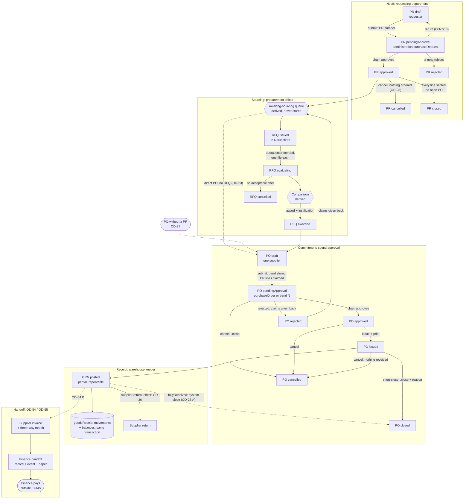

Rectangles are stored documents in a state, hexagons are derived reads that are never stored, the cylinder is the ledger,
and stadiums are points outside the stored flow (an entry without a PR, a payment made outside ECMS). A dashed arrow is a
path that exists only under one option of an open decision. Cancel and return edges are drawn where they change the
flow; §5 has every edge.

#### 4.2.2 Step by step

| # | Step · actor | Document · key | Approval type | Stores | Derives | OD |
|---|---|---|---|---|---|---|
| 1 | Raise the need · requester (who: OD-16) | PR (طلب شراء) draft · `administrationPurchaseRequest.create`, `.edit` | — | lines (catalog items; non-stock lines: OD-14); `branchId`, `departmentId`, `requesterUserId` from the placement (§7.5); `attachments[]` in `administration-request-attachments` (§11.4) | — | OD-14, OD-16, OD-76 |
| 2 | Submit · requester | PR → `pendingApproval`, `PR-…` · `.create` | `administration.purchaseRequest`, Unit = the PR's placement | number, status, host approval fields (§2.1, §5.2) | current approvers (live) | OD-17, OD-19, OD-58 |
| 3 | Approve the need · rung holders | decide, or return · `.approve` | same | `approvalSteps` (`ApprovalEntry[]`, §2.1); `approved` or `rejected`; a return archives the round | trail (`trailFor` → `ApprovalChainPanel`, `apps/web/src/platform/approvals/ApprovalChainPanel.tsx:40`) | OD-17, OD-20, OD-21, OD-72 |
| 4 | Pick the work · procurement officer | none · `administrationPurchaseRequest.view` at the officer's scope | — | nothing | **awaiting-sourcing queue** (§4.2.3) | OD-22, OD-25 |
| 5 | Ask for prices · officer | RFQ (طلب عروض أسعار) draft → `issued`, `RFQ-…` · `administrationRfq.create` | — | `sources[]` citing PR lines (no claim), `invitedSuppliers[]` | — | OD-23, OD-25 |
| 6 | Record offers · officer | quotation (عرض سعر), `received`, recorded at `POST /api/v1/administration/rfqs/:id/quotations`: quotations have no route of their own, and every quotation endpoint is nested under its RFQ (§3.3) · `administrationRfq.edit` | — | prices (`unitPriceMinor`), `validUntil`; the file, uploaded first under the RFQ into `administration-quotations` and linked as `quotationFile` (§11.4); one live quotation per supplier per RFQ (`ux_rfq_supplier`), a withdrawn one freeing the slot (OD-23, recommended) | `expired` | OD-23, OD-29, OD-30, OD-76 |
| 7 | Close bidding, compare, award · officer (`.edit`); holder of `administrationRfq.award` (§6.5 suggests the procurement manager) | RFQ `issued → evaluating` (`.edit`) → `awarded` (`.award`); quotations `selected` or `notSelected`. No acceptable offer: `evaluating → cancelled` (`.edit`); a cancel from `issued` or `evaluating` settles every `received` quotation as `notSelected` (§3.4) | none: the award is approved with the PO (OD-24, recommended) | `awards[]` (selection and justification per line); the signed award minutes in `awardSignedCopy` (§11.4) | comparison per line and supplier | OD-23, OD-24 |
| 8 | Draft the commitment · officer | PO (أمر شراء) draft, one supplier, from the award or straight from the queue · `administrationPurchaseOrder.create`, `.edit` | — | lines {`itemId`, `qty`, `unitPriceMinor`, `sources[]` citing PR lines with a per-source `qty`, `quotationLineId`, `deliveryWarehouseId`} | — | OD-23, OD-25, OD-27, OD-29 |
| 9 | Submit · officer | PO → `pendingApproval`, `PO-…` · `.create` | `administration.purchaseOrder` or a `.band<N>` type picked from the total and stored on the PO (§6.4); Unit §7.6 | claims on PR `orderedQty` (filter: PR in `PR_SOURCEABLE`, open quantity ≥ q; OD-27); PR `orderStatus`; the band type; `totalMinor` frozen (§2.5) | total = Σ lines in minor units | OD-18, OD-19, OD-22, OD-27 |
| 10 | Approve the spend · band rung holders | decide, or return · `.approve` | the stored type | trail; `rejected` and a return give the claims back | — | OD-18, OD-21, OD-72 |
| 11 | Issue to the supplier · holder of `.issue` | PO `approved` → `issued`, printed · `.issue`, `.print` | — | `issuedAt` / `issuedByUserId`; the print snapshot. Under OD-59 A (recommended) the PO paper is a record: `printCount`, `lastPrintedAt` and an `administrationPrint` audit row with `paper` / `printNumber` (§10.2, §11.6.6) | — | OD-31, OD-59 |
| 12 | Receive · keeper | GRN (إذن استلام), repeatable (§4.3.2) · `administrationGoodsReceipt.create` | — | movements, balances, PO `receivedQty`, `receiptStatus` | — | OD-32–OD-35 |
| 13 | Return to the supplier · keeper | SRN (مرتجع مشتريات) (§4.3.3) · `administrationSupplierReturn.create` | — | movements, GRN `returnedQty` | — | OD-36, OD-84 |
| 14 | Close · system, or holder of `.close` (§6.5 suggests the procurement manager) | PO → `closed` by the GRN that reaches `fullyReceived` (OD-28 A, a system row, §4.2.3), or short-closed with a reason; cancelled before any receipt · `.close` | — | remainders → `cancelledQty`, given back to the PR lines (OD-28); each cited PR written | — | OD-28 |
| 15 | Invoice and match · per OD-54 (P8) | supplier invoice · `administrationSupplierInvoice.create` | — | invoice lines; the scan as `invoiceFile` in `administration-supplier-invoices` (§12.4) | three-way match per PO line (§12.4): ordered, received net of returns (posted GRN `acceptedQty` − posted SRN quantities), already handed over, billed; the PO price against the billed price (§12.4) | OD-29, OD-54 |
| 16 | Hand off · per OD-55 (P8) | handoff · `administrationSupplierInvoice.handOver` | — | the `administration_finance_handoffs` row; the signed memo (§12.5); a reliable event only once a consumer exists (a recorded integration requirement, §12.11) | "received not invoiced", "handed over" | OD-55, OD-56 |

**How a PR ends.** A PR stays `approved` while it is sourced, and `orderStatus` shows the progress. It becomes `closed`
when every line is fully ordered or cancelled **and** no PO holding a claim on it is still open. A PO rejected, returned
or cancelled earlier therefore gives its quantity back to a PR that is still `approved`, and no reopen edge is needed.
`cancel` withdraws only unclaimed quantity: with nothing ordered the PR becomes `cancelled`; otherwise the remainder is
cancelled (`cancel-remainder`) and the PR closes with its POs (OD-28).

**The close must not rest on a read of the other POs (no ECMS precedent).** MongoDB transactions are snapshot-isolated. If the
last two POs of one PR close at once (two keepers post the last GRNs), each transaction sees the other PO still
`issued`, neither writes the PR, and both commit: the PR stays `approved` and `fullyOrdered` for good (write skew).
Every PO act that starts or ends a claim therefore writes each PR it cites in the same transaction, at least bumping its
`__v` (§5.1.3). Two such acts then conflict on the PR; `unitOfWork` retries the loser
(`apps/api/src/platform/kernel/unit-of-work.ts:5-17`), which now sees the other's result and closes the PR. §3.4 applies
the rule to every PO act that starts or ends a claim; this `__v` rule is the design. The §2.4.8 integrity check also
lists `approved` PRs that meet the close condition (check 6).

#### 4.2.3 Stored or derived

| Concept | Stored / derived | Mechanism (precedent) |
|---|---|---|
| Awaiting-sourcing queue | **derived** | Approved PR lines with `qty − orderedQty − cancelledQty > 0`, read through the PR repository with the caller's scope, oldest approval first. A line carries a hint when a live RFQ (`draft`, `issued`, `evaluating`, or `awarded` without a PO yet) or a draft PO already cites it. There is no `sourcing` status, no queue collection and no placeholder row: a pure read, stricter than recruitment's queue, which keeps a materialized `waiting` offer row for one of its two routes and applies scope per candidate before sorting and paging in memory (`apps/api/src/modules/hr/recruitment/job-offers/awaiting-offer.service.ts:9-14, 68-72, 109-114`). Recruitment's principle carries over: "a read and not a new state", with scope applied "once, where it already lives" (`apps/api/src/modules/hr/recruitment/job-offers/awaiting-offer.service.ts:3-7, 40-42`). The mechanical precedent is Fleet's "receipts no memo holds yet": the unclaimed side of a claim relation, read through an indexed filter, oldest first, with aging (`apps/api/src/modules/fleet/custody/custody-memo.service.ts:233-257, 314-339`; index `apps/api/src/modules/fleet/receipts/receipt.model.ts:105-110`). The stored `orderStatus` keeps the query indexable (`ix_sourcing`, §2.5). |
| Quotation comparison | derived | computed from the RFQ's quotations; only the selection and its justification are stored |
| Quotation `expired` | derived | `validUntil` before the Cairo business date |
| PO total | computed by the server from the lines and frozen at submission (`totalMinor`, §2.5); the **band type** picked from it is stored with it | a threshold edit never re-routes an in-flight PO (§6.4). Nor does a chain edit, deactivation or deletion under OD-20 A or B (recommended: A, chain edits never move in-flight documents). Under A, PX-1 decides on the chain the host pinned at submission in `approvalWorkflowId` and `approvalChainShape` (§5.2). Under B only, the R1 stopgap refuses the next decision with `ADMINISTRATION_APPROVAL_CHAIN_CHANGED` when the live chain's id or shape differs from them; the way out is a cancel and a new submission, or a return under OD-72 B (§5.2, §15.2.1). Only under OD-20 C, R1 accepted in writing, would one re-route the PO, because the engine re-reads the chain of that type on every `trailFor` and `decide` (`apps/api/src/platform/approvals/approval.service.ts:73-98`; R1) |
| Line counters (`orderedQty`, `receivedQty`, `issuedQty`, …) | stored | moved only by the child's guarded `$inc` (§4.1, Claim) |
| `orderStatus`, `receiptStatus`, `issueStatus`, `discrepancy` | stored, recomputed by one pure function in the same transaction that moves the counters (§2.1, Status) | Kept apart from `status`, as Operations keeps captain execution apart from shipment status (`apps/api/src/modules/operations/mobile/execution.service.ts:15-26`). Operations goes further: completing execution never completes the shipment, and the two meet only in a read (`isStopSettled`). This design deliberately deviates where the physical axis completes the document: a fully received PO (OD-28 A), a fully issued MR and an emptied transfer close in that same transaction (system rows, §5.1.1). Nothing is then left for any key holder to decide, except whether a later return or correction may reopen the document, and that is the cost (§4.3.2, §4.3.3). The Operations-faithful alternative for the PO is an explicit `.close` offered once `receiptStatus = fullyReceived` (OD-28). |
| Approval trail | stored `approvalSteps` (`ApprovalEntry[]`: the engine's `DecidedEntry` plus the rung's label and the decider's name, §2.1) and `approvalRounds[]`; the chain and current approvers derived live | the engine stores chains only (`apps/api/src/platform/approvals/workflow.model.ts:12-29`) |
| On hand, in transit | stored projection, written by the movement's transaction | ADR-024; §2.4 |
| Item-card running balance (P5, §2.4.7), at or below minimum, transit age, count variance | derived | Fleet's ledger fold (`apps/api/src/modules/fleet/custody/custody-ledger.ts:211`); IT `isBelowMin`: at or below the minimum, and none when the minimum is unset (`apps/api/src/modules/it/consumables/consumable-stock.ts:94-99`) |
| "Received not invoiced", "handed over" | derived (§12; P8) | Fleet's "waiting money" figures, computed by the API (`apps/api/src/modules/fleet/custody/custody-memo.service.ts:376-398`). Fleet also has a stored alternative: the dealership invoice row, opened at check-out with `invoiceAmount: null` as its pending state (`apps/api/src/modules/fleet/dealership/dealership.model.ts:1-6`). This design keeps the derived read. |

### 4.3 Inventory cycles

Each cycle posts as in §4.1. Balance rows are ensured outside the posting transaction (`ensureStockRows`), and their
quantities change only inside it, through a guarded `$inc` (§2.4.4). The guard (the leg's bucket ≥ `qty` on an outbound
leg) makes negative stock impossible, the ADR-024 precedent, subject to OD-53 (recommended default: never negative). A
count freezes onHand legs only (§2.4.6): an onHand leg, in or out, on a (warehouse, item) row that a count has frozen is
refused with 422 `ADMINISTRATION_STOCK_FROZEN`, while inTransit legs pass (§4.3.6). A retired item or warehouse refuses
the legs OD-70's per-kind map names (recommended default: a retired item refuses only receipts and opening balances).
Movement kinds and buckets are the closed list of §2.4.2; the refusal codes are §2.4.4's.

#### 4.3.1 Opening balance (رصيد افتتاحي)

| Step | Actor · key | Stores | OD |
|---|---|---|---|
| Draft | holder of `administrationStock.openBalance`, at organization scope under OD-69's recommended default (A, §6.7's list); how balances load is OD-63; §6.5 suggests the master-data administrator | one warehouse; lines {`itemId`, `qty`, `unitCostMinor`}, each item once, in the document's `currency`; the counted source sheet as evidence (`administration-evidence`) | OD-37, OD-63, OD-69 |
| Post | same; under OD-63 A (recommended), a second person posts (a §6.6 candidate pair, recommended: enforce) | `OB-…`; per line an `openingBalance` movement (onHand, in) carrying `unitCostMinor` and `currency`, and the guarded `$inc` on its ensured row, the filter holding `lastMovementAt: null` (a row that already moved answers 422 `ADMINISTRATION_OPENING_BALANCE_NOT_FIRST`); `at` = the posting instant, as on every leg (OD-74 A); the document's `asOfDate`, the date the stock was counted (a Cairo date no later than today), is stored and printed, never the movement's `at` (§2.6) | OD-63, OD-74 |
| Cancel | same | draft only | — |

**First movement only.** An opening balance must be the first movement of its (warehouse, item) row: the leg's filter
holds `lastMovementAt: null` (§2.4.4). "Opening" therefore never restates history, and later differences are counts or
adjustments. The rule is new: IT's own opening went the other way, and an item the store already kept was received
into, not refused (`apps/api/src/modules/it/go-live/consumables-opening.ts:11-12`). A posted opening balance keyed
wrongly is corrected by a stock adjustment, which ships in P7 unless the owner adopts §18.1 A11 (§4.1, Correct).

**Go-live order.** This per-row rule is the only ordering rule: no warehouse flag refuses a posting that comes before
the opening balance. The go-live procedure therefore posts each warehouse's opening balance before its first other
posting (§15.3.5 c). A row that moved before its opening balance takes its opening stock through an approved
`adjustmentIn` (§4.3.7), which ships in P5 under §18.1 A11's recommendation; if adjustments stay in P7, the case has no
document during P5–P6 (§4.1, Correct).

**Bulk loads beside the in-app document** of OD-63 A; the source of any legacy file is OD-68:

- **(a) A boot-time go-live step** (OD-63 B; OD-68 A's one-time load), as IT's consumables opening. An owner-reviewed
  file (`apps/api/src/modules/it/go-live/consumables-opening-import.ts:1-12`) is loaded in one transaction that writes
  the documents, movements, counters and the run row, audited after commit
  (`apps/api/src/modules/it/go-live/consumables-opening.ts:1-26`; spec
  `apps/api/tests/integration/it-go-live-consumables-opening.spec.ts`). `administration_go_live_runs` is its "done, and
  never again" marker (`apps/api/src/modules/it/go-live/go-live-run.model.ts:1-28`). It has no UI, no preview and no
  permission gate.
- **(b) An in-app gated import** (OD-68 C, not recommended). Impact: a page, a key and a preview-and-apply route pair
  (§6.2, §13), as ATM's register import (`apps/api/src/modules/atm/register/import/register-import.service.ts:98-114`)
  or IT's asset upload, which refuses with 409 when the file's hash differs from the preview's
  (`apps/api/src/modules/it/assets/asset-import.service.ts:1-16`). In ATM's shape it also adds a run collection with a
  partial unique index (`apps/api/src/modules/atm/register/import/register-import-run.model.ts:1-8, 80-84`); in IT's,
  none. Either reads the upload through the shared `reduceToOneSheet` (`apps/api/src/shared/xlsx/one-sheet-zip.ts:1-35`).
  Effort M; its route and field design is written when it is adopted.

#### 4.3.2 Goods receipt (إذن استلام)

| Step | Actor · key | Stores | OD |
|---|---|---|---|
| Draft | keeper: a holder of `administrationGoodsReceipt.create` reaching the delivery warehouse's branch (OD-10) | one warehouse; one PO in `PO_RECEIVABLE`; per line the delivered `qty` = `acceptedQty` + `rejectedQty`; the supplier's papers in `administration-delivery-documents` and photos in `administration-evidence` (§11.4); inspection members (`inspection.members`) only under OD-35 B (below) | OD-33, OD-34, OD-35 |
| Post | same; `.print` for the paper of record (OD-59), its signed copy filed as `signedCopy` (§11.4) | see below | OD-21, OD-32, OD-37 |
| Cancel | same | draft only. A posted GRN is final; its correction is below | OD-36, OD-84 |

Posting runs in one transaction, in §2.4.4's order. The rows were ensured beforehand, outside it.

1. Reserve `GRN-…`. The counter `$inc` comes first, so postings of one series conflict early: the counter stays held
   until the posting commits, and a second posting of the series retries until then (§2.4, RK-33).
2. Flip the GRN `draft → posted`, filtered on `{_id, status: 'draft', __v}`: the idempotency guard.
3. Per line, claim on the PO line through the PO service, with the session. One filter holds the PO in `PO_RECEIVABLE`
   (§5.14), the line's `deliveryWarehouseId` equal to the GRN's warehouse (receiving elsewhere is OD-22, recommended
   default: refused; receive where ordered, then transfer) and
   `receivedQty + acceptedQty ≤ qty − cancelledQty` (OD-32, recommended default: A, no excess). Only under OD-32 B does a tolerance setting under `administrationProcurementPolicy.manage` widen it to `⌊(qty − cancelledQty) × (1 + tolerance)⌋`, and an override beyond it would need a new override key (§6.2). The PO service then recomputes `receiptStatus` in the same transaction and bumps the PO's
   `__v`. At `fullyReceived` it closes the PO (OD-28 A, a system row) and writes each PR the PO claims (§4.2.2, How a PR
   ends).
4. Per line, the guarded `$inc` of the `goodsReceipt` leg (onHand, in). A row frozen by a count refuses it (422
   `ADMINISTRATION_STOCK_FROZEN`), and so do a retired item (OD-70) and a line whose `unitId` is no longer the item's
   (409 `ADMINISTRATION_ITEM_UNIT_CHANGED`).
5. `insertLegs` of the movements, with `unitCostMinor` = the PO line price and `currency` = the PO's, since an amount
   never travels without its currency (BD-004, the platform's business decision that every amount is bound to an
   explicit currency, `docs/01-domain/business-decisions.md:79-90`). The receipt captures the price; whether it ever
   values stock is OD-37 (recommended A: quantities, the cost captured so that B or C can later be computed from the ledger
   without re-keying history; B still needs a valuation record or a D-17 backfill, §12.9).
6. `emit('administration.goodsReceipt.posted', …, { reliable: true, session })`: the outbox row commits with the receipt
   (§8.5).

After commit: `nudgeOutboxRelay()`; the GRN's audit row (`receive`, lines summarized), plus `complete` on the PO when it
closed and on each PR that closed with it (§10.1). Then the signals, each carrying its `branchId`: `goodsReceipt` and
`administration.stock` to the warehouse's branch; `purchaseOrder` to the PO's branch, which central buying can make a
different one; and `purchaseRequest` to the branch of each PR that closed (§9.3). Then the notifications. Finance relies
on the stored records (§12.5), never on the event (RK-05).

- **Partial receipt** is the normal case: any number of GRNs per PO, one warehouse each.
- **Rejected quantity** (OD-34, recommended A) is recorded on the line with a `reasonCode` and no movement. The PO line
  stays open for a replacement or a short-close. Option B, a quarantine warehouse, fits neither a one-warehouse GRN nor
  the rule that only accepted quantity enters stock and counts toward `receivedQty`. It needs two warehouses per GRN or
  a second document that moves the rejected goods, and a way to return goods never accepted (the SRN claim is bounded
  by `acceptedQty`): a §2 change.
- **Central POs** (OD-22). Each PO line names its delivery warehouse (§2.5). The keeper's screen reads "lines receivable
  into warehouses my `administrationGoodsReceipt.create` reaches" (`ix_delivery_receipt`, §7.10), so a keeper needs no
  PO view over the purchasing branch. This follows recruitment's rule of applying scope where it lives (§4.2.3). It has
  three consequences.
  - *Prices.* Under OD-73 (recommended A: prices appear on RFQ, PO and invoice DTOs; GRN DTOs, the receivable-lines
    read and the stock screens carry quantities, §6.8), the receivable-lines read, the keeper's GRN view and the movement
    rows omit `unitPriceMinor` and `unitCostMinor` unless the caller also holds the PO view key (§2.5). A separate values
    key is OD-73 B: one more key in §6.2.
  - *The cross-branch write.* Posting writes another branch's PO (`receivedQty`, `receiptStatus`, the close) under a key
    that may not read that PO. Its only path is the PO service's receipt method, called with the session, which refuses
    a line whose `deliveryWarehouseId` is not the GRN's warehouse (step 3; OD-22). A guard spec pins it, as §7.4 does
    for transfers: a source scan (no other write path to the PO's receipt fields) and an integration case (a keeper of
    branch B cannot receive a line delivered to branch C).
  - *The reverse read.* The PO's owner and the invoice matcher in the purchasing branch must see GRNs filed in the
    delivery branch, which their branch scope fails closed on. A "GRNs of this PO" read is authorized through
    `administrationPurchaseOrder.view` on the PO itself: the PO is loaded in scope, then its GRNs by `ix_po` (§7.10).
- **Separation of duties.** §6.6 refuses the PO's approvers as the GRN poster (pair A2, OD-21). Buyer (the PO's creator
  or issuer) ≠ GRN poster, the classic control against fictitious deliveries, is one of OD-21's further candidate pairs, each decided alone (recommended: not enforced, since A2 already keeps the PO's approvers off the GRN; §6.6).
- **Who receives** (OD-35, recommended default: A). The signed-in poster is the receiver, the shape the owner chose for
  Operations' vault receipt («انا مش عاوز اى اسماء»), which now records one receiver, the signed-in user
  (`apps/api/src/modules/operations/vault/vault-custody.service.ts:98-101`; the history is in OD-35); pair A2 keeps the
  PO's approvers off the GRN (§6.6). Named inspection members (`inspection.members`) exist only under OD-35 B, if the
  owner asks for a receiving committee, and two different ids there are still not two signed-in people (§6.6).
- **Receipt without a PO** is OD-33 (recommended A: none; samples and donations enter as an approved `adjustmentIn`).
  That path needs adjustments outside counts, which OD-52 B (counts only) would forbid, and it opens only when
  adjustments ship: P7 by default, P5 if the owner adopts §18.1 A11.
- **A posted GRN entered in error** (a PO for 100; 100 typed, 10 delivered) is not corrected by either general tool.
  - An `adjustmentOut` of 90 fixes the stock. But PO `receivedQty` stays 100 and the PO stays auto-closed, so the §12.4
    match passes a 100-unit invoice, and the §2.4.8 check (PO `receivedQty` = Σ GRN `acceptedQty`) stays green.
  - A plain SRN records a return that never happened and, under OD-36, a debit-note claim on the supplier.

  **An adjustment therefore never corrects a GRN.** The correction is OD-84:
  - **A** — a correcting document with opposing receipt legs. It gives back PO `receivedQty` and reopens a PO the GRN
    closed: a new movement kind (§2.4.2) and the `closed → issued` edge (§5.6).
  - **B** (recommended) — an SRN with the reason code `entryError` from the SRN's closed list (§2.4.1). It always gives
    back PO `receivedQty`, creates no debit note or handoff line only while nothing of that GRN line has been handed over, and otherwise cuts OD-54's post-hand-over notice (§12.5), and is reported apart from real returns. It
    ships with supplier returns in P5 (§18.2), so this correction never waits for adjustments. Under OD-28 A, B also
    takes the conditional `closed → issued` edge to reopen a PO the GRN closed (§5.6), unless OD-28 keeps closing
    explicit (§4.2.3). What B saves over A is the new movement kind: a reason code on the existing supplier return.
  - **C** — block the Finance hand-over of an invoice while its GRN is disputed. The ledger is untouched, and the stock
    stays wrong until a correction posts.

  §2.4.8 check 5 counts PO `receivedQty` as Σ posted GRN `acceptedQty` − Σ posted SRN quantities that gave `receivedQty` back (OD-36's reopen; OD-84's `entryError`); the §12.4 match nets every posted return (kept = Σ `acceptedQty − returnedQty`), the `entryError` one included.

#### 4.3.3 Supplier return (مرتجع مشتريات)

| Step | Actor · key | Stores | OD |
|---|---|---|---|
| Draft | keeper · `administrationSupplierReturn.create` | lines citing posted GRN lines (`grnLineId`), a `reasonCode` from the closed list (§2.4.1) and a `reason`, evidence in `administration-evidence` | OD-84 (`entryError`) |
| Post | same | `SRN-…`; claim `returnedQty + q ≤ acceptedQty` on the GRN line; a `supplierReturn` leg (onHand, out), guarded; PO `receivedQty` given back under OD-36's reopen while the PO is open, and always for `entryError` (§2.6); `administration.supplierReturn.posted`, emitted reliably inside the transaction (§8.5) | OD-36: does the return reopen the PO line for a replacement, or end it with a debit note for Finance? (recommended A: it reopens until the PO closes, and each return joins the handoff) |
| Cancel | same | draft only | — |

No approval type is registered for returns (§6.4); if OD-36 wants one, it costs one more request type and approve key
(§6.2, §6.4) and a `pendingApproval` state on the return (§5). Two dependencies follow:

- **OD-28 × OD-36.** Auto-close at `fullyReceived` (OD-28 A) and "a return reopens the PO line" (OD-36 A) rarely meet,
  because a fully received PO is already `closed` and a terminal state takes nothing back (§5.7). Under both defaults, a
  return against a closed PO ends with a debit note (§12), and a replacement is a new PO. An explicit close (§4.2.3) would
  keep the reopen reachable.
- **Integrity.** Under OD-36 A a reopening return gives back PO `receivedQty`, and so does every OD-84 `entryError`
  return. §2.4.8 check 5 therefore reads PO `receivedQty` = Σ posted GRN `acceptedQty` − Σ posted SRN quantities that
  gave `receivedQty` back.

#### 4.3.4 Material request → issue → return

| Step | Actor · key | Approval | Stores | OD |
|---|---|---|---|---|
| Raise | requester · `administrationMaterialRequest.create`, `.edit`; at `own` scope through ESS only under OD-38 B (`apps/api/src/modules/hr/employee-loans/ess-grants.ts:19-35`) | — | MR (طلب صرف) lines; the issuing warehouse, picked from a module-gated options read. Warehouses fail closed for own and department scopes (§7.2), so the read returns the active warehouses of the requester's placement branch, as `{id, code, name}` only, gated by `.create` (§7.10; the §7.4 destination-picker pattern) | OD-38, OD-41, OD-75 (recommended A: the requester picks one warehouse in their branch) |
| Submit | requester · `.create` | `administration.materialRequest`, Unit = the MR's placement | `MR-…`, `pendingApproval` | OD-19 |
| Decide | rung holders · `.approve`; return (OD-72) | same | the trail. The engine records yes or no; a quantity lowered at the decision becomes the line's `cancelledQty` (§5.8) | OD-39; OD-42 (a reservation needs a reserved bucket the balances lack; recommended: check at issue) |
| Issue (إذن صرف), partial and repeatable | keeper · `administrationStockIssue.create`, `.print` | — | `ISS-…`; the claim on MR `issuedQty`, with the MR in `MR_ISSUABLE` in the same filter; an `issue` leg (onHand, out), guarded; `issueStatus`; the recipient's `signedCopy` (§11.4); `administration.stockIssue.posted`. The recipient snapshot (`recipient: PersonSnap`, §2.1) holds code, Arabic name, job title and department: `resolvePerson` (§3.5) reads the directory listing (`searchDirectoryEmployees`, `getDirectoryEmployee`) and takes the job-title and department names from `platform/organization`. Which acts refuse a leaver is OD-44 (recommended default: IT's rule, refused only when the directory positively answers `exited`, for a requester or a recipient, while a leaver may still be a return's `returnedBy`; an id the directory cannot read passes, `apps/api/src/modules/it/assets/custody.service.ts:76-95`). The snapshot holds no national ID: IT's receipt-holder read takes the raw one through `getDirectoryIdentityFacts` (`apps/api/src/modules/it/assets/receipt-holder.ts:33-38, 66`), which this module never calls (§6.8), and IT's own consumable memo stores none (`apps/api/src/modules/it/consumables/consumable-issue.service.ts:195-198`). | OD-40 (direct issue; recommended A: never, or C: for categories the owner names), OD-15 (durable items), OD-44 |
| Close | system | — | `approved → closed` in the issue or remainder cancel that leaves every line issued or cancelled (§5.8) | — |
| Close the rest | holder of `administrationMaterialRequest.cancel`; when the store cannot supply, the issuing keeper · `administrationStockIssue.create` on the MR's warehouse (OD-28.1 (ii)) | — | the remainder cancelled with a reason, `POST /material-requests/:id/cancel-remainder` once something was issued, which ends the MR `closed`; with nothing issued, the MR's cancel ends it `cancelled` (§5.8 row 8, `.cancel`; the keeper's case is OD-28.2). When the store cannot supply, the issuing keeper must be able to do this, yet no keeper bundle carries the key: §6.5 suggests `administrationMaterialRequest.cancel` only for the Administrative Affairs manager's bundle. The keeper's "cannot supply" act therefore closes the MR's unissuable remainder through the same endpoint, under `administrationStockIssue.create` on the MR's warehouse, with a reason (OD-28.1 (ii), recommended; OD-28.1 (i) would give the storekeeper bundle the cancel key instead, OD-78) | OD-28 |
| Return (مرتجع صرف) | keeper · `administrationStockReturn.create` | — | `RTN-…`; cites the issue line (`issueLineId`), with the claim `returnedQty + q ≤ qty` on it; `returnedBy`, who may be a leaver (OD-44); an `issueReturn` leg (onHand, in). Damaged goods follow OD-43 (recommended A: every return posts `issueReturn`, and damaged lines are then written off). An issue posted against the wrong MR is corrected by a stock return and a new issue; the return never gives back the first MR's `issuedQty`, which counts everything ever issued, as IT's counter does (`apps/api/src/modules/it/consumables/consumable-stock.ts:37-38`). This is a sub-question of OD-43 | OD-43, OD-44 |
| Leaver | §8.6's `hr.employee.exited` handler, tied to OD-44, which only flags; then a later sweep that reads the directory and cancels drafts, a scheduled `administration.*` task listed in P6 (§18.2) | — | OD-44 (recommended A: cancel their drafts; flag holdings only under OD-15 B). IT's "flag" is no stored field: it is one `alertRaised` audit row per open assignment plus a log warning, never an automatic return, and it covers durable custody only. IT never flags issued consumables (`apps/api/src/modules/it/assets/custody.service.ts:1015-1042`; `apps/api/src/modules/it/it.module.ts:577-604`; `docs/03-decisions/ADR-021-it-asset-custody-and-history.md:59-61`). §8.6 keeps that shape. HR emits before it saves the employee, so the handler records and never cancels: one `alertRaised` row per match, with a null actor and a `source` pseudo-field (§10.1), for each warehouse whose `responsibleEmployeeId` is the leaver and, only under OD-15 B, each of their issues with returnable items still out. Cancelling their drafts is the later act: under OD-44 A the sweep reads the distinct requesters of draft PRs and MRs through the directory and cancels the drafts of those it reads as `exited`, on a positive answer only, as the system actor. | OD-15, OD-44 |

#### 4.3.5 Stock transfer (تحويل مخزني)

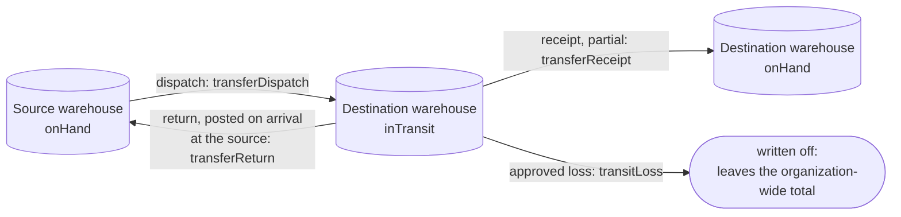

| Step | Actor · key (side, §7.4) | Stores | OD |
|---|---|---|---|
| Create, submit | source keeper · `administrationStockTransfer.create` (source): the push model, OD-45's recommended default | lines; `TRF-…` at submission | OD-45 |
| Approve | rung holders · `.approve` | `administration.stockTransfer`, Unit §7.6. Where OD-45 needs no approval (recommended A: approval for inter-branch transfers only, so an intra-branch one needs none), submission lands directly in `approved`: the conditional `draft → approved` edge (§5.9), with an empty trail and an audit row saying "no approval required". The `TRF-…` number is taken at that submission all the same (§2.8) | OD-45 |
| Dispatch | source keeper · `.dispatch` (source) | per line a `transferDispatch` pair (source onHand out, destination inTransit in) and `dispatchedQty`; `carrier: {name, vehicleRef}` as text; `expectedArrivalAt`; the signed dispatch note as `dispatchSignedCopy` (§11.4) | OD-46; OD-47.1 (short dispatch; recommended A: the undispatched rest is cancelled with a reason) |
| Receive, partial and repeatable | destination keeper · `.receive` (destination) | per receipt a `transferReceipt` pair; `receiptStatus`; a line declared short stamps `shortDeclaredAt` / `shortDeclaredByUserId` and sets `discrepancy: open`; the signed receipt note as `receiptSignedCopy` (§11.4) | OD-21 (dispatcher ≠ receiver, pair B2) |
| Resolve | holder of `.resolve` (destination) for a late arrival, a loss or a return that never arrived; a return to the source is declared by the destination keeper under `.receive` (destination) and posted, when the goods are back, by the source keeper under `.receive` (source), never under `.resolve`, as recommended below | per short line, one outcome per `/resolve` call (§5.9): a late arrival (`lateArrival`, received later), a return to the source (`returningToSource`, declared as `returningQty`, which the source's `transferReturn` moves into `returnedQty` on arrival), a loss (`writtenOff`, declared as `lossPendingQty`), or, for a declared return that never reaches the source, `returnNotArrived` under `.resolve` (destination), which re-declares the unarrived `returningQty` a loss for the loss round or gives it back to the plain in-transit share; `discrepancy: resolved` once every short line is emptied (§5.12) | OD-21; OD-47.2 (recommended A: another person resolves); OD-47.3 (recommended B); OD-47.4 (recommended (ii): losses are approved as write-offs) |
| Close | system | `closed` when every dispatched unit is received, returned or lost. A pure liveness spec over the line counters checks that from every reachable state each line can still reach received + returned + lost = dispatched (§5.9) | — |
| Cancel | source keeper · `.create` | from `draft`, `pendingApproval` or `approved`, before dispatch; a reason after draft | — |

- **Return to the source.** `resolve` is a destination act, yet `transferReturn` writes (source, onHand, in). A
  destination-only key would thus add stock to a warehouse in a branch it cannot read, the moment the goods start
  back, and nothing would record goods that never arrive. Recommended default, OD-47.3 B (§2.4.5): the
  destination declares the quantity "returning to source" as the line's `returningQty` (the outcome
  `returningToSource`, under `.receive` at the destination), which stays in the destination's `inTransit`. The source
  keeper posts the `transferReturn` when the goods are back, under `administrationStockTransfer.receive` reaching
  `fromBranchId` (`POST /stock-transfers/:id/receipts` with `side: 'source'`, §5.9), which moves it into
  `returnedQty`; this is the source-side row of §7.4's act table. `.resolve` never posts the return (§5.9, §7.4). A
  declared return that never reaches the source is resolved as `returnNotArrived`: the unarrived `returningQty` is put
  to the loss round (OD-47.4) or given back to the plain in-transit share, so the line can still close. OD-47.3 C, a
  return trip tracked on its own with a source-side in-transit leg, would add a leg and a bucket to §2.4.2 and §2.4.5.
  OD-47.3 D, receiving what arrived and sending goods back on a new transfer to the source, would drop `returningQty`,
  the two return outcomes and the source-side receipt; its costs are stated in OD-47.3.
- **Losses.** If one person could post a loss, "lost in transit" would be the easiest way to make stock disappear, while
  every other write-off is approved (§4.3.7). OD-47.4's recommended "losses approved as write-offs" cannot be built from
  the adjustment kinds: `writeOff` and `adjustmentOut` are onHand legs, the loss sits in `inTransit`, and only the transfer writes `transitLoss` (§2.4.2). The mechanism within this design's movement kinds, OD-47.4 (ii)
  (§2.4.5): a `writtenOff` resolution posts nothing at once. It declares the quantity as the line's `lossPendingQty` and
  opens an in-state approval round on the `dispatched` transfer (`administration.stockTransfer`; an earlier round moves
  into `approvalRounds[]` with `endedBy: 'loss'`, §5.2). The round needs deciders: the `writtenOff` resolve is refused
  with `ADMINISTRATION_APPROVAL_CHAIN_MISSING` when no active `administration.stockTransfer` chain with a staffed rung
  covers the transfer's Unit (OD-19 A, §7.6); the line stays declared short, and OD-61's stuck notice asks for a chain
  to be configured. A transfer that loses nothing needs no chain where OD-45 asks no approval. `transitLoss` moves the
  quantity into `lostQty` in the final approval's transaction; a rejected round returns it to the plain in-transit
  share, the discrepancy still open. The resolver differs from the receiver (OD-47.2 A, a §6.6 candidate pair,
  recommended: enforce). OD-47.4 (iii), an adjustment line of kind `transitLoss` on the in-transit bucket approved on
  the write-off chain, would change the movement legs and the adjustment kinds (§2.4.2, §4.3.7). Until OD-47.4 is
  answered, a one-person loss is a known control gap.
- **Two steps are the owner's requirement** (D-3). His brief asks for dispatch, receipt, partial receipt and difference
  handling: «ولا تعتبر الكمية انتقلت نهائيًا بمجرد الضغط على "Transfer"». The nearest precedent, Operations' secured
  shipment, climbs `draft → inVault → dispatched → completed`
  (`apps/api/src/modules/operations/shipments/shipment-status.ts:25-36`). Its vault receipt records one receiver, the
  signed-in user (`apps/api/src/modules/operations/vault/vault-custody.service.ts:98-101`; history in OD-35), so a
  dispatcher ≠ receiver check (OD-21 B) has no enforced precedent left and takes §6.6's login-based shape (B2). IT's
  branch transfers are one step, with nothing to confirm at the other end
  (`apps/api/src/modules/it/consumables/consumable-transfer.service.ts:5-11`). None has an in-transit bucket; that part
  has no ECMS precedent.
- **Two branches.** Both keepers read the document (§7.4). Every act signals each branch through its own
  `publishAuditedChange` call, because the publisher takes one `branchId` and also emits to the organization-wide rooms on
  every call (`apps/api/src/platform/realtime/realtime-publisher.ts:27-38, 52, 67-70`). The helper to copy is IT's
  `signalConsumable` (`apps/api/src/modules/it/consumables/consumable-history.ts:100-107`; §9.3). IT's own branch
  transfers already reach both stores through it, one signal per item moved (`apps/api/src/modules/it/consumables/consumable-transfer.service.ts:245-273`).
- **Goods that were never dispatched** cannot be received, because the in-transit guard refuses them. They enter as an
  adjustment (OD-52 A); under OD-52 B (counts only) they wait for the next count.
- **A warehouse under count.** The freeze guards onHand legs only (§2.4.6). A dispatch to a warehouse under
  count is allowed: the quantity waits in the destination's `inTransit` bucket. Receiving it into the frozen onHand row,
  by a receipt or a late arrival, is refused with 422 `ADMINISTRATION_STOCK_FROZEN` (never 409) until the count is
  posted, or cancelled, which also releases the freeze. Outflows from frozen rows are refused the same way, so nothing
  is dispatched out of them. A return to a source under count waits too, because its second leg is the source's onHand.
  A loss passes: `transitLoss` is an inTransit leg only (§2.4.5, §4.3.6).
- **Overdue in transit** (the OD-46 deadline) is a scheduled `administration.*` sweep that notifies and never moves
  stock. Its reminders can ride a notification idempotency key, which holds once per recipient and key
  (`apps/api/src/platform/notifications/notification.service.ts:226-231`), so it needs no `administration_sweep_marks`.
  Marks, and the seam ADR-025 asks the next module to extract (platform slice PX-2), come only with an announcement made
  once per date whatever its recipients (§2.7; §18.1 A10).

#### 4.3.6 Stock count (جرد)

The word جرد is the product's existing word (§0.4); only the document's name is a candidate (OD-67).

| Step | Actor · key | Stores | OD |
|---|---|---|---|
| Open | count owner · `administrationStockCount.create` | one warehouse; the scope: "full", the active items of chosen categories, or a list of items (OD-48; recommended reading of "full": every row the warehouse holds at start, plus found lines) | OD-48 (scope, freeze), OD-51 (frequency) |
| Start = freeze | owner · `.create` | → `inProgress`, `CNT-…`. The in-scope rows are ensured first, outside the transaction, zero rows included (§2.4.6). Then one transaction stamps `frozenByCountId` on each row (a row another count holds answers 422 `ADMINISTRATION_STOCK_FROZEN`, naming that count) and snapshots `expectedQty` = `onHandQty` into `administration_stock_count_lines` | OD-48 (recommended: freeze the counted items only) |
| Count | holders of `.count` | `countedQty` per line, each line versioned, refused once the line is `locked`. A found item with no line gets one before Submit (`expectedQty` = its row's on hand, 0 for a new row): its row is ensured outside the transaction, then frozen in the act that writes its line (§2.4.6) | OD-49 (blind), OD-50 (team) |
| Submit | owner · `.create` | `inProgress → submitted`, only when every line has a counted quantity (`countComplete`); `locked` set on every line in the same transaction; variance = counted − expected (derived) | — |
| Recount | owner · `.create` | `submitted → inProgress` for chosen lines, with a reason: `locked` cleared on those lines, the freeze kept (§5.10) | OD-51 |
| Request approval | owner · `.create` | → `pendingApproval`; `administration.stockCount`, Unit §7.6; zero-variance counts too, unless OD-51 decides otherwise | OD-19, OD-51 |
| Decide, post | rung holders · `.approve` | The final approval posts in one transaction: `countGain` or `countLoss` per variance line, its guard accepting this count's own freeze and requiring on hand = the line's `expectedQty`, a check that the freeze held (§2.4.6); the freeze released on every row; `posted`. The engine has already audited the decision before this transaction runs (§4.1, Decide), so the postings are pre-checked first | OD-21 (counter ≠ approver, pair A3) |
| Reject | rung holders · `.approve` | OD-51 A (recommended): back to `inProgress` for a recount, the freeze kept, lines unlocked, `approvalSteps` moved into `approvalRounds[]`. The engine's rejection is final, so the next round must start empty, or `decide` throws `approvals.alreadyDecided` (`apps/api/src/platform/approvals/approval-trail.ts:59-65`; `apps/api/src/platform/approvals/approval.service.ts:164-166`). Under that default no `rejected` status exists; it appears only if OD-51 makes a rejection final (option C), which then releases the freeze | OD-51 |
| Cancel | owner · `.create` | from `draft`; or, with a reason, from `inProgress`, `submitted` or `pendingApproval`: the freeze released, no movement, lines kept | OD-51 (after counting) |

**The freeze guards onHand legs only** (§2.4.4, §2.4.6). While its rows are frozen, every onHand
leg on them, in or out, is refused with 422 `ADMINISTRATION_STOCK_FROZEN` (never 409: retrying cannot help): receipts,
issues, returns, adjustments, dispatches out of the warehouse, transfer receipts and late arrivals into it, and returns
posted back into it from transit. InTransit legs pass, because a count counts on hand only (`expectedQty` =
`onHandQty`): a dispatch to the warehouse is allowed and waits in its `inTransit` bucket, and a loss there posts. Goods
that physically arrive during a count therefore stay in transit until it is posted, and the counters leave them out of
the count. How such arrivals are handled is an OD-48 sub-question (recommended default: exactly this). A slow approval
holds the stock still, and OD-48's recommendation adds reminders and no automatic release.

Only one idea is reused from the attendance freeze: a stamp inside the write's filter
(`apps/api/src/modules/hr/attendance/day-records/day-record.repository.ts:13-28`). That freeze is permanent ("corrections
flow forward") and rides `BaseRepository.writeConditions`, which only `updateById` and `softDeleteById` apply
(`apps/api/src/shared/base/base.repository.ts:574-583, 603-613`). The count freeze is released on posting or cancel,
which is new (§5.13), and its condition sits in the balance method's own filter (§2.4.4), like IT's `moveStock` guard
(`apps/api/src/modules/it/consumables/consumable.repository.ts:115-138`). OD-48's snapshot-only option avoids the hold,
but then the variance must net out the movements made during the count.

#### 4.3.7 Adjustments and write-offs (تسوية مخزنية)

| Step | Actor · key | Stores | OD |
|---|---|---|---|
| Raise | keeper · `administrationStockAdjustment.create` | lines of kind `adjustmentIn`, `adjustmentOut` or `writeOff`, each with a `reasonCode` and a `reason`; evidence in `administration-evidence` | OD-52, OD-74 |
| Submit | keeper · `.create` | `ADJ-…`, `pendingApproval`; `administration.stockAdjustment`, Unit §7.6; the minutes the approvers decide on, filed as `signedCopy` (§11.4) | OD-19 |
| Decide, post | rung holders · `.approve` | The final approval posts the movements, guarded. The stock is pre-checked before `decide` (§5.2), because the engine has already audited the decision when the host's transaction runs (`apps/api/src/platform/approvals/approval.service.ts:158-224`). If stock moves after the pre-check and the guard refuses, the host's transaction fails and the document stays `pendingApproval` with the reason. The engine's `platform.approval` row is then an orphan for a decision that never landed (R5), a known risk until OD-20. | OD-21; value limits need OD-37 (OD-51, OD-52) |
| Reject | rung holders · `.approve` | `rejected` (final; return for amendment per OD-72) | OD-72 |
| Cancel | keeper · `.create` | from `draft`; or, with a reason, from `pendingApproval` (§5.11), so a document whose chain was deleted or unstaffed meanwhile (R1, R2) can still be withdrawn | — |

Adjustments outside counts carry four paths of this section: receipts without a PO (OD-33 A), goods never dispatched
(§4.3.5), the opening stock of a row that moved before its opening balance (§4.3.1), and every correction other than a
GRN's (OD-84), an opening balance's included. OD-52 B (counts only) would close all four. Adjustments ship in P7 by
default. Moving them into P5 is the owner's choice recorded in §18.1 A11, which recommends it so that P5's postings have
a correcting document from the start; until they ship, these paths have no document (§4.1, Correct).

### 4.4 Who owns what: Administrative Affairs, Finance, IT, Fleet, HR

| Concern | Administrative Affairs | Finance (future `accounting`; none exists) | IT | Fleet | HR |
|---|---|---|---|---|---|
| Need → sourcing → commitment → receipt | **owns** PR, RFQ, PO, GRN | — | may raise PRs like any department (OD-16) | which spend must pass Procurement: OD-66 | — |
| Supplier register | **owns** `administration_suppliers` (OD-01, recommended C) | reads it | keeps `it_vendors` until the staged migration (§15.3) | keeps workshop rows until then | — |
| Supplier invoice and match | registers and matches if OD-54 says so | pays; payables, tax | — | dealership bills stay record-only (OD-66) | — |
| Payment, ledger, budget | never: "ECMS has no treasury and pays nobody" (`apps/api/src/modules/hr/employee-loans/employee-loan.model.ts:50`); hands off (§12, OD-55); budgets OD-56 | **owns** | — | its fund's letters carry Finance's signature, on paper only | payroll → GL is blocked (P-HR-14, the payroll-to-GL plan, `docs/12-planning/payroll-to-gl-discovery.md:1-3`) |
| Stock quantity and ledger | **owns** warehouses, movements, balances, counts | valuation entries | keeps its consumables and spare-parts ledgers; "an item lives in exactly one ledger" (OD-02 A). ADR-024 already defines the seam inherited here: a received PO becomes the writer of IT's receipt movements, and on-hand may move to Warehouses while IT keeps its consumption ledger (`docs/03-decisions/ADR-024-minimal-spare-parts-ledger.md:40-52`; OD-02 C) | parts and tires bought outside any stock (OD-66) | — |
| Durable devices and custody | no second count or custody chain for IT assets (ADR-021); GRN → `it_assets` is OD-65; its own durable items OD-15 | — | **owns** assets and their custody (ADR-021), printed on its custody receipt, form F-14 (`docs/12-planning/it-module-design.md:452`) | **owns** vehicles | — |
| Unit cost and valuation | captures the PO price and its currency on receipts, and the cost an opening balance states (§4.3.1, §4.3.2) | whether stock is valued, by which method, and who owns cost: OD-37 | none today | none | — |
| Cost center on issues | only if OD-41 reopens D-CC-3, the platform rule that only employees carry a cost center (`apps/api/src/platform/organization/cost-centers/cost-center-guards.spec.ts:76-88`) | maps centers to accounts, later | — | — | **owns** membership; the catalog is platform |
| People | reads `platform/directory` through its `people/` endpoint; never imports HR | — | — | — | **owns** employees and the exit event |
| Approval chains | registers types and stores trails; chains are configured in the platform screen (`approval.configure`) | — | — | — | — |
| Petty cash | none; no second fund without OD-66 | reimburses | — | **owns** its fund | — |

ATM seals and bags are not stock today ("Seal stock (c) is not requested",
`docs/12-planning/atm-settlements-phase1.md:146`). Whether they ever become Warehouses items is OD-03 (recommended: they
wait for option (c) of ATM's S-8, its Control & Supplies decision quoted above; if they come in, ATM reads stock through
a boundary).

### 4.5 The owner's procurement questions

The owner's brief (2026-10-29) asks these questions of the purchasing cycle. Each row quotes his words, then gives them
in English.

| # | Question | What the design supports technically | Decided by |
|---|---|---|---|
| 1 | «ما الذي يجب أن يكون داخل Administrative Affairs؟» «ما الذي يجب أن يبقى داخل Finance؟» What belongs in Administrative Affairs, and what stays in Finance? | Administrative Affairs records the need, the sourcing, the commitment and the receipt (§4.2) and, under OD-54, the supplier invoice and its match. It pays nobody. Finance owns payment, payables, the ledger and tax; budgets are OD-56. Until an `accounting` module exists, the handoff is OD-55 (recommended D: a stored record and a signed paper, §12.5; a reliable event is a recorded integration requirement until a consumer exists, §12.11), never a call into Finance. | OD-54, OD-55, OD-56 |
| 2 | «أين تنتهي مسؤولية Procurement؟» Where does procurement's responsibility end? | Three supported end points. (A) The GRN is posted and the handoff carries PO + GRN. (B) The supplier invoice is registered, matched and handed over: recommended. (C) B plus a record-only "paid on / reference" fact, the payroll `pay` shape (`apps/api/src/modules/hr/payroll/runs/payroll-run.service.ts:231-265`). | OD-54 |
| 3 | «من يعتمد الطلب؟» Who approves the request? | The holders of the rungs configured for `administration.purchaseRequest` at the requester's Unit, in the existing approvals screen: one key, up to four desks, one per level (§6.4). Two desks at one level, such as an Administrative Affairs director and then the general manager, both organization-level, need a second key: OD-71. The requester never decides any rung, whichever OD-21 option is chosen (the floor, §5.2); under OD-21 A or B (pair A1; recommended: B), neither do the creator and the submitter (§6.6). | OD-17 (recommended A: need approval by the requesting Unit's chain), OD-19, OD-21, OD-71 |
| 4 | «من يعتمد أمر الشراء؟» Who approves the purchase order? | The rungs of the type stored on the PO at submission (`administration.purchaseOrder` or one band type). Under the recommended need/spend split (OD-17, OD-18), the Unit is the issuing (procurement) department (§7.6), which rules out a requesting-department rung on POs; a Unit built from the PR's department would allow one. Under OD-21 A or B (pair A1; recommended: B), neither its creator nor its submitter decides it (§5.2, §6.6). Two desks at one level need a second key (OD-71). | OD-17, OD-18, OD-21, OD-22, OD-71 |
| 5 | «هل توجد مستويات اعتماد حسب القيمة؟» Are there approval levels by value? | The engine has no amount field. The recommended mechanism (OD-18 A): the module registers one request type per band, `administration.purchaseOrder.band<N>`, keeps the thresholds in a setting under `administrationProcurementPolicy.manage`, picks the band from the PO total at submission and stores it, so no threshold edit re-routes an in-flight PO (note 1). B is an engine condition (a platform ADR, §20); C is no bands. The band's basis and the receipt tolerance are OD-18 and OD-32 (notes 2, 3). PRs can use bands only if they carry estimated prices. | OD-18 (band basis included), OD-17, OD-29 (VAT in the total), OD-32 |
| 6 | «هل يمكن إلغاء الطلب؟» Can the request be cancelled? | Yes, with a reason after draft, until its quantity is consumed: a PR's unclaimed remainder (`cancel`, `cancel-remainder`); a PO before its first receipt, and short-closed after it (`close`). Who may cancel at which stage is OD-28 (recommended A: cancel until the first GRN, then short-close; claims given back return to the PR lines, and so to the queue). A PR cited by a live RFQ either refuses cancel, naming the RFQ (OD-28.3 (i), recommended), or cancels and notifies the RFQ's officer (OD-28.3 (ii)); either way, the PO's claim filter (`PR_SOURCEABLE`) is what binds. Posted receipts and issues are never cancelled; an opposing document reverses them. Sending a pending document back for amendment is OD-72 (recommended B: the `return` act). | OD-28, OD-72 |
| 7 | «هل يمكن تعديله بعد الاعتماد؟» Can it be amended after approval? | Not in place: submission freezes the document in the write. Under OD-26 A (recommended), a decrease is a line cancellation without re-approval, files go in the slots §11 opens after approval, and an increase means a new PR or PO. In-place changes exist only under OD-26 B or C (note 4). A rejected or returned request follows OD-72. | OD-26, OD-72 |
| 8 | «ماذا يحدث إذا تغيرت الكمية أو السعر بعد الاعتماد؟» What happens if the quantity or the price changes after approval? | A decrease is a line cancellation (OD-26 A, recommended: no re-approval). An increase or a price rise is either (a) with the documents as designed: cancel or short-close, then raise a new PO (or PR) that is approved again; or (b) under OD-26 B, an in-state PO revision approved in a round of its own while the PO keeps receiving under the approved terms (§5.6; note 4). Its precedents are job offers, which keep their prior terms but carry no approval (`apps/api/src/modules/hr/recruitment/job-offers/job-offer.service.ts:202-248`), and HR contract amendments, re-approved as a new version under the same code (`apps/api/src/modules/hr/contracts/contracts/contract.service.ts:396-462`). An invoice price that differs from the PO is a match question. | OD-26, OD-54 |
| 9 | «هل يمكن شراء بدون Purchase Request؟» Can goods be bought without a purchase request? | A PO line may cite no PR line, carry a justification and still go through its band's approval; equally, the server can refuse such a line, or one that orders more than the PR approved. Recommended (OD-27 A): every PO line claims an approved PR line, never beyond its open quantity. | OD-27 |
| 10 | «هل يوجد Emergency Purchase؟» Is there an emergency purchase? | Supported without new mechanics: the normal documents, moved quickly. Approvers are notified at submission, and OD-61 can add reminders or escalation. Reminders that follow the chain would read `approvalService.currentApprovers`, as leave's `notifyChainApprovers` does (`apps/api/src/modules/hr/leave-management/leave-requests/leave-request.service.ts:678-711`). The only reminder precedent, `hr.leave.approvalReminder`, instead sends engine-hosted requests to every organization-wide `leave.approve` holder (`apps/api/src/modules/hr/hr.module.ts:2206-2215`; `apps/api/src/modules/hr/leave-management/leave-requests/leave-request.service.ts:1280-1293`). A post-facto PO (goods received before approval) conflicts with OD-33's recommended default (receipts only against an issued PO); it is no option of OD-27 and would need a receipt path without an issued PO (OD-33 B). Petty-cash buying outside Procurement exists only in Fleet and must not be copied (OD-66). | OD-27, OD-33, OD-61, OD-66 |
| 11 | «هل المورد يمكن تغييره بعد الموافقة؟» Can the supplier be changed after approval? | Never in place: the approval covered this supplier at this price. Under OD-26 A the PO is cancelled (nothing received) or short-closed, its quantities return to the queue, and a PO to the other supplier is approved again, from a new RFQ or as a direct PO with a single-source justification (OD-23). Re-awarding inside the same RFQ exists only under OD-26 B, if OD-24 allows it: a `notSelected → selected` edge on the quotation, which §5.5 does not draw. | OD-26, OD-24, OD-23 |
| 12 | «هل الطلب الواحد يمكن أن ينتج عنه أكثر من PO؟» Can one request produce more than one PO? | Yes. PO lines claim PR line quantities, so one PR splits across suppliers by line or by quantity. `orderStatus` shows partial or full ordering, and the queue shows the rest. A split can also keep each PO under a lower band (Q5). | OD-24 (split award), OD-27, OD-18 (band basis) |
| 13 | «هل PO الواحد يمكن أن يحتوي أكثر من صنف؟» Can one PO hold more than one item? | Yes: one supplier per PO and any number of item lines, possibly from several PRs and departments (consolidation) and for several delivery warehouses. A consolidated line stores a quantity per source (`sources[].qty`, as RFQ lines do, §2.5) and claims each source at submission. Which source a partial receipt fulfills, and which one a short-close remainder returns to, is OD-25 (recommended default: receipts fill the oldest approved source first, and a remainder goes back to the newest source first). Consolidating across branches needs central procurement. | OD-25, OD-22 |
| 14 | «ماذا يحدث عند الاستلام الجزئي؟» What happens on a partial receipt? | Yes: any number of GRNs per PO, one warehouse each. `receiptStatus` moves `notReceived → partiallyReceived → fullyReceived`; a receipt above the open quantity is refused (OD-32 A; above the tolerance only under B); a remainder is short-closed with a reason. | OD-32, OD-34, OD-28 |

Notes to the table:

1. *Q5, in-flight POs.* A threshold edit never re-routes an in-flight PO, and neither does a chain edit under OD-20 A or
   B (recommended: A). Under A, PX-1 decides on the chain the host pinned at submission (§5.2). Under B only, the R1
   stopgap refuses the PO's next decision, the way out being a cancel and a new submission or, under OD-72 B, a return
   (§5.2, §15.2.1). Only under OD-20 C, R1 accepted in writing, does a chain edit still re-route it.
2. *Q5, what the band is keyed on.* Part of OD-18 (recommended: the PO total, with a derived split-purchase report). A
   single PO's total lets one need be split across POs or suppliers (Q12) to stay under a higher band; the alternatives
   are the need's total or a cumulative total per supplier and period.
3. *Q5, tolerance.* A non-zero tolerance (only under OD-32 B; recommended A: none) could push received value past the
   approved band. How the two meet is a further OD-18/OD-32 sub-question (recommended: cap the tolerance so the value
   stays inside the PO's band; the alternative, the next band's approval for the excess, needs a new override key in
   §6.2).
4. *Q7 and Q8, OD-26 B or C.* For a PR, an in-place change would add an `approved → pendingApproval` edge, which §5.4
   does not draw, triggered by the requisition rule "more than was granted, or another placement"
   (`apps/api/src/modules/hr/recruitment/job-requisitions/job-requisition-rules.ts:95-107`) and never lowering a line
   below its `orderedQty` (the `editProblem` shape, `apps/api/src/modules/hr/recruitment/job-requisitions/job-requisition-rules.ts:109-126`).
   For a PO, OD-26 B is an in-state revision: the PO keeps its status and keeps receiving under its approved terms while
   the proposed terms wait for an approval round of their own. Its cost, listed in OD-26 B's impact (§16): pending terms
   and a revision history on the PO, an amend act under `.edit` and a further round on one document, which no engine
   host does today: requisitions, which do not run on the engine, clear their decision stamps and keep the history only
   in audit
   (`apps/api/src/modules/hr/recruitment/job-requisitions/job-requisition.service.ts:182-209`). Effort M; its route and
   field design is written when OD-26 adopts B (§5.6).

---

## 5. State machines

Every document in this design has a code-defined lifecycle (D-4): one pure transition table plus pure guards in a `<doc>-lifecycle.ts` file beside its feature (the five posting documents share one table, `shared/posting-lifecycle.ts`, §5.7), consulted by the single service that writes that document's `status`. This
is code practice, not ADR-011, whose engine was never built (`docs/12-planning/it-module-design.md:65, 1168`). IT tickets
and Operations' shipments and captain execution keep their machines as pure tables
(`apps/api/src/modules/it/tickets/ticket-lifecycle.ts:22-36`;
`apps/api/src/modules/operations/shipments/shipment-status.ts:18-40`;
`apps/api/src/modules/operations/mobile/execution-state.ts:52-66`). Payroll runs keep inline predecessor guards in their
service instead, pinned by a source-scanning spec (`apps/api/src/modules/hr/payroll/runs/run-lifecycle.spec.ts:63-106`).
The module adds to the recorded ADR-011 debt, row P1 of the IT design's deferred-debt table
(`docs/12-planning/it-module-design.md:1168`). The approvals engine answers only "who may decide this,
and is it settled" (§5.2).

Statuses are camelCase (`pendingApproval`, `onHold`) in every module except Gold, whose bar status `in_vault` was ported
as it was (`packages/contracts/src/modules/gold.ts:34-40`); no module follows the kebab-case rule of
`docs/04-standards/naming-conventions.md:25`. The workflows that drive these machines are §4; keys and separation of
duties §6; the approval Unit §7.6; every field name and the ledger arithmetic §2; events §8; signals §9; audit verbs §10.

| Machine | Documents (phase, §18.2) | Approval request type (§6.4) | Guard sets (§5.14) | § |
|---|---|---|---|---|
| active / inactive | units, item categories, items, warehouses (P1a); suppliers (P1b) | — | — | 5.3 |
| PurchaseRequest | PR (P2) | `administration.purchaseRequest` | `PR_SOURCEABLE` | 5.4 |
| Rfq, Quotation | RFQ, quotation (P3) | — | — | 5.5 |
| PurchaseOrder | PO (P4) | `administration.purchaseOrder`, or `.band<N>` under OD-18 A | `PO_RECEIVABLE`, `PO_CLAIM_OPEN`, `PO_INVOICEABLE` | 5.6 |
| posting | GRN, SRN, OB (P5); ISS, RTN (P6) | — | — | 5.7 |
| MaterialRequest | MR (P6) | `administration.materialRequest` | `MR_ISSUABLE` | 5.8 |
| StockTransfer | TRF (P7) | `administration.stockTransfer`, under OD-45 and for OD-47.4's loss rounds | `TRF_IN_TRANSIT` | 5.9 |
| StockCount | CNT (P7) | `administration.stockCount` | `COUNT_FREEZING` | 5.10 |
| StockAdjustment | ADJ (P7; P5 under §18.1 A11) | `administration.stockAdjustment` | — | 5.11 |

Every approval host also reads `APPROVAL_PENDING`; every document reads `CONTENT_EDITABLE` and its `<DOC>_CANCELLABLE`.
The approval types assume PX-1, the platform hardening slice before P2 (OD-20, recommended default: A); only under
OD-20 B does P2 ship §15.2.1's stopgaps instead.

### 5.1 Conventions shared by every machine

#### 5.1.1 Transitions and in-state operations

- A *transition* changes `status`. It is one table row with one `from`, one `to` and the stamp it writes: the shape of
  Operations' captain execution (`execution-state.ts:45-66`) and of payroll's "each transition names the one state it
  may follow" (`run-lifecycle.spec.ts:63-74`). A row is never a self-loop
  (`apps/api/src/modules/it/tickets/ticket-lifecycle.spec.ts:29-33`).
- One action may own several rows from one state: `decide` lands on `approved` or `rejected`, a transfer's `submit` on
  `pendingApproval` or `approved`. A pure function picks the row. Recruitment also lets one action leave a state by two
  edges, and shows one button for them (`apps/api/src/modules/hr/recruitment/workflow/workflow-actions.ts:106-108`).
- An *in-state operation* changes content or counters, never `status`: editing a draft, an intermediate approval rung,
  recording a quotation, a partial transfer receipt or a transfer loss round, entering counts, cancelling a line
  remainder.
- When an in-state operation completes a condition (the last rung, the last unit in transit, the last open quantity of a
  request), the same transaction performs the transition (§2.1, "Status"). Rows of that kind are marked *system*.
- A row marked *(OD-xx …)* exists only if the owner answers that decision that way, and the diagrams label such edges
  with the OD. The code's tables hold only the rows of the adopted answers: an answer that adds rows ships them, and
  their specs, with that answer.

#### 5.1.2 Effects every transition has

The tables list only what is specific.

1. **Audit.** One `auditService.record` per act, after commit, lines summarized; reasons, numbers and linked ids ride as
   `changes` pseudo-fields (D-12). The rows are built inside the transaction callback, fresh on every attempt, and
   recorded after commit: ATM's `PendingAudit[]` and `recordAll`
   (`apps/api/src/modules/atm/settlements/plans/plan.service.ts:16-17, 118-120`). An act that changes the lifecycle
   `status` of **another** document also writes one row on that document, under its own `entityRef`, naming the acting
   document: a GRN that closes its PO, a PO act that closes a PR, an issue that closes its MR, an award or a cancel that
   settles quotations (§10.1). Physical sub-statuses (`orderStatus`, `receiptStatus`,
   `issueStatus`, `discrepancy`) ride on the acting row. Verbs: §10.2.
2. **Realtime.** After commit, every audited act on a branch-scoped entity, whatever its verb, sends
   `publishAuditedChange({ action: 'update', branchId })` (§9.1), as IT's `signalConsumable` does
   (`apps/api/src/modules/it/consumables/consumable-history.ts:100-107`). A transfer signals both branches (§7.4), and a
   document whose progress the act moved is signaled on its own branch (§9.3). Every posting also signals the
   signal-only topic `administration.stock` once per branch whose stock moved (§9.2). Organization-wide master data rides
   `record()`'s broadcast, except a (de)activation, which needs an explicit signal (§5.3). Own-scope requesters refresh
   on their notification once PC-7 lands, and on navigation until then (D-11; §9.5).
3. **Stamps.** One `<act>At` / `<act>ByUserId` pair per lifecycle act (§2.1). Approval hosts keep the loans' names,
   `submittedAt` / `submittedBy` (`apps/api/src/modules/hr/employee-loans/employee-loan.model.ts:45`), stamped again
   whenever a round starts. A count's counting submit stamps its own pair, `countSubmittedAt` /
   `countSubmittedByUserId`; its `submittedAt` / `submittedBy` are stamped at request approval (§5.10 rows 3 and 5).
4. **Number (№).** Taken inside the transaction that leaves `draft` (D-6; §2.8; OD-58, recommended default: A, exactly
   this). `ensureCounter` runs before the transaction and `takeNumbers` is its first write (§2.3.1), so every row that
   takes a number is a **T**, even when it writes a single document. An aborted transaction takes its increment back
   (`apps/api/src/modules/fleet/custody/custody-counter.model.ts:4-9`), whereas a lone conditional write that lost its
   race after the increment would leave a gap. A cancelled draft consumes none; a returned document keeps its number.
5. **Reason.** Required on the destructive set: every row into `rejected` or `cancelled` from beyond `draft`; the cancel
   of a draft that carries a number (a returned document); and return, remainder cancel, short-close, recount, resolve
   and withdraw. Recruitment marks its rows with `requiresReason`
   (`apps/api/src/modules/hr/recruitment/workflow/workflow-transitions.ts:38-49`); ATM uses `AtmLineReasonSchema`. Spec 6
   pins the set. Where an act's OD decides whether a reason is needed (OD-28, OD-47, OD-52), the OD wins (§10.4).
6. **Events.** §8.2's catalog binds: each transition emits what §8.2 lists for it, and a row below names an event only
   where its tier or its timing matters. Finance facts use `{ reliable: true, session }` inside the transaction, then
   `nudgeOutboxRelay()` (`apps/api/src/platform/users/user.service.ts:179-188`); the others are in-process after commit
   (§8.5).
7. **Notifications.** After commit, best-effort `.catch()`
   (`apps/api/src/modules/hr/payroll/runs/payroll-run.service.ts:325-349`), to `userIds`, permission@branch or
   permission@organization; the matrix is OD-61.

Abbreviations: **mv** movements (kind, bucket, direction; §2.4.2) · **au** audit verb · **ev** event · **nt**
notification · **№** number · **claim** / **give back** a guarded counter `$inc` on a parent line, and its opposite
(§2.1, "Claims"; §4.1).

#### 5.1.3 Concurrency legend

| Code | Mechanism | Precedent |
|---|---|---|
| **V** | `BaseRepository.updateById(id, set, { version })`, only where `writeConditions()` lets the row be written: master data and drafts (§5.1.4). A miss is 409 `STALE_DOCUMENT` | `apps/api/src/shared/base/base.repository.ts:570-601` |
| **C** | a conditional write `{ _id, status: from, __v: version }` with `$inc __v`. A miss is re-read and reported as 409 (the version moved) or 422 (the status moved). The re-read is the module's addition, ranked as the base ranks its own misses (`base.repository.ts:594-600`); the precedent answers every miss with 422 and reads nothing | `apps/api/src/modules/hr/recruitment/job-requisitions/job-requisition.service.ts:400-418` |
| **T** | `unitOfWork`: the counter first when a number is taken, then the head document as **C**; every other document or balance guarded inside its own write (a status filter or a guarded `$inc`; `matchedCount ≠ 1` throws); audit, notify and in-process emit after commit, never in the callback, which may run more than once | `apps/api/src/platform/kernel/unit-of-work.ts:5-17`; `docs/12-planning/atm-settlements-phase1.md:36-39`; `apps/api/src/modules/atm/settlements/plans/plan.service.ts:5-17, 1063-1078` |
| **A** | the approval append: **C** plus `approvalSteps.<n>: { $exists: false }`; **A + T** when the act moves other documents or stock. Leave's append filters on status and array length only; it checks the version before the write and answers a miss with `ConflictError` (`DUPLICATE`). The `__v` in the filter and the C-style classification are the module's additions | `apps/api/src/modules/hr/leave-management/leave-requests/leave-request.service.ts:437-439, 589-611` |

- **Version bumps.** A write that moves a document's status, line counters or physical status bumps that document's
  `__v`, claims and give-backs included, so a cancel, close or short-close decided on a stale view is refused. IT moves
  its item counters without a bump, so that an edit form left open still saves
  (`apps/api/src/modules/it/consumables/consumable.repository.ts:112-113`); a document here has no edit form after
  draft. Balance rows, print counters and file links move without a bump (§2.1, "After draft").
- **PO acts write their PRs.** Every PO act that starts or ends a claim, a system close included, writes each PR it
  cites, at least a `__v` bump (§3.4; §4.2.2). Two acts that end the last two claims on one PR then conflict on the PR,
  instead of each reading the other PO as still open (§5.4).
- **One writer per collection.** Only the owning service writes a document's `status`, physical status or line counters.
  A transaction that changes another document calls that document's exported function with the session, as IT's
  maintenance completion calls `consumeForOrder(…, session)`
  (`apps/api/src/modules/it/spare-parts/part.service.ts:165-203`; §3.4).
- **A read of another collection is a hint.** A guard that reads another collection (no draft GRN cites this PO, no
  draft issue names this MR, the warehouse checkers of §3.6) is not in the write's filter, so a concurrent draft can pass
  it: "the guard is the filter, never a prior read" (§2.4.4). Each such guard names the filter that binds behind it. A
  stale draft GRN cannot post, because its claim filter requires the PO in `PO_RECEIVABLE`, and its keeper cancels it.
  Where the conflict must be real, the act touch-writes the parent in its transaction (quotation acts bump the RFQ,
  §5.5), as ATM's plan cancel bumps the preparation's `__v` "so a capture in flight fails"
  (`apps/api/src/modules/atm/settlements/plans/plan.service.ts:14-15`).

#### 5.1.4 Endpoints, DTOs, immutability

- **Keys** follow §6.2. An act without a key of its own rides another: posting rides `create`, a PO
  cancel `close`, an RFQ issue `create`, quotation recording and an RFQ cancel `edit`, a transfer's edit or cancel before
  dispatch `create`; under OD-28.1 (ii) (recommended), a keeper's "cannot supply" rides
  `administrationStockIssue.create` on the MR's warehouse, through the MR's own
  `POST /material-requests/:id/cancel-remainder` (§5.8). Each act names exactly one key
  (recruitment's `unmappedActions`, `workflow-actions.ts:68-80`). A route that serves acts or screens on different keys
  is gated `authorizeAny` over them, and the service then requires the act's own key at its own reach: the detail read
  (below), the decide route (§6.4, item 3), the pickers (§7.1), the transfer's `/resolve` (`.resolve` for `lateArrival`, `writtenOff` and `returnNotArrived`, `.receive` for `returningToSource`, all reaching `toBranchId`, §5.9, §7.4), and the MR's `/cancel-remainder` under OD-28.1 (ii)
  (`administrationMaterialRequest.cancel` on the MR, or `administrationStockIssue.create` on its warehouse).
  One route is gated differently: under OD-28.4 (i) (recommended), a PR's or MR's cancel route is
  gated by `.view`, and the service admits a `.cancel` holder, or the requester on their own request before a decision.
  That is IT's FR-14, a requester cancelling their own open ticket (`docs/12-planning/it-module-design.md:820-822`;
  `apps/api/src/modules/it/tickets/ticket.routes.ts:121-128`; `apps/api/src/modules/it/tickets/ticket.service.ts:433-446`).
- **Endpoints.** A transition is `POST /api/v1/administration/<plural>/:id/<action>` with `{ version, reason?, comment? }`
  plus its payload; a draft edit is `PATCH /:id`. Quotations are nested under their RFQ,
  `/api/v1/administration/rfqs/:id/quotations` (§3.3). Every write checks that its key reaches the
  side it changes (§7.2, §7.4). The decide body is the platform's `DecideApprovalSchema` `{ decision, comment }`
  (`packages/contracts/src/platform/approvals.ts:184-189`) plus `version`. The action routes are `/submit`, `/decide`,
  `/return`, `/cancel`, `/cancel-remainder`, `/recount`, `/receipts`, `/resolve`, `/post`, `/dispatch`, `/issue`,
  `/close-bidding`, `/award`, `/withdraw`, `/close`, `/start`, `/request-approval` and `PATCH /:id/lines`; §18.3 lists
  them by phase. These verb sub-paths depart from the standard's "no verbs" path style
  (`docs/04-standards/naming-conventions.md:50-51`) and follow the modules' named actions; §1.11 records the divergence.
- **Reads.** The detail `GET /:id` of the six approvable documents (PR, PO, MR, transfer, count, adjustment) is gated
  `authorizeAny(<r>.view, <r>.approve)`, so an approver who holds `.approve` without `.view` opens what they decide. An
  awaiting-decision list read, the `APPROVAL_PENDING` set within the `.approve` key's reach (§5.14), ships with each
  approval type (P2, P4, P6, P7; §13.4).
- **Papers** are in-state. A print moves only the print counter, where OD-59 makes the paper a record, under `.print` on
  the PO, the GRN and the stock issue, and under `.view` elsewhere (§11.6). A print of record writes the module's own
  verb `administrationPrint` (§10.2), as ATM prints under `atmSettlementPrint`
  (`packages/contracts/src/platform/audit.ts:189-194`), never `export`: the `exportSpike` signal counts only `export`
  rows (`apps/api/src/platform/audit/audit.signals.ts:129-142`), so prints never trip it.
- **Available actions.** Detail DTOs carry `availableActions: { key, permission, enabled, reason }[]`, recruitment's
  `WorkflowActionDto` (`packages/contracts/src/modules/hr-recruitment-workflow.ts:354-359`; `workflow-actions.ts:83-110`),
  computed from the lifecycle table, the §7.4 side checks and §6.6. Decide and return also need the viewer's place on
  the chain, which no pure table holds. They come from `trailFor`'s `viewerMayDecide` and `viewerMayOverride`
  (`apps/api/src/platform/approvals/approval.service.ts:115-148`), plus §6.4 item 4's checks under OD-20 B only (under
  A, PX-1 fixes R3 and R4 in the engine itself), and the detail DTO carries
  the `ApprovalTrailDto` that `ApprovalChainPanel` shows. Lists carry no trail ("A list does not carry trails anyway",
  `apps/api/src/modules/hr/leave-management/leave-requests/leave-request.controller.ts:63-64`). The web never
  re-implements a table. IT's ticket page does, as button conditions
  (`apps/web/src/modules/it/pages/TicketDetailPage.tsx:3-6, 133-145`): the duplication this design avoids.
- **Content after draft.** Each document repository's `writeConditions()` holds `status ∈ CONTENT_EDITABLE` (`draft`),
  and its `assertWritable()` names the refusal (`base.repository.ts:549-569`), so `updateById` (V) never writes a
  document after draft (§2.1, "After draft"). That is the shape of the attendance freeze and of the Fleet memo
  (`apps/api/src/modules/hr/attendance/day-records/day-record.repository.ts:18-28`;
  `apps/api/src/modules/fleet/custody/custody-memo.repository.ts:25-31`). Everything after draft goes through one named,
  guarded method on the model, never `updateById`: transitions, claims, file links, print counters, a quotation edit. A
  quotation has no draft: its condition is `status: 'received'`, and its RFQ's state rides
  the RFQ touch-write (§5.5).

**Audit verbs.** §10.2 is the module's one verb table, and the `au` entries below are read from it; §10.3 says why
`accept`, `reject`, `deliver` and `checkOut` are never used. Each document maps its acts in one exhaustive constant,
the shape of IT's `MOVEMENT_AUDIT_ACTION` (`consumable-history.ts:68-81`).

### 5.2 Approval integration (platform/approvals)

- **The engine** chooses the chain for `(requestType, departmentCatalogId, branchId)`, reads staffing live and returns
  the entries to append. It stores nothing and has no requester rule
  (`apps/api/src/platform/approvals/approval.service.ts:150-224`).
- **The host**, this module, owns the status, the trail, the conditional append, separation of duties (§6.6) and every
  effect.
- **The adapter** `modules/administration/shared/approvals.ts` registers the request types of §6.4 and builds each
  `ApprovalSubject` from the Unit of §7.6.

```ts
// Host fields on every approval host (illustrative; §2.1 "Approval trail" owns the names)
interface ApprovalHostFields {
  approvalRequestType: string;          // stamped at submission: the PO's band under OD-18
  approvalWorkflowId: string | null;    // the chain row at submission: the pin, with #7 (below)
  approvalSteps: ApprovalEntry[];       // the current round: leave's DecidedEntry + stepLabel, deciderName (§2.1)
  approvalRounds: ApprovalRound[];      // { round, endedBy: 'returned' | 'recount' | 'loss', at, steps }
  submittedBy: ObjectId | null;         // stamped again when a round starts
  submittedAt: Date | null;
  approvalChainShape: string[];         // host field #7 (proposed: string[] of permissionKey@level, the rungs in
                                        // order as chainFor returned them at submission,
                                        // apps/api/src/platform/approvals/approval.service.ts:92-97; the pin, with
                                        // the id; PX-1's ADR, §20, fixes its name and type before P2; under
                                        // OD-20 B the module keeps this shape for its R1 check)
}
```

The hosts are the PR, PO, MR, count and adjustment, and the transfer under OD-45 or for an OD-47.4 loss round (§2.1).
`approvalWorkflowId` and `approvalChainShape` pin the chain per request. Under OD-20 A they are where PX-1's pin lives:
the engine stays stateless and the host hands it the pinned chain (the proposed PX-1 shape, settled in its ADR, §20).
Under OD-20 B they feed the module's R1 refusal ("Chain changes", below).

**Submission** (`draft → pendingApproval`). Build the Unit and call `chainFor`. Apply OD-19 (recommended default: A,
refuse with `ADMINISTRATION_APPROVAL_CHAIN_MISSING` when no active chain applies or no rung is staffed): the engine
reads an all-unstaffed chain as approved, "the caller's policy" (`apps/api/src/platform/approvals/approval-chain.ts:74-92`;
`approval.service.ts:100-112`). Under OD-19 A a live rung whose only eligible holder is the requester (or, under OD-21 A or B, recommended: B, the creator or the submitter) counts as unstaffed (§6.4 item 5; §6.6). Stamp the fields above. Every submission is a **T**, because it
takes the number (§5.1.2 item 4); a PO submission also claims PR lines (§5.6). A count is the exception: it requests
approval from `submitted` with the number it took at start, so that row is a **C** (§5.10 row 5). OD-19 B would need edges this section
does not draw: `draft → approved` for PR, PO, MR and TRF with the claims taken at submission, and a submission that posts
for counts and adjustments (§4.1).

**What submission cannot see.** The public API names holders only for the live rung (`currentApprovers`,
`approval.service.ts:226-233`). `chainFor` returns one `staffed` flag per rung (`approval-chain.ts:58-61`), and
`approversFor` is not exported (`apps/api/src/platform/approvals/index.ts:1-9`). Two cases follow:

- a later rung whose only holder is the requester passes submission; once the lower rungs approve, the document waits on
  a rung that pair A1 refuses;
- a rung that loses its last holder after submission makes `decide` throw `approvals.alreadyDecided` or
  `approvals.nothingToDecide` (`approval.service.ts:164-168`), while the host stays `pendingApproval`.

After each decision the host re-checks the new live rung and flags a stuck document for OD-61's notice (§6.4 item 5).
The exits are an override decision within the override's own reach (R4: PX-1 under OD-20 A, §6.4 item 4 under B;
OD-69), a return by an override holder (OD-72 B), or a cancel, which loses the PO's band. A host act that archives the
round and re-runs `chainFor` and the OD-19 check under the same number (a "re-route") and an exported per-rung holder
lookup are both outside PX-1's scope, which is R1–R5, R8 and R9 (§15.2.1). Neither exists, and neither is proposed
here: the re-route needs a new engine act and the lookup a new engine export, and either widens PX-1 (new §18.3 exit
tests and a wider §20 ADR).

**Decision** (`POST /:id/decide { decision, comment, version }`). The route gate is §6.4. Under OD-20 A, PX-1 fixes R1,
R3 and R4 in the engine and the module does not repeat them; under OD-20 B only, §6.4 item 4's exact-level and
override-reach checks and §15.2.1's stopgaps run before `decide`. **Requester exclusion** is the rule of most HR approvals: the loan's
submitter (`apps/api/src/modules/hr/employee-loans/employee-loan.service.ts:280-282`), payroll's freezer
(`apps/api/src/modules/hr/payroll/runs/payroll-run.service.ts:207-209`), leave's subject
(`apps/api/src/modules/hr/leave-management/leave-requests/leave-request.service.ts:443-446`) and the requisition's
requester (`apps/api/src/modules/hr/recruitment/job-requisitions/job-requisition-rules.ts:41-52`). HR contracts'
`decideApproval` and the engine have none (`apps/api/src/modules/hr/contracts/contracts/contract.service.ts:202-227`;
`approval.service.ts:158-224`), so the module adds it host-side as §6.6's pair A1 (OD-21, recommended default: B): the
requester, the creator and the submitter never decide any rung, override included. Excluding the creator and the
submitter goes beyond leave, where an on-behalf filer may decide (`leave-request.service.ts:250-262, 443-446`). The
steps:

1. Load in scope. `approvalPending(doc)` holds (§5.14: `pendingApproval`, or a transfer's open loss round); the
   version matches; §6.6's pairs pass: A1; B1, one decider per round;
   B3, the RFQ's awarder never approves its PO; A3, a counter never approves the count's variance.
2. Pre-check the act's effects (stock for an adjustment, a count or a loss). The engine writes its own audit row before
   the host commits (R5); pre-checks keep such orphan rows rare.
3. Call `approvalService.decide()` once, outside `unitOfWork`.
4. Write **A** (or **A + T**) and map the engine's status: `pending` → in-state, the status unchanged; `approved` → the
   row's target (`approved`; `posted` for counts and adjustments; for a transfer's loss round, the transit loss
   posted); `rejected` → `rejected` (a count goes back to `inProgress` for a recount, OD-51 A; a loss round returns its
   quantity to the plain in-transit share, §5.9).
5. After commit: the host's audit row under OD-82's verb (§10.2), with `stepIndex`, level, `overriddenWith` and
   covered rungs; notify `currentApprovers` of the next live rung (leave, `leave-request.service.ts:679-711`), or the
   requester once the chain is settled.

A document leaves `pendingApproval` only by a settling decision, a cancel or a return. `statusFor()` is never read as
approval: a deleted or unstaffed chain (R1, R2) leaves the document waiting for a stuck-approval sweep (OD-61), never
approved (§5.16 spec 12).

**Chain changes (R1).** Under OD-20 A, the engine as PX-1 leaves it decides every request against the chain pinned at
its submission, so an edited or deleted chain applies to new submissions only (§15.2.1). Under OD-20 B only, the module's stopgap refuses a
decision with `ADMINISTRATION_APPROVAL_CHAIN_CHANGED` when `chainFor` now returns another workflow id than the stored
`approvalWorkflowId`, or another shape than the stored `approvalChainShape` (§6.4 item 4; §15.2.1). The id alone is not
enough: an administrator's edit keeps the id, because `setWorkflow` updates the chain row in place
(`approval.service.ts:273-297`), which is exactly R1's case of recorded decisions mapped onto other rungs. The shape is
host field #7, `approvalChainShape: string[]`: the ordered `permissionKey@level` list `chainFor` returned at submission
(§2.1). The refusal blocks decisions only. The way out is a cancel and a new submission (§15.2.1),
or, under OD-72 B, a return by a holder on the new chain, which keeps the number; the next submission stamps the new
chain's id and shape.

**Rounds.** Any `rejected` entry ends a chain for good (`apps/api/src/platform/approvals/approval-trail.ts:51-65`).
Three acts run a document through its chain again, and each moves `approvalSteps` into `approvalRounds[]` with its
`endedBy` (§2.1): a return (OD-72 B, `returned`), a count's rejection into a recount (OD-51 A, `recount`) and a
transfer loss round (OD-47.4 (ii), `loss`); OD-26 B would add a fourth, a PO revision (§5.6). The next round starts
empty. History stays on the document, as job offers keep `revisions[]`; requisitions instead clear their stamps
(`apps/api/src/modules/hr/recruitment/job-requisitions/job-requisition.service.ts:182-209`).

**Return for amendment (OD-72, recommended default: B).** The engine knows only `approved` and `rejected`. Option B is a
host act, `POST /:id/return { reason, version }`, under the type's `.approve` key, allowed when `trailFor` gives the
caller `viewerMayDecide` or `viewerMayOverride`, with §6.4's and §6.6's checks. It moves `pendingApproval → draft`,
keeps the number, gives back claims and archives the round; `rejected` stays final. This is the loans shape, where a
rejection returns the loan to draft (`employee-loan.service.ts:294`), as HR contracts also do
(`contract.service.ts:215`), made a separate act. Under OD-72 A there is no return. Under OD-72 C the rejecting
decision itself would take the document on to `draft`, in its own transaction: a `rejected → draft` row on every
approval host, which §5 does not draw.

### 5.3 Master data — active / inactive (P1a; suppliers P1b)

Units (`catalog_items`, kind `unit`), item categories, items, warehouses and suppliers carry `isActive`, the IT vendor
precedent. There is no delete (§6.1).

| State | Meaning | Terminal |
|---|---|---|
| active | offered for new documents | no |
| inactive | kept for history; references still resolve (ADR-019 rule 5, `apps/api/src/modules/it/vendors/vendor.service.ts:62-75`) | no |

| From → to | Action · endpoint | Key | Guard | Effects | Conc. |
|---|---|---|---|---|---|
| active → inactive | deactivate · `PATCH /<plural>/:id { isActive: false, version }` (§19.3) | `<resource>.edit`; `administrationCatalog.manage` for units and categories; organization authority for organization-wide rows (`assertAdministrationOrgAuthority` over PC-12's `assertOrganizationScope`, §6.7; OD-04) | a warehouse: OD-70 (recommended default: B, refused while any of its balance rows holds on-hand or in-transit stock, or a non-terminal document names it), the pure `deactivationProblem` over the §3.6 checkers, refused with `ADMINISTRATION_DEACTIVATION_BLOCKED` (§5.15); in P1 nothing holds stock, so a warehouse retires freely (§2.3.5). An item: OD-70 (recommended default: A, allowed; what a retired item refuses is below). A unit, category or supplier: none | au `deactivate`; an explicit `update` signal | V |
| inactive → active | activate · the same | the same | live-row uniqueness (the indexes of §2.3) | au `activate`; an explicit `update` signal | V |

- **Endpoint and verb.** A `PATCH` that flips `isActive` writes one `deactivate` or `activate` row, with the other
  changed fields in its `changes` (§19.6). The verbs are IT maintenance plans'
  (`apps/api/src/modules/it/maintenance/plan.service.ts:126-145`), whose named `POST /:id/activate` and `/:id/deactivate`
  routes (`apps/api/src/modules/it/maintenance/plan.routes.ts:63-74`) are not copied. The `PATCH` field is IT vendors',
  which audit the same flip as `update` (`vendor.service.ts:94-112`), a verb not copied.
- **Signal.** `activate` and `deactivate` are not among the broadcast actions
  (`packages/contracts/src/platform/realtime.ts:19-31`), so the service sends `publishAuditedChange({ action: 'update' })`
  after commit; a warehouse sends it with its `branchId`, as after every audited act (§9.1).
- **What a retired row refuses** is one per-kind map, `REFUSED_WHEN_INACTIVE`, after IT's
  (`apps/api/src/modules/it/consumables/consumable.repository.ts:21-32`), read inside the posting transaction (§2.4.4
  item 6). Under OD-70's recommended defaults:
  - new drafts and new lines that name a retired item, warehouse or supplier are refused, and so are invitations and
    orders to a retired supplier (the pure `activeFor(entity, act)` in each `<entity>-rules.ts`);
  - a retired item refuses `goodsReceipt` and `openingBalance` legs (`ADMINISTRATION_ITEM_INACTIVE`). Every other leg
    passes: issues, returns, write-offs, count postings and every leg of a transfer already dispatched, so stock leaves
    until zero and nothing in transit is stranded. An issued PO whose item retires can then no longer be received; its
    remainder is cancelled (§5.6) or the item reactivated;
  - a retired warehouse is met only through a race, because it cannot retire while it holds stock or an open document
    names it; the in-transaction read refuses the leg (`ADMINISTRATION_WAREHOUSE_INACTIVE`).
- **IT differs.** IT refuses receipts **and** issues of a retired item ("A scrap or a return is not",
  `consumable.repository.ts:21-25, 31`), and puts the flag inside the guarded `$inc` (`active: true`, `:124, 149-153`), so a
  deactivation racing a receipt cannot be overtaken. Here the flags live on rows other than the balance, so they are
  read inside the transaction instead: a deliberate trade-off (§2.4.4).
- Deactivation never cancels an approved or issued document. Whether a supplier can also be *blocked*, which would stop
  issue and receipt, is OD-12 (recommended default: A, `active` and `inactive` only).

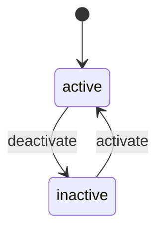

### 5.4 PurchaseRequest طلب شراء (P2)

| State | Meaning | Terminal |
|---|---|---|
| draft | being composed; no claims; numbered only after a return (OD-72 B) | no |
| pendingApproval | need approval (OD-17, recommended default: A, the chain of the requester's Unit) | no |
| approved | sourceable while a line has open quantity | no |
| rejected | need refused | yes |
| cancelled | withdrawn with nothing ordered | yes |
| closed | every line ordered or cancelled, and no PO still holding an open claim on it (§4.2.2) | yes |

`orderStatus`: §5.12.

| # | From → to | Action · endpoint | Key | Guard (pure, or in the filter) | Effects | Conc. |
|---|---|---|---|---|---|---|
| 1 | — → draft | create · `POST /purchase-requests` | `.create` | active items, or non-stock lines under OD-14 (recommended default: C, a non-stock kind on items); who raises: OD-16 (recommended default: A, department focal points) | au `create` | — |
| 2 | draft → pendingApproval | submit · `/:id/submit` | `.create` | `submitProblem`: ≥1 line, qty > 0, items active; chain staffed (OD-19) | № PR (a returned PR keeps its own); `submittedAt/By`; nt approvers | T |
| 3 | pendingApproval → approved | decide, settling rung | `.approve` | §5.2; an approver may lower a line, never raise it, the cut recorded as its `cancelledQty` (OD-17, recommended default: lowering (ii)) | nt requester and procurement (OD-61); ev `administration.purchaseRequest.approved` | A |
| 4 | pendingApproval → rejected | decide `rejected` | `.approve` | §5.2; reason | nt requester | A |
| 5 | pendingApproval → draft | return · `/:id/return` *(OD-72 B)* | `.approve` | §5.2; reason | round archived (`returned`); nt requester | A |
| 6 | draft → cancelled | cancel · `/:id/cancel` | `.cancel`, or the requester's own withdrawal (OD-28.4 (i), §5.1.4) | a reason when the draft carries a number | — | V |
| 7 | pendingApproval → cancelled | cancel | `.cancel`, or the requester's own withdrawal before a decision (OD-28.4 (i)) | reason | nt current approvers | C |
| 8 | approved → cancelled | cancel | `.cancel` | `cancelProblem`: every `orderedQty` is 0, in the filter (OD-28, recommended default: A, cancel until something is ordered, then only the remainder); reason. A line a live RFQ cites: OD-28.3 (recommended default: (i), refused, naming the RFQ; §4.5 Q6), a hint read, so RFQ issue and award re-check their lines (§5.5) | — | C |
| 9 | approved → closed | *system*, inside the PO act or the remainder cancel that completes `closeCondition` | — | every line `orderedQty + cancelledQty ≥ qty`; no citing PO in `PO_CLAIM_OPEN` (§5.14) | au: the remainder cancel's own row (`cancel`, `scope: 'remainder'`), or `complete` on the PR naming the PO when a PO act closed it; ev `….purchaseRequest.closed` | T |

- **In-state.** Edit a draft (`PATCH`, `.edit`, V); intermediate rungs (A); claims and give-backs by PO acts (§5.6).
  **Cancel the remainder:** `POST /:id/cancel-remainder { version, reason, lines?[{ lineId, qty }] }` (`.cancel`) on an
  approved PR with something ordered. Each chosen line's unclaimed quantity, every line's whole remainder by default,
  moves to `cancelledQty`; a line a live RFQ cites is treated as in row 8 (OD-28.3); row 9 follows if its condition
  holds (OD-28 A).
  With nothing ordered, the act is row 8. The screen shows one "cancel" button, and `availableActions` exposes whichever
  act applies.
- **A race-free close (§4.2.2).** The close condition reads the PR's lines and asks whether a PO still holds an open
  claim. A PO act answers that from its own transaction (§3.6); the PR's own remainder cancel asks through a checker that
  `purchase-orders` registers (a §3.6 checker). Two acts that end the last two claims would
  each read the other PO as still open in their snapshots (write skew). They do not, because every PO act that starts or
  ends a claim writes each PR it cites (§5.1.3): the two conflict on the PR, `unitOfWork` retries the loser, and the
  retry sees the other PO closed and closes the PR. The §2.4.8 check lists `approved` PRs that meet the condition
  (item 6), and spec 15 races the two closers.
- **No close on `fullyOrdered` alone.** A PO rejected or cancelled later gives its quantity back to a PR that is still
  `approved`, so no reopen edge exists: "nothing leaves a terminal state"
  (`apps/api/src/modules/hr/recruitment/job-requisitions/job-requisition-rules.ts:12-14`). A PO reopened under OD-84 B
  (§5.6 row 13) leaves its closed PR closed: the PR's part ended at ordering, and the receipts carry on on the PO.
- **Edits after approval** are OD-26 (recommended default: A, none in place: a decrease is a remainder cancel, an
  increase a new PR); rejection and return are OD-72. OD-26 B or C would add an `approved → pendingApproval` amend row,
  the requisition's regress (`statusAfterEdit`, `job-requisition-rules.ts:135-142`), under which a rejected amendment
  rejects the PR itself while its POs carry on (§4.5 note 4). The binding guard against ordering from a PR that is not
  sourceable is the PO submission's claim filter (§5.6 row 2).

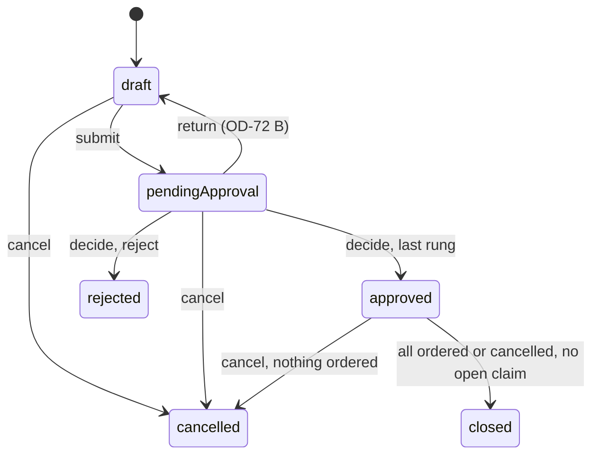

### 5.5 Rfq طلب عروض أسعار and Quotation عرض سعر (P3)

RFQs and quotations are two feature folders, `procurement/rfqs` and `procurement/quotations`. The RFQ feature mounts the
nested routes and calls the quotations' functions with the RFQ it loaded, so `quotations` never imports `rfqs` (§3.6).
The RFQ rows are numbered RF1–RF7, so that they are not read as the approval-engine defects R1–R12 (§15.2.1); the
quotation rows are Q1–Q4.

| RFQ state | Meaning | Terminal |
|---|---|---|
| draft | cites sourceable PR lines without claiming them (OD-25; without a PR, OD-27) | no |
| issued | sent to the invited suppliers; quotations can be recorded | no |
| evaluating | bidding closed, under evaluation. Not named `closed`, so that a `closed` status is terminal on every document | no |
| awarded | selection recorded | yes |
| cancelled | abandoned, "no award" included | yes |

| Quotation state | Meaning | Terminal |
|---|---|---|
| received | recorded with its file | no |
| selected | chosen by the award for some or all lines | yes |
| notSelected | not chosen, or its RFQ was cancelled | yes |
| withdrawn | withdrawn by the supplier; frees the supplier's slot (`ux_rfq_supplier`, §2.5) | yes |

`expired` is derived (`validUntil` before the Cairo business date), never stored.

| # | From → to | Action · endpoint | Key | Guard (pure, or in the filter) | Effects | Conc. |
|---|---|---|---|---|---|---|
| RF1 | — → draft | create · `POST /rfqs` | `administrationRfq.create` | the cited PR lines in `PR_SOURCEABLE` (§5.14), with open quantity | au `create` | — |
| RF2 | draft → issued | issue · `/:id/issue` | `.create` | `issueProblem`: ≥1 line; the cited PR lines still sourceable (re-read); invited suppliers active; how many must be invited is OD-23 (recommended default: A, judged at award; D, a flat minimum here until P4's bands exist); `responseDueAt` set, its length per OD-23 | № RFQ; papers (§11) | T |
| RF3 | issued → evaluating | close bidding · `/:id/close-bidding` | `.edit` | at or after `responseDueAt`; late and expired quotations: OD-23 (recommended default: (i), a quotation is recorded only while bidding is open, so none after this row, and an expired one is never awarded) | — | C |
| RF4 | evaluating → awarded | award · `/:id/award { selections[{ lineId, quotationId }], justification? }` | `.award` | `awardProblem`: each quotation `received`, invited and not expired (OD-23); the cited PR lines still sourceable (re-read); the minimum number of valid quotations, judged on the awarded total, or a written reason (OD-23, recommended default: A); a justification when the choice is not the lowest compliant price, and a split by line allowed (OD-24, recommended default: A) | quotations → `selected` / `notSelected` through the quotations' functions (§3.4); au `statusChange` on the RFQ and on each quotation it settled; `awardedAt/ByUserId`; POs are then drafted from the award (§4.2.2 step 8) | T |
| RF5 | draft → cancelled | cancel · `/:id/cancel` | `.edit` | — | — | V |
| RF6 | issued → cancelled | cancel | `.edit` | reason | every `received` quotation → `notSelected`, each audited (§3.4); supplier notice (§11) | T |
| RF7 | evaluating → cancelled | cancel, "no award" | `.edit` | reason | every `received` quotation → `notSelected`, each audited | T |
| Q1 | — → received | record · `POST /rfqs/:id/quotations` | `.edit` | the RFQ `issued`, in the touch-write's filter; the supplier invited; one live quotation per supplier (`ux_rfq_supplier`); the file first (§11.4; required attachments, OD-76) | au `create` | T |
| Q2 | received → withdrawn | withdraw · `/rfqs/:id/quotations/:quotationId/withdraw` | `.edit` | the RFQ `issued` or `evaluating`, in the touch-write's filter; reason; quoting again after a withdrawal: OD-23 (recommended default: one live offer (i), the slot freed, so a new quotation is recorded while bidding is open) | au `statusChange` | T |
| Q3 | received → selected | only through RF4 | `.award` | — | — | T |
| Q4 | received → notSelected | through RF4, RF6 or RF7 | `.award` (RF4) · `.edit` (RF6, RF7) | — | — | T |

- **In-state.** Edit the RFQ draft (`PATCH`, `.edit`, V). Edit a received quotation while the RFQ is `issued`
  (`PATCH /rfqs/:id/quotations/:quotationId`, `.edit`): a named guarded write, filtered on `status: 'received'`, plus the
  touch-write (§5.1.4).
- **The RFQ touch-write.** Every quotation act runs in a **T** whose first write is
  `updateOne({ _id: rfqId, status: <allowed> }, { $inc: { __v: 1 } })` on the RFQ. A racing close of bidding, award or
  cancel then conflicts with it, and `unitOfWork` retries the loser against the RFQ's new state (§5.1.3). Without it the
  RFQ's status would be a prior read.
- **An awarded RFQ is final** under OD-26 A (recommended): if its PO is rejected or cancelled, the PR lines return to the
  sourcing queue by themselves, and a new RFQ or a direct PO (OD-23, OD-27) is the path. OD-26 B would add a re-award
  on an `awarded` RFQ, a `notSelected → selected` quotation row for lines whose PO was rejected or cancelled, which this
  section does not draw (§4.5 Q11).

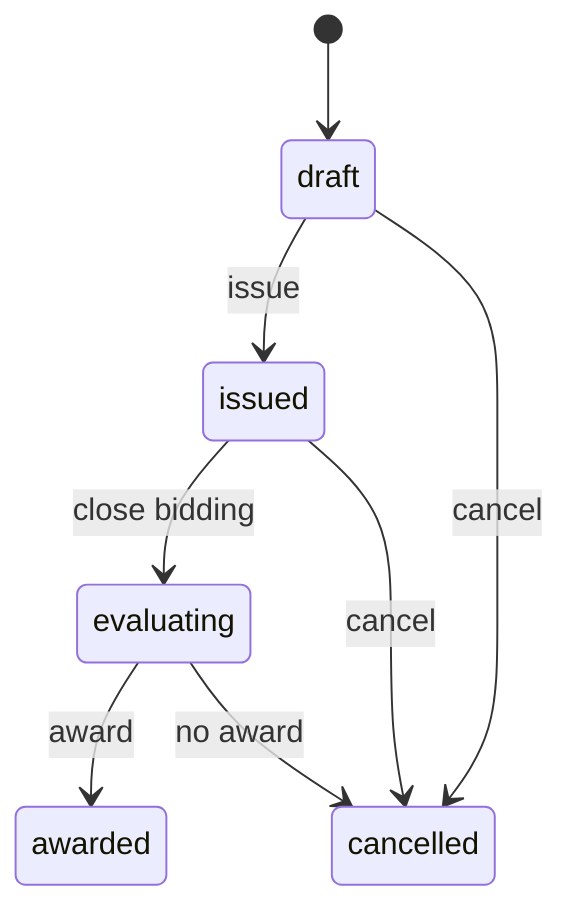

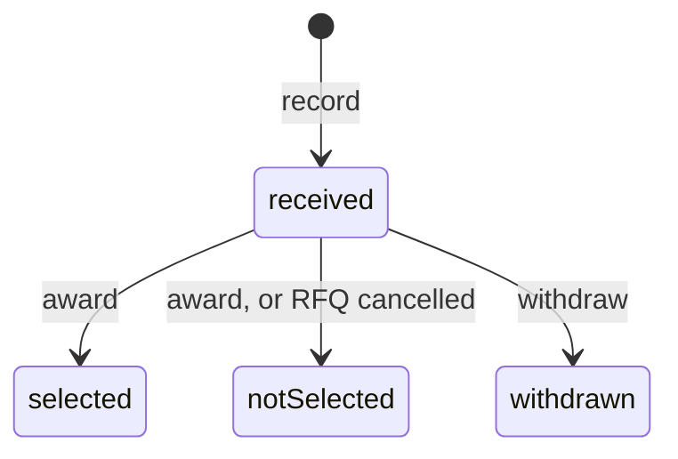

### 5.6 PurchaseOrder أمر شراء (P4)

| State | Meaning | Terminal |
|---|---|---|
| draft | from an award or from PR lines (without a PR: OD-27, recommended default: A, never); no claims | no |
| pendingApproval | spend approval, its request type picked by value band (OD-18, recommended default: A, basis 1, the PO total); PR lines claimed | no |
| approved | spend approved; not yet sent | no |
| issued | sent to the supplier (OD-31); receivable | no |
| closed | `fullyReceived` (a system close under OD-28 A), or short-closed | yes (OD-84 B: back to `issued`, row 13) |
| rejected | spend refused; claims given back | yes |
| cancelled | ended before any GRN was posted; claims given back | yes |

`receiptStatus`: §5.12.

| # | From → to | Action · endpoint | Key | Guard (pure, or in the filter) | Effects | Conc. |
|---|---|---|---|---|---|---|
| 1 | — → draft | create · `POST /purchase-orders` | `.create` | the supplier active; PR lines sourceable (a hint: row 2 binds) | au `create` | — |
| 2 | draft → pendingApproval | submit · `/:id/submit` | `.create` | `submitProblem`: ≥1 line; a unit price on each (OD-29, OD-30); `totalMinor` by a pure function; `approvalRequestTypeFor(total, bands)` (OD-18); chain staffed (OD-19) | № PO first; claim PR `orderedQty` (filter: the PR in `PR_SOURCEABLE`, open quantity ≥ qty; OD-27); each PR's `orderStatus` and `__v`; `totalMinor` frozen (§2.5) | T |
| 3 | pendingApproval → approved | decide, settling rung | `.approve` | §5.2; pairs A1 (creator, submitter) and B3 (the RFQ's awarder) | nt creator; ev `administration.purchaseOrder.approved` | A |
| 4 | pendingApproval → rejected | decide `rejected` | `.approve` | reason | give back PR claims, each PR written; nt creator | A + T |
| 5 | pendingApproval → draft | return *(OD-72 B)* | `.approve` | reason | give back PR claims; round archived | A + T |
| 6 | approved → issued | issue · `/:id/issue` | `.issue` | OD-31 (recommended default: A, printed and handed over, the channel recorded); a supplier retired since approval does not stop it (§5.3); a blocked one only under OD-12 C | `issuedAt/ByUserId`; papers (§11); ev `….purchaseOrder.issued` (إصدار fits) | C |
| 7 | issued → closed | *system*, inside the GRN post or the remainder cancel that reaches `fullyReceived` (OD-28, recommended default: A) | — | `receiptStatus = fullyReceived` | each claiming PR written (§5.4 row 9); au: `complete` on the PO naming the GRN when a GRN closed it, or the remainder cancel's own row (`cancel`, `scope: 'remainder'`), whose reason becomes `closeReason`; ev `….purchaseOrder.closed` | T |
| 8 | issued → closed | short-close · `/:id/close` | `.close` | `closeProblem`: a GRN has been posted on the PO (else row 12); reason; no draft GRN cites the PO: OD-28 (recommended default: refused, naming the draft), a hint (§5.1.3) | remainders → `cancelledQty`, given back to the PR lines in OD-25's order (recommended default: (i), the newest source first, §4.5 Q13); `closeReason`; au `cancel` with `scope: 'remainder'` and `shortClosed: true`; ev `….purchaseOrder.closed` | T |
| 9 | draft → cancelled | cancel · `/:id/cancel` | `.close` (§6.2: every act that ends a PO) | a reason when the draft carries a number | — | V |
| 10 | pendingApproval → cancelled | cancel | `.close` | reason | give back PR claims; nt current approvers | T |
| 11 | approved → cancelled | cancel | `.close` | reason | give back PR claims | T |
| 12 | issued → cancelled | cancel | `.close` | reason; no GRN ever posted on the PO (OD-28, recommended default: A, cancel until the first receipt, then short-close); no draft GRN, as in row 8 | give back PR claims; supplier notice (§11) | T |
| 13 | closed → issued | *system (OD-84 B only)*, inside an SRN post with `reasonCode: 'entryError'` that leaves the PO short of `fullyReceived` | — | the PO was closed by a GRN post: row 7 with `closeReason` null (a short-close and a remainder cancel record one) | `receiptStatus` recomputed; au `statusChange` on the PO, naming the SRN; no event (§8.2 lists none) | T |

- **In-state.** Edit a draft (`PATCH`, `.edit`, V); intermediate rungs; `receiptStatus` written by GRN and SRN posting
  (§5.7). **Cancel a remainder:** `POST /:id/cancel-remainder { version, reason, lines[{ lineId, qty }] }` (`.close`) on
  `approved` or `issued`: the decrease of OD-26 A (recommended; §4.5 Q7). Each line's claim is
  `cancelledQty + q ≤ qty − receivedQty`, given back to its PR lines in OD-25's order; `receiptStatus` is recomputed and
  may reach row 7; au `cancel` with `scope: 'remainder'`. Cancelling everything left on a PO with nothing received is
  row 11 or row 12, not this act.
- **"Received" is one fact for both ends.** Under OD-36 A and OD-84, `receivedQty` is net of the returns that gave it
  back (§2.5), so a supplier return can take an `issued` PO back to `notReceived` while its GRNs stay posted. Short-close
  (row 8) and cancel (row 12) therefore both test whether a GRN was ever posted on the PO, through a checker
  `goods-receipts` registers (§3.6, widened from "a draft GRN" to "a draft or a posted GRN"), and never `receivedQty`.
  Exactly one of the two applies, so the PO never strands with its PR claims. The read is safe: a GRN post writes the PO
  (its claim), so it conflicts with a concurrent cancel or short-close.
- **Reopening (row 13)** is the cross-section edge OD-84 B needs (§4.3.2): a receipt keyed in error closed the PO, and the
  correcting return shows that the goods are still due. It is taken only for a PO a GRN closed, never for a short-closed
  or cancelled one. Under OD-28 A's auto-close, OD-84 A needs the same edge. The two options differ in what corrects
  the receipt: A a new movement kind (a value in §2.4.2's closed list, with its legs, its card label and its term in the
  §2.4.8 check), B one reason code on an ordinary supplier return. An explicit close under OD-28 (§4.2.3) would need the
  edge under neither.

**Revisions (OD-26, recommended default: A).** §4.5 Q8 sets the options: (a) cancel, short-close or cancel a remainder,
and raise a new PO; (b) a revision. Under A nothing more is built. Under B a revision is in-state: the PO keeps its
status and keeps receiving under its approved terms while the change waits. Its impact, none of it in §2's fields or
this section's tables: on the PO, `pendingRevision`, `revisions[]` (the prior terms, as job offers keep theirs,
`apps/api/src/modules/hr/recruitment/job-offers/job-offer.service.ts:202-248`) and a moving `revisionNumber`, plus a
`revision` round, a fourth `endedBy` value beside §5.2's three, that `approvalPending` would count as open; one act,
`/amend` under `.edit`, which needs a new round under the revised total's band (OD-18) when the change asks more than
was granted (`requiresReapproval`, `job-requisition-rules.ts:102-107`); the PR claims moved by the delta and an issued
PO re-issued (OD-31); one pending revision at a time, no line below its received quantity, short-close, cancel and
remainder cancel refused while one waits (a guard on rows 8, 11 and 12), and a pending revision discarded when the PO
closes (row 7). Its events, signals, audit rows and paper are listed in OD-26 B's impact (§16); effort M. Its route and
guards are designed in P4 if the owner picks B. A supplier change is never a revision: under B it re-awards
within the RFQ once the PO is rejected or cancelled, a `notSelected → selected` quotation row (§5.5; §4.5 Q11).

The requisition's status regress (`statusAfterEdit`, `job-requisition-rules.ts:135-142`) is not used for POs: for a PO
already with the supplier, a rejected amendment would reject the commitment itself, and receipts would stop while it
waits.

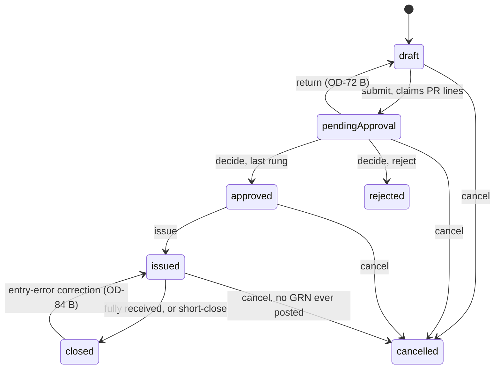

### 5.7 Posting documents — GRN إذن استلام, SupplierReturn مرتجع مشتريات, StockIssue إذن صرف, StockReturn مرتجع صرف, OpeningBalance رصيد افتتاحي (P5, P6)

All five share one machine, `shared/posting-lifecycle.ts` (§5.16). GRN, SRN and OB ship in P5,
ISS and RTN in P6 (§18.2).

| State | Meaning | Terminal |
|---|---|---|
| draft | being prepared; no stock effect, number or claim | no |
| posted | movements written in the same transaction; content immutable | yes |
| cancelled | abandoned draft | yes |

| From → to | Action · endpoint | Key | Conc. |
|---|---|---|---|
| — → draft | create · `POST /<plural>` | GRN `administrationGoodsReceipt.create` · SRN `administrationSupplierReturn.create` · ISS `administrationStockIssue.create` · RTN `administrationStockReturn.create` · OB `administrationStock.openBalance` | — |
| draft → posted | post · `/:id/post { version }` | the same key (posting rides it, §5.1.4) | **T** in §2.4.4's order, on balance rows ensured beforehand, outside the transaction (`ensureStockRows`): the number; the head as **C** (the idempotency guard); the claims on the source lines, through their owner's function; per leg, the retired-row read (which also refuses a line whose `unitId` is no longer its item's, 409 `ADMINISTRATION_ITEM_UNIT_CHANGED`: the binding guard behind §2.3.4's checker) and one guarded `$inc`; then `insertLegs`. Quantities change only inside this transaction |
| draft → cancelled | cancel · `/:id/cancel` | the same key | V |

A posted document is final; a mistake is corrected by an opposing document, never by a status flip (D-2; payroll's
"corrected forward", `run-lifecycle.spec.ts:49-61`). Only a draft is cancelled, on all five.

| Doc | Post guard (pure, and in the write) | mv | Effect on the source document | au | ev | Opposing document |
|---|---|---|---|---|---|---|
| GRN | the PO in `PO_RECEIVABLE` (§5.14); the PO-line claim within OD-32's tolerance (recommended default: A, no excess), and the line's `deliveryWarehouseId` = the GRN's warehouse (OD-22, §2.6); rejected quantity: OD-34 (recommended default: A, on the line, no movement); inspection members only under OD-35 B (recommended default: A, the signed-in poster is the receiver); the poster is no approver of the PO (§6.6 A2); item and warehouse per OD-70's map (§5.3); the on-hand rows not frozen | `goodsReceipt` (onHand, in), with `unitCostMinor` and `currency` from the PO line | PO line `receivedQty`; `receiptStatus`; the PO's `__v`; `issued → closed` at `fullyReceived` (§5.6 row 7) | `receive`; `complete` on a PO it closes | `administration.goodsReceipt.posted`, reliable (§12) | an SRN; for a GRN keyed in error, an SRN with `reasonCode: 'entryError'` (OD-84, recommended default: B); never an ADJ (§4.3.2) |
| SRN | the GRN-line claim `returnedQty + q ≤ acceptedQty`; on hand ≥ qty; the on-hand row not frozen; a reason code from the closed list (§2.4.1) | `supplierReturn` (onHand, out) | GRN line `returnedQty`; PO `receivedQty` given back under OD-36's reopen (recommended default: A, while the PO is open) and always for OD-84's `entryError`; `receiptStatus`; a PO a GRN closed reopens under OD-84 B (§5.6 row 13) | `return`; `statusChange` on a PO it reopens | `administration.supplierReturn.posted`, reliable (§12, OD-36) | a GRN on the PO, or an ADJ |
| ISS | the MR in `MR_ISSUABLE`, or a direct issue (OD-40, recommended default: A, none; C for categories the owner names); the MR-line claim; on hand ≥ qty; the on-hand row not frozen; a named recipient refused only on a positive `exited` answer (OD-44, recommended default: per act (i), IT's rule; §4.3.4); the cost center: OD-41 | `issue` (onHand, out) | MR line `issuedQty`; `issueStatus`; MR `approved → closed` once every line is issued or cancelled (§5.8 row 9) | `assign`; `complete` on an MR it closes | `administration.stockIssue.posted` | an RTN, or an ADJ; an issue posted against the wrong MR: below |
| RTN | the issue-line claim `returnedQty + q ≤ qty`; the condition: OD-43 (recommended default: A, every return posts, damaged lines are then written off); the on-hand row not frozen | `issueReturn` (onHand, in) | issue line `returnedQty`; the MR is untouched (§5.12) | `return` | `administration.stockReturn.posted` | an ISS, or an ADJ |
| OB | the first movement of its (warehouse, item) row, in the leg's filter (`lastMovementAt: null`, §4.3.1); the path: OD-63 (recommended default: A, an in-app document posted by a second person, so the drafter is not the poster, §6.6); `at` = the posting instant, as on every leg (OD-74 A); `asOfDate`, the counted date (a Cairo date no later than today), is stored and printed, never the movement's `at` (§2.6) | `openingBalance` (onHand, in), with `unitCostMinor` and `currency` (OD-63, OD-37) | — | `receive` | none (§8.2) | an ADJ (§18.1 A11) |

- **Go-live order (P5).** The per-row rule is the only ordering rule: an opening balance on a row that has already
  moved is refused (`lastMovementAt: null` in the leg's filter, 422 `ADMINISTRATION_OPENING_BALANCE_NOT_FIRST`), and no
  warehouse flag refuses the posting that moved it first. The go-live procedure therefore posts each warehouse's opening
  balance before its first other posting (§15.3.5 c), and a row that moved first takes its opening stock through an
  approved `adjustmentIn` (§4.3.1).
- **OD-28 × OD-36 × OD-84.** Auto-close at `fullyReceived` (OD-28 A) and "a return reopens the PO line" (OD-36 A) cannot
  both reach a `closed` PO, because a terminal state takes nothing back. Under both defaults a return against a closed
  PO ends with a debit note (§12), and a replacement is a new PO. OD-84 B's entry-error return is the one exception: it
  reopens a PO that a receipt closed (§5.6 row 13), because the receipt it corrects never happened.
- **An issue posted against the wrong MR** is corrected by a stock return plus a new issue against the right MR. The
  return never lowers the wrong MR's `issuedQty`, which is never given back (IT's "everything EVER issued", §5.12),
  unlike the `receivedQty` that OD-84 B gives back for a GRN. This is a sub-question of OD-43 (recommended default:
  never given back, IT's rule).

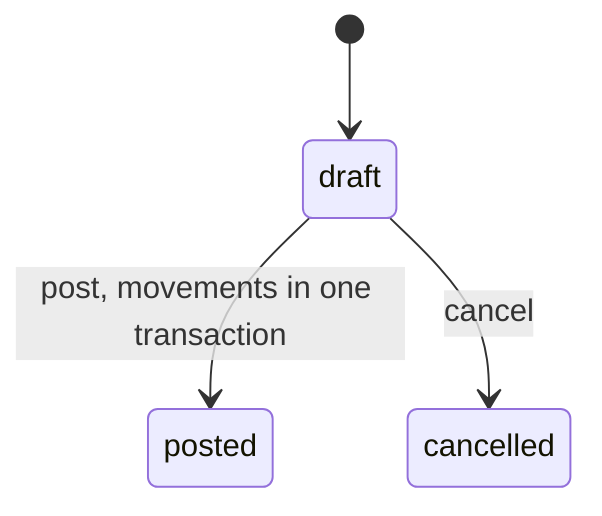

### 5.8 MaterialRequest طلب صرف (P6)

| State | Meaning | Terminal |
|---|---|---|
| draft | being composed; numbered only after a return | no |
| pendingApproval | approval (OD-39, recommended default: A, the department chain; quantities lowered, never raised) | no |
| approved | issuable while a line has open quantity | no |
| rejected | refused | yes |
| cancelled | withdrawn with nothing issued | yes |
| closed | every line issued or cancelled, with something issued | yes |

`issueStatus`: §5.12.

| # | From → to | Action · endpoint | Key | Guard (pure, or in the filter) | Effects | Conc. |
|---|---|---|---|---|---|---|
| 1 | — → draft | create · `POST /material-requests` | `.create` | who raises: OD-38 (recommended default: A, department focal points; ESS at own scope only under B, §6.5); the fulfilling warehouse: OD-75 (recommended default: A, one in the requester's branch) | au `create` | — |
| 2 | draft → pendingApproval | submit · `/:id/submit` | `.create` | `submitProblem`; chain staffed (OD-19) | № MR; nt approvers | T |
| 3 | pendingApproval → approved | decide, settling rung | `.approve` | §5.2; a reduction at the decision (OD-39) is the line's `cancelledQty`, no new field (§2.6) | nt requester and the fulfilling warehouse's keepers (OD-61); ev `administration.materialRequest.approved`; a reservation only under OD-42 (recommended default: A, none) | A |
| 4 | pendingApproval → rejected | decide `rejected` | `.approve` | reason | nt requester | A |
| 5 | pendingApproval → draft | return *(OD-72 B)* | `.approve` | reason | round archived | A |
| 6 | draft → cancelled | cancel · `/:id/cancel` | `.cancel`, or the requester's own withdrawal (OD-28.4 (i), §5.1.4) | a reason when the draft carries a number | — | V |
| 7 | pendingApproval → cancelled | cancel | `.cancel`, or the requester's own withdrawal before a decision (OD-28.4 (i)) | reason | nt current approvers | C |
| 8 | approved → cancelled | cancel | `.cancel` (OD-28.2, recommended default: (i), a `.cancel` holder only) | every `issuedQty` is 0, in the filter (OD-28, recommended default: A); reason; no draft issue names the MR (a hint: a stale draft cannot post, since `MR_ISSUABLE` is in its claim filter) | — | C |
| 9 | approved → closed | *system*, inside the issue post or the remainder cancel that completes it | — | every line `issuedQty + cancelledQty ≥ qty`, and Σ `issuedQty` > 0 | au: the remainder cancel's own row (`cancel`, `scope: 'remainder'`), or `complete` on the MR naming the issue that closed it; ev `….materialRequest.closed` | T |

In-state: edit a draft; intermediate rungs; **cancel the remainder**,
`POST /:id/cancel-remainder { version, reason, lines?[{ lineId, qty }] }` (`.cancel`; §4.3.4, "close the rest"), only
when something was issued. With nothing issued the act is row 8, so an MR ends `closed` if anything was issued and
`cancelled` otherwise (§4.3.4). The remainder cancel leads to row 9. When the store cannot supply the rest, OD-28.1
decides who closes it (recommended default: (ii), a keeper's "cannot supply" act: the keeper calls the same
`POST /material-requests/:id/cancel-remainder` under `administrationStockIssue.create` on the MR's warehouse, with a
reason and the same effect, as OD-47.1 A closes an undispatched rest; (i) gives the storekeeper bundle `.cancel` instead).
Unlike a PR, a fully issued MR closes at once: posted issues are never undone, and returns never lower `issuedQty`.

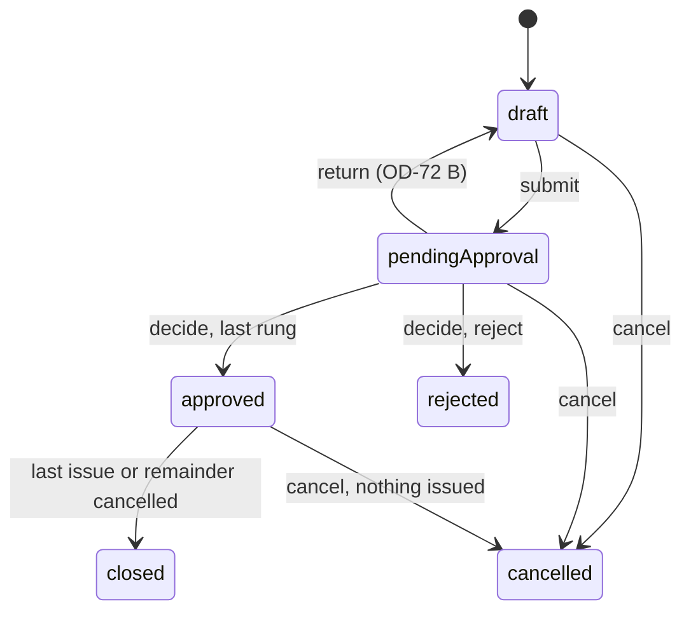

### 5.9 StockTransfer تحويل مخزني (P7)

| State | Meaning | Terminal |
|---|---|---|
| draft | composed at the source (OD-45, recommended default: A, the source creates) | no |
| pendingApproval | only where OD-45 requires approval (recommended default: A, inter-branch transfers) | no |
| approved | ready to dispatch | no |
| dispatched | stock sits in the destination's inTransit bucket; receipts, resolutions and loss rounds run here | no |
| closed | nothing left in transit | yes |
| rejected | refused | yes |
| cancelled | ended before dispatch | yes |

`receiptStatus`, `discrepancy`: §5.12. Branch sides: §7.4. The number is taken at submission, always, with or without
approval (§2.8).

| # | From → to | Action · endpoint | Key (side) | Guard (pure, or in the filter) | Effects | Conc. |
|---|---|---|---|---|---|---|
| 1 | — → draft | create · `POST /stock-transfers` | `.create` (source) | the two warehouses differ and are active | au `create` | — |
| 2 | draft → pendingApproval | submit · `/:id/submit` | `.create` (source) | `transferNeedsApproval(transfer, policy)` is true (OD-45); chain staffed (OD-19) | № TRF; nt approvers | T |
| 3 | draft → approved | submit · `/:id/submit` | `.create` (source) | `transferNeedsApproval` is false: OD-45 A's conditional edge | № TRF; an empty trail; au `statusChange` with `approvalRequired: false`; nt dispatcher | T |
| 4 | pendingApproval → approved | decide, settling rung | `.approve` | §5.2 | nt source keepers | A |
| 5 | pendingApproval → rejected | decide `rejected` | `.approve` | reason | nt source keepers | A |
| 6 | pendingApproval → draft | return *(OD-72 B)* | `.approve` | reason | round archived | A |
| 7 | approved → dispatched | dispatch · `/:id/dispatch { version, carrier?, lines? }` | `.dispatch` (source) | on hand at the source ≥ qty; the source's on-hand rows not frozen. The destination may be under count, because its leg is in transit (§2.4.6). Carrier and deadline: OD-46 (recommended default: A, the carrier as text, overdue after N days). Dispatching less than planned: OD-47.1 (recommended default: A, the rest cancelled with a reason, in this act) | mv `transferDispatch` (source onHand out, destination inTransit in); `dispatchedQty`; `dispatchedAt/ByUserId`; au `transfer`; ev `….stockTransfer.dispatched` (خروج); nt destination keepers (permission@branch) | T |
| 8 | dispatched → closed | *system*, inside the receipt, late arrival, return posting or loss approval that empties transit | — | `remainingInTransit` = 0 on every line | `closedAt`; the act's own row; ev `….stockTransfer.closed` | T |
| 9 | draft → cancelled | cancel · `/:id/cancel` | `.create` (source) | a reason when the draft carries a number | — | V |
| 10 | pendingApproval → cancelled | cancel | `.create` (source) | reason | nt current approvers | C |
| 11 | approved → cancelled | cancel | `.create` (source) | reason | nt dispatcher | C |

In-state on `dispatched`, each a **T** with one audit row per act. A count freezes on-hand legs only (§5.10), so the
in-transit legs below pass a freeze and the on-hand legs do not. The outcomes follow OD-47's recommended defaults:
short dispatch OD-47.1 A, resolver OD-47.2 A, return OD-47.3 B and the loss round OD-47.4 (ii) (§2.4.5). The keys and
sides are §7.4's; the verbs are §10.2's.

- **Receive** `POST /:id/receipts { version, side: 'destination', lines[{ lineId, qty, declareShort? }] }` (`.receive`,
  destination side). `qty` ≤ the line's plain in-transit share; the destination warehouse active; its on-hand row not
  frozen: receiving into a warehouse under count is refused with 422 `ADMINISTRATION_STOCK_FROZEN` until the count posts.
  mv `transferReceipt` (destination inTransit out, onHand in) into `receivedQty`. A line declared
  short gets `shortDeclaredAt` / `shortDeclaredByUserId` and `discrepancy: open`; its received part posts, and the rest
  stays in transit. The receiver is not the dispatcher (§6.6 B2); where one keeper runs both stores, another holder of
  `.receive` reaching the destination, or a holder at a higher level, receives (B2's small-branch escape, §6.6). au
  `receive`; ev `….stockTransfer.received`.
- **Resolve** `POST /:id/resolve { version, outcome, lines[{ lineId, qty, reason }] }`, on lines declared short, `qty` ≤
  each line's plain in-transit share (for `returnNotArrived`, its `returningQty`). One call carries one outcome, so that
  each act has one key, one side and one verb (the table below).

| Outcome | Key (side, §7.4) | Effect | au |
|---|---|---|---|
| `lateArrival`: the goods came after all | `.resolve` (destination); not the line's `shortDeclaredByUserId` (§6.6, resolver ≠ receiver); not the dispatcher (B2, with its small-branch escape) | the receipt pair into `receivedQty`, as for a receipt; the on-hand row not frozen | `receive` |
| `returningToSource`: the goods are going back | `.receive` (destination) | the destination only declares: the quantity becomes `returningQty`, and nothing moves at resolve time. The source keeper posts the `transferReturn` on arrival (return posting, below) | `resolve` |
| `writtenOff`: the goods are lost | `.resolve` (destination); not the line's `shortDeclaredByUserId` | the quantity becomes `lossPendingQty`; nothing moves. It opens a loss round on the dispatched transfer (`administration.stockTransfer`; the earlier round moves into `approvalRounds[]` as `loss`; one loss round at a time), decided through `/decide`. This is the transfer's only chain check: under OD-19 A the resolve is refused with 422 `ADMINISTRATION_APPROVAL_CHAIN_MISSING` when no active `administration.stockTransfer` chain with a staffed rung covers the transfer's Unit (§7.6); the line stays declared short, OD-61's stuck notice asks for a chain, and the resolve passes once one is configured. The final approval posts `transitLoss` (destination inTransit out) into `lostQty` in an **A + T**; a rejection returns the quantity to the plain in-transit share, the discrepancy still open | `resolve` |
| `returnNotArrived`: goods declared returning never reached the source | `.resolve` (destination); not the line's `shortDeclaredByUserId` | the quantity leaves `returningQty` for the plain in-transit share, the discrepancy still open; nothing moves. From there a `writtenOff` puts it to OD-47.4's loss round, or a `lateArrival` receives it if it turns up at the destination | `resolve` |

- **Return posting** `POST /:id/receipts { version, side: 'source', lines[{ lineId, qty }] }`
  (`administrationStockTransfer.receive`, source side, reaching `fromBranchId`): the source keeper posts it when the
  goods are back, never at resolve time and never under `.resolve`; `qty` ≤ the line's `returningQty`. mv `transferReturn`
  (destination inTransit out, source onHand in) into `returnedQty`; the source's on-hand row not frozen, so a return to a
  source under count waits for its posting; au `return`. The source's stock rises only when the goods arrive, and a
  destination key never writes the source's on hand.
- **Every line can close.** From any reachable state of its counters, a dispatched line can still reach
  `receivedQty + returnedQty + lostQty = dispatchedQty`: the plain share by a receipt, a `lateArrival` or a loss round;
  `returningQty` by the source's return posting or `returnNotArrived`; `lossPendingQty` by the round's approval, or by
  its rejection back to the plain share. Spec 16 (§5.16) checks it.
- OD-47's other options post the return at once (OD-47.3 A), send goods back on a new transfer once the destination
  has received them (OD-47.3 D, which drops `returningQty`, `returningToSource`, `returnNotArrived` and the return
  posting), let the resolver post a loss alone (OD-47.4 (i)), or put losses on an adjustment line on the in-transit
  bucket (OD-47.4 (iii), which changes `MOVEMENT_LEGS` and the adjustment kinds, §2.4.5).
- **One receipt endpoint, two sides:** `side` picks the branch the key must reach (§7.4).
- **Overdue** transfers are notified by a sweep (OD-46); it never moves stock.

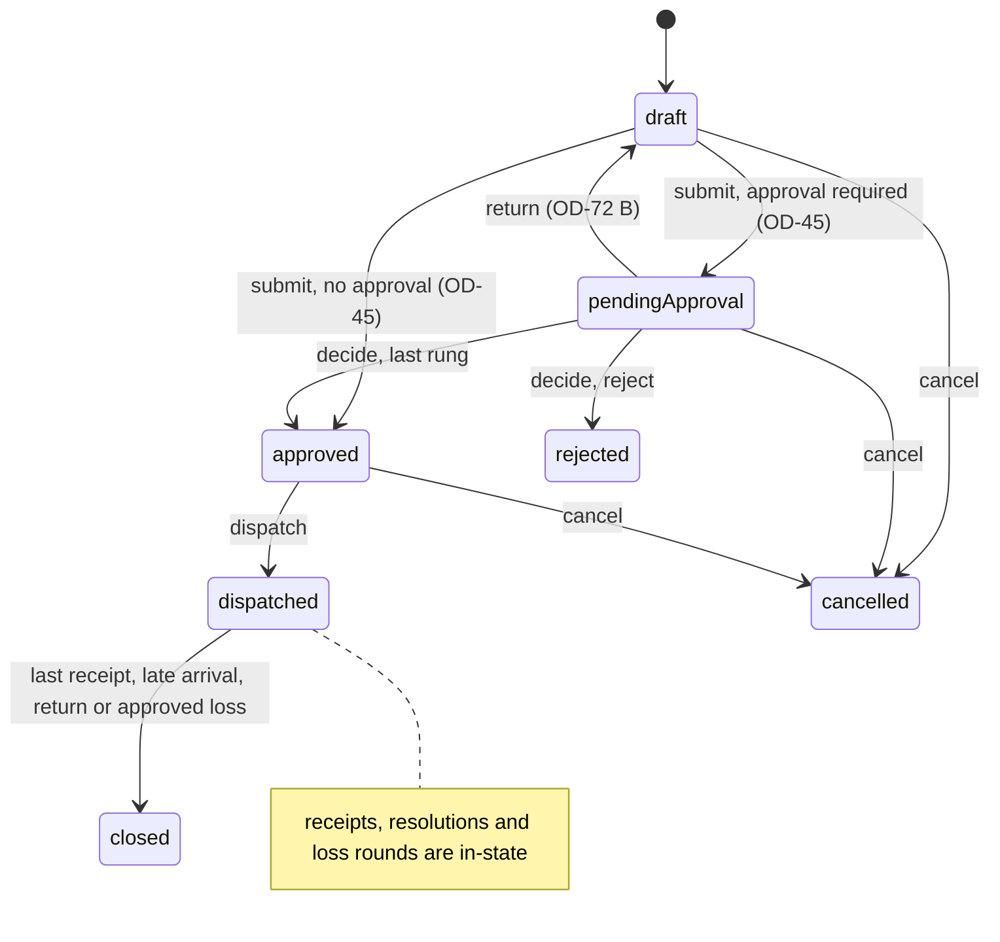

### 5.10 StockCount جرد (P7)

The document's Arabic name is a candidate (§0.4, OD-67).

| State | Meaning | Terminal |
|---|---|---|
| draft | warehouse, scope (OD-48), blind count (OD-49) and team (OD-50) chosen | no |
| inProgress | the in-scope balance rows carry `frozenByCountId`; book quantities snapshotted as `expectedQty`; counting | no |
| submitted | counting closed; every line `locked`; the variance derived | no |
| pendingApproval | the variance in the engine | no |
| posted | variance movements written; the freeze released | yes |
| cancelled | the freeze released; lines kept and locked | yes |

**The freeze is bucket-aware.** `frozenByCountId` guards on-hand legs only. A dispatch to a
warehouse under count is allowed: the quantity waits in the destination's inTransit bucket. Receiving it into the
frozen on-hand row is refused until the count is posted, with 422 `ADMINISTRATION_STOCK_FROZEN` (never 409: a retry
cannot cure it). Outflows from frozen rows are refused the same way. A loss, and the in-transit half of a return, pass
(§2.4.6). Goods that arrive during a count therefore stay in transit and out of the count (OD-48, recommended default:
A, freeze the counted items, with reminders and no automatic release; arrivals (i)).

| # | From → to | Action · endpoint | Key | Guard (pure, or in the filter) | Effects | Conc. |
|---|---|---|---|---|---|---|
| 1 | — → draft | open · `POST /stock-counts` | `.create` | the warehouse active | au `create` | — |
| 2 | draft → inProgress | start · `/:id/start` | `.create` | no in-scope row frozen by another count, in each claim's filter | the in-scope rows ensured before the transaction (`ensureStockRows`, zero rows included, §2.4.6). Inside it: № CNT first; the lines written with `expectedQty` = `onHandQty` and `locked: false`; each row claimed by `updateOne({ warehouseId, itemId, frozenByCountId: null }, { $set: { frozenByCountId } })`, a miss being 422 `ADMINISTRATION_STOCK_FROZEN` naming the holding count; `startedAt`; au `start`; ev `….stockCount.started` | T |
| 3 | inProgress → submitted | submit · `/:id/submit` | `.create` (§6.2) | `countComplete(lines)`: every line counted, every reopened line recounted; `varianceOf(expectedQty, recountQty ?? countedQty)` | every line `locked` in the same T; `countSubmittedAt` / `countSubmittedByUserId` (the approval host's `submittedAt/By` wait for row 5); au `statusChange` | T |
| 4 | submitted → inProgress | recount · `/:id/recount { version, lineIds, reason }` | `.create` | OD-51 (recommended default: A; the owner may reopen chosen lines with a reason) | the chosen lines unlocked; their next entry writes `recountQty` and keeps the first `countedQty` (§2.6); the freeze held; au `statusChange` | T |
| 5 | submitted → pendingApproval | request approval · `/:id/request-approval` | `.create` | chain staffed (OD-19); zero-variance counts too (OD-51, recommended default: (i)) | `submittedAt/By` (the approval host's pair, §2.1), stamped here and not at the counting submit; nt approvers; au `statusChange` | C |
| 6 | pendingApproval → posted | decide, settling rung | `.approve` | §5.2; no counter approves (§6.6 A3) | mv `countGain` / `countLoss` per variance line, qty = \|variance\|; each leg filtered on `frozenByCountId` = this count and `onHandQty` = `expectedQty`, so a match shows the freeze held, and the same update releases the row; a zero line only releases; au under OD-82 with the variance lines; ev `….stockCount.posted` | A + T |
| 7 | pendingApproval → inProgress | decide `rejected`, a recount *(OD-51 A)* | `.approve` | reason | round archived (`recount`); lines unlocked; the freeze held | A + T |
| 9 | draft → cancelled | cancel · `/:id/cancel` | `.create` | — | — | V |
| 10 | inProgress → cancelled | cancel | `.create` | reason | the freeze released (`releaseCount`, §3.4); every line locked in the same T | T |
| 11 | submitted → cancelled | cancel | `.create` | reason; abandoning a counted count: OD-51 (below) | as row 10 | T |
| 12 | pendingApproval → cancelled | cancel | `.create` | reason; as row 11 | as row 10; nt current approvers | T |

- **Abandoning a count after counting** (rows 11, 12) drops a variance and releases the stock, so it is a control
  question: OD-51 (recommended default: allowed under `.create` with a reason; the current approvers are notified, and
  the counted lines and their variance stay on the cancelled document).
- **Count entry** (in-state): `PATCH /:id/lines { lines[{ lineId, countedQty, version }] }` (`.count`; `recountQty` on a
  reopened line), V per line, with `locked: false` in the line's filter (§2.6); one `update` row on the count per saved
  page (§10.2). `countedByUserId` and `countedAt` are stamped, and a recount stamps `recountedByUserId` (§2.6; pair A3,
  §6.6). The submit and every cancel lock the lines in their own
  transaction, so a racing entry either lands first or is refused. A blind count hides `expectedQty` (OD-49,
  recommended default: A).
- **Found stock.** An item found on the shelf with no line gets one before the submit: its row is ensured outside the
  transaction, then one act freezes the row and writes the line with `expectedQty` = its on hand, 0 for a new row
  (§2.4.6); au `update`.
- **Precedent.** The claim copies one idea of the attendance freeze, a stamp inside the write's filter: there, a
  stamp-once `updateMany` on `frozenAt: null` that counts `modifiedCount`
  (`apps/api/src/modules/hr/attendance/day-records/day-record.service.ts:576-580`), and later writes refused by
  `writeConditions()` (`day-record.repository.ts:18-28`). Here each row is claimed by its own `updateOne`, so a miss
  names its row, and the condition sits in the balance method's own filter, because balances have no `BaseRepository`
  (§2.4.3). Unlike attendance, this freeze is released (§5.13).

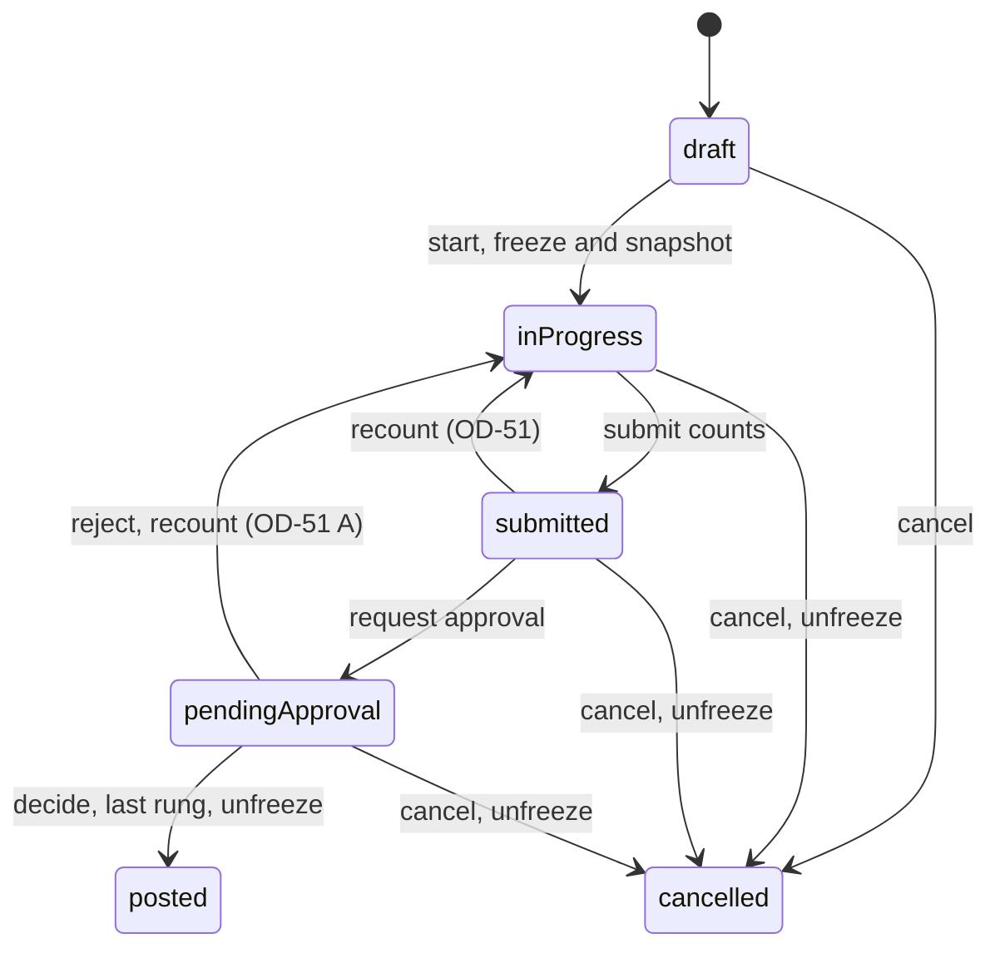

### 5.11 StockAdjustment تسوية مخزنية (P7; P5 under §18.1 A11)

| State | Meaning | Terminal |
|---|---|---|
| draft | lines `{ itemId, kind, qty, reasonCode, reason }` (§2.6); evidence per OD-52 | no |
| pendingApproval | in the engine | no |
| posted | movements written on the final approval; there is no `approved` state | yes |
| rejected | refused | yes |
| cancelled | withdrawn | yes |

| # | From → to | Action · endpoint | Key | Guard (pure, or in the filter) | Effects | Conc. |
|---|---|---|---|---|---|---|
| 1 | — → draft | create · `POST /stock-adjustments` | `.create` | the kinds allowed and the evidence: OD-52 (recommended default: A, outside counts too, with a reason code, evidence and the chain; write-offs on `organization` rungs) | au `create` | — |
| 2 | draft → pendingApproval | submit · `/:id/submit` | `.create` | ≥1 line; evidence per OD-52 (required attachments: OD-76); chain staffed (OD-19) | № ADJ; nt approvers | T |
| 3 | pendingApproval → posted | decide, settling rung | `.approve` | §5.2; a pre-check: on hand ≥ qty on out lines, the on-hand rows not frozen, OD-70's map | mv per line `kind`: `adjustmentIn`, `adjustmentOut` or `writeOff` (OD-52); if stock moved after the pre-check the guard refuses (422) and the document stays pending (§4.3.7); au under OD-82 with the posted lines; ev `….stockAdjustment.posted` (§8.2: in-process; a promotion to reliable, should OD-37 value stock, changes no contract) | A + T |
| 4 | pendingApproval → rejected | decide `rejected` | `.approve` | reason | nt keeper | A |
| 5 | pendingApproval → draft | return *(OD-72 B)* | `.approve` | reason | round archived | A |
| 6 | draft → cancelled | cancel · `/:id/cancel` | `.create` | a reason when the draft carries a number | — | V |
| 7 | pendingApproval → cancelled | cancel | `.create` | reason | nt current approvers | C |

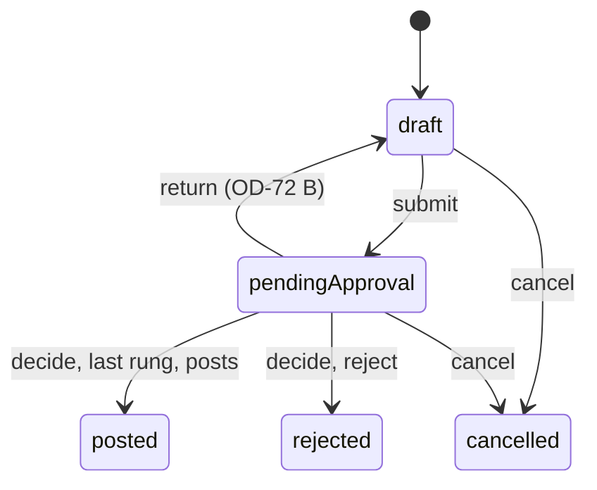

### 5.12 Physical status fields — how they are derived

| Field | Pure function | Per-line inputs (§2.5–§2.6) | Rule | Moved only by |
|---|---|---|---|---|
| PR `orderStatus` | `orderStatusOf` (`purchase-request-lifecycle.ts`) | `qty`, `orderedQty`, `cancelledQty` | `notOrdered`: Σ ordered = 0 · `fullyOrdered`: every line ordered ≥ qty − cancelled · else `partiallyOrdered` | PO submit (claim); PO reject, return, cancel, short-close and remainder cancel (give back); PR remainder cancel; an approver's reduction (OD-17) |
| PO `receiptStatus` | `receiptStatusOf` (`purchase-order-lifecycle.ts`) | `qty`, `receivedQty`, `cancelledQty` | `notReceived` / `fullyReceived` / `partiallyReceived`, as above, against qty − cancelled | GRN post; SRN post under OD-36's reopen and OD-84's `entryError`; short-close; remainder cancel |
| MR `issueStatus` | `issueStatusOf` (`material-request-lifecycle.ts`) | `qty`, `issuedQty`, `cancelledQty` | as above, with issued; returns never lower `issuedQty`, IT's "everything EVER issued" (`apps/api/src/modules/it/consumables/consumable-stock.ts:36-38`) | issue post; remainder cancel; an approver's reduction (OD-39) |
| TRF `receiptStatus` | `transferReceiptStatusOf` (`stock-transfer-lifecycle.ts`) | `dispatchedQty`, `receivedQty` | as above, against dispatched | receipt; late arrival |
| TRF `discrepancy` | `discrepancyOf` | `shortDeclaredAt`, `dispatchedQty`, `receivedQty`, `returnedQty`, `lostQty` | `none`: no line declared short · `open`: a short line with quantity still in transit (plain, `returningQty` or `lossPendingQty`) · `resolved`: every short line emptied | receipt (declare); resolve; return posting; a loss round's approval or rejection |

- **Zero state.** Each field is written at create with its function's value for zero counters (`notOrdered`,
  `notReceived`, `notIssued`, `none`) and recomputed thereafter; queues filter on `status` first, so a draft's value is
  never read as progress.
- **Stored** so that queues are indexable; no write schema contains them, as IT's asset status, which its rule FR-2
  derives from operations only (`docs/12-planning/it-module-design.md:793`).
- **Recomputed in the same transaction** that moves the counters (the same transaction, not the same update): the claim returns the updated lines, the function derives the status, and a second guarded write stores it
  (§2.1, "Status"). The pure derivation is the requisition's `fulfilmentStatus`
  (`job-requisition-rules.ts:77-85`), which, however, runs after a fill insert with no session and writes the main
  `status` (`job-requisition.service.ts:351-389`). The in-transaction shape is IT's: `applyStockEffect` beside the
  guarded `$inc`, inside the issue transaction (`consumable-stock.ts:64-72`; `consumable.repository.ts:115-157`).
- **Independent of `status`**, the Operations lesson: "two lifecycles, never written from one another"
  (`apps/api/src/modules/operations/mobile/execution.service.ts:15-26`); the one place they meet is a read,
  `isStopSettled` (`execution-state.ts:84-132`). This design deviates where the physical axis completes the document: a
  PO fully received under OD-28 A, a fully issued MR and an emptied transfer close as system rows (§4.2.3).
- **Against qty − cancelled.** A cancelled remainder counts as settled, so a closed PR or MR reads fully ordered or
  fully issued even when part of it was cancelled, and a short-closed PO reads `fullyReceived`. The cancelled share stays
  on the lines (`cancelledQty`), in the PO's `closeReason` and in the closed event's `shortClosed` (§8.2). A closed
  transfer can still read `partiallyReceived` with `discrepancy: resolved`, because its rule runs against dispatched.
- **Rebuilt for checking** by a report-only integrity check over the child documents (§2.4.8).

### 5.13 Cancellation, amendment and re-approval, mapped to precedents

| Module semantics | Precedent | Applied as |
|---|---|---|
| Rejection is final; refiling is a new document | the engine's `statusOf` (`approval-trail.ts:51-65`); IT's cancelled ticket, "A new ticket is the honest path" (`ticket-lifecycle.ts:29-31`); "a new need is a new requisition" (`job-requisition-rules.ts:12-14`) | `rejected` terminal on PR, PO, MR, TRF and ADJ under OD-72's recommended default (B); OD-72 C adds `rejected → draft` (§5.2) |
| Return for amendment | loans send a rejection back to draft (`employee-loan.service.ts:294`), and so do HR contracts (`contract.service.ts:215`) | a separate act under OD-72 B (§5.2) |
| Edit after approval | the requisition's `requiresReapproval` and `statusAfterEdit` (`job-requisition-rules.ts:102-142`) | none in place under OD-26 A (recommended); OD-26 B's impact, a PR amendment row and a PO's in-state revision, is stated in §5.4 and §5.6 |
| Revision history | the job offer's `revisions[]` and the re-issue of a sent offer (`job-offer.service.ts:202-248`); the contract amendment as a new version (`apps/api/src/modules/hr/contracts/contracts/contract.service.ts:396-462`) | none under OD-26 A (recommended); OD-26 B's `revisions[]` and `pendingRevision` on the PO are its impact (§5.6) |
| Cancel before execution, correct forward after it | payroll's cancellable set (`run-lifecycle.spec.ts:56-61`); loans, "record its repayment instead" (`employee-loan.service.ts:417-419`) | posted documents never cancel; a PO with receipts short-closes; a dispatched transfer resolves; a posted count is corrected by an adjustment; a GRN keyed in error by OD-84's correction |
| Short-close | the requisition's `closeProblem` (`job-requisition-rules.ts:154-158`) | PO short-close and remainder cancel; PR and MR remainder cancel (OD-28) |
| A lock released at the end | attendance freezes for good: "There is **no unfreeze**, anywhere" (`docs/12-planning/retro-post-freeze-corrections.md:16`; `day-record.service.ts:543-547`). Payroll's freeze ends when its run is cancelled: "a cancelled run no longer speaks for its period … the month is open again" (`payroll-run.service.ts:425-430`; the cancellable set, `packages/contracts/src/modules/hr-payroll.ts:545`) | the count freeze locks rows, not a period; posting and cancel release it, as a cancelled payroll run reopens its month; period locks are OD-74 |

### 5.14 Guard sets — the payroll freeze-gap lesson

P-HR-10, the payroll run governance change (`docs/12-planning/payroll-run-governance.md:1`), added `approved`, `paid`
and `closed` after `frozen` and widened the unique index (`run-lifecycle.spec.ts:187-196`),
but not `frozenPeriods()` (`payroll-run.service.ts:431-437`) or the leave-snapshot port
(`apps/api/src/modules/hr/payroll/compensation/leave-snapshot.port.ts:34`). Both still match `status: 'frozen'` only, so
approved and paid months stopped counting as frozen (§17 RK-27).

**Rule.** No guard tests `status === x`. Every "has X happened / is it locked" question is a typed
`Record<Status, boolean>` in contracts, so adding a status fails compilation until every set classifies it: the event
catalog's trick ("declaring a new event constant without adding it here does not compile",
`packages/contracts/src/events/catalog.ts:1118-1121`). Today's guard sets are tuples (`CANCELLABLE_PAYROLL_RUN_STATUSES`,
`hr-payroll.ts:545`; `TERMINAL_JOB_REQUISITION_STATUSES`, `packages/contracts/src/modules/hr-job-requisition.ts:47-50`);
the exhaustive status-keyed `Record` is the shape of IT's transition table (`ticket-lifecycle.ts:22`), used here as a
guard set. Mongo and partial-index filters read `statusesWhere(SET)`.

```ts
// packages/contracts/src/modules/administration-procurement.ts (illustrative)
export const PO_RECEIVABLE: Readonly<Record<PurchaseOrderStatus, boolean>> = {
  draft: false, pendingApproval: false, approved: false /* OD-31 */, issued: true,
  closed: false, rejected: false, cancelled: false,
};
```

| Set | Members today | Used by | Failure it prevents |
|---|---|---|---|
| `PR_SOURCEABLE` | approved | RFQ and PO line citations; the RFQ issue and award re-checks; the PO submit claim filter; the sourcing queue | — |
| `PO_RECEIVABLE` | issued | GRN create and post | an OD-31 `acknowledged` after `issued` silently stopping receipts |
| `PO_CLAIM_OPEN` | pendingApproval, approved, issued | the PR close condition (§5.4 row 9) | a PO status added later that keeps its claim but is missed by the close |
| `PO_INVOICEABLE` | issued, closed | the supplier-invoice hand-over (§12.4; §12.5 step 2) | — |
| `MR_ISSUABLE` | approved | issue post | — |
| `TRF_IN_TRANSIT` | dispatched | receipts, resolutions, return postings, loss rounds; the Σ inTransit integrity check | — |
| `COUNT_FREEZING` | inProgress, submitted, pendingApproval | freeze integrity (every `frozenByCountId` names a count in this set); post and cancel release | an `approved` status added later before `posted` without widening the set, releasing freezes on unposted counts |
| `APPROVAL_PENDING` | pendingApproval | decide guards, the awaiting-decision list read that ships with each approval type (within the `.approve` key's reach, §5.1.4), reminder sweeps, all through `approvalPending(doc)`, which adds the one in-state round that keeps its status, a transfer's loss round (`lossPendingQty`); its Mongo filter is the same disjunction | an in-state round missed by the awaiting-decision list |
| `CONTENT_EDITABLE` | draft | `writeConditions()` (§5.1.4) | — |
| `<DOC>_CANCELLABLE` | per table; `SUPPLIER_INVOICE_CANCELLABLE`: draft (§12.4) | cancel guards | the `CANCELLABLE_PAYROLL_RUN_STATUSES` shape |

The procurement sets live in `administration-procurement.ts`, the warehouse sets in `administration-warehouses.ts`.
A spec pins each set's members with one line of reason per status (§5.16 spec 8).

### 5.15 Error vocabulary

| Situation | Thrown as | HTTP · code | Precedent |
|---|---|---|---|
| an action not defined from the current status | `new AppError(ErrorCodes.ADMINISTRATION_INVALID_TRANSITION, 422, msg, { details: [{ field: 'status', code: <from>, … }] })`: the shape of ATM's `lineStateError`, which ATM throws at 409 (`apps/api/src/modules/atm/settlements/plans/plan.service.ts:122-126`), here at 422. `BusinessRuleError(msg, code)` takes no details | 422 | `OPERATIONS_INVALID_SHIPMENT_TRANSITION` (`apps/api/src/modules/operations/shipments/shipment.service.ts:1135-1139`); every HR lifecycle |
| defined, but a guard refuses | the same shape, `ADMINISTRATION_TRANSITION_BLOCKED`, with `details[]` naming each failed rule | 422 | the requisition's `*Problem` functions |
| a reason is required from this state | `ADMINISTRATION_REASON_REQUIRED` | 422 | recruitment's `REASON_REQUIRED` is a refusal discriminator only: the wire code is `BUSINESS_RULE_VIOLATION` (`workflow-transitions.ts:153-183`; `apps/api/src/modules/hr/recruitment/workflow/workflow-engine.ts:297-303`); a module code is new |
| no chain, or no staffed rung (OD-19), at a submission or at a transfer's `writtenOff` resolve, which opens a loss round (§5.9) | `ADMINISTRATION_APPROVAL_CHAIN_MISSING` | 422 | new |
| OD-20 B only: the chain changed since submission, its id (`approvalWorkflowId`) or its shape (`approvalChainShape`) (§15.2.1 R1 stopgap; §5.2) | `ADMINISTRATION_APPROVAL_CHAIN_CHANGED` | 422 | new |
| the engine's refusals `approvals.alreadyDecided`, `nothingToDecide`, `notYourStep` | remapped by the adapter to `ADMINISTRATION_APPROVAL_NOT_PENDING` / `ADMINISTRATION_APPROVAL_NOT_YOUR_STEP`. The engine throws all three as `BusinessRuleError` with the key as the message (`approval.service.ts:164-185`), so the remap matches message keys; engine codes are not in PX-1's scope (OD-20), and R11, the untranslated engine keys, joins RK-23 (§15.2.1) | 422 | the engine keys have no translation (R11, §15.2.1) |
| a separation-of-duties pair (§6.6) | `new AppError(ErrorCodes.ADMINISTRATION_SEPARATION_OF_DUTIES, 403, msg)`. `ForbiddenError` fixes its code to `FORBIDDEN` (`apps/api/src/shared/errors/index.ts:39-43`), so a module code needs `AppError`, as ATM's codes do | 403 | loans and payroll (`ForbiddenError`); training nominations refuse their four-eyes case at 422 (`apps/api/src/modules/hr/training/nominations/training-nomination.service.ts:182-185`) |
| a stale version, or a lost race on the head document | `StaleDocumentError` | 409 `STALE_DOCUMENT` | `base.repository.ts:574-601`; ATM's `matchedCount ≠ 1` |
| a stock leg refused (§2.4.4): a row held by a count, a bucket short of the quantity, an opening balance on a row that has moved, a retired item or warehouse under OD-70's map | `AppError` with `ADMINISTRATION_STOCK_FROZEN` (details: the holding `CNT-…`), `ADMINISTRATION_INSUFFICIENT_STOCK` (`{ have, asked }`), `ADMINISTRATION_OPENING_BALANCE_NOT_FIRST`, `ADMINISTRATION_ITEM_INACTIVE`, `ADMINISTRATION_WAREHOUSE_INACTIVE` | 422 | IT's two 422s (`consumable.repository.ts:148-156`) |
| at posting, a line whose `unitId` is no longer its item's (§2.3.4; §5.7) | `ADMINISTRATION_ITEM_UNIT_CHANGED` | 409 | new: the binding guard behind the item edit's checker (§3.6) |
| a balance row missing because it was not ensured; a retry ensures it | `ADMINISTRATION_STOCK_ROW_NOT_READY` | 409 | the counter's "not ready — try again" (§2.3.1) |

**422, not 409, for an illegal transition.** IT, Fleet and ATM answer a state miss with 409: IT's and Fleet's
`ConflictError` (`apps/api/src/modules/it/tickets/ticket.service.ts:329-333`;
`apps/api/src/modules/fleet/vehicles/vehicle.service.ts:343-346`), ATM's named `ATM_PLAN_LINE_STATE` with details
(`plan.service.ts:122-126`; "the named 409", `docs/12-planning/atm-settlements-phase1.md:36-39`). Gold mixes 409 ("already
confirmed", `apps/api/src/modules/gold/transfers/transfer.service.ts:165, 189`) and 422 ("only confirmed transfers can be
reverted", `:248`). HR and Operations use 422. The module borrows ATM's `AppError` + `details` shape at 422: retrying
with a fresh version cannot help, and the repository already ranks "this row may never be written" above "someone else
wrote it first" (`base.repository.ts:594-600`); 409 is kept for "re-read and retry may succeed". The requisition service
throws 422 on a plain stale miss (`job-requisition.service.ts:416-418`); this module classifies the miss instead. Every
code joins `packages/contracts/src/errors/index.ts`, whose header asks for a pull request to that catalog for each new
code (`:1-2`), in the slice that ships its transition, with its web i18n mapping.

**Phase 1 master-data refusals.** The rule refusals of units, categories, items, warehouses and suppliers (P1a, P1b;
§19.3, §19.7) have codes of their own. None falls back to `BusinessRuleError`'s `BUSINESS_RULE_VIOLATION` or
`ConflictError`'s `DUPLICATE` (`apps/api/src/shared/errors/index.ts:51-55, 63-67`): the web has no text for either and
would show the server's English message (`apps/web/src/shared/lib/errors.ts:8-218, 235-238`; RK-23). Each code is
thrown as `new AppError(code, status, message, { details })` (`apps/api/src/shared/errors/index.ts:5-25`) and has its
text under `administration.module.errors.<code>` in en and ar, mapped by the web's `lib/administration-errors.ts`, whose
spec checks that every Phase 1 code has both. Each ships in the Phase 1 pull request that ships its rule.

| Situation | Thrown as | HTTP · code | Details |
|---|---|---|---|
| a category's parent is refused: the category itself, a cycle, a level deeper than OD-06 allows (recommended default: A, two levels), an inactive parent, or a move of a category that has children (§2.3.3) | `AppError` | 422 `ADMINISTRATION_CATEGORY_PARENT_INVALID` | `[{ field: 'parentId', code: 'self' \| 'cycle' \| 'tooDeep' \| 'inactive' \| 'hasChildren' }]` |
| an item's stock levels out of order: min ≤ reorder point ≤ max, where set (OD-09; §2.3.4) | `AppError` | 422 `ADMINISTRATION_STOCK_LEVELS_ORDER` | one entry per field out of order: `[{ field: 'minQty' \| 'reorderPointQty' \| 'maxQty' }]` |
| an item created with, or edited onto, an inactive unit or category; existing items keep theirs (§2.3.2, §2.3.3) | `AppError` | 422 `ADMINISTRATION_REFERENCE_INACTIVE` | `[{ field: 'unitId' \| 'categoryId' }]` |
| a deactivation §5.3's rule refuses: under OD-70 (recommended default: B), a warehouse while any of its balance rows holds on-hand or in-transit stock, or a non-terminal document names it (the pure `deactivationProblem` over the §3.6 checkers). A unit, category or supplier has no such rule, and in P1 nothing holds stock, so a warehouse retires freely (§2.3.5): the code ships with the rule functions and is first met once stock or documents exist | `AppError` | 422 `ADMINISTRATION_DEACTIVATION_BLOCKED` | `[{ field: 'isActive', code: 'holdsStock' \| 'openDocument' }]` |
| a warehouse keeper whom the directory positively answers as `exited`, IT's rule; an id the directory cannot read passes (§7.8; OD-44) | `AppError` | 422 `ADMINISTRATION_EMPLOYEE_EXITED` | `[{ field: 'responsibleEmployeeId' }]` |
| a duplicate among live rows: a name or a code caught by the service's pre-check, which gives the early message and compares names by `nameKey`, the folded `name.ar` (§2.1); or a duplicate key on a module `ux_*` index, the race guard (for names `ux_kind_name_key`, `ux_parent_name_key`, `ux_name_key` and `ux_branch_name_key`, §2.3), which the service maps to its field. A barcode has no pre-check: `ux_barcode` is its only check (§2.3.4, §19.7) | `AppError` | 409 `ADMINISTRATION_DUPLICATE` | `[{ field: 'name' \| 'code' \| 'barcode' }]` |

### 5.16 File plan and spec obligations

| File (under `apps/api/src/modules/administration/`) | Holds |
|---|---|
| `shared/lifecycle.ts` | `TransitionDef`, `findTransition`, `availableActions`, `statusesWhere`, `reachableFrom`: recruitment's helpers, generalized, their one source (`findTransition`, `transitionsFrom`, `statesOf`, `workflow-transitions.ts:137-188`; `availableActions`, `workflow-actions.ts:83-110`); module-local, promoted to `apps/api/src/shared/` when a second module needs them |
| `shared/posting-lifecycle.ts` | the one draft / posted / cancelled table of §5.7 |
| `shared/approvals.ts` | the adapter (§5.2): registration, the Unit builder, the conditional append, the no-chain refusal, the engine-refusal remap |
| `procurement/purchase-requests/purchase-request-lifecycle.ts` | table; `submitProblem`, `cancelProblem`, `closeCondition`, `orderStatusOf` |
| `procurement/rfqs/rfq-lifecycle.ts` · `procurement/quotations/quotation-lifecycle.ts` | tables; `issueProblem`, `awardProblem`; `isExpired(validUntil, cairoDay)` |
| `procurement/purchase-orders/purchase-order-lifecycle.ts` | table; `approvalRequestTypeFor`, `requiresReapproval`, `closeProblem`, `receiptStatusOf` |
| `warehouses/{goods-receipts, supplier-returns, stock-issues, stock-returns, opening-balances}/<doc>-lifecycle.ts` | `postProblem` and remaining-quantity functions |
| `warehouses/material-requests/material-request-lifecycle.ts` | table; `issueStatusOf` |
| `warehouses/stock-transfers/stock-transfer-lifecycle.ts` | table; `transferNeedsApproval`, `remainingInTransit`, `transferReceiptStatusOf`, `discrepancyOf` |
| `warehouses/stock-counts/stock-count-lifecycle.ts` · `warehouses/stock-adjustments/stock-adjustment-lifecycle.ts` | tables; `countComplete`, `varianceOf`; `postProblem` |
| `warehouses/stock/` | `REFUSED_WHEN_INACTIVE`, the per-kind map read inside the posting transaction (§2.4.4 item 6) |
| `<entity>-rules.ts` beside each master-data feature | `deactivationProblem`, `activeFor` (§5.3) |
| `<entity>-audit.ts` beside each feature | the literal `entityRef`, the act-to-verb constant (§10.2) and the branch signal (§9.1) |

Status tuples and guard sets live in `packages/contracts/src/modules/administration*.ts` (§5.14); tables stay in the API,
as the ticket table does, and the web reads `availableActions` (§5.1.4).

```ts
// shared/lifecycle.ts (illustrative; recruitment's TransitionDef, workflow-transitions.ts:38-49, extended)
export interface TransitionDef<S extends string, A extends string> {
  action: A;                 // dispatch key, audit mapping, availableActions key
  from: S;                   // one predecessor per row; several rows may share an action (§5.1.1)
  to: S;
  permission: string | null; // exactly one key; null only for system rows
  stamps?: string;           // the <act>At / <act>ByUserId pair it writes (execution-state.ts:43-56)
  requiresReason?: true;
  settledByApproval?: true;  // reached only through decide()
  system?: true;             // performed inside another act's transaction (§5.1.1)
}
```

**Specs.** 1–8 beside each lifecycle file, and 16 beside the transfer's; 9–14 one source-scanning guard per
sub-module; 15 integration.

| # | Asserts | Precedent |
|---|---|---|
| 1 | every contract status appears in the table and is reachable from the start state (`draft`; `active` for master data; `received` for quotations) | extends `ticket-lifecycle.spec.ts:17-27` (coverage, real targets) and `:99-114` (every live status reaches a terminal one) |
| 2 | no self-loop; every target is a real status | `ticket-lifecycle.spec.ts:29-33` |
| 3 | the terminal set = the statuses with no outgoing row = the documented list | extends `ticket-lifecycle.spec.ts:55-60` |
| 4 | no duplicate `(from, to)`; an action with several rows from one state (decide; a transfer's submit) names the pure function that picks its row | extends `apps/api/src/modules/hr/recruitment/workflow/workflow-transitions.spec.ts:16-27`, which pins `from → to`; `run-lifecycle.spec.ts:63-74` |
| 5 | every non-system action maps to one key, and that key is declared in the manifest; the PR and MR cancel routes of OD-28.4 (i), gated by `.view` with the key and ownership checked in the service (§5.1.4), are pinned by their own cases | extends recruitment's `unmappedActions` spec (`apps/api/src/modules/hr/recruitment/workflow/workflow-actions.spec.ts:9`), which checks only that some key is named |
| 6 | the reason-required rows are exactly the destructive set of §5.1.2 item 5, both ways; a numbered draft's cancel by a case | extends `workflow-transitions.spec.ts:39-48`, which checks one direction |
| 7 | the physical-status functions cover zero lines, cancelled remainders, returns that give `receivedQty` back and short-declared lines | the requisition's `fulfilmentStatus` |
| 8 | each guard set's members (§5.14); partial-index filters built from the same constant | `run-lifecycle.spec.ts:187-196` |
| 9 | **one writer of `status`**: only the owning service writes `status:`, a physical-status field or a line counter on its model | `run-lifecycle.spec.ts:82-99` |
| 10 | **every transition version-checked or status-filtered**: no bare `updateById(…)`; every status write has `__v` or `status` in its filter | `run-lifecycle.spec.ts:101-106`; ATM's rule |
| 11 | **four-eyes present** in every decide, post, receive, resolve and hand-over path of §6.6 (the pairs OD-21 adopts, and the candidates) | `run-lifecycle.spec.ts:76-80` |
| 12 | no `approvalService.statusFor(`; no `approvalService.decide(` inside a `unitOfWork(` callback | new |
| 13 | no content write can match a terminal status: each named write's filter is built from a guard set, and a pure case runs every set against the statuses with no outgoing row | the Fleet memo freeze |
| 14 | no update or delete path on movements: the repository overrides `writeConditions()` and `assertWritable()`, adds only `insertLegs`, and a write-surface scan pins its callers (§2.4.1) | new: IT relies on a header comment (`apps/api/src/modules/it/consumables/consumable-movement.repository.ts:1-4`), and `BaseRepository` still hands a subclass `updateById`, `softDeleteById`, `createManyUnordered` and `restoreById` (`base.repository.ts:493, 506, 574, 603, 639`); the scan's `MUTATORS` lists all five |
| 15 | per transition: the happy path, authZ, illegal (422), stale (409). Races through an ATM-style hook (`apps/api/src/modules/atm/settlements/shared/test-hooks.ts:1-38`): post vs post; decide vs decide; dispatch vs count start; two POs ending the last claims of one PR; a GRN post vs a PO short-close or cancel; a PO submit's claim vs a PR cancel; an award vs a quotation withdrawal or recording; a count entry vs the submit or a cancel; a master-data deactivation vs a posting. A stuck approval: a later rung held only by the requester, and a rung unstaffed after submission | `apps/api/tests/integration/*.spec.ts` |
| 16 | **every transfer line can close**: from every line-counter state that §5.9's acts can reach (receipt, the four resolve outcomes, the return posting, a loss round's approval or rejection), some sequence of those acts reaches `receivedQty + returnedQty + lostQty = dispatchedQty`; a pure search over the counters and the declared shares | new |

---

## 6. Permissions

### 6.1 Rules the catalog follows

**Prefix `administration<Entity>`**, as every module from Fleet on (`fleetVehicle`, `itAsset`, `goldTransfer`,
`atmMachine`, `operationsShipment`):

- keys share one namespace, and a duplicate fails boot (`apps/api/src/platform/rbac/rbac.service.ts:573`);
- an unprefixed `supplier` would claim the concept the platform may take over (`docs/12-planning/it-module-design.md:1171`,
  OD-01);
- a rename deletes the registry row while roles keep the dangling string (`rbac.service.ts:591`).

`docs/04-standards/naming-conventions.md:55-60` is silent on prefixes.

**`administrationItem` stays generic.** A key name is final once it ships, and the module is meant to absorb facilities
and general requests later. The item resource is still not narrowed to stock (such as `administrationStockItem`): one
item master serves stock and non-stock lines (OD-14), and facilities requests would cite the same items.
`administrationCatalog` is the module-wide catalog key, one grant over several kinds, as `itCatalog` is
(`apps/api/src/modules/it/it.module.ts:163-173`).

**A key ships with its operation** (`apps/api/src/modules/it/it.module.ts:68-70`). A grant declared earlier "reads in
the permission matrix like a capability somebody has already been given" (`apps/api/src/modules/hr/hr.module.ts:1092-1094`).
Pages follow the same rule (`packages/contracts/src/permissions/platform.ts:339-342`), and a page without a key fails
boot (`packages/contracts/src/permissions/def.ts:165-217`).

- P1a has 7 keys on 3 pages; P1b has 3 keys on 1 page (§18.2).
- Request types, bundles and `authorizeAny` lists ship in their key's phase.
- `employee.viewSensitive`, declared ahead of its surface (`hr.module.ts:537-538`), is not a precedent to follow.

**Mechanics.**

- **CI parser.** Every `declarePermissions(...)` is a literal call in
  `apps/api/src/modules/administration/administration.module.ts`. `scripts/check-page-registry.mjs` reads it as text
  once its list (`:65-67`) gains `'administration'` (§15.2.3). It finds:
  - one `export const administrationPages: PageDef[] = [` block, closed by `\n];`;
  - pages that open with `{ id: '…', moduleId: '…'` (`:25-27`);
  - in each call: the module id, the resource and the trailing page id as literals; the actions as the first array
    literal; the specials as `action: '…'` (`:49-54`).

  Constants and spreads are invisible to it.
- **Actions.** Non-vocabulary actions are `specials`, introduced per resource as the permission matrix allows
  (`docs/06-security/permission-matrix.md:20-21`), each with bilingual names; otherwise the label is raw (`def.ts:120`).
  There is no `delete` key; deactivation is `edit`.
- **Labels.** The formal-Arabic gate skips `*.seed.ts` (`scripts/check-formal-arabic.mjs:167`, `:122-128`), so §6.5's
  role names sit in a non-seed constants file. The Arabic uses §0.4's candidates (OD-67; جرد as §0.4 notes).
- **Module label.** `systemAdmin.roles.module.administration` is needed in both locales
  (`apps/web/src/platform/localization/i18n.ts:10692-10700`, `:25479-25487`). Without it:
  - the role matrix, the permission catalog and a user's effective permissions show the raw key
    (`apps/web/src/modules/system-admin/roles/components/RolePermissionMatrix.tsx:128`,
    `apps/web/src/modules/system-admin/roles/pages/PermissionCatalogPage.tsx:132`,
    `apps/web/src/modules/system-admin/roles/components/UserEffectivePermissionsTab.tsx:196`);
  - the delegation panel shows the module id (`apps/web/src/platform/rbac/delegation/DelegationPanel.tsx:609-616`);
  - nothing catches the omission.
- **Matrix document.** Rule 2 asks for a row per key (`docs/06-security/permission-matrix.md:105`), but no module has
  added one: the document covers Platform Core and Recruitment (`:3-4`). §6.2 is the reviewable list. Whether the
  module also adds a section there is settled at approval (§19.2).

### 6.2 Permission catalog per phase

Standard labels read `عرض`, `إنشاء`, `تعديل`, `اعتماد`, `طباعة` or `تصدير` plus the resource name (`def.ts:100-131`).

- `view` reads what its scope reaches (§7), files and papers included.
- **Approvers open what they decide.** The detail `GET` of the six approvable documents (PR, PO, MR, transfer, count,
  adjustment) is `authorizeAny('<resource>.view', '<resource>.approve')`. Each held key is tried through its own scope,
  as §11.3's file reads are; the registers stay `.view` (§13.4). An awaiting-decision list read, the `APPROVAL_PENDING`
  set (§5.14) within the `.approve` key's reach, ships with each approval type: P2, P4, P6, P7.
- `print` makes the paper of record (OD-59). A print of record writes the module's own audit verb
  `administrationPrint`, carrying the `paper` and `printNumber` pseudo-fields (the HR contract precedent), as ATM's
  prints write `atmSettlementPrint` (`packages/contracts/src/platform/audit.ts:189-194`; §10.2). The platform's
  export-spike alert counts only `export` (`apps/api/src/platform/audit/audit.signals.ts:129-142`), so prints never
  trip it; `export` stays for real exports.
- An act without a key of its own rides the key the last column of the table names for it.
- Each act names exactly one key. A route that serves acts or screens on different keys is gated `authorizeAny` over them (the detail `GET` above, the decide route of §6.4 item 3, the pickers of §7.1, the MR's `/cancel-remainder` under OD-28.1 (ii), the transfer's `/resolve`, §7.4), and the service then requires the act's own key at its own reach (§5.1.4).

| Ph | Resource — en / ar | Standard | Specials — en / ar | Page | What the keys authorize |
|---|---|---|---|---|---|
| P1a | `administrationWarehouse` — warehouses / المخازن | view, create, edit | — | `administration.warehouses` | **create, edit** (deactivation included) in a branch the key reaches (§7.2). |
| P1a | `administrationItem` — items / الأصناف | view, create, edit | — | `administration.items` | **view:** organization-wide. **create, edit:** §6.7. |
| P1a | `administrationCatalog` — units and item categories / وحدات القياس وتصنيفات الأصناف | — | `manage`: Manage units and item categories / إدارة وحدات القياس وتصنيفات الأصناف | `administration.catalogs` | **manage:** units (`administration_catalog_items`, kind `unit`) and categories (OD-06), §6.7. Reads: `authorizeAny('administrationItem.view', 'administrationCatalog.manage')` (`apps/api/src/modules/it/catalog-items/catalog-item.routes.ts:45`). |
| P1b | `administrationSupplier` — suppliers / الموردون | view, create, edit | — | `administration.suppliers` | **view:** organization-wide. **create, edit:** §6.7; fields OD-11; status OD-12. |
| P2 | `administrationPurchaseRequest` — purchase requests / طلبات الشراء | view, create, edit, approve | `cancel`: Cancel purchase requests / إلغاء طلبات الشراء | `administration.purchase-requests` | **create:** draft, submit (filing §7.5; who: OD-16). **edit:** a draft. **approve:** decide a rung, yes or no, as leave does; return (OD-72). **cancel:** cancel, `/cancel-remainder` (§5.4); OD-28. |
| P3 | `administrationRfq` — requests for quotation / طلبات عروض الأسعار | view, create, edit | `award`: Award requests for quotation / ترسية طلبات عروض الأسعار | `administration.rfqs` | **create:** a draft from PR lines (approved only: OD-27, recommended default: yes); issue. **edit:** the draft; record and withdraw quotations; close bidding (`issued → evaluating`); cancel. **award:** OD-24. Quotations ride these keys: they have no page of their own (§6.3, §13.4). IT consumables no longer ride `itAsset.*`: they have keys and a page of their own, because the owner wanted to grant that screen apart (`apps/api/src/modules/it/it.module.ts:9-13`; the one-time key copy, `apps/api/src/modules/it/go-live/screen-grants.ts:1-13`). |
| P4 | `administrationPurchaseOrder` — purchase orders / أوامر الشراء | view, create, edit, approve, print | `issue`: Issue purchase orders to suppliers / إصدار أوامر الشراء للموردين · `close`: Close, short-close and cancel purchase orders / إغلاق أوامر الشراء كليًا أو جزئيًا وإلغاؤها | `administration.purchase-orders` | **create:** draft, submit (without a PR: OD-27). **edit:** the draft. **approve:** a rung of the stored type (§6.4); return. **issue:** OD-31. **close:** close, short-close, cancel (OD-28), one grant like `itTicket.close`. |
| P4 (P3 under OD-23 A) | `administrationProcurementPolicy` — procurement policy / سياسة المشتريات | — | `manage`: Manage procurement policy (value bands, tolerances) / إدارة سياسة المشتريات (شرائح القيمة ونسب التجاوز) | `administration.procurement-policy` | **manage:** the OD-18 band thresholds, OD-23 A's quotation minimums and, only under OD-32 B, the receipt tolerance; organization scope (§6.7). The key ships with the first of these that the owner adopts (§18.2). |
| P5 | `administrationStock` — stock / المخزون | view; export only under OD-60 | `openBalance`: Record opening balances / تسجيل الأرصدة الافتتاحية | `administration.stock` | **view:** balances, movements and the item card (P5); the signal-only realtime topic `administration.stock` and the `administration.openingBalance` topic (§9.2); the dashboard's stock sections when P9 ships (§14.2); values: OD-73. **openBalance:** draft, post, cancel a draft (OD-63). |
| P5 | `administrationGoodsReceipt` — goods receipts / أذون الاستلام | view, create, print | — | `administration.goods-receipts` | **create:** draft, post, cancel a draft; receivable lines §7.10; inspection OD-35. |
| P5 | `administrationSupplierReturn` — supplier returns / مرتجعات المشتريات | view, create | — | `administration.supplier-returns` | **create:** draft, post, cancel a draft (OD-36). A GRN keyed in error is corrected here under OD-84 (recommended default: B, a return with the reason code `entryError`). |
| P6 | `administrationMaterialRequest` — material requests / طلبات الصرف | view, create, edit, approve | `cancel`: Cancel material requests / إلغاء طلبات الصرف | `administration.material-requests` | As PRs; who: OD-38; warehouse §7.10; lowering quantities OD-39. **cancel:** cancel, close an unissued remainder (§4.3.4): OD-28. |
| P6 | `administrationStockIssue` — stock issues / أذون الصرف | view, create, print | — | `administration.stock-issues` | **create:** draft, post (إذن صرف), cancel a draft; direct issue OD-40; under OD-28.1 (ii), close an MR's unissuable remainder on its warehouse (§4.3.4). |
| P6 | `administrationStockReturn` — stock returns / مرتجعات الصرف | view, create | — | `administration.stock-returns` | **create:** draft, post (مرتجع صرف), cancel a draft (OD-43). |
| P7 | `administrationStockTransfer` — stock transfers / التحويلات المخزنية | view, create, approve | `dispatch`: Dispatch stock transfers / إرسال التحويلات المخزنية · `receive`: Receive stock transfers / استلام التحويلات المخزنية · `resolve`: Resolve transfer discrepancies / تسوية فروق التحويلات المخزنية | `administration.stock-transfers` | Sides per act: §7.4. **create:** draft, edit, submit, cancel before dispatch (OD-45); where OD-45 asks for no approval, submit lands in `approved` (§5.9). **approve:** a rung of OD-45's approval or of OD-47.4's loss round; return. **dispatch:** the source. **receive:** receipts, and lines declared short, at the destination; at the source, the return of goods sent back (OD-47.3). **resolve:** a late arrival, a loss, or a declared return that never arrived (OD-46, OD-47.2, OD-47.4). |
| P7 | `administrationStockCount` — stock counts / عمليات الجرد | view, create, approve | `count`: Record counted quantities / تسجيل الكميات المجرودة | `administration.stock-counts` | **create:** open, start (the freeze, OD-48), submit, recount, request approval, cancel. **count:** lines (OD-49, OD-50). **approve:** a rung; under OD-51's recommended default a rejection means a recount and no `rejected` status exists. |
| P7 (P5 under §18.1 A11) | `administrationStockAdjustment` — stock adjustments / التسويات المخزنية | view, create, approve | — | `administration.stock-adjustments` | **create:** draft, submit, cancel (OD-52). **approve:** a rung; the last one posts. |
| P8 | `administrationSupplierInvoice` — supplier invoices / فواتير الموردين (OD-54) | view, create | `handOver`: Hand supplier invoices over to Finance / تسليم فواتير الموردين إلى الإدارة المالية | `administration.supplier-invoices` | **create:** register and match (OD-54). **handOver:** OD-55. |

- **Export keys exist only if OD-60 picks server exports:** `administrationRfq.export` (P3),
  `administrationPurchaseOrder.export` (P4), `administrationStock.export` and `administrationGoodsReceipt.export` (P5),
  and `administrationSupplierInvoice.export` (P8).
- **Print keys** exist only for POs, GRNs and stock issues. Other papers ride `.view` unless OD-59 makes them records.
- **Reports ride the view keys** of what they show, as the Fleet dashboard does: each of its sections
  needs both the key of the data it counts and the route guard of the screen it links to (`FLEET_DASHBOARD_GATES`,
  `packages/contracts/src/modules/fleet-dashboard.ts:439-445`; `apps/api/src/modules/fleet/dashboard/dashboard.routes.ts:1-10`). Gold, ATM and HR instead give reports their own
  key: `apps/api/src/modules/gold/gold.module.ts:156-164`; `apps/api/src/modules/atm/atm.module.ts:188-195` ("a report
  reader need not see one register row"); `hr.module.ts:942-960`. Whether a report-only reader is wanted is OD-79
  (first reports and report access); its option B adds a report key per family to this table.

### 6.3 Pages per phase

Pages organize keys and authorize nothing (`def.ts:21-36`); `route` is documentation only (`def.ts:37-49`). Each page
arrives with its screen, at `/administration/<slug>`. Detail and sub-routes add no page: Phase 1's
`/administration/items/:id` and `/administration/suppliers/:id`, and later `stock/opening-balances`, sit under their
list's page and key (§13.4).

| Phase | Page id — name en / ar |
|---|---|
| P1a | `administration.warehouses` — Warehouses / المخازن · `administration.items` — Items / الأصناف · `administration.catalogs` — Units and categories / وحدات القياس والتصنيفات |
| P1b | `administration.suppliers` — Suppliers / الموردون |
| P2 | `administration.purchase-requests` — Purchase requests / طلبات الشراء |
| P3 | `administration.rfqs` — Requests for quotation / طلبات عروض الأسعار |
| P4 | `administration.purchase-orders` — Purchase orders / أوامر الشراء · `administration.procurement-policy` — Procurement policy / سياسة المشتريات (P3 under OD-23 A) |
| P5 | `administration.stock` — Stock / المخزون · `administration.goods-receipts` — Goods receipts / أذون الاستلام · `administration.supplier-returns` — Supplier returns / مرتجعات المشتريات |
| P6 | `administration.material-requests` — Material requests / طلبات الصرف · `administration.stock-issues` — Stock issues / أذون الصرف · `administration.stock-returns` — Stock returns / مرتجعات الصرف |
| P7 | `administration.stock-transfers` — Stock transfers / التحويلات المخزنية · `administration.stock-counts` — Stock counts / الجرد · `administration.stock-adjustments` — Stock adjustments / التسويات المخزنية (P5 under §18.1 A11) |
| P8 | `administration.supplier-invoices` — Supplier invoices / فواتير الموردين (OD-54) |

### 6.4 Approval request types and the keys they offer as rungs

**Approval levels.** A rung asks for one key at one level over the document's approval Unit (§7.6). The engine reads a
grant as a level by its shape (`apps/api/src/platform/approvals/approver-level.ts:10-15, 64-82`):

| Level | A grant of the key stands on the rung when | For example |
|---|---|---|
| `unit` | its scope is `department`, it names the Unit's department and reaches the Unit's branch, and it does not cover every branch | the department's manager in that branch |
| `department` | its scope is `department`, it names the Unit's department, and it covers every branch | the department's general manager |
| `branch` | its scope is `branch` and it reaches the Unit's branch | the branch manager |
| `organization` | its scope is `organization` | an organization-wide holder |

A level is matched exactly, never by rank: a wider grant reaches another level's rung only through the override, and
is recorded (`approver-level.ts:58-63`; item 4, R4). Delegated grants stand on the first three levels only (§6.7). A
**desk** is a rung at one level, so one key gives a type up to four desks (item 1).

Request types register at module load, beside the permissions. That is the registry's rule
(`apps/api/src/platform/approvals/request-type.registry.ts:17-20`). Leave, the only registration today, does the same
(`apps/api/src/modules/hr/leave-management/leave-requests/leave-request.service.ts:65-71`).

This holds while the module ships without an environment gate (D-19, §0.3; OD-80 asks only pilot or all branches,
and is needed only before the module's roles are assigned in production). Withholding the manifest would not stop the
module-load call, because `apps/api/src/modules/index.ts` imports every manifest (`:9`, `:26`). Registration would
then move into `administration.seed.ts`, which runs only for registered manifests
(`apps/api/src/platform/kernel/bootstrap.ts:141-145`). That move would have no ECMS precedent.

| Request type | Ph | Name (ar) | `permissionKeys` (rungs offered) | Levels that can be staffed (Unit, §7.6) |
|---|---|---|---|---|
| `administration.purchaseRequest` | P2 | طلبات الشراء | `administrationPurchaseRequest.approve` | unit, department, branch, organization |
| `administration.purchaseOrder`, or `administration.purchaseOrder.band<N>` under OD-18 A | P4 | أوامر الشراء (الشريحة N) | `administrationPurchaseOrder.approve` | all four, over the purchasing unit (OD-22) |
| `administration.materialRequest` | P6 | طلبات الصرف | `administrationMaterialRequest.approve` | all four |
| `administration.stockTransfer` (OD-45's approval; OD-47.4's loss round) | P7 | التحويلات المخزنية | `administrationStockTransfer.approve` | branch and organization; also unit and department if OD-10 gives warehouses a department |
| `administration.stockCount` | P7 | عمليات الجرد | `administrationStockCount.approve` | as for transfers |
| `administration.stockAdjustment` | P7 (P5 under §18.1 A11) | التسويات المخزنية | `administrationStockAdjustment.approve` | as for transfers |

1. **One key per type; the desks differ by level.** This is leave's "One key, three desks"
   (`leave-request.service.ts:56-64`).
   - **On the screen, at most four rungs.** The screen offers only the type's keys
     (`apps/web/src/modules/system-admin/approvals/pages/ApprovalWorkflowsPage.tsx:94-95`), and the engine refuses a
     repeated `(key, level)` (`apps/api/src/platform/approvals/approval.service.ts:268-270`).
   - **Through the API, any key.** The API accepts any registered key, up to ten steps (`:262-267`;
     `packages/contracts/src/platform/approvals.ts:67`). Submission therefore refuses a chain that names another key,
     with `ADMINISTRATION_APPROVAL_CHAIN_MISSING` (no ECMS precedent).
   - **Two desks at one level** are OD-71.
2. **Bands (OD-18 A).** `band1…bandN` register unconditionally; N is a contract constant that OD-18 sets.
   - The setting holds only thresholds. A band that is no longer used is never picked, but its type stays registered for
     in-flight POs. (Only registered types can be configured, `approval.service.ts:253-256`.)
   - At every submission the band is picked on the server, never from the client: the first submission, and each one
     after an OD-72 return. What a band is keyed on is OD-18 (recommended default: the PO total, §2). The band is
     stored in `approvalRequestType` (§5.2).
3. **The decide route** is gated `authorizeAny('<resource>.approve', 'approval.override')`, unlike leave's
   authenticate-only route (`leave-request.routes.ts:1-5`). The document loads through the scope of the key that let the
   caller in: `.approve` if held, else override. A miss is a 404. Leave loads it unscoped (`leave-request.service.ts:432`).
   Whether override may decide administration approvals, and for which bands, is OD-69 (recommended default: yes,
   within its reach, recorded as `overriddenWith`, and bound by §6.6).
4. **Checks before `approvalService.decide` — OD-20 B only** (§15.2.1). Under OD-20 A (recommended default), PX-1
   lands before P2 and fixes R1, R3 and R4 in the engine, which decides on the chain the host pinned at submission in
   `approvalWorkflowId` and `approvalChainShape` (the proposed PX-1 shape, settled in its ADR, §20); the module adds no
   check of its own. Under B the decide route carries the three stopgaps of §15.2.1's stopgap column: R1, the pin
   compare, which refuses a decision with `ADMINISTRATION_APPROVAL_CHAIN_CHANGED` when the stamped id or shape differs
   from the live chain; R3, the exact-level check, an active grant at exactly the level of the rung `decide` records;
   and R4, the override key's own reach over the live rung. R3 and R4 refuse with
   `ADMINISTRATION_APPROVAL_NOT_YOUR_STEP`. They are written out in detail only if PX-1 is deferred. A §6.6 pair is
   refused under either option, with `ADMINISTRATION_SEPARATION_OF_DUTIES`.
5. **Staffing — OD-19 (recommended default: A).**
   - **At submission.** `chainFor` reports both "no chain" and "no staffed rung" (`approval.service.ts:73-98`; leave
     reads it the same way, `leave-request.service.ts:293-295`). Either one is refused as
     `ADMINISTRATION_APPROVAL_CHAIN_MISSING`. A transfer is not checked at creation. Its loss round is checked when it
     opens: the `writtenOff` resolution is refused while no `administration.stockTransfer` chain with a staffed rung
     covers the transfer's Unit (OD-61's stuck notice; configuring a chain releases it; §4.3.5, §5.9).
   - **An eligible approver on the live rung.** The rung's `currentApprovers`, minus the requester (and, under OD-21 A
     or B, the creator and the submitter; recommended default: B), and minus accounts that are not `active`, must not
     be empty. (`approversFor` reads no account status, `approver-lookup.ts:23-75`.)
   - **The limit.** No per-rung lookup is exported (`apps/api/src/platform/approvals/index.ts:1-9`), so later rungs are
     known only to have someone. After each decision the check repeats on the new live rung; a failure flags the document
     as stuck and triggers OD-61's notice. Checking every rung needs an exported per-rung holder lookup, a platform
     change outside PX-1's scope (R1–R5, R8, R9; OD-20).
6. **Web.** The decide entry of `availableActions` (§5.1.4) requires `viewerMayDecide || viewerMayOverride`
   (`packages/contracts/src/platform/approvals.ts:151-182`). Under OD-20 B only, it also requires passing item 4's
   checks, which those flags alone ignore (`approval.service.ts:137-147`); under A the flags are the engine's, after
   PX-1 has fixed R3 and R4. The entry never uses `useCan`.

### 6.5 Suggested role bundles — OD-78

- **Seeding** (D-20, §0.3) uses `rbacService.ensureManagedRole` (`rbac.service.ts:1639-1656`;
  `apps/api/src/modules/gold/gold.seed.ts:40-44`; `apps/api/src/modules/hr/hr.seed.ts:883-888`), not `ensureSystemRole`.
  A system role makes its holders privileged (`rbac.service.ts:314-315`), and a privileged account signs in with a TOTP
  code or, since ADR-035, a passkey in its place (`apps/api/src/platform/auth/auth.service.ts:443`;
  `docs/03-decisions/ADR-035-passkey-sign-in.md:34-37`).
- **Code owns the key list, in both directions.** Each boot resets the keys to the declared set: a hand-added key goes,
  and a hand-trimmed key returns (`rbac.service.ts:1652`; `hr.seed.ts:870-873`).
- **A bundle is created in the first pull request that gives it a key**, with its OD-67 title: the master-data
  administrator in P1a.1 (`administrationCatalog.manage`); the storekeeper, procurement officer, procurement manager,
  Administrative Affairs manager and auditor in P1a.2 (`administrationItem.view`); the department requester in P2; the
  count team member in P7; the finance reader in P8. No bundle is seeded empty. `ensureManagedRole` writes the name
  only when it creates the role and never rewrites it (`rbac.service.ts:1646-1656`), so a title changed after seeding
  is renamed by hand (such a role stays editable by administrators, `:1633-1634`) or by a run-keyed step.
- **One scope per assignment.** An assignment's scope applies to every key in the role
  (`apps/api/src/platform/rbac/role-assignment.model.ts:7-27`).
- **Without bundles,** only `super-admin` holds a new key (`rbac.service.ts:595-605`).
- **Role keys are proposed names;** which bundles exist is OD-78. `ensureManagedRole` finds a role by its key
  (`rbac.service.ts:1645`), so a renamed key seeds a second role and leaves the assignments on the first. The Arabic
  titles are candidates for OD-67; §0.4 does not list them yet.

Keys below drop the `administration` prefix.

| Bundle (role key) | en / ar | Keys, by phase | Suggested scope |
|---|---|---|---|
| `administration-storekeeper` | Storekeeper / أمين المخزن | **P1a** Warehouse.view, Item.view · **P1b** Supplier.view · **P5** Stock.view; GoodsReceipt.view/create/print; SupplierReturn.view/create · **P6** MaterialRequest.view; StockIssue.view/create/print; StockReturn.view/create · **P7** StockTransfer.view/create/dispatch/receive; StockCount.view/create; StockAdjustment.view/create (P5 under §18.1 A11) | the branch of the keeper's warehouses; per-warehouse authority would have no ECMS precedent (OD-10) |
| `administration-counter` | Count team member / عضو فريق الجرد | **P7** StockCount.view/count; Item.view under OD-78's found-line answer (i), so a found item can be picked (§13.6 D; the key shows no quantity). No Stock.view, so a blind count stays blind (OD-49 A). | the counted warehouse's branch |
| `administration-department-requester` | Department requester / منسق طلبات الإدارة | **P2** PurchaseRequest.view/create/edit · **P6** MaterialRequest.view/create/edit (OD-16 A, OD-38 A) | department, the requester's own copy |
| `administration-procurement-officer` | Procurement officer / موظف المشتريات | **P1a** Item.view, Warehouse.view · **P1b** Supplier.view (+ create/edit if OD-04 gives suppliers to procurement) · **P2** PurchaseRequest.view · **P3** Rfq.view/create/edit · **P4** PurchaseOrder.view/create/edit/print/issue · **P5** GoodsReceipt.view · **P8** SupplierInvoice.view/create/handOver | organization for central buying, else branch (OD-22) |
| `administration-procurement-manager` | Procurement manager / مدير المشتريات | the officer's keys + **P2** PurchaseRequest.cancel · **P3** Rfq.award · **P4** PurchaseOrder.close | organization |
| `administration-affairs-manager` | Administrative Affairs manager / مدير الشئون الإدارية | every view key and every approve key as each ships · **P6** MaterialRequest.cancel · **P7** StockTransfer.resolve · Stock.export (OD-60) | organization (the organization rungs) |
| `administration-master-data` | Master-data administrator / مسؤول البيانات الأساسية | **P1a** Warehouse.view/create/edit, Item.view/create/edit, Catalog.manage · **P1b** Supplier.view/create/edit · **P4** (P3 under OD-23 A) ProcurementPolicy.manage · **P5** Stock.view, Stock.openBalance (the opening-balances page reads under `Stock.view`, §13.4) | organization (§6.7) |
| `administration-auditor` | Internal auditor / المراجع الداخلي | every view key as it ships; export keys under OD-60 | organization |
| `administration-finance-reader` | Finance (handoffs) / الإدارة المالية (التسليمات) | **P8** SupplierInvoice.view, Item.view, + export under OD-60 (§12.5) | organization |
| ESS requester (no new role) | Employee self-service / الخدمة الذاتية | **P2** PurchaseRequest.view/create/edit, only under OD-16 B · **P6** MaterialRequest.view/create/edit, only under OD-38 B | `own` |

- **Lower rungs.** A `unit`, `department` or `branch` desk gets the approve key and the view key through a role assigned
  at that rung's scope, usually the manager's own role. Holding one key at two levels puts a person on two rungs, and
  OD-21 B refuses the second decision.
- **`PurchaseOrder.approve`** is left out of the procurement manager's bundle because OD-21 B separates the awarder from
  the PO approver.
- **An MR remainder the store cannot supply.** Under OD-28.1 (recommended default: (ii)), the issuing keeper closes it,
  with a reason, through the MR's `POST /material-requests/:id/cancel-remainder` under `administrationStockIssue.create`
  on the MR's warehouse (§4.3.4, §5.8), so no keeper bundle needs `MaterialRequest.cancel`, which only the
  Administrative Affairs manager's bundle holds. OD-28.1 (i) would give the storekeeper bundle `.cancel` instead (OD-78).
- **ESS widening** applies only under OD-16 B or OD-38 B and uses `addSystemRoleGrants`
  (`apps/api/src/modules/hr/employee-loans/ess-grants.ts:20-35`).
  - **Withdrawing one's own request** can ride `.view` plus an ownership check, like IT's FR-14 cancel (IT's rule that
    a requester may cancel their own open ticket, `docs/12-planning/it-module-design.md:820-822`;
    `apps/api/src/modules/it/tickets/ticket.routes.ts:121-128`). This is OD-28.4 (recommended default: (i)).
  - **Grants are only added** (`rbac.service.ts:1589-1597`). OD-16 and OD-38 must therefore be answered first, and
    undoing a widening needs an operator-run reconcile (no ECMS precedent).
  - **Manifest order.** The call returns 0 when the role is missing (`:1603-1604`), and HR's seed creates the role
    (`apps/api/src/modules/hr/leave-management/leave.migration.ts:160-173`). The manifest therefore comes after
    `hrModule` (`apps/api/src/modules/index.ts:19-27`).
  - **HR-only accounts.** Accounts confined to HR lose these keys (`apps/api/src/hr-only-access.ts:25-30`); this belongs
    in OD-16 and OD-38.
- **The services enforce separation** (§6.6): "one key held by one person is not a two-person rule"
  (`hr.module.ts:967`). The bundles only make refusals rare.

### 6.6 Separation of duties — OD-21 (recommended default: B)

The engine excludes no requester and lets one person decide several rungs (`approval-chain.ts:154-164`). Every key is
also delegable (§6.7). Separations are therefore service rules:

- **What they compare.** Login ids: `requesterUserId`, `createdBy`, `submittedBy`, the deciders in `approvalSteps` and
  in every `approvalRounds[].steps` (§5.2), and the `<act>ByUserId` stamps (§2).
- **How they refuse.** `new AppError(ErrorCodes.ADMINISTRATION_SEPARATION_OF_DUTIES, 403, msg)`. `ForbiddenError` would
  always carry `FORBIDDEN` (`apps/api/src/shared/errors/index.ts:39-43`).
- **Whom they bind.** Override deciders and delegates too: a keeper handed `administrationStockAdjustment.approve` still
  cannot approve their own write-off.

| Pair | Checked when | Refused if `ctx.userId` is… | Precedent |
|---|---|---|---|
| **A1** requester ≠ any decider; creator and submitter likewise, on every administration type | a rung is decided or returned | `requesterUserId` (PR, MR), `createdBy`, `submittedBy` | leave subject (`leave-request.service.ts:443-446`); requisition requester (`apps/api/src/modules/hr/recruitment/job-requisitions/job-requisition-rules.ts:41-52`); loan and adjustment submitter (`apps/api/src/modules/hr/employee-loans/employee-loan.service.ts:280-282`; `apps/api/src/modules/hr/payroll/adjustments/payroll-adjustment.service.ts:337-340`) |
| **A2** PO approver ≠ GRN poster | a GRN is posted | an approving decider of the PO, in any round | no ECMS precedent (two documents) |
| **A3** counter ≠ variance approver | a count rung is decided | `countedByUserId` of any line, or its recount actor (`recountedByUserId`, §2.6) | run approver ≠ freezer (`apps/api/src/modules/hr/payroll/runs/payroll-run.service.ts:207-209`) |
| **B1** one decider per round | a rung is decided | a decider of another rung in the current round | no ECMS precedent |
| **B2** dispatcher ≠ receiver | a destination receipt is posted (`transferReceipt`, a late arrival included) | `dispatchedByUserId` | as A3 |
| **B3** awarder ≠ PO approver | a PO rung is decided | the RFQ's `awardedByUserId` | no ECMS precedent (two documents) |
| **B4** GRN poster ≠ invoice hand-over | `handOver` | `postedByUserId` of a matched GRN | no ECMS precedent |

A1 widens the requester rule to every administration type, and to creators and submitters, as the loans precedent does (OD-21 A and B). That
widening is part of the recommendation. Further candidates, with recommended defaults:

| Candidate | Recommended default |
|---|---|
| resolver ≠ the receiver who declared the line short (`shortDeclaredByUserId`, §2; OD-47.2 A: "another person resolves") | enforce |
| opening-balance drafter ≠ poster (OD-63 A) | enforce |
| invoice recorder ≠ hand-over actor (§12.4) | enforce; otherwise one person types and releases the payable |
| buyer (the PO's creator or issuer) ≠ GRN poster (§4.3.2) | not enforced; A2 already keeps the PO's approvers off the GRN |
| quotation recorder ≠ awarder (§5.5) | not enforced; B3 keeps the awarder off the PO |
| supplier maintainer or policy setter ≠ awarder or PO approver | separate bundles only (§6.5) |
| PR requester ≠ the PO's approver | not enforced; the PR chain already separated the need from its requester |

- **Small branches.** B1 may leave a branch one decider short; a higher rung or an override then decides. B2 has the
  same escape: where one keeper runs both stores of an intra-branch transfer, another holder of
  `administrationStockTransfer.receive` reaching the destination, such as a holder at a wider scope, posts the receipt
  or the late arrival.
- **Logins, not typed ids.** Two typed ids are not two signed-in people. Operations' vault receipt now records the
  signed-in user alone (`apps/api/src/modules/operations/vault/vault-custody.service.ts:98-101`; the history is in
  OD-35).
- **Guard specs.**
  - A source scan of each decide, post and hand-over path, in the shape of
    `apps/api/src/modules/hr/payroll/runs/run-lifecycle.spec.ts:76-80`.
  - Integration cases for a second round and for a delegated approve key.

### 6.7 Delegation (ADR-032) and keys held at organization scope

- **Every key is delegable** (`apps/api/src/platform/rbac/delegation.service.ts:68-72`). The ceiling is what the
  delegator covers (`:219-240`). A delegated grant never has organization scope (`rbac.service.ts:304-313`).
- **Delegates staff rungs** (`apps/api/src/platform/approvals/approver-level.ts:106-122`):
  - a whole branch stands on `branch`;
  - a department copy stands on `unit`;
  - a department in every branch stands on `department`;
  - no delegate stands on `organization`.
- **A department copy reads its whole branch** in a branch-only collection
  (`ADR-032-delegated-grants-per-site.md:132-139`, Amendment Gap 1, item 3;
  `apps/api/src/shared/base/org-scope-match.ts:96-97`). It never writes there (§7.2).

Keys held organization-wide are checked at organization scope by `assertOrganizationScope(ctx, key, reason)`, which
PC-12 writes in `apps/api/src/shared/base/org-authority.ts` (§7.2); the module's `shared/org-authority.ts` wraps it as
`assertAdministrationOrgAuthority`. ATM's `assertAtmSettingsManager`
(`apps/api/src/modules/atm/shared/settings-authority.ts:12-20`) and the bank service's check call it too; ATM's reason
is that "a branch-scoped holder editing either would be editing it for everybody" (`:4-6`). No delegate and no
branch-scoped role can use such a key. Which acts are held only organization-wide is OD-69; this table is its
recommended default (A).

| Key | Needs organization scope in the service | Basis |
|---|---|---|
| `administrationProcurementPolicy.manage` | yes: the values are one organization-scoped setting (§15.1); who holds the key is OD-18's "edited by whom" | ATM settings seam |
| `administrationItem.create/edit`, `administrationCatalog.manage`, `administrationSupplier.create/edit` | OD-04 (recommended default: A, yes). Under B, each master row needs an owning-branch field (a new field on items, categories and suppliers, §2.3) checked with `keyReachesBranch`. Under C, branches propose and the center approves. Under every option, `own`, `section` and `department` grants never write master data. | one item master, one supplier register; OD-01 |
| `administrationStock.openBalance` | OD-69 (recommended default: yes); how balances load is OD-63 | a one-time go-live act |
| `administrationWarehouse.create/edit` | no; the key must reach the warehouse's branch | branch records |
| approve keys and operational keys | no | per-site acts; OD-69 |

**Settings.** The policy values are platform settings declared at module import (§15.1).

- **Module writes.** `settingsService.set` authorizes on `setting.edit`
  (`apps/api/src/platform/settings/settings.service.ts:179-200`). The module therefore writes through
  `asSettingsEditor(ctx)`, as ATM does (`settings-authority.ts:22-32`;
  `apps/api/src/modules/atm/branch-links/branch-links.service.ts:56`).
- **The bypass.** Any `setting.edit` holder at organization scope can write the bands through
  `PATCH /api/v1/platform/settings/values` (`apps/api/src/platform/settings/settings.routes.ts:19-25`) without the
  module key, and the audit records only `platform/setting`. `platform-admin` holds every platform key
  (`rbac.service.ts:602-604`).
- **Mitigations.** The declaration's Zod schema carries every domain check. An object value is read-only on the generic
  screen (`apps/web/src/modules/system-admin/settings/lib/settings-view.ts:69-81`). That screen can also show a key
  with no field and a link to its owning screen (`MANAGED_ELSEWHERE`,
  `apps/web/src/modules/system-admin/settings/lib/settings-catalog.ts:131-153`: ATM's, IT's and Operations' keys); listing
  the policy keys there hides the screen's side of the bypass only, since `PATCH /api/v1/platform/settings/values` still
  writes them (`apps/api/src/platform/settings/settings.service.ts:179-201`, the rule unchanged since `b03522f`).
- **Closing the bypass** needs a module-owned record (one more collection in §2, read by the band pick) or an owning
  key on platform declarations (a platform settings change). Whether to close it is a sub-question of OD-18
  (recommended default: a module-owned policy record or an owning key), and the bypass is RK-32 (§17).

### 6.8 Sensitive data

- **No bank data** unless OD-11 decides otherwise (recommended default: A, none). The payroll contracts reject `iban`
  and `bankAccount` (`packages/contracts/src/modules/hr-payroll.spec.ts:440-445`).
- **If OD-11 B stores and seals bank data** (not recommended), ADR-034 applies
  (`docs/03-decisions/ADR-034-audited-reveal-of-a-sealed-value.md:63-64`) and the module follows the ATM register's
  build (`apps/api/src/modules/atm/register/register-secrets.ts:26-101`). Impact: sealed fields on the supplier, the
  DTO carrying only a "set" flag (§2.3.6); an audited reveal act under one more special, at organization scope because
  suppliers have no branch, its holder named by OD-11 (§6.2); the sealed field names joined to the logger's and
  Sentry's redaction list (`apps/api/src/infrastructure/logging/logger.ts:14-20`;
  `apps/api/src/infrastructure/observability/sentry.ts:16-21`); and a nightly re-wrap of the sealed values. Effort M;
  its route and field design is written when OD-11 adopts B. The alternative precedent is a value masked unless a key
  grants it (`apps/api/src/modules/it/it.module.ts:88-98`; `docs/06-security/security-architecture.md:99-107`).
- **No national ids.** The module never calls `getDirectoryIdentityFacts`
  (`apps/api/src/platform/directory/index.ts:350-367`).
- **Supplier contacts** are kept as OD-11 lists them. Phones are PII: masked in lists, never in URLs
  (`security-architecture.md:99-102`). The logger's `*.phone` rule covers only one level (`logger.ts:31`), so nested
  contact paths join the list.
- **Prices and values follow OD-73 (recommended default: A).**
  - Under A, each amount follows the view key of the document that sets it: quotation prices
    `administrationRfq.view` (quotations ride the RFQ keys), PO prices `administrationPurchaseOrder.view` and invoice
    amounts `administrationSupplierInvoice.view`. Stock surfaces carry quantities: stock values, the movements'
    `unitCostMinor` and `currency` (§2) and any valuation OD-37 adds, show there only to a caller who also holds the PO
    view key, `administrationPurchaseOrder.view` (§16 OD-73 A).
  - A document that only carries a price forward shows it only to a caller whose `administrationPurchaseOrder.view`
    reaches the PO: the GRN lines' `unitPriceMinor` and the §7.10 read (§2's keeper-queue rule). The GRN keys alone
    show quantities.
  - A GRN movement's `unitCostMinor` is the PO line price, so under A a keeper who holds only `administrationStock.view`
    sees the quantity on the ledger, not the cost. The values key is OD-73 B: stock values behind a key of their own,
    for stock readers who hold no procurement key, one more key in §6.2. OD-73 recommends B once OD-37 values stock.
  - Notifications and events carry no amounts (§8.1).
  - `auditLog.view` holders read every audit value, and masking covers `nationalId` only
    (`apps/api/src/platform/audit/audit.masking.ts:18`). Whether price changes are audited in clear is part of OD-73
    (recommended default: in clear, since a price trail without prices settles nothing).

---

## 7. Organization scope

### 7.1 Scope fields per collection

Every repository declares its scope fields. An undeclared field silently widens a scope to the whole organization
(`apps/api/src/shared/base/org-scope-match.ts:79-111`; the "Known limitation" in ADR-026, where failing closed instead
is the open item G-2, `docs/03-decisions/ADR-026-role-administration-guards.md:174-176`).

| `administration_…` | Ph | branchField | departmentField | ownerUserField | `own` reads | Read rule |
|---|---|---|---|---|---|---|
| `counters`, `go_live_runs`, `sweep_marks` | counters P1a if OD-05 picks generated codes, else P2; go_live_runs with the first Phase 1 part (P1a or P1b) whose data OD-68 loads from files (P1a.2 for units, categories and items; P1b.1 for suppliers; §19.8), else P5 under OD-63 B; sweep_marks only through PX-2 | — | — | — | — | system only |
| `catalog_items`, `item_categories`, `items`, `suppliers` | P1a, P1b | — | — | — | everything | master data: options `{}`, no selector, so any view-key holder reads the whole register (`apps/api/src/modules/it/vendors/vendor.repository.ts:6`); writes §6.7 |
| `warehouses` | P1a | `branchId` | — | — | nothing | fail-closed (§7.2) |
| `stock_movements`, `stock_balances` | P5 | `branchId`, from the warehouse | — | — | nothing | fail-closed |
| `opening_balances`, `goods_receipts`, `supplier_returns` | P5 | `branchId` | — | — | nothing | fail-closed; the GRNs of a PO: §7.10 |
| `stock_issues`, `stock_returns` | P6 | `branchId` | — | — | nothing | fail-closed |
| `stock_counts`, `stock_count_lines`, `stock_adjustments` | P7 | `branchId` | — | — | nothing | fail-closed |
| `purchase_requests`, `material_requests` | P2, P6 | `branchId` | `departmentId` | `requesterUserId` | own rows | BaseRepository with a section override (§7.3); the MR's warehouse: §7.10 |
| `rfqs`, `quotations`, `purchase_orders` | P3, P4 | `branchId`, the purchasing unit's (a quotation copies its RFQ's) | — | — | nothing | fail-closed (§7.5); PO delivery lines: §7.10 |
| `stock_transfers` | P7 | none (two fields) | — | — | nothing | two-branch match (§7.4) |
| `supplier_invoices`, `finance_handoffs` (OD) | P8 | `branchId`, the PO's | — | — | nothing | fail-closed |

- **Pickers** are gated `authorizeAny(<master>.view, <document>.create, …)`, as IT's catalog-item pickers are.
- **Document pickers** carry that rule to source documents (§13.6 D). Each is gated
  `authorizeAny(<source>.view, <acting document>.create)`:
  - posted GRN lines for a supplier return: `administrationGoodsReceipt.view` or `administrationSupplierReturn.create`;
  - approved MR lines for an issue: `administrationMaterialRequest.view` or `administrationStockIssue.create`;
  - posted issue lines for a stock return: `administrationStockIssue.view` or `administrationStockReturn.create`.
- **A document's warehouse picker** lists only branches its key can write (`writableBranches`, ATM's today,
  `apps/api/src/modules/atm/shared/branch-scope.ts:90-98`, in `apps/api/src/shared/base/branch-scope.ts` after PC-12,
  §7.2), never `me.branchIds`. The MR form is the exception (§7.10).
- **A stock screen** gets its working branch and `canWrite` from `resolveWorkBranch`
  (`apps/api/src/modules/atm/shared/branch-scope.ts:104-126`).

### 7.2 The fail-closed branch rule

Branch records follow ATM's `branchScopeMatch` (`apps/api/src/modules/atm/shared/branch-scope.ts:36-45`). ATM's
settlement services apply it in `$and` filters they build by hand
(`apps/api/src/modules/atm/settlements/plans/plan.service.ts:297-301`). Modules do not import each other, so platform
change PC-12, one pull request before P1a.1 (its org-authority check; the branch-scope rule's first caller is P1a.3),
writes two files in `apps/api/src/shared/base/`:

- **`branch-scope.ts`**, beside `org-scope-match.ts`: `branchScopeMatch`, `branchScopeBranches`, `narrowToBranch`,
  and `writableBranches` and `resolveWorkBranch` taking the candidate branch ids as an argument (ATM's two call
  `activeBranchIds` themselves when every branch is a candidate,
  `apps/api/src/modules/atm/shared/branch-scope.ts:79-82, 96, 120`). The file imports no `platform/` code:
  `apps/api/src/shared` may import only shared code (`eslint.config.js:70`). The one data read, the active branch ids
  over `platform/organization`'s `branchRepository`, stays with each caller: ATM keeps its loader and its exported
  names as thin wrappers, and the module has its own one-line loader over `platform/organization`.
- **`org-authority.ts`**: `assertOrganizationScope(ctx, key, reason)`, a 403 (`ForbiddenError`) unless
  `scopeOf(ctx, key) === 'organization'` (§6.7). ATM's `assertAtmSettingsManager`
  (`apps/api/src/modules/atm/shared/settings-authority.ts:12-20`) and the bank service's private check
  (`apps/api/src/modules/atm/catalogs/bank.service.ts:131-138`) call it.

These go to Layer 3, not to Platform Core (`docs/02-architecture/module-structure.md:120-122`), because they are pure,
business-agnostic functions of the request's grants, like `scopeSelector`, `selectorBranches` and `orgScopeMatch`,
which already live in `apps/api/src/shared/`; the one data read stays in the callers. The rule is written there as
`selectorBranches` was written beside `scopeSelector` (a copy of ATM's `registerScopeBranches`, which ATM keeps;
`apps/api/src/shared/types/index.ts:284-308`, `apps/api/src/modules/atm/register/register.repository.ts:33-47`), and
the shared `branchScopeBranches` reads `selectorBranches` where ATM's reads `registerScopeBranches`, so both give the
same answer. The module imports the shared rule; its own `shared/branch-scope.ts` holds its `activeBranchIds` loader (P1a.3)
and its two-branch helpers, `twoBranchScopeMatch` and `branchScopeMatchOn` (§7.4).

| The caller's scope for the key | Reads | Writes (`keyReachesBranch`) |
|---|---|---|
| organization | everything (narrowed by the active branch, §7.5) | yes |
| branch, home or listed | those branches | yes, there |
| department or section, home only | the home branch (`finerNarrowsToBranch`) | no |
| department copies (role reach or ADR-032 delegation) | the branches the copies sit in | no |
| own | nothing | no |
| no unit at that level, or a reach that cannot be placed | nothing (`NEVER_MATCH`) | no |

- **One rule for reads and writes.**
  - Each branch-record repository declares `branchField: 'branchId'` and overrides `scopeFilter` with this match. The
    override mechanism is the ATM register's (`register.repository.ts:65-71`).
  - The register's own rule differs: its `own` reads the caller's rows (`:22-25`). Putting `branchScopeMatch` inside a
    repository therefore has no ECMS precedent, and the guard spec pins it.
  - Aggregations import the same function.
- **`$and`, never a spread** (`branch-scope.ts:18-19`). `baseFilter` composes filters this way
  (`apps/api/src/shared/base/base.repository.ts:266-275`), and every hand-written aggregation must too.
- **The browser can only narrow.** A branch outside the caller's reach is a 400 `OUT_OF_REACH`
  (`narrowToBranch`, `branch-scope.ts:63-76`).
  - **The warehouse branch filter** is served by a module read, `GET /api/v1/administration/warehouses/branch-options`,
    which returns every active branch, named and ordered as the switcher, each with `canView` and `canCreate` (a
    branch outside both reaches carries both false; §19.3), for the warehouse screens (§13.6), as the ATM register's
    meta gives each of its branches both flags (`apps/api/src/modules/atm/register/register.service.ts:1297-1323`). A branch filter outside reach
    still answers 400 `OUT_OF_REACH`.
- **Writes.**
  - The record loads through the scope of the key the route authorized. `scopeSelector` answers `own` for a key the
    caller does not hold (`apps/api/src/shared/types/index.ts:219-220`); this is the unheld-key trap.
  - The write then requires `keyReachesBranch(ctx, key, record.branchId)` (`types/index.ts:205-209`; IT does the same
    in `apps/api/src/modules/it/consumables/consumable.service.ts:172`).
  - A scoped miss is a 404.
- **A warehouse's department (OD-10).** If OD-10 gives warehouses a department, it is stored as `departmentId`,
  reference-only (§2.3.5, §7.7), and feeds the approval Unit of counts, adjustments and transfers (§7.6). Under OD-10's
  recommended default (A) it is not a scope axis: reads stay branch-wide, and writes keep `keyReachesBranch` on the
  warehouse's branch. Whether the department also becomes a write axis, with writes checked by `keyCoversUnit`
  (`types/index.ts:157-181`) so that a department-scoped holder could post in its own department's stores, is a
  sub-question of OD-10. Posting by the named keeper only is OD-10 B (no ECMS precedent).

### 7.3 What `own` means, per document

| Document | `own` reads | Basis |
|---|---|---|
| PR, MR | rows the caller created or requested (`createdBy` or `requesterUserId`) | IT tickets: "a requester always sees their own tickets" (`apps/api/src/modules/it/tickets/ticket.repository.ts:13-15`) |
| every branch record | nothing | "own = createdBy would show an arbitrary subset" (`branch-scope.ts:15-16`) |
| master data | not scoped | §7.1 |

`requesterUserId` is always the caller, never a request field (`apps/api/src/modules/it/tickets/ticket.service.ts:174-176`).

PRs and MRs carry no section. BaseRepository would answer a `section` grant on them with `{}`, which is the whole
organization. Their repositories therefore read `section` as `own`, so the grant fails closed. Section focal points
(OD-16) would need a `sectionId` on both documents (§2.5, §2.6) and a `sectionField` in their repositories.

### 7.4 Stock transfers: one document, two branches (no ECMS precedent)

Every existing branch record has a single anchor:

- IT rewrites an asset's single `branchId`. Its custody transfer still does not check that the caller reaches the
  destination (`apps/api/src/modules/it/assets/custody.service.ts:588-590, 745-761`); its branch moves do, for assets
  and consumables alike (`keyReachesBranch` on the target, `custody.service.ts:808-813`;
  `apps/api/src/modules/it/consumables/consumable-transfer.service.ts:115-118`), and both are one step: one row per branch, never a
  document both branches read.
- Operations' `destinationBranchId` names a bank's branch (`apps/api/src/modules/operations/shipments/shipment.service.ts:351`).

A transfer must stay visible to both keepers until it closes; the ADR in §20 records this.

- **Reads.** A caller whose view key reaches `fromBranchId` or `toBranchId` reads the transfer.
- **Writes.** An act's key must reach the side whose stock the act vouches for. Dispatch also moves the destination's
  in-transit bucket (§2.4), but only the source can say the goods left. A return to the source raises the source's on
  hand, so the source keeper posts the `transferReturn` when the goods are back, under `receive` reaching
  `fromBranchId`, never `resolve` (§2.4.5, §5.9).

```ts
// shared/branch-scope.ts — §7.2 per side, OR-ed; callers compose it with $and
export const twoBranchScopeMatch = (s: ScopeSelector): Record<string, unknown> => {
  if (s.scope === 'organization') return {};
  const sides = [branchScopeMatchOn(s, 'fromBranchId'), branchScopeMatchOn(s, 'toBranchId')]
    .filter((m) => !isNeverMatch(m));
  return sides.length === 0 ? { ...NEVER_MATCH } : { $or: sides };
};
```

The repository declares no `branchField`, because one field would hide the transfer from the other side. It overrides
`scopeFilter` with this match (§7.2). Because the match is an `$or`, a search `$or` spread over it would replace it.

| Act (key) | The key must reach |
|---|---|
| `create`: draft, edit, submit, cancel before dispatch | `fromBranchId` (OD-45's recommended push); under pull, `toBranchId` |
| `approve`, return: OD-45's approval and OD-47.4's loss round | the rung's level over the Unit (§6.4, §7.6) |
| `dispatch` | `fromBranchId` |
| `receive` at the destination: receipts, and a line declared short, "returning to source" included (`returningQty`) | `toBranchId`, where the in-transit stock sits (OD-46 A) |
| `resolve`: a late arrival, a loss put to the loss round (`lossPendingQty`), or a declared return that never arrived (`returnNotArrived`, §4.3.5) | `toBranchId`; who resolves is OD-47.2, who approves the loss OD-47.4 |
| `receive` at the source, never `resolve`: the `transferReturn` (`POST /:id/receipts`, side `source`, §5.9), posted when the goods are back | `fromBranchId`. OD-47.3 (recommended default: B, the source keeper confirms every return, §2.4.5, §4.3.5) |

- **Destination picker.** A module-gated read returns active warehouses organization-wide, as `{id, code, name, branchId}`,
  gated by `administrationStockTransfer.create`. OD-45 and OD-46 may narrow it.
- **Acts on the screen.** Each act's side check feeds `availableActions` (§5.1.4). A destination keeper is therefore
  not offered edit or cancel on an A→B transfer.
- **Realtime.**
  - Each act sends one `publishAuditedChange` per side, because the publisher takes one branch per signal
    (`apps/api/src/platform/realtime/realtime-publisher.ts:27-38`).
  - `record()` also broadcasts the eight data verbs without a branch (`apps/api/src/platform/audit/audit.service.ts:182`;
    `packages/contracts/src/platform/realtime.ts:19-31`).
  - Organization-room viewers may therefore receive a change two or three times; the coalescer merges them (§9.1).
- **Ledger rows** keep the warehouse's single `branchId`.
- **Guard spec.**
  - Source scan: no `branchField`; the `twoBranchScopeMatch` override; a side check for every act, for `receive` on
    each side and for every resolve outcome; no spread over a scope clause.
  - Pure cases: organization gives `{}`; branch B gives `$or` on both fields; `own` gives nothing; home-only department
    gives the home branch on both fields; no branch gives nothing; scope `$and` search keeps both.
  - Integration, on an A→B transfer: readers in A and in B see it; a reader in C gets 404 on the read and on every act.
    A B-only `dispatch` holder is refused. So are an A-only `receive` holder posting a receipt in B, and a B-only
    `receive` or `resolve` holder posting the return into A.

### 7.5 Active-branch narrowing (ADR-028) and the filing branch

ADR-028 applies unchanged through `scopeSelector` (`types/index.ts:219-254`). An organization grant plus a chosen branch
becomes branch scope on that branch. A multi-unit reach keeps only the units in that branch. Nothing widens. A narrowed
caller sees transfers that have the chosen branch on either side.

| Document | `branchId` | `departmentId` | Basis, or the refusal |
|---|---|---|---|
| PR, MR | the branch of the requester's department copy; never the switcher | the requester's placement. Filing for another unit, if OD-16 allows it, must pass `keyCoversUnit`. | an unplaced account is refused (`leave-request.service.ts:85-90`) |
| warehouse | chosen in the form, checked with `keyReachesBranch` | OD-10 | — |
| GRN, SRN, OB, issue, return, count, adjustment, movement, balance | the warehouse's | — | Gold: "the key follows the DRAWER's branch" (`apps/api/src/modules/gold/keys/key-handover.service.ts:94-95`) |
| RFQ, PO | the purchasing unit's branch | PO only: the purchasing unit — the creator's department copy (OD-22's recommended default), or a unit the policy names for central buyers placed elsewhere; never the switcher | refused: an unplaced creator, or a create key that does not reach the branch |
| quotation · invoice, handoff | the RFQ's · the PO's | — | — |
| transfer | `fromBranchId` and `toBranchId`, from the two warehouses | — | — |

- **One source for the PO's Unit.** Both coordinates of the Unit come from one source, for two reasons:
  - A department copy in another branch matches no unit rung, or matches another branch's manager of the same catalog
    department (`approver-level.ts:72-79`).
  - A branch taken from the switcher would let creators choose their approvers, because `currentBranchId` accepts any
    branch their grants touch (`types/index.ts:327-335`).
- **Whose chain approves spend** is OD-22 (recommended default: the purchasing unit's, because one PO may consolidate
  several departments' lines, OD-25).
- **RFQs follow the same rule.** Gold's switcher-based `resolveCreateBranchId`
  (`apps/api/src/modules/gold/shared/ecms-refs.ts:82-95`) is not used to file an RFQ or a PO.
- **A department is always stamped from the placement** (`apps/api/src/modules/hr/payroll/department-scope-guards.spec.ts:1-10`).
  The OD-16 choice is the one gated exception.

### 7.6 The approval Unit per document

`Unit = {branchId, departmentCatalogId, departmentId}` (`apps/api/src/platform/approvals/approver-level.ts:38-44`).

| Document (request type) | `branchId` | `departmentId` | `departmentCatalogId` |
|---|---|---|---|
| PR (`administration.purchaseRequest`) | PR.branchId | PR.departmentId | the copy's `catalogId` |
| MR (`administration.materialRequest`) | MR.branchId | MR.departmentId | the copy's `catalogId` |
| PO (`administration.purchaseOrder[.band<N>]`) | PO.branchId | PO.departmentId, the purchasing unit (§7.5) | the copy's `catalogId` |
| transfer (`administration.stockTransfer`; OD-47.4's loss round uses the same Unit) | `fromBranchId` under push; `toBranchId` under pull (OD-45) | the `departmentId` of the warehouse on that side (OD-10), else null | its `catalogId`, or null |
| count, adjustment | the warehouse's branch | the warehouse's `departmentId` (OD-10), else null | its `catalogId`, or null |

- **Rebuilt at every call** from the document's stored fields, reading `catalogId` through `departmentRepository.findById`.
  Leave builds its Unit the same way but from the current placement (`leave-request.service.ts:101-111`). So filing,
  visibility and approval stay in step, and moving the requester does not move the request.
  A guard checks that the Unit's department copy lies in the Unit's branch.
- **Null department.** Only `branch` and `organization` rungs can be staffed (`approver-level.ts:64-82`).
- **Uncataloged copy.** A copy's `catalogId` is nullable by design
  (`apps/api/src/platform/organization/departments/department.model.ts:13-20`). Since ADR-038 a department or section
  row created without one is linked as it is created, to the single active catalog entry its name folds to or to a
  new one (`apps/api/src/platform/organization/org-chart/org-chart.link-new.ts:1-12`;
  `apps/api/src/platform/organization/index.ts:14-19`); rows unlinked on release day, or whose name is ambiguous, stay
  unlinked until `migrate:org-catalog`. For those:
  - only chains written without a department match (`approval-chain.ts:41-56`);
  - catalog-based grants staff neither the `unit` rung nor the `department` rung (`approver-level.ts:52-56`);
  - only grants and delegations that name the copy itself can (`:120`).
- **Pinned by workflow id and chain shape** at submission (`approvalWorkflowId`, `approvalChainShape`): under OD-20 A
  PX-1 decides on this pinned chain; under OD-20 B only, the R1 check compares the live chain with it (§6.4 item 4).
  Staffing stays live.

### 7.7 Org references and the ADR-031 naming rule

- **The id is the branch copy's** `departments._id`, which is the data-scope axis
  (`packages/contracts/src/platform/organization.ts:228-237`).
- **Naming.** Use `departmentId` at any depth, or `<x>DepartmentIds` for an array. The merge sweep walks schemas for
  these names (`apps/api/src/org-catalog-migration/references.ts:51-54`). A second department goes in a sub-document,
  such as `recipient.departmentId`.
- **No org ids inside `Mixed`.** The walk cannot see into `Mixed` (`references.ts:10-16`), and the merge refuses only
  for its two listed carriers (`:178-187`). Any other carrier would be missed silently.
- **No unique index with `departmentId`.** The merge refuses on such collisions (`uniqueIndexRisks`,
  `apps/api/src/org-catalog-migration/apply.ts:120`).
- **Labels** resolve with `findByIdsSystem`, which includes retired rows
  (`apps/api/src/shared/base/base.repository.ts:303-310`).
- **Guard.** A module guard follows P-SCOPE-1, the payroll slice that made the employee's department a declared scope
  axis, whose source guard is `apps/api/src/modules/hr/payroll/department-scope-guards.spec.ts:1-10` (§7.5). Every
  model that stamps `departmentId` either declares `departmentField` (PR, MR) or is listed as reference-only, with its
  reason:
  - the PO, which uses its department only for the Unit;
  - warehouses (OD-10);
  - every `PersonSnap.departmentId`: requester, recipient, return giver, count team, and, under OD-35 B only, the
    receiving committee (§2).

### 7.8 Employee reads through the directory

- **Endpoints.** `GET /api/v1/administration/people` and `/:employeeId` wrap `searchDirectoryEmployees`
  (`apps/api/src/platform/directory/index.ts:273-332`), the IT precedent
  (`apps/api/src/modules/it/people/people.routes.ts:32-49`).
- **Never through HR.** No `employee.view` (`apps/api/src/modules/it/people/people.service.ts:7-10`) and no import of
  `modules/hr` (`apps/api/src/modules/fleet/driver-profiles/drivers-are-derived.spec.ts:108-116`).
- **The gate grows.** In P1a it is `authorizeAny('administrationWarehouse.create', 'administrationWarehouse.edit')`, for
  the warehouse keeper (`responsibleEmployeeId`), whom OD-10 recommends from P1a because the owner's brief lists the
  keeper in the warehouse's master data. Later, each document that names a person adds its create key (OD-35 B,
  OD-15, OD-41, OD-50).
- **Scope:** one `scopeSelector(ctx, key)` per held gate key, passed together as `anyOfScopes`, which the directory ORs
  exactly (`apps/api/src/platform/directory/index.ts:286-293`); IT's `/it/people` does this for its three
  registers' grants (`apps/api/src/modules/it/people/people.controller.ts:19-31`). Not `widestScopeSelector`
  (`types/index.ts:264-282`), which keeps one winning key's reach and drops the others' (§11.3).
- **Status.** Only `employed` people are offered. Refusing an `exited` keeper or recipient follows IT's rule
  (`custody.service.ts:89-95`) under OD-44's recommended default; in Phase 1 the keeper's refusal is
  `ADMINISTRATION_EMPLOYEE_EXITED` (§5.15). A leaver may still return goods (§2). History names come from
  `getDirectoryEmployees` (`directory/index.ts:375-378`).
- **DTO:** `employeeId`, `code`, `fullNameAr`, `status`, `branchId`, `departmentId`, `jobTitleId`.

### 7.9 Cost-center reads

D-CC-3 stands: "employees only" (`apps/api/src/platform/organization/cost-centers/cost-center-guards.spec.ts:76-88`).

- A cost center is neither an accounting concept (`packages/contracts/src/permissions/platform.ts:141-142`) nor a scope
  axis (`packages/contracts/src/platform/organization.ts:298-300`).
- The platform read needs `costCenter.view` and offers no `/options` route.
- P1–P5 read none.

At P6, OD-41 decides (recommended default: A):

- **A — none.**
- **B — a manual pick.** This reopens D-CC-3. The D-CC-3 guard checks five named files only (`cost-center-guards.spec.ts:77-88`), so the new
  carrier must be recorded there or in a module guard. The module adds `GET /api/v1/administration/cost-centers`:
  - active centers as `{id, code, name}`, by server search;
  - read from `costCenterRepository` (`apps/api/src/platform/organization/index.ts:69`);
  - gated by the create key of the document that stamps the center, which option B names. On an ESS-raised MR that key
    would expose the catalog to every employee.
- **C — derived.** A new directory seam over `coveringSystem`
  (`apps/api/src/modules/hr/employee-management/cost-center-assignments/cost-center-assignment.repository.ts:58-72`;
  PC-2).

Under every option the center is a stamp; it never filters authorization.

### 7.10 Second anchors: PO delivery lines and the MR's warehouse

**PO delivery lines (P5).** Lines carry `deliveryWarehouseId` and `deliveryBranchId`, so a keeper can receive against
a PO filed in another branch (§4.3.2, OD-22). The receivable-lines read is gated by `administrationGoodsReceipt.create`.

- **Matching.** It matches `branchScopeMatchOn(s, 'lines.deliveryBranchId')` on POs in `PO_RECEIVABLE` (§5.14), using
  `ix_delivery_receipt`. It keeps only the lines whose branch the key reaches.
- **Fields.** It returns only what receiving needs: PO number, supplier, item, unit, the ordered, received, cancelled
  and remaining quantities, and the warehouse. It adds the unit price only for a caller whose
  `administrationPurchaseOrder.view` reaches the PO (OD-73, recommended default: A; §6.8, §2).
- **Posting** re-checks that the GRN's warehouse is the line's `deliveryWarehouseId`, and that the key reaches it.
- **The guard** follows §7.4. A keeper in B sees only B's lines, sees no price without a PO view key that reaches the
  PO, and cannot receive a line bound for A.
- **GRNs of this PO.** The PO's owner and the invoice matcher in the purchasing branch must see GRNs filed in the
  delivery branch, which their branch scope fails closed on. This reverse read is authorized through
  `administrationPurchaseOrder.view` on the PO itself: the PO loads through that key's scope (a miss is a 404), then
  its GRNs by `ix_po` (§4.3.2). This has no ECMS precedent.

**The MR's warehouse (P6).** Under OD-75 A, one warehouse in the requester's branch (recommended default: A):

- The server requires `warehouse.branchId === MR.branchId`.
- The MR form lists the active warehouses of the requester's branch under `administrationMaterialRequest.create`. This
  is the exception to §7.1's picker rule, because `own`, `section` and home-only `department` creators reach no whole
  branch (`types/index.ts:157-181`).
- The keeper reads the MR through `administrationMaterialRequest.view` at branch scope.

Under OD-75 B or C the warehouse may sit in another branch. A second-anchor read would then follow §7.4, and storing the
warehouse's branch on the MR would be a §2 addition.
