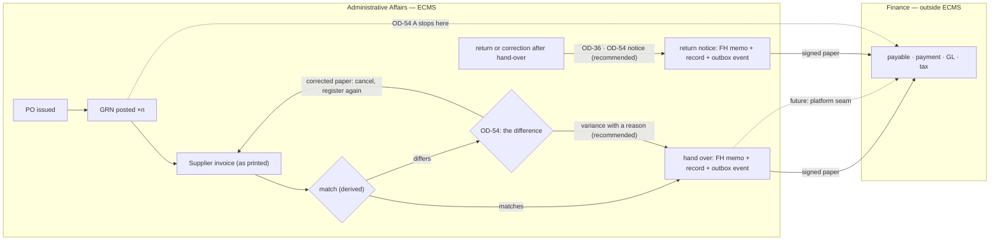
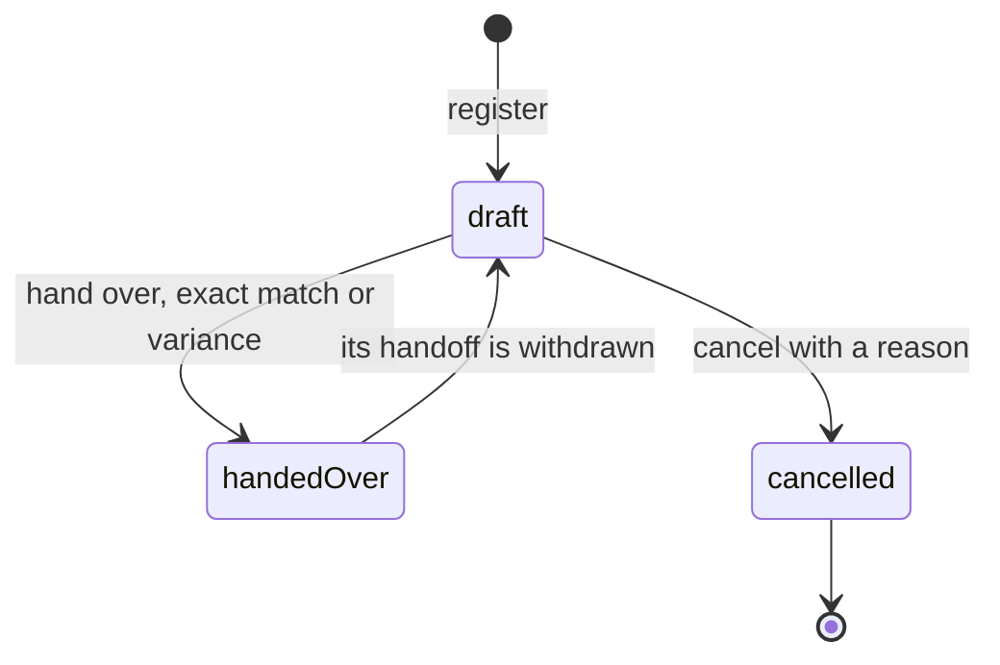

# Administrative Affairs (الشئون الإدارية) — Warehouses & Procurement — Part 3 of 4

**Status:** DRAFT v0.1 (2026-11-17) — part of the design whose status, executive summary and contents are in [administration-module-design.md](administration-module-design.md). Section numbers run across the four files; decisions are `OD-xx` in [§16](administration-module-decisions-and-phases.md#16-open-business-decisions).

> Part 1: [administration-module-design.md](administration-module-design.md) (§0–§3) · Part 2: [administration-module-design-flows.md](administration-module-design-flows.md) (§4–§7) · Part 3: [administration-module-design-integration.md](administration-module-design-integration.md) (§8–§14) · Part 4: [administration-module-decisions-and-phases.md](administration-module-decisions-and-phases.md) (§15–§22)

---

## 8. Events

The module publishes facts others react to and consumes almost none, through the existing bus
(`apps/api/src/platform/kernel/event-bus.ts:61-97`) and catalog (`packages/contracts/src/events/catalog.ts`).

### 8.1 Rules every event follows

- **Name.** `administration.<entity>.<pastTense>` (ADR-008; `packages/contracts/src/events/index.ts:20`). The lexicon is
  global, so a word keeps its existing meaning. `issued` is «إصدار» (`catalog.ts:826`), which fits an RFQ or a PO; a
  stock issue therefore *posts* (`administration.stockIssue.posted`). No event uses `custody` (vault custody, `:778`) or
  `maintenance` (Fleet's visit, `:742`). The Arabic collisions that remain go to OD-67 (§8.3).
- **Declared with its emitter.** Each name lands in the slice that emits it, `stable` on arrival, as in Fleet's later
  slices (`catalog.ts:1013-1021`). Nothing is pre-declared `planned`: a cataloged name nobody emits "never fires"
  (`docs/12-planning/cross-module-dependency-audit.md:99-118`).
- **Facts, not lines.** At most one event per lifecycle fact of a document; never one per line or per approval rung.
  One act may cause several facts: a receipt that completes a transfer emits `.received` and `.closed`; a GRN that
  completes its PO emits `goodsReceipt.posted`, `purchaseOrder.closed` and one `purchaseRequest.closed` for each cited
  PR that closes with the PO (§4.2.2, How a PR ends). Nothing that happens to a draft is an event, so `.cancelled` fires
  only for a document cancelled after draft, and its `number` is never null. The one level event, `item.belowMin`, is
  one per posting (§8.2). Volume matters because every cataloged event is subscribed as an HR notification-rule
  trigger (`apps/api/src/modules/hr/notification-rules/rule-subscriptions.ts:15-24`; offered in the rule picker,
  `apps/api/src/modules/hr/notification-rules/notification-rule.controller.ts:68-73`) and as an automation trigger
  (`apps/api/src/modules/automation/triggers/trigger-subscriptions.ts:11-18`).
- **Payload V1.** Ids, immutable display fields (document `number`, item or warehouse `code`), the scope ids a filter
  needs (`branchId`, `warehouseId`, `departmentId`, `supplierId`), the employee ids an HR rule's `subject` audience
  reads (§8.2), counts and the resulting status. No names, no free text (reasons stay on the document and in the audit
  row) and no other personal data. No money: whether amounts may travel in events is OD-73's notifications-and-events
  question (recommended default: (i), no amounts; Finance reads them from the records, §12.6), and an amount added
  later is an additive field. Schemas are plain `z.object`, as 115 of the 119 `…PayloadV1` schemas in contracts are
  (`ItSparePartBelowMinPayloadV1`, `packages/contracts/src/modules/it.ts:1919-1924`): consumers parse payloads
  non-strict (`packages/contracts/src/events/index.ts:1-4`), and the catalog publishes every payload with
  `additionalProperties: true` (`catalog.ts:616-619`, pinned by `packages/contracts/src/events/catalog.spec.ts:475-479`).
  The four `.strict()` job-requisition payloads (`packages/contracts/src/modules/hr-job-requisition.ts:210-243`) are the
  outlier and are not copied; extra keys are stopped at the emit site instead (below). The actor rides the envelope
  (`event-bus.ts:31-49`).
- **Additive only.** Module envelopes are always `schemaVersion: 1` (`event-bus.ts:36`); a `…V2` needs a bus change. So
  fields are only added, and consumers read tolerantly (`events/index.ts:1-4`).
- **Tier.** In-process after commit, like every IT, Fleet and Operations emit. Facts Finance must not lose become
  reliable once a cross-module consumer exists (D-13, §12.11), in the order of §8.5. A later promotion (OD-37, OD-41,
  OD-54, OD-56) changes no payload contract, but it changes how a handler runs. An in-process handler runs in the emitter's process, under its request context (`event-bus.ts:51-59`;
  `apps/api/src/infrastructure/http/request-context.ts:31-36`), so a row it writes names the emitting user. A reliable
  handler runs in the worker with only the request id (`apps/api/src/infrastructure/queue/jobs.ts:142, 262-263`), waits
  for the relay (§8.5) and runs at most once when it throws. Handlers therefore take the actor from `envelope.actorId`
  and are idempotent and non-throwing. **A fact and its reversal share a tier:** promoting one promotes its opposing
  events in the same slice: `goodsReceipt.posted` with `supplierReturn.posted`; `stockIssue.posted` with
  `stockReturn.posted`; `purchaseOrder.issued` with `.cancelled` and `.closed`; and, under OD-37 B or C, every posting that writes stock off (`stockAdjustment.posted`,
  `stockCount.posted`).
- **Literal emit sites.** `emit(AdministrationEvents.X, { … })` with an object literal written one key per line. The
  payload-key check (`apps/api/src/platform/kernel/event-publishers.spec.ts:198`) reads only the keys that start a line
  (`:87-105`), so a one-line literal shows it none: about 30 of some 175 literal-payload emit sites escape it today
  (e.g. `apps/api/src/modules/hr/contracts/contracts/contract.service.ts:198`). Prettier (`printWidth: 100`,
  `.prettierrc.json:2`) keeps an object expanded when its source breaks the line after `{`, so the emitter writes its
  first key on a new line, and the module's event spec pins each emitter's keys as the backstop (§8.4). One emitting
  helper per name (IT `announceBelowMin`, `apps/api/src/modules/it/spare-parts/part.service.ts:206-217`).

### 8.2 Catalog per phase

`C` = `{ <doc>Id, number, branchId, lineCount }`; transfers carry `fromBranchId` and `toBranchId` instead of `branchId`.
**P1a and P1b emit nothing**: master data is audited, not published, as IT's vendors and consumables audit their create
and edit and emit nothing (`apps/api/src/modules/it/vendors/vendor.service.ts:54-58, 110-114`;
`apps/api/src/modules/it/consumables/consumable.service.ts:215, 274`).

| Ph | Event | Fires when | Payload beyond `C` | Tier |
|---|---|---|---|---|
| P2 | `administration.purchaseRequest.submitted` | draft → `pendingApproval` | `departmentId`, `requesterUserId`, `requesterEmployeeId` (§2.5) | in-process |
| P2 | `….purchaseRequest.approved` · `.rejected` | the chain's final outcome | the same + `status` | in-process |
| P2 | `….purchaseRequest.cancelled` · `.closed` | cancel after draft (OD-28); the act that closes it: a remainder cancel, or the PO act that closes its last open claiming PO (§4.2.2) | the same + `status`, `orderStatus` | in-process |
| P3 | `administration.rfq.issued` | draft → `issued` | `supplierIds` (invited) | in-process |
| P3 | `….rfq.awarded` · `.cancelled` | award (OD-24); cancel from `issued` or `evaluating` | award: `quotationIds`, `supplierIds` (awarded); both: `status` | in-process |
| P4 | `administration.purchaseOrder.submitted` · `.approved` · `.rejected` | as for PRs | `supplierId`, `status` | in-process |
| P4 | `….purchaseOrder.issued` | `approved → issued` (OD-31) | `supplierId`, `deliveryWarehouseIds`, `deliveryBranchIds` (distinct over the lines, §2.5) | in-process; reliable if OD-56 adds commitments |
| P4 | `….purchaseOrder.cancelled` · `.closed` | cancel after draft; close: a short-close, or the GRN or remainder cancel that completes it under OD-28 A's auto-close (§4.3.2; §5.6 row 7) | `supplierId`, `deliveryBranchIds`, `receiptStatus`, `shortClosed` (derived: closed with a `closeReason`, i.e. by a short-close or by the remainder cancel that completes it, §5.6 rows 7–8 and 13; never from `receiptStatus`, which reads `fullyReceived` on every closed PO, §5.12) | in-process; reliable with `.issued` (§8.1) |
| P5 | `administration.goodsReceipt.posted` | GRN posted | `warehouseId`, `supplierId`, `purchaseOrderId` (null only under OD-33 B), `purchaseOrderReceiptStatus`, `at` | in-process; **reliable** once a cross-module consumer exists (D-13; §8.6) |
| P5 | `administration.supplierReturn.posted` | SRN posted | `warehouseId`, `supplierId`, `goodsReceiptId`, `purchaseOrderId`, `reasonCodes` (the lines' distinct codes, OD-84's `entryError` among them), `at` | in-process; **reliable** with `goodsReceipt.posted` (§8.1) |
| P5 | `administration.item.belowMin` | an outbound posting takes one or more balance rows from above to at or below the item's minimum (the edge, `apps/api/src/modules/it/spare-parts/stock-rules.ts:20-21`): one event per posting, never one per item; a count posting emits none (below) | not `C`: `warehouseId`, `warehouseCode`, `branchId`, `docType`, `docId`, `number`, `items: [{itemId, itemCode, onHandQty, minQty}]`, at most the line cap (§2.1) | in-process |
| P6 | `administration.materialRequest.submitted` · `.approved` · `.rejected` · `.cancelled` · `.closed` | as for PRs; `.closed` from the issue or remainder cancel that completes it | `departmentId`, `requesterUserId`, `requesterEmployeeId`, `warehouseId` (the fulfilling store, OD-75), `status`, `issueStatus` | in-process |
| P6 | `administration.stockIssue.posted` | ISS posted | `warehouseId`, `materialRequestId` (null only under OD-40 B or C), `recipientEmployeeId`, `recipientDepartmentId` (the `recipient` snapshot's, §2.6), `at` | in-process; reliable if OD-41/OD-54 make consumption a Finance fact |
| P6 | `administration.stockReturn.posted` | RTN posted | `warehouseId`, `stockIssueId`, `recipientDepartmentId` (the cited issue's), `at` | in-process; reliable with `stockIssue.posted` (§8.1) |
| P7 | `administration.stockTransfer.submitted` · `.approved` · `.rejected` | only where OD-45 puts the transfer on a chain (recommended default: A, inter-branch transfers) | `fromWarehouseId`, `toWarehouseId`, `status` | in-process |
| P7 | `….stockTransfer.dispatched` · `.received` · `.closed` · `.cancelled` | dispatch; every act that moves stock into the destination's on hand (a receipt, or a late arrival a resolution records); the act that empties transit (§2.4.5); cancel after draft | the same + `receiptStatus`, `discrepancy` | in-process |
| P7 | `administration.stockCount.started` · `.approvalRequested` · `.posted` · `.cancelled` | freeze (`draft → inProgress`); `submitted → pendingApproval`; the final approval, which posts (§4.3.6); cancel after draft | `warehouseId`, `varianceLineCount` | in-process; `.posted` reliable under OD-37 B or C |
| P7 | `administration.stockAdjustment.submitted` · `.posted` · `.rejected` · `.cancelled` | submit; the final approval, which posts; rejection; cancel after draft | `warehouseId` | in-process; `.posted` reliable under OD-37 B or C |
| P8 | `administration.financeHandoff.created` · `.withdrawn` | hand-over, or an SRN posting that cuts a return notice (OD-54's post-hand-over notice, recommended default: (i); §12.5); withdrawal (§12.5) | §12.5's `{ handoffId, number, supplierInvoiceId, supplierId, status }`, plus `branchId` (asked here, for parity with `C`) | in-process; **reliable** once a consumer exists (D-13, §12.11); the record exists only under OD-55 D (recommended default: D) |

- **Acts that emit nothing.** The catalog keeps to the facts others react to:
  - closing bidding (`issued → evaluating`) and every quotation act (record, edit, withdraw): the buyer's working
    steps; the award is the fact;
  - a return for amendment (OD-72 B): the document is back in draft, and `returned` («إرجاع») already means goods
    coming back in this module;
  - a count's recount (`submitted → inProgress`) and, under OD-51 A, its rejection (`pendingApproval → inProgress`):
    the count stays frozen and in progress;
  - a transfer that needs no approval (`draft → approved`, OD-45 A): its first fact is `.dispatched`;
  - a transfer line declared returning or lost, a return re-declared as never arrived (`returnNotArrived`), the
    source's return posting and the loss round (OD-47, recommended default: OD-47.3 B with OD-47.4 (ii)); only a late
    arrival, which moves stock on hand, emits `.received`, and the act that empties transit emits `.closed`. A valued
    loss event waits for OD-37 (recommended default: A, quantities only);
  - a PR or MR remainder cancel that leaves the document open;
  - opening balances, as IT's go-live opening (`apps/api/src/modules/it/go-live/consumables-opening.ts`).
- **Under answers not recommended.** OD-51 C (a final rejection) would add `stockCount.rejected` (the count payload
  plus `status`), and PO revisions bring their own event (OD-26 B, §16). Each ships with that answer.
- **`item.belowMin`.** The event is the immediate at-or-below-minimum crossing of OD-61's level alerts (recommended
  default: A); it compares the item's `minQty` with each warehouse's on hand, OD-09's basis 1 (§2.3.4). A daily
  reorder-point alert per (warehouse, item) is OD-61's too, and needs PX-2's marks (§2.7). A count posting emits
  none, because it can cross hundreds of rows at once and OD-61's recommended low-stock digest reports them. The event
  alerts nobody by itself: a rule or workflow built on it is its author's second alert beside the digest.
- `at` is the business time (OD-74, recommended default: A, the posting instant).
- HR rules address a person only through an employee-id path
  (`packages/contracts/src/modules/hr-notification-rule.ts:46-55`). §2 stores the requester and the recipient as top-level `requesterEmployeeId` and `recipientEmployeeId` (D-22; §2.5, §2.6), and PR, MR and issue payloads carry them. A
  requester without an employee is OD-16's question; only then would the field be null.

### 8.3 What changes in `packages/contracts`

1. `packages/contracts/src/modules/administration.ts` (P2): one flat `export const AdministrationEvents = { … } as const`
   (the form `scripts/check-event-reachability.mjs:47` parses), `AdministrationEventName` and the `…PayloadV1` schemas,
   exported from `packages/contracts/src/index.ts` next to `:65-71`.
2. `packages/contracts/src/events/catalog.ts`:
   - `ADMINISTRATION_EVENT_PAYLOAD_SCHEMAS: Readonly<Record<AdministrationEventName, z.ZodTypeAny | null>>` with
     computed keys `[AdministrationEvents.X]` (an uncataloged constant does not compile, `:1118-1121`);
   - `ADMINISTRATION_EVENT_SOURCE = { moduleId: 'administration', schemas }`, appended to `buildEventCatalog(…)`
     (`:1479-1485`);
   - `EVENT_MODULE_NAMES.administration = { en: 'Administrative Affairs', ar: 'الشئون الإدارية' }` (`:656-663`;
     spelling OD-62);
   - the lexicon words below, in `EVENT_ENTITY_NAMES` (`:665`) and `EVENT_ACTION_NAMES` (`:782`). `EVENT_LIFECYCLE`,
     `EVENT_MULTI_PUBLISHER` and `EVENT_LABEL_OVERRIDES` are unchanged.

| Lexicon | Key — en / ar (candidate, OD-67) | Phase |
|---|---|---|
| entity | `purchaseRequest` Purchase request / طلب شراء · `rfq` Request for quotation / طلب عروض أسعار · `purchaseOrder` Purchase order / أمر شراء | P2–P4 |
| entity | `goodsReceipt` Goods receipt / إذن استلام · `supplierReturn` Supplier return / مرتجع مشتريات · `item` Item / صنف | P5 |
| entity | `materialRequest` Material request / طلب صرف · `stockIssue` Stock issue / إذن صرف · `stockReturn` Stock return / مرتجع صرف | P6 |
| entity | `stockTransfer` Stock transfer / تحويل مخزني · `stockCount` Stock count / جرد · `stockAdjustment` Stock adjustment / تسوية مخزنية | P7 |
| entity | `financeHandoff` Finance handoff / تسليم للإدارة المالية (§12.5) | P8 |
| action (new) | `awarded` awarded / ترسية · `posted` posted / ترحيل | P3, P5 |

All other action words exist (`catalog.ts:782-929`): `submitted`, `approved`, `rejected`, `cancelled`, `closed`,
`issued`, `started`, `approvalRequested` («طلب اعتماد», `:870`), `dispatched`, `received`,
`created`, `withdrawn` and `belowMin`. Labels compose as ترحيل إذن صرف، إصدار أمر شراء، ترسية طلب عروض أسعار،
طلب اعتماد جرد. Every Arabic word of this section and of §10.3, the composed labels included, passes
`scripts/check-formal-arabic.mjs` today (probed through its exported `offendersIn`, `:181-199`; the check scans every
product file, `catalog.ts` included, `:202-226`). Two meanings collide, and both go to OD-67:

- «ترحيل» (`posted`) already labels leave carry-over (`apps/web/src/platform/localization/i18n.ts:17017-17027`:
  «الترحيل», «ترحيل الكل»);
- «صرف» already labels money and vault releases in the action lexicon (`disbursed` and `released`,
  `catalog.ts:888, 903`), beside IT's stock «صرف», so the trigger picker would show اعتماد طلب صرف next to
  «صرف سلفة». طلب مواد and إذن صرف مخزني also pass the check, as alternatives.

«جرد» is reused, not a collision (§0.4).

### 8.4 Spec and gate obligations

| Guard | Obligation |
|---|---|
| `packages/contracts/src/events/catalog.spec.ts` | Import `AdministrationEvents`; add its constants to a coverage case and to the hand-written "invents nothing" set (`:181-195`), which otherwise fails on the first event. Spread `ADMINISTRATION_EVENT_PAYLOAD_SCHEMAS` into `ALL_SCHEMAS` (`:147-150`): the sample test (`:211-221`) skips every schema outside it, so today it checks only the platform and HR samples, and Fleet's, IT's and Operations' go unchecked. Localization (`:276`) needs every word above. The field and JSON Schema tests (`:223`, `:355`, `:430`, `:439`) already run over the whole catalog. The planned list and formula (`:402-417`) stay untouched: nothing is `planned`. |
| `apps/api/src/platform/kernel/event-publishers.spec.ts` | No edit; it discovers every `…Events` export (`:50-61`). Emitted ⇒ cataloged (`:165`); `stable` ⇒ referenced (`:180`, weak: any mention counts); literal payload keys ⊆ cataloged fields (`:198`), for keys that start a line only (§8.1). |
| A module event spec (P2) | One case per emitting helper: the payload it builds parses against its `…PayloadV1` and carries exactly the cataloged keys. It is the backstop of §8.1's one-key-per-line rule, in the shape of `apps/api/src/modules/it/consumables/consumable-history.spec.ts:100-163`. |
| `scripts/check-event-reachability.mjs` | Report-only, not in CI. Each slice runs it and keeps the module at 100 % (today 214/216; both orphans are HR's). |
| Docs | P2 corrects `docs/12-planning/automation-module-design.md:256-257` (§8.7). |

### 8.5 Reliable emits: the order of a posting

Once a fact is reliable (D-13), its posting runs in this order:

```ts
await ensureStockRows(pairsOf(input));                                    // outside the transaction (§2.4.4)
const posted = await unitOfWork(async (session) => {
  const doc = await supplierReturnPosting.post(id, input, ctx, session);   // number, status, GRN claim, guarded $inc, legs
  await emit(
    AdministrationEvents.SupplierReturnPosted,
    {
      supplierReturnId: doc.id,
      number: doc.number,
      branchId: doc.branchId,
      // … one key per line (§8.1)
    },
    { reliable: true, session },                                           // outbox row in this transaction
  );
  return { doc, audits: auditsOf(doc), crossed: doc.crossed };             // built fresh on every attempt
});
nudgeOutboxRelay();                                                        // event-bus.ts:140
await recordAll(posted.audits);                                            // §10.1: the act's row (+ any closed document's)
signalSupplierReturn(posted.doc); signalStock(posted.doc);                 // §9.3
signalGoodsReceipt(posted.doc); signalPurchaseOrder(posted.doc);           // parents whose progress moved (OD-36, OD-84)
await announceBelowMin(posted.crossed);                                    // in-process emits last
```

This is the platform's shape (`apps/api/src/platform/users/user.service.ts:174-190`), with ATM's audit timing: rows
built inside the callback, fresh on every attempt, and recorded once after the commit
(`apps/api/src/modules/atm/settlements/plans/plan.service.ts:16-17, 118`). The relay writes its dedup row before the
handler runs (`event-bus.ts:100-109`), so a failing handler is never retried; `failed` is never set and outbox rows are
never purged. PC-1 (§15.2.2) fixes the retry before the first reliable event gets a cross-module consumer (§12.11).
The one-minute `platform.outboxSweep` (`apps/api/src/platform/scheduler/scheduler.tasks.ts:14-23`) relays what a lost
nudge left pending. Consumers reconcile by reading records: "the event is the doorbell, the record the mailbox" (§12.5).

### 8.6 Consumers

| Consumer | What it gets | Constraint |
|---|---|---|
| HR notification rules | every event, subscribed by name (`rule-subscriptions.ts:15-24`) and offered in the rule picker (`notification-rule.controller.ts:68-73`) | Organization-scope authors; payload values interpolate into the message as `{{placeholders}}` (`packages/contracts/src/modules/hr-notification-rule.ts:69-75`), which can reach the `everyone` audience (`:46-67`). Hence §8.1's lean payloads. |
| Automation | every event, once `AUTOMATION_ENABLED` | Off by default; no branch filter on dispatch; each run keeps the payload in its execution row (credentials redacted) and hands it whole to the provider, n8n (`apps/api/src/modules/automation/triggers/trigger-bridge.ts:83, 113`); never the authority on state (ADR-018). |
| Module notifications | none: `notify()` runs after commit (OD-61) | a notification about a record without a detail route (a quotation, a line) carries its parent document's `entityRef`, the RFQ's for a quotation; `ENTITY_ROUTES` (`packages/contracts/src/platform/notification-target.ts:36-42`) gets entries only for entity types with a detail route (§13.4, rule 4). The push then refreshes the parent's keys (§9.5) |
| Future Finance | `financeHandoff.*`, `goodsReceipt.posted`, `supplierReturn.posted` as doorbells; amounts from the records (§12.6) | idempotent, non-throwing handlers that take the actor from `envelope.actorId` (§8.1, §8.5) |
| Future IT | `goodsReceipt.posted` for IT items, under OD-02 C or OD-65 B (recommended default: A in P5, B as a later IT slice) | IT re-reads the GRN through a read seam; no line payloads |

**The one subscription.** The module subscribes to `hr.employee.exited`
(`{employeeId, code, exitType, effectiveDate}`, `packages/contracts/src/modules/hr-employee.ts:1067-1072`) with P6's
exit flag (§18.2), as IT does (`apps/api/src/modules/it/it.module.ts:577-604`). It serves OD-44 (recommended default:
A, the leaver's drafts are cancelled and their holdings flagged only under OD-15 B; documents keep their filing
snapshot, so a mover needs nothing).

- **It runs early, as HR.** HR emits in-process before it saves the employee, which is why the payload carries
  `effectiveDate` (`apps/api/src/modules/hr/employee-management/employee-actions/employee-action.service.ts:771-780`).
  An in-process handler runs asynchronously under the emitter's request context (`event-bus.ts:51-59`). A handler that
  cancelled would therefore act on an exit whose save may still fail, and its rows would name the HR officer. So the
  handler only records. It passes an explicit null actor and a `source: 'hr.employee.exited'` pseudo-field (§10.1).
- **What it records.** One `alertRaised` row per match, IT's exit-flag precedent
  (`apps/api/src/modules/it/assets/custody.service.ts:1027-1042`;
  `apps/api/src/modules/it/mobile-lines/line-custody.service.ts:353-368`): each warehouse whose `responsibleEmployeeId`
  is the leaver (`ix_responsible`, §2.3.5) and, only under OD-15 B, each of their issues with returnable items still out
  (`recipientEmployeeId`, `ix_recipient`, §2.6). The label reads «رفع تنبيه أمني» (§10.3).
- **Cancelling drafts is a later act.** Under OD-44 A, a module sweep reads the distinct requesters of draft PRs and MRs
  through the directory and cancels the drafts of those it reads as `exited`, on a positive answer only, IT's
  `refuseLeaver` reading (`apps/api/src/modules/it/assets/custody.service.ts:89-95`). It runs as the system actor with
  `source` (§10.1). The cancel is a stamp on the document, so the sweep needs no marks (§2.7).

### 8.7 Alignment with `automation-module-design.md`

| Planned text | In this design |
|---|---|
| `purchasing.request.approved` (`:257`) | `administration.purchaseRequest.approved`: the prefix is the reserved module id (`docs/01-business/module-hierarchy.md:75`), and shipped names are permanent. |
| `admin.asset.created` (`:256`) | Not this module: durable assets are IT's (`it.asset.registered`); personal custody is OD-15. |
| "request submitted → approval by amount" (`:682`) | Value bands are approval request types (OD-18); automation never decides state (ADR-018). |
| "approved → PO generation" (`:682`) | Module logic from the awaiting-sourcing queue (§4.2.3); automation has no action surface (A-6b, the automation plan's unbuilt service-token and callback slice, `docs/12-planning/automation-module-design.md:744`). |
| "supplier delivery reminder" (`:682-683`) | `purchaseOrder.issued` plus scheduling (A-8, the automation plan's unbuilt scheduling slice, `docs/12-planning/automation-module-design.md:746`) or a module sweep (OD-61). |
| "budget-threshold alert" (`:683`) | OD-56. |
| "office supplies reorder point" (`:685-686`) | `administration.item.belowMin` at the minimum; a reorder-point alert is OD-61's daily alert (§8.2). |

---

## 9. Realtime

### 9.1 The rule

`auditService.record()` broadcasts only eight data-change verbs (`packages/contracts/src/platform/realtime.ts:19-31`;
`restore` among them, a verb this module does not use) and never passes `branchId`
(`apps/api/src/platform/audit/audit.service.ts:180-188`), nor does `recordMany`; any other verb stops at the audit
stream (`apps/api/src/platform/realtime/realtime-publisher.ts:51-55`). Branch-, department- and section-scoped viewers
join only branch rooms (`apps/api/src/platform/realtime/realtime-rooms.ts:29-35`). So, after commit:

1. **Every audited act on a branch-scoped entity, whatever its verb, calls the entity's literal
   `signal<Entity>(id, branchId)`** = `publishAuditedChange({ entityRef, action: 'update', at, branchId })`
   (`realtime-publisher.ts:40-74`), as IT's `signalConsumable` does
   (`apps/api/src/modules/it/consumables/consumable-history.ts:100-107`). IT signals only movements, so its item edits
   (`apps/api/src/modules/it/consumables/consumable.service.ts:274`) never reach branch viewers; this design closes that
   gap.
2. **Organization-wide master data audited under a non-broadcast verb sends the same signal without a branch**, which
   reaches the organization room. That is (de)activation: it audits `deactivate` and `activate` (§10.2), and neither
   verb is broadcast, so without the signal retiring or reactivating an item, unit, category or supplier would refresh
   no screen (§19.6).

Broadcast verbs thus reach the organization room twice, and every explicit signal also feeds the audit screen's live
stream once more (`realtime-publisher.ts:51-52`). Both are extra refetches, which the web's 300 ms coalescer merges
(`apps/web/src/platform/realtime/realtime-client.ts:11`). The rule covers acts that change a record: audited reads
(`export`, `download`) and exit flags (`alertRaised`, §8.6) send no signal, the reading §11.5 records. A print of
record moves its counters, so it signals like any write (§11.6.6).

### 9.2 Topics

| Topic | Permission | Ph | `branchId` on the module's signal |
|---|---|---|---|
| `administration.warehouse` | `administrationWarehouse.view` | P1a | the warehouse's |
| `administration.item` · `.catalogItem` · `.itemCategory` | `administrationItem.view` (the catalog pair on `administrationCatalog.manage` in P1a.1, §19.6) | P1a | none (organization-wide data) |
| `administration.supplier` | `administrationSupplier.view` | P1b | none |
| `administration.purchaseRequest` | `administrationPurchaseRequest.view` | P2 | the request's |
| `administration.rfq` · `.quotation` | `administrationRfq.view` | P3 | the RFQ's |
| `administration.purchaseOrder` | `administrationPurchaseOrder.view` | P4 | the purchasing branch |
| `administration.goodsReceipt` | `administrationGoodsReceipt.view` | P5 | the warehouse's; for a PO act, each delivery branch (§9.3) |
| `administration.supplierReturn` | `administrationSupplierReturn.view` | P5 | the warehouse's |
| `administration.openingBalance` | `administrationStock.view` | P5 | the warehouse's |
| `administration.stock` (signal only) | `administrationStock.view` | P5 | every branch whose stock the act moved |
| `administration.materialRequest` | `administrationMaterialRequest.view` | P6 | the request's; also the fulfilling warehouse's under OD-75 B or C |
| `administration.stockIssue` | `administrationStockIssue.view` | P6 | the warehouse's |
| `administration.stockReturn` | `administrationStockReturn.view` | P6 | the warehouse's |
| `administration.stockTransfer` | `administrationStockTransfer.view` | P7 | `fromBranchId` and `toBranchId`: two signals |
| `administration.stockCount` | `administrationStockCount.view` | P7 | the warehouse's |
| `administration.stockAdjustment` | `administrationStockAdjustment.view` | P7 | the warehouse's |
| `administration.supplierInvoice` · `.financeHandoff` | `administrationSupplierInvoice.view` | P8 (OD-54, OD-55) | the purchasing branch |

- **Units and categories** use `administrationItem.view`, the wider of their two read keys (§6.2: reads accept either
  key), because every item screen shows them; IT gates its catalog topic on the manage key
  (`apps/api/src/platform/realtime/realtime-registry.ts:223`). A topic's key must be declared, so in P1a.1, before the
  item keys ship, both topics sit on `administrationCatalog.manage` (§19.6). A holder of the manage key alone then
  refreshes on navigation and `staleTime` (§9.7).
- **Quotations** ride the RFQ key, as they ride its permissions (§6.2).
- **`administration.stock` carries no act rows.** Postings audit on their document (§10), and a stock reader may hold
  no document key. Its literal pair lives in `signalStock`, after Fleet's receipts topic and ATM's day topics, both for
  an audience without the main key (`apps/api/src/modules/fleet/custody/custody-memo-guard.ts:174-186`;
  `apps/api/src/modules/atm/settlements/shared/day-signals.ts:1-30`). The same precedent carries the `goodsReceipt`
  signal of a PO act to the delivery branches (§9.3).
- **No other entity types.** The table above is the module's whole list. Server exports (OD-60) audit on the exported
  register's entity type with `entityId: 'export'` (`stock` for the stock registers), as ATM's register export does
  (`apps/api/src/modules/atm/register/register-export.ts:145-153`). File links audit on their document (§11.4).
  Go-live loads audit per row (§10.1), so they need no run entity; an in-app import with preview (OD-68 C, OD-63)
  would need a run entity type, with its topic and registry entry, and a run verb appended to `AUDIT_ACTIONS` with its
  labels (§10.3 gives that cost). It is not proposed.
- **The procurement policy** (OD-18 bands, OD-32 tolerance) is written through the platform settings service, the ATM
  precedent (`apps/api/src/modules/atm/shared/settings-authority.ts:22-32`; §18.3 P4). Its `settingChanged` row
  broadcasts on `platform.setting`, gated by `setting.view` (`realtime-registry.ts:262`). A policy manager without
  `setting.view` refreshes on navigation and `staleTime`. A module topic for the policy would cost a topic of its own,
  its registry entry and an invalidation row (§9.4), with a signal sent after each save; it is not proposed.

### 9.3 What each act signals

An act signals its own topic; `administration.stock` once per branch whose stock moved; and every parent whose
progress or status it moved, on the parent's own branch (which central buying, OD-22, can make different). A PO act
that changes what a store can receive also signals `goodsReceipt` on each delivery branch: under OD-22's recommended
central buying, the keepers there read the receivable PO lines under `administrationGoodsReceipt` keys (§7.10) and may
hold no PO key, so they join no PO room.

| Act | Signals after commit |
|---|---|
| Master data: create, edit | items, units, categories, suppliers: `record()`'s broadcast to the organization room; a warehouse: also its topic → its branch |
| Master data: deactivate, reactivate | items, units, categories, suppliers: an explicit `update` signal without a branch → the organization room (§9.1, rule 2); a warehouse: its topic → its branch |
| Any document: create, edit, submit, return, decide, cancel, close; a file link (§11.4) | its topic → its branch |
| PO act that claims or gives back PR quantity: submit, reject, return, cancel, short-close, remainder cancel | `purchaseOrder` → PO branch; `purchaseRequest` → each cited PR's branch (each act writes every PR it cites, §4.2.2) |
| PO act that changes receivability: issue, cancel, short-close, remainder cancel; a GRN that closes its PO | also `goodsReceipt` → each distinct `lines.deliveryBranchId` |
| RFQ award; RFQ cancel from `issued` or `evaluating` | `rfq`, `quotation` → RFQ branch (the quotations settle in the same act, §3.4) |
| Quotation record, edit, withdraw (nested under `/rfqs/:id/quotations`, §3.3) | `quotation` → RFQ branch |
| GRN posted | `goodsReceipt`, `stock` → warehouse branch; `purchaseOrder` → PO branch; `purchaseRequest` → the branch of each PR that closed with the PO (§4.3.2) |
| Supplier return posted | `supplierReturn`, `stock` → warehouse branch; `goodsReceipt` → its branch; `purchaseOrder` → PO branch when it gives `receivedQty` back (OD-36 A, OD-84); `financeHandoff` → the PO's branch when it cuts a return notice (P8, OD-54 (i), §12.5) |
| Opening balance posted | `openingBalance`, `stock` → warehouse branch |
| Issue posted | `stockIssue`, `stock` → warehouse branch; `materialRequest` → the MR's branch, where it closes when the issue completes it |
| Issue return posted | `stockReturn`, `stock` → warehouse branch; `stockIssue` → its branch |
| MR act that changes issuability (approve, cancel, remainder cancel), under OD-75 B or C | also `materialRequest` → the fulfilling warehouse's branch |
| Transfer: any act | `stockTransfer` → both branches |
| Transfer stock effect: dispatch · receipt or late arrival · the source's return posting · a loss round's final approval | `stock` → both · destination · both · destination |
| Count: start; a found line frozen; final approval; cancel | `stockCount`, `stock` → warehouse branch (freeze stamps change balance rows) |
| Count entry, per save (§10.2) | `stockCount` → warehouse branch |
| Adjustment: final approval | `stockAdjustment`, `stock` → warehouse branch |
| Supplier invoice registered or cancelled; hand-over; withdrawal (P8) | `supplierInvoice`, `financeHandoff` → the PO's branch; on a hand-over or a withdrawal, also `goodsReceipt` → the branch of each GRN whose `invoicedQty` moved (§12.5) |
| Procurement policy saved | the platform's `settingChanged` on `platform.setting` only (§9.2) |

Both sides read a transfer at every status, drafts included (§7.4), so both are signaled for every act. The signal is
not data (`realtime.ts:4-8`). PO revisions, and so their signals, exist only under OD-26 B (§16).

### 9.4 Web invalidation registry

Each row in `apps/web/src/platform/realtime/invalidation-registry.ts` says exactly what the matching mutation's
`onSuccess` says (`:1-5`). Keys come from `featureKey('administration', <feature>)`, `listKey` and `detailKey`
(`apps/web/src/shared/lib/query-keys.ts:4-15`); a feature subtree holds its lists, details and history, so Phase 1's
ItemDetailPage and SupplierDetailPage sit under `items` and `suppliers`. The awaiting-sourcing queue sits under
`purchaseRequests`, the receivable PO lines (§7.10) under `goodsReceipts`, and the item card and warehouse card, live
stock views from P5, under `stock`, which the `administration.stock` topic refreshes. A key marked
with a phase joins its row with the screen that holds it; the dashboard ships in P9 (§18.2).

| Topic | Key prefixes `['administration', …]` |
|---|---|
| `.warehouse` | `warehouses`, `stock` (P5), `dashboard` (P9) |
| `.item` | `items`, `stock` (P5), `dashboard` (P9) |
| `.catalogItem`, `.itemCategory` | `catalogs`, `items` |
| `.supplier` | `suppliers`, `rfqs` (P3), `purchaseOrders` (P4) |
| `.purchaseRequest` | `purchaseRequests`, `dashboard` (P9) |
| `.rfq`, `.quotation` | `rfqs`, `purchaseRequests` |
| `.purchaseOrder` | `purchaseOrders`, `purchaseRequests`, `goodsReceipts` (P5), `dashboard` (P9) |
| `.goodsReceipt`, `.supplierReturn` | `goodsReceipts`, `supplierReturns`, `purchaseOrders`, `dashboard` (P9) |
| `.openingBalance` | `openingBalances` |
| `.stock` | `stock`, `dashboard` (P9) |
| `.materialRequest` | `materialRequests`, `dashboard` (P9) |
| `.stockIssue`, `.stockReturn` | `stockIssues`, `stockReturns`, `materialRequests`, `dashboard` (P9) |
| `.stockTransfer` | `stockTransfers`, `dashboard` (P9) |
| `.stockCount` | `stockCounts`, `dashboard` (P9) |
| `.stockAdjustment` | `stockAdjustments`, `dashboard` (P9) |
| `.supplierInvoice`, `.financeHandoff` | `supplierInvoices`, `financeHandoffs`, `purchaseOrders`, `dashboard` (P9) |

No document row lists `stock`: a posting's stock effect arrives on `administration.stock`, which also reaches readers
without the document key. The dashboard key sits in the row of every topic that feeds a tile (§14.3, §14.4); RFQs,
quotations, the catalogs, suppliers and opening balances feed none (§14.4). From P9 the `dashboard` prefix also joins
the registry's `THROTTLED_KEY_PREFIXES`, as Fleet's dashboard did
(`apps/web/src/platform/realtime/invalidation-registry.ts:47-69`): a signal marks it stale at once and refetches it on
screen at most once per 30 s (`apps/web/src/platform/realtime/throttle.ts:1-17`), so a busy store does not re-read the
board on every posting. Report keys sit in no row: cross-document reports (§14) are not live; they show `generatedAt`
and a refresh action (§14.4). The item and warehouse cards are not among them, although §14.5 lists them: their keys
sit under `stock`, so a posting refreshes an open card through the `.stock` row. A module spec pins `keysForTopic` for
the stock topic (`apps/web/src/modules/fleet/api/custody-queries.spec.tsx:277-292`).

### 9.5 Requesters: liveness through their notifications (no ECMS precedent)

Own-scope requesters join no rooms (`realtime-rooms.ts:29-35`). The in-app push already carries the notification's
`entityRef` (`apps/api/src/platform/notifications/channel-adapters/in-app.adapter.ts:11-18`;
`apps/api/src/platform/notifications/notification.mapper.ts:19`), which the web ignores
(`apps/web/src/platform/realtime/realtime-client.ts:88`).

**Design (PC-7).** On `notification:new`, the client also pushes
`realtimeTopic(entityRef.moduleId, entityRef.entityType)` into the coalescer; the registry row picks the keys, and an
unknown topic is ignored. A notification about a record without a detail route (a quotation, a line) carries its
parent document's `entityRef` (§8.6), so the parent's row picks the keys: the RFQ's for a quotation (§9.4). ADR-029's
argument holds: the push went to exactly this user, and the refetch is authorized.
This is platform web code (one handler and its spec), recorded as an ADR-029 note, and an ADR only if it becomes a
platform convention (§20). A push without `entityRef` keeps today's single `NOTIFICATIONS_TOPIC`, the pinned case
(`apps/web/src/platform/realtime/realtime.spec.ts:143-151`). **Fallback:** if platform review refuses the generic rule,
the handler acts only when `entityRef.moduleId` is `administration` (an allow-list).

**Timing.** PC-7 is not a prerequisite of P2. P2 ships with navigation and `staleTime` refresh for requesters (below),
PC-7 lands when platform review accepts it, and P2's exit criterion is worded accordingly (§18.1).

**Risk.** A transition that notifies nobody (OD-61) refreshes nothing. Neither does one whose template was deactivated:
`notify()` then throws (`apps/api/src/platform/notifications/notification.service.ts:113-117`), and the caller swallows
the error, as HR does (`employee-action.service.ts:781-788`). A template without the in-app channel still refreshes,
because the push is sent for every notification row whatever the template's channels
(`notification.service.ts:186-197, 263-271`). Requesters otherwise rely on navigation and `staleTime: 30_000`
(`apps/web/src/shared/lib/query-client.ts:18`). Approvers who hold `.approve` without `.view` are in the same position.

### 9.6 Reconnect and degraded modes

- **Reconnect** invalidates every registered prefix (`apps/web/src/platform/realtime/RealtimeProvider.tsx:67`;
  `invalidation-registry.ts:666-674`) through the platform invalidator (`apps/web/src/platform/realtime/invalidator.ts`):
  mounted screens refetch at once, unless the tab is hidden (marked stale, refetched once when shown) or the
  prefix is throttled (at most once per 30 s); others refetch when next opened. No module code, but
  every live module key must sit under a registered prefix; report keys, which are not live, sit under none (§9.4).
- **Rooms are computed at connect**, so a new or revoked grant takes effect at reconnect
  (`docs/03-decisions/ADR-029-realtime-invalidation-over-the-audit-chokepoint.md:80-81`).
- **Realtime off** (`REALTIME_ENABLED=false`): no entity signal is published and no topic room joined, but notification
  pushes are not behind the flag (`apps/api/src/infrastructure/config/env.ts:104-112`). §9.5's refresh therefore still
  runs, one authorized refetch per notification, which is accepted.
- **A broken socket** stops both: screens fetch on navigation and staleness. No rule depends on a signal: the guarded
  `$inc` and version checks refuse stale writes.
- **Timeline lag.** The audit row is queued, so a refetched timeline can miss the newest row by one event.

### 9.7 What each viewer gets

| Grant scope on the topic key | Gets live | Does not get live |
|---|---|---|
| organization | every topic, master data included, both ends of every transfer | — |
| branch, department, section | every act in the home branch and every branch in reach; transfers touching their branch at either end; the receivable PO lines of their delivery branch | master data (no branch: navigation or `staleTime`); other branches; grants changed since connect |
| own | nothing by topic; their documents through their notifications (§9.5) | transitions that notify them of nothing |

Department- and section-scoped holders receive their whole branch's signals, but their refetch returns only their scope:
extra refetches, no leak. A holder of `administrationCatalog.manage` without `administrationItem.view` gets no catalog
signal from P1a.2 on (§9.2).

### 9.8 Guards

- **`apps/api/src/platform/realtime/realtime-registry.spec.ts`**: every literal pair (letters only, `:76-77`)
  classified, none stale, none dynamic (`EXPECTED_DYNAMIC_SITES = 16` holds, `:65`; it was 10 at `b03522f`); each
  topic's permission declared in `moduleManifests` (an env-gated manifest is imported directly, `:9-13`). The scan also sees signals, notification
  `entityRef`s and file owners, so a topic row lands with the entity's first literal pair. **Shared helpers never build
  `entityType` from a variable:** `shared/lifecycle.ts` and `shared/posting-lifecycle.ts` take the feature's literal
  `…EntityRef` helper and its `signal<Entity>` as parameters, because a `moduleId: 'administration'` site with a
  variable `entityType` is a new dynamic site the spec counts (`:78`, `:113-115`).
- **`apps/web/src/platform/realtime/realtime.spec.ts:166-214`**: every server topic mapped, none phantom. Server rows
  keep the shape its regex reads: a quoted `'a.b'` key, then `{` with `permission:` as the first property (`:171-174`);
  line breaks are allowed.
- **A module audit spec per `<entity>-audit.ts`** pins literal pairs, verbs and branch signals
  (`apps/api/src/modules/it/consumables/consumable-history.spec.ts:100-163`).

---

## 10. Audit

### 10.1 Shape and timing

- **After commit.** `auditService.record({ entityRef, action, changes })` runs after commit, in the §8.5 order, never
  inside `unitOfWork`, whose callback `withTransaction` may run more than once
  (`apps/api/src/platform/kernel/unit-of-work.ts:5-17`). The rows are built inside the callback, fresh on every
  attempt, and recorded once after it (§2.4.4; ATM's `recordAll`,
  `apps/api/src/modules/atm/settlements/plans/plan.service.ts:16-17, 118`), in one `auditService.recordMany(entries)` call
  (`apps/api/src/platform/audit/audit.service.ts:229-274`): one queue round trip for all the act's rows,
  each its own instant, `record()`'s never-throws fallback, and one entity signal per entity type and verb. Like `record()`
  it passes no branch, so §9.1's branch signal still follows. Several IT services audit inside the
  callback instead: custody, spare parts, maintenance, tickets and software (e.g.
  `apps/api/src/modules/it/spare-parts/part.service.ts:148`; `apps/api/src/modules/it/tickets/ticket.service.ts:197`).
  That is not copied.
- **One row per document act**, lines summarized. A second row is written on every other document whose lifecycle
  `status` the act changes, `complete` when the act closes that document and `statusChange` otherwise, so each
  document's trail is complete: the GRN that closes its PO (§4.3.2) also writes `complete` on the PO and on each PR that
  closes with it (§4.2.2); the issue that completes its MR writes `complete` on the MR; an award or an RFQ cancel writes
  `statusChange` on each quotation it settles (§3.4); a handoff's withdrawal writes `statusChange` on its invoice
  (§12.5). A PO cites at most the line cap's PR lines (§2.1), which bounds the cascade. Physical progress
  (`orderStatus`, `receiptStatus`, `issueStatus`, `discrepancy`) rides on the acting row as pseudo-fields.
- **Literal refs.** One `…EntityRef(id)` helper per entity type, with its `signal<Entity>`, in the feature's
  `<entity>-audit.ts`, after IT's `consumable-history.ts`
  (`apps/api/src/modules/it/consumables/consumable-history.ts:26-38, 100-107`).
- **Actor.** The request context. Sweeps and go-live steps run without one, so their rows carry a null actor
  (`apps/api/src/platform/audit/audit.service.ts:162`; IT's SLA sweep,
  `apps/api/src/modules/it/tickets/ticket-sweeps.ts:58-62`). They also name their origin in a `source` pseudo-field,
  as IT's go-live does (`apps/api/src/modules/it/go-live/consumables-opening.ts:305`); no sweep does that yet.
  The exit handler passes an explicit null actor with `source` (§8.6). A sweep that stamps a document audits the stamp
  (IT's `slaBreached`); a sweep that only notifies writes nothing.
- **Go-live loads.** A master-data load (OD-68) or an opening-balance file (OD-63 B) audits per row, after commit, as
  IT's go-live does (`consumables-opening.ts:294-308`): `create` per master row, and each opening-balance document's
  own posting row, each with `source`, written by one `auditService.recordMany` call (`audit.service.ts:229-274`): one queue
  round trip and one entity signal per entity type and verb, rather than one of each per row. No run entity and no run verb
  are needed (§9.2).
- **Accepted gaps.** A crash between commit and audit loses the row (platform precedent; D-12 records the rejected
  alternatives). The engine's own decision row (`apps/api/src/platform/approvals/approval.service.ts:202-221`) is
  written before the host commits and keyed
  `<requestType>:<step>`, so it names no document (R5, OD-20; PX-1 fixes it under OD-20 A, §18.1 A4). Both rows carry
  the HTTP `requestId` (`audit.service.ts:167`), which joins them; the host row repeats the decision's fields besides.

### 10.2 Verb per act

This is the module's one verb table; §5's audit columns defer to it. `accept`, `reject`, `deliver` and `checkOut` are
never reused (§10.3), and the chain-decision verb is OD-82. The table holds the acts of the recommended answers; the
rows another answer adds are listed under it and ship with that answer.

| Act | Verb | `changes`, beyond `status` old → new |
|---|---|---|
| Create; edit (master data, drafts) | `create`; `update` | `diffChanges(snapshot)` (`apps/api/src/shared/utils/diff.ts:19-34`), only if non-empty |
| Link, replace or withdraw a file (§11.4) | `update` on the document | `signedCopy` (old → new id) or `attachment` |
| Count entry: one save of a page of lines (`PATCH /:id/lines`) | `update` on the count | `lines [{itemCode, countedQty}]`. The screen saves a page at a time, never line by line, so the trail holds one row per save; each line's `countedByUserId` and `countedAt` (§2.6) record who counted it |
| Deactivate, reactivate master data (§5.3) | `deactivate`, `activate`, then an explicit `update` signal (§9.1) | `isActive`, plus any field the same `PATCH` changed (§19.6) |
| Submit; issue an RFQ; close bidding (`issued → evaluating`); award; issue a PO; request a count's approval; submit a transfer that needs no approval (`draft → approved`, OD-45 A) | `statusChange` | `number` when assigned; linked ids; award: `quotationIds`, `justification`; the no-approval transfer: `approvalRequired: false` |
| Return for amendment (OD-72 B); recount (§5.10); withdraw a quotation; withdraw a finance handoff (§12.5) | `statusChange` | `reason`; recount: `lineIds`; return: the archived round's number |
| Chain decision, any rung, any document, a transfer loss's round included | the verb OD-82 picks (recommended default: A, a new `approvalDecision`; B: `statusChange` on the settling rung, `update` on the others; C: `update` everywhere) | `decision`, `requestType`, `step`, `level`, `permissionKey`, `overriddenWith`, `covers`, `comment`; when the final approval posts (count, adjustment, transit loss), the posted lines |
| Cancel a document | `cancel` | `reason` after draft |
| Cancel a remainder: PR, MR and PO `/cancel-remainder`, a keeper's "cannot supply" under OD-28.1 (ii), a PO short-close (`/close`) | `cancel` with `scope: 'remainder'` | `reason`, the remainder per line; on a PO short-close, `status` `issued → closed` and `shortClosed: true`; on a PO remainder cancel, `status` `issued → closed` only when it completes the PO (§5.6 row 7) |
| Another document whose lifecycle `status` the act changes (§10.1) | `complete` when the act closes it; `statusChange` otherwise | the acting document's type, id and number |
| Post a GRN; post an opening balance | `receive` | `lines [{itemCode, qty}]`, `warehouseId`, `purchaseOrderId`, `receiptStatus`; an opening balance: `asOfDate`, its counted date (§2.6) |
| Post a supplier return; post an issue return | `return`; `create` on a return notice it cuts (P8, OD-54 (i); §10.1, §12.5) | `lines`, `reasonCodes`, the cited GRN or issue |
| Post a stock issue | `assign` (IT `issued → assign`, `apps/api/src/modules/it/consumables/consumable-history.ts:74-81`) | `lines`, `materialRequestId`, `issueStatus` |
| Transfer: dispatch · receipt or late arrival · resolve (a line declared returning or lost, or a return re-declared as never arrived, `returnNotArrived`; OD-47) · the source's return posting | `transfer` · `receive` · `resolve` · `return` | `lines`; `receiptStatus`, `discrepancy`; per line the outcome, quantity and reason |
| Start a count (freeze); add and freeze a found line (§2.4.6) | `start`; `update` | the frozen line count; the found item |
| Hand over a supplier invoice (§12.5) | `create` on the handoff; `statusChange` on the invoice | §12.5 |
| Save the procurement policy | the platform's `settingChanged` on `platform.setting` (`apps/api/src/platform/settings/settings.service.ts:249-259`) | the old and new value of each key, and the actor; the band stamped at submission keeps a later threshold change from re-routing an in-flight PO (OD-18) |
| Exit flag (§8.6) | `alertRaised` (IT's exit-flag precedent) | `exitedEmployeeId`, `source` |
| Server export · print of record (OD-59, §11.6.6) · quotation or invoice file read under OD-73 C (§11.5) | `export` · `administrationPrint` (§10.3) · `download` | `rowCount`, `completed`, `filter` · `paper`, `printNumber` · file, version, category |

Rows other answers add: an adjustment posted without a chain (OD-52 C or OD-19 B) audits `correct` with
`lines [{itemCode, kind, qty, reasonCode}]`; a PO revision's rows exist only under OD-26 B (§16).

A count lists only its variance lines (counted ≠ book). Which acts require a reason is §5.1.2 (5), after the
recruitment `requiresReason` precedent; the ODs that own those acts may change the list (OD-28, OD-47, OD-51, OD-52,
OD-72).

### 10.3 Why not `accept`, `reject`, `deliver` or `checkOut`

The audit log page and its detail panel label every row with one global key, `systemAdmin.users.audit.<verb>`
(`apps/web/src/modules/system-admin/audit/lib/audit-labels.ts:11-12`;
`apps/web/src/modules/system-admin/audit/pages/AuditLogPage.tsx:83, 137`;
`apps/web/src/modules/system-admin/audit/components/AuditDetailPanel.tsx:46`). The account Activity tab shows only an
account's own timeline and translates a fixed subset of verbs
(`apps/web/src/modules/system-admin/users/components/UserActivityTab.tsx:48-63, 147-149`), so module rows never appear
there. Some verbs carry another module's wording
(`apps/web/src/platform/localization/i18n.ts:25195, 25211, 25214-25215`): `accept`/`reject` read
«قبول رسالة صيانة»/«رفض رسالة صيانة», `deliver` «خروج من الخزينة», `checkOut` «تسليم العهدة». A rejected PO
audited as `reject` would read «رفض رسالة صيانة», so none is reused.

Reused, because their labels are neutral: `receive` «استلام», `return` «إرجاع», `transfer` «نقل», `resolve` «حل»,
`start` «بدء», `complete` «إتمام», `cancel` «إلغاء», `correct` «تصحيح», `activate`/`deactivate` «تفعيل»/«تعطيل»,
`statusChange` «تغيّرت الحالة», `export` «تصدير», `download` «تنزيل». Two carry another owner's wording and are accepted
on precedent: `assign` «إسناد», IT's consumables verb; and `alertRaised` «رفع تنبيه أمني», the platform's security
wording, used only for the exit flag, which IT already writes under it
(`apps/api/src/modules/it/assets/custody.service.ts:1037`; `apps/api/src/modules/it/mobile-lines/line-custody.service.ts:363`).
`dispose` «إخراج من الخدمة» is not used: a write-off and a transit loss post on their approval (§10.2). Pre-existing and
platform-wide: `create`/`update` read «أُنشئ الحساب»/«عُدِّل الحساب» for every module (`i18n.ts:25382-25383`); a neutral
relabel is a separate platform fix.

**Cost of a new verb (OD-82 A).** `approvalDecision` (en "Approval decided", ar «البت في اعتماد», the catalog's
`approvalDecided` wording, `catalog.ts:871`) needs an append to `AUDIT_ACTIONS` with its rationale comment
(`packages/contracts/src/platform/audit.ts:5-211`) and en+ar labels, enforced by
`apps/web/src/modules/system-admin/system-admin-i18n.spec.ts:113-127` and
`apps/web/src/modules/system-admin/audit/audit-screens.spec.tsx:362-368`. No migration: the enum is derived
(`apps/api/src/platform/audit/audit.model.ts:46`). An old worker refuses the verb, retries and parks the job
(`removeOnFail: false`), so the worker ships with the new contracts first (RK-29, §18.1).

**The print verb, adopted.** Every print of record (OD-59) writes the module's own verb, `administrationPrint` (en
"Printed a paper of record", ar طباعة مستند رسمي), never `export`: the `exportSpike` detector counts only `export`
rows (`apps/api/src/platform/audit/audit.signals.ts:129-142`), so a keeper's prints never raise it (§10.6). It is the
same append to `AUDIT_ACTIONS`, after ATM's `atmSettlementPrint` (`packages/contracts/src/platform/audit.ts:189-194`),
with its rationale comment, en+ar labels, the same two specs and the same worker order (RK-29). It ships with the first
paper of record (§11.6.6). It is not a broadcast verb (`packages/contracts/src/platform/realtime.ts:19-31`), so a print
refreshes screens through the branch `update` signal its counter write sends (§9.1).

### 10.4 Before, after and reason

- **Edits.** A per-entity `snapshot(doc)` diffed before and after. Counters and balances never enter a snapshot; a
  movement's quantities sit on its document's act row (`consumable-history.ts:47-57`).
- **Transitions.** A hand-built `change(field, from, to)`; reasons as `change('reason', null, text)`; linked ids as
  pseudo-fields (`apps/api/src/modules/it/consumables/consumable.service.ts:347`). Which acts require a reason: §10.2.
- **Money in the trail (OD-73).** Snapshots carry the stored `*Minor` integers. Every `auditLog.view` holder reads every
  module's `changes`: audit rows have no row scope (`apps/api/src/platform/audit/audit.service.ts:64-81`), and only
  `nationalId` is masked (`apps/api/src/platform/audit/audit.masking.ts:18`). Whether audit rows carry prices is
  OD-73's audit-rows question (recommended default: (i), prices in clear, because a price trail without prices
  settles nothing; §6.8).
  - Under (i), auditors read every price the documents' viewers read.
  - Under (ii), only write-time redaction is complete (ATM's `redactedDiff`,
    `apps/api/src/modules/atm/register/register-secrets.ts:89`), at the cost of the evidence. Read-time masking, one
    more name in `MASKED_FIELDS`, covers the list and the CSV (`audit.service.ts:384`;
    `apps/api/src/platform/audit/audit.export.ts:39`) but not `GET /platform/timeline`, which returns raw `changes`
    (`apps/api/src/platform/audit/audit.timeline.ts:57-65`).

### 10.5 Entity timeline and document history

`GET /platform/timeline` is the auditor's view: gated by `auditLog.view`/`activityLog.view`, with no entity
authorization and no `moduleId` filter (`apps/api/src/platform/audit/audit.timeline.ts:85-146`). Business users read
history under the document's own scope: the approval trail (`approvalService.trailFor`,
`apps/api/src/platform/approvals/approval.service.ts:115`, as leave reads it,
`apps/api/src/modules/hr/leave-management/leave-requests/leave-request.service.ts:657-661`, shown by
`apps/web/src/platform/approvals/ApprovalChainPanel.tsx`); the document's stamped acts and linked documents (§2); and,
for stock, the ledger itself, since the item card is the history (`consumable-history.ts:5-7`). No module history
collection is proposed; one would wait for the platform Timeline kit (IT §16 P2,
`docs/12-planning/it-module-design.md:1159-1176`). A module-gated read of a document's own audit rows needs none:
`auditService.trailOf` (`apps/api/src/platform/audit/audit.service.ts:346-375`) reads several entities of one
module in one read, masked as the audit list masks them, and Operations serves its shipment log with it under
`operationsShipment.view` (`apps/api/src/modules/operations/shipments/shipment.routes.ts:128-136`). Whether this module
shows such a log is OD-73's *action log* question (recommended default: (i), none). `recordActivity` is not used.

### 10.6 Sensitive reads

The platform audits three reads: `medicalRecordRead` and `secretRevealed`
(`packages/contracts/src/platform/audit.ts:88-97, 166-174`), and every file download ticket, under `download` on
`platform.file` (`apps/api/src/platform/files/file.service.ts:767-768`). The comment at `audit.ts:88` that calls
`medicalRecordRead` "the only READ this platform audits" is stale. Module byte routes, served through
`readEntityOwnedBuffer` (`file.service.ts:727-739`), write nothing (§11.5). By that bar, reading prices, quotations
or comparisons writes nothing under OD-73's recommended default (A); under OD-73 C, each read of a quotation or invoice
file writes one `download` row (§11.5). Also audited: server exports under `<resource>.export` (OD-60, §11.7; none in
Phase 1), prints of record under `administrationPrint` (§10.3, §11.6.6), and the ADR-034 reveal if OD-11 ever stores
bank data (§6.8).

**`exportSpike`.** Every `export` row counts toward the per-user 24-hour `exportSpike` signal
(`apps/api/src/platform/audit/audit.signals.ts:24, 31, 129-142`). Its threshold defaults to 20 a day, with a floor of 5,
set organization-wide (`apps/api/src/platform/audit/audit.settings.ts:32-38`). If prints of record wrote `export`, a
keeper who prints more than 20 GRN or issue papers in a day would raise a security alert, and raising the threshold
would blind the signal for every module. ATM's papers avoid this with a verb of their own, `atmSettlementPrint`, which
the detector does not count (`packages/contracts/src/platform/audit.ts:185-194`), and this module does the same with
`administrationPrint` (§10.3). Only real exports write `export` (§11.7, §14.7), so the threshold stays as it is.

### 10.7 What is not audited

- Reads: lists, details, dashboards, reports, item and warehouse cards, comparisons, the awaiting-sourcing queue, the
  receivable PO lines.
- Client-side Excel and print-to-PDF of lists that OD-60 leaves `.view`-gated, and papers that ride `.view` (§11.6.1).
- Individual ledger movements and balance `$inc`s: the document act's row covers them.
- Realtime signals, notification sends, counter increments, sweep marks.
- Integrity-check runs: report-only; drift is logged and shown on the integrity report (§2.4.8, §14.5).

---

## 11. Documents, attachments, printing and exports

This section reuses what ECMS already has: platform Files with ADR-023 authorizers, the web print door, the company
report form, the hand-written `.xlsx` writer and the audited CSV stream. In the default design the platform changes in
two ways: the audit contracts gain the module's print verb, `administrationPrint` (§11.6.6), and two shared-web changes
fix or promote existing pieces (PC-5 and PC-11: §11.5, §11.6.3, §11.7), each scheduled in §18.1. Conditional platform
edits are named where they arise. Business choices stay open decisions.

### 11.1 Ground rules (precedent, not policy)

| Rule | Precedent |
|---|---|
| Files owns the bytes; the document owns the link. Services call `fileService.upload`, `replace`, `softDelete` and `readEntityOwnedBuffer`. The module has one multipart helper per cap (15 MB and 25 MB), shared by its routes. | `fleet/license-image-upload.ts:1-5` ("a second copy would be a second place for the cap … to drift"); IT's three papers share `signedCopyUpload` (`it/assets/receipt.controller.ts:21-23`, `consumable-memo.routes.ts:11, 48`). `module-structure.md:89` forbids touching Multer; module code does it for uploads throughout HR, Fleet and IT, and the code wins. |
| For module roles, the module's own endpoints are the only door. No administration role holds `file.*`, and no screen calls `/platform/files`. | An authorizer never sees the category (`file-authorizers.ts:32-56`), so only a module endpoint can enforce one. The residual path for `file.*` holders is in §11.4 ("Generic file paths"). |
| Every entity type that owns files has an authorizer. | Claimed types fail closed (`file-authorizers.ts:151-186`); `readEntityOwnedBuffer` refuses unclaimed types (`file.service.ts:727-739`). |
| A file's `entityType` is the document's own audited entity type (§9.2), written as a literal at each upload call: `moduleId: 'administration', entityType: 'goodsReceipt'`. | The registry scan then finds a pair the document already classifies, so no new entry is needed (`realtime-registry.spec.ts:76-78`). A constant would be a new dynamic site and break the `EXPECTED_DYNAMIC_SITES` pin (`:24-65, 113-115`). |
| A category ships with its phase's endpoint. `ensure()` runs in `administration.seed.ts` before any upload, and a cached resolver serves the uploads. Keys are declared in contracts and match the schema's key pattern. | Fleet's seed variant: `fleet.seed.ts:31-33` → `fleet/vehicles/vehicle-files.ts:29-42`; IT's lazy creation is the cache precedent only (`consumable-memo-files.ts:18-27`). Key pattern: `platform/files.ts:110-118`; `hr.contractAttachments` breaks it. Keys are declared with their operation, like permissions (`it.module.ts:68-70`). |
| A category's rules change only by an operator act. `ensure()` is create-if-missing, so a later OD answer (formats, size, retention) never reaches an existing category, and no screen edits categories. The change is a `PATCH /platform/file-categories/:id` under `fileCategory.manage`, recorded in the phase's runbook. The resolver drops its cached id when a lookup answers `NotFound`. | `file-category.service.ts:83-87`; `file.routes.ts:191-196`. A cache held for the process's life, as IT's is (`apps/api/src/modules/it/consumables/consumable-memo-files.ts:18-27`), keeps a soft-deleted category's id until restart. A seed-time reconcile of `administration-*` rules has no precedent and is not proposed. |

### 11.2 File categories

**P+I** means `application/pdf`, `image/jpeg`, `image/png` and `image/webp`: "a phone photo of the signed paper, or the
office scanner's PDF" (`consumable-memo-files.ts:12-13`). Office formats are OD-76 (recommended default: P+I only).
An Office file would also be download-only, because previews are an `` or an `<iframe>` (§11.5).

**Caps.** The multer cap sits above the category limit, so the category is the limit users meet. Fleet sets 15 MB over a
10 MB category (`license-image-upload.ts:11-16`); 25 MB over 20 MB follows the same rule (new). Each cap is
`min(category + 5, env.MAX_UPLOAD_MB)`, so a deployment that lowers `MAX_UPLOAD_MB` (`env.ts:257`, default 25; the
platform's own multer cap, `file.routes.ts:54`) lowers the module's caps too. The repository's scanner image accepts
50 MB streams (`infra/clamav/Dockerfile:20-24`; `railway-deployment.md:408-410`). `env.ts` only requires
`StreamMaxLength ≥ MAX_UPLOAD_MB` (`env.ts:52-53`); a file above the stream limit fails its scan and stays `pending`.

**Retention** is stored, but no job enforces it (`files-service.md:53-55`).

| Key | Holds | Entity types (authorizer `administration/<entityType>`) | MIME | Max | Retention (OD-77) | Phase |
|---|---|---|---|---|---|---|
| `administration-supplier-documents` | supplier registration papers, if OD-11 keeps them | `supplier` | P+I | 10 MB | `null` | P1b (OD-11) |
| `administration-request-attachments` | a request's spec sheet, photo or memo | `purchaseRequest`, `materialRequest` | P+I | 10 MB | `null` | P2/P6 |
| `administration-quotations` | supplier quotations | `rfq` (uploaded first, §11.4) | P+I; Office formats: OD-76 | 20 MB | `null` | P3 |
| `administration-signed-papers` | scans of the module's papers after signature | `rfq`, `purchaseOrder`, `goodsReceipt`, `supplierReturn`, `stockIssue`, `stockReturn`, `stockTransfer`, `stockCount`, `stockAdjustment`, `financeHandoff` (OD-55); `purchaseRequest`, `materialRequest` only if OD-59 has them signed | P+I | 10 MB | `null` | P3–P8 (P2 if OD-59 has PRs signed) |
| `administration-delivery-documents` | the supplier's delivery note or packing list | `goodsReceipt` | P+I | 10 MB | `null` | P5 |
| `administration-evidence` | photos or minutes of damage, loss or variance; the counted sheet an opening balance comes from | `goodsReceipt`, `supplierReturn`, `stockReturn`, `stockTransfer`, `stockCount`, `stockAdjustment`, `openingBalance` (OD-63) | P+I | 10 MB | `null` | P5–P7 |
| `administration-supplier-invoices` | invoice scans (OD-54) | `supplierInvoice` | P+I | 20 MB | `null` | P8 |

There is one key per purpose. A link can then be checked against its purpose (§11.4), and retention and formats stay
separate decisions (`fleet/driver-profiles/driver-files.ts:10-14`). If OD-77 gives procurement papers and store papers
different periods, `administration-signed-papers` must be split. Decide this before P3, when the award minutes are the
category's first file. Split before P5 at the latest, when store papers first arrive. A later split migrates the
`categoryId` of every stored file.

### 11.3 Authorizers

```ts
// IT's shape (consumable-memo-files.ts:33-44) with Fleet's scope rule, tried key by key
// (HR employee-action-file-access.ts:33-48: "Any ONE of the four is enough")
export const goodsReceiptFileAuthorizer: FileEntityAuthorizer = {
  entityType: 'goodsReceipt',
  async authorize({ ctx, entityId, intent }) {
    for (const key of intent === 'write' ? WRITE_KEYS : READ_KEYS) {
      if (!hasPermission(ctx, key)) continue;
      if ((await goodsReceiptRepository.findById(entityId, scopeSelector(ctx, key))) !== null) return true;
    }
    return false;
  },
};
```

**Keys.** Reading needs `.view`. Documents with an approval chain also accept `.approve`, because a decider loads the
document under the decide key (§5.2) and must be able to open its evidence. Writing needs the key of the act that
produces the file. The platform also has a `delete` intent, opt-in per authorizer (`understandsDelete`):
an authorizer that does not opt in, as these do not, is asked a delete as a `write`
(`apps/api/src/platform/files/file-authorizers.ts:30`, `:44`, `:162-165`), so withdrawing a file takes the write key and
the `intent === 'write'` test above stays right; an authorizer that opted in with that test would send deletes down its
read branch.

**Scope.** Each held key is tried with its own selector, and the first that finds the document wins. A read tries at
most two keys (`.view`, `.approve`). The scope comes from the key asked, which is Fleet's rule
(`fleet/vehicles/vehicle-files.ts:53-65`). IT's view-scope-for-writes form (`consumable-memo-files.ts:37-41`) is not
copied.

`widestScopeSelector` is not used. It builds the selector for one winning key and drops the other keys' reach lists
(`shared/types/index.ts:256-282`); on a tie of scope ranks the later key wins (`packages/contracts/src/common/index.ts:124-125`).
Take a `.view` held at department scope plus a delegated `.approve` reaching another branch (ADR-032): the combined
selector would answer 404 on the files of a document the caller can open.

**Cost.** Each try is one indexed `findById` on a collection that carries its own scope fields, so no directory, HR,
ledger or parent read is needed. An invalid id returns `null` (`base.repository.ts:277-283`). ADR-023's budget is time:
200 ms per authorizer call, and a timeout denies (`file-authorizers.ts:58-66`; ADR-023 l.114). The IT ticket-comment
authorizer's two sequential lookups are the existing worst case, which the code calls "not enormous headroom". Two
lookups is also the most any authorizer here makes.

**Transfers (§7.4).**
- *Read:* the two-branch `$or` under `.view` or `.approve`.
- *Write:* one lookup by id, then `keyReachesBranch` (`shared/types/index.ts:205`) for each held write key on the side
  its act changes: `.dispatch` on `fromBranchId`; `.resolve` on `toBranchId` (a late arrival or a loss); `.receive` on
  `toBranchId` for receipts and on `fromBranchId` for the source keeper's return posting, never under `.resolve` (§5.9,
  §7.4). This is ATM's `requireReach` shape (`atm/settlements/prints/print.service.ts:82-86`). The read's two-branch
  match alone would let a B-only holder of `.dispatch` pass for an A→B transfer, because B matches `toBranchId`. The
  authorizer cannot see which `.receive` act writes, so it accepts `.receive` reaching either side.
- *Slot:* the authorizer cannot tell which slot is written; it sees only `ctx`, `entityId` and `intent`
  (`file-authorizers.ts:32-56`). The endpoint therefore applies the exact side check (`canDispatch`, `canReceive`,
  `canResolve`, §7.4).
- *Spec:* §7.4's guard spec gains three file cases on an A→B transfer: a B-only holder of `.dispatch` and an A-only
  holder of `.resolve` are both refused file writes, and so is a `.receive` holder who reaches neither branch.

**The PO approver and the bids.** Under OD-24 A the PO approval covers the award, so the PO approver must see the
quotations and the award minutes. Approvers on `unit` rungs hold no RFQ key (§6.5). The `rfq` read rule therefore also
accepts `administrationPurchaseOrder.approve` when a PO citing the RFQ is found under that key's scope. That is one
indexed lookup on the PO's `ix_rfq` (§2.5). Decided together with OD-73.

**Failure.** A throw or a timeout denies. The service then answers 404 on a read and 403 on a write
(`file.service.ts:657-675`).

**Worker contexts.** A worker or go-live context must carry real keys (`fleet/go-live/fuel-card-photos.ts:85-104`).
HR's `permissions: {}` (`contract-pdf.ts:31-42`) works only because HR contracts are unguarded. `hasPermission` reads
only `ctx.permissions` (`shared/types/index.ts:103-104`), so `isPrivileged` bypasses nothing.

| Entity type | Read | Write |
|---|---|---|
| `supplier` | `administrationSupplier.view` | `administrationSupplier.edit` |
| `purchaseRequest` | `administrationPurchaseRequest.view`, `.approve` | `.create`, `.edit` |
| `rfq` | `administrationRfq.view`; `administrationPurchaseOrder.approve` through a PO citing the RFQ | `.edit` (quotation files), `.award` (award minutes) |
| `purchaseOrder` | `administrationPurchaseOrder.view`, `.approve` | `.issue` |
| `goodsReceipt` | `administrationGoodsReceipt.view` | `.create` |
| `supplierReturn` | `administrationSupplierReturn.view` | `.create` |
| `materialRequest` | `administrationMaterialRequest.view`, `.approve` | `.create`, `.edit` |
| `stockIssue` | `administrationStockIssue.view` | `.create` |
| `stockReturn` | `administrationStockReturn.view` | `.create` |
| `stockTransfer` | `administrationStockTransfer.view`, `.approve` (either side) | `.dispatch` (source side); `.receive` (destination side; the source side for the return posting, §7.4); `.resolve` (destination side, §7.4) |
| `stockCount` | `administrationStockCount.view`, `.approve` | `.create`, `.count` |
| `stockAdjustment` | `administrationStockAdjustment.view`, `.approve` | `.create` |
| `openingBalance` | `administrationStock.view` | `administrationStock.openBalance` |
| `supplierInvoice` (P8) | `administrationSupplierInvoice.view` | `.create` |
| `financeHandoff` (P8) | `administrationSupplierInvoice.view` | `administrationSupplierInvoice.handOver` |

The endpoint gates the exact slot first; for example, only `.receive` files a receipt note. The authorizer is a second,
independent line. Entity types that own no file register no authorizer: `catalogItem`, `itemCategory`, `item`,
`warehouse`, and `quotation`, whose file is filed under its `rfq` (§11.4).

### 11.4 Attachment shapes per document

```ts
// A — one versioned link (IT signedCopy, consumable-memo.model.ts:58, 80-89)
interface FileLink { fileId: ObjectId; fileName: string; mime: string; size: number; uploadedAt: Date }
// B — typed list: HR contracts' list (contract.model.ts:218-231) with Employee File's file facts (employee-file.model.ts:47-56)
attachments: { attachmentId; fileId; categoryKey; label; fileName; mime; size; addedByUserId; addedAt }[]
// C — uploaded first, before the record that links it (HR, employee-action.service.ts:1067-1119)
quotationFile: FileLink   // on administration_quotations; the file's entityRef is administration/rfq/<rfqId>
```

In B, `categoryKey` is a file-category key such as `administration-evidence`. HR's `category` is a different thing: a
purpose enum (`nda | annex | signedCopy | approval | other`, `contract.model.ts:224`). The cap of 20 entries per list
has one precedent: IT's vehicle-check reports hold at most five photos, guarded in the write's filter
(`photos.4` must not exist) and refused with 422 `IT_VEHICLE_CHECK_PHOTO_LIMIT`
(`packages/contracts/src/modules/it.ts:3007`; `apps/api/src/modules/it/vehicle-checks/vehicle-check.repository.ts:147-159`;
`vehicle-check.service.ts:304-309`). It bounds the document's size and keeps one list within a single
scan-state read (§11.5).

| Document | A: signed-copy slot (opens at) | B: list (editable while) | C |
|---|---|---|---|
| Supplier | — | supplier documents (OD-11) | — |
| PurchaseRequest, MaterialRequest | — (an information copy; `signedCopy` at `pendingApproval` only if OD-59 has the paper signed) | request attachments (`draft`; OD-76) | — |
| Rfq | `awardSignedCopy` (`awarded`; OD-24, OD-59) | — | quotation file (while the RFQ is `issued`) |
| PurchaseOrder | `signedCopy` (`issued`; the supplier's acknowledgment, OD-31) | — | — |
| GoodsReceipt | `signedCopy` (`posted`) | delivery documents, evidence (OD-34, OD-35) (`draft`) | — |
| SupplierReturn, StockReturn | `signedCopy` (`posted`) | evidence (OD-43) (`draft`) | — |
| StockIssue | `signedCopy` (`posted`; signed per OD-59, recommended default: the recipient, as on the IT memo) | — | — |
| StockTransfer | `dispatchSignedCopy` (`dispatched`), `receiptSignedCopy` (first receipt; see below) | evidence (OD-47) (from `dispatched` until `closed`, by `.receive` on the destination side (on the source side for the return posting) or `.resolve` on the destination side, §7.4) | — |
| StockCount | `signedCopy` (`submitted`: the count result, signed by the count team, OD-50; stale after a recount) | evidence, e.g. the filled count sheet (`inProgress`, `submitted`) | — |
| StockAdjustment | `signedCopy` (`pendingApproval`: the minutes the approvers decide on; OD-52) | evidence (OD-52) (`draft`) | — |
| OpeningBalance | — (no paper unless OD-63 or OD-59 asks) | evidence: the counted source sheet (OD-63) (`draft`) | — |
| SupplierInvoice (P8) | `invoiceFile` (`draft`; OD-54) | — | — |
| FinanceHandoff (P8) | `signedCopy` (`handedOver`; Finance's signed memo, §12.5) | — | — |

**Count results.** The copy signed at `submitted` attests the counted quantities. A recount (`submitted → inProgress`,
§5.10) supersedes it, and the DTO derives that at read time: a copy filed before the latest `countSubmittedAt` is
stale, so the earlier copy reads stale once the recount is submitted. The counting submit (`/:id/submit`) stamps
`countSubmittedAt`; `submittedAt` is the approval host's stamp, taken later by `/:id/request-approval` (§5.10 row 5;
§2.1); read here, it would mark stale every copy filed in between.
This follows ATM's paper-staleness idea (`receiptStale`, `print.service.ts:14-15`), derived instead of stored.

**Transfer receipt notes.** Receipts are partial and repeatable (`POST /:id/receipts`, §5.9). The transfer has one
`receiptSignedCopy` (§2.6), so each later note is filed as a new version, and the earlier signatures become history
that no screen lists. The receipt note is therefore cumulative: it lists every receipt to date and is filed again after
each one. Whether each delivery gets its own signed note is OD-59 (recommended default: the cumulative note, which
§2.6's fields carry). A note per delivery is the stronger record, since each delivery is a separate hand-over, but it is
not adopted: it would need a receipt entry with its own slot per act, a field §2.6 does not have, or one more numbered
document and series (a collection, a counter and a paper), for what each receipt act already records with its own
`receive` audit row (§10.2).

**Why quotations use C.** A quotation is recorded as `received` in one step, with no draft (§5.5 Q1). Uploading first
lets "every quotation has its file" (OD-76) hold at recording. Every quotation route, file routes included, sits under
the one nested family `/rfqs/:id/quotations` that the RFQ feature mounts (§3.3, §3.6):

1. `POST …/rfqs/:id/quotations/file` stores the file under the RFQ. It is accepted only while the RFQ is `issued`, the
   quotation-recording state. HR nests its upload-first route the same way, under the child collection it serves
   (`POST /hr/employees/:id/actions/attachment`, `employee-action.routes.ts:81-93`).
2. `POST …/rfqs/:id/quotations` sends the `fileId`.
3. Before linking, the service checks the file's `entityRef` and category (`employee-action.service.ts:1140-1161`), and
   that the file is the latest, active version. `ux_quotation_file`, partial unique on `quotationFile.fileId` among live
   quotations (§2.5), makes one file back exactly one quotation.

An abandoned upload stays under the RFQ, readable only by RFQ readers; HR documents the same behavior
(`employee-action.service.ts:1104-1108`). The quotation file follows its quotation's edit window: replaceable while the
RFQ is `issued` (§5.5 in-state rule), and frozen from `evaluating` on. A replacement is A's replace on the linked
group, a new version (`POST …/rfqs/:id/quotations/:quotationId/file`). A late change is a withdrawal plus a new
quotation before bidding closes (OD-23). Whether the person who records quotations may also award is one of OD-21's
further candidate pairs (recommended default: not enforced, since B3 keeps the awarder off the PO; §6.6).

**Where this departs from HR.** HR files early uploads under a dedicated entity type keyed by the parent's id, with its
own authorizer (`employee-action.service.ts:1117-1127`, `employee-action-file-access.ts:37-48`), pinned as a dynamic
key (`realtime-registry.spec.ts:24-27`). Here they go under `rfq` itself. Quotation files, award minutes and the RFQ's
other files therefore share one read rule, and the authorizer cannot treat quotation files apart. If the owner's answer
to OD-73 gives quotation files a narrower reader than the RFQ's view key (its option E), they move to a dedicated
entity type keyed by the RFQ id, with its own authorizer and a realtime classification. That type is not among this
design's entity types (§9.2, §18.2), so it would be added with that answer.

**Rules for every shape:**

| Rule | Detail |
|---|---|
| Upload, replace, withdraw | **A:** a first upload uses `upload`; a later one uses `replace` (a new version). A replace starts from the group's latest version (`listVersions`, `file.service.ts:384-391`), never from the linked id, which `replace` refuses once it is not the latest (`:247-255`). Withdrawing unlinks first, then soft-deletes (`consumable-memo.service.ts:110-134`). **B:** entries are added and removed. An entry is replaced only when its file is `blocked` (below). |
| Failed link write | After a first upload, the new file is soft-deleted (`consumable-memo.service.ts:74-80`). After a replace, the new version stays as history and the document keeps naming version n. The next replace starts from the latest, so the slot never sticks. |
| Concurrency, audit, signal | Link writes are version-guarded and audit one `update` row with a pseudo-field: `signedCopy` (old → new id) or `attachment` (`<categoryKey>:<label>`). `record()` passes no branch, so branch-scoped viewers would otherwise wait for a refetch (`realtime-publisher.ts:32-37, 68-70`). After commit the service therefore sends `publishAuditedChange({ action: 'update', branchId })`: both branches for a transfer, the RFQ's branch for a quotation link. A supplier has no branch: `record()`'s own `update` broadcast reaches its viewers in the organization room (§9.3). |
| Posted documents | No edit is accepted. File links and print counters go through one narrow repository method that writes nothing else (§2.1 "After draft"). Considered and not chosen: HR medical events link from the file's side and read the document back by entity (`medical-event.service.ts:58-66, 131-149`). The link has to live on the document: a gate checks it inside the transition's own write, the version guard and the `update` row record it, and it tells the filed copy apart from abandoned uploads. |
| B lists | A list freezes when its editable status ends (matrix above); removal is refused from then on (`contract.service.ts:576-578`). Whether files may be added after submission is OD-76 (recommended default: `draft` only). A file an approver asks for comes back through the return for amendment (OD-72, recommended default: B). By contrast, HR contracts add after signing (`addAttachment` has no `assertMutable`, `:514-535`), and HR leave attaches while pending (`leave-request.service.ts:1032-1041`). |
| Required files (OD-76) | A gate runs at the last moment its slot is editable: submission (PR, MR, adjustment), posting (GRN, SRN, RTN), recording (quotation), hand-over (invoice). It does not run at the approval decision. HR leave checks after `approvalService.decide` has already audited (`leave-request.service.ts:569-581`; R5, §15.2.1), and a gate at decide over a frozen list could never be cured. At a decision only `blocked` is re-checked, and never on a reject. If a file turns `blocked` after its gate, the DTO flags the document and the slot accepts a replace even after its freeze. Who is told is OD-61. |
| Closing an A slot (OD-59, OD-55) | No precedent closes one: IT deletes at any time (`consumable-memo.service.ts:110-134`). Recommended default: replace stays allowed, with history kept. Withdraw is refused once the PO is `closed`, once a live handoff cites the document (§12.5), and on a filed handoff memo. A replace after hand-over requires an audited reason. |
| Double submits | No idempotency store exists, so the control is disabled while a request is pending (`CustodyReceipt.tsx:209`). |
| Generic file paths | A holder of `file.edit` or `file.delete` who passes the write authorizer can still change `categoryId` or `visibility`, or archive a linked file, through `/platform/files`; a delete there is put to the module's authorizer as a write too, unless that authorizer opts into the separate `delete` intent (`understandsDelete`) (`files.ts:54-63`; `file.service.ts:474-530, 549-558`; `apps/api/src/platform/files/file-authorizers.ts:36-44, 162-165`). Super-admin receives every new key (OD-78). The DTO shows a link whose file is gone or archived as الملف غير متاح, and the slot accepts a new upload. A status-aware authorizer is not used: it cannot see the slot, and it would also refuse the replace of a `blocked` file after a freeze. |

**Precedents not to copy:**

| Precedent | Defect | Module rule |
|---|---|---|
| Bare `ObjectId[]` (HR leave, `leave-request.model.ts:108`) | No purpose; the type is unguarded | B |
| File rows listed via `/platform/files` (IT tickets) | No category check; the screen takes `categories.items[0]` (`TicketAttachments.tsx:57, 181`) | Never |
| HR contracts' JSON `addAttachment` (`contract.service.ts:514-535`, `contract.routes.ts:407-410`) | Links any `fileId` without checking its `entityRef` or category | Every JSON link runs C's check |
| HR contracts' `uploadAttachment` (`contract.service.ts:537-574`) | No compensation, so a stale version leaves an orphan; `ensure()` on every call; an invalid key | IT compensation, cached id, valid keys |
| IT's signed-copy replace (`consumable-memo.service.ts:57, 74-81`) | Replaces from the linked id: after a failed link write the slot names a non-latest version, and every later replace is refused | Replace from the group's latest |
| Gold `uploadCompanyLogo` (`gold/api/gold-api.ts:128-135`) | Sends no `entityId`, which `files.ts:30` requires | The server sets `entityRef` |
| HR contracts' worker context (`contract-pdf.ts:31-42`) | `permissions: {}`; works only on an unguarded type | Real keys (§11.3) |

### 11.5 Serving bytes, read audit, virus-scan states

| Route (`/api/v1/administration/…`) | Gate | Behavior |
|---|---|---|
| `GET <plural>/:id/signed-copy`, `GET <plural>/:id/attachments/:attachmentId` | read key | Reads the document under scope, then calls `readEntityOwnedBuffer`. That call keeps the scan gate, asks ADR-023 again and needs no `file.download`. Bytes go out `inline` with `private, no-store` (`consumable-memo.controller.ts:59-62`). |
| `POST`/`DELETE <plural>/:id/signed-copy`; `POST <plural>/:id/attachments`, `DELETE <plural>/:id/attachments/:attachmentId` | slot write key | §11.4 |
| `stock-transfers/:id/dispatch-signed-copy` · `/receipt-signed-copy` | `.dispatch` · `.receive`, each on its own side | §11.3 |
| `rfqs/:id/award-signed-copy` | `.award` | — |
| `POST rfqs/:id/quotations/file` · `POST rfqs/:id/quotations/:quotationId/file` · `GET rfqs/:id/quotations/:quotationId/file` | `administrationRfq.edit` while `issued` · the same · the `rfq` read rule | upload first, then replace (§11.4); the OD-73 C read audit runs on the GET |
| `supplier-invoices/:id/invoice-file` (P8) | `.view` · `.create` | the OD-73 C read audit runs on the GET |
| `finance-handoffs/:id/signed-copy` (P8) | `administrationSupplierInvoice.view` · `.handOver` | §12.5 |

**Read audit.** Only `issueDownloadTicket` audits a file read today (`file.service.ts:768`). The platform's other
audited reads are `medicalRecordRead` and `secretRevealed` (`packages/contracts/src/platform/audit.ts:88-97, 166-174`).
Module byte endpoints audit nothing: `readEntityOwnedBuffer` writes no row (`file.service.ts:727-739`). OD-73
recommends A, with C (audited reads of quotation and invoice files) if bids are confidential. Under OD-73 C, each read
of a quotation or invoice file writes one `download` row before the bytes are sent. The buffer is already in memory,
and the ticket also audits before it hands out its URL (`file.service.ts:767-769`), so a failed audit fails the read.
The row's `changes` name the file, the version and the category. `download` (`audit.ts:53`) is not a broadcast action
(`realtime-publisher.ts:55`), and these rows send no branch signal: §9.1's signal rule ("whatever its verb") covers
acts that change a record, and a read changes nothing a viewer must refetch. HEAD requests are skipped
(`stream-rows.ts:52-53`). Store papers are not audited, as in IT.

**Web.**
- *Previews.* Bytes come through `fetchBlob` into an object URL: `` for photos, `<iframe>` for PDFs
  (`CustodyReceipt.tsx:147-167, 304-310`).
- *Scan state.* The UI's scan state comes only from the DTO's derived `scanStatus`. On a non-OK response `fetchBlob`
  throws `ApiError('EXPORT_FAILED', …, status)` without reading the body (`api-client.ts:490-508`). The friendly
  `FILE_SCAN_PENDING` and `FILE_BLOCKED` messages (`errors.ts:126-127, 208-209`) are therefore never reached on this path,
  and IT's hook only sets `failed: true` (`CustodyReceipt.tsx:155-164`).
- *The fix.* The shared-web pull request that adds `X-Active-Branch` to `fetchBlob` (PC-5, §11.7) also parses the JSON
  error envelope on non-OK responses. Until then, the module's hook maps a 422 to "refresh the scan state".
- *Signed-copy controls.* IT already made these generic: `ReceiptStore` (`CustodyReceipt.tsx:44-64`) has three stores,
  `DEVICE_RECEIPTS`, `LINE_RECEIPTS` (`MobileLineReceipt.tsx:23`) and `CONSUMABLE_MEMOS` (`ConsumableMemo.tsx:24`). But
  they are typed to IT's DTOs and queries (`ItCustodyReceiptSignedCopyDto`). Moving them to `apps/web/src/shared/ui`
  means retyping a component, so the module rebuilds its own from IT's pattern (D-21); a shared piece is a separate
  change reviewed outside the module. The house rule "a module never copies another's code" was written for a promoted
  library (`apps/web/src/shared/lib/xlsx-writer.ts:3-6`): a pure library is never copied, it is promoted, as the
  libraries of §11.6.3 and §11.7 are, unchanged behind re-exports.

**Scan states.** These apply only when `CLAMAV_HOST` is set (`virus-scan.processor.ts:3, 24`). The detail DTO derives
each link's `scanStatus` from the linked files themselves. It makes one `fileService.list` call by entity and category
(`pageSize: 100`; `file.service.ts:418-470`) and matches the rows by `fileId`. A link the page does not cover is read
with `fileService.getById` (`:377-382`): a lagging version, or more than 100 files under an RFQ with abandoned
uploads. Each call costs one authorizer decision. The status is never stored: the worker's verdict arrives later and
would race the link write.

| `scanStatus` | UI | Actions |
|---|---|---|
| `unscanned`, `clean` | preview | view, replace, withdraw (where the slot allows, §11.4) |
| `pending` | قيد الفحص chip; preview and download disabled. The screen refetches with backoff, because no signal is published on a verdict: `setScanStatus` writes no audit row (`file.repository.ts:110-112`) | replace, withdraw |
| `blocked` | محظور danger chip; the file cannot be opened | replace (scanned again; allowed after a freeze, §11.4), withdraw |

The verdict is already a reliable event, `platform.file.virusScanCompleted` with `{ fileId, groupId, processor, result }`
(`file.processors.ts:76-90`; `packages/contracts/src/events/index.ts:54`). A manifest `eventSubscription` could send the
owning document's `update` signal. No module does that: the payload has no `entityRef`, so the module would look the
link up by `fileId`. It is not proposed for the first release.

If clamd is down, files stay `pending` (fail-closed). A sweep every 15 minutes re-queues files that have been pending for
over 10 minutes (`scheduler.tasks.ts:80-91`, `file.processors.ts:111-127`). The chip therefore means "still being
scanned", not that the paper is invalid. A `blocked` file never satisfies a required-file gate. A `pending` one does,
which is OD-76's recommendation, so a scanner outage does not stop posting.

### 11.6 Printing

#### 11.6.1 Which papers (OD-59)

Titles are §0.4 candidates (OD-67), except the word «جرد», which the product already prints (§0.4); only the count
papers' full titles are candidates. The print-from states, signed copies and watermarks are recommended defaults
under OD-59. Numbers are §2.8's; a print never takes one (§11.6.6). Each paper ships in its document's phase (§18.2).

| Paper | Document | Ph | Number (§2.8, taken at) | Print from | Signed copy (§11.4) | Gate |
|---|---|---|---|---|---|---|
| طلب شراء | PurchaseRequest | P2, only if OD-59 has PRs printed | `PR-` (submission) | `pendingApproval` | none: an information copy, unless OD-59 has it signed | `administrationPurchaseRequest.view` |
| طلب عروض أسعار | Rfq | P3 | `RFQ-` (issue), kind `request` | `issued` | — | `administrationRfq.view` |
| award sheet (title: OD-67) | Rfq | P3 | same `RFQ-`, kind `awardSheet` | `evaluating` (signed, then filed once `awarded`) | `awardSignedCopy` | `administrationRfq.view` |
| أمر شراء | PurchaseOrder | P4 | `PO-` (submission) | `approved` (earlier: a غير معتمد watermark) | `signedCopy` from `issued` (OD-31) | `administrationPurchaseOrder.print` |
| إذن استلام / إذن إضافة | GoodsReceipt | P5 | `GRN-` (posting) | `posted` | `signedCopy` | `administrationGoodsReceipt.print` |
| مرتجع مشتريات | SupplierReturn | P5 | `SRN-` (posting) | `posted` | `signedCopy` | `administrationSupplierReturn.view` |
| طلب صرف | MaterialRequest | P6, only if OD-59 has MRs printed | `MR-` (submission) | `pendingApproval` | none: an information copy, unless OD-59 has it signed | `administrationMaterialRequest.view` |
| إذن صرف | StockIssue | P6 | `ISS-` (posting) | `posted` | `signedCopy` | `administrationStockIssue.print` |
| مرتجع صرف | StockReturn | P6 | `RTN-` (posting) | `posted` | `signedCopy` | `administrationStockReturn.view` |
| تحويل مخزني, dispatch note | StockTransfer | P7 | `TRF-` (submission, including `draft → approved` where OD-45 needs no approval), kind `dispatchNote` | `dispatched` | `dispatchSignedCopy` | `administrationStockTransfer.view`, source side |
| تحويل مخزني, receipt note | StockTransfer | P7 | same `TRF-`, kind `receiptNote` | first receipt (cumulative, §11.4) | `receiptSignedCopy` | `administrationStockTransfer.view`, destination side |
| «جرد» sheet | StockCount | P7 | `CNT-` (start), kind `sheet` | `inProgress`; no book quantities if blind (OD-49) | none; the filled sheet is evidence | `administrationStockCount.view` |
| محضر جرد (count result) | StockCount | P7 | same `CNT-`, kind `result` | `submitted` | `signedCopy` (stale after a recount) | `administrationStockCount.view` |
| تسوية مخزنية minutes | StockAdjustment | P7 (P5 under §18.1 A11) | `ADJ-` (submission) | `pendingApproval` | `signedCopy` | `administrationStockAdjustment.view` |
| مذكرة تسليم إلى الإدارة المالية (§12.5) | FinanceHandoff | P8 | `FH-` (hand-over; under OD-54's post-hand-over notice (recommended default: (i)), also the SRN posting that cuts a return notice, whose memo takes its own title, OD-67; §2.8, §12.5) | `handedOver` | `signedCopy` (Finance's block) | `administrationSupplierInvoice.view` |

- **First paper.** It is the PR's information copy, in P2, if OD-59 has PRs printed. Otherwise it is P3's RFQ paper,
  which OD-59 A makes the first. `EGYCASH_LOGO` is already shared, in contracts (§11.6.3).
- **Opening balances.** `OB-` documents have no paper unless OD-63 or OD-59 asks; their counted source sheet is evidence
  (§11.4).
- **Supplier files.** Quotation and invoice files carry the supplier's own number (`supplierQuoteRef`,
  `supplierInvoiceNo`, §2.5).
- **Shared numbers.** The RFQ, transfer and count each print two papers under one number; the form code (OD-59) and the
  paper's title tell the two apart.
- **Print keys.** Only the PO, GRN and stock issue have a `.print` key (§6.2). The other papers ride `.view`, as
  IT reprints do: "the paper shows nothing the ledger does not" (`consumable-memo.routes.ts:1-5`). That holds until
  OD-59 makes a paper a record; it then gets `<resource>.print` with its endpoint.

#### 11.6.2 One door, module-owned composers

Each paper has a composer, `apps/web/src/modules/administration/lib/<paper>-print.ts`, which:

- writes standalone HTML with inline CSS and `PAPER_FONT_CSS` (`shared/lib/paper-fonts.ts:89`);
- opens its tab only through `shared/lib/print-window.ts`, inside the click (`:97`);
- contains no script, because the tab inherits `script-src 'self'` (`:1-14`);
- is listed in `print-window.spec.ts:138-155`.

HR contracts call `window.open` themselves (`contract-doc-actions.ts:7-17`); the module does not copy this.

#### 11.6.3 Letterheads: form papers and the company report form

Two headers, both under the EGYCASH logo:

- **Registers, reports and item or warehouse cards** print on the company report form, `buildFleetReportHtml` /
  `printFleetReport` (`fleet/lib/fleet-report-print.ts:46-50, 140-144, 212-224`). Only its company line
  «ايجى كاش للحلول النقدية» is fixed; the department line is a field. IT's registers
  (`it/lib/register-export.ts:12-19, 90-91`) and ATM's statements (`atm/components/StatementExportButtons.tsx:9-13, 20`)
  already print on it with their own lines: "Writing a second copy … is how two exports of the same app come to look
  different". The module passes «الشئون الإدارية», or its section's name (OD-62). The report form is promoted to
  `apps/web/src/shared/` with the export walk and buttons (PC-11, §11.7; §15.4 lists the same move).
- **Form papers** (PO, GRN, issue, returns, transfer notes, count and adjustment minutes, the handoff memo) use a module
  letterhead, `administration/lib/administration-letterhead.ts`.
  - *Layout:* the logo and a «الشئون الإدارية» banner; under them a department line («المخازن» or «المشتريات», OD-62);
    then the title, number and form code (OD-59); a footer with the number and the page.
  - *Why not the report form:* a form carries party blocks, terms, an approval block and per-paper signatures. The
    report form has a title, a table, totals and one signature block.
  - *Precedent:* every module that prints forms composes its own. IT's `RECEIPT_LETTERHEAD` hard-codes
    «قطاع تكنولوجيا المعلومات» (`it/lib/custody-receipt-print.ts:365-369`); ATM has `settlement-print.ts`, Gold
    `gold-print.ts`, Fleet `custody-papers.ts`. The module's layout follows IT's.

**Logo.** `EGYCASH_LOGO` (≈54 KB) already lives in contracts (`packages/contracts/src/assets/egycash-logo.ts:7`) and is
imported by its subpath, `@ecms/contracts/egycash-logo`, never through the barrel (`packages/contracts/package.json:14-16`).
Gold re-exports it for its six web importers across four modules (`apps/web/src/modules/gold/lib/egycash-logo.ts:1-5`), and
HR's server letterhead imports the subpath (`apps/api/src/modules/hr/contracts/contracts/letterhead.ts:4`). The module
imports it the same way: no move pull request and no local copy.

**Wording.** All wording passes `check-formal-arabic.mjs`. If OD-59 requires the owner's forms word for word, that
wording goes into one `administration-paper-wording.ts`, modeled on ATM's `settlement-paper-wording.ts:1-8`:

- the file is added to `VERBATIM_PAPERS` (`check-formal-arabic.mjs:151-156`) and to the list pinned in
  `formal-arabic.spec.ts:102-109`, which holds four files today;
- a guard like ATM's keeps every other file of the module's paper folder free of Arabic letters
  (`formal-arabic.spec.ts:132-143`);
- new words are formal i18n keys under `administration.<feature>.paper.<key>`, rendered with `translate('ar', …)`.

#### 11.6.4 Snapshot DTOs

A paper prints what its document stored: the snapshot frozen when it left draft (§2.1 "Snapshots"), plus the decision
snapshots appended since. Approvals happen after a document leaves draft. Nothing is looked up at print time, so a
reprint matches the signed paper even after a rename or a chain edit. This is the IT memo rule
(`consumable-memo.model.ts:1-16, 45-56`) and the payslip rule (`payroll-payslip-export.md:88`).

```ts
// §2.1's snapshot types as the document stores them (ids as strings on the wire); the composer prints their `.ar`
interface AdministrationPaperDto {                 // one per paper, e.g. AdministrationGoodsReceiptPrintDto
  kind: string;                                    // the paper, where a document prints two (§11.6.6)
  number: string; formCode: string | null; businessDate: string; status: string; printNumber: number | null;
  branch: BranchSnap; warehouse?: PartySnap;       // a transfer note carries both sides' pairs (§2.6)
  supplier?: SupplierSnap;                         // OD-11 fields only, never bank data
  person?: PersonSnap & { name: string | null };   // requester, recipient or returnedBy: <role>Name beside <role> (D-22)
  team?: MemberSnap[];                             // a count's team (OD-50) or, under OD-35 B only, a GRN's committee
  currency: string;                                // one per document (§2.1)
  lines: (ItemSnap & { serial: number; qty: number;
           unitPriceMinor?: number; lineTotalMinor?: number })[];  // prices only where the document shows them
  totalMinor?: number;                             // server sum (sumMinorUnits), never the browser's
  // tax and discount fields only if OD-29 adds them
  approvals: { stepLabel: LocalizedString | null; deciderName: string | null; decidedAt: string }[];
                                                   // ApprovalEntry's snapshots, decided rungs only (§2.1)
  signatories: SignatorySnap[];                    // §11.6.5; a null name prints a blank line for the pen
}
```

- **People.** Person snapshots (`PersonSnap`, built by §3.5's `resolvePerson`) take the directory listing plus the
  job-title and department names, as IT's `readReceiptHolder` does (`it/assets/receipt-holder.ts:55-81`). They leave
  out its `getDirectoryIdentityFacts` call and `nationalId` (`:66, 77`; §6.8). The IT memo prints no national ID either
  (`consumable-memo.model.ts:10-11`). OD-64 classifies the collections that keep these snapshots.
- **Money.** `*Minor` fields in a print DTO follow the output precedent: payroll's `netMinor` beside `net`
  (`hr-payroll.ts:497-503`) and ATM's `egpTotalMinor` (`atm-settlements.ts:1224`). The browser converts once with
  `fromMinorUnits` (`hr-payroll-money.ts:79-84`), which returns a number, and then formats to two decimals; ATM's papers
  convert, then format (`receipt-print.ts:78`, `note-print.ts:213`). Totals are server sums (`sumMinorUnits`,
  `hr-payroll-money.ts:100-108`). Fleet's `reportMoney` (`fleet-report-print.ts:235`) formats correctly; its defect is the browser's float
  sum before it (`CompanyViolationsPanel.tsx:283-287`). Prices print only on papers whose document already shows them
  to its readers: the PO, the award sheet and the handoff memo (OD-73, §6.8). Store papers print quantities, although
  GRN and supplier-return lines store a unit price (§2.6).
- **Approvals.** A `DecidedEntry` stores neither the rung's label nor the decider's name (`approval-trail.ts:26-36`).
  `trailFor` resolves both at read time, the label from the chain as currently configured and the name from the directory
  (`approval.service.ts:115-149`), and chains are not pinned (OD-20, R1). Each decision therefore stores, beside its
  entry, a `stepLabel` and a `deciderName`:
  - the name from the request context (`ctx.identity.displayName`, ATM's `actorName`, `atm/shared/atm-context.ts:171-172`);
  - the label from the chain read just before `decide` (`approvalService.chainFor`, `approval.service.ts:73`;
    `ResolvedStep.label`, `approval-chain.ts:13, 58`).

  No host stores these two today; §2.1 carries both fields on `ApprovalEntry`. The paper prints decided rungs only
  (OD-59 default).
  Skipped, covered and unreached rungs, whose decider is null, do not print.
- **Revisions.** A revised PO paper exists only under OD-26 B (§16); the recommended default, A, cancels and
  re-raises instead.
- **Signatures.** Whether an electronic approval line can replace a wet signature is OD-59.

#### 11.6.5 Signatories from settings

- **Settings.** `administration.settings.ts` declares one organization-scope string per paper role. Fleet does the same
  for its reports (`fleet.settings.ts:57-103`), read through `GET /settings/me` (`use-report-signatories.ts:1-39`).
  A role is declared with the first paper that prints it, so the file arrives with the first paper that carries a
  signature block: P3's RFQ papers, or P2 if OD-59 has PRs printed with one.
- **Keepers.** These settings are organization scope, as Fleet's are, so they name offices and people who serve the
  whole organization. A keeper's block takes the warehouse's keeper (`responsibleEmployeeId`, OD-10), resolved when the document leaves draft
  and snapshotted on the paper only (§2.3.5). With no keeper named, the line prints blank for the pen
  (`SignatorySnap.name: null`, §2.1).
- **Defaults.** Defaults are office titles only. Fleet ships real names as defaults (`fleet.settings.ts:80-103`); this
  module does not.
- **Blank roles.** Fleet's schema refuses an empty value (`z.string().trim().min(1)`, `:66-73`), so in Fleet a line
  drops out only in the moment before settings load (`use-report-signatories.ts:8-10`). If a role must be optional here,
  its schema accepts `''` (no ECMS precedent), and a blank role drops out of the paper.
- **Snapshot.** When the document leaves draft, it snapshots the whole block into `signatories: SignatorySnap[]` (§2.1).
  Fleet custody memos do the same: "a snapshot taken at create, never refreshed" (`custody-memo.model.ts:48-49`).
- **Decisions.** OD-59 decides who signs which paper, and also who maintains the names. Recommended default:
  `setting.edit` on the generic screen (`settings.routes.ts:19-25`), as in Fleet, which needs no new key. The
  alternative is a module key at organization scope through the module's own card
  (`atm/shared/settings-authority.ts:21-32`, `atm/branch-links/branch-links.service.ts:30-61`).
- **Pins.** New settings move the pins in `settings-inventory.spec.ts:92-100` (58) and `SettingsPage.spec.tsx:271-272`
  (67).

#### 11.6.6 Print endpoint, numbering, reprints

**Endpoint.** `POST /api/v1/administration/<plural>/:id/print { kind }` returns the PrintDto (IT's POST idiom,
`consumable-memo.routes.ts:29-35`). `kind` names the paper where a document prints two: the RFQ (`request`,
`awardSheet`), the transfer (`dispatchNote`, `receiptNote`) and the count (`sheet`, `result`). This is ATM's
`input.kind` switch (`print.service.ts:143-161`).

- The document is read under the view scope; outside it the answer is 404.
- Where a `.print` key exists, it must reach the document's branch, or the answer is 403. This is ATM's `requireReach`
  (`print.service.ts:82-86, 151-160`).
- A transfer note checks the branch of its own side.

**Numbering.** A print never takes a number; the state transition does (§2.8; OD-58). No number is spent on a print,
unlike IT's F-14 receipts, where an unused print leaves a gap (`it/assets/receipt-number.ts:5-9`). A draft prints only
as an unnumbered «مسودة» preview (OD-59 default), as Operations' vault receipt prints before its act: titled «مسودة»,
nobody named, no time (`apps/web/src/modules/operations/lib/vault-receipt-print.ts:10-13`).

**Reprint marking (OD-59).** No paper marks its copies today; the counters below have precedents, the marks do not. If
adopted:

- `printCount` and `lastPrintedAt` change by `$inc` with no `__v` bump (gold `recordPrint`,
  `delivery-receipt.repository.ts:9-22`). The printable-status set goes in the filter, which gold's has not; ATM puts
  the state in its print-counter filter (`print.service.ts:10-13`). A print racing a cancel then either counts on a
  live document or answers 409.
- Counters are per paper; one pair serves the PO, GRN and issue. A two-paper document would need a pair per kind, a
  field §2 does not have, and only if OD-59 makes its papers records.
- The first print reads أصل, later ones نسخة رقم n, and a cancelled document prints ملغى (OD-59 defaults).
- Before a reprint, the screen says when the paper was last printed. The paper itself carries none of this, as with
  ATM's reprint dialog (`PrintReceiptDialog.tsx:1-4`).
- A counter change sends the branch `update` signal (§11.4), because a print row is not broadcast: its verb is not
  among the broadcast verbs (`packages/contracts/src/platform/realtime.ts:19-31`; `realtime-publisher.ts:55`).

**Audit.** If prints are records (OD-59 A), each print writes one row under the module's own verb,
`administrationPrint` (en "Printed a paper of record", ar طباعة مستند رسمي), with the pseudo-fields `paper` and
`printNumber`.

- *Why not `export`:* HR's `documentHtml` audits a document view as `export` (`contract.service.ts:669-677`), but every
  `export` row counts toward the per-user 24-hour `exportSpike` signal
  (`apps/api/src/platform/audit/audit.signals.ts:24, 31, 129-142`; default threshold 20, organization scope,
  `apps/api/src/platform/audit/audit.settings.ts:32-38`). A keeper who prints more than 20 issue vouchers in a day
  would raise a security alert, and raising the threshold would blind the signal for every module (§10.6).
- *ATM's answer, followed here:* papers get their own verb, `atmSettlementPrint` (`audit.ts:189-194`;
  `print.service.ts:4-8, 330-338`), and `export` stays for the workbook (`:350-360`). The detector counts only `export`
  rows (`audit.signals.ts:129-142`), so prints never trip it.
- *Cost:* an append to `AUDIT_ACTIONS` after `atmSettlementPrint`, with en+ar `systemAdmin.users.audit.<verb>` labels,
  shipped with the first paper of record (§10.3 lists the specs and the worker order). `export` stays for real exports
  (§11.7, §14.7).

#### 11.6.7 Optional server PDF

This falls under OD-31 and OD-59. **Recommended default: not in the first release**, following the payslip decision:
"No PDF at this time … Add nothing on speculation" (`payroll-payslip-export.md:84-88`). No platform channel can deliver
a document to a non-user (§0.2): notifications reach users only (`notification.service.ts:37-41`). The WhatsApp sender
is a text-only infrastructure transport for credentials and applicant invites (`infrastructure/messaging/whatsapp.ts:1-4`;
`applicant-portal.service.ts:15`), not a platform seam. A PDF could therefore only be printed or handed over.

**Impact if the owner wants a stored, supplier-facing PO** (M, and blocked as below). The PO composer moves to the
server, so print and PDF share one renderer, as IT's label sheet does: a PDF when the driver is configured, the same
HTML through the print door otherwise (`asset.service.ts:387-408`; `print-window.ts:111`). Rendering runs in the
worker (`renderPdfFromHtml`, `platform/pdf/index.ts:2`; `chromium-pdf.ts:10-32`), the only service with Chromium and
`fonts-noto` (`railway-deployment.md:90-100`); each call launches a browser, and the cost of rendering in bulk is
unmeasured. A reliable internal event, kept out of the catalog, starts it from the issuing transaction, and one
immutable file per version is kept in a category of its own (`administration-generated-pdfs`, PDF only). It is blocked
until the API and the worker share file storage: `local` and `railway` storage cannot (ADR-020;
`shared-file-storage-design.md` is still a draft). It touches §8 (an internal event), §11.2 (the category) and §11.6.2
(where the composer lives); HR's integrity hash and QR would be added only if suppliers must verify a PO. Its routes
and job are designed with that answer.

### 11.7 Exports (OD-60)

| Kind | Mechanism | Gate | Audited | Recommended use (OD-60) |
|---|---|---|---|---|
| Client export: `.xlsx` | `buildXlsx` (`xlsx-writer.ts:553-575`) over every filtered page (`fetchFilteredRows`, `fleet/lib/fleet-sheet.ts:28-30`). The walk stops at 200 pages of 100 rows without saying so (`whole-catalog.ts:40, 47-57`). | list `.view` | no | registers without money (past 20,000 rows, filtered under the cap: OD-60.2 (i)): master data, suppliers (no sensitive fields), PR and MR lists without prices |
| Server export: CSV | copy of `atm/register/register-export.ts:90-153` | `<resource>.export` | yes | any register with prices or values; a register with no export key that can pass 20,000 rows is OD-60.2 (recommended default: (i), the client export stays, filtered under the cap, and a register the owner names gets a server export with a key of its own) |
| Server workbook export: JSON → client `.xlsx` | ATM's REP. TAPE export (the day's replenishment lines as a workbook, `docs/12-planning/atm-settlements-phase1.md:76`): the server audits `export` (`print.service.ts:350-360`), the browser builds the workbook | `<resource>.export` | yes | audited data the owner wants as a formatted workbook |

**Export keys.** §6.2 declares five keys. Each exists only if OD-60 picks server exports, and each is declared with its
endpoint:

| Key | Phase | Register |
|---|---|---|
| `administrationRfq.export` | P3 | quotation comparison |
| `administrationPurchaseOrder.export` | P4 | PO register with values |
| `administrationStock.export` | P5 | balances, movements, item cards |
| `administrationGoodsReceipt.export` | P5 | GRN register, if values are shown |
| `administrationSupplierInvoice.export` | P8 | invoice and handoff registers |

There are no exports in Phase 1 (P1a, P1b). A client export ships there only if the owner asks (OD-60.1, recommended
default: (i), none). Stock values in any export follow OD-73 (a separate value key under its option B), and no
valuation exists before OD-37.

How a server export works:

- **Scope.** The cursor reads the model directly, so it applies the repository's own match. That is `orgScopeMatch` on
  the collection's fields plus the module's own clause (`shared/base/org-scope-match.ts:61-71`), as ATM's
  `registerScopeMatch` does (`register.repository.ts:21-25`, used at `register-export.ts:93-101`). Transfers use
  `twoBranchScopeMatch` (§7.4). The selector comes from `scopeSelector(ctx, '<resource>.export')`, so ADR-028 applies.
- **Streaming.** A lean cursor, `drainingWriter`, `streamRows`, a HEAD guard and a BOM.
- **Cells.** `csvEscape` is reached by a deep import past the audit barrel, which says "nothing else is importable"
  (`platform/audit/index.ts:1`). HR attendance and ATM already import it this way (`attendance-export.ts:13`;
  `register-export.ts:26`), so the module would be the third, unless the barrel exports it. Every cell also passes a
  module copy of `guardCsvFormula` (`register-export.ts:46-55`). Backend modules may not import each other
  (`module-structure.md:88`), so the module copies a backend helper only where no shared one exists and no
  prerequisite writes one first. Two do: PC-12 writes ATM's branch-scope rule and organization-scope check in
  `apps/api/src/shared/base/` (ATM keeping thin wrappers, §7.2), and PC-13 writes a shared counter factory,
  `apps/api/src/shared/base/counter.ts`, from Fleet's counter and moves IT's `foldName` to
  `packages/contracts/src/common/` (§3.5). `cairo-day.ts` re-exports the shared Cairo calendar in contracts.
- **Audit.** One `export` row after the stream, with `rowCount`, `completed` and `filter`.

Rules for every export:

- A register with a server or server workbook export never also offers a client export.
- In a server export, money leaves as 2-dp strings from minor units, with server totals. In a server workbook export it
  becomes numeric cells, because the writer stores numbers as numbers (`xlsx-writer.ts:16-17`).
- Movement registers carry a signed quantity column (`MOVEMENT_SIGN`, `consumable-movement-register-export.ts:37`).
- No filter in force is ever dropped from the filter line (`it/lib/register-export.ts:37-41`).
- Movement exports take a date window. Attendance caps its window at 92 days (`hr-attendance.ts:442-445`); the length
  here is fixed technically at P5.

**Active-branch gap.**
- *The gap:* `fetchBlob` sends only `Authorization` (`api-client.ts:490-508`), and `downloadBlob` uses it (`:511-513`).
  `getText` has the same gap (`:391-407`); the module does not use it.
- *The effect:* server exports and byte reads ignore the branch switcher.
- *The fix:* its own shared-web pull request (PC-5, §18.1) before the first server export. It adds the header line the
  other paths already set (`:126, 334, 450, 532, 598`) and parses the JSON error envelope on non-OK responses (§11.5).
  Until then, the export takes the branch as an explicit filter.

**Promotion.** The module is the next consumer of the export walk, the buttons and the company report form
(`whole-catalog.ts`, `fleet-sheet.ts`, `RegisterExportButtons.tsx`, `fleet-report-print.ts`). Fleet, IT, ATM and
Operations use them, the last three by importing across modules
(`apps/web/src/modules/operations/lib/report-export.ts:30`). They move to `apps/web/src/shared/` behind re-export shims,
as the xlsx writer did, in their own pull request before the first client export (PC-11, §18.1); §15.4 lists the same
move, the report form included. The fallback is to import them from Fleet and IT, as ATM does.

---

## 12. Finance integration

This section defines what Administrative Affairs hands to Finance and where its responsibility stops. It invents no
accounting: every Finance policy is an open decision (§16).

### 12.1 Verified: ECMS has no Finance

The search log is in §1.10.

| Fact | Evidence |
|---|---|
| No `accounting`, `finance` or treasury module exists; `accounting` is a reserved id only. | `apps/api/src/modules/` = `atm automation fleet gold hr it operations`; `docs/01-business/module-hierarchy.md:76` |
| No chart of accounts, journal, payable, supplier invoice, payment, bank-account (IBAN) or VAT model exists. The bank models that do exist are catalogs of customer banks. | No model matches `generalLedger`, `chartOfAccount`, `vendorInvoice`, `accountsPayable`, `journalEntry` or `\bvat\b`; `withholding` appears only in prose comments. Bank catalogs: `operations_banks`, `operations_bank_branches` (`apps/api/src/modules/operations/operations.module.ts:258-259`) and ATM's (`apps/api/src/modules/atm/catalogs/bank.model.ts`). VAT appears once, as a note: Fleet's vehicle supply contracts store unit prices excluding VAT, with no tax field, and print «غير شامل ضريبة القيمة المضافة 14%» as fixed text (`apps/api/src/modules/fleet/vehicle-contracts/vehicle-contract.model.ts:20`; `apps/web/src/modules/fleet/components/vehicle-contract-record-parts.tsx:179-183`) |
| Money is only recorded as having moved *elsewhere*. | "ECMS has no treasury and pays nobody" (`packages/contracts/src/modules/hr-employee-loans.ts:141`); payroll → GL "🔒 BLOCKED" (`docs/12-planning/payroll-to-gl-discovery.md:84`) |
| The only Finance handoff is paper. | Fleet custody letters carry a `finance` signature role (`packages/contracts/src/modules/fleet.ts:5503-5504`) that prints the office «مدير الادارة المالية», as stored (`packages/contracts/src/modules/fleet-custody-paper-defaults.ts:98-99, 122-123, 145-146`), snapshotted per paper (`apps/api/src/modules/fleet/custody/custody-papers.service.ts:104-114`) |
| The domain docs model receivables only; a new Finance edge needs an ADR. | `docs/01-domain/domain-model.md:228-232`; `docs/01-domain/entity-relationships.md:151` |
| The organization profile has `taxNumber`, `commercialRegistry` and a `fiscalYearStartMonth` that no feature reads; "no fiscal year exists" is half true (OD-57). | `apps/api/src/platform/organization/organization.model.ts:11-13, 30` |

Nothing in software can receive a handoff. People must be able to read it today, and a module later.

### 12.2 The boundary

| Concern | Administrative Affairs | Finance department (outside ECMS) | A future `accounting` module |
|---|---|---|---|
| Need and spend | Approves the PR (the need) and the PO (the spend; value bands OD-18) | Budget and commitment control, if any (OD-56, recommended default: A, none in ECMS) | Budgets only under OD-56 B or C |
| Goods | Receipts, rejections, supplier returns, stock custody | — | — |
| Supplier invoice | Under OD-54 (recommended default: B), records the supplier's paper, matches it and hands it over | Recognizes the payable, keeps supplier balances, approves payment | Reads the handoffs through the platform seam (§12.6) |
| Payment | Never pays: "ECMS has no treasury and pays nobody" (`hr-employee-loans.ts:141`). Whether it records "paid on" is OD-54 (recommended default: B, it does not; C does) | Pays and records the payment | May publish payment status through the seam (§12.6) |
| Books | Quantities, with acquisition cost captured on receipts and opening balances (OD-37, recommended default: A) | GL, chart of accounts, posting, reversals, period close | A GL mapping and export to the external ledger: "ECMS is not the ledger" (`docs/01-domain/domain-model.md:228-232`), unless an ADR changes it |
| Tax | Per OD-29 (recommended default: B), net lines, tax and total typed as printed, ECMS checking only net + tax = total (§12.8); files nothing | VAT and withholding returns, e-invoicing | Withholding and e-invoice fields only under OD-29 D |
| Supplier data | Identity and tax registration (OD-11, recommended default: A); no bank data unless OD-11 picks B (then ADR-034, §6.8) | Payee bank data | — |
| Attribution | The requesting department on PRs and MRs (§2.5–§2.6); what an issue is charged to is OD-41 (recommended default: A, the department plus the recipient snapshot; a cost center only under B or C) | Department or center → account | The mapping |

**Design rule.** Under OD-54 B, the recommended default, this module records and checks the supplier's figures. Under
every option it recognizes no payable, keeps no supplier balance and maps no account, and outside OD-54 C it records no
payment. The precedents are "ECMS is not the
ledger" (`docs/01-domain/domain-model.md:228-232`) and "Payroll must not learn what an account is"
(`docs/12-planning/payroll-to-gl-discovery.md:50-52`). Checking an invoice against PO prices and kept quantities does,
however, compute what the supplier claims to be owed, which the context map rules out for operational contexts:
"Operations never compute money owed" (`docs/01-domain/bounded-contexts.md:105`). OD-54 B is therefore a departure,
recorded by the §20 Finance-handoff ADR, not a precedent.

**Guard spec.** A spec keeps accounting identifiers out of `procurement/supplier-invoices/` (under OD-54 B or C) and
`procurement/finance-handoff/`: `account`, `accountCode`, `glCode`, `chartOfAccounts`, `journal`, `journalEntry`,
`debitAccount`, `creditAccount`, `postingRule` and `mapping`, each matched as a whole identifier after comments are
stripped. It copies the cost-center guard, which strips comments first
(`apps/api/src/platform/organization/cost-centers/cost-center-guards.spec.ts:22-27`; its word lists `:51-65`), and
narrows it, because that guard lower-cases the source and refuses substrings:

- `ledger` and `posting` are this module's own stock words (§2.4: the movement ledger, the posting invariant);
- a bare `credit` or `debit` would refuse the credit and debit notes OD-36 and OD-54 may add (§12.5), and a bare
  `account` substring would refuse "accountable".

### 12.3 Where procurement ends (OD-54)

| Option | Last act here | Finance receives | Consequence |
|---|---|---|---|
| A. Goods receipt | GRN `posted` | PO and GRN facts | Saves `supplier_invoices`, the `invoicedQty` claims on GRN lines and the withdrawal of an `FH-` handoff back to a draft invoice (§12.5). Invoices are checked outside ECMS by people who never saw the goods, which departs from the owner's example chain «Procurement → PO → Receiving → Invoice → Finance» |
| **B. Invoice match** (recommended) | invoice recorded, matched to the PO and its GRNs, handed over | one matched package per invoice | Adds `supplier_invoices`, the match and the `invoicedQty` claims (P8), beside the `finance_handoffs` record every option keeps; whoever ordered and received checks the bill. A departure from `bounded-contexts.md:105` (§12.2), recorded by the §20 ADR |
| C. B + payment facts | also records "paid on" and a reference | the same, with a paid state | Record-only precedents exist: loan `disburse` records `disbursedAt` (`packages/contracts/src/modules/hr-employee-loans.ts:144-151`) and payroll `pay` records `paidOn` and a reference (`packages/contracts/src/modules/hr-payroll.ts:588-599`), each "that a payment was made elsewhere" (`docs/12-planning/employee-loans-design.md:239-241`). The cost: Administrative Affairs would type a fact Finance owns |

Recommended default: B, so that whoever ordered and received checks the bill. The owner's own example chain puts the
invoice in Procurement before Finance, «Procurement → PO → Receiving → Invoice → Finance», and his brief lists
«Invoices» among the documents procurement needs. Choose A if the context map's rule "Operations never compute money
owed" (`docs/01-domain/bounded-contexts.md:105`) is to hold; OD-54 puts the choice to the owner.

**What is handed over under each option.** The mechanism of §12.5 serves all three:

- **A** — one handoff per posted GRN (or per closed PO, an OD-54 sub-question), cut from the receipt facts: the same
  record and memo, with no invoice and no match.
- **B** — one handoff per matched invoice (§12.4–§12.5).
- **C** — B, plus `paidOn` and a reference written later on the handoff by one more version-guarded, audited act (the
  payroll `pay` shape, `hr-payroll.ts:642-643`), until a Finance module publishes the paid fact through the seam
  instead (§12.6).

Under B, any payment status shown here comes from Finance (§12.6); nobody types it in.



The outbox event in the diagram is built only with its first consumer (§12.5 part 2, §12.11); P8 ships the record and
the memo.

### 12.4 Supplier invoice and match (P8, under OD-54 B or C)

**The invoice.** A copy of the supplier's paper, typed as printed (§2.5): `supplierId` and its `SupplierSnap`,
`supplierInvoiceNo`, the invoice date as `businessDate`, the PO (`purchaseOrderId` and its number), the GRNs it covers
(`goodsReceiptIds[]`), lines `{poLineId, qty, unitPriceMinor, lineTotalMinor}`, `totalMinor` and the OD-29 tax fields, in
one `currency`. The scan is `invoiceFile`, in `administration-supplier-invoices` (§11.2). The invoice takes no internal
number: the supplier's number is unique among live registrations (`ux_supplier_invoice_no`, §2.5), and the handoff takes
the `FH-` number (§12.5).

**Lifecycle (proposed with OD-54, §2.5).**



- Only a draft is edited or cancelled, and a cancel frees the supplier's number (the index is partial on `draft` and
  `handedOver`).
- The guard sets are exhaustive Records in contracts (§5.14): `SUPPLIER_INVOICE_CANCELLABLE` (`draft`) and
  `PO_INVOICEABLE` (`issued`, `closed`); a PO that received nothing is never billed here.
- Registering, editing and cancelling a draft ride `administrationSupplierInvoice.create` (recommended, as a GRN
  draft's acts ride its create key, §6.2); hand-over and withdrawal ride `.handOver` (§12.5). The derived match comes
  with the invoice's detail read.

**Cardinality (OD-54).** One registration bills one PO (§2.5's single `purchaseOrderId`); a PO may be billed by several.
Recommended default: that shape, with suppliers billing each PO on its own paper. If a supplier bills several POs on one
paper, the alternative is one registration citing the lines of several POs of one supplier and one purchasing branch (a
§2.5 change: the PO moves from the header to each line). Registering one paper once per PO is not possible, because the
supplier's number is unique among live registrations.

**The match is derived, never stored, while the invoice is a draft** (like the RFQ comparison and the quotation's
`expired`, §4.2.3). It runs per PO line, not per item, so two lines of one item keep their own price and delivery
warehouse (§2.5):

| Figure | Source |
|---|---|
| ordered | the PO line's `qty − cancelledQty` |
| kept | Σ `acceptedQty − returnedQty` over the lines of the cited GRNs that receive this PO line (posted GRNs and SRNs) |
| handed over | Σ `invoicedQty` (the GRN-line counter of §2.6 and §12.5): on the cited lines, and on every GRN line of the PO line |
| billable now | min(ordered − handed over on every GRN line of the PO line, kept − handed over on the cited lines) |
| billed | the invoice line's `qty` |
| price | the invoice line's `unitPriceMinor` against the price the GRN line captured from the PO line at receipt (`unitPriceMinor`, §2.6), which a later PO revision (OD-26 B) does not change |

Only the hand-over freezes the result, into the handoff snapshot. The ordered figure never falls below what was kept,
because a short-close cancels only the unreceived remainder (OD-28). Under OD-32's recommended default (A, no excess)
kept never passes ordered either, so the GRN-line claims alone bound billing (§12.5); under OD-32 B the ordered cap
needs a guarded write on the PO line as well, a PO-line counter proposed only then.

**Rules (OD-54).** Each is a business rule with a recommended default:

| Sub-question | Recommended default | Other options |
|---|---|---|
| What matches | An exact match: billed ≤ billable now on every line and the billed price = the captured price (OD-54 (i)); the tax is checked per OD-29 (recommended default: B, only net + tax = total; a per-line computation only under C or D) | Tolerance bands (quantity and price %) under `administrationProcurementPolicy.manage` |
| What a difference does: a price, a quantity beyond what is billable, a charge with no PO line (freight, packing), a document discount, a rounding piastre | The invoice may still be handed over as a **variance**. The hand-over actor, who did not record the invoice (OD-21), gives a reason; the variance per line and the unmatched remainder of `totalMinor` are frozen in the snapshot and printed on the memo; Finance decides what to pay. Quantities are claimed only up to what is billable (§12.5) | Block until the paper changes (a corrected paper registered again, a credit note, a supplier return). That is a dead end when the supplier will not re-issue: a received line's price cannot change under OD-26 A, and OD-28 A forbids cancelling a PO once a GRN is posted. Or tolerance bands, with the variance path beyond them |
| Which GRNs | Cumulative per PO line, over the GRNs the invoice cites (`goodsReceiptIds[]`; by default every posted GRN of the PO with billable quantity), claimed oldest posting first | Per delivery: each invoice line cites one GRN line |
| Over-receipt | Billing never passes the ordered quantity, even where OD-32 B accepted more; the excess is a variance | Bill what was kept |
| Duplicates | A second live registration with the same supplier and number is refused (`ux_supplier_invoice_no`) | Warn only |
| Non-stock lines (OD-14 C) | Received on the GRN as an accepted line that posts no movement, so the match treats every line alike (a §2.6 change; OD-14 × OD-54) | The requester confirms the service; or the line is billed against the ordered quantity alone |

**Separation of duties.** GRN poster ≠ hand-over actor is OD-21 B's pair B4 (§6.6). Two further OD-21 candidates arise
here, with recommended defaults:

- the invoice's recorder ≠ its hand-over actor: enforce, or one person types and releases the payable;
- the withdrawer of a handoff: not a pair of its own. A withdrawal returns the invoice to draft, and its next hand-over
  meets the recorder pair again.

### 12.5 The handoff mechanism (OD-55)

| Option | Reaches Finance today | Reaches a future Finance module | Precedent |
|---|---|---|---|
| A. Paper memo only | yes | no — nothing to read | Fleet custody letters |
| B. Event only | no — no consumer | only if delivered; a handler that throws runs once (below) | payroll `runPaid` |
| C. Export file only | yes | no — no idempotency, no state | ATM register CSV |
| **D. Record + memo; a reliable event once a consumer exists** (recommended) | yes — a page plus the paper | yes — reads the records (§12.6); the event, built with the seam and its first consumer, signals | Fleet memo · outbox · directory seam |

The rest of this subsection is drawn for OD-54 B, the recommended default: one handoff per matched invoice. Under A the
same record and memo are cut from a posted GRN (or a closed PO), with no invoice, match, claims or withdrawal to draft
(§12.3); under C the record also takes the paid fact.

**1 — The record.** `administration_finance_handoffs` holds one snapshot per hand-over, with §2.5's fields:

- **Identity.** `number`, `FH-{YYYY}-{seq:6}` (counter key `financeHandoff:{YYYY}`, Cairo year, §2.8), and `status: handedOver | withdrawn` (proposed with OD-55, §2.5).
- **Parties.** `supplierId` and `supplier: SupplierSnap` (its tax registration included, OD-11), and `branchId`, the PO's
  purchasing branch.
- **Documents.** `supplierInvoiceId` with the supplier's invoice number and date; `purchaseOrderId` and its number;
  `goodsReceipts[]` and `supplierReturns[]`, each `{id, number, postedAt}`.
- **Figures.** The frozen lines in minor units, `amountMinor` and `currency`, and the frozen match: per PO line, the GRN
  lines claimed and their quantities, and any variance with its reason (OD-54).
- **Acts.** `handedOverAt` / `handedOverByUserId`; `withdrawnAt` / `withdrawnByUserId` and `withdrawReason`.
- **Paper.** `signatories`, Finance's receiving block included (§11.6.5), and `signedCopy`, `null` until Finance's
  signed memo is filed (the IT memo's slot, `apps/api/src/modules/it/consumables/consumable-memo.model.ts:58, 104`, whose
  type comes from `apps/api/src/modules/it/assets/receipt.model.ts:70, 125`).

`ux_supplier_invoice`, partial on `{status: 'handedOver'}`, allows one live handoff per invoice, as Fleet allows one live
memo per receipt (`apps/api/src/modules/fleet/custody/custody-memo.model.ts:114-122`); a withdrawn handoff frees it for
the corrected one. The repository declares `branchField: 'branchId'` and fails closed (§7.1). Its figures and references
are never edited: only `status` (the withdrawal), `signedCopy` and, under OD-54 C, the paid fact change, each through one
version-guarded, audited write.

**The hand-over write.** `POST /api/v1/administration/supplier-invoices/:id/hand-over { version, reason? }` under
`administrationSupplierInvoice.handOver`; a variance requires the reason. Outside the transaction:
`ensureCounter('financeHandoff:{YYYY}', floor)`, the module's counter (§2.3.1), built with PC-13's shared counter
factory (`apps/api/src/shared/base/counter.ts`, written from Fleet's `ensureCustodyCounter` and `nextCustodyNumber`,
`apps/api/src/modules/fleet/custody/custody-counter.model.ts:54, 70`), and the `collectionReady` of the invoice,
GRN and handoff repositories, whose collections carry `ux_*` indexes (§15.3.2). Inside one `unitOfWork`, in order:

1. `takeNumbers('financeHandoff:{YYYY}', 1, session)` first, so hand-overs conflict early
   (`apps/api/src/modules/atm/settlements/plans/plan.service.ts:9-13`);
2. the invoice `draft → handedOver`, filtered on `{_id, status: 'draft', __v}` (a miss is re-read as a §5.1.3 **C** miss: 409 when only the version moved, 422 when the invoice is no longer a draft), which is
   also the idempotency guard; the PO, read in the session, must be in `PO_INVOICEABLE`;
3. the claims: per billed PO line, one guarded `$inc` of `lines.$[l].invoicedQty` on each cited GRN line, oldest posting
   first, with the top-level `$expr` cap `invoicedQty + q ≤ acceptedQty − returnedQty` (§2.1 "Claims"); a shortfall is a
   quantity variance, refused unless OD-54's variance path applies;
4. the match, recomputed from what the session now reads: it shapes the error and becomes the frozen snapshot;
5. the handoff inserted; once the event has a consumer (part 2 below), `administration.financeHandoff.created` is also
   emitted with `{ reliable: true, session }` (`apps/api/src/platform/kernel/event-bus.ts:61-97`).

**Why the claim is a write.** ATM's governing rule: "Every guard is checked by the write that depends on it, inside the
same transaction … A check made before the transaction only shapes the error" (`plan.service.ts:5-8`). A read-only
recompute would not conflict with a supplier return posted at the same moment, because the two transactions would write
different documents, so a handoff could bill quantity the return had just removed. The SRN posting writes the same GRN
line (`returnedQty`, §2.6), so the two now conflict and `withTransaction` retries the loser against the winner's result.
Two hand-overs on one PO line conflict on the same GRN lines too, not only, by accident, on the yearly `FH-` counter.
`invoicedQty` is the GRN-line counter §2.6 adds for this guard.

After commit, in §8.5's order:

- `nudgeOutboxRelay()` (`event-bus.ts:140-144`), when the event was emitted;
- the audit rows: `statusChange` on the `supplierInvoice`, the acting row (§10.2: the `FH-` number, linked ids, a
  variance summary), and `create` on the `financeHandoff`, whose lifecycle starts there (D-12's row on another
  document);
- one `publishAuditedChange({ action: 'update', branchId })` per topic: `supplierInvoice` and `financeHandoff` on the
  purchasing branch, and `goodsReceipt` on the branch of each GRN whose progress moved (§9.3);
- the notifications (below).

**The withdrawal.** `POST /api/v1/administration/finance-handoffs/:id/withdraw { version, reason }`. It rides
`administrationSupplierInvoice.handOver` (§12.4); its window is OD-55's (recommended default: until the signed copy is
filed). After the same repositories' `collectionReady` (§15.3.2), one `unitOfWork`:

1. the handoff `handedOver → withdrawn`, filtered on `{_id, status: 'handedOver', __v}` and, under the recommended window,
   `signedCopy: null`; filing the signed copy writes the same row, so a withdrawal racing an upload commits only one of
   the two;
2. the claims released: the opposite `$inc` on every GRN line the frozen match names;
3. the invoice `handedOver → draft`, guarded the same way;
4. `administration.financeHandoff.withdrawn`, emitted reliably once the event has a consumer.

After commit come the nudge (with the event); `statusChange` on the handoff (with the reason) and on the invoice; the same signals; and
Finance's notification. The `FH-` number stays on the withdrawn record, and a reprint prints «ملغى» (OD-59's default,
§11.6.6). The invoice, back in draft, is corrected and handed over again under a new number.

**After the window: corrections Finance must hear of.** A filed handoff stands. Later events can leave it billing more
than was kept:

- a supplier return of goods already handed over (OD-36);
- an `entryError` correction of a GRN whose quantity was handed over (OD-84, recommended default: B);
- a supplier's credit note for a price or quantity billed in error.

The SRN posting sees the first two on the GRN line, whose `returnedQty` passes `acceptedQty − invoicedQty`. How Finance
hears of them is a sub-question of OD-36 and OD-54:

| Option | What reaches Finance | Cost |
|---|---|---|
| **(i) Return notice** (recommended) | The SRN posting cuts a second kind of handoff, in its own transaction and through the handoff feature's service (§3.4), for the handed-over share it returned: its own `FH-` number, the same record and memo (title: OD-67), one live notice per SRN | A `kind` and a `supplierReturnId` on `finance_handoffs`, and a second partial unique index (a §2.5 change). A supplier's credit note for a price stays Finance's to receive: it changes the payable, not the goods |
| (ii) Credit note | The supplier's credit note is registered as an invoice of kind `creditNote`, matched against posted returns not yet credited, and handed over | A `kind` on `supplier_invoices`, and credit amounts as the one stated exception to "prices ≥ 0" (§12.7). Nothing reaches Finance until the supplier sends the paper |
| (iii) Nothing in ECMS | Finance reads the SRN through the seam (§12.6) and its signed paper (§11.6.1) | The live handoff overstates the payable until a person notices |

Under (i), the rule that an `entryError` return "creates no debit note or handoff line" (§2.6, OD-84) holds while nothing
of the GRN line has been handed over. OD-36's recommended "each return joins the handoff" (§16) reads the same way:
before the hand-over, a return lowers what can be billed; after it, the return cuts a notice.

**2 — The reliable event, with its first consumer.** Nothing in ECMS can consume a handoff event today (§12.1), so
P8 ships the record and the memo, and the event is a recorded integration requirement (§12.11), built with the seam
(§12.6) and its first consumer, after PC-1. Its shape is fixed now: `administration.financeHandoff.created` and
`.withdrawn` emitted with `{ reliable: true, session }` inside the transaction, followed by `nudgeOutboxRelay()` after
commit (`apps/api/src/platform/kernel/event-bus.ts:61-97, 140-144`; the platform's shape,
`apps/api/src/platform/users/user.service.ts:179-188`).

- **Payload.** `{ handoffId, number, supplierInvoiceId, supplierId, status, branchId }`, `branchId` for parity with
  §8.2's common fields, and no amounts. That is OD-73's recommended default for its notifications-and-events question ((i), no amounts; §8.1), argued from exposure: every cataloged event becomes an HR notification-rule and automation trigger (§8.6). It
  follows HR's rule for notification bodies ("No amount appears in any body. A notification is a pointer to a decision,
  not a second copy of the figure", `apps/api/src/modules/hr/hr.seed.ts:724-725`) and the payroll run events, which carry
  none because "a run has no total of its own" (`packages/contracts/src/modules/hr-payroll.ts:1384-1401`). The
  counter-precedent is real: payroll adjustment events carry `amount` and `currency` on purpose (`:1351-1381`), and the
  loan events carry `principal` and `currency` (`packages/contracts/src/modules/hr-employee-loans.ts:360-393`). A Finance
  consumer reads the amounts from the record.
- **Words.** `created` and `withdrawn` exist in the lexicon (`packages/contracts/src/events/catalog.ts:783, 796`).
  The entity word `financeHandoff` (candidate ar تسليم للإدارة المالية, OD-67) and the module's name are new:
  `EVENT_ENTITY_NAMES` and `EVENT_MODULE_NAMES` (`:656-663`) gain them, or the catalog's localization check fails
  (`isFullyLocalized`, `:980-989`; §8.3).
- **Delivery.** The `outbox.dispatch` consumer (`dispatchReliable`, `event-bus.ts:99-109`) writes its dedup row before it
  calls the handler. BullMQ retries the failed job (`apps/api/src/infrastructure/queue/jobs.ts:108-109`), but the retry
  finds the row and skips that handler, so a handler that throws runs once. PC-1 closes this before the event's first
  consumer (§18.1, RK-05).
  Either way consumers reconcile by listing records: the event is the doorbell, the record the mailbox.

**3 — The memo.** مذكرة تسليم إلى الإدارة المالية (candidate, OD-67) is a §11.6 paper (§11.6.1): a composer,
the §11.6.3 form letterhead, a snapshot DTO, and signatories snapshotted at hand-over (§11.6.5), Finance's receiving
block included. Which blocks print is OD-59. A variance prints with its reason. The memo prints at once from the
hand-over response. Reprints ride `.view` unless OD-59 makes the paper a record; `administrationSupplierInvoice.print`
then arrives with its endpoint, and each print of record writes the module's audit verb `administrationPrint`
(§11.6.6). The two precedents are ATM's print of record ("A PRINT IS A WRITE
OF RECORD": a reach check, and an audit row of what was printed,
`apps/api/src/modules/atm/settlements/prints/print.service.ts:4-8`) and IT's reprints, which write nothing ("the paper
shows nothing the ledger does not", `apps/api/src/modules/it/consumables/consumable-memo.routes.ts:1-5`). The signed copy goes in
`administration-signed-papers`, whose entity types include `financeHandoff` (§11.2).

**Finance staff today** use the "handed over" view of `administration.supplier-invoices` (§6.3) through §6.5's
`administration-finance-reader` bundle: `administrationSupplierInvoice.view` (plus its `.export` under OD-60) and `administrationItem.view` (the home row's key, §13.3), at
organization scope. The snapshot is self-contained, so they need no PO or stock key. Who is told of a hand-over or a
withdrawal is OD-61. Recommended default here: the holders of `administrationSupplierInvoice.view` at organization scope
(a `permission@organization` recipient), with no amount in the body (`hr.seed.ts:724-725`). The closed category list
already has `finance`, which nothing uses yet (`packages/contracts/src/platform/notifications.ts:8-19`).

**OD-55 also decides:** per invoice or batched (recommended default: per invoice, one key per payable; a dated كشف is
the handoff register of §14.5); acknowledgment (recommended default: the filed signed copy, not an in-app Finance act);
the withdrawal window (above); and whether Finance needs the files (recommended default in §16: on request).

### 12.6 The future-Finance seam is a platform seam

When `accounting` is designed, it reads handoffs through `apps/api/src/platform/finance-handoff/index.ts`, shaped like
`apps/api/src/platform/directory/index.ts:1-11, 137-179`. The context map documents exactly this
relationship: "Business context → business context (read): Query contract registered with the platform"
(`docs/01-domain/bounded-contexts.md:102`).

- **Registration.** The owner of each fact registers a reader at load: this module registers
  `registerProcurementHandoffReader({ list, get, findMany })`; `accounting` may later register a status reader for the
  facts it owns (accepted, paid).
- **Consumers.** Platform accessors fail closed when nothing is registered (empty page, `null`, "unknown") and never
  throw, as the directory's lookups do (`directory/index.ts:7-11`). Neither module imports the other.
- **What crosses.** String ids, minor units with the currency, and a thin view, widened only on purpose
  (`apps/api/src/modules/operations/treasury-boundary.ts:59-104`: "Thin by default, and widened deliberately").
- **Direction.** Finance reads this module, as P-HR-14 has GL read payroll
  (`docs/12-planning/payroll-to-gl-discovery.md:50-52`).
- **Status, one channel.** Recommended: Finance's registered status reader, read at display time. Nothing Finance owns
  is stored on the handoff, whose figures are frozen. If `accounting` also emits `accounting.*` events, this module may
  subscribe by string, as IT does for `hr.employee.exited` (`apps/api/src/modules/it/it.module.ts:577-604`), only to
  refresh screens.
- **No push intake.** An intake called by the hand-over is rejected: Finance's write would sit in this module's
  transaction, and a Finance failure would block the hand-over.
- **Versioning.** A new platform seam is a versioned platform-contract change (`bounded-contexts.md:101`):
  `PLATFORM_VERSION` (`'2.2.0'`, `apps/api/src/platform/kernel/module-registry.ts:17`) takes a minor bump, and the
  manifests that use the seam raise `requiresPlatform` (checked at `:123-128`; today `'^2.2'`, as in
  `apps/api/src/modules/atm/atm.module.ts:461`).

**Why not a module-local port like `treasury-boundary.ts`:**

| Property of that port | Why it fails here |
|---|---|
| Its interim provider is Operations-owned: the future owner adopts `operations_vault_custody` or starts its own collection (`treasury-boundary.ts:9-17`) | `validateManifest` refuses a foreign prefix (`apps/api/src/platform/kernel/module-registry.ts:140-144`), so adopting is a data migration, and starting fresh leaves the history behind. Here the records stay this module's facts; Finance builds its own payables. |
| The future owner registers by importing `modules/operations/…` | A business → business import, forbidden by the docs (`docs/01-business/module-hierarchy.md:24-35`) though the lint allows it (`eslint.config.js:63-76`). |
| It leaks: `secured.service.ts:63, 1005, 1028` imports the concrete service and calls `docFor()`/`announceRelease()` | Swapping providers breaks those calls; a platform seam has no interim implementation to reach. |
| Its accessor throws when no provider is registered (`vaultCustody()`, `treasury-boundary.ts:188-193`) | The seam fails closed (above), so this module and its screens work before Finance exists. Registration stays last-wins in both (`directory/index.ts:146`; `treasury-boundary.ts:183`), so a test can install a fake; one registrant per reader, the data's owner, is a convention the conformance spec checks by loading every manifest. That check is new: one more spec, shipped with the seam. |
| No conformance test | Ship an "unregistered = empty" spec and a conformance suite (`apps/api/src/platform/automation/provider-conformance.ts:57`). |

**Timing.** The seam and the reliable event (§12.5 part 2) are specified now and built with their first consumer: "a
grant is declared WITH its operation, never ahead of it"
(`apps/api/src/modules/it/it.module.ts:68-70`). The §20 Finance-handoff ADR records it, with the version bump:
Administrative Affairs registers its reader, and a future `accounting` module consumes it.

### 12.7 Money conventions

- **Import, never fork** `packages/contracts/src/modules/hr-payroll-money.ts`: "the repo already has one money discipline
  and two would be worse" (`packages/contracts/src/modules/operations.ts:583-585`). Fleet's `Math.round(x*100)`
  (`apps/api/src/modules/fleet/accidents/accident-transfer.ts:16`) and IT's bare `cost: z.number()`
  (`packages/contracts/src/modules/it.ts:322`) are not copied.
- **Storage and wire.** Integer `*Minor` fields (`unitPriceMinor`, `lineTotalMinor`, `totalMinor`, `amountMinor`, and the
  OD-29 tax fields), with one `currency` per document (§2.1; BD-004). `MoneyCurrencySchema` accepts any three-letter code
  (`hr-payroll-money.ts:148`), so while OD-29 keeps EGP only (its recommended default, B) the module's schemas narrow it
  with a refine to `'EGP'`. Majors travel on the wire through `MoneyAmountSchema` (`:134-141`), which refuses a third
  decimal (OD-30) but allows negatives, so prices add `≥ 0` (`operations.ts:653-655`). Credit amounts would be the one
  stated exception, and only under OD-54's post-hand-over option (ii) (§12.5).
- **Arithmetic** (§2.1). A line total is `scaleMinorUnits(unitPriceMinor, qty)`: exact for an integer quantity (OD-08),
  and it throws past a safe integer (`packages/contracts/src/modules/hr-payroll-money.ts:118-125`). A total is bounded with `isMoneyAmount(fromMinorUnits(total))`
  (`:79-84, 93-97`), because `MONEY_MAX_AMOUNT` (`:33-40`) is a bound in major units: a minor-unit figure is never
  compared with it directly. Sums use `sumMinorUnits` (`:100-108`).
- **Rounding.** The money module "defines what ONE rounding step does — never when to take one" (`hr-payroll-money.ts:20-24`); OD-29 says
  when. Under its recommended default (B) ECMS computes no tax; only under C or D is the tax of each line, at its rate, one `scaleMinorUnits` step per line. Whether a discount is an amount or a percentage, and where its step sits, are part of OD-29 too (§16). OD-08
  (decimal quantities) or OD-30 (finer prices) would each add a step, placed by that decision.
- **Mongo.** `$sum` over integer minors is exact; never `$round`, which rounds half to even
  (`apps/api/src/modules/fleet/custody/custody-memo-totals.ts:19-22`). Every money aggregate keys by `currency` and never
  sums across currencies, as the payslip register does
  (`apps/api/src/modules/hr/payroll/payslips/payslip.repository.ts:268-300`).
- **Derived vs stored.** Editable documents derive totals on read; frozen facts store theirs: the PO's `totalMinor` at
  submission (§2.5) and the handoff's figures. No exchange rate exists; foreign currency needs one under any OD-29 option (§16).

### 12.8 VAT and other taxes (OD-29)

The options are §16's:

| Option | Meaning | Consequence here |
|---|---|---|
| A. Gross only | Amounts as printed, no tax field | Quotes cannot be compared net (S) |
| **B. Tax typed, record only** (recommended) | Net lines, tax and total typed as printed; ECMS checks only net + tax = total; EGP only | No tax rule in ECMS; Finance gets the figures (S–M) |
| C. Rate-based | A VAT rate per item, the tax computed | Rates and exemptions become ECMS knowledge (M) |
| D. Full tax | VAT, withholding, e-invoice | The Finance module's job, arriving early (L) |

Foreign currency needs exchange rates under any option (L). OD-29 also decides whether value bands (OD-18) and quotation comparison (OD-24) use net or gross amounts, and whether a
discount is an amount or a percentage. Today a PO's `totalMinor` is the sum of its net line totals (§2.5), so OD-18's
band basis, the PO total, is net unless OD-29 says otherwise. Under every option ECMS files nothing:
VAT and withholding returns are Finance's.

### 12.9 Valuation (OD-37)

| Option (§16) | Meaning |
|---|---|
| A. Quantities | Receipt lines keep the PO price; no value is computed, as in IT ("no valuation", `apps/api/src/modules/it/spare-parts/part.model.ts:5`) |
| B. Weighted average per item and warehouse | Every movement valued; a new field on each balance row (§2.4.3); past outflows valued through a valuation record or a D-17 backfill, because movements have no update path (below); average-cost rounding has no precedent in ECMS, so B must also place its rounding step (§12.7) |
| C. FIFO | A new collection of cost layers |
| D. Reference value | The last PO price, read at display time; nothing is stored |

D is listed for the owner but not recommended: it is not an accounting value, but it is easily taken for one.

**Recommended default (OD-37): A in P5, with capture.** `goodsReceipt` movements carry `unitCostMinor` and `currency`, the
PO line price as the GRN line captured it; `openingBalance` movements carry them when OD-63 supplies a cost
(§2.4.1). Every other kind leaves both `null`: a supplier return's price stays on its SRN line
(`unitPriceMinor`, §2.6), not on the movement. Under A, no value is summed or shown anywhere; who may see costs is OD-73
(§6.8).

**What capture buys, and what it does not.** The ledger is append-only, complete and ordered (on each balance row by
`moveSeq`, the row's commit order, §2.4.4; across rows by `at`, then `createdAt`, then `_id`, §2.4.7), so B or C can
later be computed from it without re-keying history. They still need work:

- B needs a new field on each balance row (§2.4.3). Valuing past outflows then needs either a valuation record of its own
  beside the movements, or one operator-run backfill over the ledger, dry-run first and approved by the owner (D-17),
  because movements have no update path.
- Kinds with no natural cost (`countGain`, `adjustmentIn`, `issueReturn`, transfers) take theirs from the chosen method.
- A replay per (warehouse, item) row follows `moveSeq`, so no movement lands before one committed earlier on its row;
  B and C value per row.

Who owns cost, and which method, is OD-37's question; no value appears anywhere before it is answered.

### 12.10 Cost centers (OD-41)

The mechanics are in §7.9. A center "maps to no account — that mapping is the Accounting phase's"
(`packages/contracts/src/permissions/platform.ts:141-142`), and D-CC-3 allows only employees to carry one
(`apps/api/src/platform/organization/cost-centers/cost-center-guards.spec.ts:76-88`).

**Recommended default (OD-41): A**, the department plus the recipient snapshot (§16). The requesting department is
already on PRs and MRs as a scope axis (ADR-031), and an issue snapshots its recipient's department (§2.6). Finance can
map department to center outside ECMS.

**If B or C is chosen,** the center is stamped once, at posting, the way payslips stamp theirs: written once and never
re-set (`cost-center-guards.spec.ts:131-140`), resolved on an explicit anchor date (D-CC-7, `:142-146`), and never
backfilled (`:162-169`).

### 12.11 Requirements recorded for a future Finance module

1. **Immutable facts:** stable ids and numbers. A handoff's figures and references never change; only `status` (the
   withdrawal), `signedCopy` and, under OD-54 C, the paid fact do, each through one version-guarded, audited write.
   Corrections are opposing records.
2. **Idempotency:** the handoff id; under OD-54 B or C, one live handoff per invoice (`ux_supplier_invoice`, partial on
   `handedOver`, §2.5), as P-HR-14 asks of a posting (`docs/12-planning/payroll-to-gl-discovery.md:59-69`).
3. **Reversal:** a withdrawal cites the handoff it reverses; a later return or correction reaches Finance per OD-36 ×
   OD-54 (§12.5) and cites the SRN and the handoff.
4. **Direction:** Finance reads through the seam; this module stores no account, mapping or posting rule.
5. **Delivery:** recorded, not built in P8: the reliable event (§12.5 part 2) is built with the seam (§12.6) and its
   first consumer, after PC-1; it signals, and consumers reconcile by listing and dedupe by event id.
6. **Money:** minor units and currency per line and document; tax per OD-29; variances frozen with their reasons
   (OD-54).
7. **Dates:** Cairo business dates (the invoice's `businessDate`, the GRN's posting date) plus recorded timestamps.
8. **Counterparty:** supplier id and `SupplierSnap`, tax registration included (OD-11); no bank data in the handoff.
9. **Dimensions:** purchasing branch, requesting departments, cost center per OD-41.
10. **Commitments:** approved PO value not yet received or handed over is derivable (OD-56); the received-not-invoiced
    report shows it (§14.5).
11. **Stock:** `goodsReceipt` and `openingBalance` movements carry `unitCostMinor` and `currency` (OD-37); the integrity
    check reports any difference between the movements and the balances (§2.4.8).
12. **Payment state:** only ever Finance's, read through the seam (§12.6), unless OD-54 C has it typed here.
13. **Year:** Cairo calendar year; `fiscalYearStartMonth` only if OD-57 says so.
14. **Retention:** handoffs and invoices are records, kept under OD-77 (recommended default: A, keep all). They carry no
    `*employeeId*` path, so the workforce reset, which matches `/employeeid/i`, never reaches them
    (`apps/api/src/workforce-reset/targets.ts:23`); OD-64 classifies the collections that do.

---

## 13. Navigation & page plan

This section fixes where the module sits in the sidebar, which web routes it mounts, which key guards each route and
nav row, which page id carries each key, and how each kind of page is built. It follows the shipped IT and ATM
precedents and a `ui-consistency` pass over `apps/web` for the Phase 1 pages, recorded in §13.6. One owner rule holds
throughout: **no placeholder surface is ever reachable.** A screen gets its route, its nav row and its page in the pull
request that ships it (`apps/web/src/modules/it/routes.tsx:4-7`; `apps/api/src/seed-navigation.ts:889-892`; Phase 1's
pull requests in §19.1).

### 13.1 The navigation category

| Field | Value | Evidence and constraint |
|---|---|---|
| English name (the identity key) | **Administrative Affairs** — never "Administration" | `ensureCategory` finds a category by `name.en` (`apps/api/src/seed-navigation.ts:1403-1404`). "Administration" is System Administration (`:1290-1296`), so the module's rows would be filed under it, and section defaults key on the same name (`apps/api/src/seed-application-sections.ts:91`). |
| Arabic name | «الشئون الإدارية» (spelling: OD-62) | «الشئون الإدارية» is the owner's own spelling (OD-62). The repository holds the department only in two test fixtures: `apps/api/tests/integration/org-catalog.spec.ts:274` («الشئون الإدارية») and `apps/api/src/org-catalog-migration/plan.spec.ts:236` («الشئون الادارية», without the hamza); no seed or data file carries it. Which spelling the product prints is OD-62's (recommended default: A, «الشئون الإدارية»). Product prose writes «الشؤون» (`apps/web/src/platform/localization/i18n.ts:17538`). Neither spelling trips the formal-Arabic gate, which looks for dialect morphology (`scripts/check-formal-arabic.mjs:20-22`). |
| `sortOrder` | **29** (OD-62's recommended default, §19.2) | It sits between ATM (28, `seed-navigation.ts:1151`) and System Administration (30, `:1296`). The pinned order list gains the name between `'ATM'` and `'Administration'` (`apps/api/tests/integration/auth-seed-login.spec.ts:141-150`). |
| Place in `NAVIGATION_CATALOG` | directly after the ATM block | Three specs read the seed as text, one category's span each: HR → Fleet (`apps/api/src/seed-application-sections.spec.ts:21-28`), Operations → Organization (`apps/api/src/seed-navigation-operations.spec.ts:40-47`), and Fleet's rows from «الحركة»'s `apps: [` to the next category (`apps/web/src/modules/fleet/fleet-nav-icons.spec.ts:25-34`). A block inside either of the first two spans would be read as their rows; after ATM it is outside all three. Array order is independent of `sortOrder`, but not of a fourth spec, which reads every module tile's name and icon in array order and pins the list (`apps/web/src/platform/navigation/module-icons.spec.ts:30-38`, `:49-58`): there the new tile sits between `'ATM'` and `'Administration'` (§13.3, Pins). The module's own nav spec reads its block's span the same way (§13.4). |
| Category icon | **new glyph `box`**: a `BoxIcon` in `apps/web/src/shared/ui/icons.tsx`, registered as `box` in P1a.W (§19.5). The tile glyph is OD-62.1 (recommended default: A, a box); the `warehouse` row glyph is the design's | None of the 72 glyphs is a box, warehouse or cart. Module tiles wear one glyph each, none shared (`apps/web/src/platform/navigation/app-icon.tsx:99-103`), pinned by `apps/web/src/platform/navigation/module-icons.spec.ts:44-81`. Why `box`: the note below the table. |
| Role-matrix label | `systemAdmin.roles.module.administration` — "Administrative Affairs" / «الشئون الإدارية» | The role matrix and the permission catalog read it without a fallback (IT's entry: `i18n.ts:10695`). Without it they show the raw key. |

**Note to the category icon.** The registry knows 41 keys (`apps/web/src/platform/navigation/app-icon.tsx:44-104`), and
an unknown key falls back silently (`app-icon.tsx:106-109`). Each module tile wears its own glyph since the owner's
«عايز كل أيقونة تكون بتعبر عن اسم الإدارة» (`app-icon.tsx:99-103`). A key is registered with the row that names it
(`app-icon.tsx:88-95`), and `module-icons.spec.ts` lists every tile with its glyph, no two alike (§13.3, Pins). The
existing alternative, `inbox`, is already worn by five rows, among them IT consumables
(`apps/api/src/seed-navigation.ts:934`). `box` describes the stores; the department later takes on facilities and
office services (§0). So the tile glyph is OD-62.1 (A, a box, for the stores, recommended default;
B, another picture the owner names): the owner has chosen module tile glyphs himself
(`apps/web/src/platform/navigation/module-icons.spec.ts:68-72`) and objected to ones that do not say what the
department is (`:3-4`). The `warehouse` row glyph is the design's.

**A second «الإدارة».** The System Administration category is called «الإدارة». The ubiquitous language uses «الإدارة»
for a department (`docs/01-domain/ubiquitous-language.md:30`), and the company's department is «الشئون الإدارية», in
the owner's spelling (OD-62). SA-1 already refused "two groups both called some form of 'administration'"
(`seed-navigation.ts:1312-1317`). This design does not rename the system category (for example to إدارة النظام):
installed rows are found by `name.en`, and an administrator may have renamed the category at
`/organization/application-categories`. The rename belongs to OD-62 (option C).

### 13.2 Sections — OD-62 (recommended default: A, sections later)

How the menu is grouped is OD-62's question ("how is the menu grouped?"). Its recommended default — one category after
ATM, **sections later** — ships **no sections in Phase 1**: every row renders flat under the category (§19.2, §19.5).
That is how every module but HR renders today. IT (18 rows), ATM (18), Fleet (24) and Operations (18) are flat
(`apps/api/tests/integration/auth-seed-login.spec.ts:290-291`), and `APPLICATION_SECTION_DEFAULTS` exists for "the
module that actually outgrew a flat column (HR, eighteen pages)", its only key
(`apps/api/src/seed-application-sections.ts:4-8`, `:91-184`). When sections arrive is part of OD-62; one natural trigger
is the phase in which each section would hold more than one row (P2 for Procurement).

When sections ship — now, if the owner asks for them (§19.2), or in a later phase — the plan is two:

| Section en | Section ar | Rows | First slice |
|---|---|---|---|
| Warehouses | المخازن | warehouses, items, units and categories; every stock document and the stock views (P5–P7) | P1a.W |
| Procurement | المشتريات | suppliers; purchase requests, RFQs, purchase orders, procurement policy, supplier invoices (P2–P8) | P1b.W, with the supplier row |

- **Placement (pin #3).** `seed-application-sections.spec.ts` parses `seed-application-sections.ts` from `HR: [` to the
  object's first `\n};` (`seed-application-sections.spec.ts:41-47`), then pins six HR sections (`:72`; seven at `b03522f`, before «التواصل» became tabs of HR's settings hub) and their names (`:73-83`). An entry placed after
  HR would be read as HR's sections and fail all three. The entry therefore goes before `HR: [`, or the span the spec
  reads is bounded to HR's own array (§19.7, pin #3).
- **Timing.** Every route a section lists must be a seeded row (`apps/api/src/seed-navigation.spec.ts:48-57`). A
  section's route list therefore grows with the web slice that seeds its rows: Procurement first appears in P1b.W,
  never in P1a.W.
- **How the sync behaves.** A section is created only when the category has none by that English name, and is found by
  that name afterwards (`seed-application-sections.ts:202-206`). Its listed rows are filed on every boot, and nothing is
  ever deleted (`:15-28`).
- **The home row** stays outside both sections, so it renders flat above the groups.
- **Empty sections** are hidden from a reader who holds none of their rows
  (`apps/api/src/platform/me/effective-applications.ts:163-165`).
- **Shared names.** A section and a row may share a name: HR's «الموظفون» section holds the «الموظفون» row
  (`seed-application-sections.ts:116-117`; `seed-navigation.ts:198-199`).
- **Open within OD-62:** whether sections ship and from which phase, their names, and whether items belong to Warehouses
  alone.

### 13.3 Rows per phase

Each row's `permission` is the key that the client route guard checks (`seed-navigation.ts:56-62`); a hub row or a
shared row also opens on the other keys its contracts entry lists (`packages/contracts/src/platform/navigation-hubs.ts:92-99`),
which this plan uses only if OD-62 adopts one. The labels are candidates (OD-62; terms OD-67) and repeat §6.3's page
names; the home row takes the label every module home row wears, `<Module> Home` / «الرئيسية» (Fleet
`seed-navigation.ts:412-413`, Operations `:647-648`, IT `:894`, ATM `:1155-1156`). «جرد» is the product's word, not a
candidate (§0.4). The row icons are the design's, the `warehouse` glyph among them; the tile glyph is OD-62.1
(§13.1), beside the names, labels and when sections arrive (§15.2.3).
"New" means a glyph or a key is added to `app-icon.tsx` together with the row that uses it. The Section column applies
only once OD-62 adds sections (§13.2).

| Ph | Section, if any | en | ar | Route | Key (= route guard) | Icon |
|---|---|---|---|---|---|---|
| P1a | — | Administrative Affairs Home | الرئيسية | `/administration` | `administrationItem.view` ¹ | `home` |
| P1a | Warehouses | Warehouses | المخازن | `/administration/warehouses` | `administrationWarehouse.view` | `warehouse` (new glyph) |
| P1a | Warehouses | Items | الأصناف | `/administration/items` | `administrationItem.view` | `box` (new glyph) |
| P1a | Warehouses | Units and categories | وحدات القياس والتصنيفات | `/administration/catalogs` | `administrationCatalog.manage` | `tag` |
| P1b | Procurement | Suppliers | الموردون | `/administration/suppliers` | `administrationSupplier.view` | `company` |
| P2 | Procurement | Purchase requests | طلبات الشراء | `/administration/purchase-requests` | `administrationPurchaseRequest.view` | `clipboard` |
| P3 | Procurement | Requests for quotation | طلبات عروض الأسعار | `/administration/rfqs` | `administrationRfq.view` | `chat` |
| P3 or P4 ² | Procurement | Procurement policy | سياسة المشتريات | `/administration/procurement-policy` | `administrationProcurementPolicy.manage` | `settings` |
| P4 | Procurement | Purchase orders | أوامر الشراء | `/administration/purchase-orders` | `administrationPurchaseOrder.view` | `cart` (new glyph) |
| P5 | Warehouses | Stock | المخزون | `/administration/stock` | `administrationStock.view` | `layers` |
| P5 | Warehouses | Goods receipts | أذون الاستلام | `/administration/goods-receipts` | `administrationGoodsReceipt.view` | `inbox` |
| P5 | Warehouses | Supplier returns | مرتجعات المشتريات | `/administration/supplier-returns` | `administrationSupplierReturn.view` | `undo` (new key) |
| P6 | Warehouses | Material requests | طلبات الصرف | `/administration/material-requests` | `administrationMaterialRequest.view` | `file` |
| P6 | Warehouses | Stock issues | أذون الصرف | `/administration/stock-issues` | `administrationStockIssue.view` | `upload` (new key) |
| P6 | Warehouses | Stock returns | مرتجعات الصرف | `/administration/stock-returns` | `administrationStockReturn.view` | `corner` (new key) |
| P7 | Warehouses | Stock transfers | التحويلات المخزنية | `/administration/stock-transfers` | `administrationStockTransfer.view` | `swap` (new key) |
| P7 | Warehouses | Stock counts | الجرد | `/administration/stock-counts` | `administrationStockCount.view` | `count` (new key) |
| P7, or P5 under §18.1 A11 | Warehouses | Stock adjustments | التسويات المخزنية | `/administration/stock-adjustments` | `administrationStockAdjustment.view` | `edit` (new key) |
| P8, under OD-54 B or C | Procurement | Supplier invoices | فواتير الموردين | `/administration/supplier-invoices` | `administrationSupplierInvoice.view` | `receipt` |

¹ The home row is the one row whose key is not a route guard. The index route has no guard in any
phase, as IT's, ATM's and Operations' indexes have none (`apps/web/src/modules/it/routes.tsx:81`, `atm/routes.tsx:85`,
`operations/routes.tsx:75`): the page decides what to show from the reader's grants ("any IT
grant (the page itself decides what to show)", `it/routes.tsx:8`). Two module indexes are guarded: Gold's, by
`goldReport.view` (`apps/web/src/modules/gold/routes.tsx:43-50`), and Fleet's, by
`RequirePermission anyOf={FLEET_DASHBOARD_PAGE_KEYS}`, the union of its dashboard sections' gates
(`apps/web/src/modules/fleet/routes.tsx:102-109`; `packages/contracts/src/modules/fleet-dashboard.ts:532-536`), so a
Fleet reader holding none of them meets the forbidden page at `/fleet`. This module does not copy that guard, for the
reason below. IT's row carries `itAsset.view`
(`seed-navigation.ts:894`) and ATM's `atmReplenishment.view` (`:1154-1160`). Here the row carries
`administrationItem.view`, which OD-78's recommended bundles give the storekeeper, the procurement roles, the
Administrative Affairs manager, the auditor, the master-data administrator, from P7 the count team (OD-78's found-line
answer (i)) and, from P8, the Finance reader (§6.5). Readers without it — in those bundles the department requesters
(P2) and ESS requesters under OD-16 B or OD-38 B — reach the home through the breadcrumb every page carries. From P9
(§18.2) the page adds the dashboard sections that come back non-null (Fleet's pattern,
`apps/web/src/modules/fleet/pages/FleetDashboardPage.tsx:31-34`) and asks `GET /dashboard` only when the reader holds
one of its door keys. The route stays unguarded even then: a guard over the dashboard's keys would shut readers who hold
only keys no tile reads (units and categories, suppliers, RFQs, the procurement policy; §14.3) out of the page every
breadcrumb links to. This design fixes the rule: `/administration`, index and dashboard alike, is never route-guarded,
as IT's, ATM's and Operations' indexes are not (Gold's and Fleet's are), and the API gates the tiles per section
(`authorizeAny` and null sections, §14.2). The row keeps `administrationItem.view`; a later change ships with `previousPermission` (below).

² The policy page ships with the first procurement setting the owner adopts (§6.2, §18.2): in P3 under OD-23 A
(a quotation minimum per value band, which brings OD-18's thresholds forward; recommended default: A), else in P4 with
OD-18's band thresholds (OD-18 A; recommended default: A). It edits settings at organization scope (§6.7). With no
setting at all (OD-18 C, OD-23 B or C, and OD-32 other than B), there is no page and no row.

- **Opening balances have no row.** Their list and detail sit under the stock page at
  `/administration/stock/opening-balances` (§13.4) and are reached from it, as the ledger is. Reading takes
  `administrationStock.view`, as their files and topic do (§11.3, §9.2); the draft, post and cancel acts sit behind
  `administrationStock.openBalance` (§6.2). A row of their own under `/stock` would make the Stock row match only
  exactly (`apps/web/src/platform/navigation/nav-model.ts:95-96`), so no row would light on the ledger or the cards, and
  the module switcher would no longer restore them (`:113-121`). Under OD-63 A (an in-app document per warehouse;
  recommended default: A) the pages offer the acts; under B the deploy-time import writes the same documents (§2.6),
  and the pages stay, read-only.
- **Rows that do not exist.** The ledger (`/administration/stock/movements`), the item card and the warehouse card get
  no row, just as IT's consumables ledger has none (`it/routes.tsx:30`; `apps/api/src/seed-navigation.spec.ts:169-187`).
  They sit under `/stock`, so the Stock row stays a prefix row and lights on them; they are reached from the stock page,
  the item detail and the warehouse register. The work lists and the count sheet have no row either (§13.4). Each report
  with a page of its own sits at `/administration/reports/<name>` (§13.4); a Reports (التقارير) row is part of OD-62. A
  row is not limited to one key: a hub, one row over a page of tabs each on its own key, opens for a holder
  of any tab's key (`packages/contracts/src/platform/navigation-hubs.ts:26-66`; OD-62, *One row over several screens*).
- **What the boot sync changes, and what it never does.** `syncNavigationCatalog` matches rows by route and rewrites an
  existing row only through its named corrections (`seed-navigation.ts:1669-1682`); sections are found by English name
  (§13.2). Three corrections apply only while the stored value still equals what the seed used to ship: `previousIcon`,
  `previousPermission` and `previousName`, per language (`:29-55`, `:1584-1610`; precedents `:765`,
  `:775`, pinned by `seed-navigation.spec.ts:243`). A category may also list routes it no longer seeds under `retired`,
  made inactive on a live installation once per revision, recorded on the module tile (`seed-navigation.ts:83-95`, `:1499-1524`; pinned by
  `seed-navigation.spec.ts:88-106`), and a module tile takes a new icon once per `iconRevision` (`seed-navigation.ts:70-82`, `:1472-1489`).
  So a row's label can be corrected after it ships, and a renamed route need not leave its old row active: HR retired six
  rows into its settings hub and Operations one report, their old addresses redirecting
  (`apps/web/src/platform/app/App.tsx:265-270`; `apps/web/src/platform/router/RedirectKeepingQuery.tsx:1-12`). A correction
  still reaches only rows wearing the old default, and an administrator's rename at `/organization/applications` stays, so
  OD-62 and OD-67 are still best answered for a row before its web slice.
- **Two supplier rows.** IT already has a supplier register in the rail, «موردو تقنية المعلومات» / IT Vendors at
  `/it/vendors` (`seed-navigation.ts:996-1002`). A reader holding both keys sees two supplier rows in two categories —
  the reader collision SA-1 refused for «الإدارة» (`:1312-1317`). The words are OD-67's (Supplier against Vendor), and the
  registry's future is OD-01's.
- **Self-service.** If ordinary employees raise PRs or MRs at `own` scope (OD-16 B, OD-38 B; both recommend
  department focal points instead), the row reads as *personal* for them. `/` is now a welcome page for every account: it
  lists the reader's recent pages and, only while there are none yet, a few starting pages with the personal rows after the
  work rows (`apps/api/src/platform/me/effective-applications.ts:96-112`; `apps/web/src/platform/navigation/nav-model.ts:134-163`;
  `apps/web/src/platform/home/WelcomePage.tsx:358`).
- **Rollout.** Rows and routes carry no gate (D-19): a row shows to whoever holds its key, OD-80's pilot (a branch or
  all branches) is a matter of role assignment, and super-admin sees every row the day it deploys (§15.1). An
  environment gate or a feature flag, D-19's rejected alternatives, would have to hide the rows and the routes too
  (§19.2).
- **Row icons (the design's; the tile glyph is OD-62.1, §13.1).** One glyph per row, Fleet's rule: the
  owner asked for it on Fleet's rail and two specs hold it there (`apps/api/src/seed-navigation.spec.ts:283-298`;
  `fleet-nav-icons.spec.ts:51-57`). IT gave its store a glyph "no other IT row wears" (`seed-navigation.ts:928-930`);
  ATM repeats three (clipboard, calendar and chart, each on two rows), so this is the module's choice, not a project
  rule. The category tile may share its row's glyph, as Fleet's truck does (`fleet-nav-icons.spec.ts:18-24`).
  - New glyphs: `box` and `warehouse` in P1a.W (§19.5), `cart` in P4.
  - New keys over existing glyphs: `undo` (`UndoIcon`, P5), `upload` (`UploadIcon`, P6), `corner` (`CornerDownIcon`,
    P6), `swap` (`SwapIcon`, P7), `count` (`CheckIcon`, P7) and `edit` (`EditIcon`, P7). None of these names appears in
    the seed today, so registering one redraws no other row.
  - Avoided: `check`, because a System Administration row already names it without a registration
    (`seed-navigation.ts:1359`) and registering it would redraw that row; `ResetIcon`, which already means "clear the
    filters" (`apps/web/src/shared/ui/icons.tsx:457`, `:465-468`).
  - The module nav spec checks that every icon resolves (Operations precedent,
    `seed-navigation-operations.spec.ts:195-205`) and that no row glyph repeats.
- **Pins.** Phase 1 adds five rows: 139 → 143 in P1a.W and → 144 in P1b.W (136 at `b03522f`: HR's two batch rows and six
  settings screens left the sidebar for one hub row, −7, and other modules added ten), at `seed-navigation.spec.ts:80` and
  `auth-seed-login.spec.ts:36`, with the breakdown comment and its sum (`:290-296`, used at `:297` and `:322`), the
  category comments (`:132-140`, `:312-313`) and the ninth group (`:314`). The launcher spec
  `apps/web/src/platform/navigation/module-icons.spec.ts` also pins every module tile in seed order and
  its glyph, no two alike (`:49-58`, `:65-74`, `:77-81`): it gains `'Administrative Affairs'` with `BoxIcon` (OD-62.1,
  recommended default A), and the category block keeps its `icon:` line directly above `sortOrder:`, which the spec's parser needs (`:30-38`). Pin #3 changes only if sections ship now
  (§13.2). Later phases add: P2 one row; P3 one, or two with the procurement policy under OD-23 A; P4 one, or two when
  the policy arrives with OD-18's bands; P5 three; P6 three; P7 three (adjustments in P5 under §18.1 A11); P8 one under
  OD-54 B or C, none under A. The file-level list is in §19.8.

### 13.4 Route tree, guards and page ids

**Mount.** `apps/web/src/platform/app/App.tsx` gets `const AdministrationRoutes = lazy(() =>
import('../../modules/administration/routes'));` and a `/administration/*` block inside `RequireAuth` and `Suspense`.
The block sits beside the IT one (`:38`, `:433-447`), above `/` (`:520`) and above the recruitment catch-all `/*`
(`:538`). Today any `/administration/...` URL lands in recruitment's 404. `modules/administration/routes.tsx` renders
`<Routes><Route element={<AppShell/>}>…<Route path="*" element={<NotFoundPage/>}/></Route></Routes>`. Its header
comment is the route → key table (IT `routes.tsx:1-46`), and literal segments come before `:id`.

| Route under `/administration` | Page component | `RequirePermission` | Page id (§6.3) | Ph |
|---|---|---|---|---|
| (index) | `AdministrationHomePage` | — (¹, §13.3) | — | P1a |
| `warehouses` | `WarehousesPage` | `administrationWarehouse.view` | `administration.warehouses` | P1a |
| `items` · `items/:id` | `ItemsPage` · `ItemDetailPage` | `administrationItem.view` | `administration.items` | P1a |
| `catalogs` | `CatalogsPage` | `administrationCatalog.manage` | `administration.catalogs` | P1a |
| `suppliers` · `suppliers/:id` | `SuppliersPage` · `SupplierDetailPage` | `administrationSupplier.view` | `administration.suppliers` | P1b |
| `purchase-requests` · `/:id` | `PurchaseRequestsPage` · `PurchaseRequestDetailPage` | `administrationPurchaseRequest.view`; the detail `anyOf` with `.approve` ³ | `administration.purchase-requests` | P2 |
| `purchase-requests/awaiting-sourcing` | `AwaitingSourcingPage` | `administrationPurchaseRequest.view` | `administration.purchase-requests` | P3 |
| `rfqs` · `/:id` | `RfqsPage` · `RfqDetailPage` (quotations inside; their API is nested under `/rfqs/:id/quotations`, §3.3) | `administrationRfq.view` | `administration.rfqs` | P3 |
| `procurement-policy` | `ProcurementPolicyPage` | `administrationProcurementPolicy.manage` | `administration.procurement-policy` | P3 or P4 (², §13.3) |
| `purchase-orders` · `/:id` | `PurchaseOrdersPage` · `PurchaseOrderDetailPage` | `administrationPurchaseOrder.view`; the detail `anyOf` with `.approve` ³ | `administration.purchase-orders` | P4 |
| `stock` · `stock/movements` | `StockPage` · `StockMovementsPage` (the ledger) | `administrationStock.view` | `administration.stock` | P5 |
| `stock/item-card` · `stock/warehouse-card` | `ItemCardPage` · `WarehouseCardPage` (§14.6) | `administrationStock.view` | `administration.stock` | P5 |
| `stock/opening-balances` · `/:id` | `OpeningBalancesPage` · `OpeningBalanceDetailPage` | `administrationStock.view`; acts behind `<Can permission="administrationStock.openBalance">` | `administration.stock` | P5 (OD-63) |
| `goods-receipts` · `/:id` | `GoodsReceiptsPage` · `GoodsReceiptDetailPage` | `administrationGoodsReceipt.view` | `administration.goods-receipts` | P5 |
| `goods-receipts/receivable` | `ReceivableLinesPage` | `administrationGoodsReceipt.create` | `administration.goods-receipts` | P5 |
| `supplier-returns` · `/:id` | `SupplierReturnsPage` · `SupplierReturnDetailPage` | `administrationSupplierReturn.view` | `administration.supplier-returns` | P5 |
| `material-requests` · `/:id` | `MaterialRequestsPage` · `MaterialRequestDetailPage` | `administrationMaterialRequest.view`; the detail `anyOf` with `.approve` ³ | `administration.material-requests` | P6 |
| `stock-issues` · `/:id` | `StockIssuesPage` · `StockIssueDetailPage` | `administrationStockIssue.view` | `administration.stock-issues` | P6 |
| `stock-returns` · `/:id` | `StockReturnsPage` · `StockReturnDetailPage` | `administrationStockReturn.view` | `administration.stock-returns` | P6 |
| `stock-transfers` · `/:id` | `StockTransfersPage` · `StockTransferDetailPage` | `administrationStockTransfer.view`; the detail `anyOf` with `.approve` ³ | `administration.stock-transfers` | P7 |
| `stock-counts` · `/:id` | `StockCountsPage` · `StockCountDetailPage` | `administrationStockCount.view`; the detail `anyOf` with `.approve` ³ | `administration.stock-counts` | P7 |
| `stock-counts/:id/count` | `CountSheetPage` (rule 1) | `administrationStockCount.view`, nesting `administrationStockCount.count` | `administration.stock-counts` | P7 |
| `stock-adjustments` · `/:id` | `StockAdjustmentsPage` · `StockAdjustmentDetailPage` | `administrationStockAdjustment.view`; the detail `anyOf` with `.approve` ³ | `administration.stock-adjustments` | P7 (P5 under §18.1 A11) |
| `<plural>/awaiting-decision`, for the six approvable documents | `AwaitingDecisionPage`, mounted once per type | `<resource>.approve` | the document's | with its approval type: P2, P4, P6, P7 (transfers: where OD-45 or OD-47.4's loss round asks for a decision) |
| `supplier-invoices` · `/:id` | `SupplierInvoicesPage` · `SupplierInvoiceDetailPage` | `administrationSupplierInvoice.view` | `administration.supplier-invoices` | P8 (OD-54 B or C) |
| `supplier-invoices/handoffs` · `/:id` | `FinanceHandoffsPage` · `FinanceHandoffDetailPage` (the FH- memo prints from it, §11.6.1, §12.5) | `administrationSupplierInvoice.view` (§11.3) | `administration.supplier-invoices` | P8 (OD-55) |
| `reports/<name>` | one page per report that no register already shows | its §14.5 gate key | — (§14.1) | with its report (§14.5): P5 low stock and stock integrity; P8 received not invoiced; P9 supplier purchases (with OD-13's KPIs) and the other cross-document reports (§18.2) |
| `*` | `NotFoundPage` | — | — | P1a |

³ **Approvers open the documents they decide.** The six approvable documents (PR, PO, MR, transfer, count, adjustment)
take `RequirePermission anyOf={['<resource>.view', '<resource>.approve']}` on the detail route. Their evidence is read
under either key (§11.3), a decision loads the document under `.approve` (§6.4, item 3), and §9.5 plans for approvers
who hold `.approve` without `.view`. A `.view`-only route would send such an approver's notification link to
`ForbiddenPage` (`apps/web/src/platform/router/RequirePermission.tsx:15-20`), away from the decision dialog that rule 1
puts on the record. The detail `GET` takes the matching `authorizeAny`, so rule 3 holds; §6.2 states that gate for the
detail read and §11.3 for files. Registers stay `.view`. An
`approval.override` holder reads through `.view`, since a read tries at most these two keys (§11.3).

**Reports.** A §14.5 report whose rows a register already lists is that register, with the report's grouping: the stock
page is the stock-balance report, `stock/movements` the stock-movements report (one ledger page, not two), and the
purchase-request, purchase-order, receiving, issue, transfer and count reports ride their registers (§14.5: "the report
is that list"). The item card and the warehouse card are the ledger's read views and ship with it in P5 (§18.1 A6), at
`stock/item-card?item=&warehouse=` and `stock/warehouse-card?warehouse=`. The rest — low stock and stock integrity
(P5), received not invoiced (P8) and P9's cross-document reports, supplier purchases among them — get `reports/<name>`.

The tree follows seven rules:

1. **Transitions are dialogs on the record, never routes.** This covers submit, decide (yes or no on a rung), return,
   issue, close bidding (`issued → evaluating`), award, post, dispatch, receive, resolve, start, recount, close, cancel
   and cancel a remainder. A reloadable URL can fire a transition twice (`apps/web/src/modules/it/it-routes.spec.ts`;
   IT's header, `it/routes.tsx:33-34`), and a posting moves stock. The acts a page offers come from the detail DTO's
   `availableActions` (§5.1.4), which carry the key's reach and §6.6's pairs; the decide entry also needs
   `viewerMayDecide || viewerMayOverride` and, under OD-20 B only, §6.4 item 4's checks (§6.4, item 6), and never
   `useCan` alone. **Line entry is
   not a transition.** Counted quantities over many lines, entered blind (OD-49, recommended default: A) by a team
   (OD-50) across sessions, are a page: the count sheet, saved with `PATCH /stock-counts/:id/lines` under `.count`
   (§18.3, P7). Starting the count, submitting it and asking for a recount stay dialogs.
2. **Create and edit.** Master data is created and edited in dialogs (§13.6 E). Documents with lines either get
   `…/new` and `…/:id/edit` editor routes — Organization's and HR recruitment's shape
   (`apps/web/src/modules/organization/routes.tsx:60-86`; `apps/web/src/modules/hr/recruitment/routes.tsx:41-66`) — or
   keep their lines in a dialog, as IT's `IssueConsumablesDialog` does
   (`apps/web/src/modules/it/components/ConsumableDialogs.tsx:729`). Fleet's custody memo is a third shape, `new` plus
   `:id` as the editor itself under two nested guards (`apps/web/src/modules/fleet/routes.tsx:358-397`); the module does
   not copy it, because `…/:id` stays the view-gated detail page and deep-link target (rule 4). An editor route nests the
   register's `.view` over the key that authorizes drafting: `.edit` where the resource has one (PR, RFQ, PO, MR), else
   `.create` (GRN, supplier return, issue, issue return, transfer, count, adjustment, supplier invoice), and
   `administrationStock.openBalance` for opening balances (§6.2). P2's UI pass makes the choice once, for every
   document.
3. **Guards mirror the API.** A route takes the key its endpoint admits. It uses `anyOf` only where the endpoint uses
   `authorizeAny` and the page serves every key the endpoint admits; a page that needs two endpoints under different
   keys nests both guards (an editor; Operations' attendance page chains two, `seed-navigation-operations.spec.ts:264-273`).
   ATM's daily report is the drift to avoid: its API admits `atmReplenishment.view` or `atmMaintenance.view`
   (`apps/api/src/modules/atm/reports/report.routes.ts:22-28`), its route only the first
   (`apps/web/src/modules/atm/routes.tsx:171-178`), so a maintenance-only reader the API would serve meets
   `ForbiddenPage`. A single key over an `authorizeAny` read is right when the screen serves only that key's holders:
   `catalogs` stays on `administrationCatalog.manage` although item viewers read the same catalogs through their selects,
   as IT's `/it/catalogs` does (`it/routes.tsx:266-273` over `apps/api/src/modules/it/catalog-items/catalog-item.routes.ts:45`).
   Every key matches `/^administration[A-Z]/`: no route gates on another module's key
   (`it/it-routes.spec.ts:171-178`).
4. **Detail routes are deep-link targets.** A notification opens its record only through an `ENTITY_ROUTES` entry
   (`packages/contracts/src/platform/notification-target.ts:36-42`). Today there are four, none for a business module,
   and every other ref opens the inbox (`:55-57`; the spec names `fleet/vehicle` as unmapped,
   `notification-target.spec.ts:52`). The module adds its `administration/<entityType>` entries — an `@ecms/contracts`
   change with cases in `notification-target.spec.ts` — in the slice that ships each notified detail route (§15.2.3; Phase
   1 notifies nothing, §19.9). Only an entity type with a detail route gets an entry ("every route here is one the
   client actually declares", `notification-target.ts:33-34`); a notification about a record without a page of its own — a quotation, a line —
   carries its parent document's `entityRef` (§8.6, §9.5). Once shipped, a detail route never moves.
5. **Pages ship with their keys** in the API slice (§19.5), as literal entries in `administration.module.ts` itself:
   an `export const administrationPages: PageDef[] = [ … ];` block whose objects open with
   `{ id: 'administration.<slug>', moduleId: 'administration', … }`, and `declarePermissions('administration', …,
   '<pageId>')` calls whose last string argument is the page id. The CI parser reads exactly one file per module, in that
   form (`scripts/check-page-registry.mjs:24-31`, `:51`, `:65-67`), so a declaration in a sub-feature file is invisible
   to it; `'administration'` joins its `MODULES` list (`:65`). A page without a key fails boot
   (`packages/contracts/src/permissions/def.ts:165-217`). Home, the ledger, the cards, the work lists and the reports
   carry no page id of their own.
6. **Approval chains** for the module's request types are configured in the existing `/system/approvals` screen
   (`approval.configure`). The module adds no chain page. That screen names request types and places by `name.ar` in
   both locales (`apps/web/src/modules/system-admin/approvals/pages/ApprovalWorkflowsPage.tsx:91-92`, `:97-101`), so the
   module's six types read Arabic on the English screen. The fix belongs with the `ApprovalChainPanel` fixes, a P2
   prerequisite (§18.1).
7. **Links between documents.** A reference to another document (a GRN's PO, a movement's source, a PO line's PR)
   renders as a link only when the reader holds the target's view key, or, for the six approvable documents, its approve
   key; otherwise the number shows as plain text. `can()` is scope-blind, so a link can still answer 404, shown as the
   target's `ErrorState`.

**Work lists.** Each is a read, not a status (§4.2.3), with a route but no row; the register, the home page and the
notifications lead to it.

| Work list | Route | Guard (= its read's) | Who, and what else uses the read | Ph |
|---|---|---|---|---|
| Awaiting sourcing: approved PR lines with open quantity, oldest approval first (§4.2.3) | `purchase-requests/awaiting-sourcing` | `administrationPurchaseRequest.view` (§4.2.2, step 4) | the procurement officer; the RFQ and PO create dialogs pick their PR lines from it | P3 |
| Receivable PO lines bound for the keeper's warehouses; a unit price only for a reader whose `administrationPurchaseOrder.view` reaches the PO (§7.10; OD-73 A) | `goods-receipts/receivable` | `administrationGoodsReceipt.create` (§7.10) | the keeper; the GRN editor picks its lines from it | P5 |
| Approved MRs awaiting issue | the MR register filtered `status=approved` and `issueStatus` ≠ `fullyIssued`, by warehouse (`ix_warehouse_issue`, §2.6) | `administrationMaterialRequest.view`, the keeper's read (§7.10) | the keeper; the issue editor starts from an MR | P6 |
| Awaiting decision: documents in a live approval round within the `.approve` key's reach — the `APPROVAL_PENDING` set (§5.14): `pendingApproval` and a dispatched transfer's loss round (OD-47.4 (ii), the recommended default) — §14.3's tile 6 as a list, the same set | `<plural>/awaiting-decision` | `<resource>.approve` | approvers, with or without `.view`; the home page shows its count per held key (`pageSize: 1`) | P2, P4, P6, P7 (transfers: where OD-45 or OD-47.4's loss round asks for a decision) |

"Within my reach" is not "waiting for me": a true per-approver inbox stays platform debt (§14.3), and this list is the
screen side of R10, which §15.2.1 routes here. §18 ships the awaiting-decision read with P2, P4, P6 and P7 and the
other two reads with P3 and P5.

**Specs that hold the tree together.**

- **`administration-routes.spec.ts`** (the IT trio, §19.7): every route guarded except the index and `*`, reading both
  the `permission=` and the `anyOf=` forms; module keys only; literal segments before `:id`
  (`it/it-routes.spec.ts:137-139`); the header table names every route with its guard
  (`apps/web/src/modules/atm/settlements-navigation.spec.ts:53-58`); the mount sits inside `RequireAuth`
  (`apps/web/src/modules/system-admin/system-admin-routes.spec.ts:127-133`).
- **`seed-navigation-administration.spec.ts`** (§19.8): each row's key equals its route guard, the index excepted
  (`seed-navigation-operations.spec.ts:235-245`); icons resolve and no row glyph repeats (§13.3); block placement. The
  Operations spec also requires a row for every guarded route (`:278-285`); this one names its rowless routes instead,
  each with the page that links to it, so a routed screen nothing links to still fails.
- **Home cards** come from an exported `ADMINISTRATION_SHORTCUTS` list with a key per card, so the spec checks card ⇄
  route ⇄ guard ⇄ nav key, as ATM's does (`apps/web/src/modules/atm/pages/AtmOverviewPage.tsx:40`;
  `atm/settlements-navigation.spec.ts:62-91`).

### 13.5 Page kinds and their reference pages

The reference is the page a builder opens first. It is chosen per kind by the order the `ui-consistency` method uses:
the page that other pages import, otherwise the newest. Each kind after Phase 1 gets its own pass in its own phase;
the reference named here is only the starting candidate.

| Kind | Pages | Reference | What it reuses |
|---|---|---|---|
| List / register | Warehouses, Items, Suppliers; every document register | `apps/web/src/modules/it/pages/ConsumablesPage.tsx` | §13.6 A, in IT's board frame (`PageContainer fullHeight`, `BOARD_FRAME`, `BOARD_TABLE_FILL_LOW`, `DataTable stickyHead`), which this module's registers wear under OD-83's default B, applied unless the owner objects |
| Detail (record, history, attachments) | Item, Supplier (Phase 1); every document detail | `apps/web/src/modules/it/pages/AssetDetailPage.tsx` | §13.6 B. History through `shared/ui/Timeline.tsx`. Attachments and signed copies go through module routes, in IT's `CustodyReceipt.tsx` shape, rebuilt in the module (§11.5). `TicketAttachments.tsx` is a precedent not to copy (§11.4). Links to other documents follow §13.4 rule 7. |
| Catalogs | Units and categories | `apps/web/src/modules/it/pages/ItCatalogsPage.tsx` | §13.6 C. The reference wears IT's board frame, like the register reference (OD-83) |
| Picker / select | Item and supplier (search); warehouse, unit and category (select); keeper; source-document lines | `apps/web/src/modules/it/components/VendorPicker.tsx` | §13.6 D |
| Document with lines + approval panel | PR, RFQ with quotations, PO, GRN, supplier return, MR, issue, return, transfer, count, adjustment, invoice | Lines: Fleet `pages/CustodyMemoEditorPage.tsx` (the newest document editor, 2026-10-20) or IT `IssueConsumablesDialog` (`it/components/ConsumableDialogs.tsx:729`). Trail: `apps/web/src/platform/approvals/ApprovalChainPanel.tsx` as `hr/leave-management/pages/LeaveRequestDetailPage.tsx:193` uses it (its only consumer). | The acts come from `availableActions` (§13.4 rule 1). The panel shows `label.ar` in both locales (`ApprovalChainPanel.tsx:76-78`) and a raw `permissionKey · level` (`:95-97`). Fixing both is a small platform change and a P2 prerequisite (§18.1), with the chain screen's same defect (§13.4 rule 6). |
| Count sheet | `stock-counts/:id/count` (P7) | none: no count capture exists in ECMS (OD-49's evidence), so this page is new, and P7's `ui-consistency` pass settles how it is built | the counted lines without book quantities under OD-49 A; `Input rule="integer"` per line |
| Ledger and cards | stock, ledger, item card, warehouse card (P5) | IT `pages/ConsumableMovementsPage.tsx` (a ledger with no row, `it/routes.tsx:30`, `:166-171`); Fleet `pages/CustodyLedgerPage.tsx` for the running balance, where filters choose lines and never change the balance after them (§14.6) | `DataTable`, Cairo dates (§14.8); quantities under OD-73 A, money only for a reader who also holds `administrationPurchaseOrder.view` (§6.8). The stock page and the ledger refresh on the signal-only `administration.stock` topic, which reaches stock readers who hold no document key (§9.2) |
| Settings | Procurement policy | `apps/web/src/modules/atm/pages/AtmSettingsPage.tsx`, the newest (2026-10-28): a thin shell of cards behind `atmSettings.manage`, organization scope enforced on the server (`apps/api/src/modules/atm/shared/settings-authority.ts:12-32`, the precedent §18.3 cites for `/procurement-policy`); its values edited as `fleet/pages/FleetSettingsPage.tsx` does (resolved settings, `MoneyInput`, `:1-9`, `:248`) | Settings authority held at organization scope (§6.7). Not `it/pages/HelpDeskSettingsPage.tsx`, which edits a collection (`:1-9`). |
| Home / dashboard | `/administration` | Phase 1: tiles per grant with counts via `pageSize: 1`, as IT's help-desk counts still do (`apps/web/src/modules/it/pages/ItHomePage.tsx:920-929`; §19.5). From P9: Fleet's board with null sections (§14.2; §18.2). | `ShortcutCard`, `StatCard`, `StatStrip`, `EmptyState`; charts in plain SVG (`apps/web/src/modules/fleet/components/CustodyDashboardCharts.tsx:10-12`). Never `ModuleHome`: its KPI tiles (`apps/web/src/shared/ui/ModuleHome.tsx:58-63`) and its always-rendered `RecentActivityCard` (`:78-80`; "a UI-only placeholder", `shared/ui/RecentActivityCard.tsx:1-2`) are both placeholders. Cards from `ADMINISTRATION_SHORTCUTS` (§13.4). |
| Print paper | the §11.6.1 papers: PO, GRN and stock issue under their `.print` keys; the RFQ and its award sheet, supplier return, issue return, transfer notes, count sheet and result, adjustment minutes and the FH- handoff memo under `.view`; PR and MR information copies only if OD-59 prints them | `apps/web/src/modules/it/lib/consumable-memo-print.ts` (the newest paper, 2026-10-28) | `shared/lib/print-window.ts`, with each paper listed in `print-window.spec.ts`; one composer per paper (§11.6). A paper becomes a record with its own `.print` key only under OD-59 (§11.6.1). |

### 13.6 Phase 1 UI checklist

The pass ran on 2026-10-29 at `b03522f`, bounded, as the method requires, to the application that mounts the pages,
`apps/web`. Its counts are from that commit, except the page frame's, recounted at `4c0fa1b0`; the pass is re-run
before P1a.W. This subsection is its record.

| Family | Members | Candidates |
|---|---|---|
| Lists | 69 | 96 |
| Details | 30 | 31 |
| Catalogs | 3 | 3 |
| Pickers | 21 | 24 |
| Form dialogs | counted over 117 files | — |

The theme is `apps/web/tailwind.config.ts`: a brand scale read from CSS custom properties
(`apps/web/src/styles.css:30-40`) and Tailwind's default spacing. There is no `DESIGN.md`. Each line below names what
settled it:

- **Level 4:** a shared piece beats a page's private copy.
- **Level 5:** a written rule that the newest pages follow.
- **Majority:** level 6, the commonest way across the family.

#### 13.6 A. Registers (Warehouses, Items, Suppliers)

| Position | Build it with | Settled by |
|---|---|---|
| Holder | `PageContainer fullHeight` with the board frame: `BOARD_FRAME` holding the header and filters, the table in `BOARD_TABLE_FILL_LOW` with `DataTable stickyHead`, so only the rows scroll | the references (§13.5) wear it, as 34 of 71 list pages do, at the owner's request module by module (54 of 69 were plain at `b03522f`); OD-83 (default B, applied unless the owner objects) — see below |
| Header | `PageHeader` with title, breadcrumbs (module → page) and actions; **no subtitle** | 57 of 69 (the 12 without are Fleet's own toolbar); no-subtitle is CI-guarded (`apps/web/src/platform/layout/page-header-has-no-subtitle.spec.ts`) |
| Create | `<Can permission="….create">` around a `Button size="sm"` with `PlusIcon` | 53 and 38 of 69 |
| Filters | `FilterBar`, then `SearchInput` (debounced, server-side `search`), then `Select`s | 48 and 43 of 69 |
| Branch filter (warehouses only) | a `Select` of the branches the view key reaches, as `GET /administration/warehouses/branch-options` answers them (its `canView` branches), named and ordered as the top bar names them; names through a module-own hook over `/platform/branches/options` — see below | level 5: the written rule, followed by IT and System Administration |
| Rows | `DataTable` with `loading`, `error` and `onRetry`; server sort through `sort=by:dir` | 69 of 69 |
| Status | `StatusBadge` active / inactive, from `isActive` (§5.3); a record is deactivated, never deleted; labels OD-67 | shared piece: 28 pages use it directly; the module enum badges on 19 more wrap it (23 of 23 wrappers do) |
| Row actions | `<RowActions>` (its default: painted under the pointer, always on touch screens and on focus) holding `Button variant="ghost" size="icon"`; warehouse edit from the row's `canEdit` (§19.3) | level 4, and the piece's own written rule — see below |
| Pager | `Pagination`, page size 25 | 55 of 69 (Fleet's `FleetPager` is its own) |
| URL state | `useSearchParams`; a `patch()` that drops `page`; `const REMEMBERED_FILTERS = [...] as const`; the page listed as COVERED in `apps/web/src/shared/lib/remembered-filters-coverage.spec.ts` | 66 of 69, and the spec enforces it |
| Exports | none in Phase 1: a client Excel comes only if the owner asks (OD-60.1, §19.9); server exports are OD-60 | majority: 51 of 69 have none (18 export: Fleet 11, IT 5, ATM 1 client CSV, HR 1 server CSV) |

- **The board frame is the owner's, not Fleet's.** `apps/web/src/shared/ui/board-scroll.ts` is a shared piece, used
  with `PageContainer fullHeight` and `DataTable stickyHead`: the page fills the screen and only the table scrolls. The
  owner asked for it on every Fleet table screen, then on 2026-10-27 on every ATM one: «عايزك فى كل الصفحات تثبت الفورم
  والفلتر وتخلي الجدول بس هو اللى يعمل Scroll», then on 2026-11-17 on IT's boards and on every page of the System
  Administration menu (`board-scroll.ts:1-15`, `:46-55`). `PageContainer fullHeight` is in 73 pages (Fleet 20, ATM 16,
  IT 14, Operations 12, System Administration 9, Organization 2) and `BOARD_FRAME` in 59 (Fleet 16, ATM 14, IT 14,
  System Administration 9, Operations 4, Organization 2); of the 71 list members at `4c0fa1b0` (69 at `b03522f`), 34
  wear it (Fleet 15, IT 14, ATM 2, Organization 2, Operations 1), IT's `ConsumablesPage` and `ItCatalogsPage` among
  them. He has since asked for it in two more places, and the IT pages this module follows wear it (§13.5), so OD-83
  applies it to the registers here by default (B, unless the owner objects; A only if he wants this module's registers
  to scroll as one page).
- **Branch filter.** It offers only the branches the reader's `administrationWarehouse.view` reaches under the top
  bar's choice, named and ordered as the switcher names and orders them (`apps/web/src/platform/layout/BranchSwitcher.tsx:67-75`),
  and it drops a remembered branch it no longer offers. A branch outside reach answers 400 `OUT_OF_REACH` (§19.3),
  which a remembered filter would replay on every visit. The web cannot compute per-key reach: `me.permissions` holds
  one scope per key and `me.branchIds` the union of all grants (`packages/contracts/src/platform/auth.ts:108-117`),
  which is why §19.3 puts `canEdit` on the warehouse DTO. A module read, `GET /administration/warehouses/branch-options`,
  therefore answers `canView` and `canCreate` per branch, as the ATM register's meta does
  (`apps/api/src/modules/atm/register/register.service.ts:1297-1323`; the filter offers `canView` and drops a stray
  value, `apps/web/src/modules/atm/components/register/RegisterFilters.tsx:113-142`), after the owner's
  «الفروع فوق خالص فى البار بتاع السيستم غير اللى فى الفلاتر» (2026-10-28,
  `apps/web/src/modules/atm/components/register/RegisterFilters.tsx:10-13`). The branch filter offers that read's
  `canView` branches, and the warehouse dialog's branch `Select` offers its `canCreate` branches only
  (`writableBranches`, §7.1). §19.3 lists the read, and its counts follow.
- **Branch names.** A module-own hook reads `/platform/branches/options` for the names; which branches the filter and
  the warehouse dialog offer comes from `GET /administration/warehouses/branch-options` (above). Level 5: the written rule
  (`.github/pull_request_template.md:13`, "No cross-module imports"; `apps/web/src/modules/it/api/it-api.ts:134-141`),
  followed by IT (`useItBranchOptions`, `it/api/it-queries.ts:120-125`) and System Administration's own hook
  (`apps/web/src/modules/system-admin/users/api/user-queries.ts:119-126`). Against it, 21 files import Organization's
  `useBranchOptions` (`apps/web/src/modules/organization/shared/references.ts:44`) from another module: HR 10, Fleet 6,
  ATM 3 (its newest settings cards, 2026-10-28, among them) and System Administration 2. ATM's
  `useRegisterBranchOptions` is not a branch list: it reads one branch's area and bank labels
  (`apps/web/src/modules/atm/api/register-queries.ts:82-87`).
- **Row actions.** `RowActions` paints a row's secondary controls under the pointer by default; `always` is the
  exception "for a board whose row buttons ARE its work" (the ATM open boards, 2026-10-27; `shared/ui/RowActions.tsx:1-18`).
  All seven `always` uses are ATM boards, and the one list member that uses the piece takes the default
  (`hr/recruitment/applicant-sources/pages/ApplicantSourcesPage.tsx:296`). The pieces are used in 9 and 11 files,
  against the `actionButton` string copied into 15 (14 of them IT, the reference among them). `can()` is scope-blind, so
  warehouse edit renders from the server's `canEdit`; item, supplier and catalog writes show to key holders, and a
  holder below organization scope meets the server's refusal under OD-04 A (§6.7), through the module error map (E).

#### 13.6 B. Item and supplier detail

- **Loading.** `LoadingState` (24 of 30), not IT's `Skeleton`.
- **Errors.** `ErrorState` with a retry (29 of 30). A record outside the reader's scope arrives as the API's 404.
- **Header.** `PageHeader` with the record's name and breadcrumbs module → list → code.
- **Body.** `Card`, `CardHeader` and `CardBody` sections in a three-column grid. Facts are `<dl>`, `<dt>` and `<dd>`,
  with "—" for an empty value (26 of 30). Twelve of the 30 write facts through a page-local component (IT's `Fact` in 5,
  Organization's `Row` in 7); app-wide, `Fact` is copied in 13 module files (D-21); here it is page-local (below,
  *Waiting on a person*).
- **References.** Linked records resolve by id under the reader's own grant, inactive ones included
  (`apps/web/src/modules/it/pages/AssetDetailPage.tsx:118-125`).
- **Edit.** Through the list's dialog (6 of the 10 detail pages that edit).
- **The item page** shows identity (`code`, `barcode`, `name`), category (`categoryId`), unit (`unitId`) and levels
  (`minQty`, `reorderPointQty`, `maxQty`), per OD-05 to OD-09 (§2.3.4). From P5 it adds a stock-by-warehouse card under
  `administrationStock.view`, in quantities under OD-73 A (§6.8), and a link to the item card.
- **The supplier page** shows identity and contacts (`phone`, `email`, `address`, `contacts`; the field set is OD-11) and
  its status (OD-12). Phones are masked in the register and never travel in a URL (§6.8). It shows a documents card if
  OD-11 keeps supplier papers (§11).
- **Coverage spec.** Both pages are classified NOT_FILTER_CAPABLE, as `AssetDetailPage` is
  (`remembered-filters-coverage.spec.ts:386`).

#### 13.6 C. Units and categories

- **Kinds.** Tabs are driven by `?kind=` (3 of 3) and drawn as a hand-written tablist (2 of 3), page-local as IT's is
  (below, *Waiting on a person*).
- **Coverage spec.** COVERED, with `['kind']` excluded (`remembered-filters-coverage.spec.ts:153`).
- **Rows.** A status filter (all, active, inactive). The only row action is edit, under `administrationCatalog.manage`.
- **Deactivation.** Through the dialog's Active toggle (`apps/web/src/modules/it/components/CatalogItemDialog.tsx:1-3`),
  audited `deactivate` / `activate` (§5.3).
- **Names.** Two inputs, `dir="rtl"` and `dir="ltr"`, rather than Organization's `LocalizedNameFields`, which is a
  module-area piece.
- **Categories.** The categories tab has a parent `Select`, under OD-06's recommended default of two levels; n levels
  would change this control (§19.2).

#### 13.6 D. Pickers

- **ADR-019 rule 5, both halves.** First, search the server: `useQuery` keyed
  `listKey('administration', '<feature>', { picker: search })`, enabled only when the search is not empty, 8 rows
  (11 of 21 pickers, IT 7 of 7). Second, resolve the picked id, inactive records included (`VendorPicker.tsx:6-9`).
- **Who may use it.** A picker's `allowed` is `useCan` over exactly the keys its endpoint's `authorizeAny` admits,
  growing in the phase that adds a key (§7.1); `VendorPicker`'s single key (`:36`) is not copied. `ItemPicker`:
  `administrationItem.view` or `administrationPurchaseRequest.create` (P2), each later document's create key in its own
  phase (`administrationMaterialRequest.create` in P6, and so on). Without that, a requester holding no `Item.view`
  (§6.5) could never add a line. `CatalogSelect`: `administrationItem.view` or `administrationCatalog.manage` (§6.2;
  §19.3; IT `catalog-item.routes.ts:26-45`), plus the supplier write keys if OD-11 keeps `categoryIds` (§19.3).
- **Parts.** A picked chip with a clear button; results as `aria-pressed` buttons; a `Spinner`; a no-results sentence;
  and a no-access sentence instead of a 403.
- **No `Combobox` in a picker.** No picker over a growth catalog uses it; the one `*Picker.tsx` that does, IT's phone `VehicleCheckCarPicker.tsx`, loads every active car (ADR-037; `apps/web/src/modules/it/mobile/VehicleCheckCarPicker.tsx:1-7`). Fleet's `VehicleCodeCombobox` does, over a vehicle registry
  loaded whole by the owner's request (`apps/web/src/modules/fleet/components/VehicleCodeCombobox.tsx:1-15`), which is
  no precedent for a growth catalog.
- **Selects.** The warehouse control is a `Select`, because warehouses are few per branch under OD-10's recommended
  default (A) and not a growth catalog. It has three sources: for a posting document, the warehouses the act's key can
  write (`writableBranches`, §7.1); for a transfer's destination, §7.4's organization-wide options read under
  `administrationStockTransfer.create`; for a material request, the active warehouses of the requester's branch under
  `administrationMaterialRequest.create` (OD-75 A, §7.10). Units and categories use the module's `CatalogSelect`.
- **Keeper.** The module's `EmployeePicker` over `/administration/people`, current staff only, in P1a when OD-10 keeps a
  keeper from Phase 1, as the owner's brief lists one in warehouse master data (the recommended default of OD-10's
  timing sub-question, §19.2); OD-10's cheaper timing names the keeper from P5 instead, and the picker moves with it.
- **Source-document lines (P3–P6).** PR lines for an RFQ or a PO come from the awaiting-sourcing read (P3); PO lines for
  a GRN from the receivable-lines read (P5); posted GRN lines for a supplier return (P5); approved MR lines for an issue
  (P6); posted issue lines for a stock return (P6). The first two take their reads' gates (§13.4, Work lists). For the
  other three, §7.1's picker rule carried to documents, `authorizeAny(<source>.view, <acting document>.create)`, is the
  gate (§7.1).
- **When they ship.** `ItemPicker` with PR lines (P2), `SupplierPicker` with RFQs (P3), `WarehouseSelect` with goods
  receipts and opening balances (P5).

#### 13.6 E. Form dialogs

- **Frame.** `Dialog` with a Cancel / Save footer and `dismissOnOutsideClick={false}` (29 files, the newest work among
  them), written once as the module's `components/AdministrationDialogFrame.tsx` (§19.8), which its form dialogs share
  (four in P1a.W, the supplier dialog in P1b.W). Fields are `Field` with the `shared/ui/form` controls.
- **Required fields.** Through `useRequiredFields` and `MissingFieldsBanner`; **Save stays enabled.** Level 4: 25 files
  use the piece, against 22 that disable Save. The piece records the owner's reason
  (`apps/web/src/shared/ui/required-fields.tsx:1-14`).
- **Whole numbers.** `Input rule="integer"` (14 files), which normalizes Arabic-Indic digits, not `type="number"`.
- **Refusals.** `errorMessage(err, locale)` (`apps/web/src/shared/lib/errors.ts:235`; 60 files, against 33 that show
  `err.message` raw), plus `lib/administration-errors.ts` (§19.8). Module-wide codes map to
  `administration.module.errors.<code>`, Phase 1's master-data refusals among them (§5.15), each with en and ar text;
  feature codes map to `administration.<feature>.errors.<key>`, and no other family.
- **Success and edits.** `toast.success` on success. An edit sends only the changed fields, plus `version`.

#### Throughout

- **Money (from P3).** `MoneyInput` and `formatMoney`, CI-guarded (`apps/web/src/shared/lib/money-input.spec.ts:125-166`,
  `money-format.spec.ts:70-94`). Which pages show prices follows OD-73 (recommended default: A): prices on RFQ,
  quotation, PO and invoice pages; GRN pages, the receivable lines, movement rows and the stock screens show quantities,
  with money there only for a reader who also holds `administrationPurchaseOrder.view` (§6.8, §7.10).
- **i18n.** Keys follow `administration.<feature>.<area>.<key>`, beside two module-wide families:
  `administration.module.title` (and `administration.module.errors.*`) and `administration.nav.<page>`; then
  `….columns|fields|status|errors.*`. Enum labels come from the contract's `as const` arrays. Page titles match the
  seeded nav labels word for word. Arabic must pass the formal-Arabic gate (`scripts/check-formal-arabic.mjs`, run in
  CI).
- **RTL.** Logical utilities; `dir="ltr"` on codes, phones and emails. Counts use Arabic-Indic digits, money uses Latin
  digits (`apps/web/src/shared/lib/format.ts:21`, `:37`).
- **Look.** Color only through theme and palette classes. Headings come from the shared pieces: page `h1`, dialog `h2`,
  card `h3`.
- **Home.** Classified NOT_FILTER_CAPABLE, as `AtmOverviewPage` is (`remembered-filters-coverage.spec.ts:279`);
  `ItHomePage` is COVERED since the `/it` dashboard gained branch and category filters (`:155-156`).

**Shared pieces and where they live** (paths under `apps/web/src/`):

| Piece | Path |
|---|---|
| `PageContainer`, `PageHeader` | `platform/layout/PageContainer.tsx` |
| `FilterBar` · `SearchInput` | `shared/ui/FilterBar.tsx` · `shared/ui/SearchInput.tsx` |
| `DataTable` · `Pagination` | `shared/ui/DataTable.tsx` · `shared/ui/Pagination.tsx` |
| `StatusBadge` | `shared/ui/Badge.tsx:66` |
| `RowActions` · `Button` | `shared/ui/RowActions.tsx` · `shared/ui/Button.tsx` |
| `useRememberedFilters` | `shared/lib/useRememberedFilters.ts:176` |
| `LoadingState` · `ErrorState` · `EmptyState` | `shared/ui/states/` |
| `Card`, `CardHeader`, `CardBody` | `shared/ui/Card.tsx` |
| `Dialog` | `shared/ui/Dialog.tsx` |
| `Field`, `Input`, `Select`, `Textarea`, `Checkbox` | `shared/ui/form.tsx` |
| `useRequiredFields`, `MissingFieldsBanner`, `FieldMissingProvider` | `shared/ui/required-fields.tsx` |
| `Input rule="integer"` | `shared/lib/input-rules.ts` |
| `errorMessage` | `shared/lib/errors.ts:235` |
| `MoneyInput` · `formatNumber`, `formatMoney` | `shared/ui/MoneyInput.tsx` · `shared/lib/format.ts:105-108` |
| `Can`, `useCan` · `RequirePermission` | `platform/rbac/Can.tsx` · `platform/router/RequirePermission.tsx` |
| `featureKey`, `listKey`, `detailKey` | `shared/lib/query-keys.ts` |
| `ShortcutCard` · `StatCard` · `StatStrip` | `shared/ui/ShortcutCard.tsx` · `shared/ui/StatCard.tsx` · `shared/ui/StatStrip.tsx` |
| `Timeline` · `Spinner` · `toast` | `shared/ui/Timeline.tsx` · `shared/ui/Spinner.tsx` · `shared/ui/toast/` |
| `ApprovalChainPanel` | `platform/approvals/ApprovalChainPanel.tsx` |
| the print door | `shared/lib/print-window.ts` |

**Not copied from the references:** IT's hand-written `actionButton` and inline icon buttons, its disabled Save, its
`type="number"` boxes and raw `err.message`, AssetDetailPage's `Skeleton`, and Fleet's own look (`DARK_TABLE`, in 11
Fleet files and no others; `FleetPager`; its toolbar in place of `PageHeader`). The board frame is not on this list:
it is shared and owner-requested, and OD-83 decides it.

**Waiting on a person.** OD-83 asks whether registers wear the board frame; its default B is applied unless the owner
objects, so they do. `Fact` and the catalogs tablist are page-local, as in IT
(`apps/web/src/modules/it/pages/AssetDetailPage.tsx:66`, `apps/web/src/modules/it/pages/ItCatalogsPage.tsx:175`),
inside `ItemDetailPage.tsx`, `SupplierDetailPage.tsx` and `CatalogsPage.tsx`; `ReferencePicker` ships with `ItemPicker`
in P2 (§13.6 D). All three are rebuilt in the module after IT's pattern (D-21); adding them to `apps/web/src/shared/ui/`
is a separate change, reviewed outside the module. The form-dialog frame waits on nobody: it is the module's
`components/AdministrationDialogFrame.tsx` (§19.8, E above), shared by the module's dialogs as IT's `Shell` is shared
by the dialogs of its one file (`apps/web/src/modules/it/components/ConsumableDialogs.tsx:98`).

**Findings about other modules.** What this pass found in other modules' pages is not this design's work; it is listed
in `docs/10-reviews/2026-11-administration-design-cross-module-findings.md` (§22).

---

## 14. Reports & dashboard

### 14.1 Principles (precedent, not policy)

1. **Derived per request; no stored results.** No stat, snapshot or result collection. ECMS's only stored report
   artifact, `hr_report_definitions`, holds questions
   (`apps/api/src/modules/hr/payroll/report-builder/report-definition.model.ts:112`). "Nothing here is stored"
   (`apps/api/src/modules/fleet/custody/custody-ledger.ts:3`); Fleet's rebuilt dashboard keeps a per-request memo and
   "no server cache" (`apps/api/src/modules/fleet/dashboard/dashboard-context.ts:8-9`). The balance projection is
   ledger state, not a report.
2. **Module-owned endpoints.** `GET /api/v1/administration/dashboard` (P9) and `/api/v1/administration/reports/<kebab>`
   with its `/export` (§14.7), served by the `dashboard/` and `reports/` folders (§3.3). Controllers are
   thin; DTOs live in the contracts split (`administration-warehouses.ts`, `administration-procurement.ts`). A report
   that is a register is that list's own endpoint with its filters (§14.5). Reports ride view keys and get no page
   (§6.2); a report-only reader key is OD-79's question.
3. **Scope passed in, never wider than the list.** Every `$match` is built from `scopeSelector(ctx, key)` by the rule the
   matching list applies (§7.1–§7.2): the shared `branchScopeMatch` for branch records (PC-12:
   `apps/api/src/shared/base/branch-scope.ts`, the rule of `apps/api/src/modules/atm/shared/branch-scope.ts:36-45`,
   which ATM keeps as a thin wrapper), the department and owner fields for PRs and MRs, and
   `twoBranchScopeMatch` for transfers (§7.4). User filters are later `$match` stages, which can only narrow
   (`apps/api/src/modules/hr/payroll/payslips/payslip.repository.ts:269-278`). Fleet's board does
   the same only for its 'screen' sections, which pass the reader's `scopeSelector` of the linked
   screen's key to that screen's own list query (`apps/api/src/modules/fleet/dashboard/now.service.ts:3-9`); its
   'company+set' sections pass no permission scope and narrow by the branches of the reader's widest dashboard grant, a
   limit it records ("a figure can cover a branch its own register does not show that reader",
   `apps/api/src/modules/fleet/dashboard/dashboard-context.ts:75-81`). This module does not copy that limit. The selector
   carries ADR-028's active-branch narrowing. Each figure that reads another collection takes that collection's own key
   and selector (§14.3). Branches outside reach are not drawn (ATM's register decision DEC-27,
   `docs/12-planning/atm-efficiency-register.md:97`;
   `apps/web/src/modules/atm/components/register-report/ReportSection.tsx:6-8`).
4. **The server computes every figure** and stamps `generatedAt`
   (`apps/api/src/modules/atm/register/register-report.service.ts:172`). Operations' `ReportBoard.tsx` keeps the server's grand total only while no name filter is typed; with one, it adds up
   the rows on screen (`apps/web/src/modules/operations/components/ReportBoard.tsx:22-24, 34-37`). Here every filter is a
   server filter (§14.5), so totals stay the server's. `$lookup` stays inside the module;
   labels are batch-read afterwards. Money is grouped per currency (§12.7).
5. **Business time.** Filters use `at` (movements) or `businessDate` (documents), never `createdAt`, on the Cairo
   calendar (§14.8). Amounts follow OD-73 (recommended default: A, each under the view key of the document that sets it,
   §6.8); values exist only after OD-37.
6. **Freshness and charts.** No server cache: `staleTime: 30_000` (`apps/web/src/shared/lib/query-client.ts:18`) plus
   realtime (§14.4). Charts are plain SVG + Tailwind (Fleet custody, ATM); tiles are `StatCard`/`StatStrip`.

### 14.2 The dashboard (P9): endpoint and gate

The board ships in P9 (§18.2), once every section's data exists. Until then the home at `/administration` is Phase 1's
`AdministrationHomePage` (§19.5): list counts read from each list's pagination meta (`pageSize: 1`), each card under its
own key, as `/it` did before IT's dashboard replaced its home; its help-desk counts still do
(`apps/web/src/modules/it/pages/ItHomePage.tsx:920-929`). It shows no tiles from this endpoint
and no placeholder. Later phases may add counts the same way, each with its list.

The board follows Fleet's pattern:

- **Door.** The endpoint takes `authorizeAny(...)` over every section key, as Fleet's board does: it is two
  reads, `/now` and `/period`, each behind a key union exported once from contracts and derived from its section gate
  table (`apps/api/src/modules/fleet/dashboard/dashboard.routes.ts:29-44`;
  `packages/contracts/src/modules/fleet-dashboard.ts:509-531`). The web route does not mirror it: `/administration`
  (index and dashboard) is never route-guarded, as IT's, ATM's and Operations' indexes are not
  (§13.3, note ¹). Fleet's index now is: `RequirePermission anyOf={FLEET_DASHBOARD_PAGE_KEYS}`, the union of every gate
  (`apps/web/src/modules/fleet/routes.tsx:102-108`; `fleet-dashboard.ts:532-536`). Here no `RequirePermission anyOf`
  wraps the board: its tiles are gated per section by the API, through this door and the `null` sections below. One key
  list in contracts feeds the door and the page's check before it asks for the board (§13.3), as Fleet's now does,
  because ATM's daily report shows two lists drifting: its API admits `atmMaintenance.view`
  (`apps/api/src/modules/atm/reports/report.routes.ts:25`), its web route only `atmReplenishment.view`
  (`apps/web/src/modules/atm/routes.tsx:171-178`).
- **Sections.** The controller builds one `ScopeSelector | null` per figure from `hasPermission`/`scopeSelector`. Fleet's
  rebuilt board decides the same in a section registry: a section the reader may not see is `null` and its compute is
  never called ("no query, no 403, no audit row"), and the permitted ones run under `Promise.allSettled`, one that throws
  coming back `null` and named in `unavailable` (`apps/api/src/modules/fleet/dashboard/dashboard-sections.ts:11-14, 54-104`). This board does the same, so one
  failing figure neither fails the board nor reads as 0. The page renders what came back non-null ("PERMISSIONS ARE THE SERVER'S", `apps/web/src/modules/fleet/pages/FleetDashboardPage.tsx:31-34`).
  A figure that links to a page also needs that page's key, as Fleet's gate table holds both for each section
  (`packages/contracts/src/modules/fleet-dashboard.ts:438-443`), so no figure links to a 403.
- **Placement.** The landing route `/administration`, replacing the Phase 1 home; no placeholder is ever reachable
  (`docs/12-planning/fleet-module-design.md:718`).
- **Roles.** A role's board is the figures its grants leave non-null. Illustrative, from §6.5's bundles:
  - storekeeper: 1–4, 9, 10, 12 (GRN part), 13 (transfer, count and GRN parts), 14, 15;
    - count team: 2 (`administrationItem.view` under OD-78's found-line answer (i)), 13 (count part);
  - department requester: 5, 14 (MR part);
  - procurement officer and manager: 1, 2, 5, 7, 8, 9 (draft GRNs), 12, 13 (GRN and invoice parts), 16;
  - Administrative Affairs manager: every section, 9 with its draft GRNs only;
  - auditor: every section but 6, 9 with its draft GRNs only;
  - Finance reader: 2, 13 (invoice part), 16.

  A rung holder sees 6 through the role that gives them their approve key (§6.5, lower rungs). Role-specific boards
  beyond this need a new OD; OD-79 asks only about reports.

```ts
export interface AdministrationDashboardDto {
  generatedAt: string;
  stock: { lowStock: number; outOfStock: number; lowest: LowStockRowDto[]; recent: MovementRowDto[] } | null;
  approvals: { purchaseRequest: number | null; purchaseOrder: number | null; /* …one per type */ } | null;
  supplierActivity: {
    top: { supplierId: string; currency: string; totalMinor: number }[] | null;   // PO key
    receipts: { supplierId: string; count: number }[] | null;                    // GRN key
  } | null;
  // one field per §14.3 row; a figure whose key the caller lacks is null; a row with no data yet
  // (valuation before OD-37) has no field — never a placeholder
}
```

### 14.3 Sections and tiles

Collection names below drop the `administration_` prefix. Every section ships with the board in P9; "Data from" is the
phase whose collections it reads. Each sub-figure that reads another collection takes that collection's own key and
selector, and is `null` without it.

| # | Section | Tiles | Query | Key(s) | Scope | Data from |
|---|---|---|---|---|---|---|
| 1 | Warehouses | active and inactive, by branch and type | `warehouses`: one repository aggregate, `$match` on `baseFilter(scope)`, then `$group` on `{branchId, type, isActive}`. Warehouses carry `isActive`, not `status` (§2.3.5), so `countByStatusGrouped` does not fit; `countByStatus` is the one-round-trip precedent (`apps/api/src/shared/base/base.repository.ts:321-337`) | `administrationWarehouse.view` | branch, fail-closed | P1a |
| 2 | Items | active, by category; items with no `minQty` | `items` `$group` | `administrationItem.view` | organization | P1a |
| 3 | Low stock | count; the 10 lowest (on hand, `minQty`, in transit) | `stock_balances` with `lastMovementAt ≠ null` → `$lookup items` → `onHandQty ≤ minQty` (OD-09: on the item, compared with each warehouse's on hand, §2.3.4); no `minQty` means never low (`apps/api/src/modules/it/consumables/consumable-stock.ts:94-99`). A pair the warehouse never carried cannot show as low until OD-09 adds per-warehouse levels | `administrationStock.view` | branch | P5 |
| 4 | Out of stock | rows that have moved and stand at `onHandQty = 0` | `stock_balances` with `lastMovementAt ≠ null`: rows ensured for a posting that was then refused, or for a count, are zeros that never moved (§2.4.3–§2.4.4, §2.4.6) | `administrationStock.view` | branch | P5 |
| 5 | Pending PRs | `pendingApproval`; `approved` with `orderStatus` ≠ `fullyOrdered`; own scope: "my PRs" | `purchase_requests` `countByStatus` | `administrationPurchaseRequest.view` | branch, department, own | P2 |
| 6 | Pending approvals | per type, the `APPROVAL_PENDING` documents within the `.approve` key's reach (§5.14): `pendingApproval` and a dispatched transfer's loss round (`lossPendingQty` > 0, OD-47.4 (ii)) | per collection, a count over `approvalPending(doc)`'s Mongo filter (§5.14), the set of that type's awaiting-decision read (§13.4); not `countByStatus`, because a loss round keeps its transfer's status; a sub-count is `null` without its key | the six `.approve` keys (§6.4) | each key's | P2–P7 |
| 7 | Open POs | `approved` and not issued; `issued` and `notReceived` | `purchase_orders` | `administrationPurchaseOrder.view` | purchasing branch | P4 |
| 8 | Partial POs | `partiallyReceived`, oldest first | `purchase_orders` | `administrationPurchaseOrder.view` | purchasing branch | P5 (receipts) |
| 9 | Pending receiving | PO lines due at my warehouses (quantities only; overdue if the PO carries `expectedDeliveryAt`); draft GRNs | the §7.10 read of `purchase_orders` (`ix_delivery_receipt`); `goods_receipts` | `administrationGoodsReceipt.create` (the §7.10 read) · `administrationGoodsReceipt.view` (drafts) | the delivery branch · the warehouse's branch | P5 |
| 10 | Recent movements | the last 10: document, kind, item, warehouse, signed quantity, `at` | `stock_movements` by `at` descending (`ix_branch_at`), ties in §2.4.7's order | `administrationStock.view` | branch | P5 |
| 11 | Valuation (if supported) | stock value in reach | exists only after OD-37 | `administrationStock.view` with `administrationPurchaseOrder.view` (OD-73 A, §6.8), or OD-73 B's values key | branch | after OD-37 |
| 12 | Supplier activity | top 5 suppliers this Cairo month by PO value, per currency; GRNs per supplier | `purchase_orders` `$group`; `goods_receipts` `$group` | `administrationPurchaseOrder.view` (PO value) · `administrationGoodsReceipt.view` (GRNs) | purchasing branch · the warehouse's branch | P4 · P5 |
| 13 | Discrepancies | open transfer discrepancies; counts awaiting variance approval; GRN rejected quantities (OD-34; recommended default: A, which records them on the line); under OD-54 B or C, draft invoices awaiting hand-over, and their age | one per collection, each `null` without its key. The invoice part counts drafts, not mismatches: a draft's match is derived on its own screen (§12.4), and a stored match state would have to be rewritten by every GRN, SRN and handoff that changes an input | the transfer, count, GRN and invoice `.view` keys | each key's | P5–P8 |
| 14 | Issuing | approved MRs awaiting issue; issues posted today | `material_requests` (`ix_warehouse_issue`); `stock_issues` | `administrationMaterialRequest.view` (the keeper's read, §7.10) · `administrationStockIssue.view` | each key's | P6 |
| 15 | Transfers | to dispatch (`approved`, OD-45's no-approval edge included); in transit to or from my warehouses | `stock_transfers` (`$or` on both branches, §7.4) | `administrationStockTransfer.view` | two branches | P7 |
| 16 | Finance handoffs | handed over, signed copy not yet filed | `finance_handoffs` (`status: 'handedOver'`, `signedCopy: null`) | `administrationSupplierInvoice.view` | purchasing branch | P8 |

**"Pending approvals" means within my reach, not "waiting for me".** The engine has no cross-module inbox (R10, §15.2.1), and a
trail costs about 1 + 2–4 queries per (key, level), which is why lists skip it
(`apps/api/src/modules/hr/leave-management/leave-requests/leave-request.controller.ts:64`). The shape is that of leave's
scoped queue, `findPendingScoped`
(`apps/api/src/modules/hr/leave-management/leave-requests/leave-request.service.ts:1111-1114`); leave's other half adds
the manager's direct reports (`:1107-1110`). A per-approver inbox would be platform work and is
not designed here.

### 14.4 Realtime keys

- **The dashboard key.** P9 adds `featureKey('administration', 'dashboard')` to the `INVALIDATION_REGISTRY` row
  (`apps/web/src/platform/realtime/invalidation-registry.ts`) of every topic whose acts change a tile: `.warehouse` (1),
  `.item` (2), `.stock` (3, 4, 10), `.purchaseRequest` (5, 6), `.purchaseOrder` (6–9, 12), `.goodsReceipt` (9, 12, 13),
  `.materialRequest` (6, 14), `.stockIssue` (14), `.stockTransfer` (6, 13, 15), `.stockCount` (6, 13),
  `.stockAdjustment` (6), `.supplierInvoice` (13) and `.financeHandoff` (16); §9.4's rows must carry it on each of these.
  Fleet's dashboard key is in no row and refreshes only on `staleTime`. No tile reads RFQs, quotations or catalogs;
  supplier names are labels; an opening balance's effect arrives on `.stock`.
- **The stock topic.** `administration.stock` is signal-only (§9.2): gated by
  `administrationStock.view`, with no audit row of its own, signaled once per touched branch after every posting;
  transfers signal both branches. Its precedent is ATM's day signals, with "No audit row of their own", each carrying the
  plan's branch and written with its literal `{ moduleId, entityType }` pair so the registry spec's scan finds it
  (`apps/api/src/modules/atm/settlements/shared/day-signals.ts:1-30`;
  `apps/api/src/platform/realtime/realtime-registry.ts:45-47`). IT's `signalConsumable` is not one: it updates the item's
  own audited topic, `it.consumable` (`apps/api/src/modules/it/consumables/consumable-history.ts:100-107`;
  `realtime-registry.ts:221`). The topic therefore has a `REALTIME_TOPICS` row, a web `INVALIDATION_REGISTRY` row
  (`apps/web/src/platform/realtime/realtime.spec.ts:186-201` fails on a server topic without one), and one helper,
  `signalStock`, written with the literal pair `{ moduleId: 'administration', entityType: 'stock' }`.
- **Branch signals.** `record()` reaches organization rooms only and never passes `branchId`, so every audited act on a
  branch-scoped entity also sends `publishAuditedChange({ action: 'update', branchId })`, whatever its verb (§9.1).
  Master-data (de)activation, which tiles 1 and 2 count, audits `activate`/`deactivate`; those verbs are not broadcast
  (`packages/contracts/src/platform/realtime.ts:19-31`), so the act sends an explicit `update` signal too.
- **Own scope.** Requesters join no rooms; their tiles refresh on `staleTime` and on navigation, and through
  notification-socket invalidation once PC-7 lands (§9.5).
- **Cards are live; cross-document reports are not.** The item card and warehouse card are live stock views (P5):
  their query keys sit under `stock` (§9.4), so the `administration.stock` topic refreshes them
  after every posting. Cross-document reports are not live: they show `generatedAt` and a refresh action, and their keys
  sit in no registry row (§9.4), so postings do not refetch heavy aggregates while a keeper works. The as-of display
  follows a precedent, rebuilt in the module or promoted to `shared/ui` (D-21): ATM's `AsOfStamp`, "the moment the server counted … on the Cairo
  calendar" (`apps/web/src/modules/atm/components/register-report/AsOfStamp.tsx:1-3`).

### 14.5 Reports catalog

Paths are `/api/v1/administration/reports/<name>`, with `/export` for a server export. A report whose rows a section
already lists is that list, with the filters below; only its export takes the report route. Export kinds are §11.7's:
a **client export** is a client `.xlsx` under the view key; a **server export** is an audited server CSV under
`.export`. A register offers exactly one (§11.7). The column gives the kind under OD-60's recommended default (A: server
exports for registers with money or stock). Under it, a client list export (an unaudited Excel of a list without
prices) may come on request from P2; server exports exist only under §14.7's five export keys: P3 RFQ, P4 PO, P5 stock
and GRN, P8 supplier invoices. Phase 1 has none (OD-60.1 (i)). Under OD-60 B every report has a client export, and
under C a server export.

| Report (`name`) | Question answered | Filters | Grouping | Gate · scope | Export (OD-60 A) | Phase | Precedent |
|---|---|---|---|---|---|---|---|
| Stock balance أرصدة المخزون (`stock-balance`) | What is on hand and in transit now? | warehouses, category, item, low or out of stock | by warehouse, or by item across warehouses in reach | `administrationStock.view` · branch | server, `administrationStock.export` | P5 | IT consumables register (`apps/api/src/modules/it/consumables/consumable.service.ts:118-129`) |
| Stock movements (`stock-movements`) | Every unit in and out: when, on which document, by whom | warehouse, item, kinds, bucket, document, Cairo range (required) | chronological, paged ≤ 100; totals per kind | same | server, signed quantity | P5 | `/it/consumable-movements` (`apps/api/src/modules/it/consumables/consumable-movement.routes.ts:1-3`) |
| Item card كارت صنف (`item-card`) | One item's history, with its running balance | item (required); one warehouse, or every warehouse in reach (§2.4.7); range | opening, rows, closing (§14.6) | same; the warehouse read under scope first | server; the card prints on the company report form (§14.7) | P5; reached from the stock page and `ItemDetailPage` (§13.3) | Fleet custody fold (`apps/api/src/modules/fleet/custody/custody-ledger.ts:1-8`) |
| Warehouse card كارت مخزن (`warehouse-card`) | For each item: opening, in, out, closing | warehouse (required), category, range | item; kind groups | same | server | P5 | the forward `$group` (§14.6); Gold's rewind (`apps/api/src/modules/gold/reports/reports.service.ts:6-13`) only as its cross-check |
| Low stock (`low-stock`) | What to reorder, and is it already on order? | warehouse, category | warehouse → item | same; the on-order column needs `administrationPurchaseOrder.view`, with its own selector | server (balances) | P5 | IT `isBelowMin` (`consumable-stock.ts:94-99`) |
| Stock integrity (`stock-integrity`) — hardening | Do the movements sum to every balance (§2.4.8's checks)? | warehouse | warehouse → item drift | `administrationStock.view` at organization scope | — | P5 on demand; nightly from P9 (§2.4.8) | leave's ledger rebuild, one `$group` per kind (`apps/api/src/modules/hr/leave-management/leave-balances/leave-balance.service.ts:747-790`), here report-only |
| Purchase requests (`purchase-requests`) | What was requested, by whom, how far it has been sourced, how old it is | status, `orderStatus`, department, requester, range | department, status, month | `administrationPurchaseRequest.view` · branch, department, own | client, on request | P2 | a Fleet list with its `/summary` (`apps/api/src/modules/fleet/custody/custody.routes.ts:14-16`) |
| Quotation comparison (`rfq-comparison`) | Which offer wins each line, at what price and lead time? | the RFQ | RFQ line → quotation | `administrationRfq.view` · branch | server, `administrationRfq.export` | P3 | the derived comparison (§4.2.3) |
| Purchase orders (`purchase-orders`) | What we committed, with whom, and how much has arrived | status, `receiptStatus`, supplier, range | supplier, status, month; value per currency | `administrationPurchaseOrder.view` · branch | server, `administrationPurchaseOrder.export` | P4 | Operations reports, which ride the list's view key (`apps/api/src/modules/operations/reports/report.routes.ts:1-6, 40-42`) |
| Receiving (`goods-receipts`) | What arrived, when, from whom, where; late; rejected | warehouse, supplier, PO, item, range | supplier, warehouse, month | `administrationGoodsReceipt.view` · the warehouse's branch; values only per OD-73 (§6.8) | server, `administrationGoodsReceipt.export` | P5 | — |
| Issues (`stock-issues`) | What each department consumed, from where, against which MR | warehouse, department, recipient, item, range | department, item, month | `administrationStockIssue.view` · the warehouse's branch | client, on request (quantities) | P6 | IT movements by employee (`ListItConsumableMovementsQuerySchema`, `packages/contracts/src/modules/it.ts:2816-2827`) |
| Transfers (`stock-transfers`) | What is in transit, for how long, and what went missing | warehouses, either branch, status, `discrepancy`, range | status, route | `administrationStockTransfer.view` · two branches (§7.4) | client, on request | P7 | none; it reads under §7.4's two-branch scope, which the module writes for itself |
| Count and variance (`stock-counts`) | How far book and shelf differed | warehouse, count, status, item, variances only | count → line; item across counts | `administrationStockCount.view` · branch | client, on request (quantities) | P7 | ATM's 57-number check, a computed fold beside a snapshot (`apps/api/src/modules/atm/register/import/report-check.ts:1-4`) |
| Invoices and handoffs كشف (`finance-handoffs`) | What was handed to Finance, when, for which supplier and PO, signed or not, withdrawn or not; which invoices wait | range, supplier, branch, status, signed copy filed | supplier, month; totals per currency | `administrationSupplierInvoice.view` · branch | server, `administrationSupplierInvoice.export` | P8 | Fleet's memos awaiting replenishment (`apps/api/src/modules/fleet/custody/custody-memo.service.ts:376-384`) |
| Received not invoiced (`received-not-invoiced`) | What was kept but not yet handed over, per PO line, and for how long? | supplier, branch, PO, age | supplier → PO line; value at the GRN price, per currency | `administrationPurchaseOrder.view` · branch (the PO's GRNs read through the PO, §4.3.2) | server, `administrationPurchaseOrder.export` | P8 | Fleet's "waiting money" figures (`custody-memo.service.ts:386-398`; §4.2.3) |
| Supplier purchases (`supplier-purchases`) | How much we bought from each supplier, and how reliably it came | supplier, branch, category, range | supplier, month | `administrationPurchaseOrder.view` · branch; its receipt figures under `administrationGoodsReceipt.view`, with their own selector | server, `administrationPurchaseOrder.export` | P9, with OD-13's KPIs | Operations bank report (`report.routes.ts:34-54`) |

### 14.6 Item card and warehouse card

**Item card.** One item, `onHand` bucket, in one warehouse or across the warehouses in reach (§2.4.7). In one
warehouse the rows are ordered by `moveSeq`, the row's commit order (§2.4.4); across warehouses by `at`, then
`createdAt`, then `_id` (Fleet keeps a fixed order, `custody-ledger.ts:215-218`):

- **Opening** at `from` is one signed `$group` over the movements with `at < from` (`ix_warehouse_item_at` for one
  warehouse, `ix_item_at` across warehouses, §2.4.1). This forward sum is the card's one algorithm, and it reads no
  balance. Under OD-74's recommended default (A: `at` is the posting instant), every leg is dated when it is posted, an
  opening balance's included (its counted date is `asOfDate`, stored and printed, never `at`; §2.6), so later postings
  never change a card's opening at a past `from`. Gold's rewind (the balance minus the later movements) is not
  used for the card; it is the integrity cross-check (the warehouse card, below).
- **Window** rows `[from, to)` are folded in memory carrying the balance: "a filter picks rows out of the fold, it
  never changes a row's «بعدها»" (`custody-ledger.ts:5-8`); pages are cut in memory (`:292`). Fleet carries its fold over the
  WHOLE history (`:6-7`); computing the opening with a `$group` and folding only the window is a departure from Fleet,
  at the cost of one more aggregation per card. Without `from`, the card folds the whole history from zero, Fleet's way.
- **Columns:** Cairo date, document number, kind, counterpart, in, out, balance. In transit (inbound to the warehouse,
  not yet resolved) is a separate figure, never part of the balance.
- **Order.** `at` is the app server's clock, stamped in each transaction attempt, so postings handled by different
  processes can carry `at` out of commit order. The guarded balance update `$inc`s the row's `moveSeq` and the
  movement stores the returned value (§2.4.4), so a one-warehouse card in `moveSeq` order shows no intermediate balance
  the guard did not see. `at` gives the displayed date and orders the cross-warehouse card, whose rows share no
  sequence.
- **Cross-check.** The whole-history card's last "after" equals the row's `onHandQty`, which a test asserts (§2.4.7). A
  period card does not compare itself with the live balance at run time, where a posting between two reads would look
  like drift; drift is the integrity report's (§2.4.8). Nothing is patched.

**Warehouse card.** One aggregation over the warehouse's `onHand` movements with `at < to`, grouped by item, with a
`$cond` splitting the opening (`at < from`) from the window and the window by kind group; closing = opening + in − out.
In-transit legs are left out: at a destination a transfer's dispatch and receipt legs would otherwise inflate both "in"
and "out", and the closing would be on hand plus in transit (§2.4.5). In transit per item is a column of its own, read
from the `inTransit` bucket. Gold's rewind (current balance − later movements) gives the same on-hand closing while
movements sum to balances, so the integrity report uses it as the cross-check, bucket by bucket.

**Back-dating** would change past cards, because they are computed. Under OD-74's recommended default (A) it cannot
happen: every leg, an opening balance's included, is stamped at posting (§2.6); B opens a window with a reason, and C
adds the period lock. Preventing it is the decision's, never the report's.

### 14.7 Exports and printing

Mechanics are §11.7 (streaming, formula guard, audit row, the `fetchBlob` branch fix, the export walk) and §11.6
(papers). Reports add these rules:

| Rule | Basis |
|---|---|
| An export inherits the screen's filters and names every one on its filter line | precedent: `apps/web/src/modules/it/lib/register-export.ts:37-41` (§11.7) |
| A register exports by one kind only | §11.7 |
| A report with money (purchase orders, receiving with values, received not invoiced, supplier purchases, the invoice and handoff كشف) has a server export only, with no client walk. Printing it whole is a print of record under its `.export` key, audited with the module's print verb `administrationPrint` (§11.6.6), so the كشف Finance works from is a paper of record. The export-spike signal counts only `export` rows (`apps/api/src/platform/audit/audit.signals.ts:129-142`), so prints never trip it | OD-60 (recommended default: A), OD-59 and OD-73 |
| A report without money (the cards, and balances, movements, transfers and counts without values) prints what the screen shows, under its filter line, on the §11.6.3 company report form, under its view key and unaudited; the whole register leaves only by its export kind | OD-59 A (papers other than the PO, GRN and issue records ride `.view`; only a print of record is audited); IT prints its registers on the same form (`it/lib/register-export.ts:12-15`) |

**Export keys.** They exist only if OD-60 picks server exports (recommended default: A), each declared with its endpoint
in its phase (§6.2, §11.7):

| Key | Phase | Reports (§14.5) |
|---|---|---|
| `administrationRfq.export` | P3 | quotation comparison |
| `administrationPurchaseOrder.export` | P4 | purchase orders; later received not invoiced (P8) and supplier purchases (P9) |
| `administrationStock.export` | P5 | stock balance, stock movements, item and warehouse cards, low stock |
| `administrationGoodsReceipt.export` | P5 | receiving |
| `administrationSupplierInvoice.export` | P8 | invoices and handoffs |

No other export key exists. The issue and count reports have a client export, on request, while they carry quantities
only; if OD-37 and OD-73 put values on them, a server export would need a new `.export` key for each, declared in its
phase (§6.2); OD-60.2 raises that for the owner (§16), not assumed. There are no exports in Phase 1 (OD-60.1 (i)).

### 14.8 Cairo calendar

- **Days.** `from`/`to` are Cairo dates bounded `[cairoDayStart(from), cairoDayStart(addDaysYmd(to, 1)))` by
  `shared/cairo-day.ts` over `@ecms/contracts`' Cairo calendar (`packages/contracts/src/common/cairo-date.ts:141-156`), which
  reads the offset at the instant because Egypt keeps summer time (`:12-14`). Never a fixed +02:00, and never UTC days
  (Fleet's roster still cuts UTC days, `apps/api/src/modules/fleet/roster/roster.service.ts:56-58`; its dashboard moved to
  Cairo days).
- **Grouping.** `$dateToParts`/`$dateTrunc` with `timezone: 'Africa/Cairo'` (MongoDB 7, `docker-compose.yml:5`), not
  Gold's UTC `$year`/`$month` (`apps/api/src/modules/gold/reports/reports.service.ts:288-289`;
  `apps/api/src/modules/gold/dashboard/dashboard.service.ts:73-74`). No aggregation in the repository groups on the Cairo
  calendar yet, so this grouping is new; its cost is one spec that pins a month boundary falling in summer time.
- **Relative dates.** "Today", "this month" and "overdue" are Cairo's. Years are calendar years; a fiscal year only
  through OD-57. Cron runs in UTC, and no report depends on it.

### 14.9 Row caps, bounds and indexes

| Surface | Bound (technical default) | Precedent |
|---|---|---|
| Lists | `pageSize` ≤ 100 | `MAX_PAGE_SIZE`, `packages/contracts/src/common/index.ts:139` |
| Movement, receiving and issue reports; warehouse card; an item card across warehouses | a Cairo range is required, ≤ 366 days (proposed; the length is fixed at P5, §11.7) | attendance caps its export window at 92 days (`packages/contracts/src/modules/hr-attendance.ts:442-445`) |
| Item card in one warehouse | the opening is one `$group`; only the window is folded; without a range, the whole history | Fleet's custody fold for the window (§14.6) |
| Id-list filters | `listQuery(objectId())`, 50 ids; raised only for a list a machine generates, with the reason stated | `packages/contracts/src/common/index.ts:32-48`; Gold raises it to 500 for fund lists (`packages/contracts/src/modules/gold.ts:885, 910`) |
| Client export (`.xlsx`) | ≤ 20,000 rows: the shared walk stops at 200 pages of 100 without saying so; a register that can pass it has a server export (§11.7), which exists only under §14.7's five keys; a key-less register past the cap is OD-60.2 | `apps/web/src/modules/fleet/lib/whole-catalog.ts:33-41, 47-57` |
| Server export (CSV) | streamed, ≤ 50,000 rows, a technical default borrowed from the audit export's setting (1,000–200,000, organization scope); the audit row records `rowCount`, `completed`, `maxRows` and `filter`. A capped export ends `completed: true`, so truncation shows only as `rowCount = maxRows`; an explicit `truncated` pseudo-field has no precedent and is not designed. The ATM register and attendance exports have no cap | `apps/api/src/platform/audit/audit.settings.ts:18-24`; `apps/api/src/platform/audit/audit.export.ts:84-104`; `apps/api/src/shared/utils/stream-rows.ts:4-11` |

**Indexes.** They are §2's, declared on the schemas:

- movements: `ix_warehouse_item_at {warehouseId, itemId, at, _id}` (cards, integrity), `ix_item_at` (an item across
  warehouses), `ix_branch_at {branchId, at: -1}` (lists, recent movements), `ix_source` (a document's movements)
  (§2.4.1);
- balances: `ix_branch_item`, `ix_item` (§2.4.3);
- documents: `ix_branch_status {branchId, status, businessDate: -1}` on stock documents (§2.6), `ix_branch_status_created`
  on procurement documents (§2.5).

The module's seed builds them first, through `syncDeclaredIndexes('apply', administrationModels)`
(`apps/api/src/shared/base/index-sync.ts:338`), and holds no state (D-16, §15.3.2). A repository whose collection
carries a `ux_*` index awaits its `collectionReady` before its first write, so a failed build refuses that write and
the next write retries (§15.3.2).
