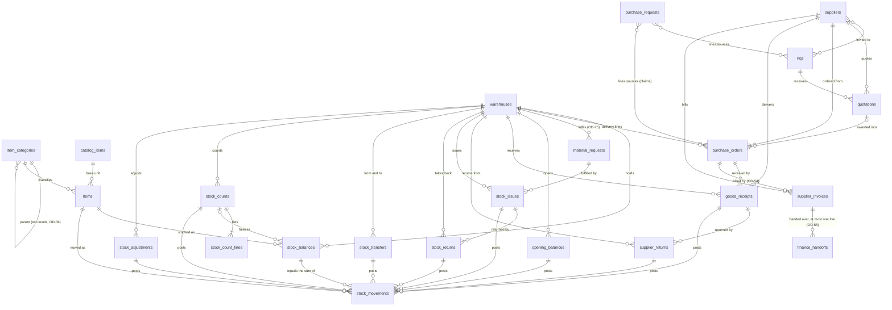
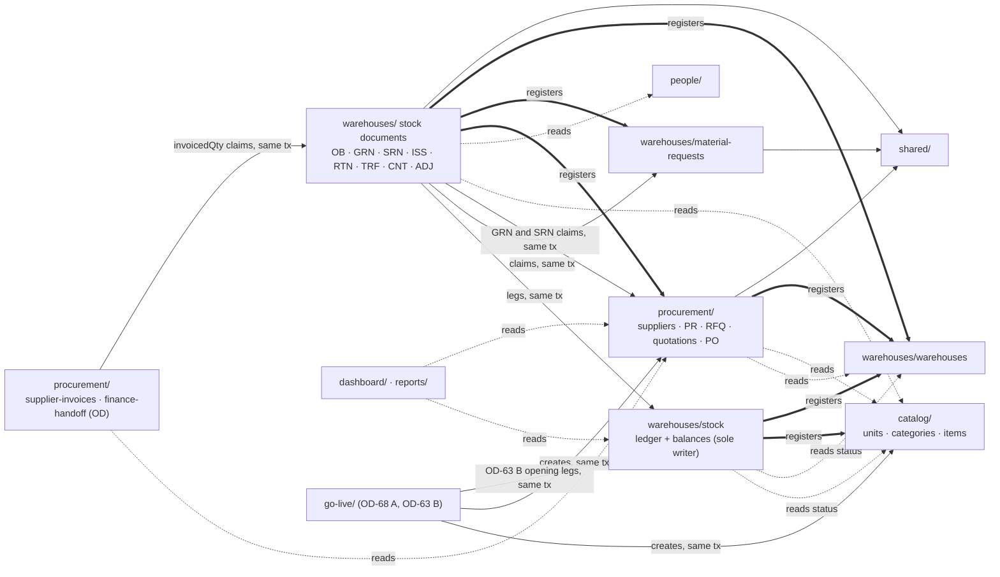

# Administrative Affairs (الشئون الإدارية) — Warehouses & Procurement: Discovery & Design

**Status:** **DRAFT v0.1** (2026-11-17) — discovery and design for owner review. **Not frozen.** No implementation, no
code pull request and no data change starts until (1) the owner answers the decisions marked *Blocks P1* in §16 and (2) the
owner approves this document, which then becomes **FROZEN v1.0**. The freeze covers the architecture of every phase
(§0–§17, §20) and Phase 1 in full (§19). Inside §2–§14 the architecture is D-1…D-22; the §2.4.4 posting invariant and
the §2.4.5–§2.4.6 arithmetic; the §3.6 dependency graph; the states and edges of §5; the scope rules of §7; the realtime
rules of §9; and every name §2 fixes (§16.1). Everything else there for P2–P9 (fields beyond their names, routes, DTOs,
tiles, exit criteria), and §18's detail for those phases, is the plan of record. Before a phase's first pull request its
plan of record is re-checked against the code and re-detailed against the owner's answers to that phase's decisions,
as a §19-shaped section written to a sibling file, `docs/12-planning/administration-module-phase-<n>.md` (§18). Its
design review is the gate before that phase's first pull request, and §22 records it; no new owner approval is needed
unless a business decision or an architectural change outside the plan arises (the owner's rule, §0). A Phase 1
decision answered other than as recommended re-opens Phase 1 the same way, for the parts it names (§19.2). Any later
discovery that changes the architecture lands as a new revision in §22 before code, never during it.
**Module id:** `administration` (reserved in [Module Hierarchy](../01-business/module-hierarchy.md) §3; no code uses it yet).
**First scope:** Warehouses (المخازن) and Procurement (المشتريات), as the owner asked on 2026-10-29 (§0). Other
Administrative Affairs work (facilities, office services, generic administrative requests) is out of scope here and joins
the same module later.
**Methodology:** the HR / Fleet / IT one — study the platform first, design, owner approval, then delivery in reviewed
slices that each extend one module manifest.

> **How to read this document.** The executive summary (in English, then in Arabic for the owner) and §0 say what the
> owner asked for, what is proposed and what is asked of him. §1 is what ECMS already has, what the module reuses and
> what is missing. §2–§15 are the design. §16 lists the business decisions this design leaves to the owner: every policy
> that the code and the docs do not settle is an `OD-xx` with options, a recommendation and the impact of each option. A
> recommendation is a proposal, not a rule. §17 is the risks register, §18–§19 the phases and the recommended Phase 1,
> §20 the ADRs, §22 the review trail. The contents below link the four files. Evidence is cited as `path:line` against
> `main` at `4c0fa1b0` (2026-11-17); a bare `:line` continues the last file named in the same sentence or table row.
> Discovery ran at `b03522f`; the citations written then were re-based to `4c0fa1b0`, each one whose code had changed
> re-checked, and later citations were written against `4c0fa1b0` (§22). A count marked "at `b03522f`" is discovery's.
> «» marks Arabic quoted verbatim, from the owner or from the product; the author's own Arabic is unmarked.


## Contents

This design is one document in four files. Section numbers run across all four.

**Part 1 — this file (administration-module-design.md)**

- [Executive summary](#executive-summary)
- [ملخص تنفيذي](#ملخص-تنفيذي)
- [0. Scope, non-goals and the decisions this design does take](#0-scope-non-goals-and-the-decisions-this-design-does-take)
- [1. What already exists and is reused](#1-what-already-exists-and-is-reused)
- [2. Domain model](#2-domain-model)
- [3. Modules, sub-modules and features](#3-modules-sub-modules-and-features)

**Part 2 — [administration-module-design-flows.md](administration-module-design-flows.md)**

- [4. Workflows](administration-module-design-flows.md#4-workflows)
- [5. State machines](administration-module-design-flows.md#5-state-machines)
- [6. Permissions](administration-module-design-flows.md#6-permissions)
- [7. Organization scope](administration-module-design-flows.md#7-organization-scope)

**Part 3 — [administration-module-design-integration.md](administration-module-design-integration.md)**

- [8. Events](administration-module-design-integration.md#8-events)
- [9. Realtime](administration-module-design-integration.md#9-realtime)
- [10. Audit](administration-module-design-integration.md#10-audit)
- [11. Documents, attachments, printing and exports](administration-module-design-integration.md#11-documents-attachments-printing-and-exports)
- [12. Finance integration](administration-module-design-integration.md#12-finance-integration)
- [13. Navigation & page plan](administration-module-design-integration.md#13-navigation--page-plan)
- [14. Reports & dashboard](administration-module-design-integration.md#14-reports--dashboard)

**Part 4 — [administration-module-decisions-and-phases.md](administration-module-decisions-and-phases.md)**

- [15. Dependencies, migration and data](administration-module-decisions-and-phases.md#15-dependencies-migration-and-data)
- [16. Open business decisions](administration-module-decisions-and-phases.md#16-open-business-decisions)
- [17. Risks](administration-module-decisions-and-phases.md#17-risks)
- [18. Implementation phases](administration-module-decisions-and-phases.md#18-implementation-phases)
- [19. Recommended Phase 1](administration-module-decisions-and-phases.md#19-recommended-phase-1)
- [20. Required ADRs](administration-module-decisions-and-phases.md#20-required-adrs)
- [21. Documentation that changes with this design](administration-module-decisions-and-phases.md#21-documentation-that-changes-with-this-design)
- [22. Review trail](administration-module-decisions-and-phases.md#22-review-trail)

---

## Executive summary

**In short.** This is the discovery and design report for the Administrative Affairs module's first scope, Warehouses and
Procurement, which the owner asked for on 2026-10-29 (§0). No code exists yet. Delivery starts once the owner answers the
decisions that block Phase 1 (§16.2) and approves this document.

**What ECMS already has**

1. The platform services the module needs exist and are used as they are: permissions with their scopes and delegation,
   the organization (branches, departments, sections, cost centers), employees through the directory, the approvals
   engine, audit and realtime, files and printing, notifications and the scheduler (§1). On top of them the module needs
   a short list of platform changes (§15.2) and rebuilds IT's pickers and page parts in its own folder (§13.6); §1.10
   lists what does not exist at all.
2. ECMS has no Finance, accounting or treasury module, so Procurement ends at a documented handoff to Finance (§12), not
   at an accounting entry.
3. The approvals engine knows no value bands and treats a request with no chain as approved. It also has defects that
   matter for money: the chain is not pinned to a request, an expired grant can still decide, and the override ignores
   scope. A platform phase, PX-1, fixes them before purchase requests (OD-19, OD-20).
4. IT runs two stores (consumables per branch, spare parts for the whole organization); Fleet's cash fund buys parts and
   tires outside any stock; supplier and workshop lists are scattered. Phase 1 touches none of them; how they relate to
   the new stores are separate decisions (OD-01, OD-02, OD-66).
5. The code has no precedent for goods in transit, a count-and-adjust cycle, a document two branches share, taxes or
   units of measure. Partial receipt has one: Fleet's vehicle supply contracts take several deliveries per line. Every
   business rule in these parts is an open decision.

**What this design proposes**

- One module, `administration` («الشئون الإدارية»), in three parts: master data, warehouses and procurement (§3). A
  goods receipt updates its purchase order and the stock ledger in one transaction; two modules would need a
  session-joining port or eventual consistency between them, so one module was chosen (D-1).
- Stock is an append-only movement ledger. The balance is derived from it and written in the same transaction, behind an
  atomic guard that stops negative stock; a mistake is corrected by an opposing document; a transfer takes two steps,
  through stock in transit, as the owner asked (§2, §4, §5). An opening balance is a movement like any other: stamped
  when it is posted, it carries the date it was counted and must be the item's first movement in its warehouse (§4.3.1).
  Goods that must go back to the sending warehouse travel on the transfer itself (OD-47.3, recommended default: B) or,
  more simply, on a new transfer once received (D). A goods receipt records the signed-in keeper as its receiver
  (OD-35, recommended default: A), the shape the owner chose for the vault's receipt.
- Code other modules already hold is written once in shared code, not copied again: the fail-closed branch-scope rule
  and the organization-wide check (PC-12), the gap-free number counter and the fold that treats two spellings of one
  Arabic name as one (PC-13), each one pull request before P1a.1 (§18.1). As in IT, a write waits until the unique index
  that guards it exists (§15.3.2).
- Every document has an explicit state machine in pure functions kept apart from persistence; approvals run on the
  platform engine once it is fixed (§5).
- Fine-grained permissions, `administration<Entity>.<action>`, each declared with the operation it gates, and an explicit
  scope for every document (§6, §7).
- Realtime, audit and notifications ship with each phase rather than in a last one, because the CI checks require it
  (§8–§10, §18.1).
- 85 open business decisions (OD-01…OD-85), each with its question, options, recommendation, the impact of each option
  and the phase it gates (§16).

**Phase order** (changed from the owner's order where the code forces it, and elsewhere only by recommendation; §18.1):
P1a master data (units, categories, items, warehouses) → P1b suppliers → PX-1 approvals fix → P2 purchase requests
with their approval and notifications → P3 quotations and selection → P4 purchase orders → PX-3 CI capacity → P5 stock
ledger, opening balances and receiving → P6 material requests, issues and returns → P7 transfers, counts and
adjustments → P8 supplier invoices and the handoff to Finance → P9 dashboard and reports. PX-2 (sweep marks) joins only
if digests or reminders need it.

**What the owner is asked before Phase 1** (§16.2): who maintains master data (OD-04), code formats (OD-05), category
depth (OD-06), units of measure (OD-07), decimal quantities (OD-08), stock limits (OD-09), warehouses and their keeper
(OD-10), the menu name and the launcher tile's picture (OD-62), whether a deleted employee's name may stay on the
module's records (OD-64), the terms (OD-67), current data sources (OD-68), ready-made roles (OD-78) and the page layout
(OD-83, whose default applies unless the owner objects); for suppliers (P1b) also OD-01, OD-11, OD-12, OD-76 and OD-77;
and before the first slice, whether a phase may ship as several smaller pull requests (OD-81) and which goods the
stores hold (OD-03). A pilot branch or all branches (OD-80) is needed only before the module's roles are assigned in
production, not before code (D-19). Every decision has a recommended default; the owner can accept them all at once or
change any by its number.

---

## ملخص تنفيذي

**الخلاصة.** هذا هو تقرير الـDiscovery والتصميم لموديول الشئون الإدارية بنطاقه الأول: المخازن والمشتريات، كما طلبته في
2026-10-29 (§0). لا يوجد أي كود بعد، ولن يبدأ التنفيذ قبل أن تجيب عن القرارات التي تمنع Phase 1 (§16.2) وتعتمد هذا المستند.

**ما وجدناه في ECMS**

1. خدمات المنصة التي يحتاجها الموديول موجودة وتُستخدم كما هي: الصلاحيات ونطاقاتها والتفويض، الهيكل التنظيمي (الفروع
   والإدارات والأقسام ومراكز التكلفة)، الموظفون عبر الـdirectory، محرك الاعتمادات، الـAudit والـRealtime، الملفات
   والطباعة، الإشعارات والجدولة (§1). ويحتاج الموديول فوقها قائمة قصيرة من التعديلات على المنصة (§15.2)، ويعيد بناء
   بعض مكونات شاشات IT داخل مجلده (§13.6). وما لا يوجد إطلاقًا مذكور في §1.10.
2. لا يوجد في ECMS أي موديول مالية أو محاسبة أو خزينة. لذلك تنتهي مسؤولية المشتريات بتسليم موثّق للمالية (§12)، وليس
   بقيد محاسبي.
3. محرك الاعتمادات لا يعرف مستويات حسب القيمة، ويعتمد الطلب تلقائيًا إذا لم يُضبط له مسار. وبه ثغرات تمس اعتماد الأموال:
   المسار لا يُثبَّت على الطلب، وصلاحية منتهية قد تعتمد، والتجاوز (override) لا ينظر إلى النطاق. نقترح إصلاحه في مرحلة
   منصة (PX-1) قبل طلبات الشراء (OD-19، OD-20).
4. داخل IT مخزنان قائمان (مستهلكات لكل فرع، وقطع غيار للمؤسسة كلها). وفي الحركة «عهدة» نقدية تشتري قطع غيار وإطارات خارج
   أي مخزون. وتوجد سجلات موردين وورش متفرقة. لا يمس Phase 1 أيًا منها؛ علاقتها بالمخازن قرارات مستقلة (OD-01، OD-02،
   OD-66).
5. لا توجد في الكود سابقة لبضاعة بالطريق، أو دورة جرد وتسويات، أو مستند يخص فرعين، أو ضرائب، أو وحدات قياس. وللاستلام
   الجزئي سابقة واحدة: عقود توريد السيارات في الحركة تقبل أكثر من توريد للبند. وكل قاعدة عمل في هذه الأجزاء محوَّلة إلى
   قرار مفتوح.

**ما نقترحه**

- موديول واحد `administration` باسم «الشئون الإدارية» من ثلاثة أجزاء: البيانات الأساسية، والمخازن، والمشتريات (§3).
  الاستلام يحدّث أمر الشراء ودفتر المخزون في transaction واحدة؛ وفصلهما في موديولين يحتاج وسيطًا يشارك الـtransaction أو
  تزامنًا مؤجلًا بينهما، فاخترنا موديولًا واحدًا (D-1).
- المخزون دفتر حركات append-only. الرصيد مشتق منه ويُكتب في نفس الـtransaction بحماية ذرية تمنع الرصيد السالب، والتصحيح
  بمستند عكسي، والتحويل على خطوتين مع بضاعة بالطريق كما طلبت (§2، §4، §5). والرصيد الافتتاحي حركة كغيرها: يُسجَّل
  بوقت ترحيله، ويحمل تاريخ الجرد الذي عُدَّ فيه، ويجب أن يكون أول حركة للصنف في مخزنه (§4.3.1). والبضاعة التي يجب أن
  تعود إلى المخزن المرسِل تعود على التحويل نفسه (OD-47.3، التوصية B)، أو بطريقة أبسط بتحويل جديد بعد استلامها (D).
  ويسجّل إذن الاستلام المستخدمَ الذي سجّل دخوله، أي أمين المخزن، مستلمًا (OD-35، التوصية A)، كما اخترت لاستلام
  الخزينة.
- ما تملكه موديولات أخرى من كود يُكتب مرة واحدة في كود مشترك بدل نسخه مرة أخرى: قاعدة نطاق الفروع والتحقق من
  الصلاحية على مستوى المؤسسة (PC-12)، وعدّاد الأرقام المتسلسلة بلا فجوات ومطابقة الاسم العربي مهما اختلفت كتابته
  (PC-13)، كلٌّ في pull request واحد قبل P1a.1 (§18.1). وكما في IT، لا تتم الكتابة إلا بعد وجود الفهرس الفريد
  (unique index) الذي يحميها (§15.3.2).
- لكل مستند state machine صريحة في دوال pure منفصلة عن الـpersistence، والاعتمادات على محرك المنصة بعد إصلاحه (§5).
- صلاحيات دقيقة بالصيغة `administration<Entity>.<action>`، تُعلَن كل صلاحية مع العملية التي تحرسها، ونطاق كل مستند
  محدد صراحة (§6، §7).
- الـRealtime والـAudit والإشعارات تُبنى مع كل مرحلة، لا في مرحلة أخيرة، لأن اختبارات CI تفرض ذلك (§8–§10، §18.1).
- 85 قرار عمل مفتوح (OD-01…OD-85). لكل قرار السؤال والخيارات والتوصية وأثر كل خيار والمرحلة التي يوقفها (§16).

**ترتيب المراحل** (عُدِّل عن ترتيبك حيث فرضه الكود، وفي غير ذلك على سبيل التوصية فقط؛ §18.1): P1a البيانات الأساسية
(الوحدات، الفئات، الأصناف، المخازن) ← P1b الموردون ← PX-1 إصلاح الاعتمادات ← P2 طلبات الشراء مع اعتمادها وإشعاراتها
← P3 عروض الأسعار والمفاضلة ← P4 أوامر الشراء ← PX-3 سعة CI ← P5 دفتر المخزون والأرصدة الافتتاحية والاستلام ← P6
طلبات الصرف والصرف والمرتجعات ← P7 التحويلات والجرد والتسويات ← P8 فواتير الموردين والتسليم للمالية ← P9 لوحة
المتابعة والتقارير. وتُضاف PX-2 (علامات التذكير) فقط إذا احتاجتها الملخصات أو التذكيرات.

**المطلوب منك لبدء Phase 1** (التفاصيل والتوصيات في §16.2): OD-04 من يدير البيانات الأساسية · OD-05 صيغة الأكواد ·
OD-06 عمق الفئات · OD-07 وحدات القياس · OD-08 الكميات العشرية · OD-09 حدود المخزون · OD-10 المخازن وأمين المخزن ·
OD-62 الاسم في القائمة وأيقونة الموديول · OD-64 هل يبقى اسم الموظف المحذوف على مستندات الموديول · OD-67 المصطلحات ·
OD-68 مصادر البيانات الحالية · OD-78 الأدوار الجاهزة · OD-83 شكل الصفحات (تُطبَّق التوصية ما لم تعترض). ولجزء
الموردين (P1b) أيضًا: OD-01 مكان سجل الموردين · OD-11 بيانات المورد · OD-12 حالته · OD-76 و OD-77 صيغ ملفاته ومدة
الاحتفاظ بها. ويُحسم قبل البدء OD-81 (هل تُسلَّم المرحلة على أكثر من طلب دمج pull request صغير) و OD-03 (أنواع
الأصناف). أما OD-80 (فرع تجريبي أم كل الفروع) فيلزم فقط قبل إسناد أدوار الموديول في التشغيل الفعلي، لا قبل كتابة الكود
(D-19). لكل قرار توصية افتراضية: يمكنك قبول التوصيات كلها مرة واحدة، أو تعديل ما تريد بذكر رقمه.

---

## 0. Scope, non-goals and the decisions this design does take

### The owner's request (2026-10-29)

The owner asked for this module in writing. The parts that bind the design, in his words:

- **Scope and ambition.** «أريد منك البدء في تصميم وتنفيذ موديول جديد داخل ECMS تحت: Administrative Affairs / الشئون
  الإدارية والنطاق الأول للموديول هو: Warehouses / المخازن، Procurement / المشتريات»; «لا تفترض أن "المخزن" مجرد جدول
  أصناف، ولا أن "المشتريات" مجرد Purchase Orders. أريد دورة عمل Enterprise حقيقية وقابلة للتوسع.»
- **Reuse.** «لا تعيد بناء شيء موجود بالفعل. إذا كان هناك service أو component أو hook أو pattern مناسب، أعد استخدامه.»
  (§1)
- **Business rules.** «لا تخترع Business Rules. لو وجدت قرارًا غير محسوم، اعمل: Open Decision ... ثم واصل في الأجزاء التي
  لا تعتمد عليه.» This is why §16 exists and why the design goes on past an open decision with a recommended default.
- **Data.** «لا تضف أي بيانات حساسة أو حقول غير مطلوبة بدون توثيق سبب الحاجة لها» (§2.3, OD-11).
- **Purchasing.** «Purchase Request → Approval → RFQ/Quotation → Supplier Selection → Purchase Order → Receiving →
  Invoice/Financial handoff لكن لا تعتمد هذه السلسلة بشكل أعمى», with fifteen questions, from «من يعتمد الطلب؟» to «ماذا
  يحدث عند الاستلام الجزئي؟», that §4.5 answers one by one.
- **Stock.** «صمم دورة المخزون على أساس transaction ledger وليس مجرد تعديل quantity»; «ويجب أن يكون الرصيد الحالي مشتقًا
  من الحركات أو مبنيًا على ledger موثوق، وليس رقمًا يتم تعديله عشوائيًا من عدة أماكن» (D-2).
- **Transfers.** «Transfer Request، Approval إذا لزم، Dispatch، Receipt، Partial receipt، Difference handling، Full audit
  trail. ولا تعتبر الكمية انتقلت نهائيًا بمجرد الضغط على "Transfer"» (D-3, §2.4.5).
- **Counts.** «Create Count → Freeze/lock scope → Count → Variance → Approval → Adjustment. ولا تسمح بتعديل الرصيد مباشرة
  أثناء الجرد بطريقة تكسر الـledger» (§2.4.6, §4.3.6).
- **Finance.** «لا تنقل Finance إلى Administrative Affairs. حدد فقط الـhandoff المطلوب ... إذا لم تكن موجودة، سجّل
  integration requirement بدل اختراع API جديد دون قرار» (§12, OD-54).
- **The report.** He asked for eighteen sections (what exists and can be reused, the domain model, sub-modules,
  workflows, state machines, permissions, organization scope, events, realtime, audit, documents, Finance integration,
  navigation, reports, dependencies, open business decisions, risks, phases), a dashboard and twelve reports by name
  (§14), and «Recommended Phase 1 مع قائمة الملفات التي ستنشأ/تتعدل، لكن بدون كتابة الكود الآن» (§19).
- **Delivery.** Nine phases, with «يمكنك تغيير ترتيب المراحل إذا اكتشفت dependency حقيقية في ECMS، لكن وثّق السبب»
  (§18.1); after approval, «أكمل تلقائيًا إلى المرحلة التالية إذا كانت ضمن النطاق المعتمد. لا تتوقف بعد كل مرحلة لطلب
  موافقتي، إلا إذا ظهرت Business Decision حقيقية أو تغيير معماري خارج الخطة»; and «لا تعمل destructive operation أو
  production migration بدون موافقتي الصريحة» (D-17).

**What the request does not say yet.** How the company buys and stores goods today: which goods the stores hold, how many
stores each branch has, who buys, where Finance takes over, what volumes the module serves and how its success will be
judged. These are facts, not designs, so §16 asks them (OD-03, OD-10, OD-22, OD-54, OD-68, OD-85). Until they are
answered the design carries stated assumptions (§2.4, OD-85), and an answer that moves a later phase is a re-detailing of
that phase's plan (Status, above).

### 0.1 In scope (this design, all phases)

Master data (warehouses, item categories, units of measure, items, suppliers) · purchase requests and their approval ·
requests for quotation, quotations and supplier selection · purchase orders, changes to them (OD-26) and closure ·
goods receipt (partial, rejected quantities) and supplier returns · an append-only **stock ledger** with a balance
projection · opening balances · material requests, stock issues and returns · two-step inter-warehouse transfers with
in-transit stock and discrepancy handling · stock counts (freeze → count → variance → approval → posting) and
adjustments / write-offs · dashboards and reports · the **handoff** to Finance · realtime, audit, notifications and
printed papers for all of it.

### 0.2 Non-goals (this module, this design)

- **Accounting.** No payables ledger, no payment, no general ledger, no chart of accounts, no budgets, no tax filing.
  ECMS has no Finance, Accounting or Treasury module (verified, §1.10); this design defines only the **handoff** (§12).
- **Stock valuation** until OD-37 is answered. Unit cost may be *captured* on receipts (§2, OD-37) without any valuation
  method being implied.
- **Bins / locations inside a warehouse, lots, serial numbers, expiry dates.** Not requested; not designed. (A
  warehouse's own `location`, its place within its branch, is a master-data field the owner listed, §2.3.5.)
- **Electronic exchange with suppliers** (e-mail/WhatsApp RFQs or POs, supplier portal): no external-recipient seam exists
  (`apps/api/src/platform/notifications/notification.service.ts:37-41` — users only). Papers are printed (§11).
- **Taking over IT's stores or Fleet's petty-cash fund.** They keep running unchanged until OD-02 and OD-66 are answered.
- **Merging `it_vendors` / Fleet workshop rows into the supplier registry.** A staged, separately approved migration
  (OD-01, §15.3) — never a side effect of Phase 1.
- **Automation templates.** The automation engine is off (`AUTOMATION_ENABLED`) and has no action surface; events are
  cataloged so they become triggers when it is (§8).

### 0.3 Design decisions this document takes

These are technical decisions: how the business rules, once decided, are carried. D-3 is the exception, the owner's own
requirement, listed here because it shapes the ledger. Each is open to challenge at review. The last column names the
alternative each one rejects and why.

| # | Decision | Why (precedent) | Rejected alternative (cost) |
|---|---|---|---|
| D-1 | **One module, `administration`**, with sub-modules `catalog`, `warehouses`, `procurement` (+ `shared`, `people`, `dashboard`, `reports`). | A goods receipt updates the purchase order **and** the stock ledger in one transaction, and business modules may not import each other (`docs/02-architecture/module-structure.md` §4, §7). The id is the reserved one. | Two modules joined by a port that takes the caller's session (Operations' vault port, `apps/api/src/modules/operations/treasury-boundary.ts:120-131`) or by outbox events with eventual consistency: one more seam and failure mode per receipt, for one team owning both. |
| D-2 | **Stock is an append-only movement ledger**; the on-hand figure is a projection written **only** by the same transaction that inserts the movement, through a guarded atomic `$inc` (the filter is the guard). No "set on hand to N"; mistakes are corrected by an opposing document. | The owner's brief (§0); ADR-024; IT consumables (`apps/api/src/modules/it/consumables/consumable.repository.ts:115-157`); ATM settlements' guard-inside-the-write rule. | A stored on-hand figure edited in place: what the owner ruled out («وليس رقمًا يتم تعديله عشوائيًا من عدة أماكن»). |
| D-3 | **Two-step transfers**: dispatch moves stock into an *in-transit* bucket; receipt moves it on hand at the destination; shortages stay in transit until resolved. Σ movements = Σ balances at every instant. | The owner's requirement (§0: «ولا تعتبر الكمية انتقلت نهائيًا بمجرد الضغط على "Transfer"», with Dispatch, Receipt, Partial receipt and Difference handling). No stock ledger has an in-transit bucket (§1.10); arithmetic in §2.4. The nearest two-step precedent is money: Fleet's replenishment waits `held`, outside the fund, until «تأكيد التحويل» on the day the money arrives (`apps/api/src/modules/fleet/custody/custody-fund.ts:15-17`). | One step, IT's shape for its own stores (OD-46's evidence): contrary to the brief for this module. |
| D-4 | **Lifecycles are code-defined**: one pure transition table per document (`<doc>-lifecycle.ts`; the five posting documents, GRN, SRN, ISS, RTN and OB, share one, `shared/posting-lifecycle.ts`, §5.1) + version- or status-guarded writes; document status kept separate from physical progress (`orderStatus`, `receiptStatus`, `issueStatus`). | The dominant ECMS pattern (IT tickets, job requisitions, Operations shipments); the owner's «اكتب القواعد في pure functions منفصلة عن persistence». | ADR-011's generic workflow engine, never built (§1.4): a platform project of its own (L, an ADR), with no second consumer waiting. |
| D-5 | **Approvals run on `platform/approvals`**; the document stores its decided entries; value bands, the no-chain policy and engine hardening are owner decisions (OD-18/19/20). | The engine exists and was built for this authority model (`packages/contracts/src/platform/approvals.ts:1-27`); HR leave is the precedent host. | A module-local approval chain: a second authority model beside the platform's (against D-15's "read, never redefine"). |
| D-6 | **Numbers from a module counter built with the shared counter factory (PC-13)**, reserved inside the business transaction (gap-free), `<PFX>-{YYYY}-{seq:6}`, year by the Africa/Cairo business date. Formats and timing: OD-58. | Fleet/ATM counters (`apps/api/src/modules/fleet/custody/custody-counter.model.ts`, `apps/api/src/modules/atm/settlements/plans/note-counter.model.ts`); the yearly `JO-/APP-` series. | Three options were weighed. A copy of Fleet's counter in the module (S): no prerequisite, but a third copy of one counter beside Fleet's and ATM's, against "Never copy-paste across modules" (`docs/02-architecture/module-structure.md:122`). Platform-core §14's sequence service (`docs/02-architecture/platform-core.md:212-221`): an L platform project with its own ADR. Adopted: the shared factory (S), `apps/api/src/shared/base/counter.ts`, written from Fleet's counter in PC-13 with the module as its first caller; Fleet's and ATM's copies may move onto it later, which is not this design's work. |
| D-7 | **Money as integer minor units** through `packages/contracts/src/modules/hr-payroll-money.ts` (imported, never forked). | The de-facto platform money discipline (payroll, Operations, ATM). | BD-004's Money value object (`docs/01-domain/business-decisions.md:89-96`): it joins the shared kernel with an ADR and its first consumer (M); minor units carry the same rule now. |
| D-8 | **Quantities are integers in the item's base unit** (OD-07/08 can widen this before Phase 1). | IT stores' integer quantities; no unit or decimal precedent. | Decimal quantities: OD-08 can choose them before Phase 1. |
| D-9 | **Permission resources are prefixed `administration<Entity>`**, and a key is declared **with** the operation it gates, phase by phase. | Fleet/IT/Gold/ATM/Operations prefix convention (`apps/api/src/modules/it/it.module.ts:68-70`). | One coarse key such as `admin.warehouse`: what the owner ruled out. |
| D-10 | **Every repository declares its scope fields**; branch records fail closed through the shared branch-scope rule (PC-12); transfers are visible to both branches through an explicit rule with a guard spec (§7.4). | ADR-026's G-2 widening risk; ATM's `apps/api/src/modules/atm/shared/branch-scope.ts`. A document two branches read is new: IT's branch transfers are one step and write one ledger row in each store (`apps/api/src/modules/it/consumables/consumable-transfer.service.ts:5-11, 115-118`). | Copying ATM's file into the module (S): a second copy of a scope rule whose defect shipped twice (RK-15), instead of writing it once in `apps/api/src/shared/base/branch-scope.ts` (PC-12), as `selectorBranches` was written beside `scopeSelector` (a copy of ATM's `registerScopeBranches`, which ATM keeps). |
| D-11 | **Realtime through the audit chokepoint** + explicit `update` signals carrying `branchId` after every audited act on a branch-scoped entity, whatever its verb (§9.1); requester screens refresh on their notification once PC-7 lands (§9.5). | ADR-029; IT `apps/api/src/modules/it/consumables/consumable-history.ts:100-128`; own-scope readers join no rooms. | Polling or a module channel: against the owner's «لا تخترع Realtime architecture جديدًا». |
| D-12 | **Audit after commit, one row per document act** (lines summarized), plus one row on any other document whose lifecycle status the act changes; reasons as `changes` rows. | `apps/api/src/modules/it/consumables/consumable-issue.service.ts:8-9`; ATM `recordAll`; queue-volume precedent. | An outbox-backed audit write, or ADR-012's loss alarms: a change to the platform's audit path (M). The platform's gap, a crash between commit and audit losing a row, is kept and recorded (§10.1). |
| D-13 | **Events declared only with their emitter**; facts Finance must not lose go through the outbox (`reliable: true`) once a consumer exists (§12.11). | `event-publishers.spec.ts`; ADR-008; the dependency audit's finding F1, two cataloged events nothing can emit (`docs/12-planning/cross-module-dependency-audit.md` §2). | Cataloging events ahead of their emitter: F1's defect. |
| D-14 | **Files through the Files service**, categories `administration-*`, entity-derived authorizers, signed copies of printed papers. | ADR-010/020/023; IT consumable memo. | A module upload store: against the owner's «لا تنشئ upload system جديدًا». |
| D-15 | **Org data is read, never redefined**: branches, departments (branch copies), sections, cost centers, employees through `platform/organization` and `platform/directory`. | ADR-015/031; directory seams; the owner's «لا تعيد تعريف أي منها داخل الموديول». | Module copies of org units: what the owner ruled out. |
| D-16 | **A unique index exists before the write it guards.** The module's seed builds its declared indexes through the shared `syncDeclaredIndexes('apply', administrationModels)` before any transaction and logs the report; every module repository whose collection carries a `ux_*` index awaits `collectionReady(Model)`, a copy of IT's, before its first write and before any transaction that writes it, so a failed build refuses that write and the next write retries (§15.3.2). | `autoIndex` off in production; `db:sync-indexes` only reports by default (`apps/api/src/shared/base/index-sync.ts`); IT's `collectionReady` (`apps/api/src/modules/it/mobile-lines/ensure-collection.ts:18-30`) and the platform's passkey index (`apps/api/src/platform/auth/passkey.model.ts:49-66`) hold a write until its unique index exists. | Relying on the deploy step's sync: it only reports by default and exits 0 on every failure (`apps/api/src/sync-indexes.cli.ts:15-22`), so a missing unique index would let duplicate counters or balance rows in (RK-03). |
| D-17 | **Phase 1 changes no existing data.** Any future migration is an operator-run command, dry-run by default, never at boot, and needs the owner's explicit approval. | ADR-031 migration discipline; the owner's rule (§0). | A boot-time migration: forbidden by the owner's rule. |
| D-18 | **CI capacity: the CI job is split in PX-3, before P5** (RK-01). | The job's limit went from 30 to 45 minutes after a green run took 29m41s (`.github/workflows/ci.yml:11-16`). | Raising the limit again (S): every pull request waits longer, and the next phase hits it again. |
| D-19 | **Rollout carries no gate**: unfinished pages stay unshipped and a pilot runs by role assignment (OD-80 asks pilot or all branches; it is needed before the module's roles are assigned in production, not before code). | "only SHIPPED pages appear in navigation" (`apps/api/src/seed-navigation.ts:889-892`); ATM's pilot with one bank. | An environment gate (M; permissions vanish when off) or the platform's first feature flag (M; CI expiry). |
| D-20 | **Ready-made roles are managed roles**, their keys re-asserted at every boot and their name written only when the role is created (OD-78 asks which roles exist, OD-67 their titles). | `apps/api/src/platform/rbac/rbac.service.ts:1625-1656`. | Roles seeded once (S): they drift from the keys each phase adds. |
| D-21 | **Page parts (`Fact`, `Tabs`, `ReferencePicker`) are rebuilt in the module** after IT's pattern (in Phase 1 `Fact` and the catalogs tablist are page-local, as IT's are, §19.8); promoting them to `apps/web/src/shared/ui` is a separate change reviewed outside the module (§13.6). | `Fact` is already re-declared module by module (`apps/web/src/modules/it/pages/AssetDetailPage.tsx:66`). | Moving them to `shared/ui` first (M): a cross-module change ahead of the module's first page. |
| D-22 | **A single person on a document is stored as an id with the name beside it, top level**, the shape HR's permanent delete can scrub; names inside arrays (an approval trail, a count team) stay nested (OD-64, RK-34). | `apps/api/src/modules/hr/employee-management/employees/employee-name-copies.ts:250-261` refuses a scrub inside a subdocument or array. | Nested name snapshots everywhere: a deleted person's name would survive on every kept document (RK-34). |

### 0.4 Glossary — candidate terms for owner validation

ECMS's ubiquitous-language rule is one English identifier root plus one business-validated Arabic rendering, no synonyms
(`docs/01-domain/ubiquitous-language.md:11-22`). Only the IT consumables' stock words and «جرد» (Gold's «محضر جرد درج», the
ATM settlement papers) exist in the product today; every other Arabic term below is a **candidate** until the owner confirms
it (OD-67). «جرد» is already used for counts; the count document's own name is still a candidate.

| English (code root) | Arabic (candidate) | Meaning | Not used / note |
|---|---|---|---|
| Warehouse (`warehouse`) | مخزن | A store of one branch that holds stock. | «المخزن» already names other things in the product (§1.8) |
| Warehouse keeper | أمين المخزن | The person answerable for a warehouse. | A role bundle, not a stored authority (§6) |
| Item (`item`) | صنف | A thing the stores hold or buy. | Already used by IT consumables |
| Item category (`itemCategory`) | فئة صنف / تصنيف | A group of items, one or two levels (OD-06). | Which one: OD-67 |
| Unit of measure (`unit`, catalog kind `unit`) | وحدة القياس | The unit an item is counted in. | IT uses «الوحدة»; not the approval Unit, the `unit` level or the purchasing unit below |
| Approval Unit | — | The engine's subject: a branch's copy of a department (§7.6). | Code name only |
| Approval level `unit` | — | A rung held by a department grant in one branch (§6.4). | Code name only |
| Purchasing unit | — | The department that raises a purchase request. | Prose only |
| Supplier (`supplier`) | مورد | A party the organization buys from. | `vendor` (IT's word) — OD-67 |
| Purchase request (`purchaseRequest`, PR) | طلب شراء | A department's request to buy. | "PR" never means a pull request here |
| Request for quotation (`rfq`) | طلب عروض أسعار | A request sent to suppliers for prices. | |
| Quotation (`quotation`) | عرض سعر | A supplier's prices against an RFQ. | |
| Purchase order (`purchaseOrder`, PO) | أمر شراء | The order issued to a supplier. | |
| Goods receipt (`goodsReceipt`, GRN) | إذن استلام / إذن إضافة | Goods received against a PO. | Which one: OD-67 |
| Supplier return (`supplierReturn`) | مرتجع مشتريات | Goods sent back to a supplier. | |
| Material request (`materialRequest`) | طلب صرف | A department's request for stock. | |
| Stock issue (`stockIssue`) | إذن صرف | Stock handed out against a request. | «صرف» also names money releases (§8) |
| Stock return (`stockReturn`) | مرتجع صرف | Issued stock coming back. | IT uses «مرتجع» |
| Stock transfer (`stockTransfer`) | تحويل مخزني | Stock moving between warehouses in two steps. | IT's one-step moves say «تحويل إلى فرع» / «تحويل من فرع» (`apps/web/src/platform/localization/i18n.ts:24923-24924`) — OD-67 |
| In transit | بالطريق | Dispatched and not yet received. | |
| Stock count (`stockCount`) | جرد | Counting a warehouse's stock. | |
| Stock adjustment (`stockAdjustment`) | تسوية مخزنية | An approved correction of on-hand stock; its reasons are هالك، فاقد، إعدام. | IT uses «هالك» |
| Opening balance (`openingBalance`) | رصيد افتتاحي | A warehouse's first stock. | Already used by IT |
| On hand | الرصيد | Stock physically in a warehouse. | Already used by IT |
| Item card / warehouse card | كارت صنف / كارت مخزن | Movement reports. | Report names |
| Organization-wide | على مستوى المؤسسة | The organization scope of a grant or list. | "company-wide" (retired, `docs/01-domain/ubiquitous-language.md:28`) |
| Approval | اعتماد | A decision on a rung. | "sign-off" (rejected, `docs/01-domain/ubiquitous-language.md:49`) |

The names of the suggested role bundles (§6.5, OD-78) are candidates too. «عهدة» is deliberately **not** used for
anything new: it already means IT asset custody, the Fleet cash fund and fuel cards in store (§1, OD-15).

---

## 1. What already exists and is reused

Every row was checked against the repository at `b03522f`; at `4c0fa1b0` each citation whose code had changed was
re-checked, and citations added since were written against `4c0fa1b0` (§22). The platform services in §1.1–§1.7 are
used as they are, except where §15.2 changes them (PX-1 hardens the approvals engine; the PC-xx changes adjust other
platform code). The module also rebuilds pickers and page parts after IT's pattern (§1.9, D-21) and builds what §1.10
finds absent. Three house rules apply throughout.

- **Another module's API helpers are never imported.** Modules do not import each other's code. The few exceptions are
  deliberate single read-only boundary files (`apps/api/src/modules/gold/fleet-boundary.ts:1-8`,
  `apps/api/src/modules/operations/fleet-boundary.ts:1-14`, and IT's, which exports read functions and no repository
  and is held by a lint rule: `apps/api/src/modules/it/fleet-boundary.ts:1-15`, `eslint.config.js:184-214`) and HR's
  reuse of automation's pure filter (`apps/api/src/modules/hr/notification-rules/rule-matching.ts:19`). This module adds
  none (§3.7). A generic helper it needs is either written once in `apps/api/src/shared/`, which modules may import
  (`eslint.config.js:73`) and which imports only shared code (`:70`), or **copied** into `administration/shared/`
  (`apps/api/src/modules/atm/atm-indexes.ts:1-3`, `apps/api/src/modules/it/shared/cairo-day.ts:7-8`). ATM's fail-closed
  branch-scope rule and its organization-authority check are written once there by PC-12 (§1.2), and a counter factory
  written from Fleet's counter is added there by PC-13 (§1.7), each one pull request before P1a.1. Code shared through
  `@ecms/contracts` is imported, not copied: the Cairo calendar now lives there, so `shared/cairo-day.ts` re-exports it
  (§3.5), and PC-13 moves IT's `foldName` (`apps/api/src/modules/it/go-live/inventory-import.ts:115-123`) to
  `packages/contracts/src/common/`, IT importing it, so the module's name fold is that one function (§2.1). No index
  builder is copied: the seed calls the shared `syncDeclaredIndexes`; IT's `collectionReady` is copied as
  `shared/collection-ready.ts` (D-16, §1.7).
- **Web libraries are promoted, web components are patterns.** On the web a pure library another module owns is never
  copied: it moves to `apps/web/src/shared/` behind a re-export shim, because "a module never copies another's code",
  as the promoted xlsx writer says (`apps/web/src/shared/lib/xlsx-writer.ts:3-6`;
  `apps/web/src/shared/lib/paper-fonts.ts:3-6`). IT, ATM and Fleet still import Gold's logo file across modules
  (`apps/web/src/modules/it/lib/custody-receipt-print.ts:55`), which now only re-exports `@ecms/contracts/egycash-logo`,
  where the logo lives (§11.6.3). A component typed to another module's API is a pattern, rebuilt in the module after
  IT's (D-21).
- **A grant ships with its operation.** A grant, page, route, nav row or event ships in the same slice as the operation
  it serves (`apps/api/src/modules/it/it.module.ts:68-70`, `apps/web/src/modules/it/routes.tsx:4-7`).

**Phase** is the first phase (§18: P1a, P1b, PX-1…PX-3, P2…P9) that uses the capability; *cond.* means only if the named
decision asks for it. Code wins over docs (§1.11).

### 1.1 Kernel and module system

| Capability | Where it lives | How this module uses it | Phase |
|---|---|---|---|
| Module manifest, boot validation | `apps/api/src/platform/kernel/module-registry.ts:43-78,115-163` | One manifest, `administration.module.ts`; the kernel enforces the `administration_`, `/administration` and `administration.` prefixes. No manifest field is added. | P1a |
| Registration, rollout | `apps/api/src/modules/index.ts:19-27` | One line, with no env gate: only Automation has one (`apps/api/src/modules/index.ts:26`). Whether the module starts in all branches or a pilot is OD-80; it carries no gate either way, a pilot running by role assignment (D-19). Unfinished work stays unreachable because a surface ships with its slice (`apps/api/src/seed-navigation.ts:889-892`). | P1a |
| Boot order, seeds | `apps/api/src/platform/kernel/bootstrap.ts:35-148` (module seeds last, `:141-145`) | `administration.seed.ts` runs on every boot of the api, the worker and each CLI that boots the platform (`sync-indexes.cli.ts` and `org-duplication-report.cli.ts` do not, `apps/api/src/sync-indexes.cli.ts:10-13`), concurrently, so it must be idempotent and race-safe: indexes first, then counters, file categories, templates. | P1a |
| Unit of work | `apps/api/src/platform/kernel/unit-of-work.ts:5-17` | Every act that writes several documents: an `ITM-` code taken inside its item's create under OD-05 A (§19.3), later a GRN writing PO progress, movements and balances. It is a plain `session.withTransaction` with no retry budget or time limit of its own, so on a transient conflict the driver re-runs the callback until its 120-second limit (§2.4); the callback has no side effects. | P1a |
| Repository base | `apps/api/src/shared/base/base.repository.ts:19-36,242-264,303-310,557-627` | Declared scope fields (§7); `__v` concurrency through the `version` parameter (409 `STALE_DOCUMENT`); `findByIdsSystem` resolves historical labels. `writeConditions()` and `assertWritable()` lock posted documents only on the base's `updateById` and `softDeleteById` (`:574-627`), so every custom guarded write (a claim, a counter) carries the status set in its own filter (§2.1 "After draft"; §5.14's guard sets, each pinned by a spec). | P1a |
| HTTP kit | `apps/api/src/platform/web/index.ts:6-8`; `apps/api/src/infrastructure/http/route-param-validation.spec.ts:50-63` | `authenticate → authorize → validate → asyncHandler`; every `:param` validated. | P1a |
| CI page registry | `scripts/check-page-registry.mjs:65` | `'administration'` joins the hard-coded `MODULES` list. `check-page-registry.mjs` skips a module that is not listed, but boot validation still fails the integration suites: boot validates the assembled page registry and throws (`apps/api/src/platform/kernel/bootstrap.ts:94-100`; `apps/api/src/platform/rbac/rbac.service.ts:648-654`), and 148 of the 167 integration files boot every manifest (§15.2.3, RK-01). | P1a |

### 1.2 RBAC, pages, scopes and delegation (detail in §6–§7)

| Capability | Where it lives | How this module uses it | Phase |
|---|---|---|---|
| Permission and page declaration | `packages/contracts/src/permissions/def.ts:9-18,72-74,100-143,165-217` | Resources `administration<Entity>`; specials carry bilingual names (an action outside the vocabulary gets a raw label, `packages/contracts/src/permissions/def.ts:120`). The 18 page ids `administration.<kebab>` (§6.3) each arrive with their first key: a key on a missing page, or a page with no key, fails boot (`packages/contracts/src/permissions/def.ts:190-217`). | P1a–P8 |
| Registry sync | `apps/api/src/platform/rbac/rbac.service.ts:569-614` | A duplicate key fails boot; super-admin receives new keys (`:599`); a rename deletes the old key, so names are final at first ship. | P1a |
| Route gate | `apps/api/src/platform/rbac/rbac.middleware.ts:25-75` | `authorize(key)` per route; scope is applied by the repository. | P1a |
| Scope and reach helpers | `apps/api/src/shared/types/index.ts:103-106,157-209,219-335`; `apps/api/src/shared/base/org-scope-match.ts:42-112` | `scopeSelector` for reads (aggregations through `orgScopeMatch`), `keyReachesBranch` for writes on a warehouse's branch. `currentBranchId` accepts any branch the grants touch (`apps/api/src/shared/types/index.ts:327-335`), so no PR, MR, RFQ or PO is filed by it (§7.5). The union-reach `reachesBranch` (`:311`) is never used. | P1a |
| Fail-closed branch scope | `apps/api/src/modules/atm/shared/branch-scope.ts:36-126`; `apps/api/src/modules/atm/shared/settings-authority.ts:12-20`; `apps/api/src/shared/types/index.ts:284-308` | Written once by PC-12, one pull request before P1a.1 (its org-authority check; the branch-scope rule's first caller is P1a.3), as `selectorBranches` was written beside `scopeSelector` (a copy of ATM's `registerScopeBranches`, which ATM keeps). `apps/api/src/shared/base/branch-scope.ts`, beside `org-scope-match.ts`, holds `branchScopeMatch`, `branchScopeBranches`, `narrowToBranch`, and `writableBranches` / `resolveWorkBranch` taking the candidate branch ids as an argument; `apps/api/src/shared/base/org-authority.ts` holds `assertOrganizationScope(ctx, key, reason)`, a 403 unless `scopeOf(ctx, key) === 'organization'`, which ATM's `assertAtmSettingsManager` and the bank service's check call. The one data read, the active branch ids (`activeBranchIds`, `apps/api/src/modules/atm/shared/branch-scope.ts:79-82`), stays with each caller, because shared code imports only shared code (`eslint.config.js:70`): ATM keeps its loader and its exported names as thin wrappers, and the module has its own one-line loader over `platform/organization`. The module imports both rules; its `shared/org-authority.ts` wraps the check as `assertAdministrationOrgAuthority`. `own` reads no branch record; a `branchId` filter only narrows (§7.2); `writableBranches` and `resolveWorkBranch` (`apps/api/src/modules/atm/shared/branch-scope.ts:90-126`) name the one branch a page works in. The module's `shared/branch-scope.ts` holds its `activeBranchIds` loader (P1a.3) and its two-branch helpers, `twoBranchScopeMatch` and `branchScopeMatchOn` (§7.4). ¹ | PC-12; P1a |
| Own scope by subject | `apps/api/src/modules/it/tickets/ticket.repository.ts:15` | `ownerUserField: 'requesterUserId'` on PRs and MRs (§7.3). | P2 |
| Role bundles, self-service | `rbac.service.ts:1599-1663`; `apps/api/src/modules/gold/gold.seed.ts:40-44`; `apps/api/src/modules/hr/employee-loans/ess-grants.ts:20-35`; `apps/api/src/modules/hr/ess-grants.spec.ts:1-12` | Which ready-made roles exist is OD-78 (recommended default: §6.5's bundles). They are managed roles through `ensureManagedRole` (D-20), never `ensureSystemRole`, which leaves an existing role untouched. Self-service keys only if OD-16 B or OD-38 B, in an HR slice: HR's four ESS declarations must keep agreeing (§15.4). | P1a (OD-78); P2/P6 cond. |
| Delegation (ADR-032) | `apps/api/src/platform/rbac/delegation.service.ts:68-72,143-240`; `apps/api/src/platform/rbac/delegation.model.ts:28-36` | Every held key is delegable: per branch, per department copy, or for one department in every branch (`allBranches`), never at organization scope (`rbac.service.ts:304-313`). Organization-wide acts are checked at organization scope (§6.7); which acts, and whether an approve key may be delegated at all, is OD-69 (recommended default: A, §6.7's list). | P1a |
| Sealed value, audited reveal (ADR-034) | `apps/api/src/modules/atm/register/register-secrets.ts:26-101`; `apps/api/src/platform/secrets/secret-store.ts:27-80` | Only if OD-11 stores supplier bank data (recommended default: A, none), §6.8. | P1b cond. |
| Web gates | `apps/web/src/platform/rbac/Can.tsx:7-41`; `apps/web/src/platform/router/RequirePermission.tsx:12-20` | Scope-blind UX gates; per-record capability returns as DTO flags (`viewerMayDecide` precedent; the warehouse's `canEdit`, §19.3). | P1a |

¹ The ATM file imports `registerScopeBranches` from ATM's register (`apps/api/src/modules/atm/shared/branch-scope.ts:33`;
`apps/api/src/modules/atm/register/register.repository.ts:33-47`), the rule the shared `selectorBranches` already states,
so the shared file reads `selectorBranches`. The rejected alternative is a copy in the module: a second copy of a scope
rule whose kind of defect has shipped twice (RK-15; D-10). The rules go to Layer 3 (Shared), not to Platform Core
(`docs/02-architecture/module-structure.md:120-122`), because they are pure, business-agnostic functions of the
request's grants, like `scopeSelector`, `selectorBranches` and `orgScopeMatch`, which already live in
`apps/api/src/shared/`; the one data read stays in the callers.

### 1.3 Organization, employees, cost centers and the directory (detail in §7.7–§7.9)

| Capability | Where it lives | How this module uses it | Phase |
|---|---|---|---|
| Org reads | `apps/api/src/platform/organization/index.ts:38-88`; `apps/api/src/platform/organization/organization.model.ts:30` | `branchRepository`, `departmentRepository`, ungated `/options` for names. Warehouses carry `branchId` and an optional `departmentId` (OD-10); PRs and MRs the branch-copy `departmentId` (ADR-031). `fiscalYearStartMonth` exists and nothing reads it: whether numbers and reports follow it is OD-57 (recommended default: A, the calendar year). | P1a |
| ADR-031 merge naming | `apps/api/src/org-catalog-migration/references.ts:51-54,88-96` | Department references named exactly `departmentId` or `*DepartmentIds`, so `migrate:org-catalog --merge` repoints them. | P1a cond. (OD-10), else P2 |
| Directory seam | `apps/api/src/platform/directory/index.ts:16-61, 267-420` | A module-gated `people/` endpoint over `searchDirectoryEmployees`, passing one selector per gate key the caller holds as `anyOfScopes`, as IT's `/it/people` does (§7.8; ²); the scope is optional, and an unscoped call reads everyone (`apps/api/src/platform/directory/index.ts:267-296`). No `modules/hr` import, no `getDirectoryIdentityFacts`. | P1a cond. (keeper, OD-10) |
| Person snapshot on papers | `apps/api/src/modules/it/assets/receipt-holder.ts:55-81`; `apps/api/src/modules/it/assets/custody.service.ts:89-95`; `apps/api/src/modules/gold/shared/ecms-refs.ts:46-55` | Id plus printed `PersonSnap` (code, Arabic name, job title, department; §2.1; a single person's name top level beside the id, D-22) through `resolvePerson` (§3.5), the third directory-snapshot reader after IT's `readReceiptHolder` and Gold's `resolveEmployeeRef`; it moves to the directory when a fourth module needs one. It copies `readReceiptHolder`'s directory listing and org-name lookups (`receipt-holder.ts:58-65,68-69`) **without** its `getDirectoryIdentityFacts` call (`:66`) and the section and national ID that call feeds (`:70`, `:77`): no national ID on any paper (§6.8). Which acts refuse a leaver is OD-44 (recommended default: IT's `refuseLeaver`, copied, which refuses only a positive `exited` answer; Gold's stricter `resolveEmployeeRef` also refuses an id HR cannot read). | P2 |
| Approval Unit | `apps/api/src/platform/approvals/approver-level.ts:38-44`; `apps/api/src/modules/hr/leave-management/leave-requests/leave-request.service.ts:101-111` | `Unit {branchId, departmentCatalogId, departmentId}`, rebuilt at every call from the document's stored filing fields and never stored; leave builds it from the requester's current placement instead (§7.6). | P2 |
| Cost centers | `apps/api/src/platform/organization/cost-centers/index.ts:2-5`; `cost-center.routes.ts:26-60`; `cost-center-guards.spec.ts:76` | None on documents unless OD-41 reopens D-CC-3 ("employees only"). There is no `/options` and the list needs `costCenter.view`, hence a module-gated read (§7.9). | P6 cond. |
| Exit event | `apps/api/src/modules/it/it.module.ts:583-603` | If OD-44 asks: subscribe to `hr.employee.exited` and flag, never auto-return (in-process, best-effort). | P6 cond. |
| Workforce-reset classification | `apps/api/src/workforce-reset/targets.ts:15-23,133,185-188,231-234` | Every collection with an `*employeeId*` path is classified, or the reset refuses to start; the first is `warehouses.responsibleEmployeeId` (§2.1). The classification is OD-64 (recommended default: `keep`; IT keeps its consumables ledger, `:231-234`, and purges its signed memos, `:185-188`). The stock ledger names no person (§2.4.1). | P1a cond. (keeper, OD-10, OD-64) |

² IT's `/it/people` opens on the read key of any of IT's three holder registers and passes `anyOfScopes`, one selector
per key the caller holds, OR-ed by the directory, because "any single selector would lose some register's holders"
(`apps/api/src/modules/it/people/people.service.ts:60-105`; `apps/api/src/modules/it/people/people.controller.ts:19-31`;
`apps/api/src/platform/directory/index.ts:286-293`). The module's gate grows by phase, each document that names a person
adding its create key (§7.8), so it passes one selector per key in the same way.

### 1.4 Approvals engine and lifecycle precedents

| Capability | Where it lives | How this module uses it | Phase |
|---|---|---|---|
| Request-type registry | `apps/api/src/platform/approvals/request-type.registry.ts:18-29` | The `administration.*` request types register at module load (§6.4). | P2 |
| Chain resolver, decide | `apps/api/src/platform/approvals/approval.service.ts:43-233`; `approver-level.ts:39-44`; `approval-trail.ts:26-39` | The document carries the seven host fields of §2.1: `approvalRequestType`, `approvalWorkflowId`, `approvalChainShape` (host field #7; proposed: `string[]` of `permissionKey@level`, the rungs in order; under OD-20 A the per-request pin the host hands PX-1's stateless engine; PX-1's ADR, §20, fixes its name and type before P2; under OD-20 B the module keeps this shape for its R1 check, §15.2.1), `approvalSteps` (leave's `DecidedEntry` plus two snapshots, appended by a conditional write, `leave-request.service.ts:589-611`), `approvalRounds[]`, `submittedBy`, `submittedAt`. `currentApprovers` feeds notifications. | P2 |
| Chain configuration, trail UI | `apps/api/src/platform/approvals/approval.routes.ts:21-35`; `apps/web/src/platform/approvals/ApprovalChainPanel.tsx:40,77-78,96` | Admins configure chains per type × department × branch at `/system/approvals`; overrides are recorded; the panel renders every trail. Its fixes (Arabic labels in both locales, a raw `permissionKey · level`) land before P2 (§18.1). | P2 |
| Engine limits to compensate | `approval.service.ts:100-112,179,202-221`; `apps/api/src/platform/approvals/approval-chain.ts:74-92`; `apps/api/src/platform/approvals/approver-lookup.ts:23-75,107` | No amount condition: OD-18 (recommended default: A, a request type per band). "No chain = approved", and an all-unstaffed chain approves too, since unstaffed rungs are skipped (`approval-chain.ts:74-92`): OD-19 (recommended default: A, refuse submission). R1–R5 (unpinned chains, stuck unstaffed requests, expired grants deciding, scope-blind override, the engine's audit before the host commits), R8 (suspended accounts staffing rungs) and R9 (a chain naming any registered key): OD-20 (recommended default: A, platform phase PX-1 before P2). A requester as a rung's only holder, one person on consecutive rungs: OD-21. Full list §15.2.1. | PX-1, P2 |
| Four-eyes in the service | `apps/api/src/modules/hr/payroll/adjustments/payroll-adjustment.service.ts:339`; `apps/api/src/modules/hr/employee-loans/employee-loan.service.ts:282` | The pairs OD-21 lists (recommended default: B, §6.6), enforced by the host; the engine has no requester exclusion. | P2 |
| Pure transition tables | `apps/api/src/modules/it/tickets/ticket-lifecycle.ts:22-36`; `apps/api/src/modules/hr/recruitment/job-requisitions/job-requisition-rules.ts:102-142`; `apps/api/src/modules/hr/recruitment/workflow/workflow-transitions.ts:38-49,136-188` | One `<doc>-lifecycle.ts` plus spec per document over the module's `shared/lifecycle.ts`, generalized from recruitment's transition helpers, its one source (`workflow-transitions.ts`); it moves to `apps/api/src/shared/` when a second module needs it. The five posting documents share one draft/posted/cancelled table, `shared/posting-lifecycle.ts` (§5.16). `requiresReapproval` is the precedent only if OD-26 picks re-approval (recommended default: A, decreases cancel lines, larger changes cancel and re-raise). | P2 |
| Check first, flip the status last | `apps/api/src/modules/hr/payroll/runs/payroll-run.service.ts:1-19` | Postings check every guard, then flip the status as the commit point, inside one transaction (§2.4.4). Payroll's freeze itself is not copied: it runs outside a transaction and is final ("THERE IS NO UNFREEZE", `:19`). A count freeze claims its balance rows inside the start transaction and releases them on posting and on cancel (§2.4.6); reminders are OD-48. | P5; P7 (counts) |

### 1.5 Audit, events, realtime, notifications, scheduler, settings, flags, automation

**Audit, events, outbox, realtime**

| Capability | Where it lives | How this module uses it | Phase |
|---|---|---|---|
| Audit after commit | `apps/api/src/platform/audit/audit.service.ts:35-48, 160-227`; `apps/api/src/shared/utils/diff.ts:19-34` | One row per document act, lines summarized, plus one on any other document whose lifecycle status the act changes (a GRN that closes its PO); physical sub-statuses ride as pseudo-fields on the acting row (§10.1). Reasons and linked ids as `changes` rows (`apps/api/src/modules/it/consumables/consumable.service.ts:347`). `auditLog.view` reads every module's `changes` with no row scope, masking `nationalId` only (`apps/api/src/platform/audit/audit.masking.ts:17-18`), so prices in the trail are part of OD-73 (recommended default: in clear, §6.8). Business users read history under the document's own scope (§10.5). | P1a |
| Audit verbs | `packages/contracts/src/platform/audit.ts:5-211` | Existing verbs are reused where their labels fit (§10.2–§10.3: `receive`, `return`, `transfer`, `resolve`, `start`, `complete`, `cancel`, `correct`, `statusChange`, `assign`, `activate`/`deactivate`, `export`, `download`). `accept`/`reject` («قبول/رفض رسالة صيانة») and `deliver`/`checkOut` carry other modules' wording (`apps/web/src/platform/localization/i18n.ts:25195,25211,25214-25215`) and are not reused. Absent: `approve`, `submit`, `issue`, `post`, `adjust`, `count`, `print`, `dispatch`, `freeze`, `award`, `close`; §10.2 maps each act to an existing verb, apart from a print of record and, under OD-82 A, a chain decision. A chain decision's verb is OD-82 (recommended default: A, a new `approvalDecision` with en+ar labels, `apps/web/src/modules/system-admin/system-admin-i18n.spec.ts:113-127`). A print of record (OD-59) writes the module's own verb, `administrationPrint` ("Printed a paper of record", طباعة مستند رسمي), with `paper` and `printNumber`: a contracts append that ships with the first paper of record, after ATM's `atmSettlementPrint` (`packages/contracts/src/platform/audit.ts:189-194`). `export` stays for real exports, and the `exportSpike` signal counts only `export` (`apps/api/src/platform/audit/audit.signals.ts:129-142`), so prints never trip it (§11.6.6). | P1a; P2 (OD-82); P4 (`administrationPrint`) |
| Event catalog | `packages/contracts/src/events/catalog.ts:656-1485` | `ADMINISTRATION_EVENT_SOURCE` and lexicon words. A `stable` event needs a publisher and a `planned` one must not be emitted (`apps/api/src/platform/kernel/event-publishers.spec.ts:180-194`), so each name lands `stable` with its emitter (§8.1). Phase 1 emits nothing (§8.2). | P2 |
| Outbox | `apps/api/src/platform/kernel/event-bus.ts:61-144`; `outbox.model.ts:5-32`; `apps/api/src/platform/users/user.service.ts:179-188` | Once a consumer exists (§12.11), facts it must not lose go `{reliable: true, session}` plus `nudgeOutboxRelay()`. The dedup mark is written before the handler runs (`event-bus.ts:100-108`), so a handler that throws is never run again: delivery is at most once per failing handler, and consumer-side dedup cannot recover it. Those facts are therefore persisted records that consumers reconcile by listing ("the event is the doorbell, the record the mailbox", §8.5, §12.5); handlers never throw; PC-1 (mark after success) lands before the first reliable event with a consumer (§15.2.2). | cond. (a consumer; P5 under OD-02 C or OD-65 B) |
| HR notification rules | `apps/api/src/modules/hr/notification-rules/rule-subscriptions.ts:15-24`; `apps/api/src/modules/hr/hr.module.ts:1911`; `packages/contracts/src/modules/hr-notification-rule.ts:46-70` | Live today, not behind `AUTOMATION_ENABLED`: every cataloged `administration.*` event becomes a rule trigger the moment it ships, and payload `{{placeholders}}` can reach an `everyone` audience. Hence no per-line or high-frequency events, and no money, names or free text in payloads (§8.1; OD-73). | P2 |
| Realtime chokepoint | `apps/api/src/platform/realtime/realtime-registry.ts:18,276`; `realtime-publisher.ts:40-74`; `packages/contracts/src/platform/realtime.ts:19-31`; `apps/web/src/platform/realtime/invalidation-registry.ts:131`; `apps/api/src/platform/audit/audit.service.ts:182` | Each entity type of §9.2 (audit `entityRef` = realtime topic = file authorizer) is classified, with one literal entity-ref helper per entity in its `<entity>-audit.ts` (IT's: `apps/api/src/modules/it/consumables/consumable-history.ts:27-38`). `record()` passes no branch, so after commit **every** audited act on a branch-scoped entity, whatever its verb, also sends `publishAuditedChange({action:'update', branchId})`, as IT's `signalConsumable` does (`consumable-history.ts:100-107`); IT's item edits send none (`consumable.service.ts:274`), a gap not copied. Transfers signal both branches; each posting signals the signal-only topic `administration.stock` (`administrationStock.view`) once per touched branch. The web maps topics to `['administration', <feature>]`. | P1a |
| Requester liveness | `apps/api/src/platform/realtime/realtime-rooms.ts:21-22,29-35`; `apps/web/src/platform/realtime/realtime-client.ts:88`; `apps/api/src/platform/notifications/channel-adapters/in-app.adapter.ts:11-18` | Own-scope requesters join no topic room. The pushed `notification:new` already carries the notification's `entityRef`, which the web ignores today; PC-7 adds a platform-web rule that derives the topic from it and invalidates it, with an administration-only allow-list as the fallback (§9.5). PC-7 is new platform-web code, with an ADR only if it becomes a platform convention (§20). Until platform review accepts PC-7, a requester's screens refresh after `staleTime` (30 s, `apps/web/src/shared/lib/query-client.ts:18`) and on navigation. | P2 (PC-7 once accepted) |

**Notifications, scheduler and sweeps, settings, flags, automation**

| Capability | Where it lives | How this module uses it | Phase |
|---|---|---|---|
| Templates, sending | `apps/api/src/platform/notifications/notification-template.service.ts:69`; `notification.service.ts:37-56,90-146` | Templates ensured in the seed; recipients `userIds`, permission@organization or permission@branch; sent after commit; HR's seeded-template spec copied (`apps/api/src/modules/hr/hr.seed.spec.ts:1-60`). | P2 |
| Categories, deep links | `packages/contracts/src/platform/notifications.ts:8-19`; `packages/contracts/src/platform/notification-target.ts:36-66` | Category per OD-61 (recommended default: A, the existing `approval` and `workflow` categories; B adds an `administration` category to the closed enum, PC-8). `ENTITY_ROUTES` entries for each `administration/<entity>` type with a detail route; a notification about a quotation or a line carries its parent document's `entityRef` (§8.6). | P2 |
| Scheduler | `apps/api/src/platform/scheduler/scheduler.service.ts:15-30`; `apps/api/src/infrastructure/queue/jobs.ts:207-218` | `scheduledTasks` keyed `administration.*`, for the reminders and sweeps OD-61 asks for and the P9 nightly integrity check. Cron passes no time zone, so it runs in the worker's process zone (UTC on the deploy), and retries overlap: handlers use Cairo dates and are idempotent. | P2+ (OD-61) |
| Sweep marks (ADR-025), notification keys | `docs/03-decisions/ADR-025-sweep-announcement-marks.md:45-50`; `apps/api/src/modules/it/shared/sweep-mark.model.ts:33`; `apps/api/src/modules/fleet/sweeps/sweep-mark.model.ts:42`; `apps/api/src/platform/notifications/notification.service.ts:226-232`; `notification.model.ts:102-106` | A stamp on the document comes first (`apps/api/src/modules/it/tickets/ticket-sweeps.ts:34-69`). A sweep that only notifies keys `notify()` with an `idempotencyKey`, a no-op on repeat per recipient, as HR's attendance sweeps do (`apps/api/src/modules/hr/attendance/day-records/attendance-sweeps.ts:99`). Marks serve only an announcement made once per date whatever its recipients; `administration_sweep_marks` then works through the ADR-025 seam that platform phase PX-2 extracts, never a third copy, and the module keeps its collection (`docs/12-planning/it-module-design.md:1170`). | PX-2 cond. (§18.1 A10) |
| Below-minimum edge | `apps/api/src/modules/it/spare-parts/stock-rules.ts:20-31`; `part.service.ts:206-217`; `apps/api/src/modules/it/consumables/consumable-stock.ts:94-99` | `administration.item.belowMin`, §8.1's one edge event: the crossing is computed in the transaction and emitted after commit, as IT's spare parts do; IT consumables derive the state and emit nothing. Who is told, at the crossing or in a daily low-stock digest, is OD-61 (recommended default: A, which includes the digest); the levels and what they compare with are OD-09. | P5 |
| Settings | `apps/api/src/platform/settings/settings.registry.ts:7-23`; `settings.service.ts:117,179-201`; `settings.routes.ts:19-25`; `apps/api/src/modules/atm/shared/settings-authority.ts:12-32` | `administration.settings.ts` arrives with its first consumer, the signatories of the first paper that carries a signature block (§11.6.5); the procurement policy (value bands, OD-18; a tolerance only under OD-32 B) joins it, written by a module endpoint under `administrationProcurementPolicy.manage` through `asSettingsEditor`. Any `setting.edit` holder at organization scope can also write it (OD-18, RK-32; ³). | P3 (P2 if OD-59 prints PRs, §11.6.5); the policy P4 (P3 under OD-23 A) |
| Feature flags | `packages/contracts/src/flags/index.ts:23` | Not used: rollout carries no gate (D-19); the catalog is empty and nothing reads it. A flag would make the module its first consumer, with the flag-expiry gate (§18.5). | — |
| Automation | `apps/api/src/modules/automation/triggers/trigger-subscriptions.ts:11-18` | Cataloged events become triggers automatically once `AUTOMATION_ENABLED` is on (off by default); never state authority (ADR-018); no secrets in payloads. HR's notification rules (above) are the live consumer. | — |

³ The policy key is not the only door: any `setting.edit` holder at organization scope writes every declared setting
through `PATCH /platform/settings/values`, and `platform-admin` holds every platform key
(`apps/api/src/platform/rbac/rbac.service.ts:602-604`). Closing it (a module-owned policy record, or an owning key on
declarations) is OD-18's settings-bypass sub-question and RK-32 (§6.7, §17). A setting also brings a contracts key
object, the inventory spec (`apps/api/src/platform/settings/settings-inventory.spec.ts:1-12`) and an `administration`
department, with its sections and placement rules, in the settings screen's catalog
(`apps/web/src/modules/system-admin/settings/lib/settings-catalog.ts:12-32, 43-110`), without which its rows fall under
Other.

### 1.6 Files, printing, PDF and exports (detail in §11)

| Capability | Where it lives | How this module uses it | Phase |
|---|---|---|---|
| Files service, categories | `apps/api/src/platform/files/file.service.ts:194-285,549,727-739`; `file-category.service.ts:84`; `apps/api/src/modules/hr/employee-loans/employee-loan.files.ts:32-45`; `apps/api/src/modules/hr/hr.seed.ts:614` | The eight categories `administration-<kebab>` of §11.2, each ensured in the seed with its first endpoint and served by a cached resolver, as HR's loan category is (IT's own is lazy, `apps/api/src/modules/it/consumables/consumable-memo-files.ts:20-27`). Module-owned upload endpoints enforce the category; bytes through `readEntityOwnedBuffer`. Link fields: `signedCopy`, `dispatchSignedCopy`/`receiptSignedCopy`, `awardSignedCopy`, `quotationFile`, `invoiceFile`, `attachments[]` (§11.4). | P1b (OD-11), else P2 |
| Entity authorizers (ADR-023) | `apps/api/src/platform/files/file-authorizers.ts:32-66`; `apps/api/src/modules/it/consumables/consumable-memo-files.ts:33-44` | One per attachable entity, under `administration/<entityType>` with the entity types of §11.3. A worker context lists the real keys it acts with: `hasPermission` is `Object.hasOwn` and privilege bypasses nothing (`apps/api/src/shared/types/index.ts:103-104`; `apps/api/src/modules/fleet/go-live/fuel-card-photos.ts:85-104`). | P1b (OD-11), else P2 |
| Signed copy of a paper, versions | `apps/api/src/modules/it/consumables/consumable-memo.service.ts:33-134`; `apps/web/src/modules/it/components/CustodyReceipt.tsx:40-73`; `apps/api/src/platform/files/file.routes.ts:114-120`; `apps/web/src/modules/hr/recruitment/hiring-documents/components/DocumentVersionsDialog.tsx:1-2` | Upload, replace (a Files version), withdraw (OD-59). The platform lists versions under `file.view`, which no module role holds (§11.1), so a screen that shows earlier versions needs a module-owned read, as HR's hiring documents have (`apps/web/src/modules/hr/recruitment/hiring-documents/api/hiring-documents-api.ts:50-51`); HR's dialog is module-local, so it would be rebuilt in the module after HR's pattern. | P3 |
| Print door, letterhead | `apps/web/src/shared/lib/print-window.ts:97-127`; `apps/web/src/modules/it/lib/custody-receipt-print.ts:365,525`; `apps/web/src/modules/fleet/lib/fleet-report-print.ts:212-220`; `packages/contracts/src/assets/egycash-logo.ts:7` | Server snapshot → client HTML → browser print; the company report form for registers; a new Administrative Affairs letterhead for form papers (§11.6.3). `EGYCASH_LOGO` already lives in contracts and is imported by its subpath, `@ecms/contracts/egycash-logo` (`packages/contracts/package.json:14-16`; gold re-exports it, `apps/web/src/modules/gold/lib/egycash-logo.ts:1-5`); the report form moves to `apps/web/src/shared/` before its first use (§1.8). Print keys exist only on the PO, GRN and stock issue; other papers ride `.view` unless OD-59 makes them records (§11.6.1). A stored server PDF (`apps/api/src/platform/pdf/index.ts:2`) only if OD-31 or OD-59 asks (§11.6.7). | P3 (P2 if OD-59 prints PRs) |
| Client Excel | `apps/web/src/shared/lib/xlsx-writer.ts:553-575`; `apps/web/src/modules/fleet/lib/fleet-sheet.ts:28,79`; `apps/web/src/modules/fleet/lib/whole-catalog.ts:40,47-57` | Register exports of lists without prices that ride `view`, unaudited, over the export walk once it is promoted to `shared/` (§11.7); they may come on request from P2 under OD-60. Audited server exports per OD-60 come from P3 (RFQ), P4 (PO), P5 (stock, GRN) and P8 (supplier invoices), next row. None in Phase 1. | P2+ / on request (OD-60) |
| Audited server exports | `apps/api/src/modules/atm/register/register-export.ts:50,90`; `apps/api/src/shared/utils/stream-rows.ts:28`; `draining-writer.ts:28`; `apps/api/src/modules/atm/settlements/prints/print.service.ts:68,349-377` | Two shapes under `<resource>.export` (§11.7): a streamed CSV, and the audited JSON snapshot behind ATM's REP. TAPE workbook (the day's replenishment sheet, `docs/12-planning/atm-settlements-phase1.md:76`), which the browser turns into an `.xlsx` (`repTape` writes its `export` row before returning the rows). Only if OD-60 picks server exports (recommended default: A), with five keys (§11.7): `administrationRfq.export` (P3), `administrationPurchaseOrder.export` (P4), `administrationStock.export` and `administrationGoodsReceipt.export` (P5), `administrationSupplierInvoice.export` (P8). PC-5 (`X-Active-Branch` on `fetchBlob`) lands first. None in Phase 1. | P3+ cond. (OD-60) |

### 1.7 Numbering, money, data conventions, indexes, migrations, go-live

| Capability | Where it lives | How this module uses it | Phase |
|---|---|---|---|
| Gap-free counter | `apps/api/src/modules/fleet/custody/custody-counter.model.ts:34,54-90`; `apps/api/src/modules/atm/settlements/plans/note-counter.model.ts:52-82` | PC-13 writes Fleet's counter once as a factory, `apps/api/src/shared/base/counter.ts`, that takes the model name and the `<module>_counters` collection as arguments (ensure outside the transaction with a `$max` floor, create-if-missing; the next number inside the caller's transaction; peek), and the module's `shared/counter.model.ts` is built with it (`administration_counters`, §2.3.1). Fleet's and ATM's copies stay and may move onto it later, which is not this design's work. A cancelled number is never reissued (ATM `voidedSerials`, `apps/api/src/modules/atm/settlements/plans/plan.service.ts:271,994`). Three options were weighed (D-6): a copy in the module (S; no prerequisite, but a third copy of one counter beside Fleet's and ATM's, against "Never copy-paste across modules", `docs/02-architecture/module-structure.md:122`), the shared factory (S, adopted) and platform-core §14's sequence service (`docs/02-architecture/platform-core.md:212-221`), an L platform project with its own ADR. | PC-13; P1a under OD-05 A, else P2 |
| Number formatter | `packages/contracts/src/modules/it.ts:2835-2839`; `apps/api/src/modules/it/consumables/consumable-number.ts:18-19`; `apps/api/src/modules/hr/recruitment/applicants/applicant-number.ts:7-8` | Formatters live in contracts so the web prints the same string, as IT's `formatConsumableMemoNumber` does (`it.ts:2838`; its series has four digits and never resets). Master codes `ITM-{seq:5}` and `SUP-{seq:5}` follow IT's `CON-` code (OD-05, recommended default: A). Document numbers `<PFX>-{YYYY}-{seq:6}` follow HR's yearly shape without its UTC year (OD-58, recommended default: A). | P1a (OD-05 A); P2 |
| Cairo business date | `packages/contracts/src/common/cairo-date.ts:91-106` (`cairoYmd`, `cairoCalendarDate`, moved there from HR, which re-exports it: `apps/api/src/modules/hr/shared/business-date.ts:4-10`); `apps/api/src/modules/it/shared/cairo-day.ts:36-41` | `shared/cairo-day.ts` re-exports the shared Cairo calendar in `@ecms/contracts` (`cairoYmd`, `cairoCalendarDate`, `cairoDayStart`, `addDaysYmd`), as HR's `business-date.ts` re-exports `cairoCalendarDate`: day filters in Africa/Cairo, and the Cairo calendar date and year of an instant (§3.5). Nothing is copied from IT or HR. A number's year is the Cairo calendar year of its business date unless OD-57 picks the fiscal year (recommended default: A, calendar). HR's UTC-year numbering is not copied. | P2 |
| Money | `packages/contracts/src/modules/hr-payroll-money.ts:28-148` | Imported: `*Minor` integers stored, `MoneyAmountSchema` majors on the wire, `EGP` default. `qty × unitPriceMinor` is exact for integer quantities (§2.1 computes it with `scaleMinorUnits`, which throws past a safe integer, `:118-125`). A rounding step appears only with percentages or fractions: VAT and discounts (OD-29, which places the step; under its recommended default, B, tax is typed as printed and takes none), decimal quantities (OD-08), sub-piastre prices (OD-30). Movements carry `unitCostMinor` with its `currency`, both null unless captured on `goodsReceipt` or `openingBalance` (BD-004; OD-37). HR's job-offer `MoneySchema` holds double amounts (`packages/contracts/src/modules/hr-job-offer.ts:57-59`) and is not reused. | P3 |
| Base fields | `apps/api/src/shared/base/base.model.ts:4-29` | Standard on documents; counters, marks, run rows and the balance projection carry none (`custody-counter.model.ts:1-3`; §2.1). | P1a |
| Guarded balance `$inc` | `apps/api/src/modules/it/consumables/consumable.repository.ts:115-157`; `consumable-stock.ts:45-99`; `apps/api/src/modules/hr/leave-management/leave-balances/leave-balance.service.ts:94-100`; `apps/api/tests/integration/it-consumables.spec.ts:600-615` | Balance rows are ensured with zero quantities outside the posting transaction (`ensureStockRows`, created outside the transaction as leave's `ensureRow` is), never upserted inside it. Quantities change only inside the transaction that inserts the movement, by a `$inc` whose filter carries the outgoing bucket's `≥ qty` and, from P7, on an on-hand leg, `frozenByCountId` (§2.4.4, §2.4.6); a miss is re-read in the session and named. The race spec is the test to copy. | P5 |
| Index builders | `apps/api/src/modules/fleet/fleet-indexes.ts:156`; `apps/api/src/shared/base/index-plan.ts:29`; `apps/api/src/modules/it/mobile-lines/ensure-collection.ts:18-30`; `apps/api/src/shared/base/index-sync.ts:1-24,338-341`; `apps/api/src/sync-indexes.cli.ts:1-14`; `railway.json:8`; `apps/api/src/sync-indexes.models.ts:1-13` | `administration-indexes.ts` lists the module's models (`administrationModels`), and the seed calls the shared `syncDeclaredIndexes('apply', administrationModels)` as its first step (`index-sync.ts:338-341`; §15.3.2); no builder is copied. The seed logs the returned `IndexSyncReport` (`apps/api/src/shared/base/index-sync.ts:90-104`) through `reportLines` and `reportSummary` (`:467-529`) and holds no state; the report records a failed build and never throws. The guard is IT's, per repository: `shared/collection-ready.ts` copies `collectionReady` (`apps/api/src/modules/it/mobile-lines/ensure-collection.ts:18-30`), and every module repository declares `readonly ensureCollection = collectionReady(Model)` and the bookkeeping models (counter, balances, go-live runs) hold one in their own functions (§2.1 note 10): units and categories from P1a.1, items and the counter from P1a.2, warehouses from P1a.3, suppliers from P1b.1, and from P5 the balances and the ledger, which carries no `ux_*` index but is first written inside the posting transaction. Each and awaits it before its first write and before any transaction that writes it (`apps/api/src/modules/it/consumables/consumable-history.ts:221-234`). A failed build throws, which refuses that write, and the next write retries; a duplicate that blocks a unique index stays until an operator removes it (D-16, RK-03, §15.3.2, §15.3.7). `autoIndex` is off in production (`apps/api/src/infrastructure/database/mongo.ts:143`). The pre-deploy `db:sync-indexes` runs the same shared sync, which generalizes the Fleet builder, and covers the models loaded through `./modules`, but builds nothing unless `INDEX_SYNC_MODE=apply` (`apps/api/src/infrastructure/config/env.ts:204`) and exits 0 on every failure (`apps/api/src/sync-indexes.cli.ts:15-22`), so the seed calls it in apply mode itself (D-16). A model reached only from `server.ts` or `worker.ts` is imported by name in `sync-indexes.models.ts`, or its spec fails, as IT's go-live run model is (`apps/api/src/sync-indexes.models.ts:12-13`); the module's go-live run model is listed in `administrationModels` and loads through `./modules`, so that file does not change. | P1a |
| Migrations | `apps/api/src/migrate-org-catalog.cli.ts:1-30`; `apps/api/src/modules/fleet/fleet.migration.ts:1-12,426-443` | None in Phase 1 (D-17). A later migration is an operator-run command, dry run by default, never at boot, approved separately (§15.3.5), as `migrate:org-catalog` is. Fleet's boot migration is cited for its norms only: nothing deleted, nothing invented, re-running changes nothing. | later |
| One-time load with a run row | `apps/api/src/modules/it/go-live/consumables-opening.ts:78-313`; `apps/api/src/modules/it/go-live/go-live-run.model.ts:51`; `apps/api/src/server.ts:142`; `apps/api/src/worker.ts:110` | Opening stock posts `openingBalance` movements: OD-63 (recommended default: A, an in-app document per warehouse posted by a second person; B a go-live file in this shape). Master data per OD-68 (recommended default: A, a one-time versioned load of the owner's files): a boot-time go-live step started from `server.ts` and `worker.ts`, as IT's consumables opening is, its run model listed in `administrationModels` (§19.8). | under OD-68 A, P1a.2 (units, categories, items) and P1b.1 (suppliers); P5 under OD-63 B |
| Preview, then apply | `apps/api/src/modules/atm/register/import/apply-import.ts:61,253`; `register-import-run.model.ts:1-31` | An import with a differences report and an audited override, only if OD-68 picks C (an in-app import with preview) or OD-63's answer asks for one. | cond. (P1a OD-68 C; P5 OD-63) |

### 1.8 Other modules

**IT stores, vendors and custody, Fleet lists, shared web pieces: not rebuilt, coordinated**

| Capability | Where it lives | How this module uses it | Phase |
|---|---|---|---|
| Consumables store, one per branch (IT's requirement FR-20, `docs/12-planning/it-module-design.md:872`) | `apps/api/src/modules/it/consumables/consumable.model.ts:4-9,21-78`; RAM and drives are its types (`apps/api/src/modules/it/go-live/consumable-type-defaults.ts:31-40`) | Not absorbed, not duplicated: an item lives in exactly one ledger (OD-02, recommended default: A, coexist now). | P5 |
| Spare-parts ledger (ADR-024) | `apps/api/src/modules/it/spare-parts/part.service.ts:3-9,132-217`; `docs/03-decisions/ADR-024-minimal-spare-parts-ledger.md:40-52` | "Receipts become their output": a GRN may later write IT's `received` movement by a reliable event (OD-02, recommended default: A now, C when Procurement buys for IT, OD-65). | P5 |
| IT vendors, Fleet workshops | `apps/api/src/modules/it/vendors/vendor.model.ts:1-3`; referrers `apps/api/src/modules/it/assets/asset.service.ts:115-133`, `licenses/license.service.ts:100-104`, `maintenance/order.service.ts:92-103`; `apps/api/src/modules/fleet/catalogs/catalog-item.model.ts:18-81`; `docs/12-planning/it-module-design.md:1171` | Untouched. The supplier register is module-owned (OD-01, recommended default: C, module-owned now, a platform seam later, no migration now, §15.3.5). IT's design names this design as the trigger for its external-party registry (`it-module-design.md:1171`), so deferring it is an explicit owner decision; a later merge keeps ObjectIds. Fleet's vehicle supply contracts name their supplier as free text, with no id, listed by distinct name (`apps/api/src/modules/fleet/vehicle-contracts/vehicle-contract.model.ts:65, 118`; `vehicle-contract.repository.ts:173-176`), so that list could join only through a human-named match (§15.3.5 a). | P1b |
| Fleet vehicle-part catalog | `packages/contracts/src/modules/fleet.ts:54-57`; `apps/api/src/modules/fleet/maintenance/maintenance.service.ts:151-165`; `apps/api/src/modules/fleet/maintenance/maintenance.model.ts:27` | A third parts list beside IT's two: maintenance visits reference live `sparePart` catalog rows by id. Untouched; whether vehicle parts become stock items is OD-66 (recommended default: A for v1, Fleet unchanged). A later merge keeps ObjectIds, because visits hold `sparePartIds`. | P4 |
| IT asset custody (ADR-021) | `apps/api/src/modules/it/assets/assignment.model.ts:52-60`; `custody.service.ts:319-532` | No second custody chain or in-stock count for registered devices. GRN of IT devices: OD-65 (recommended default: A, IT's GRN lines post no stock); durable items issued to people: OD-15. | P5 |
| Fleet petty-cash fund | `apps/api/src/modules/fleet/custody/custody-fund.ts:1-44`; `custody-fund.service.ts:88-103` | Not rebuilt or generalized: which Fleet purchases go through Procurement is OD-66 (recommended default: A for v1; never a second petty-cash system). | P4 |
| Store vocabulary | `apps/web/src/platform/localization/i18n.ts:24889-24977` | Reuse IT's «صنف، الوحدة، الرصيد، الرصيد الافتتاحي، الحد الأدنى» and movement words «توريد، صرف، هالك، مرتجع، بدل تالف». Candidate words already carry other meanings: «المخزن» is IT's store and the asset status «في المخزن» (`:24461`, `:23785`) and Fleet's unassigned fuel cards «العهدة / المخزن» (`:19373`); «مورد» / «الموردون» and the English "Supplier(s)" label IT vendors (`:23969-23973`, `:8982`, `:9148`), and «مورّدو الوقود» names Fleet's fuel suppliers (`:20354`); «صرف» is IT's issue and the event lexicon's `released` (`packages/contracts/src/events/catalog.ts:903`). The collisions go to OD-67; «عهدة» is not used (§0.4, OD-15). | P1a |
| Shared web pieces | `packages/contracts/src/assets/egycash-logo.ts:7`; `apps/web/src/modules/fleet/lib/fleet-report-print.ts:212-220`; `apps/web/src/modules/fleet/lib/whole-catalog.ts:47-57`; `fleet-sheet.ts:28`; `apps/web/src/modules/it/components/RegisterExportButtons.tsx:18`; `apps/web/src/modules/fleet/components/ExportSheetButton.tsx:18` | The logo needs no pull request: it already lives in contracts, and the module imports `@ecms/contracts/egycash-logo` (§11.6.3). The report form, export walk and buttons are promoted to `apps/web/src/shared/` behind re-exports, each in its own pull request outside the module, before the first client export (§11.7, §15.4, §18.1). These pull requests edit Fleet and IT files. | P3 (P2 if OD-59 prints PRs); exports P2+ / on request (OD-60) |

**Fleet, Operations, ATM and Gold: precedents copied**

| Capability | Where it lives | How this module uses it | Phase |
|---|---|---|---|
| Guard inside the write, audits after commit, race hooks | `apps/api/src/modules/atm/settlements/preparation/preparation.service.ts:422,475`; `apps/api/src/modules/atm/settlements/plans/plan.service.ts:16-17`; `apps/api/src/modules/atm/settlements/shared/test-hooks.ts:33` | Every posting and decision (`matchedCount ≠ 1` → stale); race specs. | P2 |
| Lock in the write | `apps/api/src/modules/fleet/custody/custody-memo.repository.ts:25-31` | Posted documents, through `writeConditions()`; the count freeze rides the balance filter instead (§2.4.4). | P5 |
| Running balance at read time | `apps/api/src/modules/fleet/custody/custody-ledger.ts:211,292` | Item card; never stored. | P5 |
| Claim once | `apps/api/src/modules/fleet/custody/custody-memo.service.ts:402-421` | A row is claimed only while nothing else holds it, and a short match aborts the transaction: a count claims each balance row with `frozenByCountId: null` in the filter (§2.4.6). PO lines are not claimed once: several GRNs receive one line through a guarded increment of `receivedQty` within OD-32 (recommended default: A, no excess; §2.1 "Claims"). | P7 |
| Signature snapshot | `apps/api/src/modules/fleet/custody/custody-papers.service.ts:104-114` | Printed signatories, snapshotted when the document leaves draft (§11.6.5); who signs which paper is OD-59. | P3–P4 (OD-59) |
| Kind-discriminated catalog | `apps/api/src/modules/fleet/catalogs/catalog-item.repository.ts:24-96` | `administration_catalog_items {kind:'unit'}`. | P1a |
| Status apart from physical progress | `apps/api/src/modules/operations/mobile/execution-state.ts:1-23` | `orderStatus`, `receiptStatus`, `issueStatus`, `discrepancy` (§2.1). | P2 |
| Two-person rule (gone) | Operations' vault receipt now records one receiver, the signed-in user; its two-treasurer rule was dropped (OD-35) (`apps/api/src/modules/operations/vault/vault-custody.service.ts:98-101`; `packages/contracts/src/modules/operations.ts:2653-2666`) | OD-35 recommends the same shape for a goods receipt: the signed-in poster is the receiver (recommended default: A). Only if OD-35 B or OD-50 asks for two people is the check built here, with no live precedent. | cond. (P5, P7) |
| Port for an absent owner | `apps/api/src/modules/operations/treasury-boundary.ts:120-193`; `operations.module.ts:34` | Not the Finance seam: §12.6 rejects it, because a consumer-prefixed collection cannot be adopted (`apps/api/src/platform/kernel/module-registry.ts:140-144`) and the future owner would import a business module. Finance reads handoffs through a platform seam in the directory pattern (`apps/api/src/platform/directory/index.ts:147-361`), built with its first consumer (OD-55). Wherever a port is used, its writes join the caller's `session`, as Operations' vault port's now do (`apps/api/src/modules/operations/secured/secured.service.ts:627-690, 799-804, 1009-1016`). | P8 |
| Print as a write of record | `apps/api/src/modules/atm/settlements/prints/print.service.ts:4-16`; `apps/api/src/modules/hr/contracts/contracts/contract.service.ts:669-677` | `<resource>.print` exists only on the PO, GRN and stock issue, and must reach the document's branch (ATM's `requireReach`). If OD-59 makes those papers records (recommended default: A), each print is counted (`printCount`, `lastPrintedAt`) and writes one `administrationPrint` audit row with `paper` and `printNumber` (§1.5, §11.6.6), as ATM's prints write their own verb; HR's `documentHtml` writes `export` instead. Other papers ride `.view`. | P4 |
| Filing branch | `apps/api/src/modules/gold/shared/ecms-refs.ts:82-96` | Gold refuses to guess a branch when the switcher reads «الشركة كلها» (`nav.branchSwitcher.all`). Here the user picks the warehouse, whose branch files a stock document (§16.4); PRs and MRs take the requester's placement and RFQs and POs the purchasing unit, never the switcher (§7.5). Its helper, `resolveCreateBranchId`, is not copied: stock documents take their warehouse's branch and requests the requester's placement, so it has no caller; it returns to `shared/branch-scope.ts` only with a named caller (§3.5). | P1a (warehouse form); P5 |
| Partial unique index on live rows | `apps/api/src/modules/gold/keys/key-handover.model.ts:40-48` | One live row per key: one live quotation per supplier per RFQ (`ux_rfq_supplier`, OD-23, recommended default) and one live handoff per invoice (`ux_supplier_invoice`), §2.5. Not used for counts: a count claims its rows one by one, so a second count over the same rows is refused row by row (§2.4.6). | P3 |

**Counter-examples: not copied**

| Anti-pattern | Where | Instead | Phase |
|---|---|---|---|
| Check, then write unconditionally, no transaction | `apps/api/src/modules/gold/bars/bar.repository.ts:65-76`; `apps/api/src/modules/gold/receiving/receiving.service.ts:370-408` | Guarded `$inc` inside `unitOfWork`; otherwise two issues can take the same stock. | P5 |
| Daily count-plus-retry numbers on the server's local date | `apps/api/src/modules/gold/shared/document-number.ts:15-43` | The counter above, Cairo year. | P1a (OD-05 A); P2 |
| Balances rewound from a stored balance that is not the ledger sum; edits that bypass movements | `apps/api/src/modules/gold/reports/reports.service.ts:6-13`; `apps/api/src/modules/gold/bars/bar.service.ts:148-174` | Every quantity change is a movement; a period's opening is summed forward from the ledger (§14.6), and a rewind serves only as the integrity cross-check. | P5 |
| Stored running balance rewritten retroactively; opening balance without a movement | `apps/api/src/modules/fleet/fuel-cards/fuel-card.service.ts:944-1001`; `apps/api/src/modules/fleet/go-live/fuel-cards-import.ts:161-178` | Balance computed at read; an `openingBalance` movement. | P5 |
| Money as doubles; unscoped money repositories | `apps/api/src/modules/fleet/receipts/receipt.service.ts:61`; `apps/api/src/modules/fleet/receipts/receipt.repository.ts:61` | Minor units; declared scope. | P3 |
| Port write outside the caller's transaction | none left: Operations' vault port now joins the caller's `session` for `receive`, `release` and `cancelReceipt` (`apps/api/src/modules/operations/treasury-boundary.ts:121-131`; `apps/api/src/modules/operations/secured/secured.service.ts:635-670`), the shape to copy | Every port write joins the transaction, as Operations' now do. | P5 cond. (OD-02 C) |
| Audit inside the transaction; signed quantities | `apps/api/src/modules/it/spare-parts/part.service.ts:142-148`; `apps/api/src/modules/it/spare-parts/movement.model.ts:3-4` | Audit after commit; `qty > 0` with a derived direction. | P1a; P5 |
| Number taken before the write, UTC year | `apps/api/src/modules/hr/recruitment/applicants/applicant-sequence.ts:31`; `applicant.service.ts:197` | Number reserved inside the transaction. | P1a (OD-05 A); P2 |

### 1.9 Web kit

| Capability | Where it lives | How this module uses it | Phase |
|---|---|---|---|
| Module tree, route guards | `apps/web/src/platform/app/App.tsx:433-447,538`; `apps/web/src/modules/it/routes.tsx:77-299` | `/administration/*` mounted above the `/*` catch-all; `RequirePermission` per route. Detail pages are routes (`ItemDetailPage`, `SupplierDetailPage` in Phase 1, §19.5); transitions are dialogs, never routes (`it-routes.spec.ts`). | P1a |
| API client, query keys | `apps/web/src/shared/lib/api-client.ts:95`; `apps/web/src/shared/lib/query-keys.ts:4-15` | Keys `['administration', feature, …]` from one `api/administration-keys.ts` (§19.8); mutations invalidate subtrees (no optimistic updates exist). | P1a |
| Registers | `apps/web/src/shared/ui/ListView.tsx:12`, `DataTable.tsx:241`, `Pagination.tsx:56`, `FilterBar.tsx:45`; `apps/web/src/shared/lib/useRememberedFilters.ts:176` | URL-synced filters; each `*Page.tsx` classified in `remembered-filters-coverage.spec.ts`. | P1a |
| Forms, catalogs | `apps/web/src/modules/organization/shared/UnitFormPage.tsx:286`, `form-fields.tsx:11-36`; `apps/web/src/shared/ui/form.tsx:82`, `Dialog.tsx:23`, `required-fields.tsx:50-78`; `apps/web/src/modules/it/pages/ItCatalogsPage.tsx:40` | Item, warehouse and supplier forms; units and categories. | P1a |
| Pickers | `apps/web/src/modules/organization/shared/references.ts:44-163`; `apps/web/src/modules/it/components/EmployeePicker.tsx:4-11,35-41`, `VendorPicker.tsx:23`, `ConsumablePicker.tsx:29`; `apps/web/src/shared/ui/Combobox.tsx:111` | Server-search pickers (ADR-019 rule 5) for suppliers, items with on-hand and employees, rebuilt in the module after IT's pattern, over `/administration/people`, suppliers and items. IT's pickers are patterns only: they call IT's endpoints under IT's keys (`/it/people` under any of `itAsset.view`, `itMobileLine.view` and `itConsumable.view`, each with its own scope, `apps/api/src/modules/it/people/people.controller.ts:9-31`). Org units from `/options`. | P1a |
| Money, formatting | `apps/web/src/shared/ui/MoneyInput.tsx:42`; `apps/web/src/shared/lib/money-input.ts:32`; `apps/web/src/shared/lib/format.ts:55,78,108` | Prices (`money-input.spec.ts` bans `type="number"`), `orgUnitLabel`, Cairo times. | P3 |
| Status, history, trails | `apps/web/src/shared/ui/Badge.tsx:43-66`, `Timeline.tsx:31`; `apps/web/src/platform/approvals/ApprovalChainPanel.tsx:40` | A badge per contract enum; approval trails. | P2 |
| Home, charts | `apps/web/src/shared/ui/StatCard.tsx:26`, `StatStrip.tsx:47`, `ModuleHome.tsx:33`; `apps/web/src/modules/it/pages/ItHomePage.tsx:920-929` (only its help-desk counts still read `pageSize: 1`; its asset panels read `GET /it/dashboard/assets`, `:9-18`); `apps/web/src/modules/fleet/components/CustodyDashboardCharts.tsx:201`; `apps/web/src/modules/atm/components/register-report/BarChart.tsx:103,231` | Home counts via `pageSize: 1` in Phase 1; the module dashboard in plain SVG (recharts serves Gold only). | P1a; P9 (dashboard) |
| Export buttons | `apps/web/src/modules/it/components/RegisterExportButtons.tsx:18`; `apps/web/src/modules/fleet/components/ExportSheetButton.tsx:18` | Excel and PDF buttons once promoted to `shared/` (§1.8, §11.7), for the client list exports that may come on request from P2 under OD-60. None in Phase 1. | P2+ / on request (OD-60) |
| Uploads | `apps/web/src/shared/ui/FileUpload.tsx:22` | Paper and attachment uploads (§1.6). | P1b (OD-11), else P2 |
| i18n, errors | `apps/web/src/platform/localization/i18n.ts:6,15013`; `apps/web/src/shared/lib/errors.ts:8-243`; `apps/web/src/modules/atm/lib/settlement-view.ts:218-233` | `administration.module.*`, `administration.nav.*` and `administration.<feature>.<area>.<key>` in both locales, plus `systemAdmin.roles.module.administration`; formal Arabic is a CI gate. `errors.ts` friendly keys (`BUSINESS_RULE`, `CONFLICT`) miss the emitted codes, so the module's codes, named from Phase 1 (§5.15), map to i18n as ATM's do. | P1a |
| Icons, branch switcher | `apps/web/src/platform/navigation/app-icon.tsx:44-109`; `apps/web/src/platform/layout/BranchSwitcher.tsx:63-92` | No store glyph exists (§1.10): P1a.W adds `box`, the launcher tile's picture under OD-62.1 (recommended default: A, a box), and `warehouse`, a row glyph the design chooses (§19.5, §13.1). Branch records narrow server-side and forms name their warehouse. | P1a |
| Navigation seed | `apps/api/src/seed-navigation.ts:1290-1297,1403-1420`; `apps/api/src/seed-navigation.spec.ts:80`; `apps/api/tests/integration/auth-seed-login.spec.ts:36` | A category whose English name is not "Administration": `ensureCategory` matches `name.en`, so the rows would join System Administration. Placed after ATM; each row ships with its screen; two specs pin 139 rows (§13.1, §19.7). | P1a |

### 1.10 Verified absent

| Capability | Evidence of absence |
|---|---|
| Platform sequence service | no `apps/api/src/platform/sequences`; `sequence_counters` and `sequenceService` have zero hits |
| Workflow engine (ADR-011) | no `workflow_definitions`, `workflow_instances`, `forceTransition`; `approvals/workflow.model.ts` stores chains only |
| Approval amount conditions, quorum, return for revision, escalation, chain pinning, engine events | `amount\|threshold\|quorum\|escalat` in `platform/approvals` hit prose only; decisions are approved/rejected (`packages/contracts/src/platform/approvals.ts:112-114`). The engine emits no event; hosts emit their own (`hr.contract.approvalRequested`/`approvalDecided`, `packages/contracts/src/modules/hr-contract.ts:603-604`), and the lexicon holds both words (`packages/contracts/src/events/catalog.ts:870-871`) |
| Money value object, currency setting, units of measure, decimal stock quantities | `packages/contracts/src/common/value-objects.ts` declares no Money (HR's job-offer `MoneySchema` holds doubles, `packages/contracts/src/modules/hr-job-offer.ts:57-59`); no `*.settings.ts` declares a currency (`currenc` matches only "occurrences", `apps/api/src/platform/audit/audit.settings.ts:27`); `unitOfMeasure\|uom\|conversionFactor` have zero hits; IT `unit` is free text; decimal measures exist only outside stock (gold weights, fuel liters) |
| Valuation or unit cost on any stock row | no `unitCost`, `averageCost` or `fifo` field in IT stores; "valuation" appears only in prose saying IT has none (`apps/api/src/modules/it/spare-parts/part.model.ts:5`) |
| Two-step transfer, in-transit, count and adjustment kinds; count → variance → approval; back-dating lock | IT kinds are closed and hold a one-step transfer pair, `transferredOut` / `transferredIn` sharing a `transferId`, with no in-transit leg (`packages/contracts/src/modules/it.ts:2554-2561`; `apps/api/src/modules/it/consumables/consumable-movement.model.ts:39-48`); `inTransit\|stocktake` find nothing and `variance` only HR goal prose; IT movements accept a client `at` with no lock (OD-74) |
| Finance, payables, invoices, payments, GL | `apps/api/src/modules` holds atm, automation, fleet, gold, hr, it, operations; `generalLedger\|vendorInvoice` have zero hits, and `payable` matches only "unpayable" and an audit comment |
| Bank, IBAN, VAT, supplier registration fields | no model holds `iban`, `bankAccount` or `vatNumber`: they appear only in HR guard specs that refuse them (`packages/contracts/src/modules/hr-payroll.spec.ts:440-445`), the model for an OD-11 "no bank data" spec; only the company's own `taxNumber` and `commercialRegistry` exist |
| Any procurement or warehouse code, event, setting, template, route or i18n key | no procurement or warehouse model, route, event, setting, template or `administration.*` i18n key. The words appear only in comments, test fixtures (`warehouse.reorderPoint`, `apps/web/src/modules/system-admin/settings/lib/settings-view.spec.ts:113`; `warehouseAptitude`, `apps/api/src/modules/hr/recruitment/evaluation-batches/batch-sequence.spec.ts:12`), Fleet's fuel-supplier labels (`apps/web/src/platform/localization/i18n.ts:5438,20354`) and IT's "Supplier(s)" vendor strings (`:8982,9148`). The nearest record is Fleet's vehicle supply contracts «عقود توريد السيارات» (`fleet_vehicle_contracts`): a free-text supplier, lines of make × count × unit price excluding VAT, a supply deadline and deliveries per line, entered after the fact with no request or approval (`apps/api/src/modules/fleet/vehicle-contracts/vehicle-contract.model.ts:1-11, 15-22, 57-69`) |
| Notifications to non-users; module notifications outside HR | `NotifyRecipients` names users only (`notification.service.ts:37-41`); `notificationsService` has zero hits in it, fleet, operations, gold, atm |
| Platform reports engine, server Excel writer, platform letterhead | no `platform/reports`; `exceljs` only reads (`apps/api/src/shared/xlsx/one-sheet-zip.ts` reads uploads); the logo lives in contracts (`packages/contracts/src/assets/egycash-logo.ts`, imported as `@ecms/contracts/egycash-logo`; Gold's file re-exports it, `apps/web/src/modules/gold/lib/egycash-logo.ts:1-5`), and HR's hiring forms build a server letterhead from it (`apps/api/src/modules/hr/contracts/contracts/letterhead.ts:1-18`); no platform letterhead |
| Cost center in the directory, cost-center `/options`, cost-center picker | `costCent` has zero hits in `platform/directory`; `cost-center.routes.ts:26-60` serves `/` and `/:id` only |
| Generic reference picker, confirm dialog, attachments panel | `apps/web/src/shared/ui` has no `ReferencePicker`, `ConfirmDialog` or attachments panel; `useConfirm\|ConfirmDialog` match module code only (Gold's `useConfirmGold*` mutations, `apps/web/src/modules/gold/api/gold-queries.ts:291`; HR's `ProbationConfirmDialog`; ATM's `MoveConfirmDialog`). A version-history UI exists, but it is HR's own (`DocumentVersionsDialog.tsx`, §1.6) |
| Feature-flag consumers, platform sweep-mark seam, `Idempotency-Key` store | `featureFlags` is `[]`; `markOnce` exists only in IT and Fleet; no idempotency middleware in `app.ts` or `platform/kernel`. A shared Cairo date now exists, in `@ecms/contracts` rather than `platform/`: `packages/contracts/src/common/cairo-date.ts`, which HR re-exports (`apps/api/src/modules/hr/shared/business-date.ts:4-10`); IT, ATM and Fleet keep copies of their own |
| Store, box or cart icon | 72 glyphs in `apps/web/src/shared/ui/icons.tsx` (65 at `b03522f`), none for stock |
| Procurement Arabic vocabulary | The candidate words إذن صرف، إذن استلام، إذن إضافة، طلب شراء، طلب عروض، عرض سعر، أمر شراء، أمين المخزن، المخازن appear in no file of `apps`, `packages`, `docs` or `scripts`. «جرد» is not absent: Gold's «محضر جرد درج» and «جرد الدرج» (`apps/web/src/modules/gold/lib/gold-print.ts:236`; `apps/web/src/platform/localization/i18n.ts:27455`), ATM's «محضر جرد ماكينة الصراف الآلى» (`apps/web/src/modules/atm/lib/papers/settlement-paper-wording.ts:11,47`) and IT's «جرد الأجهزة» file (`apps/api/src/modules/it/go-live/asset-specs-import.ts:1-2`) use it (§0.4). «المخزن» and «مورد» exist with other meanings (§1.8) |

### 1.11 Docs vs code discrepancies that affect this design

| Docs say | Code does | Consequence here |
|---|---|---|
| The manifest has `sequences`, `workflows`, `navigation`, `widgets` (`docs/02-architecture/module-structure.md:37-58`) | 13 fields (`module-registry.ts:43-78`) | Numbering, lifecycles and dashboards are module code; nav is seed data. |
| A platform sequence service logs gaps (`docs/02-architecture/platform-core.md:212-221`) | none exists | Module counter (§1.7); no gap log. |
| ADR-011's workflow engine is accepted | not built; approvals resolve chains only | Code-defined lifecycles; value bands in the module (OD-18). |
| Cross-module imports are lint-enforced (`module-structure.md:126`) | `eslint.config.js:63-76` allows `modules → modules`; read-only boundary files (`apps/api/src/modules/gold/fleet-boundary.ts:1-8`) and HR's import of automation's filter exist | Isolation by a module spec and review (§3.7, RK-02): helpers are copied or written once in `apps/api/src/shared/` (PC-12, PC-13), and this module adds no boundary file. |
| Audit runs inside the transaction with automatic diffs (ADR-005:19-20, ADR-012:21) | `record()` enqueues wherever it is called, with no session (`audit.service.ts:217-227`); `decide()` audits before the host commits (`approval.service.ts:202-221`), and IT spare parts audit inside the transaction (`part.service.ts:142-148`); diffs by hand (`diffChanges`) | Audit after commit (D-12); a crash between commit and audit can lose a row (accepted precedent); the engine's early row is R5 (OD-20). |
| Consumers dedup through a base class, and delivery is at least once (ADR-008:41-42) | no base class; the dedup mark is written before the handler (`event-bus.ts:100-108`), so a handler that throws is skipped for good: at most once per failing handler | Finance facts are records consumers reconcile by listing (§8.5, §12.5); handlers never throw; PC-1 before the first reliable event with a consumer (§15.2.2). |
| Amounts are a Money value object, currencies are settings (BD-004) | neither exists | Import `hr-payroll-money.ts`; currency per OD-29. |
| A reports engine renders Excel in the worker (`platform-core.md:202-210`); `export`/`print` are audited individually (`docs/06-security/permission-matrix.md:16-17`) | no engine; client exports ride `view`, unaudited, unless the server serves an audited export snapshot (ATM `repTape`, `print.service.ts:349-377`) | Client list exports (without prices, unaudited) only on request, from P2 under OD-60; audited server exports per OD-60 from P3 (RFQ), P4 (PO), P5 (stock, GRN), P8 (supplier invoices) (§1.6); none in Phase 1. |
| No `/options` endpoints (ADR-019) | org units have them; cost centers do not | Org names via `/options`; items and suppliers by server search. |
| Stored literals are kebab-case (`docs/04-standards/naming-conventions.md:25`) | camelCase (`packages/contracts/src/modules/it.ts:146`) | Statuses are camelCase. |
| Paths carry no verbs; actions beyond CRUD are sub-resource POSTs (`docs/04-standards/naming-conventions.md:50-51`) | modules route named actions as verbs (`apps/api/src/modules/it/assets/asset.routes.ts:157-188`: `/:id/assign`, `/return`, `/transfer`, `/dispose`) | Transitions are `POST /<plural>/:id/<action>` (§5.1.4). |
| All permissions land in the generated matrix (`docs/12-planning/it-module-design.md:941-942`) | the generator reads platform keys only | `permission-matrix.md` rows are written by hand only if §19.2 adopts the section; §6.2 is the list. |
| `X-Active-Branch` goes on every request path (ADR-028:46) | `fetchBlob` omits it (`apps/web/src/shared/lib/api-client.ts:490-508`) | Server exports are not branch-narrowed until PC-5 lands (§11.7); recorded risk (RK-24). |
| Approvals do not read delegations (ADR-032 §5) | approver lookup reads them (`approver-lookup.ts:53`) | Delegates can staff rungs (§6.7). |
| Event ids `purchasing.*`, `admin.*` (`docs/12-planning/automation-module-design.md:256-257`) | the reserved id is `administration` (`docs/01-business/module-hierarchy.md:75`) | Events are `administration.<entity>.<pastTense>`. |
| Cost center is a Finance entity (`docs/01-domain/domain-model.md:228-232`) | a platform catalog carried by employees only (D-CC-3) | OD-41. |
| Migrations are versioned scripts, index sync a deploy step (ADR-005:21-22) | idempotent boot functions and operator CLIs; the pre-deploy index sync only reports by default (`apps/api/src/infrastructure/config/env.ts:204`) | The module's seed builds its declared indexes itself (D-16, §1.7); migrations follow D-17. |
| `administration` is "General administrative services and requests", with a generic Administrative Request aggregate in a context shared with IT Service (`docs/01-business/business-architecture.md:79`; `docs/01-domain/domain-model.md:239-243`; `docs/01-domain/bounded-contexts.md:94`) | the id is reserved and no code uses it (`docs/01-business/module-hierarchy.md:75`) | This design scopes the module to warehouses and procurement first; generic administrative requests stay out of scope and join later (§0); names are OD-62; the docs change at freeze (§21). |

---

## 2. Domain model

The module owns 26 collections, all named `administration_*`. The kernel checks the names a manifest declares in
`collections` (`apps/api/src/platform/kernel/module-registry.ts:140-144`), not the names its models write, so a manifest
spec pins the list as each slice ships, as ATM's and Operations' do (`apps/api/src/modules/atm/atm.module.spec.ts:108`;
`apps/api/src/modules/operations/operations.module.spec.ts:63`). Each collection has exactly one writing feature (§3.3),
the house rule of one writer per collection (`docs/05-database/database-design.md:32-35`). This section fixes shapes,
indexes and the ledger arithmetic; workflows are §4, lifecycles §5, scope fields §7.1, files and papers §11. Master data
is specified field by field. Later documents are specified to the level a reviewer can check. Of that detail, every name
§2 fixes, the posting invariant (§2.4.4), the arithmetic of §2.4.5–§2.4.6 and the dependency graph of §3.6 are frozen
with the architecture (Status); the rest (fields beyond their names, indexes, DTOs) is the plan of record, re-checked
and re-detailed before each phase's first pull request (§18). **§2 is the source of truth for every field, line-counter
and status-axis name**; the other sections conform to it. Arabic names are the candidate terms of §0.4 (OD-67).

### 2.1 Conventions every collection follows

| Concern | Rule | Precedent |
|---|---|---|
| Standard fields | Business collections spread `baseFields` (`schemaVersion`, the soft-delete trio, `createdBy`, `updatedBy`) and `baseSchemaOptions` (`timestamps: true`, which adds `createdAt` and `updatedAt`; `__v` is Mongoose's own version key). `counters`, `sweep_marks`, `go_live_runs` and the `stock_balances` projection are bookkeeping: `versionKey: false`, no soft delete, and no `BaseRepository`, whose type argument must carry `BaseDocFields` (`apps/api/src/shared/base/base.repository.ts:236`); each is read and written through its owner's model functions (§2.3.1, §2.4.3, §2.7). Nothing is deleted over HTTP. A master row retires with `isActive: false`; a numbered document ends in a terminal status and keeps its number. | `apps/api/src/shared/base/base.model.ts:17-29`; `apps/api/src/modules/fleet/custody/custody-counter.model.ts:1-3, 31` |
| Names | Master names are `LocalizedString {ar, en}`, both required. A person prints with the Arabic name, the only one the directory carries (`apps/api/src/platform/directory/index.ts:16-61`). Names are compared folded, with IT's `foldName` (hamza forms, taa marbuta, alef maqsura, diacritics, tatweel and spacing; `apps/api/src/modules/it/go-live/inventory-import.ts:115-123`), which PC-13 moves to `packages/contracts/src/common/`, IT importing it, so there is one fold (§3.5). On every create and rename of a unit, category, item, warehouse or supplier the service stores `nameKey`, the fold of `name.ar`, never taken from a client. A unique index on `nameKey`, partial on live rows (`ux_*_name_key`, §2.3.2–§2.3.6), is the race guard; the service's check before the write gives the early message, 409 `ADMINISTRATION_DUPLICATE` with field `name` (§5.15), and the service maps a duplicate key on the index to the same answer. HR stores and indexes a folded `nameKey` the same way (`apps/api/src/modules/hr/contracts/insurance-job-titles/insurance-job-title.model.ts:10-11, 20, 28-31`). A unique index on the raw `name.ar` would let قطعه and قطعة in as two rows, and a check in the service alone would let two simultaneous creates of them both pass. `nameKey` does not end in `name`, so HR's census of name copies ("Workforce reset" below) does not list it (`apps/api/src/modules/hr/employee-management/employees/employee-name-copies.ts:32`). Contracts already hold two matching folds, `foldOrgUnitName` (`packages/contracts/src/platform/org-unit-groups.ts:23-45`) and `foldOperationsAreaName` (`packages/contracts/src/modules/operations.ts:3567-3579`); neither fits, because both keep words apart while IT's fold ignores all spacing («لاب توب» and «لابتوب» fold to one key, `apps/api/src/modules/it/go-live/inventory-import.ts:110-113`), and they also drop brackets or a leading ال, rules made for unit and area names. | `packages/contracts/src/common/localized.ts:5-9` |
| References | References are `<x>Id: ObjectId`. A master row never copies another row's name. Labels are resolved at read time through `findByIdsSystem`, which includes retired rows (`apps/api/src/shared/base/base.repository.ts:294-310`). | ids only on IT custody intervals (`apps/api/src/modules/it/assets/assignment.model.ts:13-31`) |
| Snapshots | A numbered document stores a display snapshot beside each reference it prints (shapes below), its filing branch included. A single person is stored as `<role>EmployeeId` and `<role>Name` at the top level, beside `<role>: PersonSnap` for the facts printed with the name, so HR's permanent delete can reach the name (D-22; "Workforce reset" below); people in an array keep their names inside (`MemberSnap`). The server rewrites the snapshots on every draft save and freezes it in the transition that assigns the number, so a reprint reproduces the signed paper (§11.6.4). This is ATM's plan-line rule: "the id links, the snapshot is the record … A draft can be refreshed; an issued line never changes". The database design says the opposite, that display copies are "refreshed by event subscribers" and "names are cache" (`docs/05-database/database-design.md:28-30`); the code wins, and the divergence is recorded here. | `apps/api/src/modules/atm/settlements/plans/plan-line.model.ts:4-8`; `apps/api/src/modules/gold/shared/ecms-refs.ts:12-14`; `apps/api/src/modules/it/consumables/consumable-memo.model.ts:10-13` |
| Departments | A department reference is the branch copy's id, named exactly `departmentId`. A second one sits in a sub-document (`recipient.departmentId`). None is ever stored inside `Mixed`. | `apps/api/src/org-catalog-migration/references.ts:51-54`; §7.7 |
| Status | Values are camelCase. Where execution is partial, a physical status (`orderStatus`, `receiptStatus`, `issueStatus`, `discrepancy`) sits beside the document status. One pure function recomputes it from the line counters in the same transaction that moves them (§5.12): the claim returns the updated lines, the function derives the status, and a second guarded write stores it. One update cannot both `$inc` a line through `arrayFilters` and recompute an aggregate of all lines, which is why the status takes a second write. | the derivation from counters: `apps/api/src/modules/hr/recruitment/job-requisitions/job-requisition-rules.ts:69-85` (`fulfilmentStatus`); two separate axes: `apps/api/src/modules/operations/mobile/execution-state.ts:10-23` |
| Money | Money is stored as integer minor units in `*Minor` fields. On the wire it travels as majors through `MoneyAmountSchema`, which refuses a third decimal. Each document has one `currency` (`MoneyCurrencySchema`, default `'EGP'`), because currencies never mix (BD-004). A line total is `scaleMinorUnits(unitPriceMinor, qty)`, exact for an integer quantity, and it throws past a safe integer. The total is bounded with `isMoneyAmount(fromMinorUnits(total))`, because `MONEY_MAX_AMOUNT` is a bound in major units. Sums use `sumMinorUnits`. How tax and discounts round is OD-29. | `packages/contracts/src/modules/hr-payroll-money.ts:40, 79-84, 93-97, 100-108, 118-125, 134-148`, imported, never forked |
| Quantities | Integers in the item's base unit (OD-08, recommended: integers). A requested, ordered, delivered, issued, returned or transferred line quantity (`qty`) and every movement's `qty` are `≥ 1` (contract `int().min(1).max(1_000_000)`). Count values (`expectedQty`, `countedQty`, `recountQty`), a line's breakdown (`acceptedQty`, `rejectedQty`), balances and line counters are `≥ 0`: "nothing found" is a count of zero. | `packages/contracts/src/modules/it.ts:2601` |
| Dates | `businessDate` is the Cairo calendar date of the act, set by the server as `cairoCalendarDate(instant)` and stored as UTC midnight; a number's `{YYYY}` is its year (§2.8). Instants such as `at` and `postedAt` are plain `Date`s. Whether a client may date an act earlier is OD-74 (recommended default: A, no back-dating). An opening balance also stores the date its stock was counted, `asOfDate` (§2.6), which is printed and never becomes a movement's `at`. | `packages/contracts/src/common/cairo-date.ts:100-106` |
| Lines | Lines are embedded, each with its own `_id`: the `lineId` that movements, claims and child lines cite (note 1). A contract constant, `ADMINISTRATION_MAX_DOCUMENT_LINES`, caps them (proposed 100) to bound one posting transaction, measured in P5 (RK-33; note 2); count lines are the one exception (§2.6). An opening balance names each item once, because a second leg on one balance row would meet `lastMovementAt` already set (§2.4.4). A posted document's lines are frozen, and the integrity check compares them with its movements (§2.4.8; note 3). | `apps/api/src/modules/fleet/vehicle-contracts/vehicle-contract.model.ts:15-27, 71-83`; the cap: `packages/contracts/src/modules/fleet-vehicle-contracts.ts:43` |
| Claims | A child act moves a parent line's counter (§3.4), for example `receivedQty + q ≤ qty − cancelledQty` on a PO line or `returnedQty + q ≤ acceptedQty` on a GRN line. That compares two fields of one array element, which a plain filter cannot do inside `$elemMatch`, and `arrayFilters` refuse `$expr`. A claim is therefore one `findOneAndUpdate` whose filter carries the parent's `_id`, its status set (`PO_RECEIVABLE` and the others, §5.14) and a top-level `$expr` over the cited line, and whose update is `$inc` on `lines.$[l].<counter>` (and on the parent's `__v`, the version rule of "After draft") with `arrayFilters: [{ 'l._id': lineId }]`. A miss is re-read in the session and named. The pieces have precedents: the leave reservation gate's top-level `$expr` and the notifications' `arrayFilters`. Their combination has no ECMS precedent. A stored remaining quantity guarded with `$gte` (IT's field-against-constant guard, `apps/api/src/modules/it/consumables/consumable.repository.ts:122-124`) would make the filter simpler, but it is a derived counter that every writer of `qty`, `cancelledQty`, `receivedQty` and `returnedQty` must keep in step (cancels under OD-26 and OD-28, returns); the `$expr` keeps one source of truth per line. | `apps/api/src/modules/hr/leave-management/leave-balances/leave-balance.service.ts:116-145`; `apps/api/src/platform/notifications/notification.repository.ts:107` |
| Approval trail | Every approval host carries seven fields: `approvalRequestType` (stamped at submission; the PO's value band, OD-18), `approvalWorkflowId` (the chain row at submission), `approvalChainShape` (host field #7; proposed: `string[]` of `permissionKey@level`, the rungs in order as `chainFor` returned them at submission, `apps/api/src/platform/approvals/approval.service.ts:92-97`; PX-1's ADR, §20, fixes its name and type before P2; under OD-20 B the module keeps this shape for its R1 check), `approvalSteps: ApprovalEntry[]` (the current round, leave's name), `approvalRounds: ApprovalRound[]` (earlier rounds, §5.2), `submittedBy` and `submittedAt` (note 4). `approvalWorkflowId` and `approvalChainShape` pin the chain per request (note 5). The hosts are the PR, PO, MR, count and adjustment, and the transfer under OD-45 or OD-47.4's loss round. A host awaits a decision while `approvalPending(doc)` holds: `pendingApproval`, or an open in-state round that keeps its status (a transfer's `lossPendingQty`, §5.14). An entry is appended by a write conditional on the array's length, and snapshots its rung's label and its decider's name (note 6). A settling decision that posts (a count, an adjustment, a transfer loss under OD-47.4) appends its entry and writes its movements in one `unitOfWork` (note 7). | `apps/api/src/modules/hr/leave-management/leave-requests/leave-request.model.ts:32-39, 61`; `apps/api/src/modules/hr/leave-management/leave-requests/leave-request.service.ts:589-611` |
| After draft | Once a document leaves draft, `writeConditions()` excludes it from `updateById`. After that, only status transitions, file links, print counters (`printCount`, `lastPrintedAt`, only on a paper OD-59 makes a record) and line counters move it, each through one guarded method. Balance and print counters move without a `__v` bump. Every write that moves a document's status, line counters or physical status bumps its `__v`, claims and give-backs included, so a cancel, close or short-close decided on a stale view is refused (§5.1.3). | `base.repository.ts:549-568`; `apps/api/src/modules/fleet/custody/custody-memo.repository.ts:20-31`; `apps/api/src/modules/it/consumables/consumable.repository.ts:112-113` |
| Indexes | A generated, never-reused code gets a unique index, not partial. A number assigned later gets a unique index partial on `{<field>: {$type: 'string'}}` (the job offers' `code: null` lesson, `apps/api/src/modules/hr/recruitment/job-offers/code-index-migration.ts:1-55`). A typed code gets a unique index partial on `{isDeleted: false}`, as org units do (`apps/api/src/platform/organization/shared/org-unit.ts:64-68`). Master rows are never deleted, so "partial on live rows" keeps blocking a retired row's name and code: reactivate, don't recreate. A duplicate key on a master row's `ux_*` index is answered 409 `ADMINISTRATION_DUPLICATE`, the service naming the field the index guards (`name`, `code` or `barcode`; §5.15). A uniqueness that must free itself when a document ends filters on the live statuses instead, with `$in`, as the leave ledger does (`apps/api/src/modules/hr/leave-management/leave-balances/leave-ledger.model.ts:56-62`). The seed's first step builds every declared index through the shared `syncDeclaredIndexes('apply', administrationModels)` (`apps/api/src/shared/base/index-sync.ts:338-341`), before the first counter upsert or transaction; why the module does it itself is D-16 (§15.3.2). The seed logs the report the sync returns through `reportLines` and `reportSummary` (`apps/api/src/shared/base/index-sync.ts:467-529`) and holds no state. Every module collection is also made ready before its own first write, with a copy of IT's `collectionReady` (note 10), because a unique index is the only race guard for one-number-one-row and one-name-one-row (§15.3.2); the counter and balance-row upserts, too, are safe only once their unique indexes exist (`apps/api/src/modules/fleet/custody/custody-counter.model.ts:48-53`). | `consumable.model.ts:63`; `apps/api/src/modules/hr/recruitment/job-offers/job-offer.model.ts:187`; `apps/api/src/shared/base/index-sync.ts:338-341`; `apps/api/src/modules/atm/atm-indexes.ts:1-9` (the copy not repeated); `apps/api/src/modules/fleet/fleet.seed.ts:150-155` |
| Workforce reset | A collection with an `*employeeId*` path must be classified, or the reset refuses to start (`apps/api/src/workforce-reset/targets.ts:15-23`). The unit spec imports every module and fails CI on an unclassified path (`apps/api/src/workforce-reset/targets.spec.ts:50-52`), so Phase 1's `warehouses.responsibleEmployeeId` (P1a.3) makes OD-64 a merge gate for Phase 1; each later collection is classified in the phase that adds its person path (note 8). On every `keep` collection, HR's permanent delete («مسح نهائي», `employee.purge`) rewrites a purged person's name copies, and its unit spec fails CI on any path ending in `name` there that it does not classify `scrub` or `leave` (`apps/api/src/modules/hr/employee-management/employees/employee-name-copies.ts:235-275`; `apps/api/src/modules/hr/employee-management/employees/employee-name-copies.spec.ts:30-33`); a `scrub` inside a subdocument or array is refused (`apps/api/src/modules/hr/employee-management/employees/employee-name-copies.ts:250-261`). A single person's name is therefore stored top level beside its id (D-22) and classified `scrub` unless OD-64 lets the name stay; names inside arrays (`ApprovalEntry.deciderName`, `MemberSnap.employeeName`, `signatories[].name`) can only be `leave`, a recorded gap (RK-34; note 9). | `apps/api/src/workforce-reset/targets.ts:15-19, 183-188` |

**Notes to the table.**

1. **Line ids.** Fleet's vehicle supply contract keeps its embedded lines' `_id`, and the deliveries embedded beside them
   cite it as `lineId` (`apps/api/src/modules/fleet/vehicle-contracts/vehicle-contract.model.ts:15-27, 71-83`). Every
   other embedded `lines[]` is declared `{ _id: false }` (`apps/api/src/modules/it/consumables/consumable-memo.model.ts:63-78`),
   and rows in another collection that cite a line point at lines kept in a collection of their own
   (`apps/api/src/modules/atm/settlements/preparation/line-preparation.model.ts:41`), so a line id cited from outside
   its document has no ECMS precedent.
2. **The cap.** Fleet caps a vehicle supply contract at the same 100 lines (`FLEET_VEHICLE_CONTRACT_MAX_LINES`,
   `packages/contracts/src/modules/fleet-vehicle-contracts.ts:43`). The precedents run from IT's 20, a paper rule ("A
   memo is a page, not a register — and an item is on it once", `packages/contracts/src/modules/it.ts:2686-2687`),
   through ATM's 400 plan lines (`packages/contracts/src/modules/atm-settlements.ts:323`) to Fleet's 3,000 memo lines
   (`packages/contracts/src/modules/fleet.ts:5483`), and IT's go-live registers hundreds of assets in one transaction
   (`apps/api/src/modules/it/shared/sequence.ts:62-67`). The 100-line posting is measured in P5, as the count posting is
   in P7 (§2.4.6, RK-33); an opening balance may need a larger cap of its own.
3. **Two records of one act.** A posted document's lines and its movements record the same act, which ADR-024 avoids for
   orders ("An order's parts are NOT stored on the order",
   `docs/03-decisions/ADR-024-minimal-spare-parts-ledger.md:33-34`); immutability keeps them equal.
4. **Who submitted.** `submittedBy` / `submittedAt` are the loans' names
   (`apps/api/src/modules/hr/employee-loans/employee-loan.model.ts:45`) and the one exception to the `<act>ByUserId`
   stamps below. On a count they are stamped at request-approval; the counting submit stamps its own
   `countSubmittedAt` / `countSubmittedByUserId` (§2.6).
5. **The pinned chain (OD-20).** Under OD-20 A (recommended), PX-1 lands before P2 and fixes R1 in the engine (§15.2.1):
   the engine stays stateless and is handed the pinned chain by the host, from `approvalWorkflowId` and
   `approvalChainShape` (the proposed PX-1 shape, settled in its ADR, §20), and the module adds no check of its own.
   **OD-20 B only:** the module checks the pin itself. It compares the workflow id and the chain shape with the live
   chain, and `ADMINISTRATION_APPROVAL_CHAIN_CHANGED` refuses a decision when either differs; the id alone would miss an
   administrator's edit, because `setWorkflow` updates the chain row in place
   (`apps/api/src/platform/approvals/approval.service.ts:273-297`; §5.2).
6. **Entry snapshots.** `DecidedEntry` stores neither the rung's label nor the decider's name
   (`apps/api/src/platform/approvals/approval-trail.ts:26-36`), and a reprint must not look them up (§11.6.4), so the
   module's entry stores both, which no ECMS approval host does yet. The Unit is rebuilt on every call (§7.6) and never stored.
7. **Decisions that post.** Leave's append runs without a session. If a leg is refused because stock fell since
   submission, a row is frozen or an item is retired (OD-70), both abort: the document stays `pendingApproval`, and its
   exits are a later decision, a rejection or a cancel (§5.11).
8. **Classification by phase.** Each later collection is classified in the phase that adds its person path:
   `purchase_requests`, `material_requests`, `stock_issues`, `stock_returns`, `stock_counts` (team) and
   `goods_receipts` (committee, under OD-35 B only). The classification is a platform file outside the module folder
   (`apps/api/src/workforce-reset/targets.ts:133-247`). Under OD-64's recommended `keep`, the integration spec's exact
   list of untouched collections and its count change too
   (`apps/api/tests/integration/workforce-reset.spec.ts:223-243, 361`). `keep` writes nothing, not even to clear a
   reference (`apps/api/src/workforce-reset/targets.ts:28-38`). That suits the numbered documents the ledger cites; IT
   purges its signed memos (`apps/api/src/workforce-reset/targets.ts:183-188`). For `warehouses`, which is live master
   data, `keep` leaves a keeper id that resolves to nobody after a reset; the screen flags the keeper until one is named
   again (recommended default under OD-64; the classification has no "clear" action).
9. **Names under HR's permanent delete.** The single-person names are `requesterName` (PR, MR), `recipientName`
   (issue) and `returnedByName` (return), each beside its `<role>EmployeeId`, and `postedByName` (stock documents),
   matched on the poster's account: the shape Fleet, ATM and Gold already scrub
   (`apps/api/src/modules/hr/employee-management/employees/employee-name-copies.ts:58-147`). Every other `*name` path
   (items, units, parties, signatories) is classified `leave`. Changing the shape after P2 would be a class-3 backfill
   of posted documents (§15.3.7), which is why D-22 fixes it now; OD-64 asks only whether a deleted person's name may
   stay.
10. **Index readiness.** `shared/collection-ready.ts` (P1a.1) is a copy of IT's `collectionReady(model)`
    (`apps/api/src/modules/it/mobile-lines/ensure-collection.ts:18-30`): the first caller in a process builds the
    collection's indexes, later callers wait on the same build, and a failed build is forgotten, so the next write tries
    again. Every module collection but the ledger carries a `ux_*` index, and the ledger is first written inside the
    posting transaction, where an insert must not be what creates the collection
    (`apps/api/src/modules/it/mobile-lines/ensure-collection.ts:5-7`). So every module repository declares
    `readonly ensureCollection = collectionReady(Model)`, and the bookkeeping models (`counters`, `stock_balances`,
    `go_live_runs`) hold one in their own functions; each awaits it before its first write and before any transaction
    that writes it, the shape of `apps/api/src/modules/it/consumables/consumable-history.ts:221-234`. In phase order:
    units and categories (P1a.1), items and, under OD-05's generated codes, the counter (P1a.2), warehouses (P1a.3),
    suppliers (P1b.1), the ledger and balances (P5), and each later collection in the phase that adds it. A failed build
    throws, which refuses that write, and the next write tries again. A duplicate that blocks a unique index stays until
    an operator removes it (class 3, §15.3.7). Nothing gates the module as a whole: there is no readiness flag and no
    module-wide refusal (§15.3.2).

```ts
// Snapshot shapes (illustrative)
type ItemSnap      = { itemCode: string; itemName: LocalizedString; unitName: LocalizedString };
type PartySnap     = { code: string; name: LocalizedString };      // warehouse, delivery warehouse
type BranchSnap    = { code: string; name: LocalizedString };      // the filing branch (both sides on a transfer)
type SupplierSnap  = PartySnap & {                                  // OD-11 fields only, never bank data
  taxNumber?: string | null; commercialRegistry?: string | null; address?: string | null };
// One person on a document (D-22): <role>EmployeeId and <role>Name (fullNameAr) top level, beside <role>: PersonSnap
type PersonSnap    = { employeeCode: string | null; jobTitle: LocalizedString | null;
                       departmentId?: ObjectId | null; departmentName?: LocalizedString | null };
type MemberSnap    = PersonSnap & { employeeId: ObjectId; employeeName: string | null };  // in an array: team, committee
type SignatorySnap = { role: string; name: string | null };        // §11.6.5; null prints a blank line for the pen
type ApprovalEntry = {                                              // leave's stored DecidedEntry, plus two snapshots
  stepIndex: number; outcome: 'approved' | 'rejected' | 'skipped' | 'covered' | 'unreached';
  deciderUserId: ObjectId | null; decidedAt: Date; comment: string | null; overriddenWith: string | null;
  stepLabel: LocalizedString | null; deciderName: string | null };  // ResolvedStep.label · ctx.identity.displayName
type ApprovalRound = { round: number; endedBy: 'returned' | 'recount' | 'loss'; at: Date;
                       steps: ApprovalEntry[] };                    // OD-72 B · OD-51 A · OD-47.4 (ii) (§5.2)
```

Every numbered document also carries:

- `number: string | null` (§2.8), `status`, and its physical status where it has one;
- `businessDate` (server-set, above) and `notes`;
- `branch: BranchSnap`, frozen with the other snapshots, because the paper prints the branch (§11.6.4);
- an `<act>At` / `<act>ByUserId` pair for each lifecycle act (`submittedAt` / `submittedBy` on approval hosts; a
  count's counting submit has its own `countSubmittedAt` / `countSubmittedByUserId`, §2.6);
- the reason for any act that requires one. Reasons stay on the document because the audit trail is a security record,
  under a retention policy the business does not control
  (`docs/03-decisions/ADR-021-it-asset-custody-and-history.md:22-23`);
- `signatories: SignatorySnap[]` (§11.6.5); `printCount` and `lastPrintedAt` where OD-59 makes the paper a record
  (recommended default: the PO, GRN and issue papers, §11.6.6); and the file slots of §11.4 (`signedCopy`,
  `attachments[]` and the named slots in §2.5–§2.6).

### 2.2 Collection map

| `administration_…` | Ph | Kind | Owner (§3.3) | Number (§2.8) |
|---|---|---|---|---|
| `counters` | P1a if OD-05 picks generated codes, else P2 | bookkeeping | `shared` | — |
| `catalog_items` | P1a | master, `kind: unit` | `catalog/catalog-items` | typed code, OD-05 |
| `item_categories` | P1a | master | `catalog/item-categories` | typed code, OD-05 |
| `items` | P1a | master | `catalog/items` | `ITM-`, OD-05 |
| `warehouses` | P1a | master | `warehouses/warehouses` | typed code, OD-05 |
| `suppliers` | P1b (OD-01) | master | `procurement/suppliers` | `SUP-`, OD-05 |
| `purchase_requests` | P2 | document, approved | `procurement/purchase-requests` | PR |
| `rfqs` | P3 | document | `procurement/rfqs` | RFQ |
| `quotations` | P3 | document | `procurement/quotations` | the supplier's own reference |
| `purchase_orders` | P4 | document, approved | `procurement/purchase-orders` | PO |
| `stock_movements` | P5 | ledger, append-only | `warehouses/stock` | cites its document's number |
| `stock_balances` | P5 | projection | `warehouses/stock` | — |
| `opening_balances` | P5 | stock document | `warehouses/opening-balances` | OB |
| `goods_receipts` | P5 | stock document | `warehouses/goods-receipts` | GRN |
| `supplier_returns` | P5 | stock document | `warehouses/supplier-returns` | SRN |
| `go_live_runs` | P1a.2 or P1b.1 under OD-68, else P5 under OD-63 B (below) | bookkeeping | `shared` | — |
| `material_requests` | P6 | document, approved | `warehouses/material-requests` | MR |
| `stock_issues` | P6 | stock document | `warehouses/stock-issues` | ISS |
| `stock_returns` | P6 | stock document | `warehouses/stock-returns` | RTN |
| `stock_transfers` | P7 | stock document, approved under OD-45 (loss rounds: OD-47.4) | `warehouses/stock-transfers` | TRF |
| `stock_counts` | P7 | stock document, approved | `warehouses/stock-counts` | CNT |
| `stock_count_lines` | P7 | lines of a count | `warehouses/stock-counts` | — |
| `stock_adjustments` | P7, or P5 if the owner adopts §18.1 A11 (recommended) | stock document, approved | `warehouses/stock-adjustments` | ADJ |
| `sweep_marks` | with PX-2, before the first announcement that needs marks (likely P9, §18.1 A10) | bookkeeping | `shared` | — |
| `supplier_invoices` | P8 (OD-54) | document | `procurement/supplier-invoices` | the supplier's own number |
| `finance_handoffs` | P8 (OD-55) | document | `procurement/finance-handoff` | FH |

`go_live_runs` arrives with the first Phase 1 pull request whose data OD-68 loads from files: P1a.2 for units,
categories and items, or P1b.1 for suppliers when only they are loaded. Otherwise it arrives in P5, and only if OD-63 B
picks a deploy-time opening-balance file.

### 2.3 Master data (Phase 1: P1a, and P1b for suppliers)

These field sets are complete for the code. If legacy lists exist (OD-68, recommended default: the owner sends files and
the fields follow them), their columns are mapped onto these sets before Phase 1 freezes.

#### 2.3.1 `administration_counters`

| Field | Type | Notes |
|---|---|---|
| `key` | string | `<docType>:<YYYY>` for a document series, `<master>:global` for a master code (§2.8). Index `ux_counter_key` (unique) |
| `seq` | int ≥ 0 | the last number handed out |
| `createdAt`, `updatedAt` | Date | `timestamps: true`, `strict`, `versionKey: false` |

The counter model is built with the shared counter factory PC-13 adds (`apps/api/src/shared/base/counter.ts`, written
from Fleet's, `apps/api/src/modules/fleet/custody/custody-counter.model.ts:4-14, 48-90`), which takes the model name
and the module's collection, here `administration_counters`; D-6 and §3.5 weigh it against a copy and platform-core's
sequence service. It ships in P1a only if OD-05 picks a generated item code; otherwise the first document series
brings it in P2 (§19.2).

- **Outside the transaction:** `ensureCounter(key, floor)` upserts `$max: {seq: floor}` and swallows a racing duplicate
  key. It creates the counter if missing and never lowers it.
- **Inside the transaction, as its first write:** `takeNumbers(key, n, session)` runs `$inc` with no upsert. A missing
  counter is a `ConflictError` ("not ready — try again"), Fleet's answer.

Concurrent takers meet a transient write conflict and the loser is retried. An abort returns the increment, so the
series has no gaps.

#### 2.3.2 `administration_catalog_items` (kind `unit`)

| Field | Type | Notes |
|---|---|---|
| `kind` | enum | `['unit']` in P1a. A later plain name list joins as a kind, never as a collection, IT's rule. A list that carries behavior has three precedents: IT gives it a collection of its own (`apps/api/src/modules/it/catalog-items/catalog-item.model.ts:1-3`); Fleet puts behavior fields on specific kinds (`apps/api/src/modules/fleet/catalogs/catalog-item.model.ts:18-39`); and a closed contract enum, used here for reason codes (`reasonCode`, §2.4.1), has no ECMS precedent and makes such a list code-owned |
| `code` | string \| null | the unit's short symbol, typed (OD-05, recommended A: typed short codes beside the generated `ITM-` and `SUP-`) |
| `name` | LocalizedString | قطعة / Piece, علبة / Box, متر / Meter |
| `nameKey` | string | the fold of `name.ar`, written by the service on create and rename (§2.1) |
| `description` | string \| null | |
| `sortOrder` | int | default 0 |
| `isActive` | boolean | Retiring a unit hides it from new items; existing items keep it. Once referenced, a unit is retired, never deleted |

**Indexes:**

- `ux_kind_name_key {kind, nameKey}`, partial on live rows;
- `ux_kind_code`, partial on `{code: {$type: 'string'}, isDeleted: false}`;
- `ix_kind_active_sort`.

This is the kind-discriminated catalog of `apps/api/src/modules/it/catalog-items/catalog-item.model.ts:1-3, 30-34` and
`apps/api/src/modules/fleet/catalogs/catalog-item.model.ts:64-67`. IT keeps units as free text (`it.ts:2606`); a
catalog plus the folded-name index (§2.1) stops قطعه and قطعة from becoming two units. Unit conversions are OD-07
(recommended: none).

#### 2.3.3 `administration_item_categories`

| Field | Type | Notes |
|---|---|---|
| `code` | string \| null | typed (OD-05) |
| `name` | LocalizedString | |
| `nameKey` | string | the fold of `name.ar` (§2.1) |
| `parentId` | ObjectId \| null | `null` means top level. A parent must itself be top-level, so the depth is at most two (OD-06, recommended); a category move racing a child create under it can leave three levels, which is accepted for Phase 1 and repaired by an edit (§19.7). A refused parent is 422 `ADMINISTRATION_CATEGORY_PARENT_INVALID` (§5.15). If OD-06 chooses n levels, add a materialized `path`, the org-unit shape (`apps/api/src/platform/organization/shared/org-unit.ts:29-36`) |
| `description` | string \| null | |
| `sortOrder` | int | |
| `isActive` | boolean | Retiring a category hides it from new items. A category with children never moves under another parent |

**Indexes:**

- `ux_parent_name_key {parentId, nameKey}`, partial on live rows. A unique index treats `null` as one value, so
  top-level names are unique among themselves.
- `ux_code`, partial on `{code: {$type: 'string'}, isDeleted: false}`;
- `ix_parent_active_sort`.

Which level an item may name is OD-06. Recommended default: the subcategory, whenever its category has any, for new
items and for edits; an item already naming a category that later gains its first subcategory keeps it until it is next
edited, so adding a level invalidates no item.

#### 2.3.4 `administration_items`

| Field | Type | Notes |
|---|---|---|
| `code` | string | OD-05 (recommended A: generated `ITM-{seq:5}`, counter `item:global`). Permanent; unique even across retired rows, like IT's `AST-` and `CON-` |
| `barcode` | string \| null | optional printed or supplier barcode, scanned by keyboard wedge (OD-05); searchable. Whether two items may share one is OD-05 (recommended default: no, so a scan resolves to one row) |
| `name` | LocalizedString | The Arabic name is unique among live items, compared folded (§2.1), for IT's reason: two rows with one name split one stock (`consumable.model.ts:64-70`) |
| `nameKey` | string | the fold of `name.ar` (§2.1) |
| `categoryId` | ObjectId | → `item_categories` (OD-06) |
| `unitId` | ObjectId | the base unit (OD-07). Immutable once any line or movement names the item; a change would silently re-mean every recorded quantity. An item edit asks the checkers the stock and document features register (§3.6), a hint; the binding guard is the posting, which reads the item inside its transaction and refuses a line whose `unitId` differs from the item's, 409 `ADMINISTRATION_ITEM_UNIT_CHANGED` (§2.4.4 item 7) |
| `minQty`, `reorderPointQty`, `maxQty` | int \| null | OD-09 (recommended C, starting with A: on the item). When set, min ≤ reorder point ≤ max, or the write is refused with 422 `ADMINISTRATION_STOCK_LEVELS_ORDER` (§5.15). "At or below minimum" (`<=`) and "at or below reorder point" are derived, never stored, and never block anything (`apps/api/src/modules/it/consumables/consumable-stock.ts:94-99`). Which quantity they are compared with is part of OD-09 (recommended default: each warehouse's on hand, IT's per-store reading; option C's per-warehouse override removes the noise an item-level minimum makes in small stores) |
| `description`, `notes` | string \| null | |
| `isActive` | boolean | Retiring is an edit. What a retired item refuses is OD-70 (recommended default A: no new purchase or receipt lines, and no `goodsReceipt` or `openingBalance` leg; every other act passes, so its stock leaves until zero, §2.4.4). IT's rule is narrower: a retired item refuses receipts and issues, "A scrap or a return is not" (`consumable.repository.ts:21-32`) |

**Indexes:**

- `ux_code`, not partial (partial on live rows if OD-05 chooses typed codes);
- `ux_name_key {nameKey}`, partial on live rows;
- `ux_barcode`, partial on `{barcode: {$type: 'string'}, isDeleted: false}`, under OD-05's recommended default. It is
  the only check on a barcode: the service runs no pre-check, and a duplicate key on it is answered 409
  `ADMINISTRATION_DUPLICATE` with field `barcode` (§5.15);
- `ix_category_active`.

**Left out of P1**, each until its decision, and each absence-safe (absence reads as today's behavior, so no
migration): `stockTracked` (OD-14), a durable-custody flag (OD-15), valuation fields (OD-37), an IT-device class
(OD-65), a vehicle-part flag (OD-66). Per-warehouse thresholds (OD-09 B or C) would need a master record of their own
per warehouse and item: a new collection, with its page and keys. Thresholds stay on master data, never in settings.

Who may write items is OD-04. That an item lives in exactly one ledger is OD-02 (recommended A). The item families in
scope are OD-03.

#### 2.3.5 `administration_warehouses`

| Field | Type | Notes |
|---|---|---|
| `code` | string | OD-05 (recommended A: typed, the org-unit pattern `^[A-Z0-9][A-Z0-9-]{0,19}$`) |
| `name` | LocalizedString | |
| `nameKey` | string | the fold of `name.ar` (§2.1) |
| `branchId` | ObjectId | Required; the scope anchor. No write path changes it, the IT rule "the branch IS the store" (`consumable.model.ts:4-9`). The ledger copies it onto every row and never re-files a row (§2.4.1), so a store that moves branch transfers its stock to a new warehouse (OD-10, recommended A) |
| `type` | enum | OD-10 (recommended: a closed list such as `main`, `branch`, `sub`, with `quarantine` only under OD-34 B). Omitted if OD-10 wants no types |
| `departmentId` | ObjectId \| null | the owning department copy (OD-10); reference-only unless OD-10 makes it a scope axis (§7.2) |
| `responsibleEmployeeId` | ObjectId \| null | the أمين المخزن: accountability, not authority (OD-10). In P1a because the owner's brief lists the keeper in warehouse master data; when the keeper arrives is OD-10's timing question. Resolved at read time; snapshotted only on papers. The P1a path that makes OD-64 a merge gate (§2.1) |
| `location` | string \| null | the warehouse's place within its branch, free text (the owner's brief lists it) |
| `notes` | string \| null | free text |
| `isActive` | boolean | Retiring is OD-70 (recommended default B: refused while any of its balance rows holds on-hand or in-transit stock, or a non-terminal document names it; the checkers of §3.6 answer). A retired warehouse takes no new document. In P1 nothing holds stock, so retirement is unrestricted |

**Indexes:**

- `ux_code`, partial on live rows;
- `ux_branch_name_key {branchId, nameKey}`, partial on live rows;
- `ix_branch_active`;
- `ix_responsible`, partial on `{responsibleEmployeeId: {$type: 'objectId'}}`, for the exit flag; it ships in P6 with
  OD-44, its only reader.

A warehouse holds no quantity; stock lives in `stock_balances`.

#### 2.3.6 `administration_suppliers`

Ownership is OD-01 (recommended C: module-owned now, platform seam later, no migration); the collection ships in P1b.
The fields are OD-11; the status is OD-12.

| Field | Type | Notes |
|---|---|---|
| `code` | string | OD-05 (recommended A: generated `SUP-{seq:5}`, counter `supplier:global`) |
| `name` | LocalizedString | the trade name as printed. Unique Arabic name among live rows (IT `ux_name`, `apps/api/src/modules/it/vendors/vendor.model.ts:50-53`), compared folded (§2.1) |
| `nameKey` | string | the fold of `name.ar` (§2.1) |
| `phone`, `email`, `address` | string \| null | the IT vendor card |
| `contacts` | `{name, role, phone, email}[]` ≤ 20 | embedded, because reality bounds the list (`vendor.model.ts:1-3`) |
| `categoryIds` | ObjectId[] | the item categories it supplies, used to filter RFQ invitations (OD-11) |
| `taxNumber`, `commercialRegistry` | string \| null | OD-11 candidates, named as the Organization's own fields (`apps/api/src/platform/organization/organization.model.ts:11-12`): they print on POs (`SupplierSnap`) and expose duplicates. Whether a repeated number is refused is OD-11 (recommended default: a warning, never a block, as OD-58 treats a repeated delivery-note number). A unique index would mean one record per legal entity, so a supplier's branches could not be separate records |
| `vatStatus` | closed contract enum \| null | OD-11 candidate; its values arrive with OD-29 (VAT) |
| `paymentTerms` | string \| null | OD-11 candidate; free text until OD-29 structures terms |
| `attachments` | list B (§11.4) | supplier documents, category `administration-supplier-documents` (OD-11) |
| `notes` | string \| null | |
| `isActive` | boolean | OD-12 (recommended: active/inactive in P1b). Qualification would bring a `status` whose absence reads as active |

**Indexes:**

- `ux_code`;
- `ux_name_key {nameKey}`, partial on live rows;
- `ix_tax_number`, partial on `{taxNumber: {$type: 'string'}, isDeleted: false}`, if OD-11 keeps the
  field; unique only if OD-11 refuses repeats;
- `ix_active`;
- `ix_category`, multikey.

**Not stored:** bank, IBAN or account data, unless OD-11 picks B: a sealed value with an audited reveal (ADR-034),
recommended only if OD-54 needs payee data (§6.8). National ids are not stored: no decision needs them.

**A later merge.** If OD-01 later absorbs `it_vendors` and Fleet's workshop rows, they enter under their original `_id`s.
Five stored references then keep resolving: `it_assets.purchase.vendorId` and `it_assets.warranty.vendorId`
(`apps/api/src/modules/it/assets/asset.model.ts:13-26, 77-94`), `it_licenses.purchase.vendorId`
(`apps/api/src/modules/it/licenses/license.model.ts:13, 32, 57`), `it_maintenance_orders.vendorId`
(`apps/api/src/modules/it/maintenance/order.model.ts:32, 64`) and `fleet_maintenance_visits.workshopId`
(`apps/api/src/modules/fleet/maintenance/maintenance.model.ts:15, 50`). So do past event payloads: the IT warranty
events' `vendorId` (`packages/contracts/src/modules/it.ts:2148-2157`) and the Fleet maintenance events' `workshopId`
(`packages/contracts/src/modules/fleet.ts:2896-2903`). The shapes differ, so a merge maps them: an IT
vendor's `name` is a plain string with an optional `code` (`vendor.model.ts:15`), and a Fleet workshop is a catalog row
of one kind with a localized name and no code, phone or contacts (`apps/api/src/modules/fleet/catalogs/catalog-item.model.ts:1-3`).
Phase 1 touches none of them (D-17).

### 2.4 The stock ledger (P5 onward)

The ledger is the truth; balances are its projection; documents write both only through `warehouses/stock` (§3.4, D-2).

**Capacity: the assumptions until OD-85 is answered.** At most 30 warehouses, 5,000 items (so the largest warehouse
holds at most 5,000 balance rows), 3,000 stock documents a month and 100 lines a document, with peaks of at most 5
postings a minute in one series. A posting's first write is its series' counter `$inc` (§2.4.4 item 3), so the
counter stays written by that transaction until it commits: a second posting of the same series meets a write conflict
and is retried for as long as the first one runs. `unitOfWork` is a
plain `session.withTransaction` (`apps/api/src/platform/kernel/unit-of-work.ts:5-17`), so the retry is the MongoDB
driver's: it re-runs the callback on a transient error until 120 seconds have passed since the first attempt, then
fails. The long transactions are a 100-line posting, and a count's start and posting, which touch every row in the
count's scope; an in-transit leg that passes a frozen row writes the same balance document as a running count posting and can make it
retry. RK-33 gates them against the thresholds of §18.3.2 (P5: the slowest of 5 concurrent 100-line postings in one
series commits within 5 s) and §18.3.3 (P7: a count's start and its posting on the largest warehouse each commit within
10 s alongside a concurrent posting). If the P5 measurement misses its threshold, per-branch series (OD-58 B) are adopted before P5 ships; if the P7
measurement misses its threshold, counts are split by category scope (OD-48).

#### 2.4.1 `administration_stock_movements`

| Field | Type | Notes |
|---|---|---|
| `warehouseId` | ObjectId | the warehouse whose balance row this row moves |
| `branchId` | ObjectId | copied from that warehouse, so the ledger is scoped without a join. Each side of a transfer carries its own. Rows are never re-filed: a store that changes branch transfers its stock to a new warehouse (OD-10), and its history stays under the old branch. ATM's branch move re-files rows, its operation logs included (`apps/api/src/modules/atm/branch-links/branch-move.service.ts:19-35`); an append-only ledger cannot |
| `itemId` | ObjectId | |
| `kind` | enum (14) | §2.4.2 |
| `bucket` | `onHand` \| `inTransit` | |
| `direction` | `in` \| `out` | computed by `directionOf(kind, bucket)`, never accepted from a client |
| `qty` | int ≥ 1 | in the base unit, always positive. In IT the kind says which way a row moved (`apps/api/src/modules/it/consumables/consumable-movement.model.ts:8-9`); here `direction`, derived from kind and bucket, says it |
| `source` | `{docType, docId, docNumber, lineId}` | the act that wrote it. `docType` ∈ `openingBalance`, `goodsReceipt`, `supplierReturn`, `stockIssue`, `stockReturn`, `stockTransfer`, `stockCount`, `stockAdjustment` |
| `at` | Date | business time. OD-74 (recommended default A: the posting instant, stamped inside each transaction attempt, §2.4.4), for every kind, an opening balance included: its counted date is the document's `asOfDate` (§2.6) |
| `moveSeq` | int ≥ 1 | the balance row's `moveSeq` after this leg's guarded update (§2.4.3, §2.4.4): the row's commit order, which a one-warehouse card follows (§2.4.7) |
| `byUserId` | ObjectId \| null | `null` only for a go-live step: in IT, "the go-live is nobody's hand, so no user" (`apps/api/src/modules/it/go-live/consumables-opening.ts:258, 268`) |
| `reasonCode`, `reason` | string \| null | a closed contract enum per kind (OD-34, OD-43, OD-47, OD-52; OD-84's `entryError` on a supplier return), plus free text: a code-owned list (§2.3.2) |
| `counterpartWarehouseId` | ObjectId \| null | on transfer legs, the other warehouse |
| `unitCostMinor`, `currency` | int \| null, string \| null | both null unless a cost is captured: on `goodsReceipt` (the PO line price) and on `openingBalance` (OD-63). An amount never travels without its currency (BD-004). Summed into no value until OD-37 picks a method (recommended A: quantities, the cost captured so that B or C can later be computed from the ledger without re-keying history; B still needs a valuation record or a D-17 backfill, §12.9) |

Every row also carries `baseFields`; `createdAt`, from `baseSchemaOptions`, is when the movement was recorded.

- **No person field.** Who received an issue is recorded on the issue. The ledger therefore has no `*employeeId*` path
  and needs no reset classification.
- **Append-only, through the base's own seam.** A `BaseRepository` subclass inherits `create`, `createManyUnordered`,
  `updateById`, `softDeleteById` and `restoreById` (`apps/api/src/shared/base/base.repository.ts:493-662`), so leaving
  methods out does not make it append-only. The never-matching `writeConditions()`
  below also closes `restoreById`, whose filter carries it (`:639-662`), but `createManyUnordered` is an insert with no
  condition (`:506-547`), so the write-surface spec's `MUTATORS` names it with the others. IT's ledger header says it does (`apps/api/src/modules/it/consumables/consumable-movement.repository.ts:1-4`),
  and IT's own go-live step writes the model directly (`apps/api/src/modules/it/go-live/consumables-opening.ts:273`).
  Here the movement repository overrides `writeConditions()` with a filter no row matches and `assertWritable()` with a
  throw, the seam the base offers "to make a class of rows permanently unwritable" (`base.repository.ts:549-568`), and
  adds one write, `insertLegs(rows, session)`. A write-surface spec pins it: only `warehouses/stock/**` names the model
  or calls a mutator on the repository. It uses the `MUTATORS` pattern of
  `apps/api/src/modules/fleet/fixed-roster/fixed-crew-write-surface.spec.ts:24-41` and the forbidden-names check of
  `apps/api/src/modules/hr/payroll/runs/leave-seam.spec.ts:42-73`. The opening-balance go-live step posts through
  `postStockLegs` as well (§2.6).

**Indexes:**

- `ix_warehouse_item_seq {warehouseId, itemId, moveSeq}`, for the one-warehouse card fold;
- `ix_warehouse_item_at {warehouseId, itemId, at, _id}`, for the period opening and the integrity check;
- `ix_item_at`;
- `ix_branch_at {branchId, at: -1}`, for the scoped list;
- `ix_source {'source.docType', 'source.docId'}`. A document's movements are the single source of what it moved
  (ADR-024).

There is no unique idempotency index. The document's status guard, in the same transaction, refuses a second posting.

#### 2.4.2 Movement kinds (closed)

| Kind | Legs (warehouse · bucket · direction) | Written by | Ph |
|---|---|---|---|
| `openingBalance` رصيد افتتاحي | W · onHand · in, only as the row's first movement | opening balance | P5 |
| `goodsReceipt` توريد | W · onHand · in | GRN | P5 |
| `supplierReturn` | W · onHand · out | SRN (OD-36); also OD-84's `entryError` correction (recommended) | P5 |
| `issue` صرف | W · onHand · out | stock issue | P6 |
| `issueReturn` مرتجع | W · onHand · in | stock return | P6 |
| `transferDispatch` | source · onHand · out **and** destination · inTransit · in | transfer dispatch | P7 |
| `transferReceipt` | destination · inTransit · out **and** destination · onHand · in | transfer receipt, or a late arrival | P7 |
| `transferReturn` | destination · inTransit · out **and** source · onHand · in | transfer return (OD-47.3, recommended B: the destination declares `returningQty`, and the source keeper posts the return when the goods are back, under `.receive` reaching `fromBranchId`, never `.resolve`, §2.4.5) | P7 |
| `transitLoss` | destination · inTransit · out | transfer loss (OD-47.4, recommended (ii): on the final approval of a loss round, §2.4.5) | P7 |
| `adjustmentIn` / `adjustmentOut` | W · onHand · in / out | adjustment | P7 (P5 under §18.1 A11) |
| `writeOff` هالك | W · onHand · out | adjustment (OD-52) | P7 (P5 under §18.1 A11) |
| `countGain` / `countLoss` | W · onHand · in / out | count posting | P7 |

The table is one pure constant, `MOVEMENT_LEGS`, in contracts, because the web labels rows from it. A spec pins every
pair, and `directionOf` refuses any pair the table lacks. A kind with two legs writes both in one transaction.

#### 2.4.3 `administration_stock_balances`

| Field | Type | Notes |
|---|---|---|
| `warehouseId`, `itemId` | ObjectId | the row's identity: `ux_warehouse_item`, unique and not partial |
| `branchId` | ObjectId | the warehouse's |
| `onHandQty` | int ≥ 0 | |
| `inTransitQty` | int ≥ 0 | dispatched **to** this warehouse and not yet resolved (§2.4.5) |
| `frozenByCountId` | ObjectId \| null | P7 (§2.4.6). Rows written in P5 and P6 lack it, and P7's filter `{frozenByCountId: null}` matches a missing field, so nothing is backfilled |
| `lastMovementAt` | Date \| null | the `$max` of the movements' `at`. `null` means the row never moved, which is the opening-balance guard |
| `moveSeq` | int ≥ 0 | the number of legs posted on the row: each leg's guarded update `$inc`s it, and the movement stores the value returned (§2.4.4) |
| `createdAt`, `updatedAt` | Date | timestamps; `versionKey: false`, because no form edits a row |

A missing row reads as zero. The row is bookkeeping: no `baseFields`, no `isDeleted`, no `__v`. It therefore cannot be
the type argument of `BaseRepository`, which requires `BaseDocFields` and filters `updateById` on `__v`
(`base.repository.ts:236, 574-601`). Gold's drawer is not a precedent: it spreads `baseFields` and opts out of soft
delete only because regenerating a layout deletes drawers (`apps/api/src/modules/gold/vaults/drawer.model.ts:36`;
`drawer.repository.ts:8-10`). The precedent is HR's leave balance cache: no `baseFields`, `versionKey: false`,
"Rebuildable from the ledger", and read and written through its model by its own service
(`apps/api/src/modules/hr/leave-management/leave-balances/leave-balance.model.ts:1-34`;
`leave-balance.service.ts:94-100, 116-145`), beside an append-only ledger with no `BaseRepository` either
(`leave-ledger.model.ts:1-66`). The balances therefore live in a stock-owned data file, and every read applies
`branchScopeMatch` (§7.2) in an `$and`, the fail-closed rule §7.1 gives the collection.

**Indexes:**

- `ux_warehouse_item`;
- `ix_item`, for stock by warehouse on an item;
- `ix_branch_item`, for the scoped stock list;
- `ix_frozen_by_count`, partial on `{frozenByCountId: {$type: 'objectId'}}`, from P7.

**Why a projection of its own.** The item master is organization-wide, while stock is per warehouse. IT can keep
counters on its item row only because that row is per branch (`consumable.model.ts:4-9, 14-17`). The at-or-below-level
states are derived against the item's levels with a `$lookup` inside the module, on OD-09's comparison basis (§2.3.4).

**Reservations.** Under OD-42 they would add a third bucket, `reservedQty`, with reserve, consume and release movements,
as in the HR leave ledger (`packages/contracts/src/modules/hr-leave.ts:369-377`). Nothing is designed before that
decision (recommended A: availability is checked at issue).

#### 2.4.4 The posting invariant

1. **One writer.** Only `warehouses/stock` writes movements and balances.
2. **Rows ensured outside the transaction.** `ensureStockRows(pairs)` upserts each touched (warehouse, item) row with
   `$setOnInsert` zeros and swallows a duplicate key, as leave's `ensureRow` does
   (`apps/api/src/modules/hr/leave-management/leave-balances/leave-balance.service.ts:94-100`). No upsert runs inside
   the transaction, where a first-use duplicate key is not transient and is never retried. This is the counter's rule
   (created outside the transaction, moved inside it), applied to balances
   (`apps/api/src/modules/fleet/custody/custody-counter.model.ts:4-9`). Quantities change only inside the transaction
   that inserts the movement.
3. **One transaction** (`unitOfWork`, `apps/api/src/platform/kernel/unit-of-work.ts:5-17`), **in a fixed order:**
   1. the number: the counter `$inc` comes first, so postings of one series conflict early
      (`apps/api/src/modules/atm/settlements/plans/plan.service.ts:5-15`);
   2. the status flip, filtered on `{_id, status, __v}`, which is also the idempotency guard;
   3. the parent-line claims (§2.1 "Claims", §4.1), each filtered on the parent's status set;
   4. per leg, the row checks below (items 6 and 7), then one guarded update;
   5. `insertLegs` of the movements, each with the `moveSeq` its leg's update returned.

   Outbox events are emitted inside the transaction (`{reliable: true, session}`). Audit rows are built inside the
   callback, fresh on every attempt, because `withTransaction` may run it more than once
   (`apps/api/src/modules/atm/settlements/plans/plan.service.ts:16-17`). The movements' `at` is stamped there too,
   inside each transaction attempt, an opening balance's legs included, so a retry never keeps a stale stamp. `at` is
   still the app server's clock, read before the attempt's first write, so two postings on one row, from two processes
   or two attempts, can commit in the opposite order to their `at`. The row's order of record is therefore `moveSeq`:
   each leg's guarded update `$inc`s the balance row's `moveSeq` and the movement stores the value returned, so a
   one-warehouse card in `moveSeq` order is the row's commit order and never shows a negative intermediate balance the
   guard did not see (§2.4.7, §14.6). After commit, in §8.5's order:
   `nudgeOutboxRelay()` (`apps/api/src/platform/kernel/event-bus.ts:140`); one audit row for the act, plus one on every
   other document whose lifecycle status it changed, such as a GRN that closes its PO (§10.1; an approval decision's
   verb is OD-82); the branch `update` signal of every audited act and the signal-only `administration.stock` topic once
   per branch whose stock moved (§9.3); the notifications; and last the level signals. `postStockLegs` returns the rows
   that crossed a level, emitted only now, as IT's maintenance completion does (`consumeForOrder` and
   `announceBelowMin`, `apps/api/src/modules/it/spare-parts/part.service.ts:165-217`).
4. **The guard is the filter, never a prior read:**

   ```ts
   // one leg — illustrative
   const filter = {
     warehouseId, itemId,
     ...(leg.bucket === 'onHand' ? { frozenByCountId: leg.countId ?? null } : {}),  // P7: a count freezes on hand only
     ...(leg.direction === 'out' ? { [bucketField(leg.bucket)]: { $gte: leg.qty } } : {}),
     ...(leg.kind === 'openingBalance' ? { lastMovementAt: null } : {}),
   };
   const update = {
     $inc: { [bucketField(leg.bucket)]: leg.direction === 'in' ? leg.qty : -leg.qty, moveSeq: 1 },
     $max: { lastMovementAt: at },
     ...(leg.releasesFreeze ? { $set: { frozenByCountId: null } } : {}),
   };
   const row = await balances.findOneAndUpdate(filter, update, { new: true, session, projection: { moveSeq: 1 } });
   // null ⇒ re-read in the same session and throw one of the codes below; else the movement takes row.moveSeq
   ```

   | Why a leg is refused | HTTP · code (contracts `errors/index.ts`, with a web i18n key) |
   |---|---|
   | the row is frozen by a count (P7); the details name its `CNT-…` | 422 `ADMINISTRATION_STOCK_FROZEN` |
   | the bucket holds less than the leg takes; details `{have, asked}` | 422 `ADMINISTRATION_INSUFFICIENT_STOCK` |
   | an opening balance on a row that has already moved | 422 `ADMINISTRATION_OPENING_BALANCE_NOT_FIRST` |
   | the item or the warehouse is retired and OD-70 refuses this kind | 422 `ADMINISTRATION_ITEM_INACTIVE` · `ADMINISTRATION_WAREHOUSE_INACTIVE` |
   | a line's `unitId` differs from the item's (§2.3.4) | 409 `ADMINISTRATION_ITEM_UNIT_CHANGED` |
   | the row is missing because it was not ensured; a retry ensures it | 409 `ADMINISTRATION_STOCK_ROW_NOT_READY` |

   The row checks of items 6 and 7 throw before the update; every other miss is told apart by a re-read in the session.
   All are thrown as `AppError(code, status, message, { details })`, the shape §5.15 uses, because a module code needs
   `AppError`. The precedent is IT's two 422s (`apps/api/src/modules/it/consumables/consumable.repository.ts:148-156`).
   Retrying cannot help a 422; a 409 means "re-read and retry may succeed" (§5.15).

5. **Concurrency.** Two postings on one row conflict, and `withTransaction` retries the loser against fresh values (the
   capacity assumptions, §2.4). IT's race test covers the same shape
   (`apps/api/tests/integration/it-consumables.spec.ts:600`).
6. **Retired rows (OD-70).** The item's and the warehouse's `isActive` are read inside the transaction, so a retirement
   a moment earlier is seen. What a retired row refuses is a per-kind map, `REFUSED_WHEN_INACTIVE`, after IT's
   (`apps/api/src/modules/it/consumables/consumable.repository.ts:21-32`), so no document is stranded. Under OD-70's
   recommended defaults:
   - a retired item refuses only `goodsReceipt` and `openingBalance` legs (and, at draft, new purchase and receipt
     lines);
   - a warehouse cannot retire while it holds stock or transit or an open document names it, so a posting meets a
     retired warehouse only through a race, which the read refuses;
   - outflows, returns, write-offs, count postings and every leg of a transfer already dispatched pass. Goods in transit
     can still be received or resolved, a count can still post, and a retired item's last units can still be issued.

   The flags live on other rows, so they cannot ride the balance filter as IT's `active` flag does on its own row
   (`apps/api/src/modules/it/consumables/consumable.repository.ts:115-157`): a deliberate trade-off.
7. **The unit, read with the flags.** The same read gives the item's `unitId`, and a line whose `unitId` differs from
   the item's is refused (409 `ADMINISTRATION_ITEM_UNIT_CHANGED`). This is the binding guard behind the checkers an
   item edit asks (§2.3.4, §3.6). An opening balance is ordered per row, not per warehouse: its leg's filter carries
   `lastMovementAt: null` (item 4), and the go-live order of §15.3.5 c posts each warehouse's opening balance before
   its first other posting.

**Invariant I.** For every row (w, i) and bucket b:

`balance(w, i, b) = Σ over movements m on (w, i, b) of (m.direction = in ? +m.qty : −m.qty)`

It holds by induction, because a transaction changes each row by exactly the signed sum of the movements it inserts
there, and both commit or neither does. Summing rows gives Σ balances = Σ signed movements, per item and
organization-wide. Both buckets stay ≥ 0, so negative stock is impossible; OD-53 (recommended A) confirms this as policy.

#### 2.4.5 Two-step transfers: the arithmetic

In-transit stock sits on the **destination's** row, so the receiver sees what is coming. The source sees it on the
transfer document, which both branches read (§7.4).

A line carries `qty`, `dispatchedQty`, `receivedQty`, `returnedQty` and `lostQty`, each moved by a guarded `$inc`. It
also carries `shortDeclaredAt` and `shortDeclaredByUserId`, null until the destination declares the line short at a
receipt (§5.9). `discrepancyOf` reads them, and they show who declared the shortage, because under OD-47.2 A
(recommended) another person resolves it (one of OD-21's further pairs, each decided alone, recommended: enforce; §6.6).

- `dispatchedQty ≤ qty`. Dispatching less than planned is OD-47.1 (recommended A: the undispatched rest is cancelled
  with a reason, in the one dispatch act).
- `receivedQty + returnedQty + lostQty ≤ dispatchedQty`.
- Under OD-47.3 B and OD-47.4 (ii) (recommended), two declared quantities wait inside a line's in-transit share:
  - `returningQty`: declared "returning to source" by the destination (the outcome `returningToSource`, under
    `.receive` at the destination). The source keeper posts the `transferReturn` when the goods are back, under
    `administrationStockTransfer.receive` reaching `fromBranchId` (`/receipts` with `side: 'source'`, §5.9, §7.4),
    which moves it into `returnedQty`; `.resolve` never posts it. The source's on hand therefore rises only when the
    goods arrive, not when the return is declared. If they never arrive, the resolve outcome `returnNotArrived`
    re-declares the quantity a loss (OD-47.4's round) or returns it to the plain in-transit share (§5.9).
  - `lossPendingQty`: declared lost. It opens an approval round on the dispatched transfer
    (`administration.stockTransfer`; an earlier round moves into `approvalRounds[]`), and `transitLoss` moves it into
    `lostQty` in the final approval's transaction. A rejected round returns it to the plain in-transit share, with the
    discrepancy still open. The `writtenOff` resolve that opens a round is refused with 422
    `ADMINISTRATION_APPROVAL_CHAIN_MISSING` while no `administration.stockTransfer` chain with a staffed rung covers the
    transfer's Unit, and OD-61's stuck notice asks for one to be configured (§5.9, §5.15). That resolve is the loss
    round's only check: creating a transfer checks no chain, and its submission checks one only where OD-45 asks for
    approval (OD-19).
  - So `returningQty + lossPendingQty ≤ dispatchedQty − receivedQty − returnedQty − lostQty`. OD-47.3 A and OD-47.4 (i)
    post either act at once. Under OD-47.3 D the destination receives what arrived and goods going back travel on a new
    transfer to the source, so `returningQty` and the source-side `transferReturn` posting are not built; the loss
    round stays (OD-47.3, §5.9). OD-47.4 (iii) puts the loss on an adjustment line on the in-transit bucket instead: the
    adjustment gains a fourth kind and in-transit lines, and `transitLoss` a second writer in `MOVEMENT_LEGS` (§2.4.2,
    §2.6).

The transfer closes when every line has `received + returned + lost = dispatched` (§5.9); a pure spec over the line
counters asserts that this stays reachable from every state a line can reach. Who may write off a loss is OD-47.4.

**Example.** The source holds 50 and the destination 5 on hand. Ten are dispatched; 7 arrive, 2 go back and 1 is lost.

| Act | Rows (warehouse · bucket · signed qty) | S onHand | D inTransit | D onHand | Organization |
|---|---|---|---|---|---|
| start | — | 50 | 0 | 5 | 55 |
| dispatch 10 | S · onHand · −10; D · inTransit · +10 | 40 | 10 | 5 | 55 |
| receive 7 | D · inTransit · −7; D · onHand · +7 | 40 | 3 | 12 | 55 |
| return 2 | D · inTransit · −2; S · onHand · +2 | 42 | 1 | 12 | 55 |
| loss 1 | D · inTransit · −1 (`transitLoss`) | 42 | 0 | 12 | 54 |

**Proof.** Each two-leg act moves one quantity out of one row and into another, so the organization-wide total does
not change.
The loss is the only one-leg act. The signed rows sum to −10 + 10 − 7 + 7 − 2 + 2 − 1 = −1 = 54 − 55, as Invariant I
requires. At close, the line's in-transit share is dispatched − received − returned − lost = 0. In general:

- the source moves by −dispatched + returned;
- the destination's on hand moves by +received;
- the organization-wide total moves by −lost, which is exactly the `transitLoss` rows.

Declaring a return or a loss moves nothing; only the posting acts above do, so the arithmetic is the same under every
OD-47 option. A destination row frozen by a count refuses a receipt, which has an on-hand leg, until the count posts. A
dispatch to it and a loss on it pass, because a count freezes on-hand legs only (§2.4.4, §2.4.6). If OD-46 makes the
sender answerable in transit, only the row carrying the in-transit legs changes. The arithmetic stays the same.

#### 2.4.6 The count freeze marker

- **Start** (`draft → inProgress`). The in-scope rows are ensured first, zero rows included. Under OD-48's recommended
  reading, a "full" scope is every row the warehouse holds at start. Then one transaction:
  - takes `CNT-…`;
  - writes the count lines with `expectedQty` = `onHandQty`;
  - claims each row with `updateOne({warehouseId, itemId, frozenByCountId: null}, {$set: {frozenByCountId: countId}})`.

  A miss is a 422 `ADMINISTRATION_STOCK_FROZEN` that names the holding count. The claim refuses overlap, so no "one open
  count per warehouse" index is needed.
- **Found stock.** An item found on the shelf with no line gets one before the count is submitted. Its row is ensured
  outside the transaction; then one act freezes it and writes its line, with `expectedQty` = the row's on hand (0 for a
  new row). This has no ECMS precedent (§4.3.6); without it, found stock would have no path to a `countGain`.
- **While frozen**, every on-hand leg on the row is refused: receipts, issues, returns, adjustments, dispatches from the
  warehouse and transfer receipts into it. In-transit legs pass, because a count counts on hand only (`expectedQty` =
  `onHandQty`): a dispatch to the warehouse, a loss and the in-transit half of a return go on. The consequence belongs
  to OD-48: goods that physically arrive during a count stay in transit until it posts, and the counters must leave
  them out of the count.
- **Posting.** A line with a variance writes `countGain` or `countLoss`. It is guarded by `frozenByCountId: countId`
  and, as §5.10 adds, by `onHandQty` = the line's `expectedQty`, which shows the freeze held; the same update releases
  the row. A zero line only releases. The loss always passes, because expected = frozen on hand ≥ the loss.
- **Cancel** releases the rows with `updateMany({frozenByCountId: countId}, {$set: {frozenByCountId: null}})`.
- **Open decisions.** Whether counts freeze at all is OD-48 (recommended A); snapshot mode would net out the movements
  made during the count. Blind counts hide `expectedQty` (OD-49). A recount keeps the freeze (OD-51). Under OD-51's
  recommended default a rejection is a recount (`pendingApproval → inProgress`, the round archived), and no `rejected`
  status exists; `rejected` appears only if OD-51 makes a rejection final.
- **Size.** A full-store posting is one transaction of hundreds to low thousands of updates. IT's go-live already writes
  hundreds of rows in one transaction (`apps/api/src/modules/it/shared/sequence.ts:62-67`); the larger figure is
  measured in P7, with the count start (RK-33, the capacity assumptions of §2.4). If it misses §18.3.3's threshold
  (10 s), counts are split by category scope (OD-48), never made non-atomic.

#### 2.4.7 The item card's running balance (read time, P5)

- **The fold.** The كارت صنف folds an item's movements per bucket, in one warehouse or across those in reach. In one
  warehouse it orders by `moveSeq`, the row's commit order (§2.4.4). Across warehouses no single commit order exists,
  and it orders by `at`, then `createdAt`, then `_id`, a display order close to the commit order. The on-hand card
  folds only `onHand` legs; inbound in-transit is shown as a figure of its own (§14.6). Before and after balances run
  over the whole history. Filters pick rows but never change a row's balance. The last on-hand "after" equals the
  row's `onHandQty`, and a test asserts it. This is Fleet's custody fold
  (`apps/api/src/modules/fleet/custody/custody-ledger.ts:1-17, 211`).
- **A period card** opens with §14.6's forward sum: one signed `$group` over the movements with `at < from`, which
  needs no read of the balance. §14.6 is the one statement of that algorithm.
- **Never stored.** A stored `balanceAfter` must rewrite every later row when a movement lands before it, which is what
  Fleet's fuel cards do (`apps/api/src/modules/fleet/fuel-cards/fuel-card.service.ts:976-997`).
- **Back-dating** (OD-74 B or C) would move a movement into a period already reported and change past period cards,
  one reason the recommendation is A.
- **Phase and route.** The card ships with the ledger in P5 (§18.1 A6), as the report `item-card` (§14.5).

#### 2.4.8 Integrity check (report only)

The comparison below runs on demand from P5 as the report `stock-integrity` (§14.5), and nightly from P9 as the task
`administration.stockIntegrityCheck` with its announcement (§18.2). It reports and never fixes. It compares:

1. the balances with Σ movements, per (warehouse, item, bucket);
2. `inTransitQty` with the open transfer remainders (`dispatchedQty − receivedQty − returnedQty − lostQty`);
3. the frozen rows with the counts that may hold them (`COUNT_FREEZING`, §5.14);
4. each posted document's lines with its movements (`ix_source`), the second record of §2.1 "Lines" (a GRN line posts a movement only for an `acceptedQty` above zero: a line wholly rejected under OD-34 A posts none, and under OD-14 C neither does an accepted line of a non-stock item, §2.6);
5. the line counters with their posted children:
   - PO `receivedQty` = Σ posted GRN `acceptedQty` − Σ posted SRN quantities that gave `receivedQty` back (OD-36's
     reopen; OD-84's `entryError`);
   - PR `orderedQty` = Σ the `sources[].qty` that live POs hold on the line;
   - GRN `returnedQty` = Σ the posted SRN lines that cite it; issue `returnedQty` = Σ the posted RTN lines that cite it;
   - MR `issuedQty` = Σ the posted issue lines that cite it;
   - from P8, GRN `invoicedQty` = Σ the quantities the live (`handedOver`) handoffs hold on the line (§12.5);
6. PRs that meet their close condition but are still `approved` (§4.2.2).

The nightly task's findings go to the log and are announced once a day through `sweep_marks` (cadence and recipients:
OD-61). Drift means a bug or a direct write, and nothing is fixed automatically
(`apps/api/src/modules/fleet/fleet.migration.ts:89-110`). Each check has its remedy, after an investigation:

- on-hand drift (checks 1 and 4, `onHand` bucket): an adjustment, approved on its chain;
- drift no document can move: `inTransitQty` (checks 1 and 2), a stale freeze marker (check 3), a line counter
  (check 5) or a PR status (check 6): an owner-approved operator command, class 3 (§15.3.7).

### 2.5 Procurement documents (P2–P4, P8)

All carry the common fields of §2.1. Every numbered one has `ux_number`. "Approval host fields" means the seven fields of
§2.1 "Approval trail", `approvalChainShape` included.

| Collection | Header, beyond the common fields | Lines and counters | Approval, files, other indexes |
|---|---|---|---|
| `purchase_requests` (P2) طلب شراء | `number` (at submission), `status`, `orderStatus`; `branchId`, `departmentId` (the requester's copy); `sectionId` only if OD-16 picks section focal points; `requesterUserId`, always the caller (§7.3); `requesterEmployeeId`, `requesterName` and `requester: PersonSnap` (D-22; a login without an employee is OD-16); `neededBy`, `justification`; the approval host fields | `{_id, itemId \| null, …ItemSnap, description \| null, unitId, qty, orderedQty, cancelledQty, notes}`. A free-text line needs OD-14 (recommended C: a non-stock kind on items). A PO claims `orderedQty` at submission and gives it back on rejection, return or cancellation (§4.1). Whether an approver may lower a quantity is OD-17; if so, the cut is the line's `cancelledQty`, no new field (the MR rule, §5.8). Changes after approval are OD-26; rejection and return for amendment are OD-72 | `approvalSteps`; `attachments` (draft). `ix_branch_status_created`, `ix_department_status`, `ix_requester_created`, `ix_sourcing {status, orderStatus}`, which serves the derived awaiting-sourcing queue (§4.2.3) |
| `rfqs` (P3) طلب عروض أسعار | `number` (at issue), `status` (`draft → issued → evaluating → awarded ; cancelled`, §5.5); `branchId` (purchasing); `subject`, `responseDueAt`; `invitedSuppliers: {supplierId, code, name}[]`; `awards: {rfqLineId, quotationId, quotationLineId, supplierId, justification}[]` (OD-24), `awardedAt/ByUserId` | `{_id, sources: {purchaseRequestId, purchaseRequestNumber, prLineId, qty}[], itemId \| null, …ItemSnap, description, unitId, qty}`. It cites PR lines without claiming them; more than one source needs OD-25 | `awardSignedCopy`; the comparison is derived. A cancel from `issued` or `evaluating` settles every `received` quotation as `notSelected` (§3.4). `ix_branch_status_created`, `ix_pr {'lines.sources.purchaseRequestId'}` |
| `quotations` (P3) عرض سعر | no series; `supplierQuoteRef` (typed); `rfqId`, `rfqNumber`, `branchId` (the RFQ's); `supplierId`, `supplier: SupplierSnap`; `receivedAt`; `validUntil` ("expired" is derived, never stored); `currency`, `deliveryTerms`, `paymentTerms`, `status` (`received → selected \| notSelected ; withdrawn`, §5.5) | `{_id, rfqLineId, offeredQty, unitPriceMinor, lineTotalMinor, leadTimeDays, notes}` | `quotationFile` (pattern D, §11.4), one file per live quotation (`ux_quotation_file {'quotationFile.fileId'}`, partial on the live statuses). `ux_rfq_supplier`, partial on `{status: {$in: ['received', 'selected', 'notSelected']}}`: one live offer per supplier per RFQ, revised by editing while it is `received` and the RFQ is `issued` (OD-23, recommended). A withdrawn quotation frees the slot, so "withdraw, then quote again" works before bidding closes; whether a supplier may do that is OD-23. `ix_supplier_received` (history, OD-13); `ix_rfq_status`. A collection of its own, because each quotation has its own supplier, file, edits and status; written only through functions the RFQ feature calls (§3.6) |
| `purchase_orders` (P4) أمر شراء | `number` (at submission), `status`, `receiptStatus`; `branchId` (purchasing); `departmentId` (the issuing copy, for the Unit only, §7.6: reference-only, not a scope field); `supplierId`, `supplier: SupplierSnap`; `rfqId`, `quotationId` (both null on a direct PO, OD-23/27); `expectedDeliveryAt`, terms, `currency`; the approval host fields, `approvalRequestType` being the band at submission (OD-18, which also decides what a band is keyed on; recommended: the PO total); `issuedAt/ByUserId` (OD-31); `closeReason` (OD-28), `cancelReason`. `totalMinor` = the server's Σ `lineTotalMinor`, frozen at submission, never from a client (a stored read of the lines, §4.2.3) | `{_id, sources: {purchaseRequestId, purchaseRequestNumber, prLineId, qty}[], quotationLineId, itemId, …ItemSnap, unitId, qty, unitPriceMinor, lineTotalMinor, deliveryWarehouseId, deliveryBranchId, deliveryWarehouse: PartySnap, receivedQty, cancelledQty, notes}`. Each line names its own delivery warehouse (§4.3.2, OD-22). `sources[].qty` splits a consolidated line among its PR lines; the order receipts and give-backs follow is OD-25. `itemId` is null only on an OD-14 line, which never enters stock. `receivedQty` grows with each GRN's accepted quantity within the OD-32 tolerance (recommended A: no excess) and shrinks on a return that reopens the line (OD-36) or corrects a receipt (OD-84). Only under OD-32 B, where a receipt may pass the ordered quantity, does the line need an ordered cap of its own: a PO-line counter, written by the hand-over's guarded claim, that keeps billing within the ordered quantity (§12.4), proposed and named only then; under A the GRN-line claims alone bound billing | `approvalSteps`, `signedCopy` (acknowledgment, OD-31), `printCount` / `lastPrintedAt` (OD-59). `ix_branch_status_created`, `ix_supplier_status`, `ix_delivery_receipt {'lines.deliveryBranchId', status, receiptStatus}` (the keeper's queue, §4.3.2), `ix_pr {'lines.sources.purchaseRequestId'}`; `ix_rfq` (partial on `$type: 'objectId'`). The keeper's queue is a projection: only the lines whose `deliveryBranchId` the caller's key reaches, and no unit prices unless OD-73 lets the caller see them (recommended A: holders of the PO view key) |
| `supplier_invoices` (P8, OD-54) | `supplierId`, `supplier: SupplierSnap`; `supplierInvoiceNo` (typed); `businessDate` (the invoice date); `purchaseOrderId` and its number; `goodsReceiptIds[]`; `branchId` (the PO's); `currency`, `totalMinor`, tax fields (OD-29); `status`, proposed with OD-54 (§12.4): `draft → handedOver ; cancelled`, and a withdrawn handoff returns its invoice to `draft`. Guard sets (§5.14): `SUPPLIER_INVOICE_CANCELLABLE` (`draft`); the hand-over needs the PO in `PO_INVOICEABLE` (`issued`, `closed`) | `{_id, poLineId, qty, unitPriceMinor, lineTotalMinor}`; the three-way match is derived until the hand-over freezes it (§12.4; its tolerances are OD-54, recommended: an exact match) | `invoiceFile`. `ux_supplier_invoice_no {supplierId, supplierInvoiceNo}`, partial on `{status: {$in: ['draft', 'handedOver']}}`, so one paper is registered once and a cancelled registration frees its number (OD-54, recommended); `ix_po`; `ix_branch_status` |
| `finance_handoffs` (P8, OD-55) | `number` `FH-{YYYY}-{seq:6}` (§2.8) and `status: handedOver \| withdrawn`, both proposed (§12.5); `supplierInvoiceId` with the supplier's invoice number and date; `purchaseOrderId` and its number; `goodsReceipts[]` and `supplierReturns[]`, each `{id, number, postedAt}`; `supplierId`, `supplier: SupplierSnap` (its `taxNumber` included, OD-11); `branchId` (the PO's); `amountMinor`, `currency`; the frozen match; `handedOverAt/ByUserId`; `signatories`, Finance's receiving block included; `withdrawnAt/ByUserId` and `withdrawReason` (the window is OD-55). Only under OD-54's post-hand-over notice (i), the return notice (recommended, shared with OD-36; §12.5): `kind` and `supplierReturnId`, so that an SRN returning quantity already handed over cuts a notice of its own | the frozen lines, in minor units | `signedCopy`. `ux_supplier_invoice`, partial on `{status: 'handedOver'}`: the idempotency key, one live handoff per invoice, as P-HR-14 asks of a posting (`docs/12-planning/payroll-to-gl-discovery.md:59-69`). A withdrawn handoff frees it for the corrected one. Under the return notice only, `ux_supplier_invoice`'s filter also requires `kind: 'invoice'`, and a second partial unique index keeps one live notice per SRN (§12.5). A reliable event in the same transaction is a recorded integration requirement, built only once a consumer exists (§12.11) |

### 2.6 Warehouse documents (P5–P7)

**The common shape.** OB, GRN, SRN, ISS, RTN, CNT and ADJ share these fields:

- `number`, `status`, `warehouseId` and `warehouse: PartySnap`;
- `branchId`, the warehouse's branch (§7.5), and `branch: BranchSnap`;
- `businessDate`, `postedAt`, `postedByUserId` and, beside it, the poster's name as `postedByName` (D-22);
- `signatories`, and the slots §11.4 assigns (`signedCopy`, `attachments`);
- lines `{_id, itemId, …ItemSnap, unitId, qty, notes}`.

A document posts once, writing its movements (§2.4.4). Each has the indexes `ux_number`,
`ix_branch_status {branchId, status, businessDate: -1}` and `ix_warehouse_posted`.

| Collection | Adds | Lines add | Other indexes, notes |
|---|---|---|---|
| `opening_balances` (P5) رصيد افتتاحي | `asOfDate`, the date the stock was counted: a Cairo date stored as UTC midnight (§2.1), no later than today's Cairo date, stored and printed, never a movement's `at`; `source` (the file or sheet, IT's `notes = file.source`); `currency` | `unitCostMinor` (OD-63, OD-37); each item once (§2.1) | Posts `openingBalance` legs guarded by `lastMovementAt: null` (422 `ADMINISTRATION_OPENING_BALANCE_NOT_FIRST` on a row that has moved, §2.4.4), each stamped `at` = the posting instant like every other leg. The go-live order is a procedure (§15.3.5 c): each warehouse's opening balance is posted before its first other posting, and a row that moved first takes its opening stock through an approved `adjustmentIn` (P5 under §18.1 A11). A deploy-time import (OD-63 B) writes the same document through `postStockLegs` and records `go_live_runs` (`apps/api/src/modules/it/go-live/consumables-opening.ts`), unlike IT's step, which inserts its movements through the model (`:273`). The counted source sheet is evidence (§11.4) |
| `goods_receipts` (P5) إذن استلام | `purchaseOrderId`, `purchaseOrderNumber` (null only under OD-33, recommended A: never); `supplierId`, `supplier: SupplierSnap`; `deliveryNoteNo` (typed; a repeat warns, never blocks, OD-58); `inspection: {members: MemberSnap[]}` under OD-35 B only | `poLineId`; `qty` = delivered = `acceptedQty` (into stock) + `rejectedQty` (with a `reasonCode` and no movement: OD-34, recommended A); `returnedQty` (claimed by supplier returns); `invoicedQty` (P8, the hand-over's guard: claimed by the Finance hand-over with `invoicedQty + q ≤ acceptedQty − returnedQty` and given back by a withdrawal, §12.5. An SRN posting writes the same line, so a return and a hand-over on one line conflict and the loser retries against the winner's result); `unitPriceMinor` (from the PO line, OD-37). Only under OD-14 C (recommended: a non-stock kind on items), a line of a non-stock item is received as an accepted line that posts no movement, so the §12.4 match treats every line alike | `ix_po`, partial on `$type: 'objectId'`; `ix_supplier_posted`. The claim on the PO line also requires its `deliveryWarehouseId` to be this GRN's warehouse; receiving into another store is OD-22 (recommended default: refused; receive where ordered, then transfer). A posted GRN keyed wrongly is corrected under OD-84 (recommended B: a supplier return with `reasonCode: 'entryError'`, which always gives `receivedQty` back, and creates no debit note or handoff line only while nothing of that GRN line has been handed over; otherwise it cuts OD-54's post-hand-over notice (i) for the handed-over share it returns, §12.5); an adjustment never corrects a GRN (§4.3.2) |
| `supplier_returns` (P5) مرتجع مشتريات | `goodsReceiptId` and its number; `purchaseOrderId`; `supplierId` and its snapshot | `grnLineId`, `unitPriceMinor`, `reasonCode`, `reason` | Claims `returnedQty + q ≤ acceptedQty` on the GRN line. It gives PO `receivedQty` back under OD-36's reopen (recommended A, while the PO is open) and always for OD-84's `entryError` |
| `material_requests` (P6) طلب صرف | Approved like a PR, not a stock document: `number` (at submission), `status`, `issueStatus`; `branchId`, `departmentId`, `sectionId` only under section focal points (OD-16, OD-38); `requesterUserId`, `requesterEmployeeId`, `requesterName`, `requester: PersonSnap`; `warehouseId` and its snapshot (the fulfilling store, OD-75, recommended A: one in the requester's branch); `costCenterId` (only under OD-41 B/C); the approval host fields; `attachments` | `{_id, itemId, …ItemSnap, unitId, qty, issuedQty, cancelledQty}`; an approver who lowers a quantity records the cut as `cancelledQty` (OD-39, recommended A: lower, never raise; §5.8) | `ix_branch_status`, `ix_department_status`, `ix_requester_created`, `ix_warehouse_issue {warehouseId, status, issueStatus}` (the keeper's queue) |
| `stock_issues` (P6) إذن صرف | `materialRequestId` and its number (null = direct issue, OD-40); `recipientEmployeeId`, `recipientName` and `recipient: PersonSnap`, whose `departmentId` (the receiving copy) is swept on merges and is reference-only; `costCenterId` (OD-41). Whether a leaver may be the recipient is OD-44 (recommended default: IT's rule, refused only on a positive `exited` answer, `apps/api/src/modules/it/assets/custody.service.ts:76-95`) | `mrLineId`, `returnedQty` | `signedCopy`, signed per OD-59 (recommended default: the recipient, as on the IT memo). `ix_mr`; `ix_recipient {recipientEmployeeId, postedAt: -1}` (history, exit flag OD-44); `ix_recipient_department` |
| `stock_returns` (P6) مرتجع صرف | `stockIssueId` and its number; `returnedByEmployeeId`, `returnedByName` and `returnedBy: PersonSnap` (a leaver may return, OD-44) | `issueLineId`, `condition` (OD-43), `reasonCode`, `reason` | Claims `returnedQty + q ≤ qty` on the issue line. Under OD-43's recommended default (A, each line citing its issue line), `stockIssueId` and `issueLineId` are required, so no return is an uncapped inflow. IT's movement row has no field that links a return to its issue (`apps/api/src/modules/it/consumables/consumable-movement.model.ts:20-49`). Unlinked "found" stock would enter only as an approved `adjustmentIn` (OD-52) |
| `stock_transfers` (P7) تحويل مخزني | `number` (at submission: `draft → pendingApproval`, or `draft → approved` where OD-45 needs no approval; §2.8), `status`, `receiptStatus`, `discrepancy`; `fromWarehouseId`, `fromBranchId`, `toWarehouseId`, `toBranchId` with warehouse and branch snapshots, and no `branchId` (§7.4); the approval host fields, for OD-45's approval and OD-47.4's loss rounds; `dispatchedAt/ByUserId`; `carrier: {name, vehicleRef}` as text (OD-46); `expectedArrivalAt` (OD-46); `closedAt`, `resolutionNotes` | the counters of §2.4.5, `shortDeclaredAt` / `shortDeclaredByUserId`, and, under OD-47.3 B and OD-47.4 (ii) (recommended), `returningQty` and `lossPendingQty` | `dispatchSignedCopy`, `receiptSignedCopy`, `attachments` (OD-47). `ix_from_status`, `ix_to_receipt {toBranchId, status, receiptStatus}`, `ix_open_discrepancy`, partial on `{discrepancy: 'open'}` |
| `stock_counts` (P7) جرد | `number` (at start); `scope: {kind: 'full' \| 'categories' \| 'items', categoryIds, itemIds}` (OD-48; "full" = every row the warehouse holds at start, plus found lines, §2.4.6); `blind` (OD-49); `team: MemberSnap[]` (OD-50); `startedAt`; `countSubmittedAt` / `countSubmittedByUserId`, stamped by the counting submit (`inProgress → submitted`, `/:id/submit`); the approval host fields, whose `submittedAt` / `submittedBy` are stamped at request-approval (`submitted → pendingApproval`, `/:id/request-approval`, §5.10). A rejection returns the count to `inProgress` for a recount (OD-51, recommended A; no `rejected` status). On the word جرد, see §0.4 | in `stock_count_lines` | `signedCopy` (the count result; after a recount, a copy filed before the latest `countSubmittedAt` is stale, §11.4), `attachments`. `ix_warehouse_status` |
| `stock_count_lines` (P7) | `{countId, warehouseId, branchId, itemId, …ItemSnap, expectedQty, countedQty, countedByUserId, countedAt, recountQty, recountedByUserId, locked, note}` + `baseFields` | — | `ux_count_item {countId, itemId}`, not partial, because lines are never deleted. Each line is versioned, so two counters on one line get a 409, not a lost write. `recountedByUserId`, stamped by the entry that writes `recountQty`, names the recount's actor, so §6.6's pair A3 (a counter never approves the count's variance) covers recounts too. `locked`, set for every line by the submit and cleared for the lines a recount reopens, rides in the entry filter (§5.10). The variance is derived (§4.3.6). Referenced, not embedded: a count is unbounded and edited line by line by several people, as ATM keeps `atm_plan_lines` apart from its plans (`apps/api/src/modules/atm/atm.module.ts:504-513`) |
| `stock_adjustments` (P7; P5 under §18.1 A11) تسوية مخزنية | posts on its final approval, with no `approved` state (§5.11); the approval host fields, the decision and the posting sharing one transaction (§2.1); `signedCopy` (the minutes the approvers decide on, §11.4); `attachments` for evidence (OD-52) | `kind: 'adjustmentIn' \| 'adjustmentOut' \| 'writeOff'`, `reasonCode`, `reason` | Whether adjustments exist outside counts is OD-52 (recommended A: yes, with a reason code, evidence and the chain) |

### 2.7 Bookkeeping collections

- **`administration_sweep_marks`** `{key, createdAt}`, index `ux_key`.
  - A mark is true once per key. The key embeds the announced date, so re-arming is a property of the key (ADR-025).
    Day keys are Cairo dates (`cairoCalendarDate`), not the UTC day of IT's `dayKey`
    (`apps/api/src/modules/it/shared/sweep-mark.model.ts:43-44`).
  - Uses: an announcement made once per date whatever its recipients, such as a sweep that emits an event: the
    integrity announcement and the digests (P9, OD-61), and a daily reorder alert per (warehouse, item) if OD-61 wants
    one. Reminders addressed to users (OD-61), quotation validity (OD-23), overdue transit (OD-46) and count reminders
    (OD-48) can ride a notification idempotency key instead, which holds once per recipient and key
    (`apps/api/src/platform/notifications/notification.service.ts:226-231`), so PX-2 is conditional (§18.1 A10).
  - ADR-025 asks the next module to extract this seam rather than copy it a third time
    (`docs/03-decisions/ADR-025-sweep-announcement-marks.md:47-50`), so the code comes from platform slice PX-2. Whether
    the extracted seam keeps one collection per module is that seam's choice: the prefix rule binds only the
    collections a manifest declares (`module-registry.ts:140-144`), and platform collections are unprefixed
    (`docs/05-database/database-design.md:34`). If it does, this collection is the module's.
- **`administration_go_live_runs`** `{key, finishedAt, outcome}`, index `ux_key`.
  - A one-transaction go-live step writes this row as its last act
    (`apps/api/src/modules/it/go-live/go-live-run.model.ts:1-9`).
  - It records the opening-balance file (OD-63) and any master-data load (OD-68). Under OD-68 A the loads are boot
    steps started from `server.ts` and `worker.ts`, beside IT's (`apps/api/src/server.ts:142`;
    `apps/api/src/worker.ts:110`): units, categories and items in P1a.2, suppliers in P1b.1 (§2.2).
  - The model is listed in `administrationModels` (§3.2), which the manifest reaches through its seed, as ATM's model
    list is reached (`apps/api/src/modules/atm/atm.module.ts:41`; `apps/api/src/modules/atm/atm.seed.ts:27`), so the
    index sync loads it through `import './modules'` (`apps/api/src/sync-indexes.models.ts:10-11`), and needs no import
    of its own there, unlike IT's run model, which only the boot steps reach (`:12-13`).

### 2.8 Numbering

| Series | Document | Counter key | Taken when (OD-58, recommended: on leaving draft) | Ph |
|---|---|---|---|---|
| `PR-{YYYY}-{seq:6}` | purchase request | `purchaseRequest:{YYYY}` | submission | P2 |
| `RFQ-…` | request for quotation | `rfq:{YYYY}` | issue | P3 |
| `PO-…` | purchase order | `purchaseOrder:{YYYY}` | submission | P4 |
| `GRN-…` · `SRN-…` · `OB-…` | goods receipt · supplier return · opening balance | `goodsReceipt:` · `supplierReturn:` · `openingBalance:{YYYY}` | posting | P5 |
| `MR-…` | material request | `materialRequest:{YYYY}` | submission | P6 |
| `ISS-…` · `RTN-…` | stock issue · stock return | `stockIssue:` · `stockReturn:{YYYY}` | posting | P6 |
| `TRF-…` | stock transfer | `stockTransfer:{YYYY}` | submission: `draft → pendingApproval`, or `draft → approved` where OD-45 needs no approval | P7 |
| `CNT-…` | stock count | `stockCount:{YYYY}` | start | P7 |
| `ADJ-…` | stock adjustment | `stockAdjustment:{YYYY}` | submission | P7 (P5 under §18.1 A11) |
| `FH-…` | finance handoff memo | `financeHandoff:{YYYY}` | hand-over (OD-55, §12.5); under OD-54's post-hand-over notice (i), the SRN posting that cuts a return notice (§12.5) | P8 |
| `ITM-{seq:5}` · `SUP-{seq:5}` | item · supplier code | `item:global` · `supplier:global`, never reset | creation (OD-05) | P1a · P1b |

- **Scope and period.** One organization-wide series per document type, reset each year: the shape of `APP-`, `JO-`, `REQ-`
  and `TRN-`. Two points deliberately differ from them.
  - *The year.* They take the UTC year (`getUTCFullYear`;
    `apps/api/src/modules/hr/recruitment/applicants/applicant.service.ts:197`;
    `apps/api/src/modules/hr/recruitment/job-requisitions/job-requisition-sequence.ts:33`), so a document made in the
    first hours of 1 January, Cairo time, numbers in the old year. Here `{YYYY}` is the year of the act's
    `businessDate`, the Cairo date the server sets (§2.1; OD-74).
  - *The allocation.* They take an upserting `$inc`, `APP-` and `JO-` outside any transaction
    (`apps/api/src/modules/hr/recruitment/applicants/applicant-sequence.ts:30-41`). Here the number is taken inside the
    transaction.

  There is no fiscal year (OD-57, recommended A). A per-branch key, `<docType>:<branchId>:<YYYY>`, would spread a
  series' contention over its branches (RK-33) but collide when branches merge, as ATM's planner must detect
  (`apps/api/src/modules/atm/branch-links/branch-move.service.ts:466-490`). Not recommended (OD-58 B), unless RK-33's
  P5 measurement misses §18.3.2's threshold (§2.4).
- **Gap-free.** The number is the first write of the transaction that leaves draft, so a refused transition returns it.
  A cancelled or rejected document keeps its number. Nothing is deleted, so no number is ever reused. Who sees cancelled
  numbers, and how papers mark them, is OD-58 (recommended default: they stay listed, and a cancelled paper prints
  ملغى, §11.6.6).
- **The floor.** `ensureCounter(key, floor)` runs before the transaction. The floor is the highest number already used,
  read through `ux_number` by prefix; the six-digit padding keeps that order numeric.
- **Formats.** `formatAdministrationNumber` and `parseAdministrationNumber` are pure functions in contracts, used by the
  web too (`formatConsumableMemoNumber`, `packages/contracts/src/modules/it.ts:2835-2839`). OD-58 and OD-59 may change
  prefixes and form codes, never the allocation.
- **Throughput.** One counter per series and year serializes a series' postings, as in Fleet and ATM: a second posting
  retries until the first commits (the capacity assumptions of §2.4; RK-33).

### 2.9 Relationships



Every document line also names an item; those edges are left out of the diagram, which would otherwise draw one to
every document.

| Field leaving the module | Points to | Read through |
|---|---|---|
| `branchId`, `fromBranchId`, `toBranchId`, `lines.deliveryBranchId` | `branches` | `platform/organization` (`branchRepository`) |
| `departmentId`, at any depth | `departments`, the branch copy | `departmentRepository`; the catalog id appears only inside the Unit (§7.6) |
| `responsibleEmployeeId`, every `<role>EmployeeId`, `MemberSnap.employeeId` | HR employees | `platform/directory` only (§7.8): the listing for code and Arabic name, `getDirectoryEmployees` for many at once on list pages (`apps/api/src/platform/directory/index.ts:369-378`) |
| `PersonSnap.jobTitle`, `PersonSnap.departmentName` | job titles, departments | `platform/organization` (`jobTitleRepository`, `departmentRepository`), as IT's receipt holder reads them (`apps/api/src/modules/it/assets/receipt-holder.ts:67-71`) |
| `requesterUserId`, `submittedBy`, `*ByUserId`, `ApprovalEntry.deciderUserId` | `users` | ids |
| `costCenterId` (OD-41) | `cost_centers` | `platform/organization` (§7.9) |
| file slots | `files` | `platform/files` (§11) |

No field, in any phase, points at an `it_*` or `fleet_*` row. Whether a seam is ever built is for OD-01, OD-02 and
OD-65 (§3.7).

---

## 3. Modules, sub-modules and features

### 3.1 One module, three sub-modules

D-1 makes this one module: a goods receipt changes the PO and the ledger in a single transaction.

| Sub-module | Holds | Depends on | Never |
|---|---|---|---|
| `catalog` | units, categories, items | nothing in the module: the leaf everyone reads. What it must ask of others (is an item named anywhere?) comes through checkers they register (§3.6) | writes another sub-module's data |
| `warehouses` | warehouses, the ledger (`stock/`), stock documents, material requests | `catalog`. `stock` reads `catalog/items` and `warehouses/warehouses` for status; GRN and SRN also claim lines through `procurement`'s exported functions | writes movements or balances outside `stock/` |
| `procurement` | suppliers (P1b), PR → RFQ → quotations → PO, invoices, the handoff | `catalog`; reads `warehouses/warehouses` for delivery warehouses; from P8 the handoff claims GRN `invoicedQty` through `goods-receipts` progress (§3.4) | touches stock |
| `shared` | counters, numbering, Cairo dates, scope rules, org authority, lifecycle tables, approval glue, sweep marks, go-live runs | platform barrels only | holds one feature's rules |
| `people` | module-gated employee search (§7.8), only if OD-10 keeps a keeper (P1a); cost-center options under OD-41 (§7.9, P6) | `platform/directory`, `platform/organization` | stores anything |
| `dashboard` (P9), `reports` (each report with its phase, §14.5) | derived boards; item and warehouse cards (P5); valuation under OD-37 | every sub-module, read-only | stores a figure ("Nothing here is stored", `apps/api/src/modules/fleet/custody/custody-ledger.ts:3`; Fleet's rebuilt dashboard keeps "Per-request memo only — no server cache", `apps/api/src/modules/fleet/dashboard/dashboard-context.ts:8-9`) |

`warehouses` and `procurement` therefore depend on each other both ways: GRN and SRN claim PO lines, and the handoff
claims GRN lines. At feature level the graph stays acyclic (§3.6).

### 3.2 Folder layout

```
apps/api/src/modules/administration/
├── administration.module.ts      the one manifest, grown slice by slice ("extending THIS manifest", it.module.ts:8)
├── administration.seed.ts        indexes → counters → file categories → templates → role bundles (OD-78); request
│                                 types register at module load (§6.4)
├── administration-indexes.ts     administrationModels, the module's model list; the seed's first step calls
│                                 the shared syncDeclaredIndexes('apply', administrationModels) (§15.3.2); no copied builder
├── administration.settings.ts    arrives with the first paper that carries signatories (§11.6.5: P2 if OD-59 prints PRs,
│                                 else P3); the procurement policy (OD-18, OD-32) from P4, or P3 under OD-23 A
├── administration.mappers.ts     doc → DTO mapping (atm.mappers.ts, it.mappers.ts precedent)
├── shared/
│   ├── counter.model.ts          the shared factory's model (PC-13): ensured outside, $inc inside (§2.3.1); P1a only
│   │                             if OD-05 picks generated codes, else P2
│   ├── collection-ready.ts       a copy of IT's collectionReady, awaited before each collection's first write (§2.1)
│   ├── document-number.ts        series keys, Cairo year, floors (formatters live in contracts)
│   ├── cairo-day.ts              re-exports @ecms/contracts' Cairo calendar (cairo-date.ts); nothing copied
│   ├── branch-scope.ts           twoBranchScopeMatch, branchScopeMatchOn, isNeverMatch and the activeBranchIds
│   │                             loader, over the shared branch rule (PC-12, §3.5)
│   ├── org-authority.ts          assertAdministrationOrgAuthority over the shared check (PC-12; OD-04, §6.7)
│   ├── lifecycle.ts              TransitionDef, findTransition, availableActions, statusesWhere, reachableFrom (§5.16)
│   ├── posting-lifecycle.ts      the one draft / posted / cancelled table of GRN, SRN, ISS, RTN and OB (§5.7)
│   ├── approvals.ts              P2: request types, Unit builder, append guard, no-chain check (OD-19)
│   ├── sweep-mark.model.ts       over the platform helper PX-2 extracts (ADR-025), never a third copy
│   └── go-live-run.model.ts      P1a.2 or P1b.1 if OD-68 loads data from files (§2.2), else P5 (OD-63 B)
├── catalog/      catalog-items/ · item-categories/ · items/
├── warehouses/   warehouses/ · stock/ · opening-balances/ · goods-receipts/ · supplier-returns/ · material-requests/ ·
│                 stock-issues/ · stock-returns/ · stock-transfers/ · stock-counts/ · stock-adjustments/
├── procurement/  suppliers/ · purchase-requests/ · rfqs/ · quotations/ · purchase-orders/ ·
│                 supplier-invoices/ (OD-54) · finance-handoff/ (OD-55)
├── people/ · dashboard/ · reports/
└── go-live/      <list>-import.ts · <list>.ts: the OD-68 A loads, P1a.2 and P1b.1, started from server.ts and worker.ts
                  (§2.7, §19.8)
```

A feature folder holds `x.model.ts`, `x.repository.ts`, `x.service.ts`, `x.controller.ts`, `x.routes.ts` and `index.ts`,
plus `<entity>-rules.ts` (its pure rules, such as `deactivationProblem` and `activeFor`) and
`<entity>-audit.ts` (the literal `entityRef` and the branch signal, §9.1). A feature with a lifecycle adds
`x-lifecycle.ts`, its pure transition table with a spec (D-4). A feature whose lines others claim adds `x-progress.ts`
(§3.4). Routes run `authenticate → authorize → validate → asyncHandler`
(`apps/api/src/modules/it/vendors/vendor.routes.ts`). The mappers file follows the ATM and IT modules
(`apps/api/src/modules/atm/atm.mappers.ts:1-4`; `apps/api/src/modules/it/it.mappers.ts`).

Outside the module folder, the slices also grow `apps/api/tests/integration/helpers/administration-fixtures.ts`,
`apps/api/src/seed-navigation-administration.spec.ts` (after `apps/api/src/seed-navigation-operations.spec.ts`) and the
web's `apps/web/src/modules/administration/api/administration-keys.ts`.

### 3.3 Which feature owns which collection

| Feature | Sole writer of `administration_…` | Route `/api/v1/administration/…` | Ph |
|---|---|---|---|
| `go-live` | — (creates through `catalog/*` and `procurement/suppliers`, §3.4; OD-63 B's opening file posts through `warehouses/stock`, §2.6) | — | P1a.2, P1b.1 under OD-68 A; P5 under OD-63 B |
| `shared` | `counters`, `sweep_marks`, `go_live_runs` | — | counters P1a (OD-05) or P2; marks with PX-2 (likely P9); runs P1a.2 or P1b.1 under OD-68, else P5 under OD-63 B |
| `catalog/catalog-items` · `item-categories` · `items` | `catalog_items` · `item_categories` · `items` | same names | P1a |
| `warehouses/warehouses` | `warehouses` | `warehouses` | P1a |
| `people` | — | `people` | P1a, only with a keeper (OD-10) |
| `procurement/suppliers` | `suppliers` | `suppliers` | P1b |
| `procurement/purchase-requests` | `purchase_requests` | `purchase-requests` | P2 |
| `procurement/rfqs` · `quotations` | `rfqs` · `quotations` | `rfqs`; quotations nested as `rfqs/:id/quotations`, mounted by the RFQ feature (§3.6, §5.5) | P3 |
| `procurement/purchase-orders` | `purchase_orders` | `purchase-orders` | P4 |
| `warehouses/stock` | `stock_movements`, `stock_balances` | `stock-movements`, `stock-balances` (read-only); the item and warehouse cards, which §14.5 lists, are live stock views with keys under `stock` (§9.4) | P5 |
| `warehouses/opening-balances` · `goods-receipts` · `supplier-returns` | the same three | same names | P5 |
| `warehouses/material-requests` · `stock-issues` · `stock-returns` | the same three | same names | P6 |
| `warehouses/stock-transfers` · `stock-counts` · `stock-adjustments` | the same three, plus `stock_count_lines` | same names | P7; adjustments P5 under §18.1 A11 |
| `procurement/supplier-invoices` · `finance-handoff` | `supplier_invoices` · `finance_handoffs` | `supplier-invoices` · `finance-handoffs` | P8 |
| `dashboard` · `reports` | — | `dashboard` · `reports/<kebab>` (§14) | P9 · each report with its phase (§14.5) |

The manifest's `collections` lists every row, bookkeeping included, as its slice ships
(`apps/api/src/modules/it/it.module.ts:510-514`), and the manifest spec pins the list (§2).

### 3.4 Writes that cross features, inside one transaction

When an act in feature A must change B's collection in the same transaction, A calls a function B exports
(`x-progress.ts`, or `stock/index.ts`) and passes its session. A never imports B's model or repository. The exact
precedent inside one module is IT's spare-parts consumption: the maintenance-order completion calls
`itSparePartService.consumeForOrder(…, session)` in its own `unitOfWork`, which "takes the caller's session rather than
opening its own" and "Returns the parts that crossed their minimum, so the caller can emit after ITS commit"
(`apps/api/src/modules/it/spare-parts/part.service.ts:165-203`; `apps/api/src/modules/it/maintenance/order.service.ts:305-319, 396`).
`postStockLegs` returns the crossed levels the same way (§2.4.4). Operations' treasury port is a different thing, a port
between two owners with a provider registered at load (`apps/api/src/modules/operations/treasury-boundary.ts:9-18, 120-179`).

| Act | Calls | Effect |
|---|---|---|
| PO submit, reject, return, cancel, short-close | `purchase-requests` progress | PR `orderedQty` ±, `orderStatus`, close. Each act writes every PR it cites (at least a `__v` bump, §4.2.2) and tells the PR whether every claiming PO is closed |
| RFQ award | `quotations` progress | `selected` / `notSelected` |
| RFQ cancel from `issued` or `evaluating` | `quotations` progress | every `received` quotation → `notSelected`, so none is stranded in a non-terminal status (§5.5) |
| quotation record, edit, withdraw | `quotations` functions, called by the RFQ feature with the RFQ it loaded | the quotation row (§3.6) |
| GRN post | `purchase-orders` progress; `stock` | PO `receivedQty`, `receiptStatus`; `goodsReceipt` legs |
| SRN post | `goods-receipts` progress; `purchase-orders` progress under OD-36's reopen and OD-84's `entryError`; `stock` | GRN `returnedQty`; PO `receivedQty`, `receiptStatus`; `supplierReturn` legs |
| issue post · return post | `material-requests` · `stock-issues` progress; `stock` | MR `issuedQty`, `issueStatus` · issue `returnedQty`; their legs |
| OB post | `stock` | `openingBalance` legs, each on a row that has not moved (§2.4.4) |
| adjustment, count start/post/cancel | `stock` | legs (§2.4.2), freeze and release (§2.4.6) |
| transfer dispatch, receipt, return, loss-round approval (OD-47.4) | `stock` | legs (§2.4.2, §2.4.5) |
| handoff create · withdraw (OD-55) | `supplier-invoices` progress; `goods-receipts` progress | invoice `draft → handedOver` · back to `draft` (§12.4); GRN `invoicedQty` claimed · given back (§12.5) |

```ts
// warehouses/stock/index.ts — the only door to the ledger (illustrative)
export const ensureStockRows: (pairs: Pair[]) => Promise<void>;                                  // outside the tx
export const postStockLegs: (legs: StockLeg[], source: StockSource,
                             act: { at: Date; byUserId: string | null; countId?: string },
                             session: ClientSession) => Promise<CrossedLevel[]>;                 // emitted after commit
export const freezeForCount: (countId: string, pairs: Pair[], session: ClientSession) => Promise<void>;
export const releaseCount: (countId: string, session: ClientSession) => Promise<void>;
// At module load, stock also registers its answers to catalog/items and warehouses/warehouses (§3.6).
```

### 3.5 What lives in `shared/`

| File | Contents | Taken from |
|---|---|---|
| `counter.model.ts` | `ensureCounter`, `takeNumbers`, `peekNumber`, over `administration_counters` | built with the shared counter factory (PC-13, below) |
| `collection-ready.ts` (P1a.1) | `collectionReady(model)`, awaited before each collection's first write (§2.1 note 10) | `apps/api/src/modules/it/mobile-lines/ensure-collection.ts:18-30`, copied |
| `document-number.ts` | series keys, the Cairo year of a `businessDate`, floor queries | HR `*-number.ts` shape |
| `cairo-day.ts` | Cairo day bounds for filters (`cairoDayStart`, and the next day's start for the end), and the Cairo calendar date and year of an instant (`cairoCalendarDate`, `cairoYmd`) | re-exported from `@ecms/contracts` (`packages/contracts/src/common/cairo-date.ts:92-156`), as HR's `apps/api/src/modules/hr/shared/business-date.ts:4-10` re-exports `cairoCalendarDate`; IT's `it/shared/cairo-day.ts:35-41` and HR's helpers are no longer copied |
| `branch-scope.ts` | the module's own two-branch helpers, `twoBranchScopeMatch` and `branchScopeMatchOn` (§7.4), and the `isNeverMatch` they use, over the shared `NEVER_MATCH` (`apps/api/src/shared/base/org-scope-match.ts:42`); and `activeBranchIds`, a one-line loader of the active branch ids over `platform/organization`'s `branchRepository`. The one-branch rule (`branchScopeMatch`, `branchScopeBranches`, `narrowToBranch`, `writableBranches`, `resolveWorkBranch`) is imported from `apps/api/src/shared/base/branch-scope.ts` | PC-12 (below) |
| `org-authority.ts` | `assertAdministrationOrgAuthority`: master-data writes at organization scope (OD-04, §6.7), a wrapper of the shared `assertOrganizationScope` | PC-12 (below) |
| `lifecycle.ts` | `TransitionDef`, `findTransition`, `availableActions`, `statusesWhere`, `reachableFrom` | §5.16; recruitment's helpers, generalized (`apps/api/src/modules/hr/recruitment/workflow/workflow-transitions.ts:38-50, 136-188`). Module-local until a second module needs them, then promoted to `apps/api/src/shared/` |
| `posting-lifecycle.ts` | the one draft / posted / cancelled table (§5.7) | §5.16 |
| `approvals.ts` (P2) | registration, Unit builder (§7.6), conditional append, no-chain refusal (OD-19) | HR leave |
| `sweep-mark.model.ts` | `markOnce(key)` over the platform helper, with Cairo day keys | the seam PX-2 extracts (ADR-025); never a third copy of IT's or Fleet's |
| `go-live-run.model.ts` | `isGoLiveRunDone`, `recordGoLiveRun` | `it/go-live/go-live-run.model.ts` |

**Generic pieces written outside the module first.** Two cross-cutting prerequisites (§18.1), each one pull request
before P1a.1, put generic code where every module can import it, so the module copies none of it:

- **PC-12, the shared scope rules.** `apps/api/src/shared/base/branch-scope.ts`, beside `org-scope-match.ts`, holds
  `branchScopeMatch`, `branchScopeBranches`, `narrowToBranch`, and `writableBranches` / `resolveWorkBranch` taking the
  candidate branch ids as an argument, written from ATM's fail-closed rule
  (`apps/api/src/modules/atm/shared/branch-scope.ts:36-126`) and reading the shared `selectorBranches` in place of
  ATM's `registerScopeBranches`. `apps/api/src/shared` may import only shared code (`eslint.config.js:70`;
  `docs/01-business/module-hierarchy.md:30`), so the one data read, the active branch ids (ATM's `activeBranchIds`
  over `platform/organization`'s `branchRepository`, `apps/api/src/modules/atm/shared/branch-scope.ts:79-82`), stays
  with each caller: ATM keeps its loader and its exported names as thin wrappers, and the module has its own loader
  (above). `apps/api/src/shared/base/org-authority.ts` holds `assertOrganizationScope(ctx, key, reason)`, a 403
  (`ForbiddenError`) unless `scopeOf(ctx, key) === 'organization'`; ATM's `assertAtmSettingsManager`
  (`apps/api/src/modules/atm/shared/settings-authority.ts:12-20`) and the bank service's check
  (`apps/api/src/modules/atm/catalogs/bank.service.ts:131-138`) call it. PC-12 lands before P1a.1, whose master-data
  writes are the org-authority check's first caller; the branch-scope rule's first caller is P1a.3.
- **PC-13, the shared counter and name fold.** `apps/api/src/shared/base/counter.ts` is a counter factory written from
  Fleet's (`apps/api/src/modules/fleet/custody/custody-counter.model.ts:48-90`: ensure outside the transaction with a
  `$max` floor, create-if-missing; the next number inside the caller's transaction; peek), taking the model name and
  the `<module>_counters` collection as arguments; this module is its first caller. IT's `foldName`
  (`apps/api/src/modules/it/go-live/inventory-import.ts:115-123`) moves to `packages/contracts/src/common/`, IT
  importing it. For the counter three options were weighed (D-6): a copy of Fleet's (no prerequisite, but a third copy
  of one counter beside Fleet's and ATM's, `apps/api/src/modules/atm/settlements/plans/note-counter.model.ts:52-82`,
  against "Never copy-paste across modules", `docs/02-architecture/module-structure.md:122`), the shared factory (S),
  or platform-core's sequence service (L). The shared factory is adopted. Fleet's and ATM's counters keep their copies
  and may move onto it later; that is listed with the cross-module findings
  (`docs/10-reviews/2026-11-administration-design-cross-module-findings.md:19`), not this design's work.

PC-12's rules sit in Layer 3, not Platform Core (`docs/02-architecture/module-structure.md:120-122`), because they
are pure, business-agnostic functions of the request's grants, like `scopeSelector`, `selectorBranches` and
`orgScopeMatch`, which already live in `apps/api/src/shared/`; the one data read stays in the callers. The precedent is
`selectorBranches`, written beside `scopeSelector` (a copy of ATM's `registerScopeBranches`, which ATM keeps;
`apps/api/src/shared/types/index.ts:284-308`).

Nothing feature-specific lives here, and nothing without a caller: no create-branch resolver is copied, because a stock
document takes its warehouse's branch and a request its requester's placement (§7.5). A snapshot
builder belongs to the owner of the referenced row: `itemSnap` to items, `warehouseSnap` to warehouses, `supplierSnap`
to suppliers, `resolvePerson` to `people`.

`resolvePerson` copies `it/assets/receipt-holder.ts:55-81` without its `getDirectoryIdentityFacts` call (`:66`) and the
national ID it returns, which no snapshot carries (§6.8). Like the original, it never refuses: "Nothing here refuses"
(`:9-12`). Names come from the directory listing (code and Arabic name) and from `platform/organization`
(`jobTitleRepository`, `departmentRepository`, `:67-71`). Which acts refuse a leaver is OD-44. Recommended default: IT's
rule, `refuseLeaver`, which refuses only a positive `exited` answer (`apps/api/src/modules/it/assets/custody.service.ts:76-95`),
for a requester or a recipient, while a leaver may still be a stock return's `returnedBy`. Gold's stricter resolver, which
also refuses an id HR cannot read (`apps/api/src/modules/gold/shared/ecms-refs.ts:46-55`), is the alternative.
`resolvePerson` is the third reader of directory snapshots, after IT's `readReceiptHolder` and Gold's
`resolveEmployeeRef`; when a fourth module needs one, the reader moves into `platform/directory`.

### 3.6 Dependency direction



A solid arrow is a write through the callee's exported function, in the caller's transaction; a dashed arrow is a read;
a thick arrow is a checker registered at module load (below). Every arrow is an import in its own direction.

Some guards need a read against that direction: a parent asking whether a child still has drafts, or `catalog` asking
whether stock names an item. Calling back would close an import cycle. Those questions are inverted: the asking feature
exports a small registry, and the answering feature registers its checker at module load. HR recruitment does exactly
this inside one module. "Stage features register their binding at module load … so the engine can propagate liveness
without importing any of them" (`apps/api/src/modules/hr/recruitment/workflow/workflow-engine.ts:62-72`); the applicant
reader is registered for the same reason, since "importing them back would close a cycle"
(`apps/api/src/modules/hr/recruitment/workflow/workflow-state.ts:8-10, 54-61`).

| Question | Asked by (owns the registry) | Answered by (registers) | Used for |
|---|---|---|---|
| Does any movement or document line name this item? | `catalog/items` | `stock`; every feature with item lines | `unitId` immutability (§2.3.4) |
| Does this warehouse hold stock, or does a non-terminal document name it? | `warehouses/warehouses` | `stock`; every feature that names a warehouse, PO delivery lines included | retirement under OD-70 (§2.3.5) |
| Does a draft or posted GRN cite this PO? | `purchase-orders` | `goods-receipts` | the short-close and cancel guards (§5.6): a posted GRN, never `receivedQty`, tells which of the two applies; a draft one blocks both under OD-28 A (recommended) |
| Does an open PO claim this PR? | `purchase-requests` | `purchase-orders` | the PR close condition (no citing PO in `PO_CLAIM_OPEN`, §5.14) when the PR's own remainder cancel completes it (§5.4 row 9) |
| Does a draft issue cite this MR? | `material-requests` | `stock-issues` | the cancel guard (§5.8) |

Two more pairs are inverted by the caller passing what the callee needs. The RFQ feature mounts `rfqs/:id/quotations`
and calls the `quotations` functions with the RFQ it loaded, so `quotations` never imports `rfqs`. A PO act tells the PR
progress function whether every claiming PO is closed, answering from its own transaction; only the PR's own remainder
cancel asks the checker `purchase-orders` registers (above). Either way `purchase-requests` never imports
`purchase-orders`.

One conditional pair follows the same rule. Under OD-54's post-hand-over notice (i), the return notice (recommended, shared with OD-36; §12.5), an SRN that
returns quantity already handed over cuts its notice in the SRN's own transaction. `finance-handoff` already imports the
stock documents for its `invoicedQty` claims, so `supplier-returns` cannot import it back: `supplier-returns` owns a
small registry, `finance-handoff` registers the notice writer at module load, and the SRN posting calls it with its
session. Without that option the registry does not exist.

With these inversions the features form a DAG. `catalog` imports no feature. `stock` imports only `catalog/items`,
`warehouses/warehouses` and `shared`, never a document feature. Lint does not check cycles (`eslint.config.js` has no
`import/no-cycle` rule), so the module guard spec of §3.7 asserts the graph.

### 3.7 Module isolation

- **Allowed imports:**
  - platform barrels: `platform/organization`, `directory`, `approvals`, `files`, `audit`, `realtime`, `settings`,
    `rbac`, `auth` and `web`; `notifications` (templates and `notify()`); `users` (names for stamps); `pdf`, only with
    §11.6.7; `secrets`, only under OD-11 B. Scheduled tasks go through the manifest (`scheduledTasks`);
  - `platform/kernel` has no barrel, so its files are imported directly: `module-registry`, `unit-of-work` and
    `event-bus`, as modules already do (`apps/api/src/modules/it/it.module.ts:17`;
    `apps/api/src/modules/it/go-live/consumables-opening.ts:34`);
  - `apps/api/src/shared/*`;
  - `@ecms/contracts`;
  - `infrastructure`, only for logger and env, as 120 module files already do (RK-02). The configured element-types
    rule forbids `modules → infrastructure` (`eslint.config.js:73`), and those imports pass lint, so the rule does not
    stop the imports it disallows (RK-02): a known divergence, not an allowance.
- **Never imported: `modules/<other>/**`.** That rules out IT's sequence and consumables, Fleet's counter, and HR.
  A generic rule another module owns is written in `apps/api/src/shared/` (or in contracts) first, as
  `selectorBranches` was written beside `scopeSelector` (a copy of ATM's `registerScopeBranches`, which ATM keeps;
  `apps/api/src/shared/types/index.ts:284-308`): PC-12 does this for ATM's branch-scope rule and org-authority check,
  and PC-13 for Fleet's counter and IT's `foldName` (§3.5). Other helpers are copied, as ATM's index builder and IT's
  go-live model were (`apps/api/src/modules/atm/atm-indexes.ts:1-3`;
  `apps/api/src/modules/it/go-live/go-live-run.model.ts:1-3`); this module copies IT's `collectionReady` and go-live
  run model the same way. The index step copies nothing, because its builder is now shared: the seed calls
  `syncDeclaredIndexes` (§2.1).
- **Never written:** `it_*`, `fleet_*` or `hr_*`.
- **Enforced by spec, not lint.** Lint allows `modules → modules` (`eslint.config.js:63-76`), and its element-types rule
  does not stop the imports it disallows (RK-02). A module guard spec therefore source-scans
  `modules/administration/**` for imports from any other module folder, and asserts the feature graph of §3.6. That is Fleet's spec
  (`apps/api/src/modules/fleet/driver-profiles/drivers-are-derived.spec.ts:108-116`), widened.
- **The ledger door, enforced by lint.** A `no-restricted-imports` rule forbids `warehouses/stock/*.model` and
  `*.repository` outside `warehouses/stock/**`, so `stock/index.ts` is the only way in. This copies payroll's two-ports
  rule (`eslint.config.js:109-140`); string-pattern rules of this kind do work. In flat config a later block's options
  for one rule replace an earlier block's for the files it matches, as the file itself warns
  (`eslint.config.js:161-162, 227-228`); the payroll block already drops the automation-barrel pattern
  (`eslint.config.js:90-107`) for payroll files. The administration block therefore restates that pattern beside its
  own, and a lint-fixture spec asserts both.
- **A boundary file, if a read of another module is ever approved** (OD-02 option C, or OD-65):
  - it is one file, `modules/administration/<owner>-boundary.ts`;
  - it is a read-only re-export, with a header saying why it exists, what crosses and what is left out
    (`apps/api/src/modules/gold/fleet-boundary.ts:1-8`; `apps/api/src/modules/operations/fleet-boundary.ts:1-14`);
  - a write into another module goes through a reliable event or a platform seam, never a re-exported repository.

  None is proposed for Phases 1–7. The Finance door is §12 (OD-55).
- **Contracts.** `packages/contracts/src/modules/administration.ts` (enums, `MOVEMENT_LEGS`, events, formatters; the
  name fold is IT's `foldName`, imported from `packages/contracts/src/common/` after PC-13) plus
  `administration-catalog.ts`, `administration-warehouses.ts` and `administration-procurement.ts` for schemas and DTOs, and for the guard sets of §5.14, exhaustive status-keyed
  records (`PR_SOURCEABLE`, `PO_RECEIVABLE`, `PO_CLAIM_OPEN`, `PO_INVOICEABLE`, `SUPPLIER_INVOICE_CANCELLABLE`,
  `MR_ISSUABLE`, `TRF_IN_TRANSIT`, `COUNT_FREEZING`, `APPROVAL_PENDING`, `CONTENT_EDITABLE`, `<DOC>_CANCELLABLE`), with
  the predicate `approvalPending(doc)`, which adds the in-state rounds to `APPROVAL_PENDING` (§5.14). This is ATM's
  split, a base `atm.ts` beside `atm-*.ts` files (`packages/contracts/src/index.ts:74-79`); HR has only `hr-*.ts`
  files. All are exported from `packages/contracts/src/index.ts` with the `.js` suffix. Each event constant is also
  linked in `packages/contracts/src/events/catalog.ts`, whose typed `Record` turns a missing link into a compile error
  (`:1-11`; §8).
