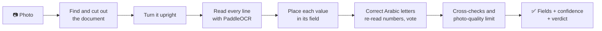

<p align="center">
  
</p>

<h1 align="center">EGY CASH Document Readers</h1>

<p align="center">
  <b>Read Egyptian identity documents from a photo, on your own computer.</b><br>
  National ID Card · EGY CASH ID · Army Exemption Certificate
</p>

<p align="center">
  
  
  
  
  
</p>

<p align="center">
  <a href="#quick-start">Quick start</a> ·
  <a href="#using-the-readers-website">Using it</a> ·
  <a href="#how-it-works">How it works</a> ·
  <a href="#api">API</a> ·
  <a href="#tests-and-checks">Tests</a> ·
  <a href="#privacy-and-security">Privacy</a>
</p>

---

## Highlights

| | |
|---|---|
| 🔒 **Fully offline** | Runs in Docker with PaddleOCR. Photos never leave the computer and are deleted as soon as each read finishes. |
| 🪪 **Three documents, one website** | A page for each document, in English and Arabic, on a computer or a phone. |
| 🎯 **Honest confidence** | Every value is marked High, Check or Low. A poor photo can only lower it. A person confirms before anything is used. |
| 🧭 **Handles real photos** | Finds the document in the photo, turns it upright (even upside down or sideways), and reads past glare, tilt and distance. |
| ✅ **Checks before trusting** | Says whether the photo is the document asked for, and checks that its details agree with each other. |

## What it reads

| Document | Photos | Fields |
|---|---|---|
| **National ID Card** `national_id` | front and/or back | name, national ID number, address, holder photo; occupation, religion, marital status, expiry date. Birth date, sex and governorate are decoded from the number. |
| **EGY CASH ID** `egycash_id` | one | company name, name, job title, employee code, national ID number |
| **Army Exemption Certificate** `army_exemption` | one | name, national ID number, birth date, type of exemption, the reason in short, military number, decision number and date, date written; plus decision code, issuing places, recruitment area and the decision text |

Every answer also says whether the photo shows the document that was asked for: `match`,
`not_match` or `unreadable`, with reasons. This is about what the photo looks like. It never says a
document is genuine; only the issuing authority can confirm that.

## Quick start

> **You need** Docker Desktop (Windows 10/11 or macOS) or Docker Engine (Linux), and Python 3.9+ for
> the start script. 8 GB of RAM is recommended. The first build needs internet and about 5 GB of
> disk; the finished image is about 2.4 GB.

**Windows** (PowerShell, in this folder):

```powershell
powershell -ExecutionPolicy Bypass -File start.ps1
```

**macOS / Linux:**

```bash
chmod +x start.sh
./start.sh
```

The first run builds the image (usually 10 to 30 minutes, depending on the connection); later starts
take 10 to 30 seconds. The script then opens:

| Address | What it is |
|---|---|
| **http://127.0.0.1:8099/readers** | the Readers website, one page per document (served by the OCR service itself) |
| http://127.0.0.1:8101/readers | the same website, through the test-page helper the start script also runs |

<details>
<summary><b>More start options, Docker Compose, and troubleshooting</b></summary>

```
start.ps1 -Stop      stop everything                                   (./start.sh --stop)
start.ps1 -Rebuild   rebuild the image after code changes              (./start.sh --rebuild)
start.ps1 -Phone     let phones on the same Wi-Fi open the test page   (./start.sh --phone)
```

The Windows script is the tested one; `start.sh` does the same steps but has not been tried on a Mac.

With Docker Compose instead (the service alone, which also serves the website at
http://127.0.0.1:8099/readers):

```bash
docker compose up -d --build
```

On Windows, Docker needs virtualization enabled in the BIOS, and Python needs "Add python.exe to
PATH" ticked when it is installed. If Docker Desktop fails with a "Secrets Engine ... engine.sock"
error, quit Docker, run `wsl --shutdown`, and start it again.

</details>

## Using the Readers website

Each document has its own page. On every photo card, **Take photo** opens the phone's camera and
**Upload** picks a saved image (one someone sent, or a screenshot). On a computer, drag the image
onto the card or click it. Then press **Read**: a document usually takes 10 to 20 seconds.

| Band | Meaning |
|---|---|
| 🟢 **High** (90 to 100%) | looks correct |
| 🟡 **Check** (70 to 89%) | probably right; worth a look |
| 🔴 **Low** (below 70%) | needs a person to check it |

This is the reader's own confidence, not a guarantee. A blurry or small photo is capped at Check
even when the text is right, and a very poor one at Low. Best results: flat, good light, no flash
glare, all four corners in view.

- **National ID Card:** the cards are shown as read (cut out and turned upright) with the holder's
  photo, each downloadable.
- **Army Exemption Certificate:** an HR view with the nine main fields, the rest under "More from the
  certificate", and one line on whether the certificate's details agree with each other.

The Arabic text on the pages is a draft and should be reviewed by a native speaker.

<details>
<summary><b>Reaching it from a phone</b></summary>

Both ways put ID photos on your network, so use them only on a network you trust.

**1. The test page, on a trusted Wi-Fi.** Start with `start.ps1 -Phone`; the script prints an
address such as `http://192.168.1.20:8101/readers` to open on the phone. Windows must treat the
Wi-Fi as a Private network, and port 8101 must be allowed once (PowerShell as administrator):

```powershell
New-NetFirewallRule -DisplayName "EGY CASH readers test page" -Direction Inbound -Protocol TCP -LocalPort 8101 -Profile Private -RemoteAddress LocalSubnet -Action Allow
```

Phones only allow the live camera guide on https pages, so this mode also serves
`https://<address>:8443` with a certificate made for this computer (needs openssl, which Git for
Windows includes; allow port 8443 the same way). Over plain http, "Take photo" still opens the
phone's own camera.

**2. The service itself, protected by an access code**, for a network you share with others:

```bash
cp .env.example .env        # then edit .env and choose your own OCR_ACCESS_CODE
docker compose -f docker-compose.yml -f docker-compose.lan.yml up -d --build
```

Open `http://<this computer's address>:8099/readers` on the phone and enter the code once; the phone
stays unlocked for 30 days. Every page and API call except `/health` needs the code, five wrong codes
lock a device out for five minutes, and `/trace` is switched off. The traffic is plain http, so
someone technical on the same network could still capture photos in transit.

</details>

## How it works



**National ID Card and EGY CASH ID** (`extract.py`, `rows.py`, `egycash_id.py`): the card is found
and flattened (`geometry.py`), turned upright by its own layout, the portrait on the front and the
barcode on the back (`orientation.py`), and read line by line. The ID number is read several more
times under different image filters and voted on (`ensemble.py`), and the front's number is
compared with the back's. Arabic letters are corrected against lists of common names and address
words, and fields are cross-checked (`crosscheck.py`) and capped by photo quality (`quality.py`).

**Army Exemption Certificate** (`army_exemption.py`, rules in `profiles/documents/army-exemption.json`):

1. Turned upright by the certificate's own printed words (وزارة الدفاع, تاريخ الميلاد, رقم القرار…),
   which only read correctly the right way up.
2. Each value found by its place in the form's table: beside its label, or in the cell under it.
   The military number's three digit groups are read one group at a time.
3. Names and decision words corrected from word lists; the reason for the exemption summarised.
4. The certificate's parts checked against each other. **Strong checks**, where a failure stops a
   clean `match`: the national ID number is possible; the birth date matches the one inside the
   number; the decision is dated after the birth; the type in the title matches the article it
   cites and the decision's wording; the reason is one the law gives that type for. **Soft checks**,
   shown for a person: the military number starts with the birth year, and the recruitment area is
   the number's governorate.

The military number is shown as **year / markaz / serial**, the order of the official inquiry form
(the paper prints it right to left). To confirm a certificate is real, a person can use the
Recruitment and Mobilization Department's inquiry (tagned.mod.gov.eg); the service never contacts it.

## API

The service listens on `http://127.0.0.1:8099`.

| Method and path | What it does |
|---|---|
| `GET /health` | status, and whether the models are present |
| `GET /types` | the document types (from `src/nidocr/registry.py`) |
| `POST /extract` | read now and answer: `{"documentType", "frontImageBase64", "backImageBase64"}` or `imageBase64` |
| `POST /jobs` | the same body; answers `202` with a `jobId` at once |
| `GET /jobs/<id>`, `GET /jobs/<id>/events` | a job's state, or its changes as server-sent events |
| `POST /read` | any document as plain lines of text: `{"imageBase64"}` |
| `POST /diagnose` | field-box geometry only, no card text |
| `POST /trace` | an HTML page showing every step of one read, with the card's images (debugging) |
| `GET /readers` | the Readers website |

<details>
<summary><b>Response details</b></summary>

`/extract` returns `verdict`, `fields` (value and high/medium/low), `scores` (percentages),
`quality` and `diagnostics`. Add `"returnPortrait": true` for the holder's photo and
`"returnOrientedImages": true` for the cut-out cards. For the Army certificate, `"holder":
{"nationalId", "fullNameAr"}` (from the National ID Card) is checked against the certificate.

```json
"verdict": {"documentType": "egycash_id", "status": "not_match", "reasons": ["looks_like_national_id", "company_name_missing"]}
```

`egycash_badge` is the EGY CASH ID's old name. It still works, and the answer carries a
`deprecation` note.

</details>

<details>
<summary><b>Configuration</b></summary>

Set as environment variables on the container (see `docker-compose.yml`):

| Variable | Default | Effect |
|---|---|---|
| `OCR_PORT` | `8099` | the service's port |
| `OCR_WORKERS` | `0` | reading processes, each with its own models (about 1 GB each); Compose uses `3`, so three reads run at once |
| `OCR_PRELOAD` | `1` | load the models at start rather than on the first read |
| `OCR_ACCESS_CODE` | unset | when set, every route but `/health` needs this code |
| `OCR_TRACE_DISABLED` | unset | `1` turns `/trace` off |
| `OCR_JOB_TTL_SECONDS` | `300` | how long a finished job's answer is kept |
| `OCR_JOB_PARALLEL`, `OCR_JOB_MAX_PENDING` | `6`, `24` | jobs read at once, and queued before `429` |
| `OCR_LAYOUT_PROFILE` | `profiles/egypt-nid.json` in the image | National ID field positions |
| `OCR_EXEMPTION_PROFILE` | `profiles/documents/army-exemption.json` | Army certificate rules |
| `EGYCASH_COMPANY_NAMES`, `EGYCASH_LOGO_MATCH` | built in, `0.55` | EGY CASH ID company names, and logo match strength |
| `LOG_LEVEL` | `INFO` | logging level (logs never contain document values) |

Model switches, all off by default, for testing another recognition model: `PADDLE_REC_MODEL`,
`PADDLE_REC_MODEL_DIR` (load a model from a folder), `PADDLE_REC_VISUAL_ORDER=1` (for a model that
returns right-to-left text backwards) and `PADDLE_ENABLE_MKLDNN=0` (for newer Paddle versions).

</details>

## Tests and checks

The unit tests need no models and no internet:

```bash
pip install opencv-python-headless numpy pytest
python -m pytest -q
```

They use made-up data and generated sample cards (`fixtures/synthetic/`).

<details>
<summary><b>More checks, and measured results on real photos</b></summary>

```bash
make check     # every National ID field box lands on its text, on the synthetic cards
make measure   # the benchmark inside the image, on the synthetic cards
```

`make measure` runs, but its scores no longer mean much: the generated cards print a "PHOTO"
placeholder and no card title, unlike real cards, and the current reader relies on the title and the
portrait. On 2026-10-18 it read most of their names and numbers wrong. Judge accuracy on real photos
until the generator is brought in line with real cards.

The browser tests in `e2e/` (Playwright) are written but need `npm install` in `e2e/` and have not
been run yet.

**Measuring on real photos (local only).** Put photos in `fixtures/real/<folder>/` with a
`manifest.json` of the true values (see `fixtures/README.md`) and run `make measure-real`;
`fixtures/real/` is ignored by git and Docker. Results so far, all on small sets:

- **National ID Card:** on the 14 photos that were failing on 14 October 2026, full name right
  50% → 86% and ID number right 82% → 100%. Photos whose number is not visible now return no number
  instead of a few digits of something else.
- **National ID Card check:** all 22 real card photos tried were recognised as national IDs; a
  driving licence and a Philippine card were not.
- **EGY CASH ID:** on 3 real cards, all three `match`, with no wrong field marked high.
- **Army Exemption Certificate:** on 3 real certificates, each read 7 ways (as is, turned 90°, 180°
  and 270°, tilted, small on a desk, at 1200 px), the turn was right every time; a sharp certificate
  gave 55 of 56 fields right, and a worn, laminated one 5 to 6 of 8, with its misses marked low or
  left out.

These are counts on a handful of photos, not accuracy rates. `bench/stress_make.py` builds harder
scenes from the real photos and `bench/stress_run.py` scores them; the list of source photos is read
from a private file in `fixtures/real/`.

</details>

## Project layout

```
start.ps1, start.sh          start / stop scripts
Dockerfile                   builds the image and downloads the models
docker-compose.yml           runs the service (this computer only)
docker-compose.lan.yml       adds network access with an access code
.env.example                 template for the access code (.env itself is private)
requirements.txt             pinned Python packages used in the image
profiles/                    National ID field positions, Army certificate rules, the EGY CASH logo
src/nidocr/                  the OCR code
tools/                       the Readers website (readers.html, ui/), the test page, generators
tests/                       unit tests
bench/                       accuracy and speed measurement
e2e/                         browser tests (Playwright, not yet run)
fixtures/synthetic/          generated sample cards used by the tests
```

<details>
<summary><b>Main files in <code>src/nidocr/</code></b></summary>

| File | Purpose |
|---|---|
| `service.py` | HTTP service on port 8099 |
| `access.py` | the optional access code |
| `registry.py` | the three document types and their readers |
| `jobs.py`, `pool.py` | background jobs and the reading processes |
| `extract.py` | the National ID Card and EGY CASH ID pipelines |
| `army_exemption.py` | the Army Exemption Certificate reader and its checks |
| `geometry.py` | finds the card's edges and flattens it |
| `orientation.py` | turns a card upright |
| `quality.py` | checks size, blur, glare and contrast |
| `rows.py` | groups text lines into rows and maps rows to fields |
| `engine.py` | the PaddleOCR wrapper |
| `ensemble.py` | reads the ID number several times and votes |
| `nid.py` | ID number rules (birth date, governorate, sex digit) |
| `crosscheck.py` | checks between fields, such as expiry against issue date |
| `lexicon.py`, `governorates.py` | Arabic name, address and governorate lists |
| `postprocess.py` | per-field cleanup (dates, digits, broken words) |
| `portrait.py` | cuts out the holder's photo |
| `document.py` | general document reading for `/read` |
| `verdict.py` | the `match` / `not_match` / `unreadable` answer |

</details>

## Limitations

- Very blurry, tiny or worn photos can lose a digit or letter. These are marked for review rather
  than guessed.
- White or busy backgrounds (a keyboard, for example) make a card's edges harder to find.
- The Army Exemption rules come from three real certificates. More are needed, especially temporary
  exemptions, and the list of exemption reasons comes from a legal summary website rather than the
  official law text, so a lawyer should confirm it.
- About 10 to 20 seconds per document on a laptop CPU.
- The original test page (port 8101) loads its 3D library from a public CDN (jsDelivr). No photos
  are sent, and the rest of the page works offline.

## Privacy and security

- ID photos and their text are personal data. The service keeps photos only while it reads them
  and never logs document values.
- `fixtures/real/` (real photos and their true values) and `.env` (the access code) are excluded
  from git, and `fixtures/real/` is also kept out of the Docker image. Never share them.
- With no access code, the service listens on this computer only. Opening it to a network needs
  `docker-compose.lan.yml` and a code.
- `/trace` shows a card's images and text, for debugging. It is turned off in the network setup; set
  `OCR_TRACE_DISABLED=1` to turn it off anywhere else.

## Credits

Text detection and recognition by [PaddleOCR](https://github.com/PaddlePaddle/PaddleOCR) and
PaddlePaddle (Apache-2.0).

<p align="center"><sub>EGY CASH · Document readers</sub></p>
